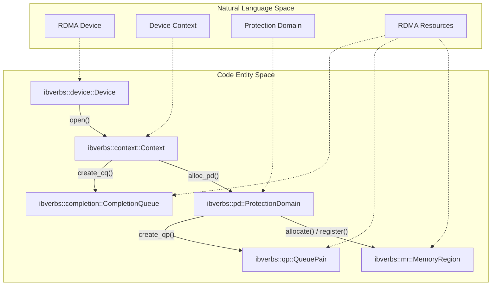
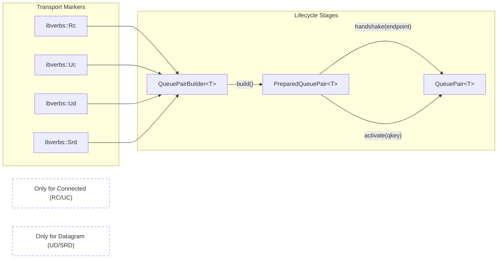

<!-- source: DeepWiki mcp.deepwiki.com · repo jonhoo/rust-ibverbs · page 9 Glossary · fetched 2026-11-11 -->

# Glossary

Relevant source files

The following files were used as context for generating this wiki page:

- [configure-ci.sh](configure-ci.sh)
- [ibverbs-sys/build.rs](ibverbs-sys/build.rs)
- [ibverbs/src/address.rs](ibverbs/src/address.rs)
- [ibverbs/src/completion.rs](ibverbs/src/completion.rs)
- [ibverbs/src/efa.rs](ibverbs/src/efa.rs)
- [ibverbs/src/lib.rs](ibverbs/src/lib.rs)
- [ibverbs/src/mr.rs](ibverbs/src/mr.rs)
- [ibverbs/src/pd.rs](ibverbs/src/pd.rs)
- [ibverbs/src/qp.rs](ibverbs/src/qp.rs)
- [ibverbs/src/rdmacm.rs](ibverbs/src/rdmacm.rs)
- [ibverbs/tests/loopback.rs](ibverbs/tests/loopback.rs)

This page provides technical definitions for RDMA (Remote Direct Memory Access), InfiniBand, and `rust-ibverbs` specific terminology. It serves as a reference for engineers onboarding to the codebase to understand how high-level networking concepts map to specific Rust types and FFI bindings.

## Resource Hierarchy and Lifecycle

The RDMA programming model is hierarchical. Resources are allocated from a parent and must be destroyed in reverse order. `rust-ibverbs` manages this using `Arc` and internal reference counting to ensure safety.

| Term | Definition | Code Entity |
|:---|:---|:---|
| **Device** | A physical or virtual RDMA network adapter (HCA). | [`ibverbs::Device`](ibverbs/src/lib.rs:21-25) |
| **Context** | An open handle to an RDMA device, providing a channel for control operations. | [`ibverbs::Context`](ibverbs/src/lib.rs:14-17) |
| **Protection Domain (PD)** | A container that associates Memory Regions and Queue Pairs, acting as a security boundary. | [`ibverbs::ProtectionDomain`](ibverbs/src/pd.rs:152-154) |
| **Memory Region (MR)** | A block of memory registered with the HCA, pinned in RAM, and assigned a local/remote key. | [`ibverbs::MemoryRegion`](ibverbs/src/mr.rs:79-82) |
| **Queue Pair (QP)** | The fundamental unit of communication, consisting of a Send Queue and a Receive Queue. | [`ibverbs::QueuePair`](ibverbs/src/qp.rs:121-129) |
| **Completion Queue (CQ)** | A FIFO queue where the HCA places Work Completions (WC) after a request is processed. | [`ibverbs::CompletionQueue`](ibverbs/src/completion.rs:24-30) |

### Resource Mapping Diagram
The following diagram bridges the conceptual RDMA resource tree to the specific implementation types in `ibverbs/src/`.

**Sources:** [ibverbs/src/lib.rs:14-17](), [ibverbs/src/pd.rs:149-154](), [ibverbs/src/mr.rs:74-82](), [ibverbs/src/qp.rs:121-129]()

---

## Data Path Terminology

### Work Request (WR) and Completion (WC)
*   **Post Recv:** The act of placing a buffer in the Receive Queue to wait for incoming data. Handled by `QueuePair::post_recv` [ibverbs/src/lib.rs:47-47]().
*   **Post Send:** Initiating a data transfer (Send, Write, Read). Handled via the `SendBatch` builder [ibverbs/src/lib.rs:48-50]().
*   **Doorbell:** A hardware mechanism where the CPU writes to a specific memory-mapped I/O register on the HCA to signal that new Work Requests are ready. `rust-ibverbs` optimizes this via "Doorbell Batching" in `SendBatch::submit` [ibverbs/src/lib.rs:50-50]().
*   **Polling:** Repeatedly checking the `CompletionQueue` for new events without blocking. Done via `CompletionQueue::poll` [ibverbs/src/lib.rs:55-55]().

### Addressing and Routing
*   **GID (Global Identifier):** A 128-bit identifier used for routing RDMA packets, often mirroring an IPv6 address. Wrapped in the `Gid` struct [ibverbs/src/address.rs:33-35]().
*   **LID (Local Identifier):** A 16-bit address used for routing within a local InfiniBand subnet.
*   **Address Handle (AH):** A pre-compiled routing header used for Unreliable Datagram (UD) transfers. Created via `ProtectionDomain::create_address_handle` [ibverbs/src/pd.rs:175-186]().

---

## Transport Types

`rust-ibverbs` uses Rust's type system to enforce transport-specific rules at compile time through the `Transport` trait [ibverbs/src/qp.rs:146-146]().

| Transport | Description | Code Marker |
|:---|:---|:---|
| **RC** | Reliable Connection. Supports Atomics, Reads, and Writes. | [`ibverbs::Rc`](ibverbs/src/qp.rs:165-165) |
| **UC** | Unreliable Connection. Supports Sends and Writes, no ACKs. | [`ibverbs::Uc`](ibverbs/src/qp.rs:171-171) |
| **UD** | Unreliable Datagram. Connectionless, fits in MTU. | [`ibverbs::Ud`](ibverbs/src/qp.rs:177-177) |
| **SRD** | Scalable Reliable Datagram (AWS EFA specific). Reliable but connectionless. | [`ibverbs::Srd`](ibverbs/src/efa.rs:30-30) |

### Transport Logic Flow
This diagram shows how the `QueuePairBuilder` transitions into a connected state based on the transport type.

**Sources:** [ibverbs/src/qp.rs:148-158](), [ibverbs/src/efa.rs:146-160](), [ibverbs/src/lib.rs:31-40]()

---

## Feature-Specific Terms

### RDMA Connection Manager (rdmacm)
A helper library (`librdmacm`) that simplifies connection setup by using IP addresses instead of raw RDMA endpoints.
*   **CmId:** The connection manager identifier, analogous to a socket descriptor. Wrapped as `CmId` [ibverbs/src/rdmacm.rs:51-53]().
*   **Port Space:** The namespace for RDMA identifiers (e.g., `Tcp`, `Udp`). Defined in `PortSpace` [ibverbs/src/rdmacm.rs:89-98]().

### AWS EFA (Elastic Fabric Adapter)
*   **SRD (Scalable Reliable Datagram):** A proprietary AWS transport that provides reliable delivery over multiple paths to avoid head-of-line blocking.
*   **efadv:** The AWS-specific provider library. Bindings are generated in `ibverbs-sys` when the `efa` feature is enabled [ibverbs-sys/build.rs:128-136]().

---

## Internal Codebase Terms

*   **ibverbs-sys:** The low-level crate containing raw FFI bindings generated by `bindgen` from `rdma-core` headers [ibverbs-sys/build.rs:86-90]().
*   **ffi:** A re-export of the `ibverbs-sys` content within the `ibverbs` crate, providing an "escape hatch" for advanced users [ibverbs/src/lib.rs:9-10]().
*   **AccessFlags:** A newtype wrapper for bitmask flags governing memory permissions (e.g., `LOCAL_WRITE`, `REMOTE_READ`) [ibverbs/src/mr.rs:12-41]().
*   **Scatter/Gather Element (SGE):** A pointer and length pair describing a memory segment. Represented as `LocalMemorySlice` in the safe API [ibverbs/src/mr.rs:170-172]().

**Sources:** [ibverbs/src/lib.rs:1-10](), [ibverbs/src/rdmacm.rs:1-18](), [ibverbs/src/efa.rs:1-8](), [ibverbs-sys/build.rs:1-60]()