# Page: Overview

# Overview

<details>
<summary>Relevant source files</summary>

The following files were used as context for generating this wiki page:

- [.gitmodules](.gitmodules)
- [Cargo.toml](Cargo.toml)
- [README.md](README.md)
- [ibverbs/src/lib.rs](ibverbs/src/lib.rs)

</details>


`rust-ibverbs` provides a safe, idiomatic Rust API for RDMA (Remote Direct Memory Access) over InfiniBand, RoCE, and iWARP transports. It wraps the low-level `libibverbs` library from the `rdma-core` project, enabling userspace applications to perform high-throughput, zero-copy network operations without kernel involvement on the data path [ibverbs/src/lib.rs:1-7]().

The library manages the full RDMA lifecycle:
*   **Control Path:** Discovering devices, opening contexts, allocating protection domains, and configuring queue pairs [ibverbs/src/lib.rs:5-7]().
*   **Data Path:** Registering memory regions, posting work requests (Sends, Writes, Reads, Atomics) via doorbell batching, and reaping completions [ibverbs/src/lib.rs:7-8]().

### System Architecture and Code Entities

The following diagram illustrates how high-level RDMA concepts map to specific Rust structs and traits within the codebase.

**Concept to Code Mapping**
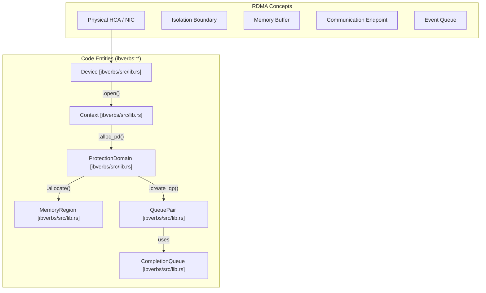
**Sources:** [ibverbs/src/lib.rs:14-17](), [ibverbs/src/lib.rs:107-112]().

---

### Two-Crate Architecture

The project is structured as a Cargo workspace containing two primary crates [Cargo.toml:1-6]():

1.  **`ibverbs-sys`**: The FFI layer. It vendors `rdma-core` as a git submodule and uses `bindgen` to generate raw Rust bindings [ibverbs-sys/vendor/rdma-core](), [.gitmodules:1-3](). It handles the complexities of linking against `libibverbs`, `librdmacm`, and `libefa` [ibverbs/src/lib.rs:88-98]().
2.  **`ibverbs`**: The safe wrapper. It consumes the raw bindings and exposes a type-safe API that enforces RDMA safety invariants at compile time. It re-exports the raw bindings as `ibverbs::ffi` for advanced use cases [ibverbs/src/lib.rs:8-10]().

For a deep dive into the build system and module structure, see **[Crate Architecture](#2)**.

---

### Safety Model and Design Philosophy

RDMA programming is notoriously difficult due to complex lifetime requirements and transport-specific rules. `rust-ibverbs` addresses these through:

*   **Typed Transports:** Queue pairs are generic over a `Transport` trait (e.g., `Rc`, `Uc`, `Ud`). Operations like RDMA Read are only available on `Rc` (Reliable Connection) queue pairs, preventing invalid operations at compile time [ibverbs/src/lib.rs:107-115]().
*   **Resource Lifetimes:** The crate uses internal reference counting (e.g., `Arc`). A `QueuePair` keeps its associated `CompletionQueue` and `ProtectionDomain` alive, preventing use-after-free bugs common in C [ibverbs/src/lib.rs:127-133]().
*   **Posting Contract:** While the library provides safe wrappers, posting work requests remains `unsafe` because the hardware may continue to access the memory buffers until a completion is reaped [ibverbs/src/lib.rs:42-50]().

For details on how these rules are implemented, see **[Safety Model and Design Philosophy](#1.2)**.

---

### Quick Start Example

The typical workflow involves opening a device, setting up resources, and performing a loopback transfer.

```rust
// 1. Open a device context
let ctx = ibverbs::devices()?.iter().next().expect("no device").open()?;

// 2. Setup Completion Queue and Protection Domain
let cq = ctx.create_cq(16).build()?;
let pd = ctx.alloc_pd()?;

// 3. Build and handshake a Queue Pair (RC Transport)
let prepared = pd.create_qp::<ibverbs::Rc>(&cq, &cq, 1)?.build()?;
let endpoint = prepared.endpoint()?;
let mut qp = prepared.handshake(endpoint)?;

// 4. Register memory and post operations
let mut recv = pd.allocate(4096, ibverbs::AccessFlags::PERMISSIVE)?;
let mut send = pd.allocate(4096, ibverbs::AccessFlags::PERMISSIVE)?;
unsafe {
    qp.post_recv([ibverbs::RecvRequest::new(1, &[recv.slice(..)])])?;
    qp.start_send().op().signaled().send(2, &[send.slice(..5)]).submit()?;
}

// 5. Poll for completion
while let Some(mut completions) = cq.poll()? {
    while let Some(wc) = completions.next() {
        wc.ok().expect("success");
    }
}
```
**Sources:** [ibverbs/src/lib.rs:19-65](), [README.md:17-60]().

For instructions on environment setup, including `SoftRoCE` for hardware-less testing, see **[Getting Started](#1.1)**.

---

### Data Path Flow

The diagram below shows the interaction between the `QueuePair`, `CompletionQueue`, and the underlying hardware during a data transfer.

**Work Request Lifecycle**
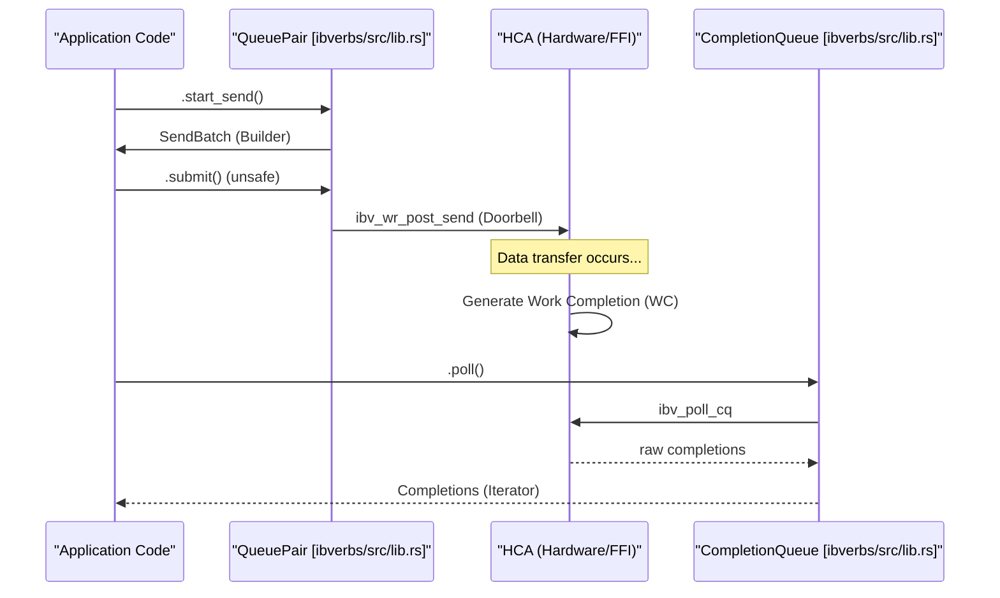
**Sources:** [ibverbs/src/lib.rs:42-61](), [README.md:80-87]().

---

### Feature Support

*   **`rdmacm`**: Optional feature for connection management over IP (TCP-like handshake) [ibverbs/src/lib.rs:81-84]().
*   **`efa`**: Support for AWS Elastic Fabric Adapter and the Scalable Reliable Datagram (`Srd`) transport [ibverbs/src/lib.rs:85-87]().

For more information on these specific features, see **[Optional Features](#6)**.

---

# Page: Getting Started

# Getting Started

<details>
<summary>Relevant source files</summary>

The following files were used as context for generating this wiki page:

- [Cargo.lock](Cargo.lock)
- [README.md](README.md)
- [configure-ci.sh](configure-ci.sh)
- [ibverbs-sys/build.rs](ibverbs-sys/build.rs)
- [ibverbs/Cargo.toml](ibverbs/Cargo.toml)

</details>


This page provides a step-by-step guide for setting up your environment, building the `rust-ibverbs` crate, and running your first RDMA programs. The crate provides a safe wrapper around `libibverbs`, enabling high-performance, zero-copy networking with single-digit microsecond latencies [README.md:8-11]().

## System Requirements

To build and run `rust-ibverbs`, your system must meet the following requirements:

*   **Operating System**: Linux (RDMA verbs are a Linux-specific subsystem).
*   **Rust Toolchain**: Minimum Supported Rust Version (MSRV) is **1.82** [ibverbs/Cargo.toml:5-5]().
*   **C Toolchain**: `cmake` and a C compiler (e.g., `clang` or `gcc`) are required to generate bindings from the vendored `rdma-core` source [ibverbs-sys/build.rs:5-27]().
*   **System Libraries**: You must have `libibverbs` installed to link the final binary. For optional features, `librdmacm` and `libefa` are also required [README.md:121-125]().

### Installing Dependencies (Debian/Ubuntu)

```bash
sudo apt-get update
sudo apt-get install libibverbs1 libibverbs-dev librdmacm1 librdmacm-dev clang cmake
```
*Sources: [configure-ci.sh:5-11]()*

## Building the Crate

The project uses a two-crate architecture: `ibverbs-sys` (low-level FFI) and `ibverbs` (safe API) [ibverbs/Cargo.toml:27-27]().

### Default Build (Vendored Headers)
By default, the build script in `ibverbs-sys` will:
1.  Initialize the `rdma-core` git submodule [ibverbs-sys/build.rs:29-44]().
2.  Run `cmake` to configure the source and generate the necessary header tree [ibverbs-sys/build.rs:5-27]().
3.  Use `bindgen` to create Rust FFI definitions from `verbs.h` [ibverbs-sys/build.rs:88-91]().
4.  Link against the system's `libibverbs` [ibverbs-sys/build.rs:47-47]().

### Custom Header and Library Paths
If you wish to use specific pre-built headers or libraries instead of the vendored submodule, set the following environment variables:

| Variable | Purpose |
| :--- | :--- |
| `RDMA_CORE_INCLUDE_DIR` | Path to the `rdma-core` include directory (containing `infiniband/verbs.h`). |
| `RDMA_CORE_LIB_DIR` | Path to the directory containing `libibverbs.so`. |

*Sources: [ibverbs-sys/build.rs:61-69]()*

## Cargo Features

The crate provides optional functionality through Cargo features. These are disabled by default to minimize dependencies [ibverbs/Cargo.toml:32-33]().

| Feature | Description | Linkage |
| :--- | :--- | :--- |
| `rdmacm` | Enables the RDMA Connection Manager for IP-based connection setup [ibverbs/Cargo.toml:37-37](). | `-lrdmacm` [ibverbs-sys/build.rs:58-58]() |
| `efa` | Enables AWS Elastic Fabric Adapter SRD queue pairs [ibverbs/Cargo.toml:35-35](). | `-lefa` [ibverbs-sys/build.rs:52-52]() |

To enable a feature, add it to your `Cargo.toml`:
```toml
[dependencies]
ibverbs = { version = "0.9.2", features = ["rdmacm"] }
```

## Data Flow and Component Architecture

The following diagram illustrates the relationship between the system libraries, the FFI layer, and the safe Rust API.

### Build and Linkage Architecture
"Code Entity Space" mapping to "System Space".

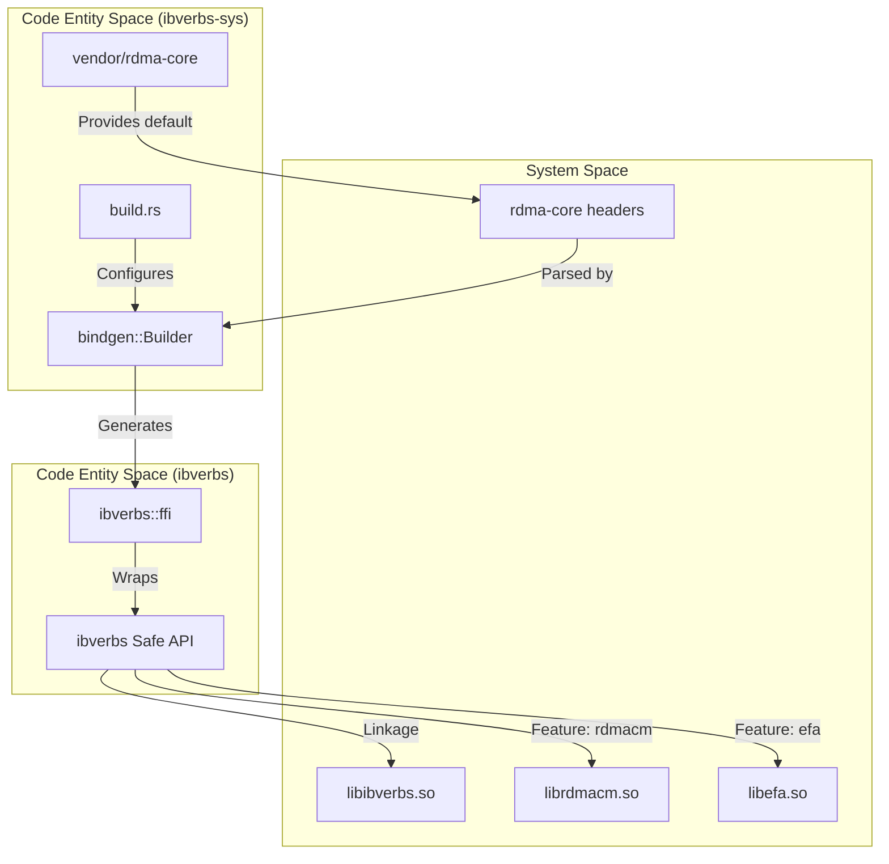
*Sources: [ibverbs-sys/build.rs:46-60](), [ibverbs-sys/build.rs:88-115](), [ibverbs/Cargo.toml:27-27]()*

## Testing Without Hardware (SoftRoCE)

If you do not have RDMA-capable hardware (like NVIDIA/Mellanox ConnectX or AWS EFA), you can use **SoftRoCE (`rdma_rxe`)**. This is a software implementation of RoCE v2 that runs over standard Ethernet interfaces.

### Setting up SoftRoCE
1.  **Load the kernel module**:
    ```bash
    sudo modprobe rdma_rxe
    ```
2.  **Create a virtual device**:
    Identify your ethernet interface (e.g., `eth0`) and map a new RXE device to it:
    ```bash
    sudo rdma link add rxe0 type rxe netdev eth0
    ```
3.  **Verify the device**:
    The device should now appear in the list of available verbs devices:
    ```bash
    ibv_devinfo
    ```

### Running Examples
Once the device is set up, you can run the provided examples. Use the `IBVERBS_TEST_DEVICE` environment variable to specify which device to use if multiple are present.

```bash
# Run the basic loopback example
cargo run --example loopback

# Run the RDMA CM example (requires rdmacm feature)
cargo run --features rdmacm --example rdmacm_connect
```
*Sources: [README.md:62-66](), [ibverbs/Cargo.toml:39-46]()*

## Resource Lifecycle Overview

The crate uses `Arc`-based reference counting to manage the complex lifetime requirements of RDMA resources [README.md:98-100]().

### Initialization Sequence
The following diagram shows the typical flow for initializing an RDMA connection.

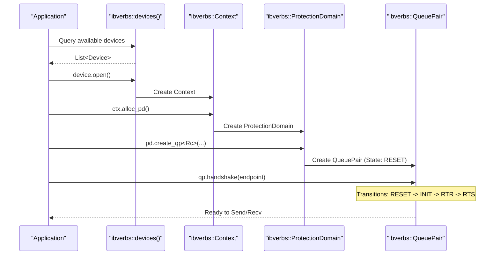
*Sources: [README.md:20-37](), [README.md:74-76]()*

### Key Initialization Code Entities
*   `ibverbs::devices()`: Entry point to discover hardware [README.md:21-21]().
*   `Context`: A handle to an opened RDMA device [README.md:21-21]().
*   `ProtectionDomain`: A container that isolates Memory Regions and Queue Pairs [README.md:24-24]().
*   `QueuePairBuilder`: A type-safe builder for configuring transport-specific QPs (RC, UC, UD, or SRD) [README.md:28-31]().

*Sources: [README.md:20-40](), [README.md:69-73]()*

---

# Page: Safety Model and Design Philosophy

# Safety Model and Design Philosophy

<details>
<summary>Relevant source files</summary>

The following files were used as context for generating this wiki page:

- [ibverbs-sys/src/lib.rs](ibverbs-sys/src/lib.rs)
- [ibverbs/src/error.rs](ibverbs/src/error.rs)
- [ibverbs/src/lib.rs](ibverbs/src/lib.rs)

</details>


The `rust-ibverbs` crate provides a safe abstraction over the RDMA "verbs" API (`libibverbs`). The design philosophy focuses on encoding the complex, often implicit, contracts of RDMA into Rust's type system to prevent common pitfalls such as use-after-free, data races, and invalid state transitions, while maintaining the zero-overhead performance required for high-throughput networking [ibverbs/src/lib.rs:1-10]().

## Transport-Typed Queue Pairs

RDMA supports multiple transport protocols (Reliable Connected, Unreliable Datagram, etc.), each supporting a different subset of operations. `rust-ibverbs` uses the `Transport` trait and marker types to ensure that only valid operations can be called on a specific `QueuePair` at compile time [ibverbs/src/lib.rs:107-116]().

| Transport Type | Supported Operations | Code Entity |
| :--- | :--- | :--- |
| **RC** (Reliable Connected) | Send/Recv, RDMA Read/Write, Atomics | `ibverbs::Rc` |
| **UC** (Unreliable Connected) | Send/Recv, RDMA Write | `ibverbs::Uc` |
| **UD** (Unreliable Datagram) | Datagram Send/Recv | `ibverbs::Ud` |
| **SRD** (Scalable Reliable Datagram) | Reliable Datagram (EFA specific) | `ibverbs::Srd` |

### Code Entity Mapping: Transport Operations
The following diagram illustrates how the `QueuePair` methods are gated by the `Transport` trait implementations.

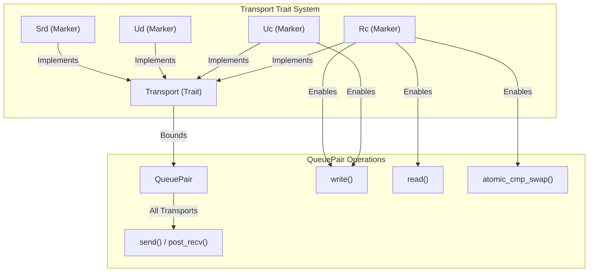
Sources: [ibverbs/src/lib.rs:107-116](), [ibverbs/src/error.rs:109-115]()

## Resource Lifetimes and Reference Counting

RDMA resources have strict hierarchical dependencies. For example, a `QueuePair` (QP) cannot be destroyed before its associated `CompletionQueue` (CQ), and a CQ cannot be destroyed before the `Context` that created it. `rust-ibverbs` manages these lifetimes using `Arc`-based internal reference counting [ibverbs/src/lib.rs:127-133]().

- **Automatic Cleanup**: Resources implement `Drop` to return handles to the device [ibverbs/src/lib.rs:129-130]().
- **Dependency Ordering**: Internal pointers ensure that parent resources (like `ProtectionDomain`) outlive their children (like `MemoryRegion`) [ibverbs/src/lib.rs:129-131]().
- **Panic on Failure**: If the device rejects a teardown (typically due to leaked raw handles), the crate panics to prevent silent resource leaks [ibverbs/src/lib.rs:131-133]().

## The Unsafe Posting Contract

While the control path is largely safe, the data path involves `unsafe` contracts due to the asynchronous nature of RDMA hardware. When a user posts a Work Request (WR), the hardware takes ownership of the memory buffers until a corresponding Work Completion (WC) is reaped from the `CompletionQueue` [ibverbs/src/lib.rs:42-50]().

The crate marks `post_recv` and `batch.submit()` as `unsafe` because the compiler cannot verify that the user won't modify the underlying memory while the HCA (Host Channel Adapter) is accessing it [ibverbs/src/lib.rs:47-50]().

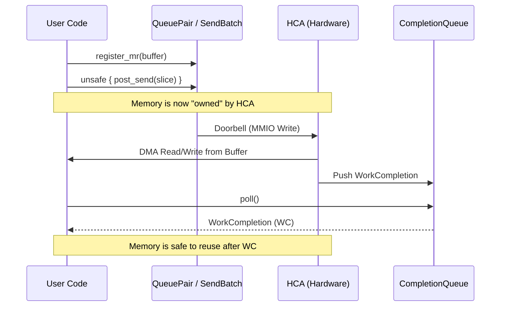
Sources: [ibverbs/src/lib.rs:42-61](), [ibverbs-sys/src/lib.rs:78-85]()

## Design Patterns

### Flags Newtype Macro
The crate uses a `flags_newtype!` macro to provide type-safe bitflags for various ibverbs constants (e.g., `AccessFlags`, `QueuePairAttributeMask`). This prevents passing incorrect bitmasks to FFI functions and provides a clean API for bitwise operations [ibverbs/src/error.rs:3-4](), [ibverbs/src/error.rs:130-138]().

### The Escape Hatch Pattern
Every safe wrapper in the crate provides an `as_raw` method, and the underlying `ibverbs::ffi` (from `ibverbs-sys`) is re-exported [ibverbs/src/lib.rs:8-10](). This allows users to:
1. Access hardware-specific features not yet wrapped by the safe API.
2. Interface with other C libraries that expect raw `ibv_*` pointers.
3. Perform manual resource management when the `Arc`-based model is too restrictive.

### Error Handling
Errors are unified into a single `Error` enum that wraps `io::Error` (errno) and provides context-specific variants like `Unsupported` or `InvalidQueuePairTransition` [ibverbs/src/error.rs:22-28](), [ibverbs/src/error.rs:123-128]().

Sources: [ibverbs/src/lib.rs:1-10](), [ibverbs/src/error.rs:1-180](), [ibverbs-sys/src/lib.rs:1-55]()

---

# Page: Crate Architecture

# Crate Architecture

<details>
<summary>Relevant source files</summary>

The following files were used as context for generating this wiki page:

- [.gitmodules](.gitmodules)
- [Cargo.lock](Cargo.lock)
- [Cargo.toml](Cargo.toml)
- [ibverbs-sys/Cargo.toml](ibverbs-sys/Cargo.toml)
- [ibverbs/Cargo.toml](ibverbs/Cargo.toml)

</details>


The `rust-ibverbs` project is structured as a Cargo workspace consisting of two primary crates: `ibverbs-sys` and `ibverbs`. This separation follows the standard Rust idiom for FFI bindings, isolating the unsafe, low-level C interface from the safe, idiomatic Rust wrapper.

### Workspace Structure

The project uses a two-tier architecture to bridge the gap between the Linux kernel's RDMA subsystem and safe Rust code.

| Crate | Role | Description |
| :--- | :--- | :--- |
| `ibverbs-sys` | **FFI Layer** | Raw, unsafe bindings generated from `rdma-core`. Handles linking and C header mapping. |
| `ibverbs` | **Safe API Layer** | High-level Rust abstractions, resource management (RAII), and type-safe RDMA operations. |

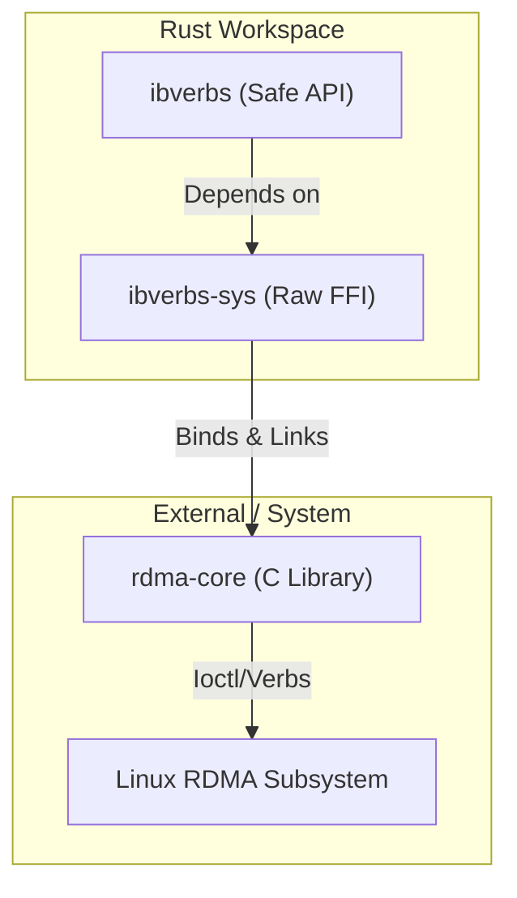
**Sources:** [Cargo.toml:1-6](), [ibverbs/Cargo.toml:27-27]()

---

### ibverbs-sys: FFI Bindings Layer

The `ibverbs-sys` crate provides the foundational bindings to the `libibverbs` library and its providers. It vendors `rdma-core` as a git submodule to ensure reproducible builds and consistent header availability.

*   **Build Process**: The `build.rs` script utilizes `bindgen` to generate Rust definitions from C headers and `cmake` to potentially compile parts of the vendored library.
*   **Feature Gating**: Optional components like `librdmacm` (Connection Manager) and `libefa` (AWS EFA provider) are gated behind Cargo features to minimize dependency bloat for users who do not require them.
*   **Submodule**: The source of truth for the C headers is located at `ibverbs-sys/vendor/rdma-core`.

For details, see [ibverbs-sys: FFI Bindings Layer](#2.1).

**Sources:** [ibverbs-sys/Cargo.toml:13-14](), [ibverbs-sys/Cargo.toml:30-36](), [.gitmodules:1-4]()

---

### ibverbs: Safe API Layer

The `ibverbs` crate wraps the raw pointers and unsafe functions from `ibverbs-sys` into a cohesive, type-safe hierarchy. It is designed around the "Control-Path vs. Data-Path" split:

1.  **Control-Path**: Uses Rust's ownership model (`Arc`, `Drop`) to manage the complex lifecycle of RDMA resources (Devices, Contexts, Protection Domains).
2.  **Data-Path**: Provides optimized interfaces for posting Work Requests (WR) and polling Completion Queues (CQ), minimizing overhead while maintaining memory safety.

#### Module Organization
The crate is organized into modules that correspond to RDMA entities:
*   `device` & `context`: Hardware discovery and entry points.
*   `pd` & `mr`: Memory protection and registration.
*   `qp` & `srq`: Communication endpoints and shared receive queues.
*   `completion`: Polling and event-driven work completion.
*   `rdmacm` & `efa`: Optional extensions for connection management and specialized hardware.

For details, see [ibverbs: Safe API Layer](#2.2).

**Sources:** [ibverbs/Cargo.toml:32-37](), [ibverbs/Cargo.toml:27-27]()

---

### Resource Dependency Graph

The following diagram illustrates how the safe Rust entities in `ibverbs` relate to one another and the underlying raw types in `ibverbs-sys`.

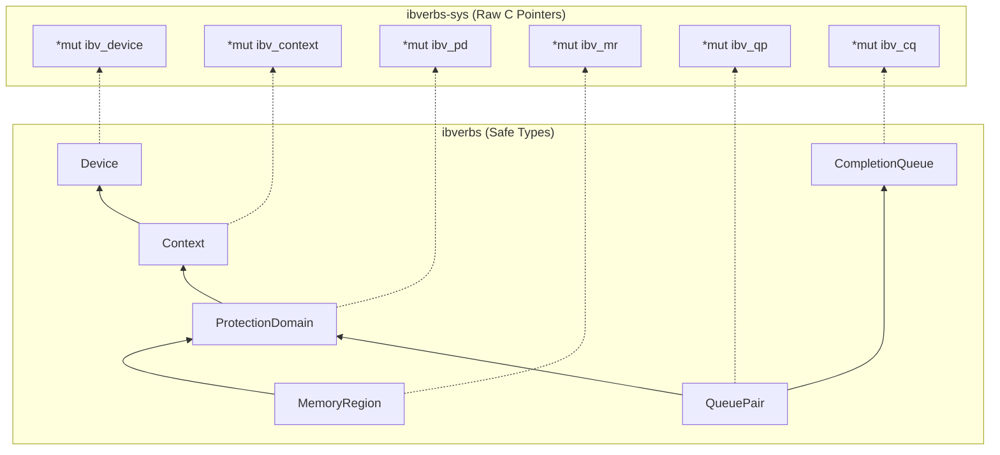

**Sources:** [ibverbs/Cargo.toml:2-7](), [ibverbs-sys/Cargo.toml:2-7]()

---

# Page: ibverbs-sys: FFI Bindings Layer

# ibverbs-sys: FFI Bindings Layer

<details>
<summary>Relevant source files</summary>

The following files were used as context for generating this wiki page:

- [configure-ci.sh](configure-ci.sh)
- [ibverbs-sys/Cargo.toml](ibverbs-sys/Cargo.toml)
- [ibverbs-sys/build.rs](ibverbs-sys/build.rs)
- [ibverbs-sys/empty.c](ibverbs-sys/empty.c)
- [ibverbs-sys/src/lib.rs](ibverbs-sys/src/lib.rs)

</details>


The `ibverbs-sys` crate provides the low-level Foreign Function Interface (FFI) bindings to the `rdma-core` userspace libraries. It serves as the foundational layer for the `ibverbs` crate, translating C-style headers into Rust-compatible types and function signatures.

## Purpose and Scope

`ibverbs-sys` is responsible for:
1.  **Binding Generation**: Using `bindgen` to create Rust representations of `libibverbs`, `librdmacm`, and `libefa`.
2.  **Vendoring**: Maintaining a specific version of `rdma-core` via a git submodule to ensure header consistency [ibverbs-sys/Cargo.toml:24-24]().
3.  **Linkage Management**: Handling the linking of system or vendored libraries based on environment variables and Cargo features [ibverbs-sys/build.rs:46-77]().

## Build Process and Bindgen Strategy

The crate uses a `build.rs` script to orchestrate the generation of bindings. It supports two primary modes: using system-installed headers/libraries or building against the vendored `rdma-core` submodule.

### Build Workflow

The build script follows a specific logic to locate headers and libraries:
1.  **Submodule Initialization**: If the vendored source is missing and a `.git` directory exists, it initializes the `rdma-core` submodule [ibverbs-sys/build.rs:29-44]().
2.  **Header Discovery**: It checks for `RDMA_CORE_INCLUDE_DIR`. If not set, it defaults to the build directory of the vendored submodule [ibverbs-sys/build.rs:61-77]().
3.  **CMake Configuration**: When using the vendored source, `cmake` is invoked to generate the include tree. The script sets `CMAKE_INSTALL_PREFIX` to `/usr` to avoid path length limitations on certain platforms (like docs.rs) [ibverbs-sys/build.rs:7-22]().

### Bindgen Configuration

The `bindgen::Builder` is configured with strict allowlists to prevent pollution of the global namespace while ensuring all necessary RDMA types are available.

| Strategy | Target Pattern / Entity | Reasoning |
| :--- | :--- | :--- |
| **Allowlist Function** | `ibv_.*`, `_ibv_.*` | Captures all standard ibverbs entry points [ibverbs-sys/build.rs:91-92](). |
| **Allowlist Type** | `ibv_.*`, `verbs_context` | `verbs_context` is required for dispatching through provider op tables [ibverbs-sys/build.rs:93-96](). |
| **Blocklist Type** | `ibv_wc` | Blocked to allow a manual, more ergonomic implementation in `src/lib.rs` [ibverbs-sys/build.rs:125-125](). |
| **Bitfield Enums** | `ibv_access_flags`, `ibv_send_flags`, etc. | Forces `bindgen` to treat these as bitfields rather than strict enums [ibverbs-sys/build.rs:101-117](). |

### C-to-Rust Entity Mapping

The following diagram illustrates how the build system bridges the gap between the C source files in `rdma-core` and the generated Rust code.

**Binding Generation Data Flow**
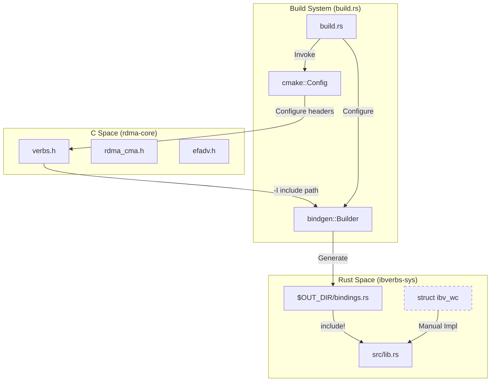
**Sources:** [ibverbs-sys/build.rs:88-154](), [ibverbs-sys/src/lib.rs:8-13]()

## Feature-Gated Linkage

`ibverbs-sys` supports optional RDMA extensions through Cargo features. These features affect both the generated bindings and the final linker flags.

*   **`efa`**: Enables AWS Elastic Fabric Adapter support. It includes `<infiniband/efadv.h>` and links against `libefa` [ibverbs-sys/build.rs:49-53](), [ibverbs-sys/build.rs:128-136]().
*   **`rdmacm`**: Enables the RDMA Connection Manager. It includes `<rdma/rdma_cma.h>` and links against `librdmacm` [ibverbs-sys/build.rs:55-59](), [ibverbs-sys/build.rs:138-145]().

**Linkage Logic**
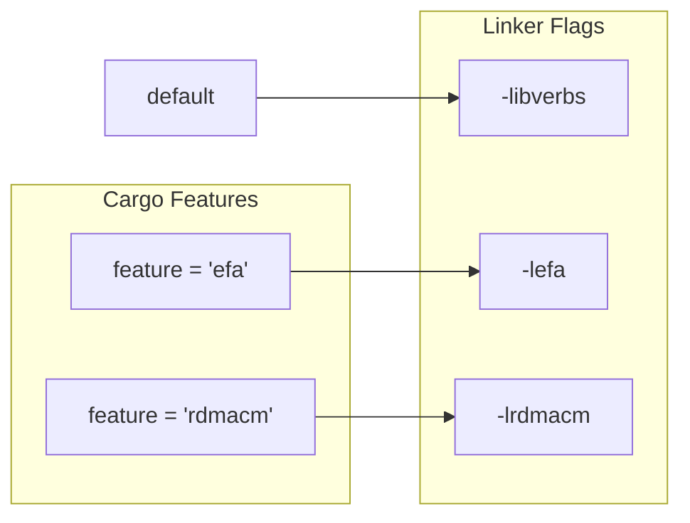
**Sources:** [ibverbs-sys/build.rs:47-59](), [ibverbs-sys/Cargo.toml:30-36]()

## Manual Implementation: `ibv_wc`

While most types are generated, `ibv_wc` (Work Completion) is manually defined in `src/lib.rs` [ibverbs-sys/src/lib.rs:13-55](). This is done to provide a stable, documented, and more "Rust-friendly" interface for the performance-critical data path.

The manual implementation includes:
*   **`wr_id()`**: Accessor for the 64-bit work request ID [ibverbs-sys/src/lib.rs:60-62]().
*   **`len()`**: Returns the number of bytes transferred, accounting for the 40-byte GRH header in UD QPs [ibverbs-sys/src/lib.rs:74-76]().
*   **`is_valid()`**: Helper to check for `IBV_WC_SUCCESS` [ibverbs-sys/src/lib.rs:83-85]().

## CI Hybrid Approach: `configure-ci.sh`

In Continuous Integration environments, the project uses a "hybrid" approach to ensure both header correctness and linkage compatibility. The `configure-ci.sh` script automates this setup.

1.  **System Library Installation**: It installs `libibverbs-dev` and `librdmacm-dev` to provide the shared libraries for linking [configure-ci.sh:8-8]().
2.  **Vendored Header Configuration**: It runs `cmake` on the submodule to generate the `rdma-core` header tree [configure-ci.sh:22-23]().
3.  **Environment Mapping**: It sets `RDMA_CORE_INCLUDE_DIR` to point to the **vendored** build path, but sets `RDMA_CORE_LIB_DIR` to the **system** library path (`/usr/lib/x86_64-linux-gnu`) [configure-ci.sh:35-36]().

This ensures that the crate is tested against the specific version of headers it vendors while remaining compatible with the host's dynamic linker environment.

**Sources:** [configure-ci.sh:1-38]()

---

# Page: ibverbs: Safe API Layer

# ibverbs: Safe API Layer

<details>
<summary>Relevant source files</summary>

The following files were used as context for generating this wiki page:

- [ibverbs/src/context.rs](ibverbs/src/context.rs)
- [ibverbs/src/device.rs](ibverbs/src/device.rs)
- [ibverbs/src/error.rs](ibverbs/src/error.rs)
- [ibverbs/src/lib.rs](ibverbs/src/lib.rs)

</details>


The `ibverbs` crate provides a high-level, memory-safe abstraction over the RDMA control and data paths. While the underlying `ibverbs-sys` crate exposes raw C bindings, the safe API layer uses Rust's type system to enforce RDMA resource lifetimes, transport-specific operation rules, and thread-safety contracts.

### Module Structure and Responsibility

The crate is organized into modules that correspond to RDMA resources and concepts. Every resource wrapper provides an `as_raw` method to access the underlying FFI handle, and the crate re-exports `ibverbs::ffi` for direct access to the raw bindings [ibverbs/src/lib.rs:9-10]().

| Module | Primary Responsibility | Key Entities |
| :--- | :--- | :--- |
| `device` | Discovery and enumeration of HCA hardware. | `Device`, `DeviceList` |
| `context` | Opening a device and querying its global state. | `Context` |
| `pd` | Memory protection and resource isolation. | `ProtectionDomain` |
| `mr` | Memory registration and slice management. | `MemoryRegion`, `LocalMemorySlice` |
| `qp` | Connection state machine and data path. | `QueuePair`, `QueuePairBuilder` |
| `completion` | Handling work completions (polling/events). | `CompletionQueue`, `CompletionChannel` |
| `address` | GID/LID routing and UD address handles. | `Gid`, `AddressHandle` |
| `srq` | Shared receive resource management. | `SharedReceiveQueue` |
| `error` | Specialized RDMA error types and errno mapping. | `Error`, `Result` |
| `efa` | AWS-specific SRD transport extensions. | `Srd` transport marker |
| `rdmacm` | IP-based connection management (optional). | `CmId`, `Connector`, `Acceptor` |

**Sources:** [ibverbs/src/lib.rs:5-10](), [ibverbs/src/lib.rs:80-87]()

### Resource Hierarchy and Dependency Flow

RDMA resources follow a strict hierarchical ownership model. The safe API uses `Arc` and internal reference counting to ensure that parent resources (like a `Context`) are not dropped before their children (like a `QueuePair`).

#### System Entity Mapping: Resource Lifecycle
The following diagram maps RDMA system resources to their corresponding Rust structs and illustrates the creation flow.

```mermaid
graph TD
    subgraph "Hardware/OS Space"
        DEV_LIST["ibv_device** (List)"]
        DEV["ibv_device*"]
        RAW_CTX["ibv_context*"]
    end

    subgraph "Code Entity Space (ibverbs crate)"
        DL["DeviceList"]
        D["Device"]
        C["Context"]
        PD["ProtectionDomain"]
        CQ["CompletionQueue"]
        QP["QueuePair<T>"]
        MR["MemoryRegion"]
    end

    DL -- "iter()" --> D
    D -- "open()" --> C [ibverbs/src/device.rs:188-190]
    C -- "alloc_pd()" --> PD [ibverbs/src/context.rs:218-220]
    C -- "create_cq()" --> CQ [ibverbs/src/context.rs:174-180]
    PD -- "create_qp()" --> QP [ibverbs/src/pd.rs:114-118]
    PD -- "allocate()" --> MR [ibverbs/src/pd.rs:152-154]

    DEV_LIST -. "wraps" .-> DL
    DEV -. "wraps" .-> D
    RAW_CTX -. "wraps" .-> C
```
**Sources:** [ibverbs/src/device.rs:188-190](), [ibverbs/src/context.rs:218-220](), [ibverbs/src/pd.rs:114-118](), [ibverbs/src/pd.rs:152-154]()

### Transport-Typed Queue Pairs

A key safety feature of the crate is the use of marker traits to type `QueuePair` instances by their transport protocol (RC, UC, UD, or SRD). This prevents calling RDMA Read on a UD transport at compile time.

*   **`Rc` (Reliable Connected):** Supports Send/Recv, RDMA Read/Write, and Atomics [ibverbs/src/lib.rs:109-110]().
*   **`Uc` (Unreliable Connected):** Supports Send/Recv and RDMA Write [ibverbs/src/lib.rs:110-111]().
*   **`Ud` (Unreliable Datagram):** Supports Send/Recv using `AddressHandle` [ibverbs/src/lib.rs:110-111]().
*   **`Srd` (Scalable Reliable Datagram):** Specific to AWS EFA hardware [ibverbs/src/lib.rs:110-112]().

### Error Handling and Diagnostics

The `ibverbs::Error` enum provides structured access to failures. It distinguishes between standard OS `errno` returns and high-level RDMA logic errors, such as invalid state transitions or mismatched GID configurations.

| Error Variant | Cause | Wrapped FFI Call |
| :--- | :--- | :--- |
| `Unsupported` | Feature not provided by HCA. | `EOPNOTSUPP` |
| `PortNotActive` | Port state is not ARMED/ACTIVE. | `ibv_query_port` [ibverbs/src/context.rs:64-70]() |
| `InvalidQueuePairTransition` | Illegal QP state change. | `ibv_modify_qp` [ibverbs/src/error.rs:122-128]() |
| `PostSend` / `PostReceive` | Failure to enqueue work. | `ibv_post_send` / `ibv_post_recv` [ibverbs/src/error.rs:161-167]() |

**Sources:** [ibverbs/src/error.rs:24-176](), [ibverbs/src/context.rs:64-70]()

### Implementation Detail: The Data Path

The data path is designed for zero-overhead performance while maintaining safety. Posting work requests is `unsafe` because the user must guarantee the underlying memory remains valid until the completion is reaped.

#### Entity Interaction: Posting and Polling
This diagram shows the flow of work requests from the `QueuePair` to the `CompletionQueue`.

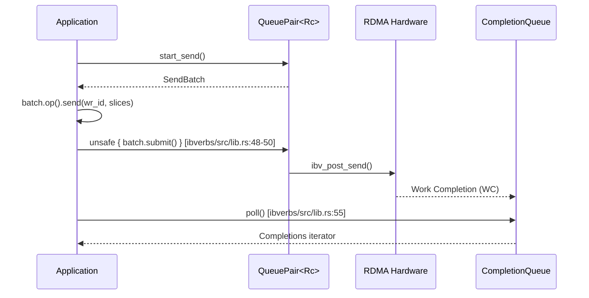
**Sources:** [ibverbs/src/lib.rs:42-61](), [ibverbs/src/error.rs:161-171]()

### Thread Safety and Ownership

*   **`Send` / `Sync`:** Handles like `Context`, `ProtectionDomain`, and `CompletionQueue` are thread-safe and can be shared [ibverbs/src/lib.rs:119-121]().
*   **Mutable Access:** Posting to a `QueuePair` requires `&mut QueuePair`, ensuring that only one thread can post to a specific queue at a time without external synchronization [ibverbs/src/lib.rs:122-123]().
*   **Lifetime Constraints:** `WorkCompletion` objects and `Completions` iterators borrow the `CompletionQueue`, preventing the queue from being dropped while results are being processed [ibverbs/src/lib.rs:124-126]().

**Sources:** [ibverbs/src/lib.rs:117-126](), [ibverbs/src/context.rs:91-92]()

---

# Page: Core RDMA Concepts and Resource Lifecycle

# Core RDMA Concepts and Resource Lifecycle

<details>
<summary>Relevant source files</summary>

The following files were used as context for generating this wiki page:

- [ibverbs/src/context.rs](ibverbs/src/context.rs)
- [ibverbs/src/device.rs](ibverbs/src/device.rs)
- [ibverbs/src/lib.rs](ibverbs/src/lib.rs)

</details>


This page explains the fundamental RDMA resource hierarchy and how `rust-ibverbs` manages the lifecycle of these resources. The crate uses a reference-counted architecture to ensure that hardware resources are released in the correct order, preventing use-after-free bugs and hardware hangs.

## Resource Hierarchy

RDMA resources are organized in a strict parent-child hierarchy. Every resource depends on its parent remaining valid. In `rust-ibverbs`, this is enforced through `Arc`-based reference counting and the Rust ownership model.

### Code Entity Relationship

The following diagram illustrates how the logical RDMA hierarchy maps to specific types within the `ibverbs` crate.

**RDMA Resource Mapping**
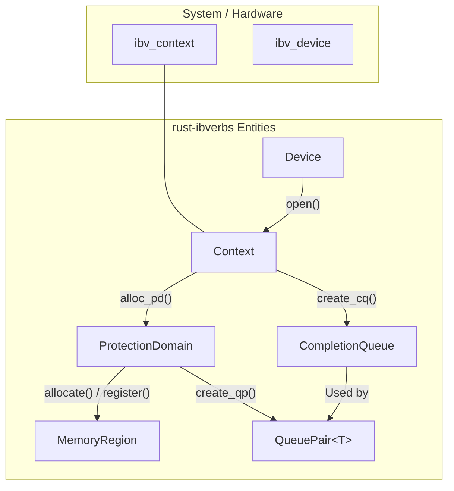
**Sources:**
- `ibverbs/src/lib.rs:14-17`
- `ibverbs/src/device.rs:89-90`
- `ibverbs/src/context.rs:94-102`
- `ibverbs/src/pd.rs:37-41`

---

## Device Discovery and Context

The entry point to any RDMA application is discovering hardware via `ibverbs::devices()` and opening a `Context`. A `Context` represents a specific user-space connection to an RDMA device.

- **Discovery**: `DeviceList` provides an iterator over available `Device` handles.
- **Context**: Opening a `Device` produces a `Context`, which is the root of the resource tree.
- **Attributes**: The `Context` allows querying device capabilities (e.g., `query_device`, `query_port`) and handling asynchronous hardware events.

For details, see [Device Discovery and Context](#3.1).

**Sources:**
- `ibverbs/src/device.rs:14-27`
- `ibverbs/src/context.rs:118-135`
- `ibverbs/src/context.rs:242-246`

---

## Protection Domains and Memory Regions

A `ProtectionDomain` (PD) acts as a container that groups RDMA resources (Queue Pairs, Memory Regions) to control access.

- **Memory Isolation**: A `MemoryRegion` (MR) must be registered with a `ProtectionDomain`. The hardware will only allow RDMA operations on memory if the MR and the Queue Pair (QP) share the same PD.
- **Registration**: Memory must be "pinned" and registered with the HCA before it can be used for zero-copy transfers.

For details, see [Protection Domain and Memory Regions](#3.2).

**Sources:**
- `ibverbs/src/pd.rs:80-84`
- `ibverbs/src/pd.rs:175-180`
- `ibverbs/src/lib.rs:42-45`

---

## Addressing and GIDs

RDMA uses specialized addressing schemes to route traffic across the fabric, especially for RoCE (RDMA over Converged Ethernet).

- **GIDs**: Global Identifiers used for routing. The `Context` provides access to the `gid_table`.
- **Address Handles**: For connectionless transports (UD/SRD), an `AddressHandle` must be created to define the destination for each packet.

For details, see [Addressing: GIDs, LIDs, and Address Handles](#3.3).

**Sources:**
- `ibverbs/src/context.rs:462-466`
- `ibverbs/src/address.rs:11-20`

---

## Lifecycle and Drop Ordering

RDMA hardware is sensitive to the order in which resources are destroyed. For example, a `ProtectionDomain` cannot be deallocated while a `MemoryRegion` still references it.

### Automatic Teardown Logic

`rust-ibverbs` manages this using `Arc<Inner>` patterns. When you create a child resource (like a `QueuePair`), it holds an `Arc` to its parent (the `ProtectionDomain` and `CompletionQueue`).

**Resource Lifetime Flow**
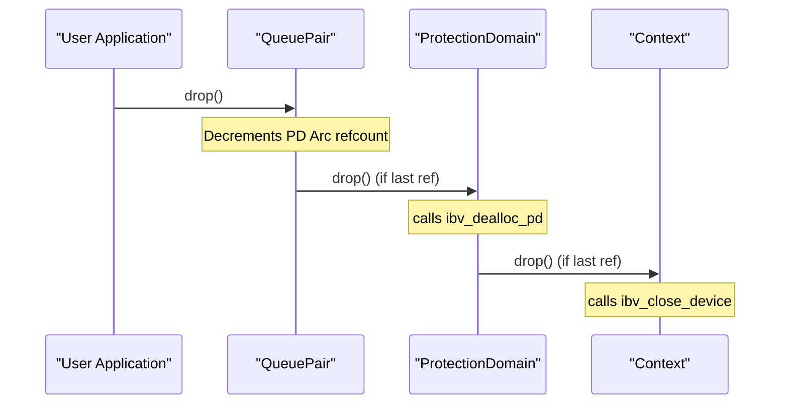

- **Drop Order**: Resources are returned to the device in dependency order.
- **Safety**: If the device rejects a teardown (usually due to raw handles still being held via `as_raw` escape hatches), the crate will `panic!` rather than risk a silent memory leak or hardware corruption.

**Sources:**
- `ibverbs/src/lib.rs:127-133`
- `ibverbs/src/context.rs:74-89`
- `ibverbs/src/pd.rs:56-69`

---

# Page: Device Discovery and Context

# Device Discovery and Context

<details>
<summary>Relevant source files</summary>

The following files were used as context for generating this wiki page:

- [ibverbs/src/address.rs](ibverbs/src/address.rs)
- [ibverbs/src/context.rs](ibverbs/src/context.rs)
- [ibverbs/src/device.rs](ibverbs/src/device.rs)

</details>


This page details the initial phase of any RDMA application: discovering hardware and establishing a communication context. In `rust-ibverbs`, this involves iterating through system devices, opening a persistent context, and querying the specific capabilities of the hardware and its ports.

## Device Discovery

The entry point for discovery is the `ibverbs::devices()` function, which returns a `DeviceList`. This list is a thin wrapper around the array of `ibv_device` pointers returned by the kernel.

### The Discovery Workflow

1.  **Enumerate**: `ibverbs::devices()` calls the underlying FFI `ibv_get_device_list` [ibverbs/src/device.rs:14-16]().
2.  **Iterate**: The `DeviceList` provides an iterator over `Device` objects [ibverbs/src/device.rs:44-46]().
3.  **Identify**: Each `Device` can be identified by its name (e.g., "mlx5_0") or its globally unique identifier (`Guid`) [ibverbs/src/device.rs:192-201]().
4.  **Cleanup**: When `DeviceList` is dropped, it automatically calls `ibv_free_device_list` to prevent memory leaks [ibverbs/src/device.rs:36-40]().

### Discovery Entity Mapping

The following diagram maps the high-level discovery concepts to the specific code entities in the `device` module.

```mermaid
graph TD
    subgraph "System Space"
        Kernel["RDMA Kernel Drivers"]
        Hardware["Physical HCA / SoftRoCE"]
    end

    subgraph "Code Entity Space (ibverbs/src/device.rs)"
        devices_fn["devices()"]
        DList["DeviceList"]
        DObj["Device"]
        DGuid["Guid"]
    end

    Kernel -->|ibv_get_device_list| devices_fn
    devices_fn -->|Returns| DList
    DList -->|Iterates| DObj
    DObj -->|Query Name| CStr["CStr (name)"]
    DObj -->|Query GUID| DGuid
    DGuid -->|Vendor OUI| OUI["oui()"]
end
```
Sources: [ibverbs/src/device.rs:8-31](), [ibverbs/src/device.rs:111-135]()

## The Verbs Context

A `Context` represents an open handle to an RDMA device. It is the root of the resource hierarchy; Protection Domains, Completion Queues, and Queue Pairs are all derived from a `Context`.

### Opening and Ownership
A `Context` is created by calling `Device::open()` [ibverbs/src/device.rs:188-190](). Internally, the crate uses an `Arc<ContextInner>` to manage the lifetime of the underlying `ibv_context` [ibverbs/src/context.rs:99-102]().

The crate handles two types of ownership via the `ContextOwnership` enum [ibverbs/src/context.rs:26-36]():
*   **Owned**: The context was opened directly via `ibverbs`. Dropping the last reference calls `ibv_close_device` [ibverbs/src/context.rs:77-83]().
*   **Borrowed**: (Requires `rdmacm` feature) The context is owned by an `rdma_cm_id`. The `Context` struct keeps the owner alive via an `Arc<dyn Send + Sync>` but does not close the device itself on drop [ibverbs/src/context.rs:85-87]().

### Context Data Flow

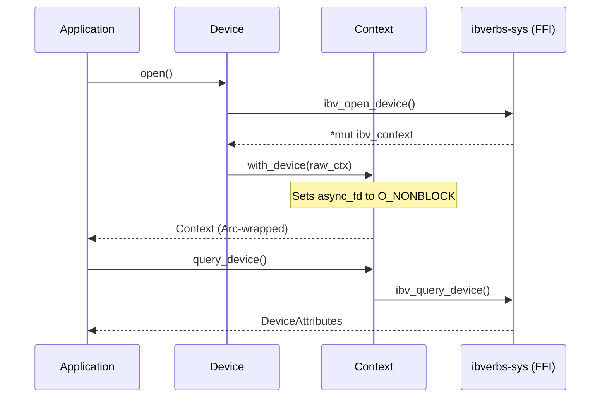
Sources: [ibverbs/src/context.rs:118-135](), [ibverbs/src/context.rs:162-172](), [ibverbs/src/context.rs:207-213]()

## Querying Attributes

Once a `Context` is established, the application must query the hardware to understand its limits (e.g., maximum number of Queue Pairs, maximum scatter/gather elements).

### Device Attributes
`context.query_device()` returns basic attributes, while `query_device_ex()` returns extended attributes (like Timestamp support) using the `ibv_query_device_ex` FFI [ibverbs/src/context.rs:207-233]().

### Port Attributes and GIDs
RDMA devices can have multiple ports. `context.query_port(port_num)` retrieves the current state (e.g., `IBV_PORT_ACTIVE`) and speed of a specific port [ibverbs/src/context.rs:39-72]().

Critical for RoCE (RDMA over Converged Ethernet) is the **GID Table**. A GID (Global Identifier) functions like an IPv6 address for RDMA.
*   **`gid_table()`**: Returns an iterator of `GidEntry` [ibverbs/src/context.rs:271-292]().
*   **`GidEntry`**: Contains the `Gid`, its index in the hardware table, the port number, and the `GidType` (IB, RoCEv1, or RoCEv2) [ibverbs/src/address.rs:171-185]().
*   **IPv4 Mapping**: For RoCEv2, `Gid::is_ipv4_mapped()` helps identify the GID entry corresponding to the system's IPv4 address [ibverbs/src/address.rs:58-60]().

Sources: [ibverbs/src/context.rs:39-72](), [ibverbs/src/address.rs:129-154](), [ibverbs/src/address.rs:171-185]()

## Asynchronous Event Handling

The `Context` manages a file descriptor (`async_fd`) used by the kernel to notify the user of hardware events (e.g., port state changes, fatal errors, or SRQ limit reached).

*   **Non-blocking Setup**: Upon creation, the crate automatically sets the `async_fd` to `O_NONBLOCK` [ibverbs/src/context.rs:162-172]().
*   **`wait_async_event()`**: This method polls the file descriptor. If an event is available, it retrieves it via `ibv_get_async_event` and immediately acknowledges it via `ibv_ack_async_event` to prevent resource leaks [ibverbs/src/context.rs:308-333]().
*   **Event Types**: Events are returned as an `AsyncEvent` enum, wrapping the raw `ibv_event_type` [ibverbs/src/context.rs:356-371]().

| Method | Description |
| :--- | :--- |
| `poll_async_event()` | Checks for an event; returns `None` immediately if none are pending [ibverbs/src/context.rs:302-305](). |
| `wait_async_event()` | Blocks (or yields in an async reactor) until an event arrives [ibverbs/src/context.rs:308-310](). |

Sources: [ibverbs/src/context.rs:162-172](), [ibverbs/src/context.rs:302-340]()

---

# Page: Protection Domain and Memory Regions

# Protection Domain and Memory Regions

<details>
<summary>Relevant source files</summary>

The following files were used as context for generating this wiki page:

- [ibverbs/src/efa.rs](ibverbs/src/efa.rs)
- [ibverbs/src/mr.rs](ibverbs/src/mr.rs)
- [ibverbs/src/pd.rs](ibverbs/src/pd.rs)

</details>


Protection Domains (PDs) and Memory Regions (MRs) form the isolation and security foundation of the RDMA stack. A Protection Domain acts as a container that associates Queue Pairs (QPs) with Memory Regions, ensuring that a QP can only access memory registered within the same domain.

## Protection Domain (PD)

A `ProtectionDomain` is created via a `Context` and serves as the factory for most RDMA resources. It manages the lifecycle of the underlying `ibv_pd` through an `Arc`-based `ProtectionDomainInner` to ensure the domain is only deallocated after all associated resources (MRs, QPs, SRQs) are dropped [ibverbs/src/pd.rs:131-154]().

### Resource Creation
The `ProtectionDomain` provides methods to initialize various RDMA objects:
*   **Queue Pairs**: `create_qp` (generic) and `create_srd_qp` (EFA specific) [ibverbs/src/pd.rs:215-225](), [ibverbs/src/efa.rs:47-55]().
*   **Shared Receive Queues**: `create_srq` [ibverbs/src/pd.rs:242-253]().
*   **Address Handles**: `create_address_handle` for UD/SRD addressing [ibverbs/src/pd.rs:175-186]().
*   **Memory Regions**: `allocate`, `register_from_raw`, and `register_dmabuf` [ibverbs/src/pd.rs:269-340]().

### Implementation Mapping
The following diagram illustrates how the `ProtectionDomain` bridges the safe Rust API to the underlying `libibverbs` structures.

**Protection Domain Entity Relationship**
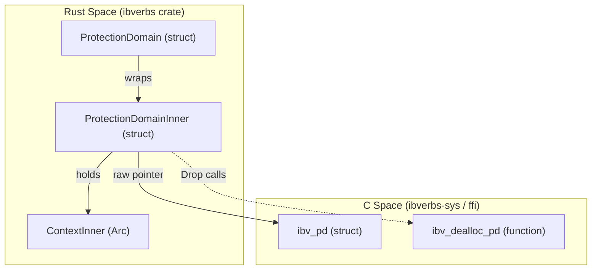
Sources: [ibverbs/src/pd.rs:131-154](), [ibverbs/src/pd.rs:136-144]()

---

## Memory Regions (MR)

Memory Regions represent buffers that have been pinned and registered with the HCA (Host Channel Adapter). Registration provides the HCA with the virtual-to-physical address mapping, allowing it to perform DMA without CPU intervention.

### Registration Methods
`rust-ibverbs` supports three primary ways to register memory:
1.  **`allocate<T>`**: Allocates a new `Vec<u8>` and registers it. The `MemoryRegion` owns the buffer [ibverbs/src/pd.rs:269-281]().
2.  **`register_from_raw<O>`**: Registers an existing buffer that implements `Deref<Target = [u8]>`. The `MemoryRegion` takes ownership of the container `O` [ibverbs/src/pd.rs:296-311]().
3.  **`register_dmabuf`**: Registers a Linux dma-buf file descriptor, useful for GPU-Direct RDMA or zero-copy storage [ibverbs/src/pd.rs:328-340]().

### Access Control
Access is governed by `AccessFlags`, which are defined using the `flags_newtype!` macro to wrap `ffi::ibv_access_flags` [ibverbs/src/mr.rs:12-41]().

| Flag | Description |
| :--- | :--- |
| `LOCAL_WRITE` | Required for the HCA to write into the buffer (e.g., `post_recv`) |
| `REMOTE_READ` | Allows remote peers to read via RDMA Read |
| `REMOTE_WRITE` | Allows remote peers to write via RDMA Write |
| `REMOTE_ATOMIC` | Allows remote atomic operations (CSWAP/FETCH_ADD) |
| `ON_DEMAND` | Enables On-Demand Paging (ODP) |

Sources: [ibverbs/src/mr.rs:17-40](), [ibverbs/src/mr.rs:47-53]()

---

## Slices and Addressing

Once memory is registered, it is accessed through slices that carry the necessary keys for the HCA.

### Local vs. Remote Slices
*   **`LocalMemorySlice`**: Wraps `ffi::ibv_sge` (Scatter/Gather Entry). It contains the local address, length, and `lkey`. Used for `post_send` and `post_recv` operations [ibverbs/src/mr.rs:170-172]().
*   **`RemoteMemorySlice`**: Contains the virtual address, length, and `rkey`. This is what a local node sends to a remote peer to enable one-sided RDMA operations [ibverbs/src/mr.rs:194-200]().

**Memory Slice Data Flow**
```mermaid
graph LR
    subgraph "Local Node"
        MR["MemoryRegion&lt;Vec&lt;u8&gt;&gt;"]
        LKey["lkey (u32)"]
        LSlice["LocalMemorySlice (ibv_sge)"]
    end

    subgraph "Remote Node"
        RSlice["RemoteMemorySlice"]
        RKey["rkey (u32)"]
    end

    MR -->|slice()| LSlice
    MR -->|remote()| RSlice
    RSlice -.->|Network Transfer| RKey
    LSlice -->|Used in| PostRecv["QueuePair::post_recv"]
    RKey -->|Used in| RDMA_Op["QueuePair::start_send().write(..., remote)"]
```
Sources: [ibverbs/src/mr.rs:87-95](), [ibverbs/src/mr.rs:107-113](), [ibverbs/src/mr.rs:129-141]()

---

## Memory Advice and ODP

For devices supporting On-Demand Paging (ODP), the `advise_mr` function allows the application to provide hints to the kernel about expected memory usage patterns [ibverbs/src/pd.rs:203-213]().

### MrAdvice and AdviseFlags
*   **`MrAdvice`**: An enum mapping to `IBV_ADVISE_MR_ADVICE_*` values, including `Prefetch`, `PrefetchWrite`, and `PrefetchNoFault` [ibverbs/src/pd.rs:21-29]().
*   **`MrAdviseFlags`**: Currently supports `FLUSHABLE`, which forces the call to be synchronous [ibverbs/src/pd.rs:54-60]().

### Implementation Details
The `advise_mr` call takes a list of `LocalMemorySlice` (acting as a scatter/gather list of ranges) and applies the advice to the underlying pages [ibverbs/src/pd.rs:203-213]().

Sources: [ibverbs/src/pd.rs:31-51](), [ibverbs/src/pd.rs:188-202]()

---

# Page: Addressing: GIDs, LIDs, and Address Handles

# Addressing: GIDs, LIDs, and Address Handles

<details>
<summary>Relevant source files</summary>

The following files were used as context for generating this wiki page:

- [ibverbs/src/address.rs](ibverbs/src/address.rs)
- [ibverbs/src/lib.rs](ibverbs/src/lib.rs)

</details>


This page covers the mechanisms used to identify and route traffic between RDMA endpoints. It details the structures for Global Identifiers (GIDs) used in RoCE and InfiniBand subnets, Local Identifiers (LIDs) for InfiniBand switching, and the `AddressHandle` required for Unreliable Datagram (UD) communication.

## Global Identifiers (GIDs)

A `Gid` is a 128-bit identifier for an RDMA device port, functionally equivalent to an IPv6 address [ibverbs/src/address.rs:12-35](). In the `rust-ibverbs` crate, `Gid` wraps the underlying `ffi::ibv_gid` union to provide a safe, printable, and comparable interface [ibverbs/src/address.rs:31-35]().

### Gid Structure and Conversion
The `Gid` struct provides methods to access the two 64-bit components of the address:
*   **Subnet Prefix**: Accessed via `subnet_prefix()` [ibverbs/src/address.rs:41-43]().
*   **Interface ID**: Accessed via `interface_id()` [ibverbs/src/address.rs:48-50]().

Because RoCE GIDs mirror the IP addresses of the underlying network interface, `Gid` implements `From<std::net::Ipv6Addr>` and `Into<std::net::Ipv6Addr>` [ibverbs/src/address.rs:65-75](). It also includes a helper `is_ipv4_mapped()` to identify GIDs representing IPv4 addresses (formatted as `::ffff:a.b.c.d`) [ibverbs/src/address.rs:58-60]().

### GID Table Queries
Devices maintain a GID table containing multiple entries. Users can query this table using `Context::gid_table()`, which returns a vector of `GidEntry` structs [ibverbs/src/address.rs:167-172]().

| Field | Type | Description |
| :--- | :--- | :--- |
| `gid` | `Gid` | The 128-bit identifier [ibverbs/src/address.rs:174](). |
| `gid_index` | `u32` | The index in the hardware table [ibverbs/src/address.rs:176](). |
| `port_num` | `u8` | The physical port number (1-based) [ibverbs/src/address.rs:178](). |
| `gid_type` | `GidType` | The framing protocol (IB, RoceV1, RoceV2) [ibverbs/src/address.rs:180](). |
| `ndev_ifindex` | `u32` | The Linux network interface index associated with this GID [ibverbs/src/address.rs:184](). |

**Sources:** [ibverbs/src/address.rs:12-61](), [ibverbs/src/address.rs:131-200]()

## Address Handles and UD Sends

While connected transports (RC, UC) store destination information within the Queue Pair (QP) state, Unreliable Datagram (`Ud`) transports are connectionless. Every send operation on a `Ud` QP must specify a destination via an `AddressHandle` [ibverbs/src/lib.rs:109-112]().

### Creating an Address Handle
An `AddressHandle` is created within a `ProtectionDomain` using `AddressHandleAttributes`. These attributes define how the packet should be routed.

#### Addressing Entity Mapping
The following diagram illustrates the relationship between the high-level addressing attributes and the internal FFI structures.

**Title: Addressing Attribute Mapping**
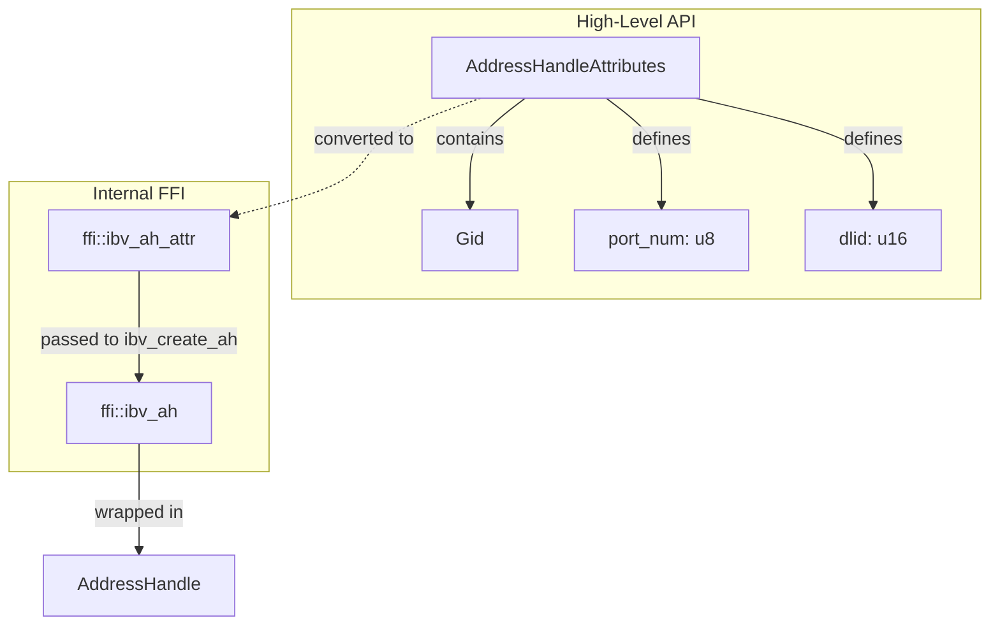
**Sources:** [ibverbs/src/address.rs:248-270](), [ibverbs/src/address.rs:395-405]()

### Routing: LIDs vs GIDs
The `AddressHandleAttributes` must be configured based on the network topology:
1.  **LID-based Routing**: In pure InfiniBand subnets, the Destination LID (`dlid`) is used for local switching [ibverbs/src/address.rs:252]().
2.  **GID-based Routing (GRH)**: For RoCE or inter-subnet InfiniBand, a Global Routing Header (GRH) is required. This is configured via `set_global_route()` [ibverbs/src/address.rs:326-335]().

### RoCEv2 and GID Selection
For RoCEv2, selecting the correct GID index is critical for routing.
*   The `gid_index` in `AddressHandleAttributes` (or `QueuePairBuilder` for RC/UC) refers to the index in the device's GID table [ibverbs/src/address.rs:332]().
*   On plain Ethernet IPv4 networks, users typically look for a `GidEntry` where `is_ipv4_mapped()` is true and `gid_type` is `GidType::RoceV2` [ibverbs/src/address.rs:52-60]().

**Sources:** [ibverbs/src/address.rs:52-60](), [ibverbs/src/address.rs:248-350](), [ibverbs/src/lib.rs:30-34]()

## Implementation Details

The `AddressHandle` lifecycle is managed by the `ProtectionDomain`. Dropping an `AddressHandle` triggers `ibv_destroy_ah` via the internal `Arc<AddressHandleInner>` [ibverbs/src/address.rs:410-425]().

### Data Flow: Address Handle Creation
The process of moving from user-defined attributes to a hardware-usable handle is shown below.

**Title: Address Handle Creation Flow**
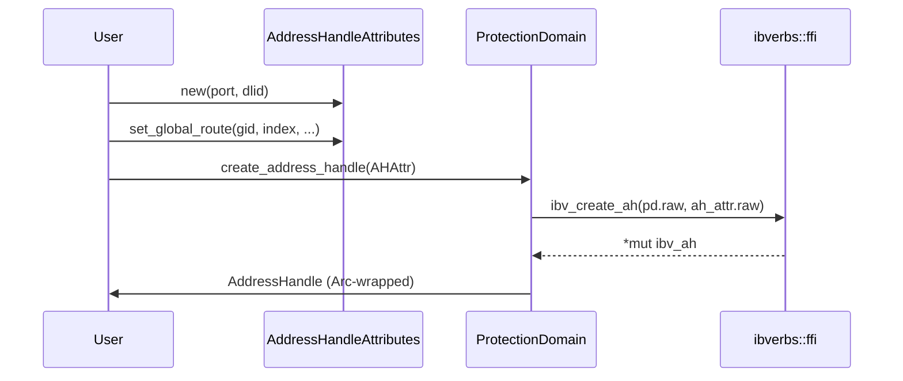
**Sources:** [ibverbs/src/address.rs:248-270](), [ibverbs/src/address.rs:395-408]()

### Summary of Key Types
| Type | Role |
| :--- | :--- |
| `Gid` | 128-bit identifier, mirrors `ibv_gid` [ibverbs/src/address.rs:33](). |
| `GidEntry` | Metadata about a GID in the device table (index, type, netdev) [ibverbs/src/address.rs:172](). |
| `AddressHandleAttributes` | Configuration for creating a destination handle [ibverbs/src/address.rs:248](). |
| `AddressHandle` | Opaque handle used in `Ud` post_send operations to specify destination [ibverbs/src/address.rs:395](). |

**Sources:** [ibverbs/src/address.rs:33-395]()

---

# Page: Queue Pairs

# Queue Pairs

<details>
<summary>Relevant source files</summary>

The following files were used as context for generating this wiki page:

- [ibverbs/src/lib.rs](ibverbs/src/lib.rs)
- [ibverbs/src/qp.rs](ibverbs/src/qp.rs)

</details>


A **Queue Pair (QP)** is the fundamental unit of communication in RDMA. Each QP consists of a **Send Queue** and a **Receive Queue**. The `rust-ibverbs` crate provides a type-safe abstraction for QPs, using Rust's trait system to enforce transport-specific rules at compile time and a state-machine-driven lifecycle to ensure safe transitions from creation to data transfer.

## Transport Types

RDMA supports multiple transport modes, each offering different guarantees regarding reliability, connectivity, and supported operations. In this crate, these are represented by marker types that implement the `Transport` trait [ibverbs/src/qp.rs:106-146]().

| Transport Marker | `QueuePairType` | Connectivity | Reliability | Key Operations |
|:---|:---|:---|:---|:---|
| `Rc` | `ReliableConnection` | Connected | Reliable | Send, Read, Write, Atomics |
| `Uc` | `UnreliableConnection` | Connected | Unreliable | Send, Write |
| `Ud` | `UnreliableDatagram` | Connectionless | Unreliable | Send (with `AddressHandle`) |
| `Srd` | `Driver` (EFA) | Connectionless | Reliable | Send (AWS EFA specific) |

The use of these markers prevents developers from calling unsupported methods (e.g., attempting an RDMA Read on a `Ud` transport) via compile-time errors [ibverbs/src/qp.rs:116-145]().

For details on specific transport behaviors and the EFA-specific `Srd` type, see **[Transport Types and QueuePair Lifecycle](#4.1)**.

### Entity Mapping: Transport Traits
```mermaid
graph TD
    subgraph "Code Entity Space (Traits)"
        T["Transport"]
        C["Connected"]
        R["Reliable"]
        D["Datagram"]
    end

    subgraph "System Concepts (Guarantees)"
        G1["In-order / Reliable"]
        G2["One-to-One Peer"]
        G3["Individual Addressing"]
    end

    T -- "base for" --> C
    T -- "base for" --> D
    C -- "base for" --> R

    R -.-> G1
    C -.-> G2
    D -.-> G3

    style T stroke-dasharray: 5 5
```
Sources: [ibverbs/src/qp.rs:146-158]()

---

## The Builder Pattern and Lifecycle

Queue Pairs are created through a multi-stage process to ensure all hardware resources and connection parameters are correctly initialized. This process follows a strict state machine (Reset → Init → Ready to Receive (RTR) → Ready to Send (RTS)).

1.  **`QueuePairBuilder`**: Used to configure hardware limits (e.g., `max_send_wr`) and transport settings [ibverbs/src/qp.rs:182-192]().
2.  **`PreparedQueuePair`**: Represents a QP that has been allocated but not yet connected. It provides a `QueuePairEndpoint` containing the necessary wire information (LID, QPN, GID) to share with a peer [ibverbs/src/qp.rs:664-672]().
3.  **Activation/Handshake**: 
    *   **Connected transports (`Rc`, `Uc`)** use `handshake(endpoint)` to transition to RTS [ibverbs/src/qp.rs:728-735]().
    *   **Datagram transports (`Ud`)** use `activate()` since they do not have a fixed remote endpoint [ibverbs/src/qp.rs:807-812]().

For details on configuring GID indices, MTU settings, and manual state transitions, see **[Transport Types and QueuePair Lifecycle](#4.1)**.

Sources: [ibverbs/src/lib.rs:31-40](), [ibverbs/src/qp.rs:658-672]()

---

## Data-Path Operations

Once a `QueuePair` is in the `RTS` state, it can perform data-path operations. The crate distinguishes between **Receiving** (pre-posting buffers) and **Sending** (initiating transfers).

### Post Receive
Buffers must be posted to the Receive Queue before the peer initiates a Send. This is done via `post_recv`, which takes an iterator of `RecvRequest` objects [ibverbs/src/lib.rs:47]().

### Send Batching and Doorbell Batching
To minimize overhead, the crate uses a `SendBatch` builder pattern. This allows multiple Work Requests (WRs) to be chained together and submitted to the hardware in a single "doorbell" ring, significantly reducing CPU-to-NIC synchronization costs [ibverbs/src/lib.rs:48-50]().

### Operation Types
*   **Two-sided**: `send` (requires a matching `post_recv` at the peer).
*   **One-sided**: `write` and `read` (directly accesses peer memory; peer CPU is not involved).
*   **Atomics**: `atomic_cmp_swap` and `atomic_fetch_add` (only supported on `Rc`).

For details on scatter/gather lists, signaled vs. unsignaled completions, and doorbell performance, see **[Sending, Receiving, and Doorbell Batching](#4.2)**.

Sources: [ibverbs/src/lib.rs:42-50](), [ibverbs/src/qp.rs:109-115]()

---

## Shared Receive Queues (SRQ)

In high-fan-in scenarios (e.g., one server handling thousands of clients), allocating a unique receive queue for every QP is memory-intensive. A **Shared Receive Queue (SRQ)** allows multiple QPs to share a single pool of receive buffers [ibverbs/src/srq.rs:1-10]().

*   **Efficiency**: Reduces memory footprint for large-scale connections.
*   **Low-Watermark**: Supports asynchronous notifications when the number of buffers in the SRQ drops below a defined threshold.

For details on creating and associating QPs with an SRQ, see **[Shared Receive Queues (SRQ)](#4.3)**.

### Entity Mapping: Data Path Components
```mermaid
graph LR
    QP["QueuePair<T>"] -- "post_recv()" --> RQ["Receive Queue"]
    QP -- "start_send()" --> SB["SendBatch"]
    SB -- "op().send()" --> SQ["Send Queue"]
    
    subgraph "ibv_wr (Work Requests)"
        SQ
        RQ
    end

    SQ -- "interrupt/poll" --> CQ["CompletionQueue"]
    RQ -- "interrupt/poll" --> CQ
```
Sources: [ibverbs/src/lib.rs:42-61](), [ibverbs/src/qp.rs:118-125]()

---

# Page: Transport Types and QueuePair Lifecycle

# Transport Types and QueuePair Lifecycle

<details>
<summary>Relevant source files</summary>

The following files were used as context for generating this wiki page:

- [ibverbs/src/lib.rs](ibverbs/src/lib.rs)
- [ibverbs/src/qp.rs](ibverbs/src/qp.rs)
- [ibverbs/tests/loopback.rs](ibverbs/tests/loopback.rs)

</details>


This page details the `rust-ibverbs` abstraction for RDMA Queue Pairs (QPs). It covers how the library uses the Rust type system to enforce transport-specific invariants, the builder-based initialization flow, and the state machine transitions required to move a QP from creation to an active data-path state.

### Transport Types and Compile-Time Safety

`rust-ibverbs` types the Queue Pair family by its transport protocol using the `Transport` trait [ibverbs/src/qp.rs:146-146](). This ensures that transport-specific operations (like RDMA Reads or Atomic operations) are only available on QPs that support them, preventing runtime provider errors through compile-time checks [ibverbs/src/qp.rs:109-115]().

#### Transport Hierarchy
The library implements a sealed trait hierarchy to categorize transport capabilities:

| Trait | Implementation Markers | Capabilities |
| :--- | :--- | :--- |
| `Transport` | `Rc`, `Uc`, `Ud`, `Srd` | Base QP operations. |
| `Connected` | `Rc`, `Uc` | Handshake with a single remote peer. |
| `Reliable` | `Rc`, `Srd` | Retries, ACKs, and (for RC) RDMA Reads/Atomics. |
| `Datagram` | `Ud`, `Srd` | Individually addressed sends via `AddressHandle`. |

**Sources:** [ibverbs/src/qp.rs:146-158](), [ibverbs/src/qp.rs:160-177]()

#### Entity Mapping: Transports
The following diagram maps the high-level RDMA transport concepts to their specific Rust marker types and internal FFI representations.

**Transport Type Mapping**
```mermaid
graph TD
    subgraph "Rust Space (ibverbs::*)"
        T_Trait["trait Transport"]
        T_RC["struct Rc"]
        T_UC["struct Uc"]
        T_UD["struct Ud"]
        T_SRD["struct Srd (feature='efa')"]
    end

    subgraph "FFI Space (ibverbs::ffi::*)"
        FFI_RC["IBV_QPT_RC"]
        FFI_UC["IBV_QPT_UC"]
        FFI_UD["IBV_QPT_UD"]
        FFI_DRV["IBV_QPT_DRIVER"]
    end

    T_RC -- "impls" --> T_Trait
    T_UC -- "impls" --> T_Trait
    T_UD -- "impls" --> T_Trait
    T_SRD -- "impls" --> T_Trait

    T_RC -.-> FFI_RC
    T_UC -.-> FFI_UC
    T_UD -.-> FFI_UD
    T_SRD -.-> FFI_DRV
```
**Sources:** [ibverbs/src/qp.rs:179-195](), [ibverbs/src/qp.rs:50-62]()

---

### QueuePair Lifecycle

The lifecycle of a Queue Pair involves three distinct stages: configuration via a builder, a "prepared" state for endpoint exchange, and finally an "active" state for data transfer.

#### 1. Configuration (QueuePairBuilder)
A `QueuePairBuilder` is obtained via `ProtectionDomain::create_qp<T>` [ibverbs/src/pd.rs:133-140](). It allows configuring hardware limits and capabilities:
* `max_send_wr` / `max_recv_wr`: The depth of the Send and Receive queues [ibverbs/src/qp.rs:1062-1072]().
* `gid_index`: The index in the GID table used for RoCE routing [ibverbs/src/qp.rs:1096-1100]().
* `set_access`: Sets `AccessFlags` (e.g., `REMOTE_WRITE`, `REMOTE_READ`) for one-sided operations [ibverbs/src/qp.rs:1130-1134]().

#### 2. Preparation (PreparedQueuePair)
Calling `.build()` on the builder transitions the QP to the `INIT` state and returns a `PreparedQueuePair` [ibverbs/src/qp.rs:1146-1165](). In this state, the QP is allocated on the hardware but not yet connected. Users can call `.endpoint()` to retrieve the `QueuePairEndpoint` [ibverbs/src/qp.rs:1255-1262](), which contains the LID, QPN, and GID required for the peer to connect [ibverbs/src/qp.rs:1416-1430]().

#### 3. Activation (Handshake vs. Activate)
The transition to the `RTS` (Ready to Send) state depends on the transport type:
* **Connected Transports (`Rc`, `Uc`)**: Require `.handshake(remote_endpoint)` [ibverbs/src/qp.rs:1283-1290](). This performs the multi-step state transition (`INIT` -> `RTR` -> `RTS`) using the peer's endpoint information.
* **Datagram Transports (`Ud`, `Srd`)**: Require `.activate()` [ibverbs/src/qp.rs:1335-1341](). Since they are connectionless, they do not need a remote endpoint to enter an active state.

**Lifecycle State Machine**
```mermaid
stateDiagram-v2
    [*] --> Builder : pd.create_qp()
    Builder --> PreparedQueuePair : .build()
    note right of PreparedQueuePair : State: INIT
    
    state PreparedQueuePair {
        [*] --> EndpointExchange : .endpoint()
    }
    
    PreparedQueuePair --> QueuePair : .handshake(remote) [Connected]
    PreparedQueuePair --> QueuePair : .activate() [Datagram]
    note right of QueuePair : State: RTS (Ready to Send)
    
    QueuePair --> [*] : drop()
```
**Sources:** [ibverbs/src/lib.rs:31-40](), [ibverbs/src/qp.rs:1255-1341](), [ibverbs/tests/loopback.rs:57-72]()

---

### Manual State Transitions and Wire Format

While the handshake/activate methods cover standard use cases, the library provides lower-level access for manual control.

#### QueuePairEndpoint Wire Format
The `QueuePairEndpoint` is designed to be easily serialized for out-of-band exchange (e.g., via TCP or a discovery service). It provides `to_bytes()` and `from_bytes()` methods [ibverbs/src/qp.rs:1437-1460]().

| Field | Description |
| :--- | :--- |
| `num` | The 24-bit Queue Pair Number (QPN) [ibverbs/src/qp.rs:1418-1418](). |
| `lid` | The Local Identifier (16-bit, InfiniBand specific) [ibverbs/src/qp.rs:1420-1420](). |
| `psn` | The Packet Sequence Number [ibverbs/src/qp.rs:1422-1422](). |
| `gid` | The Global Identifier (128-bit, required for RoCE) [ibverbs/src/qp.rs:1424-1424](). |

#### Manual Modification
Advanced users can use `QueuePair::modify` to manually drive the IB verbs state machine [ibverbs/src/qp.rs:806-813](). This requires a `QueuePairAttribute` struct and an `QueuePairAttributeMask` to specify which fields are being updated (e.g., `IBV_QP_STATE`, `IBV_QP_PATH_MTU`) [ibverbs/src/qp.rs:807-809]().

Current state can be retrieved via `QueuePair::query` [ibverbs/src/qp.rs:777-781](), which returns the hardware's view of the QP's configuration and status.

**Sources:** [ibverbs/src/qp.rs:1416-1460](), [ibverbs/src/qp.rs:777-813](), [ibverbs/src/lib.rs:36-37]()

---

# Page: Sending, Receiving, and Doorbell Batching

# Sending, Receiving, and Doorbell Batching

<details>
<summary>Relevant source files</summary>

The following files were used as context for generating this wiki page:

- [ibverbs/examples/doorbell_batching.rs](ibverbs/examples/doorbell_batching.rs)
- [ibverbs/src/qp.rs](ibverbs/src/qp.rs)
- [ibverbs/tests/loopback.rs](ibverbs/tests/loopback.rs)

</details>


This page describes the RDMA data-path operations in `rust-ibverbs`. It covers the mechanisms for posting receive requests and the specialized builder pattern used for sending work requests. A key focus is the "Doorbell Batching" performance model, which allows multiple operations to be submitted to the hardware in a single atomic action, minimizing CPU-to-device synchronization overhead.

## Receive Path: `post_recv`

The receive path is governed by the `post_recv` method on the `QueuePair`. Unlike the send path, which uses a complex builder to handle various operation types, the receive path is uniform: it consumes `RecvRequest` objects that point to local memory buffers where incoming data should be placed.

### `RecvRequest` and SGLs
A `RecvRequest` represents a single Work Request (WR) on the Receive Queue. It consists of:
1.  **Work Request ID (`wr_id`)**: A 64-bit user-defined value returned in the `WorkCompletion` when the receive finishes [ibverbs/src/qp.rs:1723-1725]().
2.  **Scatter/Gather List (SGL)**: An array of `LocalMemorySlice` objects. The hardware "scatters" the incoming message across these slices [ibverbs/src/qp.rs:1727-1730]().

### Posting Receives
The `post_recv` method is `unsafe` because the user must guarantee that the memory regions referenced in the SGL remain valid until the hardware produces a completion [ibverbs/src/qp.rs:1145-1152]().

**Sources:** [ibverbs/src/qp.rs:1145-1158](), [ibverbs/src/qp.rs:1712-1748]()

---

## Send Path: The `SendBatch` Pattern

The send path uses a **Batch Builder Pattern** to provide compile-time safety across different transport types (RC, UC, UD, SRD) while enabling performance optimizations like doorbell batching.

### Core Entities
-   **`SendBatch`**: The entry point for a batch of work requests. It manages the linked list of `ibv_send_wr` structures [ibverbs/src/qp.rs:1255-1262]().
-   **`SendOp`**: A builder for a single operation within a batch. It provides methods like `send`, `write`, and `read` [ibverbs/src/qp.rs:1493-1498]().
-   **`DatagramOp`**: A specialized builder for connectionless transports (UD/SRD) that requires an `AddressHandle` [ibverbs/src/qp.rs:1455-1460]().

### Data Flow: From Builder to Hardware
The following diagram illustrates how the `SendBatch` API translates Rust calls into the underlying C `ibv_send_wr` chain.

**Send Operation Data Flow**
```mermaid
graph TD
    subgraph "Rust Space"
        QP["QueuePair::start_send()"] --> Batch["SendBatch"]
        Batch --> Op1["SendOp (signaled)"]
        Op1 --> Op2["SendOp (unsignaled)"]
        Op2 --> Submit["unsafe { batch.submit() }"]
    end

    subgraph "FFI / C Space"
        Submit --> FFI["ibv_post_send"]
        FFI --> WR1["ibv_send_wr (WR_ID 1)"]
        WR1 --> WR2["ibv_send_wr (WR_ID 2)"]
        WR2 --> Next["next = NULL"]
    end

    subgraph "Hardware"
        FFI -- "Doorbell Ring" --> HCA["RDMA HCA"]
        HCA --> Process["Process WR1 & WR2"]
    end
```
**Sources:** [ibverbs/src/qp.rs:1120-1135](), [ibverbs/src/qp.rs:1367-1400](), [ibverbs/examples/doorbell_batching.rs:96-108]()

---

## Supported Send Operations

Operations are restricted based on the `Transport` type at compile time using traits like `Reliable`, `Connected`, and `Datagram` [ibverbs/src/qp.rs:146-158]().

| Operation | Transport | Description | Method |
| :--- | :--- | :--- | :--- |
| **Send** | All | Standard message passing. | `.send()` |
| **Write** | RC, UC | One-sided RDMA Write to remote memory. | `.write()` |
| **Write with Imm** | RC, UC | RDMA Write that consumes a Recv WR at the target. | `.write_with_imm()` |
| **Read** | RC | One-sided RDMA Read from remote memory. | `.read()` |
| **Atomic CmpSwap** | RC | Compare and Swap on remote 64-bit value. | `.atomic_cmp_swap()` |
| **Atomic FetchAdd** | RC | Fetch and Add on remote 64-bit value. | `.atomic_fetch_add()` |

### Per-Operation Modifiers
Modifiers are applied to the `SendOp` before calling the final operation method:
-   **`.signaled()`**: Generates a `WorkCompletion` when this specific WR finishes. If omitted, the operation is "unsignaled" and completes silently unless it fails [ibverbs/src/qp.rs:1516-1520]().
-   **`.fenced()`**: Ensures this WR does not start until all prior RDMA Reads and Atomics in the queue have completed [ibverbs/src/qp.rs:1527-1532]().
-   **`.solicited()`**: Sets the solicited event hint, triggering an event on the remote side if they are waiting on `req_notify` [ibverbs/src/qp.rs:1539-1544]().
-   **`.inline()`**: Hints to the driver to copy data directly into the WR, avoiding a DMA read from the memory region (useful for small payloads) [ibverbs/src/qp.rs:1551-1557]().

**Sources:** [ibverbs/src/qp.rs:1493-1678](), [ibverbs/src/qp.rs:106-145]()

---

## Doorbell Batching Performance Model

"Doorbell batching" refers to the practice of chaining multiple Work Requests together and submitting them to the NIC with a single MMIO write (the "doorbell"). This significantly reduces CPU overhead and PCI-Express contention.

### The Batching Pattern
1.  Call `qp.start_send()` to initialize the chain.
2.  Add operations via `.op()` or `.to()`.
3.  Only mark the *final* operation in a logical group as `.signaled()`.
4.  Call `submit()` to ring the doorbell once for the entire chain [ibverbs/examples/doorbell_batching.rs:96-108]().

**Entity Association: Doorbell Batching**
```mermaid
graph LR
    subgraph "Code Entities"
        QP["QueuePair"]
        SB["SendBatch"]
        SO["SendOp"]
        SUB["submit()"]
    end

    subgraph "RDMA Concepts"
        DB["Doorbell Ring"]
        WRC["WR Chain"]
        SQ["Send Queue"]
    end

    QP -- "creates" --> SB
    SB -- "builds" --> SO
    SO -- "links" --> WRC
    SUB -- "executes" --> DB
    DB -- "notifies" --> SQ
```

### Example: Chained Writes
In the `doorbell_batching.rs` example, multiple RDMA writes are queued to transfer segments of a string, followed by a single signaled `send` that notifies the receiver. The hardware processes all writes before the send, but the CPU only interacts with the NIC twice: once to post the receive, and once to post the entire send batch [ibverbs/examples/doorbell_batching.rs:99-108]().

**Sources:** [ibverbs/examples/doorbell_batching.rs:1-158](), [ibverbs/src/qp.rs:1367-1400]()

---

## Scatter/Gather Lists (SGL)

Both send and receive operations support Scatter/Gather lists. Instead of a single contiguous buffer, an operation can reference multiple `LocalMemorySlice` segments.

-   **Send Side**: The HCA "gathers" data from the slices to form a single outgoing packet.
-   **Receive Side**: The HCA "scatters" the incoming packet data into the provided slices in order [ibverbs/src/qp.rs:1727-1730]().

The maximum number of SGEs (Scatter/Gather Elements) per WR is configured during Queue Pair creation via `set_max_send_sge` and `set_max_recv_sge` [ibverbs/tests/loopback.rs:64-65]().

**Sources:** [ibverbs/src/qp.rs:1712-1748](), [ibverbs/tests/loopback.rs:60-66]()

---

# Page: Shared Receive Queues (SRQ)

# Shared Receive Queues (SRQ)

<details>
<summary>Relevant source files</summary>

The following files were used as context for generating this wiki page:

- [ibverbs/src/srq.rs](ibverbs/src/srq.rs)
- [ibverbs/tests/loopback.rs](ibverbs/tests/loopback.rs)

</details>


A Shared Receive Queue (SRQ) is an RDMA resource that allows multiple Queue Pairs (QPs) to share a common pool of receive buffers. Instead of allocating a fixed number of receive Work Requests (WR) per Queue Pair, an application can post receive buffers to a single SRQ, which are then consumed by any associated QP as incoming messages arrive. This significantly reduces the memory footprint for applications maintaining large numbers of connections.

## SRQ Creation and Configuration

SRQs are created within a `ProtectionDomain`. The creation process requires specifying the maximum number of outstanding receive requests and the maximum number of scatter/gather elements (SGE) per request.

### The `SharedReceiveQueue` Lifecycle
The `SharedReceiveQueue` struct manages the lifetime of the underlying `ibv_srq` using an `Arc`-based inner pattern to ensure the `ProtectionDomain` remains valid as long as the SRQ exists.

| Method | Description | File Reference |
|:---|:---|:---|
| `ProtectionDomain::create_srq` | Allocates a new SRQ with specified `max_wr` and `max_sge`. | [ibverbs/src/pd.rs:114-142]() |
| `SharedReceiveQueue::as_raw` | Provides an escape hatch to the underlying `ffi::ibv_srq`. | [ibverbs/src/srq.rs:39-41]() |
| `SharedReceiveQueueInner::drop` | Automatically calls `ibv_destroy_srq` when the last reference is dropped. | [ibverbs/src/srq.rs:17-25]() |

### Natural Language to Code Entity Mapping: SRQ Resources
This diagram illustrates how the high-level SRQ concept maps to specific code entities and the underlying FFI layer.

```mermaid
graph TD
    subgraph "Rust API Space (ibverbs)"
        PD["ProtectionDomain"]
        SRQ["SharedReceiveQueue"]
        SRQI["SharedReceiveQueueInner"]
        RR["RecvRequest"]
    end

    subgraph "FFI / rdma-core Space (ibverbs-sys)"
        F_SRQ["ffi::ibv_srq"]
        F_PD["ffi::ibv_pd"]
        F_WR["ffi::ibv_recv_wr"]
    end

    PD -- "create_srq()" --> SRQ
    SRQ -- "Arc" --> SRQI
    SRQI -- "raw pointer" --> F_SRQ
    SRQI -- "keeps alive" --> PD
    SRQ -- "post_recv(&mut [RecvRequest])" --> F_WR
    F_SRQ -- "context.ops.post_srq_recv" --> F_WR
```
**Sources:** [ibverbs/src/srq.rs:9-32](), [ibverbs/src/pd.rs:114-142]()

## Associating Queue Pairs with an SRQ

To use an SRQ, a Queue Pair must be associated with it during creation. This is handled via the `QueuePairBuilder`. When a QP is associated with an SRQ, the `max_recv_wr` and `max_recv_sge` settings on the QP builder are ignored, as these limits are governed by the SRQ.

1.  **Initialize Builder**: Call `pd.create_qp::<T>(...)`. [ibverbs/src/pd.rs:77-112]()
2.  **Associate SRQ**: Use `builder.set_srq(&srq)`. [ibverbs/src/qp.rs:608-612]()
3.  **Build QP**: The resulting `QueuePair` will consume buffers from the SRQ for all incoming `RECV` operations.

**Sources:** [ibverbs/src/qp.rs:518-522](), [ibverbs/src/qp.rs:608-612]()

## Data Path: Posting Receives

Posting to an SRQ is performed using `SharedReceiveQueue::post_recv`. Unlike standard QP receives, these are posted directly to the shared pool.

*   **Batching**: The method accepts a slice of `RecvRequest` objects and links them into a linked list in-place before calling the provider-specific `post_srq_recv` function. [ibverbs/src/srq.rs:74-95]()
*   **Safety**: The caller must ensure that the memory regions referenced in the `RecvRequest` remain valid until a `WorkCompletion` is polled from the Completion Queue associated with the QP that consumed the buffer. [ibverbs/src/srq.rs:60-64]()
*   **UD Specifics**: If a Unreliable Datagram (UD) QP consumes an SRQ buffer, the first 40 bytes are reserved for the Global Routing Header (GRH). [ibverbs/src/srq.rs:52-56]()

**Sources:** [ibverbs/src/srq.rs:43-102](), [ibverbs/tests/loopback.rs:374-386]()

## Async Events and Low-Watermark Notification

SRQs support a "low-watermark" notification mechanism. If the number of Work Requests in the SRQ drops below a predefined limit, the RDMA device triggers an asynchronous event.

### SRQ Limit Event Flow
This diagram tracks the flow of an `IBV_EVENT_SRQ_LIMIT_REACHED` event from the hardware to the application.

```mermaid
sequenceDiagram
    participant HW as "RDMA Hardware"
    participant CTX as "Context::wait_async_event()"
    participant SRQ as "SharedReceiveQueue"
    participant APP as "Application Logic"

    Note over HW, SRQ: SRQ WR Count < Limit
    HW->>CTX: Generate IBV_EVENT_SRQ_LIMIT_REACHED
    CTX->>APP: Return AsyncEvent::SrqLimitReached(srq)
    APP->>SRQ: post_recv(new_buffers)
    APP->>SRQ: modify_srq(new_limit)
```

### Handling the Event
Applications monitor these events using `Context::wait_async_event`. When an `AsyncEvent::SrqLimitReached` is received, it contains the `SharedReceiveQueue` that triggered the event, allowing the application to replenish the buffer pool.

| Event Type | Description | Code Identifier |
|:---|:---|:---|
| **SRQ Limit Reached** | Triggered when the number of WRs in SRQ falls below the limit. | `AsyncEvent::SrqLimitReached` [ibverbs/src/device.rs:602]() |
| **SRQ Catastrophic Error** | Triggered if the SRQ encounters a hardware error. | `AsyncEvent::SrqCatastrophicError` [ibverbs/src/device.rs:604]() |

**Sources:** [ibverbs/src/device.rs:585-610](), [ibverbs/src/srq.rs:1-32]()

## Example: Loopback with SRQ

In integration testing, an SRQ is used by creating the SRQ, posting a `RecvRequest` to it, and then creating a QP associated with that SRQ.

```rust
// 1. Create SRQ
let srq = pd.create_srq(16, 4).expect("failed to create SRQ");

// 2. Post Receive to SRQ
let mut recv_req = [RecvRequest::prepare(&[mr.slice()], 0xdeadbeef)];
unsafe { srq.post_recv(&mut recv_req).expect("failed to post SRQ recv") };

// 3. Create QP associated with SRQ
let mut builder = pd.create_qp::<Rc>(&cq, &cq, 1).unwrap();
builder.set_srq(&srq);
let qp = builder.build().unwrap().handshake(endpoint).unwrap();
```
**Sources:** [ibverbs/tests/loopback.rs:374-398](), [ibverbs/src/qp.rs:608-612]()

---

# Page: Completion Queues and Event Handling

# Completion Queues and Event Handling

<details>
<summary>Relevant source files</summary>

The following files were used as context for generating this wiki page:

- [ibverbs/src/completion.rs](ibverbs/src/completion.rs)
- [ibverbs/src/lib.rs](ibverbs/src/lib.rs)

</details>


In RDMA, the results of work requests (sends, receives, reads, writes) are not returned immediately. Instead, the hardware places a `WorkCompletion` into a `CompletionQueue` (CQ) once the operation finishes. The `rust-ibverbs` crate provides two primary strategies for handling these completions: high-performance **polling** and resource-efficient **event-driven** notification.

### Strategy Overview

| Strategy | Mechanism | Performance | CPU Usage | Best For |
| :--- | :--- | :--- | :--- | :--- |
| **Polling** | Repeatedly calling `cq.poll()` in a loop. | Lowest Latency | 100% (Busy-wait) | High-frequency data path, dedicated cores. |
| **Event-Driven** | Blocking on a `CompletionChannel` file descriptor. | Higher Latency | Low (Interrupt-based) | Control plane, low-frequency traffic, or `epoll` integration. |

### Completion Management Architecture

The following diagram illustrates how the `CompletionQueue` interacts with the `Context` and the optional `CompletionChannel`.

**CQ and Event Relationship**
```mermaid
graph TD
    subgraph "Code Entity Space"
        CTX["Context [ibverbs/src/context.rs]"]
        CQB["CompletionQueueBuilder [ibverbs/src/completion.rs]"]
        CQ["CompletionQueue [ibverbs/src/completion.rs]"]
        CC["CompletionChannel [ibverbs/src/completion.rs]"]
        WC["WorkCompletion [ibverbs/src/completion.rs]"]
    end

    CTX -- "create_cq(entries)" --> CQB
    CQB -- "build()" --> CQ
    CTX -- "create_comp_channel()" --> CC
    CC -- "set_comp_channel(&CC)" --> CQB
    CQ -- "poll()" --> WC
    CQ -- "req_notify(solicited)" --> CC
    CC -- "wait(timeout)" --> Event["Notification Event"]
```
Sources: [ibverbs/src/completion.rs:43-45](), [ibverbs/src/completion.rs:252-258](), [ibverbs/src/completion.rs:334-340]()

---

### Polling and Work Completions

Polling is the default way to interact with a `CompletionQueue` [ibverbs/src/completion.rs:24-25](). When you call `poll()`, the crate returns a `Completions` iterator that provides access to `WorkCompletion` objects. These objects contain critical metadata about the operation, including the `wr_id` (Work Request ID), status, and opcode [ibverbs/src/completion.rs:563-585]().

The crate utilizes the extended CQ interface (`ibv_create_cq_ex`) to support advanced features like hardware timestamps via `HcaClock` and configurable completion flags [ibverbs/src/completion.rs:100-105]().

**Key Components:**
*   **`CompletionQueue`**: The primary handle for reaping completions [ibverbs/src/completion.rs:252-258]().
*   **`WorkCompletion`**: A lazy-read wrapper around the hardware completion entry [ibverbs/src/completion.rs:556-561]().
*   **`HcaClock`**: Used for converting hardware timestamps into system time [ibverbs/src/context.rs:484-489]().

For detailed polling patterns and metadata handling, see [CompletionQueue: Polling and WorkCompletions](#5.1).

---

### Event-Driven Completions and CompletionChannel

For applications that cannot afford to burn 100% CPU on a polling loop, `rust-ibverbs` supports event-driven notifications via the `CompletionChannel` [ibverbs/src/completion.rs:43-45](). A channel wraps a Linux file descriptor that becomes readable when a new completion is added to an associated CQ.

The event-driven flow follows a specific cycle:
1.  **Arm**: Call `req_notify` on the CQ to request a notification [ibverbs/src/completion.rs:453-459]().
2.  **Wait**: Block on the `CompletionChannel` using `wait()` or integrate its `AsFd` into an `epoll` reactor [ibverbs/src/completion.rs:145-155]().
3.  **Drain**: Once notified, `poll()` the CQ until it is empty [ibverbs/src/lib.rs:54-61]().
4.  **Rearm**: Repeat the process.

**Notification Flow**
```mermaid
sequenceDiagram
    participant App as "Application Logic"
    participant CQ as "CompletionQueue [ibverbs/src/completion.rs]"
    participant CC as "CompletionChannel [ibverbs/src/completion.rs]"
    participant Hw as "RDMA Hardware"

    App->>CQ: req_notify(false)
    Note over App, CQ: Arming for any completion
    Hw->>CQ: Push WorkCompletion
    CQ->>CC: Trigger File Descriptor
    App->>CC: wait(timeout) / get_event()
    CC-->>App: CQ Context Cookie
    App->>CQ: poll()
    CQ-->>App: WorkCompletions
```
Sources: [ibverbs/src/completion.rs:21-30](), [ibverbs/src/completion.rs:113-127]()

For details on `epoll` integration and multiplexing multiple CQs onto a single channel, see [Event-Driven Completions and CompletionChannel](#5.2).

---

### Sources
*   [ibverbs/src/lib.rs:1-80]()
*   [ibverbs/src/completion.rs:1-160]()
*   [ibverbs/src/completion.rs:250-460]()
*   [ibverbs/src/context.rs:480-500]()

---

# Page: CompletionQueue: Polling and WorkCompletions

# CompletionQueue: Polling and WorkCompletions

<details>
<summary>Relevant source files</summary>

The following files were used as context for generating this wiki page:

- [ibverbs/src/completion.rs](ibverbs/src/completion.rs)
- [ibverbs/tests/loopback.rs](ibverbs/tests/loopback.rs)

</details>


This page covers the management of RDMA completions through the `CompletionQueue` (CQ) abstraction. It details how to configure queues using the builder pattern, the differences between standard and extended polling interfaces, and how to consume `WorkCompletion` data using the lazy-read API.

## Overview of Completion Handling

A `CompletionQueue` is the destination for Work Completions (WCs) generated by a `QueuePair`. In `rust-ibverbs`, the CQ can be driven by high-performance polling or by an event-driven model using a `CompletionChannel`.

### Data Flow and Code Entities

The following diagram illustrates the relationship between the configuration entities and the resulting completion objects.

**Diagram: Completion Queue Entity Mapping**
```mermaid
graph TD
    subgraph "Configuration Space"
        CQB["CompletionQueueBuilder"]
        CC["CompletionChannel"]
        CTX_VAL["Context Value (u64)"]
        FLAGS["WcFlags"]
    end

    subgraph "Code Entity Space"
        CQ["CompletionQueue"]
        WC["WorkCompletion"]
        WCI["WorkCompletionIter"]
        FFI_WC["ffi::ibv_wc"]
    end

    CQB -- "set_comp_channel()" --> CC
    CQB -- "set_context()" --> CTX_VAL
    CQB -- "set_wc_flags()" --> FLAGS
    CQB -- "build()" --> CQ

    CQ -- "poll()" --> WCI
    CQ -- "poll_into()" --> FFI_WC
    WCI -- "yields" --> WC
```
**Sources:** [ibverbs/src/completion.rs:43-45](), [ibverbs/src/completion.rs:242-260](), [ibverbs/src/completion.rs:446-455](), [ibverbs/src/completion.rs:550-554]()

---

## Building a CompletionQueue

The `CompletionQueueBuilder` provides a fluent interface for configuring the CQ before allocation. This is particularly important for extended CQs (`ibv_create_cq_ex`), which support hardware timestamps and other advanced metadata.

### Configuration Methods
*   **`set_comp_channel`**: Associates the CQ with a `CompletionChannel` for event-driven notifications [ibverbs/src/completion.rs:275-279]().
*   **`set_context`**: Assigns a `u64` "cookie" that is returned by the channel when an event occurs, allowing demultiplexing of multiple CQs on one channel [ibverbs/src/completion.rs:284-288]().
*   **`set_wc_flags`**: Specifies which fields the hardware should populate in the work completion (e.g., timestamps, byte count) [ibverbs/src/completion.rs:293-297]().

**Sources:** [ibverbs/src/completion.rs:262-315]()

---

## Polling Interfaces

The crate supports two distinct polling paths: the standard batch path (`poll_into`) and the extended lazy-read path (`poll`).

### 1. Standard Batch Polling (`poll_into`)
This method uses the standard `ibv_poll_cq` FFI call. It requires the caller to provide a buffer of `ffi::ibv_wc` structs. It is suitable for high-throughput batching where metadata beyond standard fields is not required.

*   **Function**: `CompletionQueue::poll_into(&self, wc: &mut [ffi::ibv_wc])` [ibverbs/src/completion.rs:550-564]().
*   **Usage**: Typically used in a loop to drain the CQ into a pre-allocated vector [ibverbs/tests/loopback.rs:163-181]().

### 2. Extended Lazy-Read Polling (`poll`)
This method utilizes the extended verbs API (`ibv_start_poll`). It returns a `WorkCompletionIter` that allows for "lazy" reading of completion fields. This is the only way to access extended fields like hardware timestamps.

*   **Function**: `CompletionQueue::poll(&self)` [ibverbs/src/completion.rs:446-465]().
*   **Mechanism**: It returns a `WorkCompletionIter` which, when advanced, provides a `WorkCompletion` view [ibverbs/src/completion.rs:467-485]().

**Diagram: Polling Logic Flow**
```mermaid
sequenceDiagram
    participant App as "Application"
    participant CQ as "CompletionQueue"
    participant FFI as "libibverbs (FFI)"
    
    Note over App, FFI: poll() - Lazy Read Path
    App->>CQ: poll()
    CQ->>FFI: ibv_start_poll(cq, attr)
    FFI-->>CQ: status
    CQ-->>App: WorkCompletionIter
    
    loop next()
        App->>CQ: iter.next()
        CQ->>FFI: ibv_next_poll(cq)
        FFI-->>App: WorkCompletion (View)
    end
    
    App->>CQ: Drop Iter
    CQ->>FFI: ibv_end_poll(cq)
```
**Sources:** [ibverbs/src/completion.rs:446-512](), [ibverbs/src/completion.rs:514-536]()

---

## WorkCompletion API

The `WorkCompletion` struct provides access to the details of a finished Work Request (WR).

### Field Access
The API distinguishes between standard fields and extended fields. Extended fields require specific flags to be set during CQ creation.

| Method | Description | Source |
| :--- | :--- | :--- |
| `wr_id()` | Returns the user-defined ID of the WR. | [ibverbs/src/completion.rs:601-604]() |
| `status()` | Returns the completion status (Success, LocalLenErr, etc.). | [ibverbs/src/completion.rs:615-618]() |
| `opcode()` | Returns the operation type (Send, Receive, etc.). | [ibverbs/src/completion.rs:633-636]() |
| `imm_data()` | Returns immediate data if present. | [ibverbs/src/completion.rs:664-672]() |
| `timestamp()` | Returns the hardware timestamp (requires `HcaClock`). | [ibverbs/src/completion.rs:687-695]() |

### Hardware Timestamps (`HcaClock`)
To convert raw hardware ticks into wall-clock time, the `WorkCompletion::timestamp()` method requires a reference to the `HcaClock` [ibverbs/src/completion.rs:687-690](). The clock is obtained from the `Context` [ibverbs/src/context.rs:252-255]().

**Sources:** [ibverbs/src/completion.rs:593-705](), [ibverbs/src/context.rs:252-255]()

---

## Safety and Lifecycle

*   **Iterators and Views**: The `WorkCompletion` yielded by `WorkCompletionIter` is a view into the CQ's internal FFI state. It cannot outlive the iterator, and the iterator's `Drop` implementation calls `ibv_end_poll` to release the CQ hardware lock [ibverbs/src/completion.rs:514-536]().
*   **Error Handling**: Completion errors are handled via the `ok()` method, which converts the status into a `Result<(), (WcStatus, u32)>`, where the second tuple element is the vendor-specific error code [ibverbs/src/completion.rs:620-631]().

**Sources:** [ibverbs/src/completion.rs:514-536](), [ibverbs/src/completion.rs:620-631]()

---

# Page: Event-Driven Completions and CompletionChannel

# Event-Driven Completions and CompletionChannel

<details>
<summary>Relevant source files</summary>

The following files were used as context for generating this wiki page:

- [ibverbs/examples/event_loop.rs](ibverbs/examples/event_loop.rs)
- [ibverbs/src/completion.rs](ibverbs/src/completion.rs)
- [ibverbs/tests/loopback.rs](ibverbs/tests/loopback.rs)

</details>


This page describes the event-driven completion mechanism in `rust-ibverbs`. While high-performance RDMA applications often poll Completion Queues (CQs) in a tight loop to minimize latency, event-driven handling allows a thread to sleep or yield to a reactor (like `tokio` or `epoll`) until work completes. This is essential for power efficiency and for scaling to thousands of connections where constant polling is impractical.

## The CompletionChannel Abstraction

A `CompletionChannel` represents a file descriptor that delivers notifications when a `CompletionQueue` transitions from empty to having at least one new entry.

### Creation and Association

A channel is created from a `Context` [ibverbs/src/completion.rs:70-84]() and then associated with one or more CQs during the CQ building process [ibverbs/src/completion.rs:24-30]().

| Entity | Responsibility |
| :--- | :--- |
| `CompletionChannel` | Owns the `ibv_comp_channel` and its underlying file descriptor [ibverbs/src/completion.rs:47-51](). |
| `CompletionQueue` | Must be configured via `CompletionQueueBuilder::set_comp_channel` to emit events to a specific channel [ibverbs/src/completion.rs:26-27](). |
| **Context Cookie** | A `u64` value set via `set_context` that identifies which CQ triggered an event on a shared channel [ibverbs/src/completion.rs:100-101](). |

### Multiplexing Many CQs

Multiple CQs can share a single `CompletionChannel` [ibverbs/src/completion.rs:32-38](). This allows a single `epoll` registration or a single `wait` call to monitor many queue pairs simultaneously. When `get_event` or `wait` returns, it provides the "context cookie" previously assigned to the CQ, allowing the application to route the event to the correct handler [ibverbs/src/completion.rs:103-108]().

**Sources:** [ibverbs/src/completion.rs:21-45](), [ibverbs/examples/event_loop.rs:48-64]()

## The Arm-Drain-Rearm Cycle

RDMA completion events are edge-triggered. To avoid missing completions, applications must follow a strict cycle: **Arm → Poll (Drain) → Wait**.

### Implementation Logic Space to Code Space
The following diagram maps the logical steps of the event-driven cycle to the specific method calls in `rust-ibverbs`.

Title: Event-Driven Logic Mapping
```mermaid
graph TD
    subgraph "Logical Step"
        A["Arm Queue"]
        B["Drain Queue"]
        C["Wait for Event"]
        D["Route Event"]
    end

    subgraph "Code Entity"
        A1["CompletionQueue::req_notify(false)"]
        B1["CompletionQueue::poll()"]
        C1["CompletionChannel::wait(timeout)"]
        D1["match cookie { ... }"]
    end

    A --- A1
    B --- B1
    C --- C1
    D --- D1
```
**Sources:** [ibverbs/examples/event_loop.rs:81-116](), [ibverbs/src/completion.rs:135-140]()

### Step-by-Step Flow

1.  **Arm (`req_notify`)**: Call `cq.req_notify(false)` to request a notification on the next completion [ibverbs/examples/event_loop.rs:81-82](). If `solicited_only` is true, only work requests marked with the `solicited` flag will trigger the event.
2.  **Initial Drain**: You must `poll()` the CQ *after* arming but *before* waiting [ibverbs/src/completion.rs:136-138](). This prevents a race condition where a completion arrives between your last poll and the `req_notify` call.
3.  **Wait**: Call `channel.wait(timeout)` [ibverbs/src/completion.rs:145]() or `channel.get_event()` [ibverbs/src/completion.rs:113]().
4.  **Acknowledge**: The crate automatically handles `ibv_ack_cq_events` inside `get_event` to prevent resource leaks [ibverbs/src/completion.rs:124-126]().
5.  **Rearm**: Once an event is received, re-arm the CQ immediately [ibverbs/examples/event_loop.rs:104]() before draining the completions that just arrived.

**Sources:** [ibverbs/src/completion.rs:129-140](), [ibverbs/examples/event_loop.rs:94-116]()

## Integration with Async Reactors

`CompletionChannel` implements `AsFd` and `AsRawFd`, making it compatible with the standard Linux `poll`/`epoll`/`io_uring` subsystems and Rust async runtimes like `Tokio`.

### Non-blocking Operation
By default, `rust-ibverbs` sets the channel's file descriptor to `O_NONBLOCK` [ibverbs/src/completion.rs:70-83](). This ensures that `get_event` returns `Ok(None)` (mapping to `EWOULDBLOCK`) instead of stalling the thread if no events are ready [ibverbs/src/completion.rs:117-121]().

### Data Flow Diagram
The following diagram illustrates how a completion event moves from the hardware to a user-space reactor.

Title: Completion Event Data Flow
```mermaid
sequenceDiagram
    participant HW as "HCA (Hardware)"
    participant FD as "CompletionChannel (File Descriptor)"
    participant Reactor as "Reactor (epoll/Tokio)"
    participant App as "Application Logic"

    HW->>FD: Write completion event
    FD->>Reactor: FD becomes Readable
    Reactor->>App: Wake Task
    App->>FD: CompletionChannel::get_event()
    FD-->>App: Return Context Cookie (u64)
    App->>App: Map Cookie to CompletionQueue
    App->>App: CompletionQueue::poll()
```
**Sources:** [ibverbs/src/completion.rs:28-38](), [ibverbs/src/completion.rs:87-97](), [ibverbs/examples/event_loop.rs:48-52]()

## Key Functions Reference

### `CompletionChannel::wait`
Blocks the current thread until an event occurs or the timeout expires [ibverbs/src/completion.rs:145](). It uses `nix::poll` internally to provide millisecond-granularity timeouts [ibverbs/src/completion.rs:150-155]().

### `CompletionChannel::get_event`
A non-blocking attempt to consume one event from the channel [ibverbs/src/completion.rs:113](). If multiple CQs are sharing the channel, this should be called in a loop until it returns `None` to ensure all pending notifications are cleared from the FD [ibverbs/src/completion.rs:103-107]().

### `CompletionQueue::req_notify`
Arms the CQ. It wraps the FFI call `ibv_req_notify_cq`.
- `solicited_only = false`: Any completion triggers an event.
- `solicited_only = true`: Only completions for Send WRs with the `solicited` flag set, or Receive completions, trigger an event.

**Sources:** [ibverbs/src/completion.rs:113-127](), [ibverbs/src/completion.rs:145-165](), [ibverbs/examples/event_loop.rs:81-82]()

---

# Page: Optional Features

# Optional Features

<details>
<summary>Relevant source files</summary>

The following files were used as context for generating this wiki page:

- [Cargo.lock](Cargo.lock)
- [ibverbs/Cargo.toml](ibverbs/Cargo.toml)
- [ibverbs/src/lib.rs](ibverbs/src/lib.rs)

</details>


The `ibverbs` crate provides core RDMA functionality by default, but certain specialized capabilities are gated behind Cargo features. These features allow the crate to support advanced hardware-specific protocols and high-level connection management while keeping the base dependency tree lean.

The two primary optional features are:
1.  **`rdmacm`**: Simplifies connection establishment using IP-based addressing.
2.  **`efa`**: Enables the Scalable Reliable Datagram (SRD) transport for AWS Elastic Fabric Adapter hardware.

### Feature Overview

| Feature | Description | Dependency |
| :--- | :--- | :--- |
| `rdmacm` | RDMA Connection Manager for IP-based handshakes. | `librdmacm`, `nix` [ibverbs/Cargo.toml:37-37]() |
| `efa` | AWS EFA specific extensions and SRD transport. | `libefa` [ibverbs/Cargo.toml:35-35]() |

Sources: [ibverbs/Cargo.toml:32-38]()

---

### RDMA Connection Manager (`rdmacm`)

The `rdmacm` feature provides a high-level alternative to manual "out-of-band" endpoint exchange [ibverbs/src/lib.rs:36-37](). While standard `ibverbs` requires users to exchange Queue Pair information (like LID/GID and QPN) manually, the RDMA CM uses standard IP addresses and port numbers to negotiate connections.

This module wraps `librdmacm` and introduces concepts such as the `CmId` (Connection Manager Identifier), which acts as a state machine for the connection lifecycle [ibverbs/src/lib.rs:82-84](). It supports both blocking and event-loop driven modes, making it suitable for integration with asynchronous reactors.

**Key capabilities include:**
*   **Address Resolution**: Converting IP/Port pairs into RDMA-specific routing information.
*   **Private Data Exchange**: Sending small amounts of application-specific data during the connection handshake.
*   **Event Migration**: Moving connection events between different event channels.

For details on state machines, event types, and non-blocking usage, see **[RDMA Connection Manager (rdmacm feature)](#6.1)**.

#### RDMA CM Code Entity Map
This diagram shows how the `rdmacm` feature bridges standard networking concepts (IP/Port) to RDMA entities.

```mermaid
graph TD
    subgraph "Natural Language Space"
        IP["IP Address / Port"]
        Handshake["Connection Handshake"]
        EvLoop["Async Event Loop"]
    end

    subgraph "Code Entity Space (rdmacm)"
        PortSpace["PortSpace"]
        CmId["CmId"]
        CmEvent["CmEventType"]
        RdmaMigrate["rdma_migrate_id"]
    end

    IP --> PortSpace
    Handshake --> CmId
    CmId --> CmEvent
    EvLoop --> RdmaMigrate
```
Sources: [ibverbs/src/lib.rs:82-84](), [ibverbs/Cargo.toml:37-37]()

---

### AWS Elastic Fabric Adapter (`efa`)

The `efa` feature enables support for the AWS Elastic Fabric Adapter (EFA). The primary addition is the `Srd` (Scalable Reliable Datagram) transport type [ibverbs/src/lib.rs:85-86](). 

Unlike standard Reliable Connected (`Rc`) transports, `Srd` is connectionless but provides reliability and out-of-order delivery optimized for AWS VPC networking [ibverbs/src/lib.rs:110-112](). This feature allows users to create SRD-specific Queue Pairs via specialized constructors on the `ProtectionDomain`.

**Key capabilities include:**
*   **SRD Transport**: A specialized `Transport` trait implementation for EFA.
*   **Extended QP Creation**: Access to `efadv_create_qp_ex` for hardware-specific configuration.
*   **Scalability**: Optimized for high-performance computing (HPC) workloads on AWS.

For details on SRD semantics and EFA-specific QP builders, see **[AWS Elastic Fabric Adapter (efa feature)](#6.2)**.

#### EFA Entity Map
This diagram maps EFA hardware concepts to the specific code entities provided when the `efa` feature is enabled.

```mermaid
graph TD
    subgraph "Natural Language Space"
        AWS_EFA["AWS EFA Hardware"]
        ReliableDatagram["Reliable Datagram"]
        AdvCreation["Advanced QP Creation"]
    end

    subgraph "Code Entity Space (efa)"
        Srd["ibverbs::Srd (Transport)"]
        CreateSrd["ProtectionDomain::create_srd_qp"]
        Efadv["efadv_create_qp_ex"]
    end

    AWS_EFA --> Srd
    ReliableDatagram --> Srd
    AdvCreation --> CreateSrd
    CreateSrd --> Efadv
```
Sources: [ibverbs/src/lib.rs:85-86](), [ibverbs/src/lib.rs:110-112](), [ibverbs/Cargo.toml:35-35]()

---

### Feature Interaction

While both features can be enabled simultaneously [ibverbs/Cargo.toml:24-24](), they serve different parts of the RDMA stack:
*   `rdmacm` is a **control-path** enhancement for establishing connections over standard network topologies.
*   `efa` is a **transport-layer** enhancement for specific hardware capabilities.

Users often use `rdmacm` to negotiate the initial connection and then use `efa` (if on AWS) or standard `Rc`/`Ud` transports for the high-speed data path.

Sources: [ibverbs/src/lib.rs:5-10](), [ibverbs/src/lib.rs:107-115]()

---

# Page: RDMA Connection Manager (rdmacm feature)

# RDMA Connection Manager (rdmacm feature)

<details>
<summary>Relevant source files</summary>

The following files were used as context for generating this wiki page:

- [ibverbs/examples/rdmacm_connect.rs](ibverbs/examples/rdmacm_connect.rs)
- [ibverbs/src/rdmacm.rs](ibverbs/src/rdmacm.rs)
- [ibverbs/tests/rdmacm.rs](ibverbs/tests/rdmacm.rs)

</details>


The `rdmacm` module provides a high-level interface to `librdmacm`, allowing applications to establish RDMA connections using IP addresses rather than manual out-of-band exchange of `QueuePairEndpoint` data [ibverbs/src/rdmacm.rs:1-7](). It automates device selection, address resolution, and the transition of Queue Pairs to the Ready-to-Send (RTS) state [ibverbs/src/rdmacm.rs:7-17]().

## Overview and Port Spaces

The Connection Manager operates within specific `PortSpace` namespaces, which determine the transport protocol and how port numbers are allocated [ibverbs/src/rdmacm.rs:84-86]().

| PortSpace | Transport / Description |
| :--- | :--- |
| `Tcp` | Reliable Connection (RC). The most common choice [ibverbs/src/rdmacm.rs:92-93](). |
| `Udp` | Unreliable Datagram (UD) [ibverbs/src/rdmacm.rs:94-95](). |
| `Ipoib` | IP over InfiniBand [ibverbs/src/rdmacm.rs:90-91](). |
| `Ib` | InfiniBand port space for any port number [ibverbs/src/rdmacm.rs:96-97](). |

Sources: [ibverbs/src/rdmacm.rs:84-122]()

## Connection State Machine

The RDMA connection process is a multi-step handshake involving address resolution, route resolution, and parameter negotiation. The library provides two ways to drive this state machine:
1.  **Synchronous Helpers**: `Connector` and `Acceptor` provide a blocking, high-level API [ibverbs/src/rdmacm.rs:9-11]().
2.  **Low-level `CmId`**: Provides granular control, support for non-blocking I/O, and event migration [ibverbs/src/rdmacm.rs:47-60]().

### Active Side (Connector)
The active side initiates the connection. Because the specific RDMA device is only known after the destination IP is resolved, the process is split into two phases [ibverbs/src/rdmacm.rs:13-17]().

Title: Active Connection Flow (Connector)
```mermaid
graph TD
    Start["Connector::new(PortSpace)"] --> Resolve["Connector::resolve(SocketAddr)"]
    Resolve -- "RDMA_CM_EVENT_ADDR_RESOLVED" --> Resolved["Resolved State"]
    Resolved -- "RDMA_CM_EVENT_ROUTE_RESOLVED" --> RouteOk["Route Resolved"]
    RouteOk --> GetCtx["Resolved::context()"]
    GetCtx --> BuildQP["User: Create PD/CQ/QP"]
    BuildQP --> Connect["Resolved::connect(QueuePair)"]
    Connect -- "RDMA_CM_EVENT_ESTABLISHED" --> Conn["Connection"]
```
Sources: [ibverbs/src/rdmacm.rs:19-39](), [ibverbs/src/rdmacm.rs:128-150]()

### Passive Side (Acceptor)
The passive side listens for incoming requests. It yields an `Incoming` handle which contains the peer's requirements (like private data) before the user chooses to accept the connection with a specific Queue Pair [ibverbs/src/rdmacm.rs:41-45]().

Title: Passive Connection Flow (Acceptor)
```mermaid
graph TD
    Bind["Acceptor::bind(SocketAddr)"] --> Listen["Acceptor::accept(Timeout)"]
    Listen -- "RDMA_CM_EVENT_CONNECT_REQUEST" --> Inc["Incoming Handle"]
    Inc --> GetCtx["Incoming::context()"]
    GetCtx --> BuildQP["User: Create PD/CQ/QP"]
    BuildQP --> Accept["Incoming::accept(QueuePair)"]
    Accept -- "RDMA_CM_EVENT_ESTABLISHED" --> Conn["Connection"]
```
Sources: [ibverbs/src/rdmacm.rs:41-45](), [ibverbs/tests/rdmacm.rs:88-123]()

## Key Components

### CmId and Events
The `CmId` (Connection Manager Identifier) is the fundamental object in `rdmacm`. It encapsulates the underlying `rdma_cm_id` and an event channel [ibverbs/src/rdmacm.rs:51-54]().

*   **Event Migration**: Using `rdma_migrate_id`, a `CmId` can be moved to a different event channel, allowing multiple IDs to be processed by a single reactor [ibverbs/src/rdmacm.rs:59-60]().
*   **Non-blocking Mode**: Calling `set_nonblocking(true)` allows the `CmId` to be integrated into async runtimes like `tokio` by watching its file descriptor via `AsRawFd` [ibverbs/src/rdmacm.rs:54-56]().
*   **Private Data**: During `connect` or `accept`, applications can exchange `private_data` (up to 56 bytes for TCP/RC), which is visible to the peer in the `ConnectRequest` or `Established` events [ibverbs/src/rdmacm.rs:139-142]().

### Connection Parameters
The `ConnectionParameter` struct configures the RDMA-specific handshake details [ibverbs/src/rdmacm.rs:23]().
*   **Responder Resources**: Number of RDMA Reads/Atomics the local side can accept [ibverbs/src/rdmacm.rs:7-17]().
*   **Initiator Depth**: Number of RDMA Reads/Atomics the local side can have outstanding [ibverbs/src/rdmacm.rs:7-17]().
*   **Retry Count**: Number of times to retry a transmission [ibverbs/tests/rdmacm.rs:113-114]().

## Code Mapping: Entity Association

The following diagram maps high-level RDMA concepts to the specific Rust types and FFI calls used in the `rdmacm` implementation.

Title: RDMA-CM Entity Mapping
```mermaid
graph LR
    subgraph "Logic Space"
        Addr["IP Address Resolution"]
        Handshake["Connection Handshake"]
        Events["Event Handling"]
    end

    subgraph "Code Entity Space (rust-ibverbs)"
        Connector["rdmacm::Connector"]
        Acceptor["rdmacm::Acceptor"]
        CmId["rdmacm::CmId"]
        CmEvent["rdmacm::CmEvent"]
        Conn["rdmacm::Connection"]
    end

    subgraph "FFI Space (librdmacm)"
        f_res["rdma_resolve_addr"]
        f_conn["rdma_connect"]
        f_ev["rdma_get_cm_event"]
    end

    Addr --> Connector
    Connector --> f_res
    Handshake --> CmId
    CmId --> f_conn
    Events --> CmEvent
    CmEvent --> f_ev
    Conn -- "wraps" --> CmId
```
Sources: [ibverbs/src/rdmacm.rs:1-68](), [ibverbs/src/rdmacm.rs:128-171]()

## Example: `rdmacm_connect`
The `rdmacm_connect` example demonstrates a full client-server exchange [ibverbs/examples/rdmacm_connect.rs:1-9]().

1.  **Server**: Binds to a port using `Acceptor::bind`, calls `accept()` to get an `Incoming` request, creates a Queue Pair on the resolved context, and completes the handshake [ibverbs/examples/rdmacm_connect.rs:53-71]().
2.  **Client**: Uses `Connector::new` and `resolve()` to find the server, creates a Queue Pair, and calls `connect()` [ibverbs/examples/rdmacm_connect.rs:88-106]().
3.  **Data Path**: Once `Connection` is returned, the `queue_pair()` is already in the `RTS` state, allowing immediate `post_send` or `post_recv` operations [ibverbs/examples/rdmacm_connect.rs:73-78]().

Sources: [ibverbs/examples/rdmacm_connect.rs:1-117](), [ibverbs/tests/rdmacm.rs:82-164]()

---

# Page: AWS Elastic Fabric Adapter (efa feature)

# AWS Elastic Fabric Adapter (efa feature)

<details>
<summary>Relevant source files</summary>

The following files were used as context for generating this wiki page:

- [ibverbs-sys/Cargo.toml](ibverbs-sys/Cargo.toml)
- [ibverbs/examples/efa_srd.rs](ibverbs/examples/efa_srd.rs)
- [ibverbs/src/efa.rs](ibverbs/src/efa.rs)
- [ibverbs/src/pd.rs](ibverbs/src/pd.rs)

</details>


The `efa` feature in `rust-ibverbs` provides support for the AWS Elastic Fabric Adapter (EFA), specifically enabling the **Scalable Reliable Datagram (SRD)** transport type. SRD is a high-performance transport protocol designed by AWS that provides reliable delivery like Reliable Connected (RC) but is connectionless and multi-path, addressed similarly to Unreliable Datagram (UD) [ibverbs/src/efa.rs:4-8]().

## Overview of SRD Transport

The `Srd` transport type is unique to EFA hardware. It combines the reliability guarantees of RC with the scalability of UD.

| Feature | RC (Reliable Connected) | UD (Unreliable Datagram) | SRD (Scalable Reliable Datagram) |
| :--- | :--- | :--- | :--- |
| **Reliability** | Reliable | Unreliable | Reliable |
| **Connectivity** | Connected (1-to-1) | Connectionless (1-to-N) | Connectionless (1-to-N) |
| **Ordering** | Strict Ordering | No Ordering | Out-of-order delivery (typically) |
| **Addressing** | Via QP Number | Via Address Handle | Via Address Handle |

In `rust-ibverbs`, the `Srd` type is a sealed implementation of the `Transport` and `Datagram` traits [ibverbs/src/efa.rs:29-36]().

## Resource Creation and Implementation

Creating an EFA-capable Queue Pair requires specific driver-level initialization via `efadv_create_qp_ex` [ibverbs/src/efa.rs:58-61]().

### SRD Queue Pair Creation Flow

1.  **Allocation**: Use `ProtectionDomain::create_srd_qp` to initialize a `QueuePairBuilder<Srd>` [ibverbs/src/efa.rs:47-54]().
2.  **Configuration**: Set standard parameters like GID index and SGE limits [ibverbs/examples/efa_srd.rs:23-26]().
3.  **Build**: The `build()` method for `Srd` specifically populates `ibv_qp_init_attr_ex` with `IBV_QPT_DRIVER` and configures `efadv_qp_init_attr` [ibverbs/src/efa.rs:79-113]().
4.  **Activation**: Call `activate(qkey)` to transition the QP to the Ready-to-Send (RTS) state [ibverbs/src/efa.rs:157-159]().

### Code Entity Mapping: EFA Initialization
The following diagram illustrates how the Rust API maps to the underlying provider-specific FFI calls.

**EFA QP Creation Data Flow**
```mermaid
graph TD
    User["User Code"] -- "ProtectionDomain::create_srd_qp()" --> PD["ProtectionDomain"]
    PD -- "create_qp<Srd>()" --> Builder["QueuePairBuilder<Srd>"]
    Builder -- "build()" --> FFI_EFA["ffi::efadv_create_qp_ex"]
    FFI_EFA -- "returns" --> QP["QueuePair<Srd>"]
    
    subgraph "ibverbs/src/efa.rs"
        Builder
        Srd["struct Srd"]
    end

    subgraph "ibverbs-sys (FFI)"
        FFI_EFA
        ATTR["ffi::efadv_qp_init_attr"]
    end
```
Sources: [ibverbs/src/efa.rs:29-54](), [ibverbs/src/efa.rs:99-113](), [ibverbs/src/pd.rs:11-13]()

## Data Path Operations

Once activated, an SRD Queue Pair uses the standard data path APIs, but supports extended operations usually reserved for connected transports, such as RDMA Write and RDMA Read [ibverbs/src/efa.rs:69-74]().

### Addressing
Because SRD is connectionless, every send operation must specify a destination. This is done using an `AddressHandle` and the remote `qp_num` [ibverbs/examples/efa_srd.rs:48-52]().

### Supported Operations
The `efa` feature enables the following operations on `Srd` queue pairs via the `AddressedSendOp` extension [ibverbs/src/efa.rs:162-180]():
*   **Send**: Standard datagram send.
*   **RDMA Write**: Writing to remote memory (Reliable).
*   **RDMA Read**: Reading from remote memory (Reliable).
*   **Immediate Data**: Appending 32-bit immediate values to writes or sends.

**SRD Send Operation Mapping**
```mermaid
graph LR
    subgraph "High Level API"
        Batch["QueuePair::start_send()"]
        To["batch.to(&ah, qpn, qkey)"]
    end

    subgraph "Srd Implementation (ibverbs/src/efa.rs)"
        Write["AddressedSendOp::write()"]
        Read["AddressedSendOp::read()"]
    end

    subgraph "FFI Execution"
        Doorbell["ibv_qp_ex -> wr_rdma_write"]
    end

    Batch --> To
    To --> Write
    Write --> Doorbell
```
Sources: [ibverbs/src/efa.rs:162-180](), [ibverbs/examples/efa_srd.rs:48-53]()

## Usage Example: `efa_srd.rs`

The `efa_srd` example demonstrates a self-contained loopback using two SRD QPs on a single EFA device.

1.  **Setup**: Open a device and allocate a PD and CQ [ibverbs/examples/efa_srd.rs:14-20]().
2.  **QP Creation**: Create `sender` and `receiver` QPs using `create_srd_qp` [ibverbs/examples/efa_srd.rs:23-34]().
3.  **Address Handle**: Create an `AddressHandle` using the receiver's GID to allow the sender to target it [ibverbs/examples/efa_srd.rs:36-40]().
4.  **Data Transfer**:
    *   Post a receive request on the receiver [ibverbs/examples/efa_srd.rs:47]().
    *   Submit a signaled send batch from the sender using `.to()` to specify the destination [ibverbs/examples/efa_srd.rs:48-53]().
5.  **Completion**: Poll the CQ for both the send and receive completions [ibverbs/examples/efa_srd.rs:58-72]().

Note: Datagram receives (including SRD) include a 40-byte Global Routing Header (GRH) at the start of the receive buffer [ibverbs/examples/efa_srd.rs:74-76]().

## Feature Gating

The EFA functionality is gated behind the `efa` Cargo feature. This feature:
1.  Links against `libefa` [ibverbs-sys/Cargo.toml:31-33]().
2.  Enables the `efadv_*` FFI bindings in `ibverbs-sys`.
3.  Exposes the `ibverbs::efa` module and the `Srd` transport type [ibverbs/src/efa.rs:1-8]().

Sources: [ibverbs-sys/Cargo.toml:30-33](), [ibverbs/src/efa.rs:1-10](), [ibverbs/examples/efa_srd.rs:1-8]()

---

# Page: Examples

# Examples

<details>
<summary>Relevant source files</summary>

The following files were used as context for generating this wiki page:

- [ibverbs/examples/devinfo.rs](ibverbs/examples/devinfo.rs)
- [ibverbs/examples/doorbell_batching.rs](ibverbs/examples/doorbell_batching.rs)
- [ibverbs/examples/efa_srd.rs](ibverbs/examples/efa_srd.rs)
- [ibverbs/examples/event_loop.rs](ibverbs/examples/event_loop.rs)
- [ibverbs/examples/loopback.rs](ibverbs/examples/loopback.rs)
- [ibverbs/examples/rdmacm_connect.rs](ibverbs/examples/rdmacm_connect.rs)

</details>


The `rust-ibverbs` repository includes a variety of runnable examples in the `ibverbs/examples/` directory. These examples serve as both functional tests and documentation for implementing RDMA patterns using the safe Rust API. They range from minimal loopback programs to complex connection management and hardware-specific features like AWS EFA.

### Running the Examples

Most examples target the first available RDMA device on the system. If physical RDMA hardware (InfiniBand, RoCE, or iWARP) is not available, you can use **SoftRoCE** (`rxe`) to run these examples over a standard Ethernet interface.

To create a SoftRoCE device:
```bash
# Replace <netdev> with your interface name, e.g., eth0 or enp0s3
sudo rdma link add rxe0 type rxe netdev <netdev>
```
Sources: [ibverbs/examples/loopback.rs:4-5](), [ibverbs/examples/doorbell_batching.rs:6-7]()

---

### Data-Path Patterns

These examples focus on the "Data-Path"—the high-performance movement of data using Send/Receive and RDMA Read/Write operations. They demonstrate different completion handling strategies and performance optimizations.

*   **`loopback.rs`**: The simplest complete program. It demonstrates a single `Rc` (Reliable Connected) Queue Pair connected to itself, performing a `post_recv` and a `send` before polling the `CompletionQueue`.
*   **`doorbell_batching.rs`**: Showcases performance optimization by chaining multiple work requests into a single "doorbell" ring using `QueuePair::start_send`. It demonstrates how to use unsignaled operations followed by a single signaled operation to minimize completion overhead.
*   **`event_loop.rs`**: Demonstrates event-driven completion handling. Instead of busy-polling, it uses a `CompletionChannel` to block on a file descriptor. It also shows how to multiplex multiple `CompletionQueue` objects onto a single channel using context cookies.

For detailed walkthroughs of these data-path implementations, see [Data-Path Examples (loopback, doorbell_batching, event_loop)](#7.1).

#### Data-Path Entity Mapping
The following diagram maps high-level RDMA concepts to the specific code entities used in these examples.

"Data-Path Entity Mapping"
```mermaid
graph TD
    subgraph "Natural Language Space"
        "Memory Buffer"
        "Work Request"
        "Notification"
        "Batching"
    end

    subgraph "Code Entity Space"
        "MemoryRegion"["MemoryRegion [ibverbs/src/mr.rs]"]
        "RecvRequest"["RecvRequest [ibverbs/src/qp.rs]"]
        "SendBatch"["SendBatch [ibverbs/src/qp.rs]"]
        "CompChannel"["CompletionChannel [ibverbs/src/completion.rs]"]
        "WC"["WorkCompletion [ibverbs/src/completion.rs]"]
    end

    "Memory Buffer" --- "MemoryRegion"
    "Work Request" --- "RecvRequest"
    "Batching" --- "SendBatch"
    "Notification" --- "CompChannel"
    "Work Request" --- "WC"
```
Sources: [ibverbs/examples/loopback.rs:44-52](), [ibverbs/examples/doorbell_batching.rs:97-108](), [ibverbs/examples/event_loop.rs:52-64]()

---

### Connections and Device Discovery

These examples focus on the "Control-Path"—discovering hardware capabilities and establishing connections between different processes or specialized hardware.

*   **`rdmacm_connect.rs`**: Uses the RDMA Connection Manager (`rdmacm`) to establish a connection between a client and a server using IP addresses. This abstracts away the manual exchange of Queue Pair numbers and GIDs.
*   **`efa_srd.rs`**: A specialized example for AWS Elastic Fabric Adapter (EFA) hardware. It demonstrates the `Srd` (Scalable Reliable Datagram) transport type, which provides reliable delivery in a connectionless manner.
*   **`devinfo.rs`**: A diagnostic tool that enumerates all RDMA devices, queries their attributes (e.g., `max_qp`, `max_mr`), and prints port information similar to the standard `ibv_devinfo` utility.

For details on connection setup and hardware-specific APIs, see [Connection and Device Examples (rdmacm_connect, efa_srd, devinfo)](#7.2).

#### Connection Entity Mapping
This diagram bridges the gap between network connection concepts and the `rdmacm` abstraction layer.

"Connection Entity Mapping"
```mermaid
graph LR
    subgraph "Natural Language Space"
        "Server Listener"
        "Client Dialer"
        "Active Connection"
        "Device Discovery"
    end

    subgraph "Code Entity Space"
        "Acceptor"["Acceptor [ibverbs/src/rdmacm.rs]"]
        "Connector"["Connector [ibverbs/src/rdmacm.rs]"]
        "Conn"["Connection [ibverbs/src/rdmacm.rs]"]
        "DevList"["DeviceList [ibverbs/src/device.rs]"]
    end

    "Server Listener" --- "Acceptor"
    "Client Dialer" --- "Connector"
    "Active Connection" --- "Conn"
    "Device Discovery" --- "DevList"
```
Sources: [ibverbs/examples/rdmacm_connect.rs:54-92](), [ibverbs/examples/devinfo.rs:7-13]()

---

### Summary Table

| Example | Feature Highlight | Primary Types Used |
| :--- | :--- | :--- |
| `loopback` | Minimal RC Loopback | `Rc`, `QueuePair`, `CompletionQueue` |
| `doorbell_batching` | Chained WRs / Unsignaled Ops | `SendBatch`, `RemoteMemorySlice` |
| `event_loop` | Completion Channels / Epoll | `CompletionChannel`, `req_notify` |
| `rdmacm_connect` | IP-based Connection Setup | `Acceptor`, `Connector`, `Connection` |
| `efa_srd` | AWS EFA / SRD Transport | `Srd`, `AddressHandle` |
| `devinfo` | Hardware Query | `DeviceList`, `DeviceAttr`, `PortAttr` |

Sources: [ibverbs/examples/loopback.rs:1-78](), [ibverbs/examples/doorbell_batching.rs:1-158](), [ibverbs/examples/event_loop.rs:1-126](), [ibverbs/examples/rdmacm_connect.rs:1-117](), [ibverbs/examples/efa_srd.rs:1-79](), [ibverbs/examples/devinfo.rs:1-30]()

---

# Page: Data-Path Examples (loopback, doorbell_batching, event_loop)

# Data-Path Examples (loopback, doorbell_batching, event_loop)

<details>
<summary>Relevant source files</summary>

The following files were used as context for generating this wiki page:

- [ibverbs/examples/doorbell_batching.rs](ibverbs/examples/doorbell_batching.rs)
- [ibverbs/examples/event_loop.rs](ibverbs/examples/event_loop.rs)
- [ibverbs/examples/loopback.rs](ibverbs/examples/loopback.rs)

</details>


This page provides a detailed walkthrough of three core data-path examples in the `rust-ibverbs` codebase. These examples demonstrate the fundamental mechanics of RDMA operations: connecting queue pairs, managing memory regions, batching work requests to minimize MMIO overhead, and handling completions through both polling and event-driven patterns.

## Loopback Example

The `loopback` example is the "Hello World" of RDMA. it demonstrates a self-connected Reliable Connected (`Rc`) Queue Pair (QP) that sends data to itself using a single `MemoryRegion`.

### Data Flow and Implementation
1.  **Device Discovery**: The program opens the first available RDMA device [ibverbs/examples/loopback.rs:7-14]().
2.  **Resource Allocation**: A `CompletionQueue` (CQ) and `ProtectionDomain` (PD) are created [ibverbs/examples/loopback.rs:16-17]().
3.  **GID Selection**: For RoCEv2 environments, it searches the GID table for an IPv4-mapped GID to ensure routability [ibverbs/examples/loopback.rs:23-30]().
4.  **QP Connection**: A `PreparedQueuePair` is created and connected to its own endpoint via the `handshake` method [ibverbs/examples/loopback.rs:32-42]().
5.  **Memory Setup**: A 16-byte `MemoryRegion` is allocated. The program uses the first 8 bytes for receiving and the last 8 bytes for sending [ibverbs/examples/loopback.rs:44-49]().
6.  **Posting Work**: 
    *   A receive request is posted via `post_recv` [ibverbs/examples/loopback.rs:49]().
    *   A send request is posted via the `SendBatch` builder, marked as `signaled()` to ensure a completion entry is generated [ibverbs/examples/loopback.rs:50-52]().
7.  **Polling**: The program enters a loop, calling `cq.poll()` until both the send and receive completions are processed [ibverbs/examples/loopback.rs:56-77]().

### Loopback Code-to-System Mapping
The following diagram maps the logical RDMA steps to the specific code entities used in `loopback.rs`.

Title: Loopback Entity Relationship
```mermaid
graph TD
    subgraph "Control Path"
        A["ibverbs::devices()"] --> B["Context::open()"]
        B --> C["Context::create_cq()"]
        B --> D["Context::alloc_pd()"]
        D --> E["pd.create_qp<ibverbs::Rc>()"]
        E --> F["PreparedQueuePair::handshake()"]
    end

    subgraph "Data Path"
        F --> G["QueuePair::post_recv()"]
        F --> H["QueuePair::start_send()"]
        H --> I["SendBatch::submit()"]
        C --> J["CompletionQueue::poll()"]
    end

    subgraph "Memory"
        D --> K["pd.allocate()"]
        K --> L["MemoryRegion"]
    end
```
**Sources:** [ibverbs/examples/loopback.rs:7-78]()

---

## Doorbell Batching Example

The `doorbell_batching` example showcases performance optimization by chaining multiple Work Requests (WRs) into a single "doorbell" (MMIO write to the NIC). It uses RDMA Writes to scatter pieces of a string into a destination buffer and finishes with a single `signaled` Send to notify the receiver.

### Key Concepts
*   **Unsignaled Operations**: To save CPU cycles and CQ space, the intermediate RDMA Writes are not signaled [ibverbs/examples/doorbell_batching.rs:99-101](). They complete silently in the hardware.
*   **Signaled Tail**: Only the final `send` in the batch is marked `.signaled()` [ibverbs/examples/doorbell_batching.rs:103-106](). A completion for this WR guarantees that all prior WRs in the same batch (and on the same QP) have also completed.
*   **Doorbell Reduction**: By using `qp.start_send()` and `batch.submit()`, the driver only rings the hardware doorbell once for the entire chain [ibverbs/examples/doorbell_batching.rs:97-108]().

### Data Flow
1.  **Memory Partitioning**: The source string is split into slices. Each slice is mapped to a `LocalMemorySlice` and a corresponding `RemoteMemorySlice` in the destination buffer [ibverbs/examples/doorbell_batching.rs:79-87]().
2.  **Batch Construction**: A `SendBatch` is opened. A loop appends `write` operations for each segment [ibverbs/examples/doorbell_batching.rs:97-101]().
3.  **Completion Notification**: A final `send` is appended to the batch, carrying a payload that tells the receiver how many writes were performed [ibverbs/examples/doorbell_batching.rs:102-106]().
4.  **Verification**: The receiver (which is the same QP in loopback) polls for the `RECEIVE_NOTIFICATION_WR_ID` and verifies the contents of the destination buffer [ibverbs/examples/doorbell_batching.rs:138-157]().

**Sources:** [ibverbs/examples/doorbell_batching.rs:1-158]()

---

## Event Loop Example

The `event_loop` example demonstrates event-driven completion handling, which is essential for scaling to many connections without busy-waiting on the CPU.

### Implementation Details
*   **CompletionChannel**: A `CompletionChannel` is created to wrap a file descriptor that becomes readable when a completion is added to an associated CQ [ibverbs/examples/event_loop.rs:52]().
*   **Context Cookies**: Two CQs (`cq_ping` and `cq_pong`) are created, both sharing the same channel. Each is assigned a unique `u64` context cookie (`PING` and `PONG`) to identify which CQ triggered the event [ibverbs/examples/event_loop.rs:53-64]().
*   **Arm-Drain-Rearm Cycle**:
    1.  **Arm**: `cq.req_notify(false)` is called to tell the hardware to generate an event for the next completion [ibverbs/examples/event_loop.rs:81-82]().
    2.  **Wait**: The program blocks on `channel.wait()` [ibverbs/examples/event_loop.rs:95-98]().
    3.  **Rearm**: Upon waking, the CQ is immediately re-armed *before* polling to avoid race conditions where a completion arrives between draining and re-arming [ibverbs/examples/event_loop.rs:104]().
    4.  **Drain**: `cq.poll()` is called to process all available completions [ibverbs/examples/event_loop.rs:105-115]().

### Event Loop Logic Flow
Title: Event Loop Notification Cycle
```mermaid
sequenceDiagram
    participant HW as RDMA Hardware
    participant CQ as CompletionQueue
    participant CH as CompletionChannel
    participant APP as Application Loop

    APP->>CQ: req_notify(false) (Arm)
    APP->>CH: wait(timeout) (Block)
    HW->>CQ: Push WorkCompletion
    CQ->>CH: Trigger Event
    CH-->>APP: Wake up (Returns Cookie)
    APP->>CQ: req_notify(false) (Rearm)
    APP->>CQ: poll() (Drain)
    CQ-->>APP: Return WorkCompletions
```

### Asynchronous Events
The example also demonstrates `Context::poll_async_event()`, which checks for device-level events such as port state changes or catastrophic errors [ibverbs/examples/event_loop.rs:120-123](). Unlike completion events, these arrive on a separate descriptor (`ctx.async_fd()`).

**Sources:** [ibverbs/examples/event_loop.rs:1-126]()

---

# Page: Connection and Device Examples (rdmacm_connect, efa_srd, devinfo)

# Connection and Device Examples (rdmacm_connect, efa_srd, devinfo)

<details>
<summary>Relevant source files</summary>

The following files were used as context for generating this wiki page:

- [ibverbs/examples/devinfo.rs](ibverbs/examples/devinfo.rs)
- [ibverbs/examples/efa_srd.rs](ibverbs/examples/efa_srd.rs)
- [ibverbs/examples/rdmacm_connect.rs](ibverbs/examples/rdmacm_connect.rs)

</details>


This page provides a technical walkthrough of three key examples in the `rust-ibverbs` codebase. These examples demonstrate high-level connection management via IP addresses, hardware-specific optimizations for AWS EFA, and basic device introspection.

## 1. Connection Management (rdmacm_connect)

The `rdmacm_connect.rs` example demonstrates how to establish a Reliable Connected (`Rc`) transport session between a client and a server using the RDMA Connection Manager (librdmacm). Unlike manual IB verb handshakes which require out-of-band exchange of Queue Pair numbers and GIDs, `rdmacm` allows using standard `SocketAddr` (IP:Port) for resolution.

### Implementation Flow

The example implements both roles in a single binary, branching based on command-line arguments `server` or `client` [ibverbs/examples/rdmacm_connect.rs:20-31]().

#### Passive Side (Server)
1. **Bind**: The `Acceptor` binds to a `SocketAddr` and `PortSpace::Tcp` [ibverbs/examples/rdmacm_connect.rs:54]().
2. **Listen**: `acceptor.accept(None)` blocks until a connection request arrives, returning an `Incoming` object [ibverbs/examples/rdmacm_connect.rs:58]().
3. **Resource Allocation**: The server borrows the `Context` from the `Incoming` request to create its `ProtectionDomain`, `CompletionQueue`, and `QueuePair<Rc>` [ibverbs/examples/rdmacm_connect.rs:59-62]().
4. **Accept**: The `Incoming::accept` method transitions the QP to RTS (Ready to Send) and returns a `Connection` [ibverbs/examples/rdmacm_connect.rs:65-71]().

#### Active Side (Client)
1. **Resolve**: The `Connector` resolves the destination `SocketAddr` to an RDMA route within a timeout [ibverbs/examples/rdmacm_connect.rs:89-92]().
2. **Resource Allocation**: Similar to the server, the client uses the `Context` provided by the `Resolved` object to allocate verbs resources [ibverbs/examples/rdmacm_connect.rs:93-96]().
3. **Connect**: `Resolved::connect` initiates the three-way handshake and returns a `Connection` [ibverbs/examples/rdmacm_connect.rs:100-106]().

### Data Transfer and Synchronization
Both sides use a helper function `wait_for` which loops on `cq.poll()` until a specific `wr_id` is found in the `WorkCompletion` [ibverbs/examples/rdmacm_connect.rs:35-51](). The client submits a signaled send [ibverbs/examples/rdmacm_connect.rs:107-112](), while the server posts a receive request before the client sends [ibverbs/examples/rdmacm_connect.rs:74-78]().

**Sources:** [ibverbs/examples/rdmacm_connect.rs:1-117]()

---

## 2. AWS EFA and SRD Transport (efa_srd)

The `efa_srd.rs` example showcases the AWS-specific Scalable Reliable Datagram (SRD) transport. SRD is connectionless (like UD) but reliable (like RC), utilizing out-of-order delivery over multiple paths in the AWS network.

### SRD Queue Pair Creation
The primary differentiator is the use of `pd.create_srd_qp` [ibverbs/examples/efa_srd.rs:23-24](). While SRD is connectionless, the QP must still be "activated" with a `QKEY` to reach the ready state [ibverbs/examples/efa_srd.rs:27]().

### Addressing with Address Handles
Because SRD is connectionless, the sender must explicitly address the receiver for every send operation:
1. **Endpoint Exchange**: The receiver's `Gid` and `qp_num` are extracted from its `PreparedQueuePair` [ibverbs/examples/efa_srd.rs:29-33]().
2. **Address Handle**: An `AddressHandleAttribute` is configured with the receiver's GID and converted into an `AddressHandle` via the `ProtectionDomain` [ibverbs/examples/efa_srd.rs:38-40]().
3. **Send Operation**: The `SendBatch` uses `.to(&ah, qp_num, QKEY)` to target the specific receiver [ibverbs/examples/efa_srd.rs:48-50]().

### Datagram Layout
As with all datagram transports in IB/RDMA, the receiver's buffer must account for the Global Routing Header (GRH). The example notes that the payload starts at offset 40 in the receive buffer [ibverbs/examples/efa_srd.rs:74-76]().

### Entity Mapping: EFA SRD Workflow
| System Concept | Code Entity | File Reference |
|:---|:---|:---|
| **SRD Transport** | `ibverbs::Srd` | [ibverbs/examples/efa_srd.rs:23]() |
| **QP Creation** | `create_srd_qp` | [ibverbs/examples/efa_srd.rs:24]() |
| **Addressing** | `AddressHandle` | [ibverbs/examples/efa_srd.rs:40]() |
| **Data Path** | `post_recv` / `start_send` | [ibverbs/examples/efa_srd.rs:47-48]() |

**Sources:** [ibverbs/examples/efa_srd.rs:1-79]()

---

## 3. Device Introspection (devinfo)

The `devinfo.rs` example acts as a diagnostic tool, mimicking the standard `ibv_devinfo` utility. It demonstrates how to discover hardware and query its capabilities.

### Discovery and Attributes
1. **Device Enumeration**: `ibverbs::devices()` returns a list of available RDMA adapters [ibverbs/examples/devinfo.rs:7]().
2. **Device Attributes**: After opening a `Context`, `ctx.query_device()` retrieves the `DeviceAttr` struct, containing limits like `max_qp`, `max_mr`, and the `phys_port_cnt` [ibverbs/examples/devinfo.rs:22-24]().
3. **Port Attributes**: The example iterates through each physical port (1-indexed) and calls `ctx.query_port(port)` to retrieve `PortAttr`, which includes link state, MTU, and speed [ibverbs/examples/devinfo.rs:24-26]().

**Sources:** [ibverbs/examples/devinfo.rs:1-30]()

---

## 4. Technical Architecture Diagrams

### RDMA-CM Connection Lifecycle
This diagram maps the natural language steps of a connection to the specific Rust methods and types used in `rdmacm_connect.rs`.

```mermaid
graph TD
    subgraph "Passive Side (Server)"
        S1["Acceptor::bind()"] --> S2["Acceptor::accept()"]
        S2 --> S3["Incoming::context()"]
        S3 --> S4["Incoming::accept(qp, ...)"]
        S4 --> S5["Connection"]
    end

    subgraph "Active Side (Client)"
        C1["Connector::new()"] --> C2["Connector::resolve(addr)"]
        C2 --> C3["Resolved::context()"]
        C3 --> C4["Resolved::connect(qp, ...)"]
        C4 --> C5["Connection"]
    end

    S2 -. "Connection Request" .-> C2
    C4 -. "Handshake" .-> S4
```
**Sources:** [ibverbs/examples/rdmacm_connect.rs:53-116]()

### EFA SRD Data Flow
This diagram illustrates the association between the SRD transport type and the addressing mechanism required for connectionless reliability.

```mermaid
graph LR
    subgraph "Sender QP (SRD)"
        A["pd.create_srd_qp()"] --> B["qp.activate(QKEY)"]
        B --> C["sender.start_send()"]
    end

    subgraph "Addressing"
        D["AddressHandleAttribute"] --> E["pd.create_address_handle()"]
    end

    subgraph "Receiver QP (SRD)"
        F["pd.create_srd_qp()"] --> G["receiver.post_recv()"]
    end

    C --> H["batch.to(ah, qp_num, QKEY)"]
    H -. "SRD Datagram" .-> G
    E --> H
```
**Sources:** [ibverbs/examples/efa_srd.rs:23-53]()

---

# Page: Testing and CI

# Testing and CI

<details>
<summary>Relevant source files</summary>

The following files were used as context for generating this wiki page:

- [.github/workflows/check.yml](.github/workflows/check.yml)
- [.github/workflows/scheduled.yml](.github/workflows/scheduled.yml)
- [.github/workflows/test.yml](.github/workflows/test.yml)
- [ibverbs/tests/loopback.rs](ibverbs/tests/loopback.rs)
- [ibverbs/tests/rdmacm.rs](ibverbs/tests/rdmacm.rs)

</details>


This page provides a high-level overview of the testing strategies and continuous integration pipelines used in `rust-ibverbs`. The project combines standard Rust unit testing with specialized integration tests that exercise the RDMA data path using software-defined networking.

## Test Strategy

The codebase employs a multi-tiered testing strategy to ensure both the safety of the Rust wrappers and the correctness of the underlying FFI interactions with `libibverbs`.

### Unit and Compile-Fail Tests
Standard unit tests are distributed throughout the `ibverbs` crate. These verify internal logic, such as the `flags_newtype!` macro expansions and error code mapping. Compile-fail tests are used to ensure that transport-specific rules (e.g., attempting to use RC-only atomic operations on a UD Queue Pair) are caught by the compiler.

### Data-Path Integration Tests
Because RDMA requires specialized hardware or kernel drivers, the primary integration tests are located in `ibverbs/tests/loopback.rs` and `ibverbs/tests/rdmacm.rs`.

*   **Loopback Tests**: These tests utilize a single RDMA device to connect a Queue Pair to itself (self-loopback). This allows testing of `RC`, `UC`, and `UD` transports, one-sided operations (RDMA Read/Write), and Atomics without needing multiple physical machines [ibverbs/tests/loopback.rs:1-8]().
*   **RDMA-CM Tests**: When the `rdmacm` feature is enabled, these tests verify the connection manager state machine by spawning client and server threads that handshake over the device's IP address [ibverbs/tests/rdmacm.rs:1-7]().

For details on the specific test cases and how to run them locally, see **[Integration Test Suite](#8.1)**.

### Software-Defined Testing (Soft-RoCE)
To enable data-path testing in environments without InfiniBand or RoCE hardware (like GitHub Actions), the project uses **Soft-RoCE (`rxe`)**. This kernel module implements the RoCEv2 protocol over standard Ethernet interfaces. The CI pipeline dynamically builds and loads this module to provide a functional `ibv_device` for the test suite [.github/workflows/test.yml:64-72]().

#### Testing Space Overview
The following diagram maps the relationship between the testing infrastructure and the code entities they exercise.

**Test Infrastructure to Code Entity Mapping**
```mermaid
graph TD
    subgraph "Test Suite"
        LB["loopback.rs"]
        RCM["rdmacm.rs"]
        CF["compile_fail tests"]
    end

    subgraph "ibverbs Crate"
        QP["QueuePair&lt;T&gt;"]
        CTX["Context"]
        PD["ProtectionDomain"]
        MR["MemoryRegion"]
        CM["rdmacm::CmId"]
    end

    subgraph "Environment"
        RXE["rdma_rxe (Soft-RoCE)"]
        DEV["IBVERBS_TEST_DEVICE"]
    end

    LB -- "exercises" --> QP
    LB -- "uses" --> PD
    LB -- "uses" --> MR
    RCM -- "exercises" --> CM
    RCM -- "requires" --> CTX
    
    RXE -- "provides" --> DEV
    DEV -- "targeted by" --> LB
    DEV -- "targeted by" --> RCM
```
**Sources:** [ibverbs/tests/loopback.rs:25-42](), [ibverbs/tests/rdmacm.rs:24-37](), [.github/workflows/test.yml:98-103]()

---

## CI/CD Workflows

The project uses GitHub Actions to automate verification across different Rust toolchains, dependency versions, and hardware configurations.

### Main Test Workflow (`test.yml`)
The `test` workflow is the primary gatekeeper for pull requests. It includes:
*   **Required Jobs**: Runs the suite on `stable` and `beta` toolchains [.github/workflows/test.yml:20-27]().
*   **Minimal Versions**: Ensures compatibility with the oldest allowed versions of dependencies [.github/workflows/test.yml:117-122]().
*   **Integration Job**: The most complex job, which builds the `rdma_rxe` kernel module from source and runs the `#[ignore]`d data-path tests against it [.github/workflows/test.yml:48-56]().

### Verification and Compliance (`check.yml`)
This workflow focuses on code quality and API stability:
*   **MSRV**: Validates that the crate builds on the Minimum Supported Rust Version (currently 1.82.0) [.github/workflows/check.yml:130-138]().
*   **Semver**: Uses `cargo-semver-checks` to prevent accidental public API breakage [.github/workflows/check.yml:83-90]().
*   **Feature Powerset**: Uses `cargo-hack` to ensure that all combinations of features (e.g., `rdmacm`, `efa`) compile correctly [.github/workflows/check.yml:111-129]().

### CI System Architecture
The following diagram illustrates how the CI jobs interact with the codebase and the external `rdma-core` dependency.

**CI Workflow to Code/System Association**
```mermaid
graph LR
    subgraph "GitHub Actions"
        TEST["test.yml"]
        CHECK["check.yml"]
        SCHED["scheduled.yml"]
    end

    subgraph "Build Processes"
        BGEN["bindgen (build.rs)"]
        CONF["configure-ci.sh"]
        RXE_BUILD["Kernel Module Build"]
    end

    subgraph "Output Entities"
        FFI["ibverbs-sys bindings"]
        RXE_KO["rdma_rxe.ko"]
    end

    TEST -- "triggers" --> CONF
    TEST -- "runs" --> RXE_BUILD
    RXE_BUILD -- "produces" --> RXE_KO
    
    CHECK -- "invokes" --> BGEN
    BGEN -- "generates" --> FFI
    
    SCHED -- "updates" --> LOCK["Cargo.lock"]
```
**Sources:** [.github/workflows/test.yml:33-33](), [.github/workflows/test.yml:82-86](), [.github/workflows/check.yml:100-110](), [.github/workflows/scheduled.yml:55-57]()

For a deep dive into the specific configurations of these workflows, see **[CI/CD Workflows](#8.2)**.

---

## Summary Table: Testing Tools

| Tool | Purpose | Scope |
| :--- | :--- | :--- |
| `Soft-RoCE (rxe)` | Software RDMA provider | Data-path integration tests in CI |
| `cargo-hack` | Feature flag validation | Ensuring `rdmacm` and `efa` features are additive |
| `cargo-semver-checks` | API Stability | PR verification against `main` branch |
| `IBVERBS_TEST_DEVICE` | Environment Variable | Selecting the RDMA device for integration tests |

**Sources:** [.github/workflows/test.yml:99-99](), [.github/workflows/check.yml:111-113](), [.github/workflows/check.yml:83-85](), [ibverbs/tests/loopback.rs:25-30]()

---

# Page: Integration Test Suite

# Integration Test Suite

<details>
<summary>Relevant source files</summary>

The following files were used as context for generating this wiki page:

- [ibverbs/tests/loopback.rs](ibverbs/tests/loopback.rs)
- [ibverbs/tests/rdmacm.rs](ibverbs/tests/rdmacm.rs)

</details>


The `rust-ibverbs` integration test suite validates the RDMA data path and connection management logic against real or emulated hardware. These tests ensure that the safe abstractions correctly map to the underlying `libibverbs` and `librdmacm` behavior across various transport types and operation modes.

## Overview and Execution

The integration tests are located in the `ibverbs/tests/` directory. Because they require a functional RDMA device (or Soft-RoCE), they are marked with `#[ignore]` to prevent failures in standard environments [ibverbs/tests/loopback.rs:6-8]().

To run the suite, use the following command:
```bash
# Run loopback data-path tests
cargo test -- --ignored

# Run RDMA Connection Manager tests (requires feature)
cargo test --features rdmacm -- --ignored
```

### Environment Configuration
The tests utilize the `IBVERBS_TEST_DEVICE` environment variable to select a specific HCA. If not set, the suite defaults to the first available device found via `ibverbs::devices()` [ibverbs/tests/loopback.rs:27-42]().

| Variable | Description | Example |
| :--- | :--- | :--- |
| `IBVERBS_TEST_DEVICE` | The name of the RDMA device to use for testing. | `rxe0`, `mlx5_0` |

---

## Loopback Test Suite

The loopback suite [ibverbs/tests/loopback.rs:1-17]() focuses on the data-path by connecting a single Queue Pair (QP) to its own endpoint. This allows for testing `RC`, `UC`, and `UD` transports without requiring a second physical host.

### Implementation Pattern: The Loopback Struct
The `Loopback<T>` struct encapsulates the resources required for a self-connected test environment [ibverbs/tests/loopback.rs:19-23]().

```mermaid
graph TD
    subgraph "Loopback Test Setup"
        A["open_test_device()"] --> B["Context"]
        B --> C["ProtectionDomain (PD)"]
        B --> D["CompletionQueue (CQ)"]
        C & D --> E["QueuePairBuilder&lt;T&gt;"]
        E --> F["PreparedQueuePair&lt;T&gt;"]
        F --> G["handshake(endpoint)"]
        G --> H["Loopback&lt;T&gt; Struct"]
    end
    
    H --> I["qp: QueuePair&lt;T&gt;"]
    H --> J["cq: CompletionQueue"]
    H --> K["pd: ProtectionDomain"]

    style H stroke-width:2px
```
**Sources:** [ibverbs/tests/loopback.rs:19-23](), [ibverbs/tests/loopback.rs:47-75]()

### Key Test Categories

1.  **Transport Types**: Tests cover Reliable Connected (`RC`), Unreliable Connected (`UC`), and Unreliable Datagram (`UD`) [ibverbs/tests/loopback.rs:47-86]().
2.  **One-Sided Operations**: Validates `RDMA WRITE`, `RDMA READ`, and `RDMA ATOMIC` (Compare-and-Swap, Fetch-and-Add) by targeting the QP's own registered memory [ibverbs/tests/loopback.rs:77-86]().
3.  **Completion Handling**:
    *   **Polling**: Uses `CompletionQueue::poll()` (lazy-read API) [ibverbs/tests/loopback.rs:133-159]().
    *   **Batch Polling**: Uses `CompletionQueue::poll_into()` for the standard `ibv_wc` array path [ibverbs/tests/loopback.rs:161-190]().
    *   **Event-Driven**: Utilizes `CompletionChannel` to wait for CQ events rather than busy-polling [ibverbs/tests/loopback.rs:89-109]().
4.  **Shared Receive Queues (SRQ)**: Verifies that multiple QPs can consume receive WQEs from a single SRQ pool.
5.  **Async Events**: Validates HCA event reporting, such as `SRQ_LIMIT_REACHED`.

### Data Flow: Work Request Completion
The `drain` function is a critical helper that polls the CQ until a specific number of completions arrive, asserting success for each [ibverbs/tests/loopback.rs:133-159]().

```mermaid
sequenceDiagram
    participant T as Test Case
    participant QP as QueuePair
    participant CQ as CompletionQueue
    participant D as drain()
    
    T->>QP: post_send(WorkRequest)
    T->>D: drain(cq, 1)
    loop until completion or timeout
        D->>CQ: poll()
        CQ-->>D: Option<Completions>
        alt is Some
            D->>D: Verify wc.ok()
            D->>D: Push to observed Vec
        end
    end
    D-->>T: Vec<Completed>
```
**Sources:** [ibverbs/tests/loopback.rs:133-159](), [ibverbs/tests/loopback.rs:113-130]()

---

## RDMA Connection Manager (rdmacm) Tests

The `rdmacm` integration tests [ibverbs/tests/rdmacm.rs:1-8]() verify the lifecycle of connections established over IP addresses. These tests use two threads within the same process to simulate a Client (Active) and Server (Passive) exchange.

### Client-Server Handshake Flow
The test `connect_and_send` demonstrates the full resolution and connection sequence [ibverbs/tests/rdmacm.rs:82-164]().

| Role | Code Entities | Primary Actions |
| :--- | :--- | :--- |
| **Server** | `Acceptor` [ibverbs/tests/rdmacm.rs:89](), `Incoming` [ibverbs/tests/rdmacm.rs:92]() | `bind()`, `accept()`, `Incoming::accept(qp, ...)` |
| **Client** | `Connector` [ibverbs/tests/rdmacm.rs:127](), `Resolved` [ibverbs/tests/rdmacm.rs:130]() | `new()`, `resolve()`, `connect(qp, ...)` |

### IP Address Discovery
RDMA-CM requires an IP address for routing. The tests programmatically locate a RoCEv2 IPv4-mapped GID from the device's GID table to use as the local bind address [ibverbs/tests/rdmacm.rs:42-52]().

```mermaid
graph LR
    subgraph "rdmacm Test Space"
        S_Th["Server Thread"] -- "bind(SocketAddr)" --> Acc["Acceptor"]
        C_Th["Client Thread"] -- "resolve(SocketAddr)" --> Res["Resolved"]
        
        Acc -- "accept()" --> Inc["Incoming"]
        Res -- "connect(qp)" --> Conn_C["Connection (Active)"]
        Inc -- "accept(qp)" --> Conn_S["Connection (Passive)"]
        
        Conn_C -- "RDMA Send" --> Conn_S
    end

    subgraph "Code Entity Space"
        Acc_E["rdmacm::Acceptor"]
        Res_E["rdmacm::Connector::resolve"]
        Inc_E["rdmacm::Incoming"]
        Conn_E["rdmacm::Connection"]
    end

    Acc -.-> Acc_E
    Res -.-> Res_E
    Inc -.-> Inc_E
    Conn_C -.-> Conn_E
    Conn_S -.-> Conn_E
```
**Sources:** [ibverbs/tests/rdmacm.rs:15-21](), [ibverbs/tests/rdmacm.rs:88-164]()

### Additional RDMACM Test Cases
*   **Timeout Handling**: Verifies that `Acceptor::accept` correctly returns `TimedOut` when no client connects within the specified duration [ibverbs/tests/rdmacm.rs:168-175]().
*   **Private Data**: Validates the exchange of `private_data` buffers during the connection handshake.
*   **Disconnect**: Ensures that `conn.disconnect()` transitions the QP state and cleans up `CmId` resources correctly [ibverbs/tests/rdmacm.rs:162]().

---

## Compile-Fail Transport Rules

Beyond runtime tests, the suite includes `compile_fail` tests (typically via `trybuild` or similar patterns in the crate) to ensure that the transport-layer safety is enforced at compile time. These verify that:
*   `UD` queue pairs cannot post `RDMA READ` or `ATOMIC` operations.
*   `UC` queue pairs cannot post `RDMA READ`.
*   Unconnected queue pairs cannot be used in `post_send` until they have been transitioned to `RTS` via the `handshake` or `activate` methods [ibverbs/tests/loopback.rs:70-72]().

**Sources:** [ibverbs/tests/loopback.rs:47-75](), [ibverbs/tests/loopback.rs:77-86]()

---

# Page: CI/CD Workflows

# CI/CD Workflows

<details>
<summary>Relevant source files</summary>

The following files were used as context for generating this wiki page:

- [.github/DOCS.md](.github/DOCS.md)
- [.github/codecov.yml](.github/codecov.yml)
- [.github/dependabot.yml](.github/dependabot.yml)
- [.github/workflows/bazel.yml](.github/workflows/bazel.yml)
- [.github/workflows/check.yml](.github/workflows/check.yml)
- [.github/workflows/scheduled.yml](.github/workflows/scheduled.yml)
- [.github/workflows/test.yml](.github/workflows/test.yml)
- [BUILD.bazel](BUILD.bazel)
- [MODULE.bazel](MODULE.bazel)
- [ibverbs-sys/BUILD.bazel](ibverbs-sys/BUILD.bazel)
- [ibverbs/BUILD.bazel](ibverbs/BUILD.bazel)
- [third_party/rdma_core.BUILD.bazel](third_party/rdma_core.BUILD.bazel)

</details>


The `rust-ibverbs` codebase utilizes a comprehensive CI/CD pipeline implemented via GitHub Actions and Bazel. The infrastructure is designed to validate the safety contracts of the RDMA bindings, ensure compatibility across various Rust toolchains, and verify data-path operations using emulated RDMA hardware.

## GitHub Actions Workflows

The primary CI logic is distributed across four YAML workflows in `.github/workflows/`, each targeting a specific aspect of the development lifecycle.

### 1. Test Workflow (`test.yml`)
The `test` workflow is the primary gatekeeper for code quality, running on every push to `main` and all pull requests [ .github/workflows/test.yml:11-14 ](). It is partitioned into several specialized jobs.

*   **Required Job**: Validates the crate against `stable` and `beta` toolchains to prevent regressions on upcoming Rust releases [ .github/workflows/test.yml:20-27 ](). It executes both standard tests and documentation tests [ .github/workflows/test.yml:43-47 ]().
*   **Minimal Job**: Uses `-Zminimal-versions` (via `cargo-hack`) to ensure that the crate's `Cargo.toml` accurately reflects the oldest versions of dependencies required for successful compilation [ .github/workflows/test.yml:117-122 ]().
*   **Integration Job**: Stands up a virtual RDMA environment using **Soft-RoCE (`rdma_rxe`)**. Because GitHub-hosted runners do not provide RDMA hardware, this job builds the `rdma_rxe` kernel module from source and attaches it to the runner's Ethernet interface [ .github/workflows/test.yml:64-89 ]().
*   **Coverage Job**: Runs the test suite and uploads results to Codecov, enforcing an 85% coverage floor [ .github/workflows/test.yml:7 ](), [ .github/codecov.yml:2-4 ]().

### 2. Check Workflow (`check.yml`)
This workflow focuses on static analysis and maintenance of the crate's public interface.

*   **Semver Check**: Uses `cargo-semver-checks` to compare the current PR's API against the `main` branch. It ensures that any breaking changes are accompanied by a version bump [ .github/workflows/check.yml:83-90 ]().
*   **Feature Powerset**: Uses `cargo-hack` to verify that all combinations of features (`rdmacm`, `efa`) compile correctly, ensuring features remain additive [ .github/workflows/check.yml:111-129 ]().
*   **MSRV**: Explicitly validates that the code compiles on the **Minimum Supported Rust Version (1.82.0)**, which is required due to the use of `unsafe extern` in generated bindings [ .github/workflows/check.yml:130-138 ]().

### 3. Scheduled Workflow (`scheduled.yml`)
Runs nightly to detect regressions caused by external factors [ .github/workflows/scheduled.yml:10-11 ]().
*   **Nightly Job**: Tests against the Rust `nightly` channel [ .github/workflows/scheduled.yml:18-33 ]().
*   **Update Job**: Runs `cargo update` and executes tests to ensure that the latest semver-compatible dependency releases do not break the crate [ .github/workflows/scheduled.yml:35-62 ]().

### Soft-RoCE Setup and Data-Path Testing
The integration tests in `ibverbs/tests/loopback.rs` are marked with `#[ignore]` because they require a functional `ibv_context`. The `integration` job enables these tests by configuring a software-emulated RDMA device.

**Integration Job Data Flow**
1.  **Kernel Header Install**: Fetches headers for the Azure-tuned kernel [ .github/workflows/test.yml:70-73 ]().
2.  **JIT Module Build**: Clones the `linux-src` tree, extracts `drivers/infiniband/sw/rxe`, and compiles the `rdma_rxe.ko` module [ .github/workflows/test.yml:75-82 ]().
3.  **Device Attachment**: Links the `rxe0` device to the primary `eth0` interface using `rdma link add` [ .github/workflows/test.yml:87-89 ]().
4.  **Test Execution**: Runs `cargo test -- --ignored` with `IBVERBS_TEST_DEVICE=rxe0` [ .github/workflows/test.yml:98-99 ]().

**Sources:** [ .github/workflows/test.yml:1-117 ](), [ .github/workflows/check.yml:1-151 ](), [ .github/workflows/scheduled.yml:1-63 ](), [ .github/codecov.yml:1-12 ]()

---

## Bazel Build System

In addition to Cargo, the repository maintains Bazel build definitions to support monorepo environments and hermetic builds.

### Build Architecture
The Bazel build bypasses `build.rs` and instead uses `rules_rust_bindgen` to generate FFI bindings.

**Code Entity Mapping: Bazel to Codebase**
| System Name | Bazel Target | Code Entity / File |
| :--- | :--- | :--- |
| **FFI Bindings Generator** | `//ibverbs-sys:bindings` | `ibverbs-sys/src/lib.rs` [ ibverbs-sys/BUILD.bazel:19 ]() |
| **System Headers** | `@rdma_core//:ibverbs_headers` | `third_party/rdma_core.BUILD.bazel:34 ]() |
| **Safe Wrapper** | `//ibverbs:ibverbs` | `ibverbs/src/lib.rs` [ ibverbs/BUILD.bazel:6 ]() |
| **Example Binary** | `//ibverbs:loopback` | `ibverbs/examples/loopback.rs` [ ibverbs/BUILD.bazel:23 ]() |

### Bazel Configuration Flow
The build relies on a hermetic LLVM toolchain to ensure consistent `bindgen` output across different host environments.

```mermaid
graph TD
    subgraph "External Dependencies"
        A["@rdma_core (HTTP Archive)"] --> B["rdma-core v63.0 Headers"]
        C["@toolchains_llvm"] --> D["LLVM 17.0.6 (Clang/libclang)"]
    end

    subgraph "ibverbs-sys (FFI)"
        E["rust_bindgen Target"]
        B --> E
        D --> E
        E --> F["bindings.rs"]
    end

    subgraph "ibverbs (Safe Layer)"
        G["rust_library: ibverbs"]
        F --> G
        H["@crates//:nix"] --> G
        I["@crates//:thiserror"] --> G
    end

    subgraph "Examples"
        J["rust_binary: loopback"]
        G --> J
    end
```
**Sources:** [ MODULE.bazel:1-60 ](), [ BUILD.bazel:1-33 ](), [ ibverbs/BUILD.bazel:1-30 ](), [ ibverbs-sys/BUILD.bazel:1-78 ](), [ third_party/rdma_core.BUILD.bazel:1-41 ]()

---

## Dependency Management

Automated dependency maintenance is handled by Dependabot and the `scheduled` workflow.

*   **Dependabot**: Configured to check for `github-actions` and `cargo` updates daily [ .github/dependabot.yml:1-10 ](). For Cargo, it is specifically configured to ignore `semver-patch` and `semver-minor` updates, as library consumers typically manage their own lockfiles [ .github/dependabot.yml:11-20 ]().
*   **Cargo Update Job**: As noted in the Scheduled Workflow section, the `update` job forces a `cargo update` to verify that the latest allowable versions of dependencies do not introduce breaking changes or deprecation warnings (enforced via `RUSTFLAGS: -D deprecated`) [ .github/workflows/scheduled.yml:55-62 ]().

**CI Configuration Relationships**
```mermaid
graph LR
    subgraph "Maintenance"
        DB["Dependabot"] -- "Daily Checks" --> PR["Pull Requests"]
        SC["scheduled.yml"] -- "Nightly Update" --> UT["Update Test Job"]
    end

    subgraph "Validation"
        PR --> TY["test.yml (Required/Integration)"]
        PR --> CY["check.yml (Semver/MSRV)"]
        PR --> BY["bazel.yml"]
    end

    subgraph "Outcome"
        TY --> CC["Codecov Upload"]
        CY --> CP["Clippy/Fmt Results"]
    end
```
**Sources:** [ .github/dependabot.yml:1-20 ](), [ .github/workflows/scheduled.yml:35-63 ](), [ .github/workflows/bazel.yml:1-30 ]()

---

# Page: Glossary

# Glossary

<details>
<summary>Relevant source files</summary>

The following files were used as context for generating this wiki page:

- [configure-ci.sh](configure-ci.sh)
- [ibverbs-sys/build.rs](ibverbs-sys/build.rs)
- [ibverbs/src/address.rs](ibverbs/src/address.rs)
- [ibverbs/src/completion.rs](ibverbs/src/completion.rs)
- [ibverbs/src/efa.rs](ibverbs/src/efa.rs)
- [ibverbs/src/lib.rs](ibverbs/src/lib.rs)
- [ibverbs/src/mr.rs](ibverbs/src/mr.rs)
- [ibverbs/src/pd.rs](ibverbs/src/pd.rs)
- [ibverbs/src/qp.rs](ibverbs/src/qp.rs)
- [ibverbs/src/rdmacm.rs](ibverbs/src/rdmacm.rs)
- [ibverbs/tests/loopback.rs](ibverbs/tests/loopback.rs)

</details>


This page provides technical definitions for RDMA (Remote Direct Memory Access), InfiniBand, and `rust-ibverbs` specific terminology. It serves as a reference for engineers onboarding to the codebase to understand how high-level networking concepts map to specific Rust types and FFI bindings.

## Resource Hierarchy and Lifecycle

The RDMA programming model is hierarchical. Resources are allocated from a parent and must be destroyed in reverse order. `rust-ibverbs` manages this using `Arc` and internal reference counting to ensure safety.

| Term | Definition | Code Entity |
|:---|:---|:---|
| **Device** | A physical or virtual RDMA network adapter (HCA). | [`ibverbs::Device`](ibverbs/src/lib.rs:21-25) |
| **Context** | An open handle to an RDMA device, providing a channel for control operations. | [`ibverbs::Context`](ibverbs/src/lib.rs:14-17) |
| **Protection Domain (PD)** | A container that associates Memory Regions and Queue Pairs, acting as a security boundary. | [`ibverbs::ProtectionDomain`](ibverbs/src/pd.rs:152-154) |
| **Memory Region (MR)** | A block of memory registered with the HCA, pinned in RAM, and assigned a local/remote key. | [`ibverbs::MemoryRegion`](ibverbs/src/mr.rs:79-82) |
| **Queue Pair (QP)** | The fundamental unit of communication, consisting of a Send Queue and a Receive Queue. | [`ibverbs::QueuePair`](ibverbs/src/qp.rs:121-129) |
| **Completion Queue (CQ)** | A FIFO queue where the HCA places Work Completions (WC) after a request is processed. | [`ibverbs::CompletionQueue`](ibverbs/src/completion.rs:24-30) |

### Resource Mapping Diagram
The following diagram bridges the conceptual RDMA resource tree to the specific implementation types in `ibverbs/src/`.

```mermaid
graph TD
    subgraph "Natural Language Space"
        Dev["RDMA Device"]
        Ctx["Device Context"]
        PD["Protection Domain"]
        Res["RDMA Resources"]
    end

    subgraph "Code Entity Space"
        DeviceStruct["ibverbs::device::Device"]
        ContextStruct["ibverbs::context::Context"]
        PDStruct["ibverbs::pd::ProtectionDomain"]
        MRStruct["ibverbs::mr::MemoryRegion"]
        QPStruct["ibverbs::qp::QueuePair"]
        CQStruct["ibverbs::completion::CompletionQueue"]
    end

    Dev -.-> DeviceStruct
    Ctx -.-> ContextStruct
    PD -.-> PDStruct
    Res -.-> MRStruct
    Res -.-> QPStruct
    Res -.-> CQStruct

    DeviceStruct -- "open()" --> ContextStruct
    ContextStruct -- "alloc_pd()" --> PDStruct
    ContextStruct -- "create_cq()" --> CQStruct
    PDStruct -- "allocate() / register()" --> MRStruct
    PDStruct -- "create_qp()" --> QPStruct
```
**Sources:** [ibverbs/src/lib.rs:14-17](), [ibverbs/src/pd.rs:149-154](), [ibverbs/src/mr.rs:74-82](), [ibverbs/src/qp.rs:121-129]()

---

## Data Path Terminology

### Work Request (WR) and Completion (WC)
*   **Post Recv:** The act of placing a buffer in the Receive Queue to wait for incoming data. Handled by `QueuePair::post_recv` [ibverbs/src/lib.rs:47-47]().
*   **Post Send:** Initiating a data transfer (Send, Write, Read). Handled via the `SendBatch` builder [ibverbs/src/lib.rs:48-50]().
*   **Doorbell:** A hardware mechanism where the CPU writes to a specific memory-mapped I/O register on the HCA to signal that new Work Requests are ready. `rust-ibverbs` optimizes this via "Doorbell Batching" in `SendBatch::submit` [ibverbs/src/lib.rs:50-50]().
*   **Polling:** Repeatedly checking the `CompletionQueue` for new events without blocking. Done via `CompletionQueue::poll` [ibverbs/src/lib.rs:55-55]().

### Addressing and Routing
*   **GID (Global Identifier):** A 128-bit identifier used for routing RDMA packets, often mirroring an IPv6 address. Wrapped in the `Gid` struct [ibverbs/src/address.rs:33-35]().
*   **LID (Local Identifier):** A 16-bit address used for routing within a local InfiniBand subnet.
*   **Address Handle (AH):** A pre-compiled routing header used for Unreliable Datagram (UD) transfers. Created via `ProtectionDomain::create_address_handle` [ibverbs/src/pd.rs:175-186]().

---

## Transport Types

`rust-ibverbs` uses Rust's type system to enforce transport-specific rules at compile time through the `Transport` trait [ibverbs/src/qp.rs:146-146]().

| Transport | Description | Code Marker |
|:---|:---|:---|
| **RC** | Reliable Connection. Supports Atomics, Reads, and Writes. | [`ibverbs::Rc`](ibverbs/src/qp.rs:165-165) |
| **UC** | Unreliable Connection. Supports Sends and Writes, no ACKs. | [`ibverbs::Uc`](ibverbs/src/qp.rs:171-171) |
| **UD** | Unreliable Datagram. Connectionless, fits in MTU. | [`ibverbs::Ud`](ibverbs/src/qp.rs:177-177) |
| **SRD** | Scalable Reliable Datagram (AWS EFA specific). Reliable but connectionless. | [`ibverbs::Srd`](ibverbs/src/efa.rs:30-30) |

### Transport Logic Flow
This diagram shows how the `QueuePairBuilder` transitions into a connected state based on the transport type.

```mermaid
graph LR
    subgraph "Transport Markers"
        RC["ibverbs::Rc"]
        UC["ibverbs::Uc"]
        UD["ibverbs::Ud"]
        SRD["ibverbs::Srd"]
    end

    subgraph "Lifecycle Stages"
        Builder["QueuePairBuilder&lt;T&gt;"]
        PQP["PreparedQueuePair&lt;T&gt;"]
        QP["QueuePair&lt;T&gt;"]
    end

    RC & UC & UD & SRD --> Builder
    Builder -- "build()" --> PQP
    
    PQP -- "handshake(endpoint)" --> QP
    note1["Only for Connected (RC/UC)"]
    PQP -- "activate(qkey)" --> QP
    note2["Only for Datagram (UD/SRD)"]

    style note1 fill:none,stroke-dasharray: 5 5
    style note2 fill:none,stroke-dasharray: 5 5
```
**Sources:** [ibverbs/src/qp.rs:148-158](), [ibverbs/src/efa.rs:146-160](), [ibverbs/src/lib.rs:31-40]()

---

## Feature-Specific Terms

### RDMA Connection Manager (rdmacm)
A helper library (`librdmacm`) that simplifies connection setup by using IP addresses instead of raw RDMA endpoints.
*   **CmId:** The connection manager identifier, analogous to a socket descriptor. Wrapped as `CmId` [ibverbs/src/rdmacm.rs:51-53]().
*   **Port Space:** The namespace for RDMA identifiers (e.g., `Tcp`, `Udp`). Defined in `PortSpace` [ibverbs/src/rdmacm.rs:89-98]().

### AWS EFA (Elastic Fabric Adapter)
*   **SRD (Scalable Reliable Datagram):** A proprietary AWS transport that provides reliable delivery over multiple paths to avoid head-of-line blocking.
*   **efadv:** The AWS-specific provider library. Bindings are generated in `ibverbs-sys` when the `efa` feature is enabled [ibverbs-sys/build.rs:128-136]().

---

## Internal Codebase Terms

*   **ibverbs-sys:** The low-level crate containing raw FFI bindings generated by `bindgen` from `rdma-core` headers [ibverbs-sys/build.rs:86-90]().
*   **ffi:** A re-export of the `ibverbs-sys` content within the `ibverbs` crate, providing an "escape hatch" for advanced users [ibverbs/src/lib.rs:9-10]().
*   **AccessFlags:** A newtype wrapper for bitmask flags governing memory permissions (e.g., `LOCAL_WRITE`, `REMOTE_READ`) [ibverbs/src/mr.rs:12-41]().
*   **Scatter/Gather Element (SGE):** A pointer and length pair describing a memory segment. Represented as `LocalMemorySlice` in the safe API [ibverbs/src/mr.rs:170-172]().

**Sources:** [ibverbs/src/lib.rs:1-10](), [ibverbs/src/rdmacm.rs:1-18](), [ibverbs/src/efa.rs:1-8](), [ibverbs-sys/build.rs:1-60]()