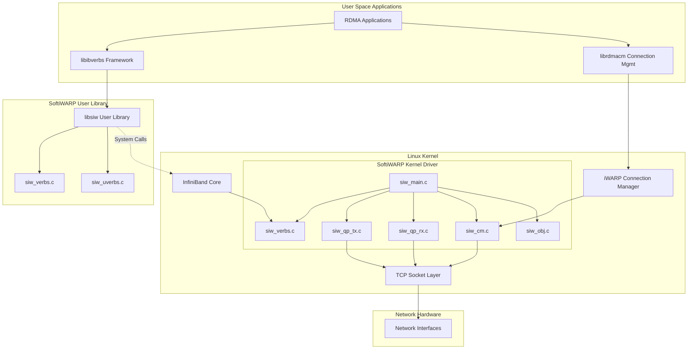
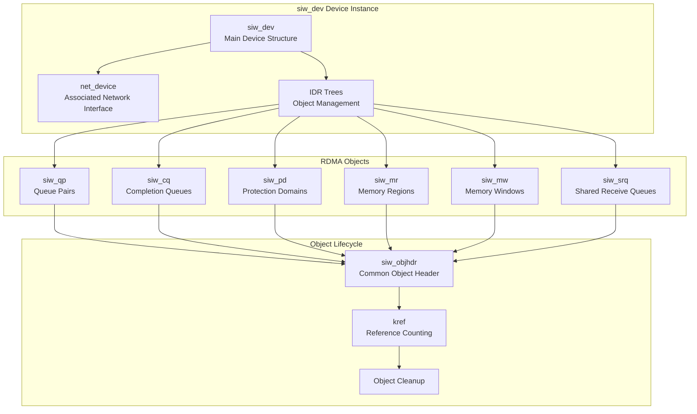
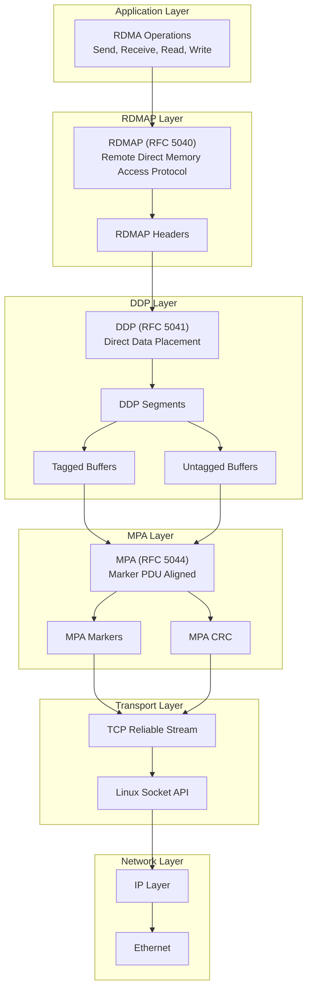
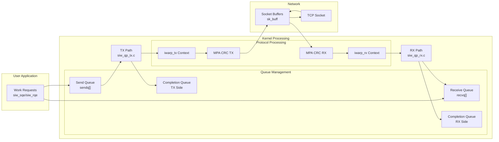

<!-- source: DeepWiki mcp.deepwiki.com · repo zrlio/softiwarp · page 1 Overview · fetched 2026-11-11 -->

# Overview

Relevant source files

The following files were used as context for generating this wiki page:

- [README.md](README.md)
- [kernel/siw.h](kernel/siw.h)
- [kernel/siw_cq.c](kernel/siw_cq.c)

## Purpose and Scope

SoftiWARP (siw) is a software implementation of the iWARP protocol suite that provides RDMA (Remote Direct Memory Access) functionality over standard TCP/IP networks without requiring dedicated RDMA hardware. This documentation covers the complete SoftiWARP system, including both the kernel driver components and the user-space library that together implement the iWARP protocols (MPA/DDP/RDMAP, IETF-RFC 5044/5041/5040) entirely in software.

For detailed information about building and installing the system, see [Build System and Installation](#6). For specifics about the kernel-userspace interface, see [User-Kernel Interface](#5).

**Note**: This repository is maintained for reference only. The SoftiWARP driver became part of upstream Linux with kernel 5.2 and is now maintained there.

## System Components

SoftiWARP consists of two primary components that work together to provide RDMA functionality:

| Component | Location | Purpose |
|-----------|----------|---------|
| Kernel Module (`siw`) | `kernel/` | Implements iWARP protocol processing, connection management, and data transfer |
| User Library (`libsiw`) | `userlib/` | Provides user-space RDMA verbs API and integrates with OpenFabrics framework |
| Common Headers | `common/` | Shared data structures and definitions between kernel and user space |

## Overall System Architecture

The following diagram shows how SoftiWARP integrates with the Linux networking stack and OpenFabrics ecosystem:

### SoftiWARP System Architecture

Sources: [README.md:11-34](), [kernel/siw.h:122-151]()

## Core Data Structures and Objects

SoftiWARP manages several key RDMA objects that are fundamental to its operation:

### SoftiWARP Object Hierarchy

Sources: [kernel/siw.h:122-151](), [kernel/siw.h:153-157](), [kernel/siw.h:175-178]()

## iWARP Protocol Stack Implementation

SoftiWARP implements the complete iWARP protocol stack as defined by IETF RFCs:

### iWARP Protocol Layers

Sources: [README.md:13-17](), [kernel/siw.h:409-454](), [kernel/siw.h:483-540]()

## Data Flow Architecture

The following diagram illustrates how data flows through the SoftiWARP system from application to network:

### SoftiWARP Data Flow

Sources: [kernel/siw.h:544-587](), [kernel/siw.h:409-454](), [kernel/siw.h:483-540]()

## Key System Characteristics

SoftiWARP provides the following key characteristics and capabilities:

- **Software-only Implementation**: No dedicated RDMA hardware required - runs over standard Ethernet
- **OpenFabrics Integration**: Compatible with standard RDMA applications through libibverbs
- **Kernel and User Space Support**: Supports both kernel-level and user-level RDMA applications  
- **TCP-based Transport**: Uses reliable TCP connections for data transport
- **Memory Management**: Efficient user memory registration and DMA operations
- **Connection Management**: Full iWARP connection establishment and teardown
- **Performance Optimization**: Multiple data paths including direct memory mapping for performance

The system limits are defined in [kernel/siw.h:68-82]() and include support for up to 102,400 Queue Pairs, 3.2M work requests, and 128 outstanding read operations per QP.

Sources: [README.md:11-28](), [kernel/siw.h:60-82](), [kernel/siw.h:90-119]()

---

