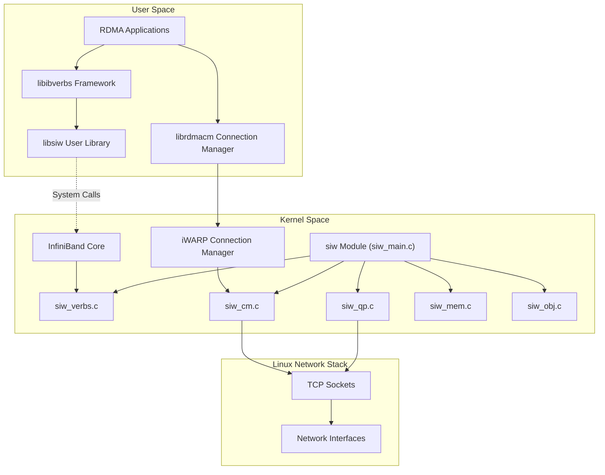
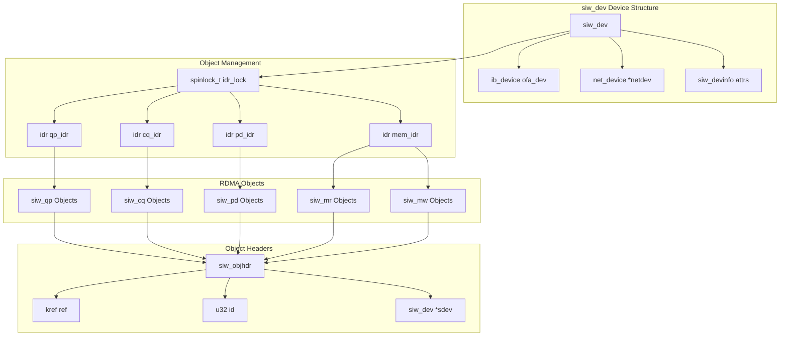
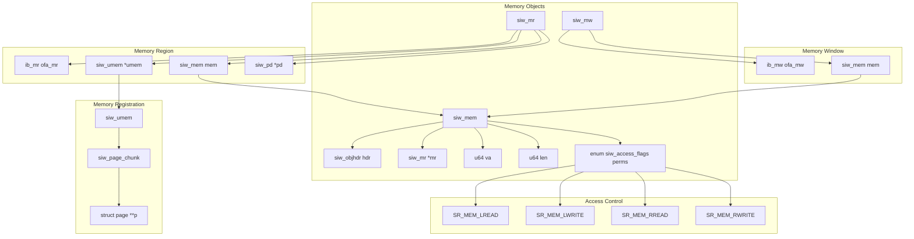
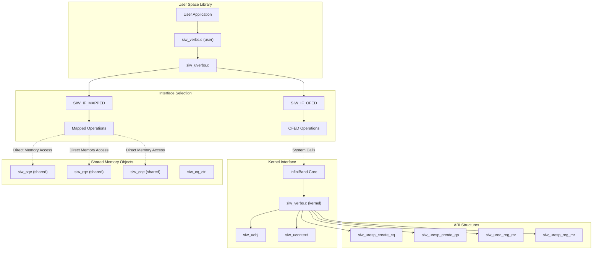
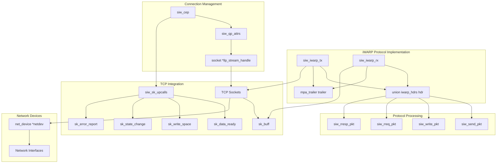
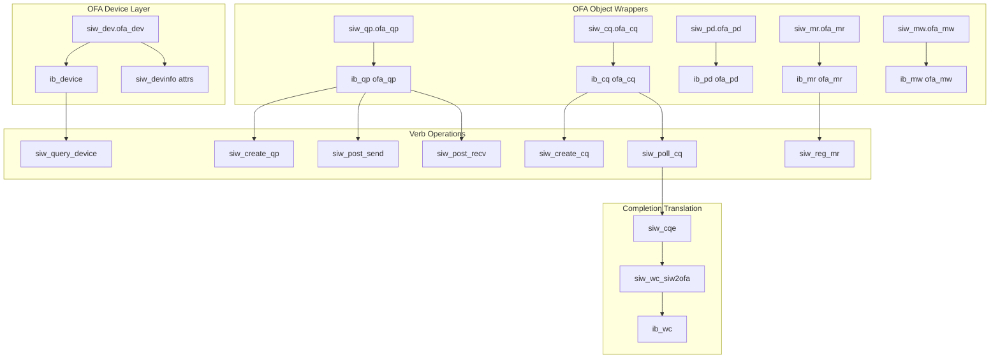

<!-- source: DeepWiki mcp.deepwiki.com · repo zrlio/softiwarp · page 2 System Architecture · fetched 2026-11-11 -->

# System Architecture

Relevant source files

The following files were used as context for generating this wiki page:

- [README.md](README.md)
- [common/siw_user.h](common/siw_user.h)
- [kernel/siw.h](kernel/siw.h)
- [kernel/siw_cq.c](kernel/siw_cq.c)

This document provides a detailed explanation of the SoftiWARP (siw) system architecture, focusing on the core data structures, component interactions, and the relationship between kernel and user space components. It covers the overall design patterns that enable software-based iWARP functionality over standard TCP sockets.

For information about specific kernel driver components, see [Kernel Driver Components](#3). For details about the user space library implementation, see [User Space Library](#4). For the user-kernel interface specifications, see [User-Kernel Interface](#5).

## Overall System Architecture

SoftiWARP implements a layered architecture that bridges RDMA applications with the Linux network stack through a software-only iWARP implementation. The system is split between user space and kernel space components that communicate through a well-defined ABI.

### System Components Overview

Sources: [README.md:11-28](), [kernel/siw.h:122-151]()

## Core Device and Object Management

The `siw_dev` structure serves as the central coordination point for all RDMA objects and device operations. It integrates with the OpenFabrics framework while managing object lifecycles through IDR trees and reference counting.

### Device and Object Hierarchy

Sources: [kernel/siw.h:122-151](), [kernel/siw.h:153-157]()

## Queue Pair Architecture

Queue pairs represent the core data transfer mechanism in SoftiWARP. Each `siw_qp` contains separate transmit and receive contexts, multiple work queues, and integrates with the completion queue system.

### Queue Pair Structure and Queues

```mermaid
graph TB
    subgraph "siw_qp Structure"
        QP["siw_qp"]
        OFA_QP["ib_qp ofa_qp"]
        HDR["siw_objhdr hdr"]
        ATTRS["siw_qp_attrs attrs"]
        
        QP --> OFA_QP
        QP --> HDR
        QP --> ATTRS
    end
    
    subgraph "Work Queues"
        SENDQ["siw_sqe *sendq"]
        RECVQ["siw_rqe *recvq"]
        IRQ["siw_sqe *irq"]
        ORQ["siw_sqe *orq"]
        
        SENDQ_GET["sq_get"]
        SENDQ_PUT["sq_put"]
        RECVQ_GET["rq_get"]
        RECVQ_PUT["rq_put"]
        IRQ_GET["irq_get"]
        IRQ_PUT["irq_put"]
        ORQ_GET["orq_get"]
        ORQ_PUT["orq_put"]
        
        SENDQ --> SENDQ_GET
        SENDQ --> SENDQ_PUT
        RECVQ --> RECVQ_GET
        RECVQ --> RECVQ_PUT
        IRQ --> IRQ_GET
        IRQ --> IRQ_PUT
        ORQ --> ORQ_GET
        ORQ --> ORQ_PUT
    end
    
    subgraph "Processing Contexts"
        RX_CTX["siw_iwarp_rx rx_ctx"]
        TX_CTX["siw_iwarp_tx tx_ctx"]
        
        RX_WQE["siw_wqe wqe_active"]
        TX_WQE["siw_wqe wqe_active"]
        
        RX_CTX --> RX_WQE
        TX_CTX --> TX_WQE
    end
    
    subgraph "Associated Objects"
        PD["siw_pd *pd"]
        SCQ["siw_cq *scq"]
        RCQ["siw_cq *rcq"]
        CEP["siw_cep *cep"]
        
        PD --> SCQ
        PD --> RCQ
        PD --> CEP
    end
    
    QP --> SENDQ
    QP --> RECVQ
    QP --> IRQ
    QP --> ORQ
    QP --> RX_CTX
    QP --> TX_CTX
    QP --> PD
```

Sources: [kernel/siw.h:544-587](), [common/siw_user.h:149-164]()

## Memory Management Architecture

SoftiWARP implements a sophisticated memory management system that handles user memory registration, DMA operations, and provides both Memory Regions (MR) and Memory Windows (MW) functionality.

### Memory Object Hierarchy

Sources: [kernel/siw.h:207-258](), [kernel/siw.h:180-190]()

## User-Kernel Communication Paths

SoftiWARP provides two distinct communication paths between user space and kernel: the standard OpenFabrics syscall interface and an optimized mapped interface for high-performance operations.

### Dual Interface Architecture

Sources: [kernel/siw.h:60-63](), [common/siw_user.h:63-95](), [kernel/siw.h:159-173]()

## Network Integration and Protocol Stack

SoftiWARP integrates with the Linux network stack through TCP sockets, implementing the complete iWARP protocol suite (MPA/DDP/RDMAP) in software while leveraging existing network infrastructure.

### Protocol Stack Integration

Sources: [kernel/siw.h:409-454](), [kernel/siw.h:483-540](), [kernel/siw.h:346-351](), [kernel/siw.h:391-392]()

## OpenFabrics Integration

SoftiWARP integrates seamlessly with the OpenFabrics architecture by implementing the required verb interfaces and maintaining compatibility with existing RDMA applications through the InfiniBand core layer.

### OFA Interface Implementation

Sources: [kernel/siw.h:90-119](), [kernel/siw_cq.c:52-62](), [kernel/siw_cq.c:67-88]()

---

