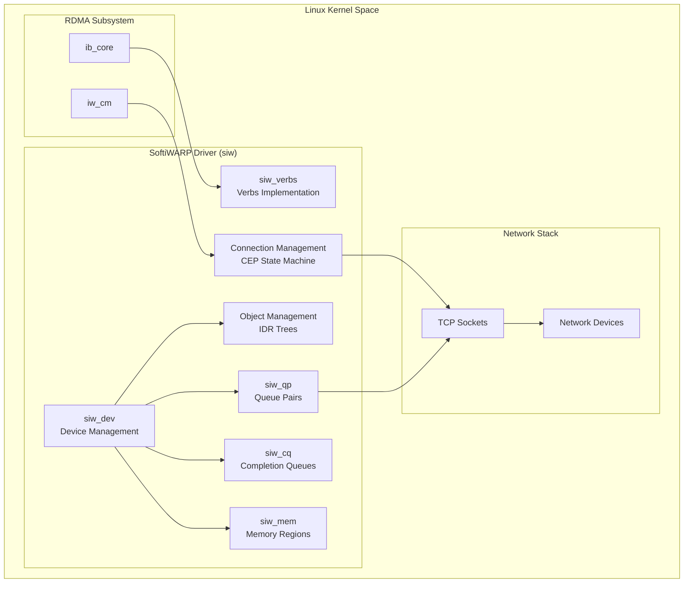
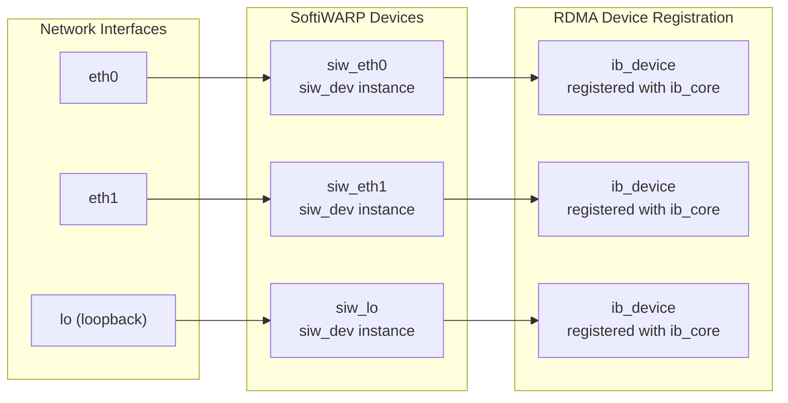
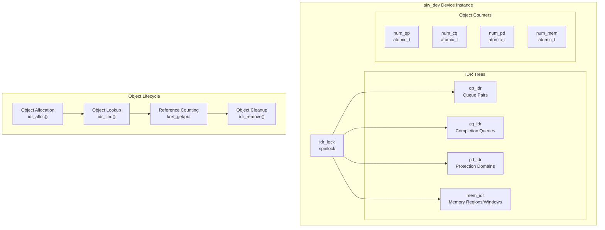
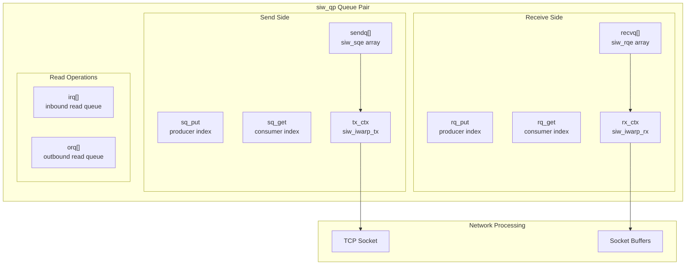
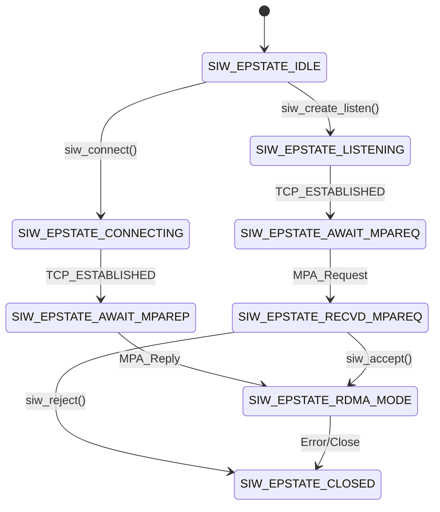
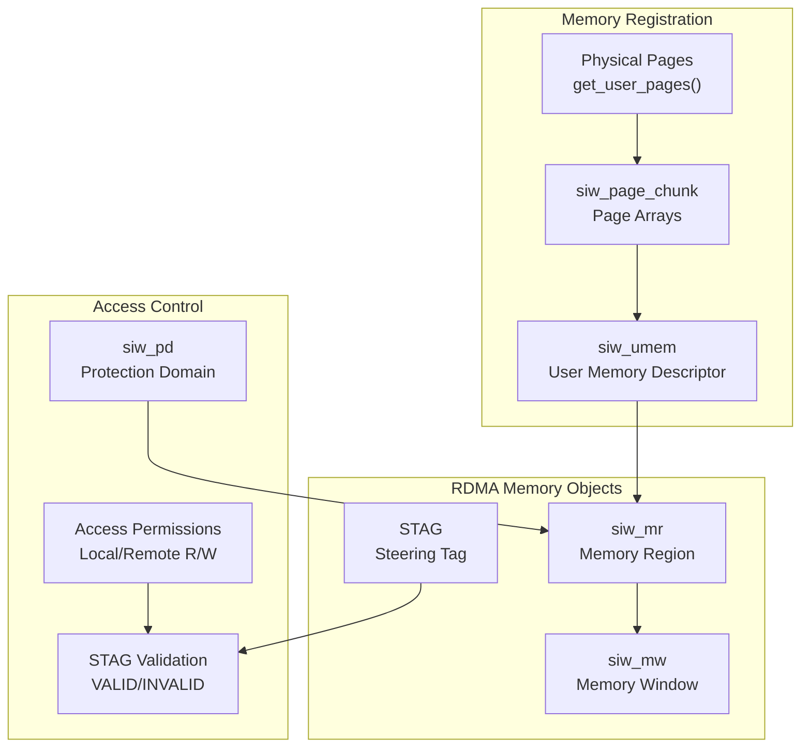

<!-- source: DeepWiki mcp.deepwiki.com · repo zrlio/softiwarp · page 3 Kernel Driver Components · fetched 2026-11-11 -->

# Kernel Driver Components

Relevant source files

The following files were used as context for generating this wiki page:

- [kernel/siw.h](kernel/siw.h)
- [kernel/siw_cq.c](kernel/siw_cq.c)
- [kernel/siw_main.c](kernel/siw_main.c)

## Purpose and Scope

This page provides an overview of the kernel-space components of the SoftiWARP (siw) driver, explaining how the kernel module implements iWARP functionality and integrates with the Linux networking stack and RDMA subsystem. It covers the core architectural components, data structures, and their interactions within the kernel driver.

For detailed implementation of specific components, see: Queue Pair Transmission ([3.1](#3.1)), Connection Management ([3.2](#3.2)), Queue Pair Reception ([3.3](#3.3)), Memory Management ([3.4](#3.4)), Object Management ([3.5](#3.5)), and Device and Module Management ([3.6](#3.6)). For user-space components, see User Space Library ([4](#4)).

## Core Architecture

The SoftiWARP kernel driver implements a software-based iWARP RDMA provider that operates over standard TCP sockets. The driver integrates with the Linux InfiniBand/RDMA subsystem to provide RDMA services to applications through the standard verbs interface.

Sources: [kernel/siw.h:122-151](), [kernel/siw_main.c:341-513]()

## Device and Registration Model

The siw driver follows a one-to-one mapping between network devices and RDMA devices. Each qualified network interface gets its own `siw_dev` instance that registers with the RDMA subsystem.

Sources: [kernel/siw_main.c:141-183](), [kernel/siw_main.c:517-620]()

## Core Data Structures

The kernel driver is built around several key data structures that represent RDMA objects and their relationships:

| Structure | Purpose | Key Fields |
|-----------|---------|------------|
| `siw_dev` | Main device representation | `netdev`, `attrs`, IDR trees, object counters |
| `siw_qp` | Queue Pair implementation | `tx_ctx`, `rx_ctx`, `sendq`, `recvq`, `attrs` |
| `siw_cq` | Completion Queue | `queue`, `cq_put`, `cq_get`, `num_cqe` |
| `siw_mem` | Memory region/window | `va`, `len`, `perms`, `stag_state` |
| `siw_pd` | Protection Domain | `hdr` (object header) |
| `siw_objhdr` | Common object header | `id`, `ref` (kref), `sdev` |

Sources: [kernel/siw.h:122-178](), [kernel/siw.h:222-258](), [kernel/siw.h:293-303](), [kernel/siw.h:544-587]()

## Object Management System

The driver uses Linux IDR (ID Radix) trees to manage RDMA objects, providing efficient lookup and allocation of object IDs. Each device maintains separate IDR trees for different object types.

Sources: [kernel/siw.h:135-149](), [kernel/siw.h:153-157]()

## Queue Pair Processing Architecture

Queue Pairs are the core data transfer mechanism, with separate TX and RX processing contexts that handle iWARP protocol operations over TCP connections.

Sources: [kernel/siw.h:544-587](), [kernel/siw.h:409-454](), [kernel/siw.h:483-540]()

## Connection and State Management  

The driver implements iWARP connection establishment through Connection Endpoints (CEPs) that manage the MPA handshake protocol and coordinate with Queue Pair state transitions.

Sources: [kernel/siw.h:305-315]() (QP states), connection management implementation in sub-components

## Memory Management Integration

The driver provides RDMA memory management through integration with Linux memory management, supporting both kernel and user memory registration with DMA operations.

Sources: [kernel/siw.h:203-258](), [kernel/siw.h:696-723]()

## Integration Points

The kernel driver integrates with several Linux subsystems:

- **RDMA Subsystem**: Registers as an `ib_device` with verbs operations
- **Network Stack**: Uses TCP sockets for iWARP transport  
- **Memory Management**: Integrates with page allocation and DMA mapping
- **Module Framework**: Standard Linux kernel module with parameter support
- **Debug Framework**: DebugFS integration for runtime diagnostics

The driver supports both kernel clients (direct verbs calls) and user-space applications (through uverbs), with different optimizations for each path.

Sources: [kernel/siw_main.c:39-770](), [kernel/siw.h:60-63]()

---

