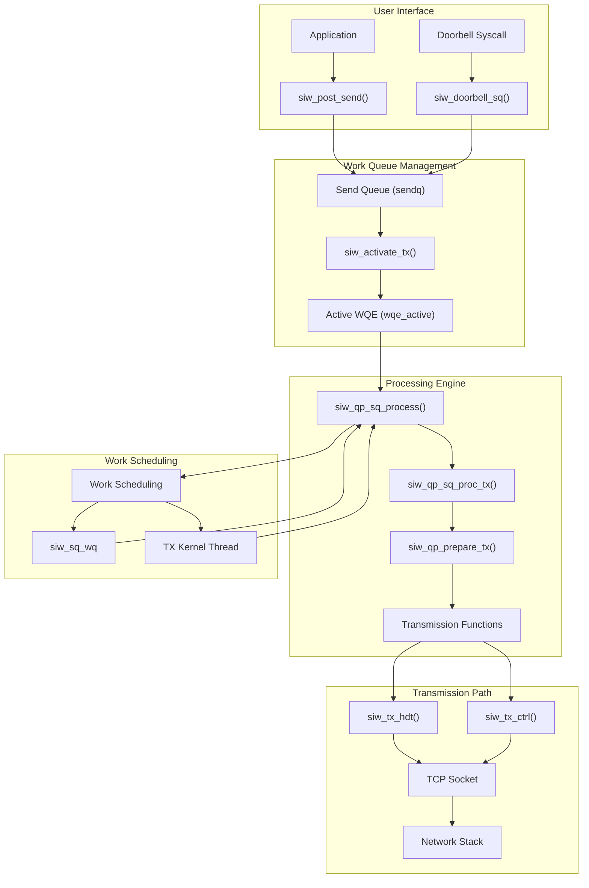
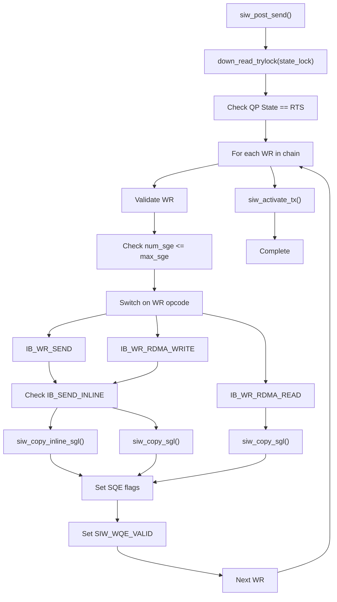
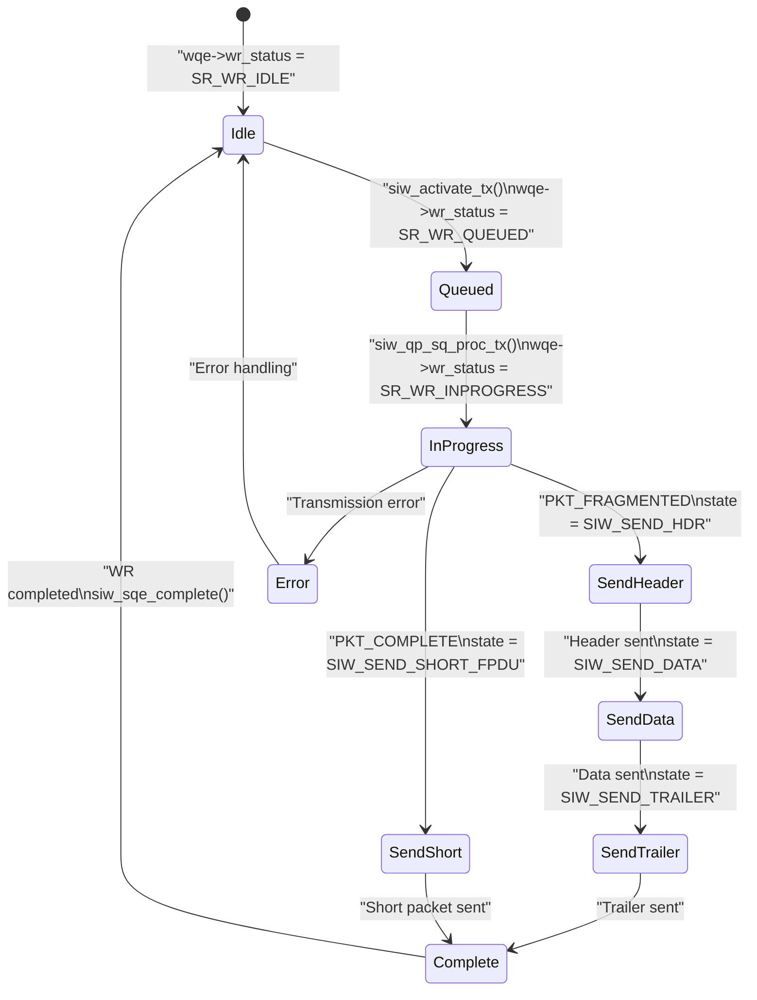
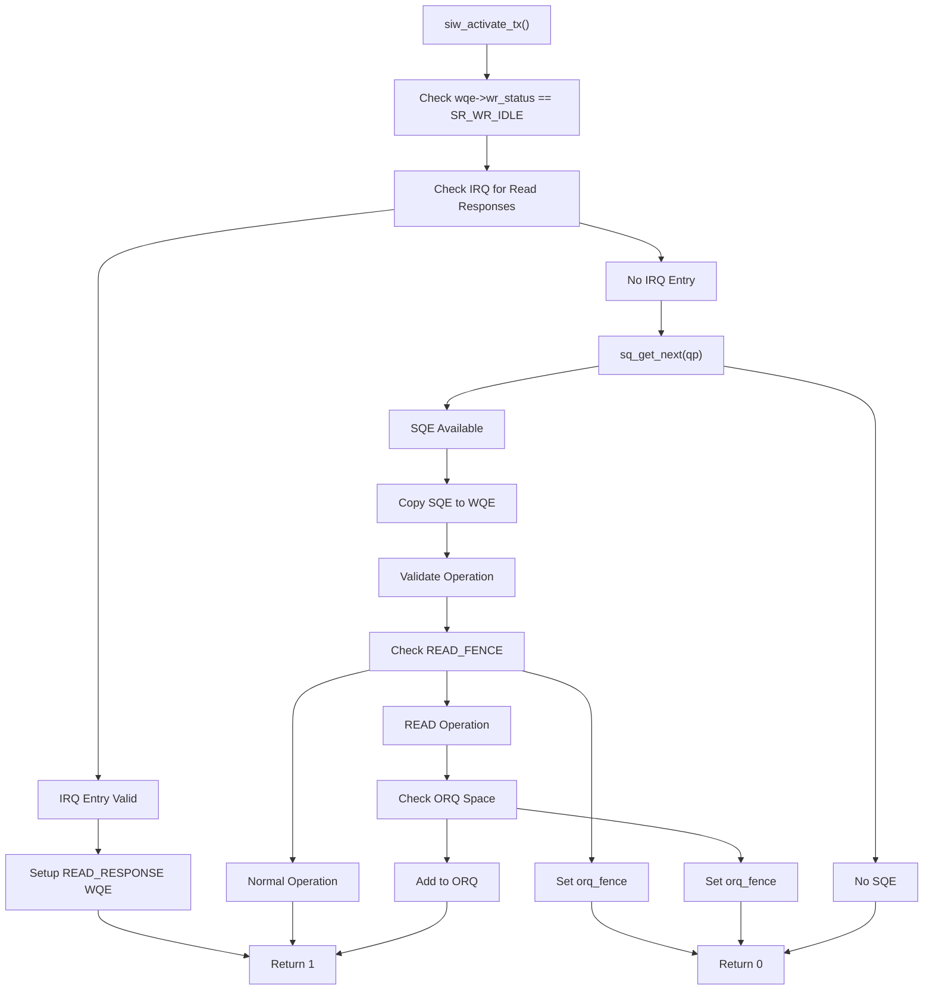
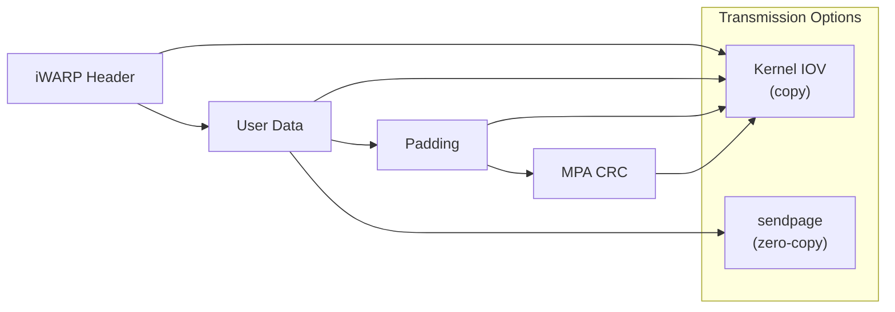
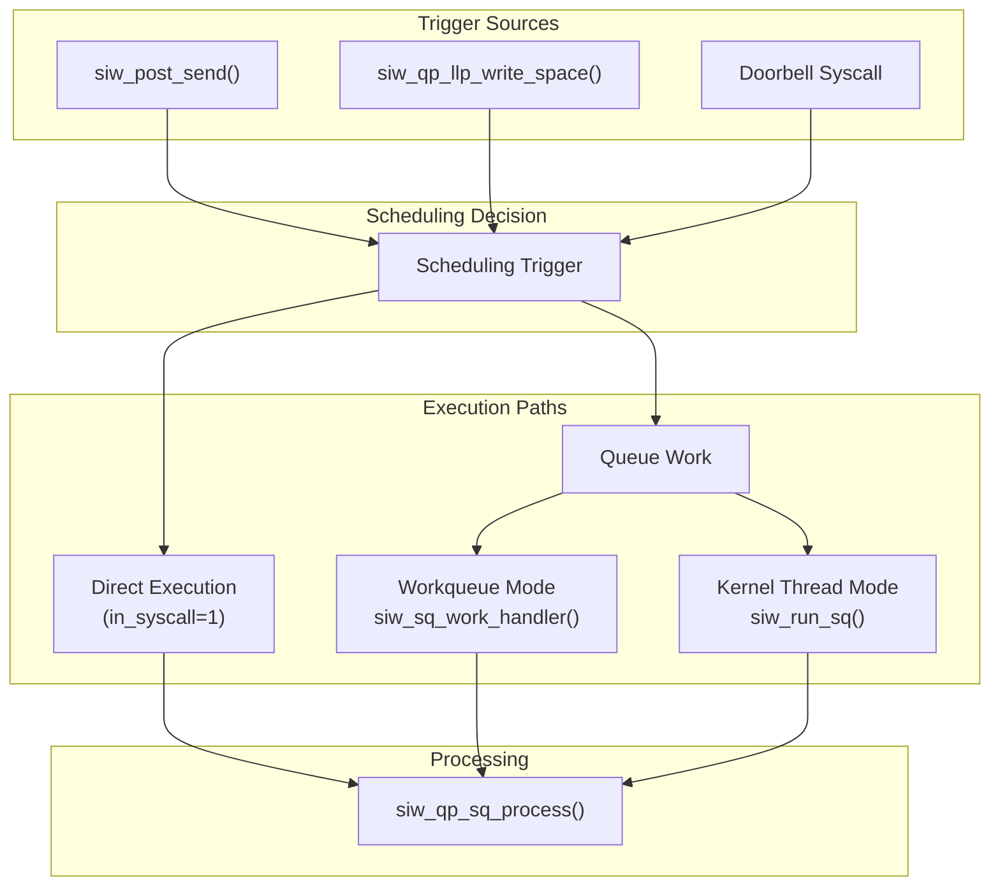

<!-- source: DeepWiki mcp.deepwiki.com · repo zrlio/softiwarp · page 3.1 Queue Pair Transmission · fetched 2026-11-11 -->

# Queue Pair Transmission

Relevant source files

The following files were used as context for generating this wiki page:

- [kernel/siw_qp.c](kernel/siw_qp.c)
- [kernel/siw_qp_tx.c](kernel/siw_qp_tx.c)
- [kernel/siw_verbs.c](kernel/siw_verbs.c)

This document covers the send queue processing, work request handling, and data transmission path in the SoftiWARP kernel driver. This is the most critical component of the system as it handles all outbound RDMA operations including SEND, WRITE, and READ requests.

For information about the receive path processing, see [Queue Pair Reception](#3.3). For connection establishment and management, see [Connection Management](#3.2).

## Overview

The Queue Pair transmission system implements the complete outbound data path for iWARP operations. It processes work requests posted by applications, manages send queue state, prepares iWARP protocol packets, and transmits data over TCP sockets. The system supports multiple operation types, zero-copy transmission optimizations, and both kernel and user-space work request posting.

## Architecture Components

**Sources:** [kernel/siw_qp_tx.c:1040-1188](), [kernel/siw_verbs.c:1020-1217](), [kernel/siw_qp.c:787-904]()

## Work Request Posting

Applications submit work requests through the `siw_post_send()` function, which validates requests and places them in the send queue for processing.

### Post Send Flow

**Sources:** [kernel/siw_verbs.c:1020-1217](), [kernel/siw_verbs.c:863-873](), [kernel/siw_verbs.c:884-913]()

### Send Queue Elements

The send queue contains `siw_sqe` structures representing individual work requests:

| Field | Purpose |
|-------|---------|
| `opcode` | Operation type (SEND, WRITE, READ) |
| `flags` | Control flags (INLINE, SIGNALLED, READ_FENCE) |
| `num_sge` | Number of scatter-gather elements |
| `sge[]` | Scatter-gather list |
| `rkey`/`raddr` | Remote memory key and address for RDMA ops |
| `id` | Work request identifier for completion |

**Sources:** [kernel/siw_verbs.c:1058-1174]()

## Send Queue Processing

The core processing engine is `siw_qp_sq_process()`, which continuously processes work requests from the send queue until completion or error.

### Processing State Machine

**Sources:** [kernel/siw_qp_tx.c:890-1002](), [kernel/siw_qp_tx.c:176-323]()

### Work Request Activation

The `siw_activate_tx()` function selects the next work request for processing, prioritizing pending read responses over new send queue entries:

**Sources:** [kernel/siw_qp.c:787-904]()

## Packet Preparation and Transmission

Work requests are converted into iWARP protocol packets through `siw_qp_prepare_tx()` and transmitted via specialized functions.

### Packet Types and Preparation

| Operation | Packet Type | Header Size | Special Handling |
|-----------|-------------|-------------|------------------|
| SEND | `iwarp_send` | 16 bytes | Supports inline data |
| WRITE | `iwarp_rdma_write` | 28 bytes | Supports inline data |
| READ | `iwarp_rdma_rreq` | 36 bytes | Request only |
| READ_RESPONSE | `iwarp_rdma_rresp` | 28 bytes | Response data |

**Sources:** [kernel/siw_qp_tx.c:184-266](), [kernel/siw_qp.c:80-151]()

### Transmission Mechanisms

The system supports two primary transmission mechanisms:

#### Header-Data-Trailer (HDT) Transmission

`siw_tx_hdt()` handles fragmented packets that may span multiple TCP segments:

**Sources:** [kernel/siw_qp_tx.c:480-719]()

#### Control Packet Transmission

`siw_tx_ctrl()` handles complete small packets that fit in a single TCP segment:

**Sources:** [kernel/siw_qp_tx.c:330-360]()

### Zero-Copy Optimization

For large transfers, the system can use zero-copy transmission via `sendpage()` when conditions are met:

- Payload > `SENDPAGE_THRESH`
- Work request not signalled
- No CRC calculation required
- Operation is not READ

**Sources:** [kernel/siw_qp_tx.c:314-320](), [kernel/siw_qp_tx.c:434-461]()

## Work Scheduling and Threading

The transmission system supports both workqueue-based and kernel thread-based scheduling for continued processing when transmission cannot complete immediately.

### Scheduling Architecture

**Sources:** [kernel/siw_qp_tx.c:1190-1413](), [kernel/siw_qp_tx.c:1220-1260](), [kernel/siw_qp_tx.c:1295-1366]()

### Burst Control

The system implements burst control to prevent excessive CPU usage:

- Default burst size: `SQ_USER_MAXBURST`
- Configurable per-QP burst limit in `qp->tx_ctx.burst`
- Returns `-EINPROGRESS` when burst limit reached to schedule continuation

**Sources:** [kernel/siw_qp_tx.c:894-948]()

## Error Handling and Completion

### Completion Processing

Successful work requests generate completions via `siw_sqe_complete()`, which places completion queue entries (CQEs) in the associated completion queue.

### Error Conditions

| Error | Cause | Action |
|-------|-------|--------|
| `-EAGAIN` | TCP send buffer full | Schedule retry |
| `-EINVAL` | Invalid operation/parameters | Complete with error |
| `-ECONNABORTED` | Connection lost | Flush remaining work |
| `-EMSGSIZE` | Packet too large | Complete with error |

**Sources:** [kernel/siw_qp_tx.c:1122-1182](), [kernel/siw_qp.c:1049-1117]()

### Queue Flushing

When errors occur or QP transitions to error state, `siw_sq_flush()` completes all pending work requests with flush error status.

**Sources:** [kernel/siw_qp.c:1049-1117]()

---

