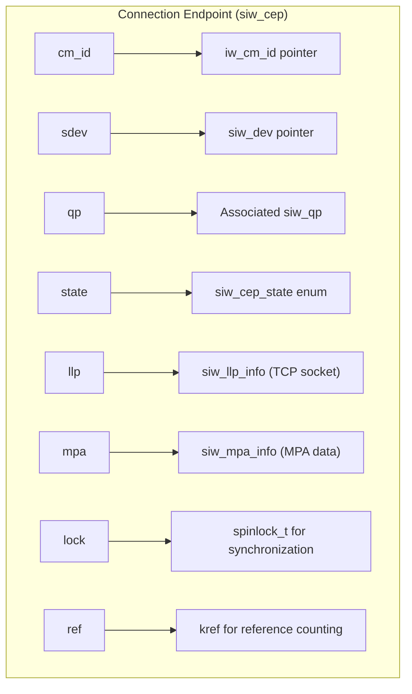
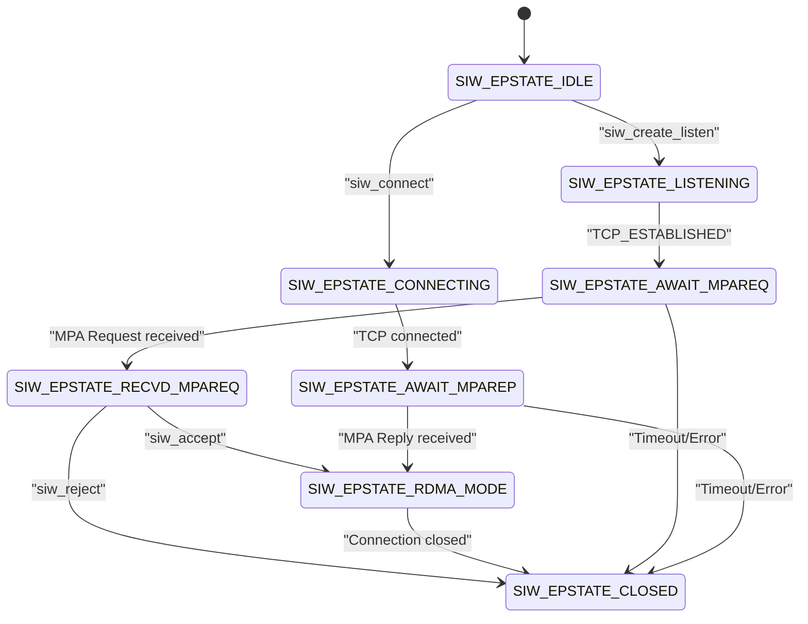
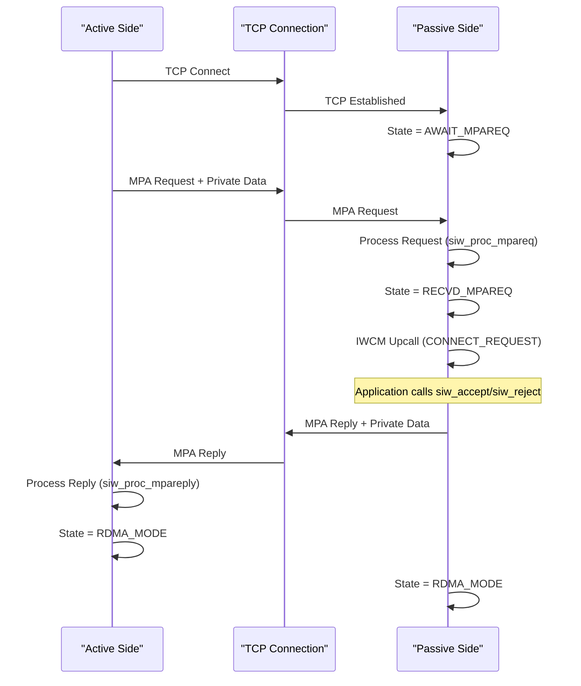
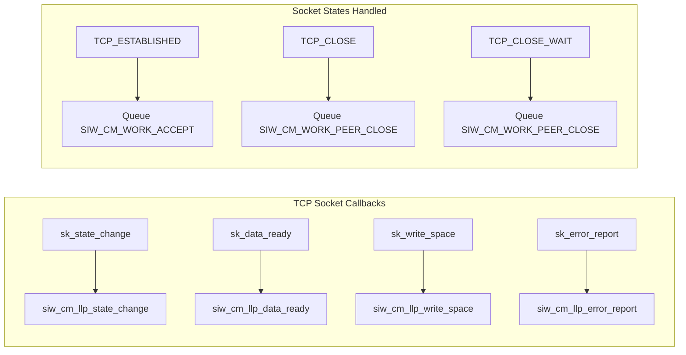
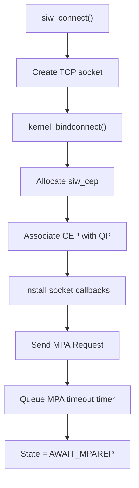
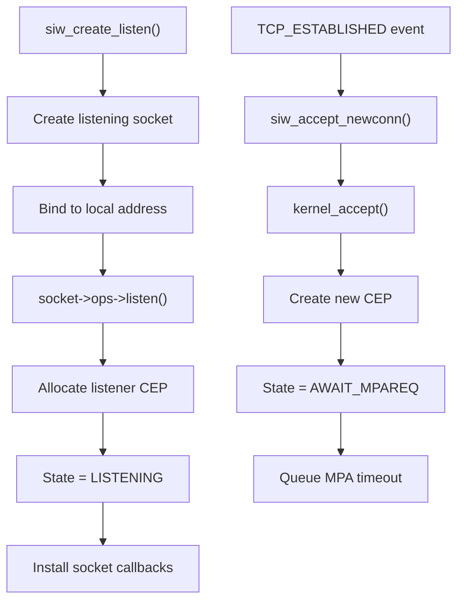
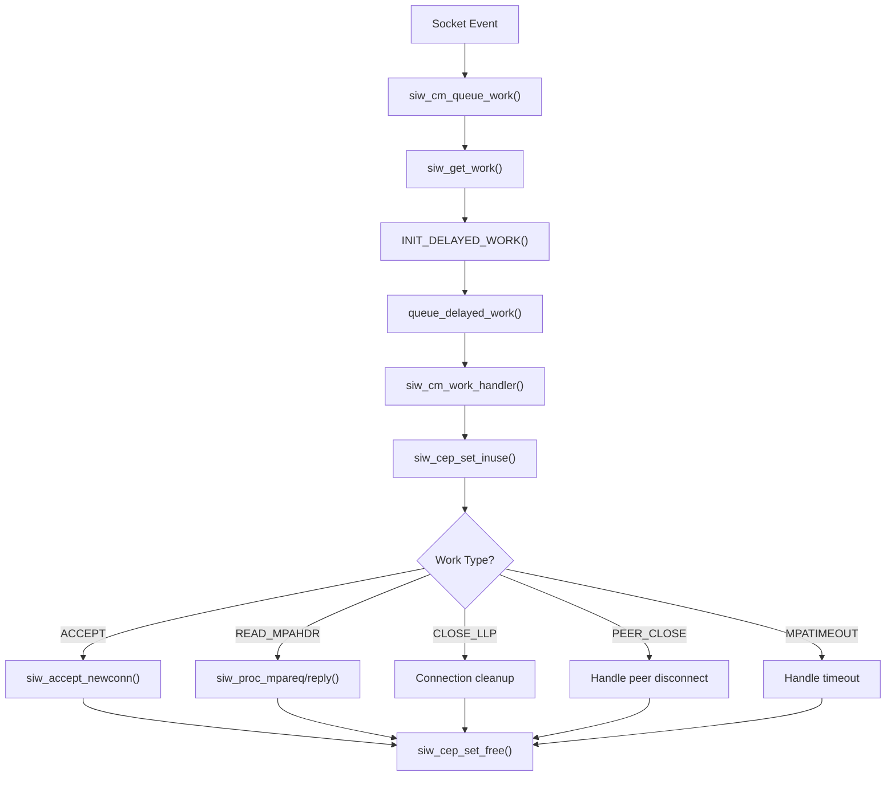
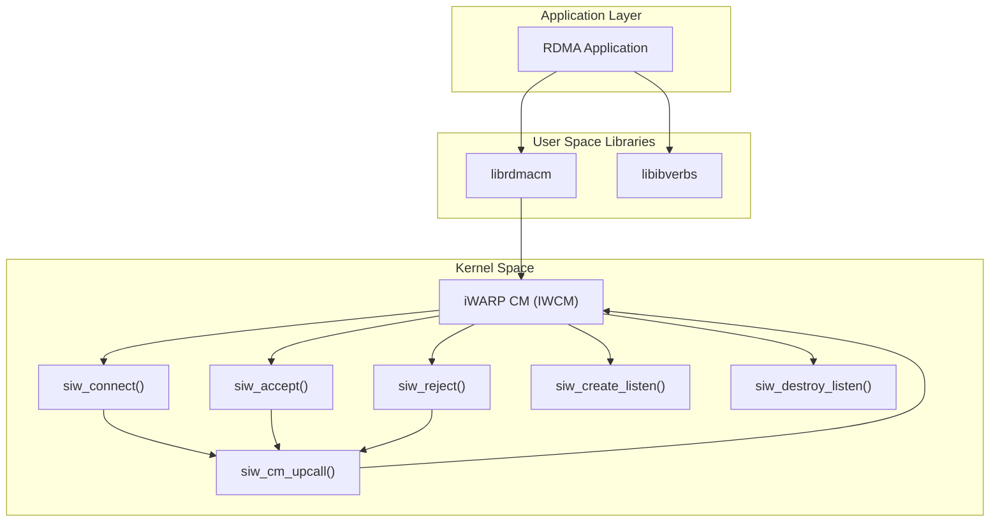

<!-- source: DeepWiki mcp.deepwiki.com · repo zrlio/softiwarp · page 3.2 Connection Management · fetched 2026-11-11 -->

# Connection Management

Relevant source files

The following files were used as context for generating this wiki page:

- [kernel/siw_cm.c](kernel/siw_cm.c)
- [kernel/siw_cm.h](kernel/siw_cm.h)
- [kernel/siw_debug.c](kernel/siw_debug.c)
- [kernel/siw_debug.h](kernel/siw_debug.h)
- [kernel/siw_obj.h](kernel/siw_obj.h)

This document covers the iWARP connection establishment and management functionality in the SoftiWARP kernel driver. Connection management handles the lifecycle of RDMA connections from initial listen/connect operations through MPA handshake to established RDMA mode. For information about queue pair operations after connection establishment, see [Queue Pair Transmission](#3.1) and [Queue Pair Reception](#3.3).

## Overview

The SoftiWARP connection management subsystem implements the iWARP connection model by bridging TCP sockets with RDMA semantics. It manages Connection Endpoints (CEPs) that represent the connection state and coordinates the MPA (Marker PDU Aligned) handshake protocol required by the iWARP specification.

The system provides both active (client) and passive (server) connection establishment through integration with the kernel's iWARP Connection Manager (IWCM) and maintains connection state through a well-defined state machine.

## Connection Endpoint Architecture

### Connection Endpoint Structure

The `siw_cep` structure serves as the central data structure for managing connection state:

**CEP State Management**

Sources: [kernel/siw_cm.h:48-57](), [kernel/siw_cm.h:74-108]()

### MPA Protocol Integration

The MPA handshake is implemented through the `siw_mpa_info` structure which tracks the exchange of MPA Request/Reply messages:

| Field | Purpose |
|-------|---------|
| `hdr` | MPA Request/Reply header in host byte order |
| `pdata` | Private data buffer |
| `bytes_rcvd` | Bytes received so far |

**MPA Handshake Flow**

Sources: [kernel/siw_cm.h:59-63](), [kernel/siw_cm.c:527-610](), [kernel/siw_cm.c:696-779]()

## Socket Integration

### Socket Callback Management

The connection management system integrates with Linux TCP sockets by installing custom callback functions that handle socket events:

The system saves original socket callbacks in the CEP structure and restores them when the connection is torn down, ensuring proper cleanup without interfering with normal socket operation.

Sources: [kernel/siw_cm.c:102-133](), [kernel/siw_cm.c:1219-1265]()

### Connection Establishment Functions

**Active Connection Establishment**

**Passive Connection Establishment**

Sources: [kernel/siw_cm.c:1298-1449](), [kernel/siw_cm.c:1830-1909](), [kernel/siw_cm.c:785-887]()

## Asynchronous Work Processing

### Work Queue System

Connection management uses a dedicated single-threaded workqueue (`siw_cm_wq`) to handle asynchronous connection events:

| Work Type | Trigger | Handler Function |
|-----------|---------|------------------|
| `SIW_CM_WORK_ACCEPT` | TCP_ESTABLISHED on listener | `siw_accept_newconn()` |
| `SIW_CM_WORK_READ_MPAHDR` | Socket data ready | `siw_proc_mpareq/reply()` |
| `SIW_CM_WORK_CLOSE_LLP` | QP close requested | Connection cleanup |
| `SIW_CM_WORK_PEER_CLOSE` | TCP socket closed | Peer disconnect handling |
| `SIW_CM_WORK_MPATIMEOUT` | MPA timer expired | Timeout processing |

**Work Processing Flow**

Sources: [kernel/siw_cm.c:1126-1157](), [kernel/siw_cm.c:890-1122](), [kernel/siw_cm.h:113-126]()

## Connection Management API

### Primary Interface Functions

The connection management subsystem exports the following functions to the iWARP Connection Manager:

| Function | Purpose | Key Parameters |
|----------|---------|----------------|
| `siw_connect()` | Initiate active connection | `iw_cm_id`, `iw_cm_conn_param` |
| `siw_accept()` | Accept incoming connection | `iw_cm_id`, `iw_cm_conn_param` |
| `siw_reject()` | Reject incoming connection | `iw_cm_id`, private data |
| `siw_create_listen()` | Create listening endpoint | `iw_cm_id`, backlog |
| `siw_destroy_listen()` | Destroy listening endpoint | `iw_cm_id` |

**Connection Management Integration**

### Reference Counting and Cleanup

CEPs use kernel reference counting (`kref`) for safe memory management across multiple contexts:

- CEPs are allocated with initial reference count of 1
- References are taken when associating with QPs, sockets, or work items  
- The `__siw_cep_dealloc()` function handles final cleanup when reference count reaches zero
- Cleanup includes MPA timer cancellation, socket disassociation, and work item cleanup

Sources: [kernel/siw_cm.c:134-151](), [kernel/siw_cm.c:272-294](), [kernel/siw_cm.c:457-471]()

## Error Handling and Timeouts

The connection management system implements robust error handling through:

- **MPA Timeouts**: Configurable timeouts for MPA Request (`MPAREQ_TIMEOUT`) and Reply (`MPAREP_TIMEOUT`) phases
- **Socket Error Handling**: Custom error report callbacks that propagate socket errors to the IWCM
- **State Validation**: Strict state checking to prevent invalid transitions
- **Resource Cleanup**: Automatic cleanup of sockets, timers, and references on error conditions

Sources: [kernel/siw_cm.h:110-111](), [kernel/siw_cm.c:214-225](), [kernel/siw_cm.c:1206-1217]()

---

