<!-- source: DeepWiki mcp.deepwiki.com · repo zrlio/softiwarp · page 3.3 Queue Pair Reception · fetched 2026-11-11 -->

# Queue Pair Reception

Relevant source files

The following files were used as context for generating this wiki page:

- [kernel/siw_qp_rx.c](kernel/siw_qp_rx.c)

## Purpose and Scope

This document covers the receive path processing in the SoftiWARP kernel driver, including DDP (Direct Data Placement) segment handling, iWARP message parsing, and data placement into target memory regions. The reception system processes incoming TCP data streams and converts them into RDMA operations targeting Queue Pairs.

For transmission path processing, see [Queue Pair Transmission](#3.1). For connection establishment, see [Connection Management](#3.2).

## Reception Architecture Overview

The SoftiWARP reception system implements a multi-stage pipeline that processes incoming TCP data and transforms it into completed RDMA operations. The system handles the complexity of reassembling fragmented DDP segments while maintaining strict ordering requirements.

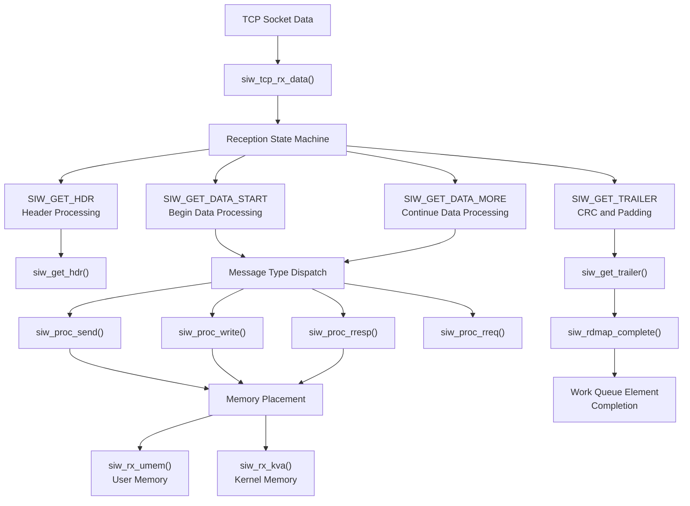

Sources: [kernel/siw_qp_rx.c:1201-1351]()

## DDP Segment Reassembly

The SoftiWARP receiver implements DDP reassembly with strict ordering constraints as defined by the iWARP specifications. The system relies on the transmitter's guarantee that DDP segments arrive in order for each RDMA message.

### Ordering Rules

The implementation enforces these key ordering principles:

| Rule | Description | Implementation |
|------|-------------|----------------|
| **Message Serialization** | RDMAP messages for same QP cannot be interleaved | State tracking in `siw_iwarp_rx` |
| **Segment Ordering** | DDP segments within message arrive in sequence | Error on out-of-order detection |
| **READ Response Ordering** | READ responses only start after READ request delivered | Completion fence mechanisms |

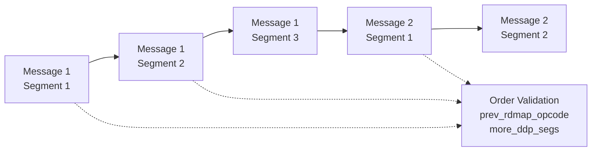

Sources: [kernel/siw_qp_rx.c:59-102]()

## Reception State Machine

The reception process operates through a finite state machine that processes each incoming socket buffer through distinct phases. The `siw_iwarp_rx` context maintains state across multiple socket buffer arrivals.

### State Transitions

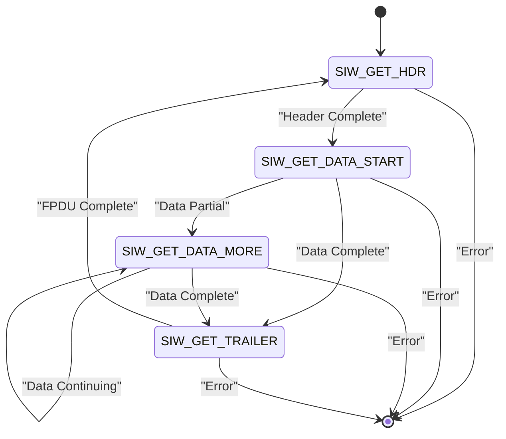

### State Processing Details

| State | Function | Purpose | Next State Logic |
|-------|----------|---------|------------------|
| `SIW_GET_HDR` | `siw_get_hdr()` | Parse iWARP header | Complete → `SIW_GET_DATA_START` |
| `SIW_GET_DATA_START` | `siw_rx_data()` | Begin payload processing | Partial → `SIW_GET_DATA_MORE` |
| `SIW_GET_DATA_MORE` | `siw_rx_data()` | Continue payload processing | Complete → `SIW_GET_TRAILER` |
| `SIW_GET_TRAILER` | `siw_get_trailer()` | Process CRC and padding | Complete → `SIW_GET_HDR` |

Sources: [kernel/siw_qp_rx.c:1224-1304]()

## Header Processing

The header processing phase extracts and validates iWARP protocol headers from the incoming TCP stream. Headers have variable lengths depending on the RDMA operation type.

### Header Structure Processing

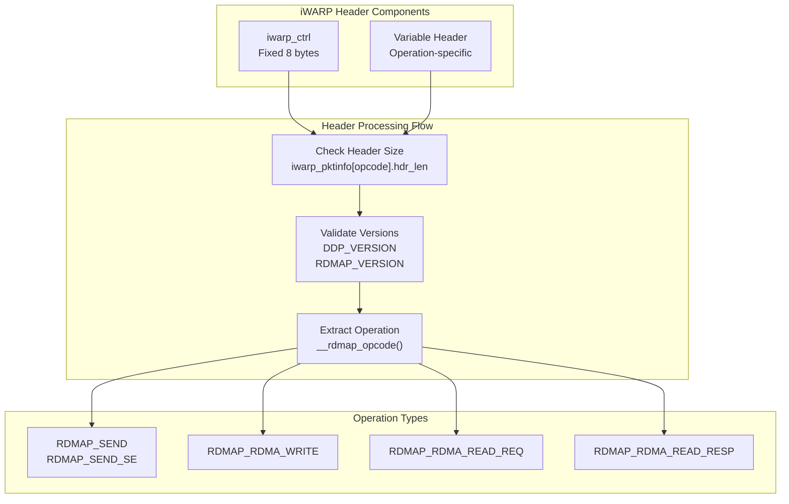

### Header Validation Functions

| Operation | Validation Function | Key Checks |
|-----------|-------------------|------------|
| SEND | `siw_send_check_ntoh()` | MSN sequence, MO offset, QN validation |
| WRITE | `siw_write_check_ntoh()` | STAG/TO consistency across fragments |
| READ RESP | `siw_rresp_check_ntoh()` | STAG/TO matching with original request |

Sources: [kernel/siw_qp_rx.c:929-1026](), [kernel/siw_qp_rx.c:236-378]()

## Message Type Processing

Different RDMA operations require specialized processing logic for data placement and completion handling. Each processor function handles the specific semantics of its operation type.

### SEND Message Processing

SEND operations place data into receive work queue elements (RQEs) and generate completions for the receiving application.

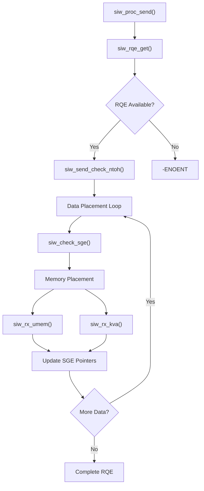

Sources: [kernel/siw_qp_rx.c:457-551]()

### WRITE Message Processing  

WRITE operations place data directly into memory regions specified by the remote STAG (Steering Tag) and TO (Tagged Offset).

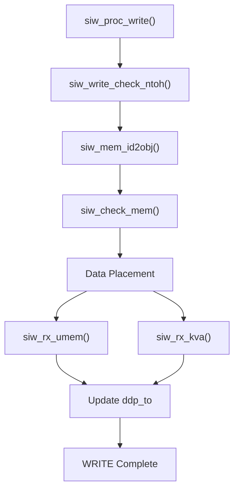

Sources: [kernel/siw_qp_rx.c:566-636]()

### READ Response Processing

READ responses place data into the memory region specified in the original READ request, which is retrieved from the Outbound Read Queue (ORQ).

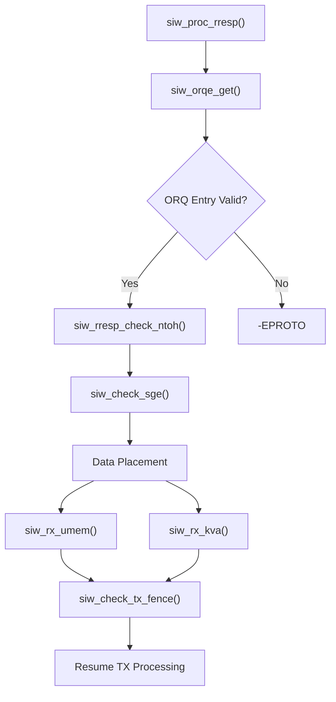

Sources: [kernel/siw_qp_rx.c:765-852](), [kernel/siw_qp_rx.c:729-753]()

## Memory Placement Operations

The reception system supports two primary memory placement paths: user memory (`siw_rx_umem`) and kernel virtual addresses (`siw_rx_kva`). Both paths handle data copying with optional CRC computation.

### User Memory Placement

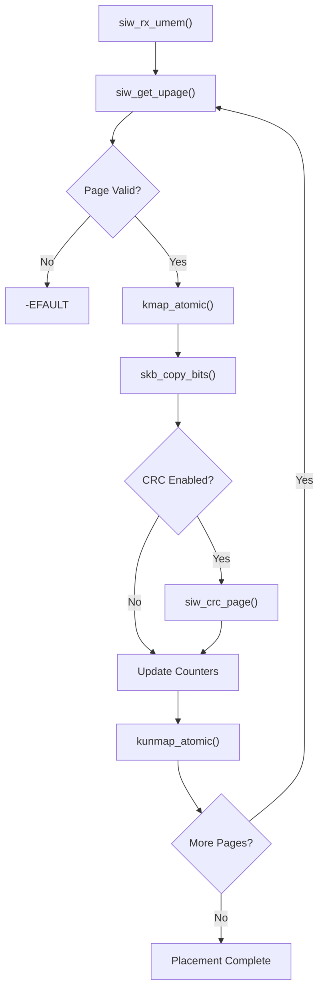

### Kernel Memory Placement

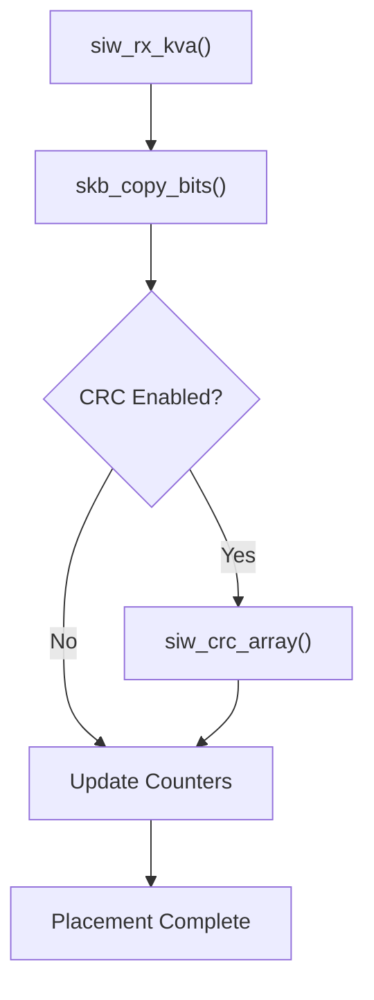

Sources: [kernel/siw_qp_rx.c:125-199](), [kernel/siw_qp_rx.c:201-223]()

## Completion Processing

Once a complete RDMA message has been received and processed, the `siw_rdmap_complete()` function handles operation-specific completion logic and work queue element cleanup.

### Completion Flow by Operation

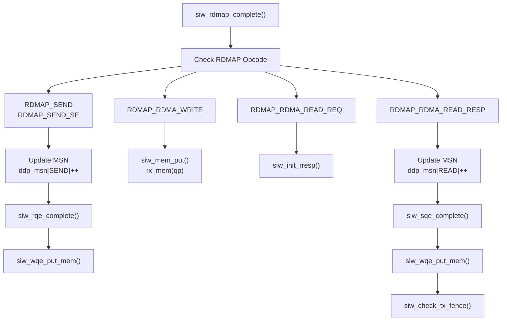

### MSN (Message Sequence Number) Management

| Queue Number | Purpose | MSN Update Location |
|--------------|---------|-------------------|
| `RDMAP_UNTAGGED_QN_SEND` | SEND operations | `siw_rdmap_complete()` for SEND |
| `RDMAP_UNTAGGED_QN_RDMA_READ` | READ responses | `siw_rdmap_complete()` for RRESP |

Sources: [kernel/siw_qp_rx.c:1102-1189]()

## Error Handling and Recovery

The reception system includes comprehensive error detection and handling mechanisms to maintain protocol integrity and provide diagnostic information for debugging.

### Error Categories

```mermaid
graph TB
    subgraph "Protocol Errors"
        VERSION_ERR["Version Mismatch<br/>DDP/RDMAP versions"]
        OPCODE_ERR["Invalid Opcode<br/>Unknown operation"]
        SEQUENCE_ERR["Sequence Error<br/>MSN/MO validation"]
    end
    
    subgraph "Memory Errors"  
        ACCESS_ERR["Access Violation<br/>siw_check_sge/mem"]
        FAULT_ERR["Page Fault<br/>siw_get_upage"]
        LENGTH_ERR["Length Mismatch<br/>Buffer overflow"]
    end
    
    subgraph "CRC Errors"
        CRC_HDR_ERR["Header CRC<br/>siw_crc_rxhdr"]
        CRC_DATA_ERR["Data CRC<br/>Trailer validation"]
    end
    
    subgraph "State Errors"
        STATE_ERR["Invalid State<br/>Unexpected transitions"]
        RESOURCE_ERR["Resource Exhaustion<br/>No RQE/ORQ available"]
    end
    
    VERSION_ERR --> FATAL["Fatal Error<br/>Connection Drop"]
    OPCODE_ERR --> FATAL
    CRC_HDR_ERR --> FATAL
    CRC_DATA_ERR --> FATAL
    
    ACCESS_ERR --> QP_EVENT["QP Event<br/>IB_EVENT_QP_ACCESS_ERR"]
    SEQUENCE_ERR --> QP_EVENT
    
    STATE_ERR --> CM_DROP["siw_qp_cm_drop()"]
    RESOURCE_ERR --> CM_DROP
```

Sources: [kernel/siw_qp_rx.c:1306-1342]()

## Integration with Queue Pair Context

The reception system integrates tightly with the Queue Pair's receive context (`siw_iwarp_rx`) and coordinates with transmission processing through shared work queue elements and fence mechanisms.

### Context Structure Relationships

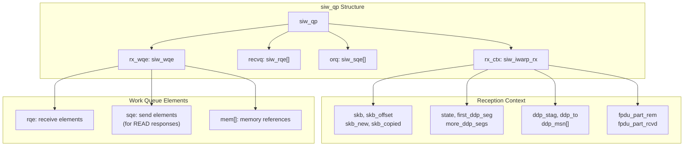

Sources: [kernel/siw_qp_rx.c:1204-1215]()

---

