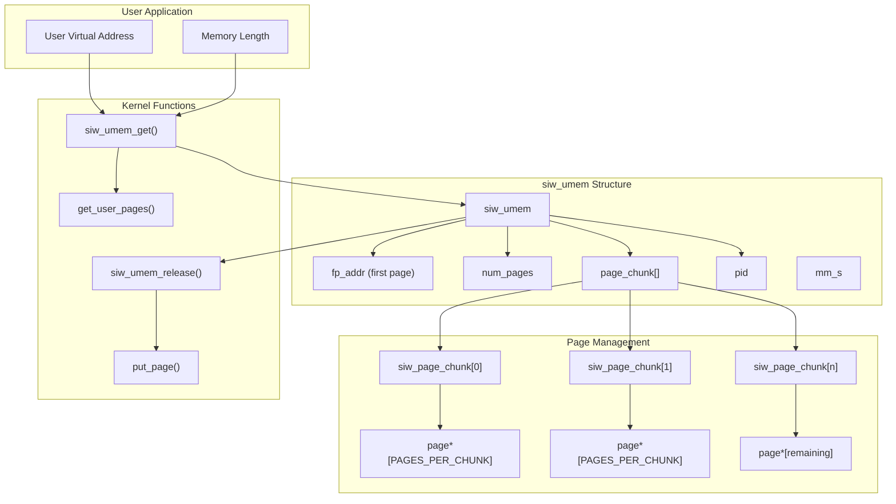
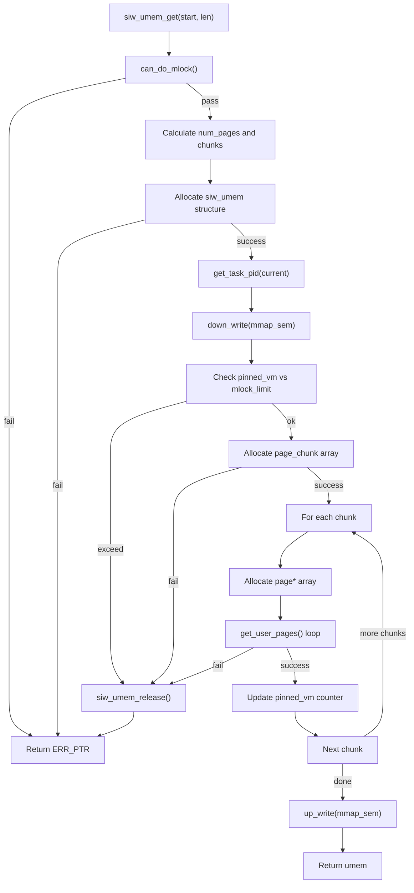
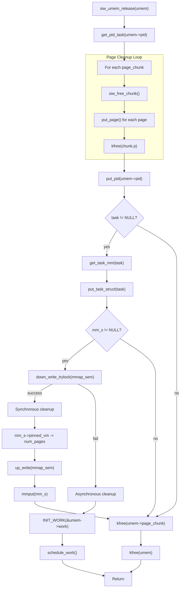
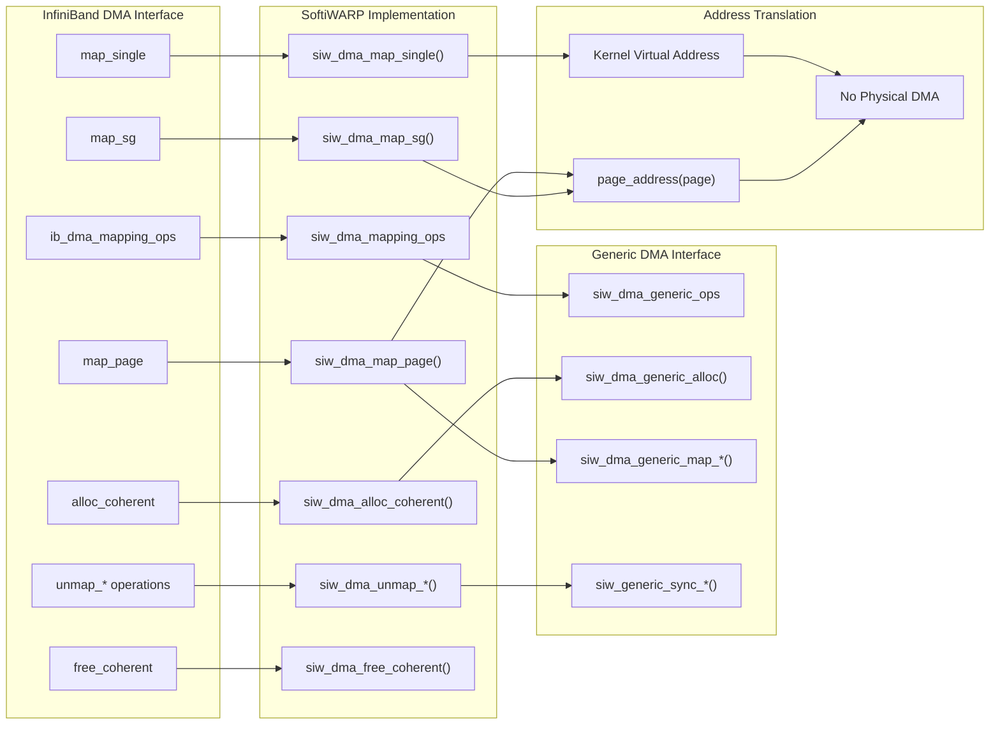
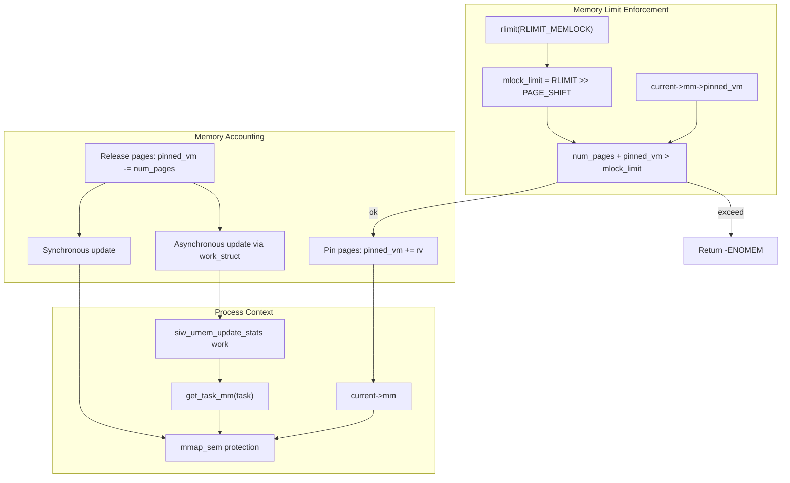

<!-- source: DeepWiki mcp.deepwiki.com · repo zrlio/softiwarp · page 3.4 Memory Management · fetched 2026-11-11 -->

# Memory Management

Relevant source files

The following files were used as context for generating this wiki page:

- [kernel/siw_mem.c](kernel/siw_mem.c)

## Purpose and Scope

This document covers the memory management subsystem within the SoftiWARP kernel driver, focusing on how user memory regions are pinned, managed, and made available for RDMA operations. The memory management component handles user memory registration, page pinning, DMA address translation, and memory accounting within kernel limits.

For information about RDMA object lifecycle management including memory regions and protection domains, see [Object Management](#3.5). For details on how memory regions are used during data transfer, see [Queue Pair Transmission](#3.1) and [Queue Pair Reception](#3.3).

## User Memory Management Architecture

The SoftiWARP memory management system centers around the `siw_umem` structure, which represents a pinned user memory region. The system manages user virtual memory by pinning pages and organizing them into manageable chunks for efficient processing.

The memory management system divides user memory regions into chunks to handle large memory registrations efficiently. Each chunk contains up to `PAGES_PER_CHUNK` pages, allowing the system to process memory in manageable units.

Sources: [kernel/siw_mem.c:114-185](), [kernel/siw_mem.c:77-112]()

## Memory Registration Process

The `siw_umem_get()` function implements the core memory registration logic, performing permission checks, memory limit validation, and page pinning operations.

The registration process includes several critical steps:

| Step | Function | Purpose |
|------|----------|---------|
| Permission Check | `can_do_mlock()` | Verify process can lock memory |
| Address Alignment | `PAGE_MASK`, `PAGE_ALIGN` | Align to page boundaries |
| Chunk Calculation | `CHUNK_SHIFT` | Determine number of page chunks |
| Memory Limits | `rlimit(RLIMIT_MEMLOCK)` | Enforce system memory limits |
| Page Pinning | `get_user_pages()` | Pin user pages in memory |
| Accounting | `pinned_vm` updates | Track pinned memory usage |

Sources: [kernel/siw_mem.c:114-185]()

## Memory Release and Cleanup

The memory release process handles both synchronous and asynchronous cleanup scenarios, managing process termination cases and memory accounting updates.

The cleanup process includes a deferred work mechanism (`siw_umem_update_stats`) to handle cases where the memory map semaphore cannot be acquired immediately, ensuring memory accounting remains consistent even during process termination scenarios.

Sources: [kernel/siw_mem.c:77-112](), [kernel/siw_mem.c:50-65](), [kernel/siw_mem.c:67-75]()

## DMA Operations Interface

SoftiWARP implements custom DMA operations that work with kernel virtual addresses rather than physical DMA addresses, since it operates as a software-based RDMA implementation over TCP.

Key characteristics of SoftiWARP DMA operations:

| Operation | Implementation | Purpose |
|-----------|----------------|---------|
| `siw_dma_map_single` | Return `(u64) kva` | Direct kernel virtual address mapping |
| `siw_dma_map_page` | Return `page_address(page) + offset` | Page-based virtual address mapping |
| `siw_dma_map_sg` | Set `sg->dma_address` to page addresses | Scatter-gather virtual mapping |
| `siw_dma_unmap_*` | No-op functions | No unmapping required for virtual addresses |
| `siw_dma_alloc_coherent` | `alloc_pages()` + `page_address()` | Allocate kernel pages |
| `siw_mapping_error` | Check for null address | Simple error detection |

Sources: [kernel/siw_mem.c:194-308](), [kernel/siw_mem.c:310-428]()

## Memory Accounting and Limits

The memory management system enforces system limits and tracks memory usage to prevent resource exhaustion and ensure fair resource allocation among processes.

The accounting system handles several critical scenarios:

**During Registration (`siw_umem_get`)**:
- Checks current process memory limits using `rlimit(RLIMIT_MEMLOCK)`
- Validates that pinning additional pages won't exceed limits
- Updates `current->mm->pinned_vm` under `mmap_sem` protection

**During Release (`siw_umem_release`)**:
- Attempts synchronous cleanup with `down_write_trylock()`
- Falls back to asynchronous cleanup via `schedule_work()` if semaphore busy
- Maintains accounting consistency across process termination

**Memory Limit Parameters**:
- `RLIMIT_MEMLOCK`: System-wide memory locking limit per process
- `pinned_vm`: Current count of pinned virtual memory pages
- `PAGES_PER_CHUNK`: Chunk size for efficient page management (defined via `CHUNK_SHIFT`)

Sources: [kernel/siw_mem.c:114-185](), [kernel/siw_mem.c:77-112](), [kernel/siw_mem.c:50-65]()

---

