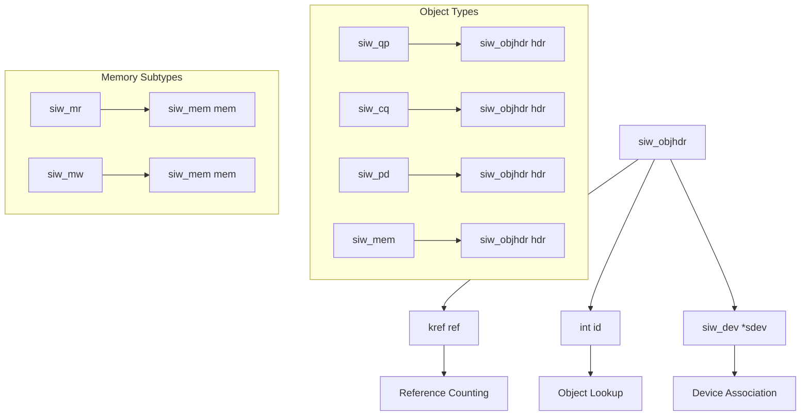
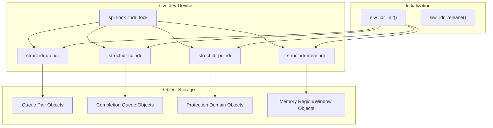
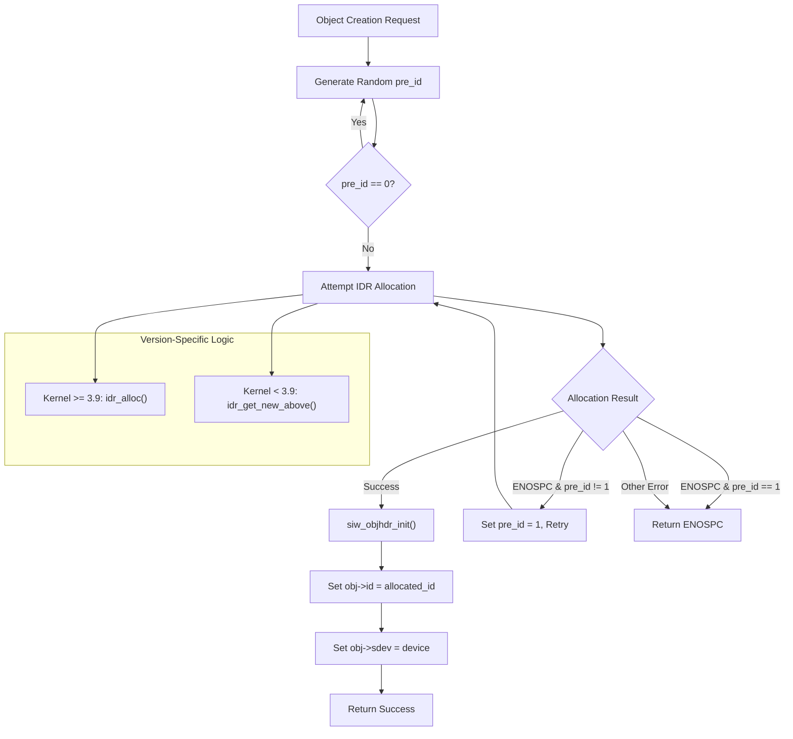
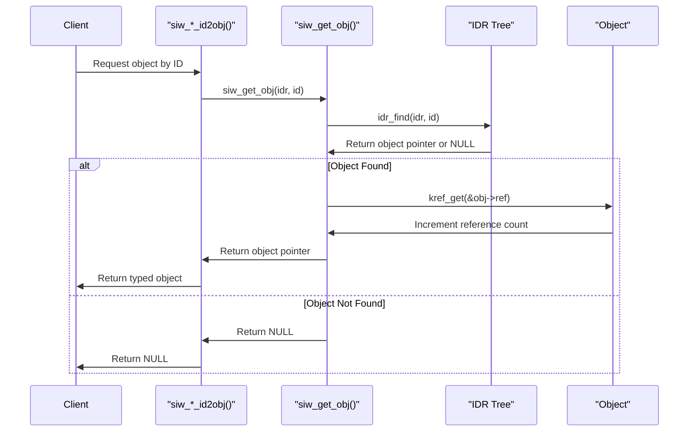
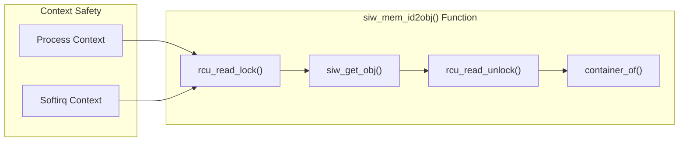
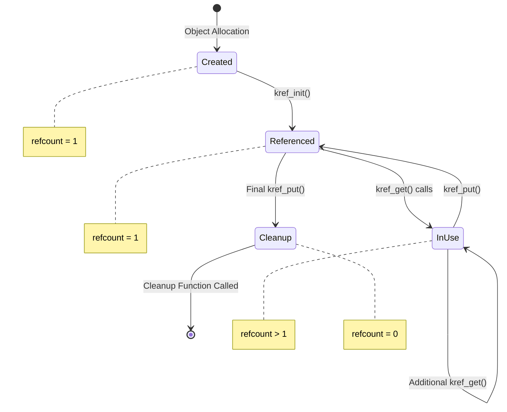
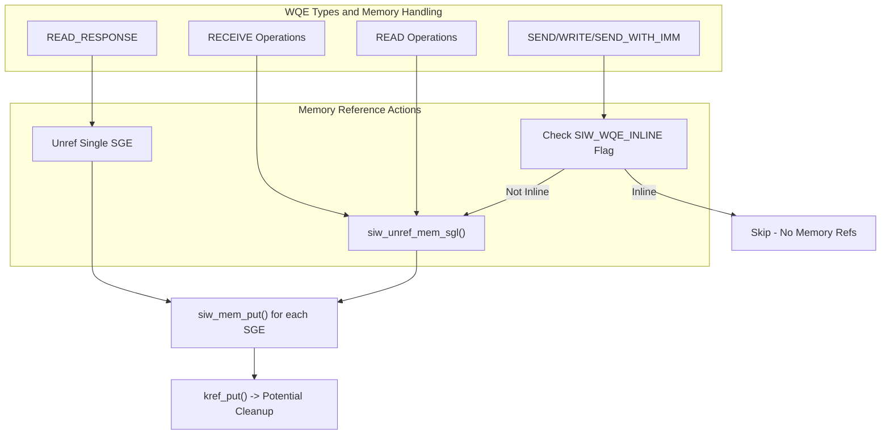
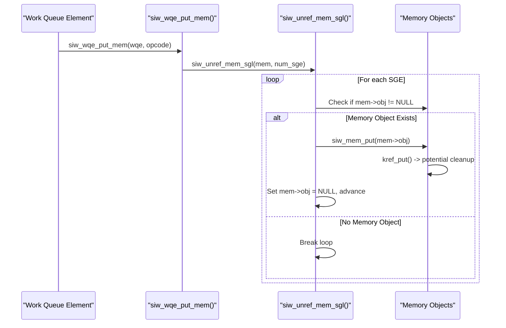

<!-- source: DeepWiki mcp.deepwiki.com · repo zrlio/softiwarp · page 3.5 Object Management · fetched 2026-11-11 -->

# Object Management

Relevant source files

The following files were used as context for generating this wiki page:

- [kernel/siw_obj.c](kernel/siw_obj.c)

This document covers the RDMA object lifecycle management system in the SoftiWARP kernel driver. This system provides the foundational infrastructure for creating, tracking, and cleaning up all RDMA objects including Queue Pairs (QPs), Completion Queues (CQs), Protection Domains (PDs), and Memory Regions/Windows (MRs/MWs). The object management system ensures thread-safe access, automatic cleanup, and efficient lookup of objects by unique identifiers.

For information about the higher-level device and module initialization, see [Device and Module Management](#3.6). For details about memory region registration and DMA operations, see [Memory Management](#3.4).

## Object Types and Hierarchy

The SoftiWARP object management system handles four primary RDMA object types, each represented by a different IDR (ID Radix tree) within the device structure. All objects share a common header structure for unified management.

### Object Header Structure

Sources: [kernel/siw_obj.c:48-51](), [kernel/siw_obj.c:328-340](), [kernel/siw_obj.c:342-372](), [kernel/siw_obj.c:374-384](), [kernel/siw_obj.c:386-407]()

### IDR Management System

The device maintains separate IDR trees for each object type, providing fast O(log n) lookup by integer ID with thread-safe access through spinlocks.

Sources: [kernel/siw_obj.c:53-61](), [kernel/siw_obj.c:63-69]()

## Object Allocation and ID Assignment

Object allocation follows a two-phase process: first adding the object to the appropriate IDR tree with a randomly assigned ID, then initializing the object header with reference counting.

### ID Assignment Algorithm

Sources: [kernel/siw_obj.c:105-133](), [kernel/siw_obj.c:71-103](), [kernel/siw_obj.c:281-310](), [kernel/siw_obj.c:229-274]()

### Object-Specific Addition Functions

Each object type has a dedicated addition function that calls the generic `siw_add_obj()` with the appropriate IDR tree:

| Function | IDR Tree | Special Handling |
|----------|----------|------------------|
| `siw_qp_add()` | `sdev->qp_idr` | Standard random ID assignment |
| `siw_cq_add()` | `sdev->cq_idr` | Standard random ID assignment |
| `siw_pd_add()` | `sdev->pd_idr` | Standard random ID assignment |
| `siw_mem_add()` | `sdev->mem_idr` | Limited to `SIW_STAG_MAX` for STag compatibility |

Sources: [kernel/siw_obj.c:190-198](), [kernel/siw_obj.c:200-208](), [kernel/siw_obj.c:210-218](), [kernel/siw_obj.c:281-310]()

## Object Lookup and Reference Management

Object retrieval is performed through type-specific lookup functions that combine IDR lookup with automatic reference counting to ensure objects remain valid during use.

### Lookup Process Flow

Sources: [kernel/siw_obj.c:135-144](), [kernel/siw_obj.c:146-153](), [kernel/siw_obj.c:155-162](), [kernel/siw_obj.c:171-188]()

### Memory Object Lookup with RCU

Memory objects require special handling due to potential access from softirq context during packet processing:

Sources: [kernel/siw_obj.c:171-188]()

## Reference Counting and Object Lifecycle

The object management system uses Linux kernel reference counting (`kref`) to ensure objects are automatically freed when no longer in use. Each object type has a specific cleanup function registered with its reference counter.

### Reference Counting Operations

Sources: [kernel/siw_obj.c:48-51](), [kernel/siw_obj.c:410-415](), [kernel/siw_obj.c:417-422](), [kernel/siw_obj.c:424-429](), [kernel/siw_obj.c:431-436]()

### Object Cleanup Functions

Each object type has a dedicated cleanup function that handles type-specific resource deallocation:

| Object Type | Cleanup Function | Special Actions |
|-------------|------------------|-----------------|
| CQ | `siw_free_cq()` | Free queue memory with `vfree()`, decrement `num_cq` |
| QP | `siw_free_qp()` | Free send/recv/irq/orq queues, remove from device list, release CEP |
| PD | `siw_free_pd()` | Simple cleanup, decrement `num_pd` |
| Memory | `siw_free_mem()` | Handle MR vs MW cleanup, release user memory, use RCU for deferred free |

Sources: [kernel/siw_obj.c:328-340](), [kernel/siw_obj.c:342-372](), [kernel/siw_obj.c:374-384](), [kernel/siw_obj.c:386-407]()

## Work Queue Element Memory Management

The object management system also handles memory reference management for Work Queue Elements (WQEs), ensuring that memory regions referenced by work requests remain valid during processing.

### WQE Memory Reference Handling

Sources: [kernel/siw_obj.c:453-476](), [kernel/siw_obj.c:441-451]()

### Memory SGE Cleanup Process

The `siw_unref_mem_sgl()` function iterates through scatter-gather entries and releases memory object references:

Sources: [kernel/siw_obj.c:441-451](), [kernel/siw_obj.c:453-476]()

---

