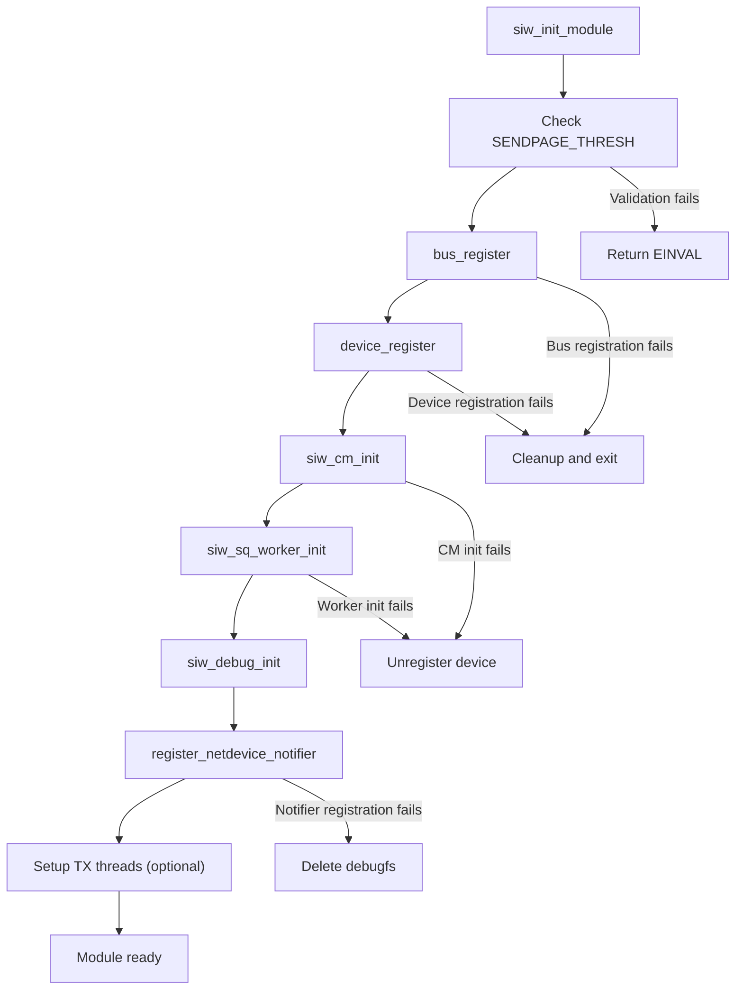
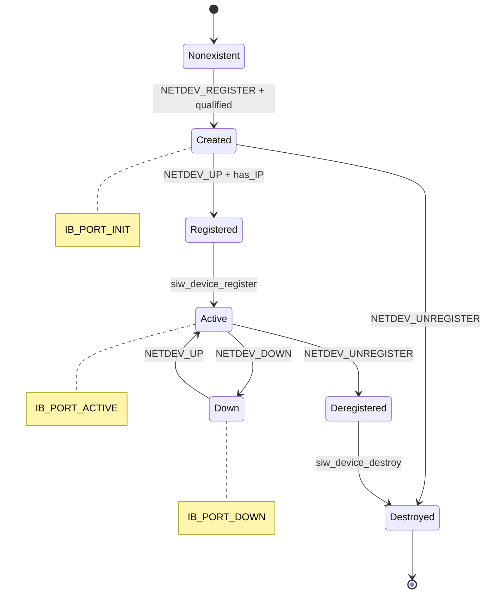
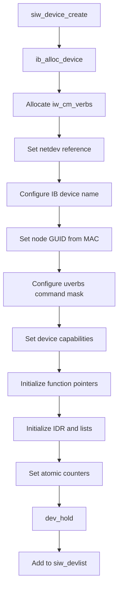
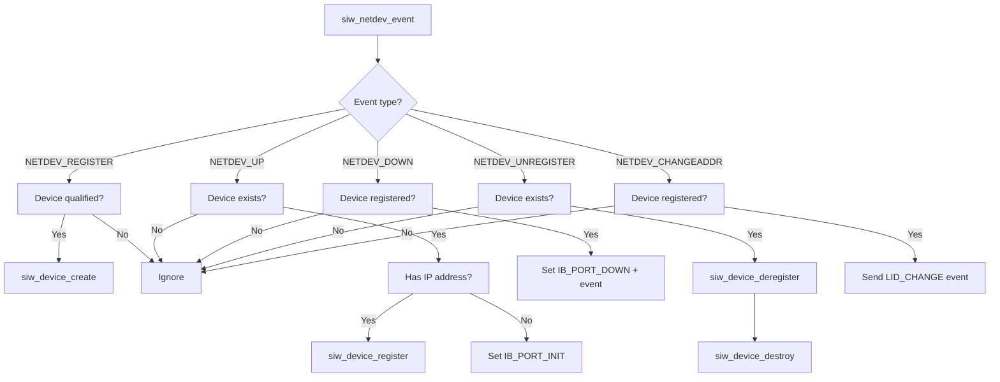
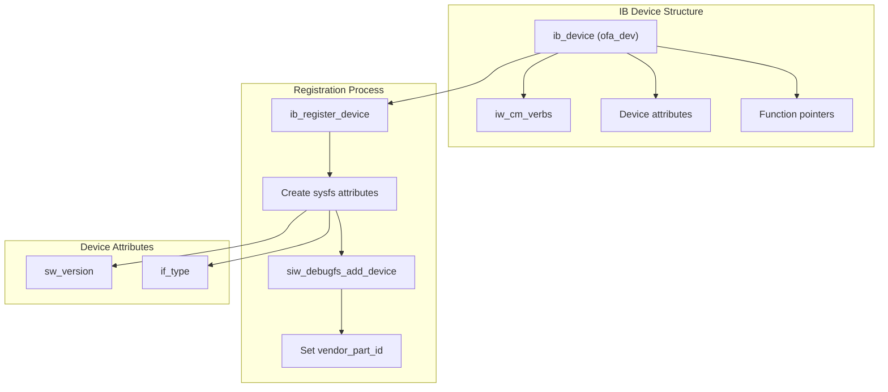
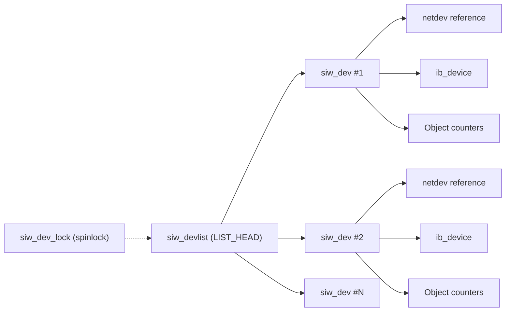

<!-- source: DeepWiki mcp.deepwiki.com · repo zrlio/softiwarp · page 3.6 Device and Module Management · fetched 2026-11-11 -->

# Device and Module Management

<details>
<summary>Relevant source files</summary>

The following files were used as context for generating this wiki page:

- [kernel/siw_main.c](kernel/siw_main.c)

</details>


This document covers the kernel module initialization, device lifecycle management, and integration with Linux networking and InfiniBand subsystems in the SoftiWARP driver. This component is responsible for creating and managing SoftiWARP devices as network interfaces come online, registering them with the InfiniBand core, and handling device events.

For information about the actual RDMA object management within devices, see [Object Management](#3.5). For details about connection endpoint management, see [Connection Management](#3.2).

## Module Lifecycle Management

The SoftiWARP kernel module follows standard Linux kernel module patterns with initialization and cleanup phases. The module registers with multiple kernel subsystems and sets up infrastructure for device management.

### Module Initialization Flow



The module initialization in `siw_init_module()` performs several critical setup steps:

1. **Parameter validation**: Checks that `SENDPAGE_THRESH` meets minimum requirements for inline data
2. **Bus registration**: Registers the `siw_bus` with the kernel for device organization
3. **Generic DMA device setup**: Creates a generic DMA device for RDMA operations
4. **Subsystem initialization**: Initializes connection management and send queue workers
5. **Network integration**: Registers for network device events to track interface changes

Sources: [kernel/siw_main.c:633-724]()

### Module Parameters

The module accepts several configuration parameters that control its behavior:

| Parameter | Type | Description |
|-----------|------|-------------|
| `iface_list` | string array | List of network interfaces to attach to |
| `loopback_enabled` | boolean | Enable loopback interface support |
| `tx_cpu_list` | string array | CPU affinity for TX threads (when enabled) |

Sources: [kernel/siw_main.c:67-84]()

## Device Creation and Lifecycle

SoftiWARP devices are created dynamically as network interfaces become available. Each network device that meets qualification criteria gets a corresponding SoftiWARP device.

### Device Lifecycle State Machine



### Device Creation Process

The `siw_device_create()` function creates a new SoftiWARP device when a qualified network interface is detected:



Key aspects of device creation:

- **Memory allocation**: Uses `ib_alloc_device()` to allocate device structure
- **Network binding**: Associates with a specific `net_device` 
- **GUID generation**: Creates node GUID from network device MAC address (or device name for loopback)
- **Capability setup**: Configures supported RDMA operations and limits
- **Reference management**: Holds reference to underlying network device

Sources: [kernel/siw_main.c:341-513]()

## Network Device Integration

The module integrates tightly with the Linux networking subsystem through a netdev notifier that responds to network interface events.

### Network Event Handling



### Device Qualification

The `siw_dev_qualified()` function determines which network devices should have SoftiWARP support:

- **Interface filtering**: Must be in `iface_list` (if specified) or list must be empty
- **Hardware type support**: Supports Ethernet, IEEE 802, InfiniBand, and optionally loopback
- **Namespace restriction**: Only operates in `init_net` namespace

Supported ARPHRD types:
- `ARPHRD_ETHER` - Ethernet interfaces
- `ARPHRD_IEEE802` - IEEE 802 networks  
- `ARPHRD_INFINIBAND` - InfiniBand interfaces
- `ARPHRD_LOOPBACK` - Loopback (if enabled)

Sources: [kernel/siw_main.c:320-339](), [kernel/siw_main.c:517-620]()

## InfiniBand Subsystem Registration

SoftiWARP devices must register with the InfiniBand core to provide RDMA services to applications.

### Device Registration Components



The registration process in `siw_device_register()`:

1. **IB registration**: Calls `ib_register_device()` to register with InfiniBand core
2. **Sysfs attributes**: Creates device-specific sysfs files for monitoring
3. **Debug support**: Adds device to debugfs infrastructure  
4. **Unique identification**: Assigns incrementing `vendor_part_id`

### Function Pointer Configuration

The device structure is populated with function pointers for all supported RDMA operations:

| Category | Functions |
|----------|-----------|
| Device queries | `siw_query_device`, `siw_query_port`, `siw_query_gid` |
| Context management | `siw_alloc_ucontext`, `siw_dealloc_ucontext` |
| Protection domains | `siw_alloc_pd`, `siw_dealloc_pd` |
| Queue pairs | `siw_create_qp`, `siw_modify_qp`, `siw_destroy_qp` |
| Completion queues | `siw_create_cq`, `siw_destroy_cq`, `siw_poll_cq` |
| Memory regions | `siw_reg_user_mr`, `siw_dereg_mr`, `siw_get_dma_mr` |
| Work posting | `siw_post_send`, `siw_post_receive` |
| Connection management | `siw_connect`, `siw_accept`, `siw_reject` |

Sources: [kernel/siw_main.c:141-183](), [kernel/siw_main.c:415-467]()

## Global Device Management

The module maintains a global list of all SoftiWARP devices and provides thread-safe access through spinlocks.

### Global Data Structures



Key global variables:
- `siw_devlist`: Linked list of all SoftiWARP devices
- `siw_dev_lock`: Spinlock protecting device list operations
- Device lookup via `siw_dev_from_netdev()` for event handling

### Object Reference Counting

Each SoftiWARP device tracks the number of allocated objects:

```c
atomic_t num_ctx;    // User contexts
atomic_t num_srq;    // Shared receive queues  
atomic_t num_qp;     // Queue pairs
atomic_t num_cq;     // Completion queues
atomic_t num_mem;    // Memory regions
atomic_t num_pd;     // Protection domains
atomic_t num_cep;    // Connection endpoints
```

These counters are checked during device deregistration to ensure proper cleanup.

Sources: [kernel/siw_main.c:76-77](), [kernel/siw_main.c:185-225](), [kernel/siw_main.c:251-263]()

---

