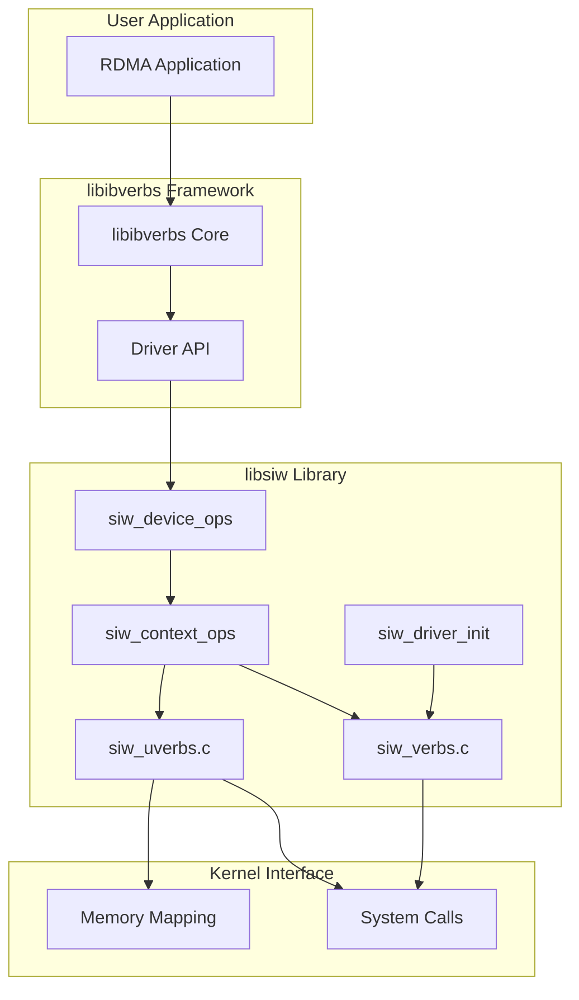
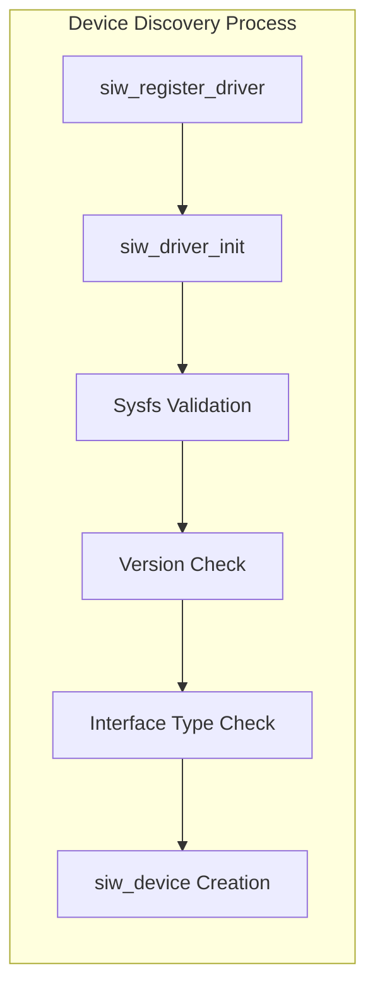
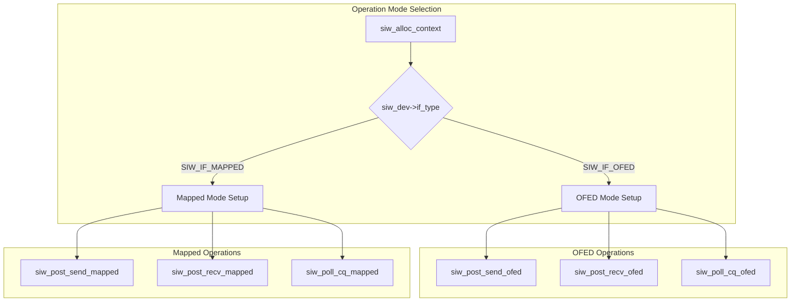
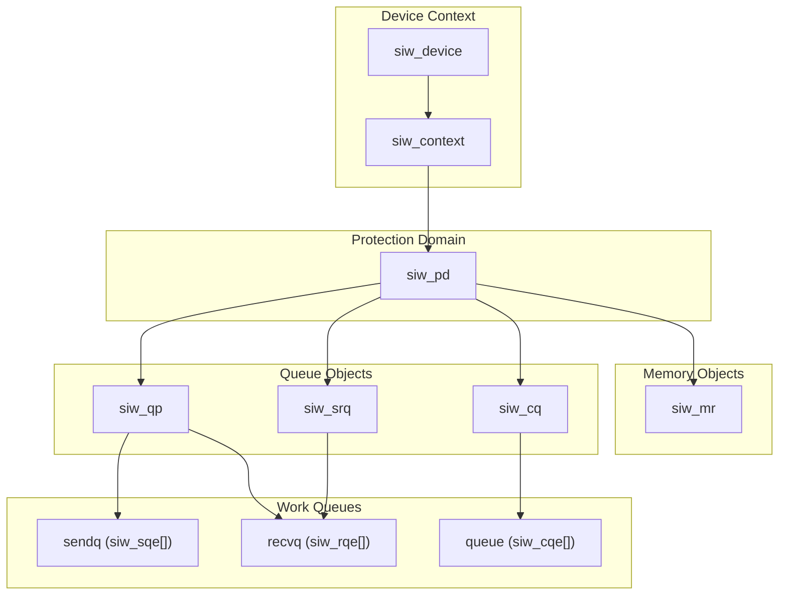
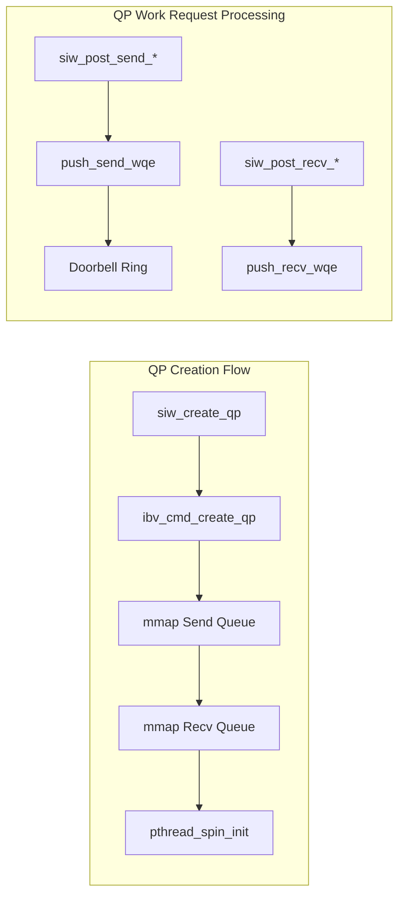
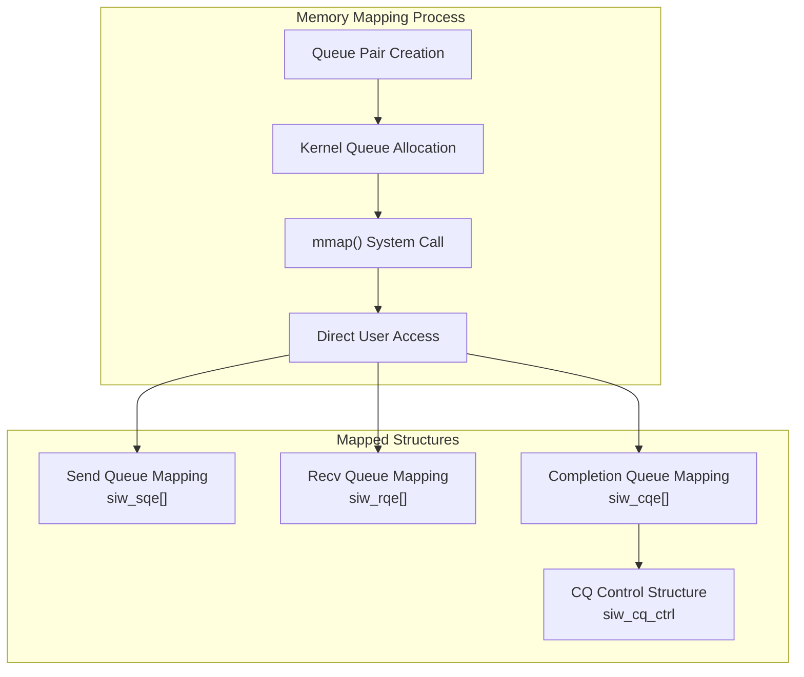
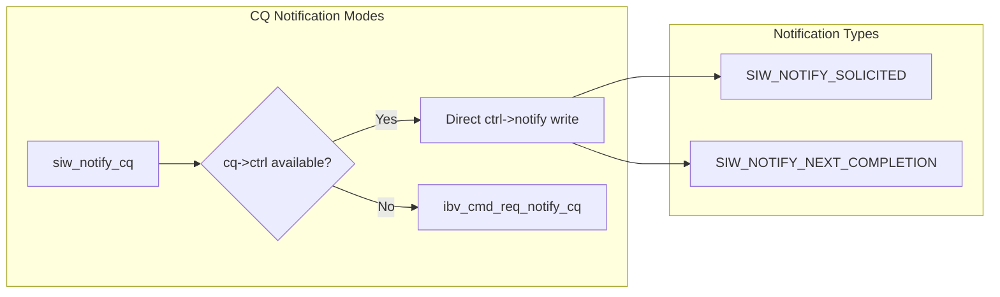

<!-- source: DeepWiki mcp.deepwiki.com · repo zrlio/softiwarp · page 4 User Space Library · fetched 2026-11-11 -->

# User Space Library

Relevant source files

The following files were used as context for generating this wiki page:

- [userlib/src/siw.c](userlib/src/siw.c)
- [userlib/src/siw.h](userlib/src/siw.h)
- [userlib/src/siw_abi.h](userlib/src/siw_abi.h)
- [userlib/src/siw_uverbs.c](userlib/src/siw_uverbs.c)
- [userlib/src/siw_verbs.c](userlib/src/siw_verbs.c)

## Purpose and Scope

The SoftiWARP user space library (`libsiw`) provides a complete libibverbs-compatible implementation that enables RDMA applications to use the SoftiWARP kernel driver. This library serves as the critical bridge between user applications and the kernel driver, implementing all standard Verbs API operations while providing optimized data paths for high-performance communication.

The library supports two distinct operation modes: standard OFED syscall interface and optimized mapped memory interface. For information about the kernel driver components that this library interfaces with, see [Kernel Driver Components](#3). For details about the user-kernel interface protocols, see [User-Kernel Interface](#5).

## Library Architecture

The libsiw library integrates with the standard libibverbs framework and provides device-specific implementations of all RDMA Verbs operations. The library automatically detects the kernel driver capabilities and selects the optimal operation mode.

### Core Library Structure

**Sources:** [userlib/src/siw.c:147-150](), [userlib/src/siw.c:59-81]()

### Device Discovery and Registration

The library registers itself with libibverbs through the `siw_register_driver` constructor function, which enables automatic device discovery when applications initialize libibverbs.

**Sources:** [userlib/src/siw.c:211-214](), [userlib/src/siw.c:152-209]()

## Operation Modes

The library supports two distinct operation modes that provide different performance characteristics and kernel interaction patterns.

### OFED Mode vs Mapped Mode

| Aspect | OFED Mode | Mapped Mode |
|--------|-----------|-------------|
| Interface | Standard syscalls via `ibv_cmd_*` | Direct memory mapping + syscalls |
| Performance | Standard latency | Optimized low-latency |
| Work Request Posting | `siw_post_send_ofed` | `siw_post_send_mapped` |
| Completion Polling | `siw_poll_cq_ofed` | `siw_poll_cq_mapped` |
| Memory Access | Kernel copy required | Direct user-kernel shared memory |

**Sources:** [userlib/src/siw.c:111-135](), [userlib/src/siw_uverbs.c:85-134]()

## RDMA Object Management

The library manages all standard RDMA objects through comprehensive lifecycle operations, maintaining both libibverbs compatibility and SoftiWARP-specific optimizations.

### Core Data Structures

**Sources:** [userlib/src/siw.h:57-123]()

### Queue Pair Operations

Queue pairs represent the core communication endpoints, with the library providing optimized implementations for both operation modes.

**Sources:** [userlib/src/siw_verbs.c:321-406](), [userlib/src/siw_uverbs.c:161-221]()

## Performance Optimizations

### Memory Mapping Strategy

In mapped mode, the library establishes direct memory mappings to kernel queue structures, eliminating data copying overhead for work request submission and completion polling.

**Sources:** [userlib/src/siw_verbs.c:350-394](), [userlib/src/siw_verbs.c:190-208]()

### Work Request Processing Optimization

The mapped mode implementation uses lock-free algorithms with memory barriers to ensure correct ordering while maximizing performance.

| Operation | OFED Implementation | Mapped Implementation |
|-----------|--------------------|-----------------------|
| Send WR Posting | `ibv_cmd_post_send()` | Direct `siw_sqe` write + doorbell |
| Recv WR Posting | `ibv_cmd_post_recv()` | Direct `siw_rqe` write |
| CQ Polling | `ibv_cmd_poll_cq()` | Direct `siw_cqe` read |
| Synchronization | Kernel locks | User-space spinlocks + memory barriers |

**Sources:** [userlib/src/siw_uverbs.c:247-301](), [userlib/src/siw_uverbs.c:468-492]()

### Completion Queue Notification

The library implements both solicited and unsolicited notification mechanisms, with mapped mode providing direct control structure access for optimal performance.

**Sources:** [userlib/src/siw_uverbs.c:64-82]()

---

