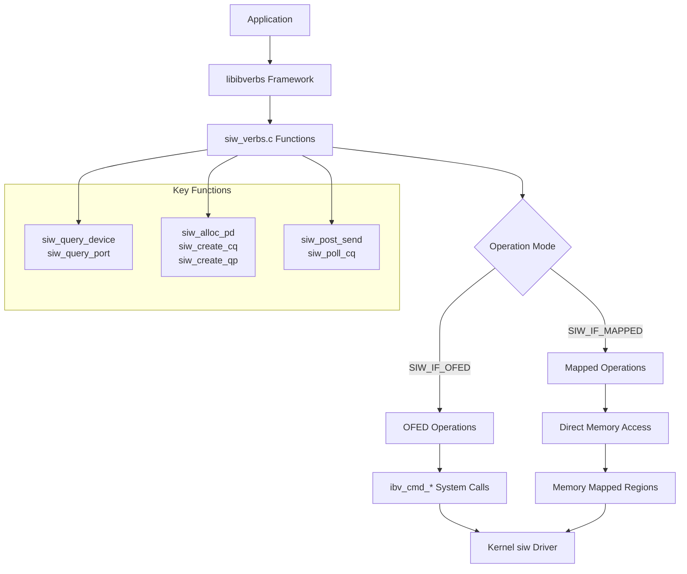
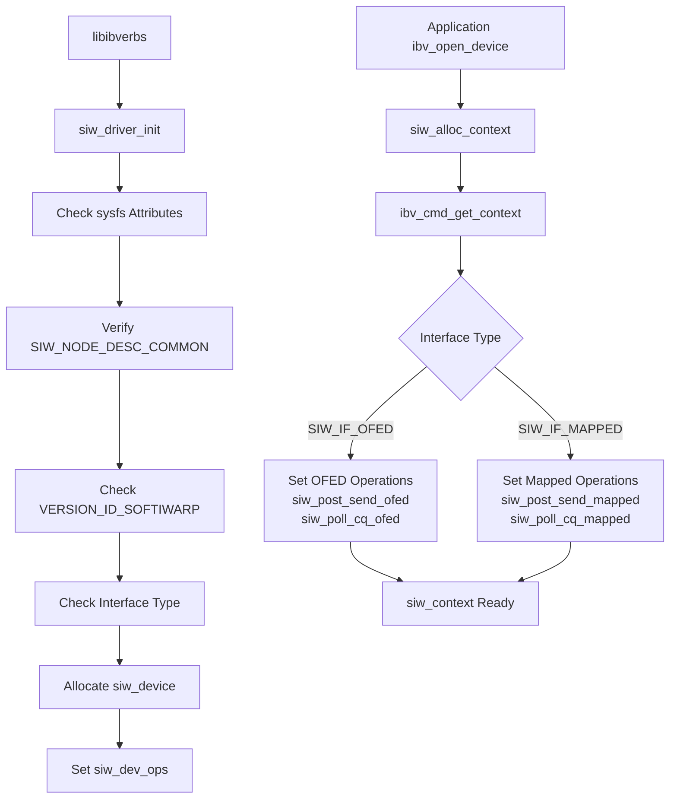
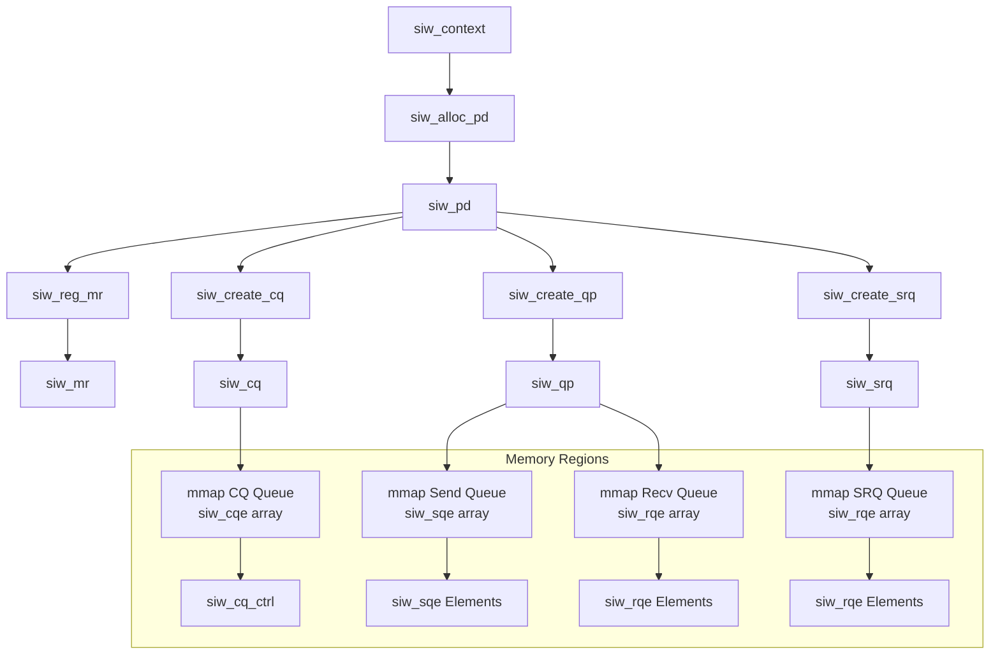
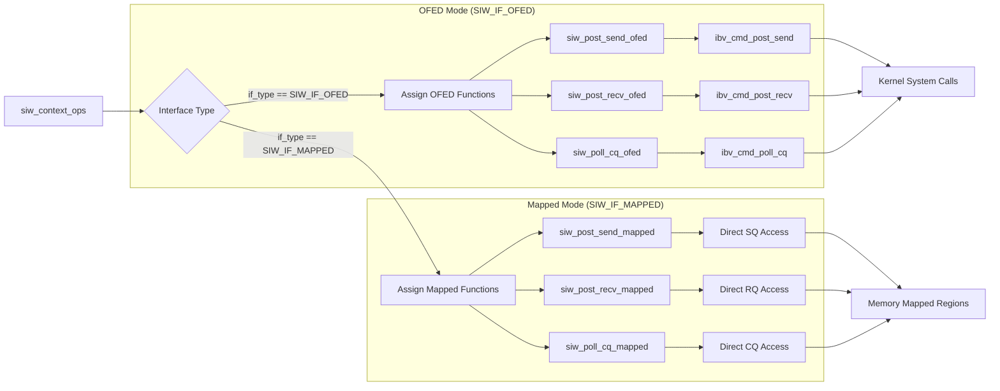
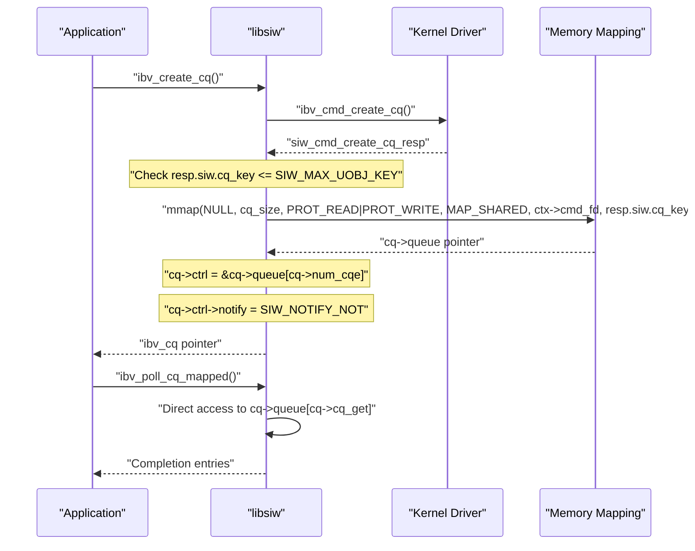
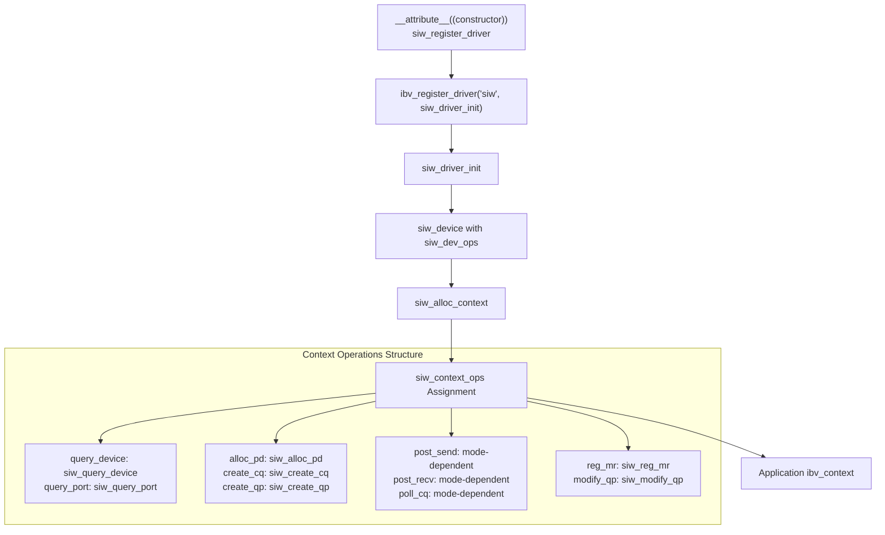

<!-- source: DeepWiki mcp.deepwiki.com · repo zrlio/softiwarp · page 4.1 Verbs Implementation · fetched 2026-11-11 -->

# Verbs Implementation

Relevant source files

The following files were used as context for generating this wiki page:

- [userlib/src/siw.c](userlib/src/siw.c)
- [userlib/src/siw.h](userlib/src/siw.h)
- [userlib/src/siw_abi.h](userlib/src/siw_abi.h)
- [userlib/src/siw_verbs.c](userlib/src/siw_verbs.c)

## Purpose and Scope

This document covers the user space implementation of the RDMA Verbs API in the SoftiWARP library (`libsiw`). The Verbs implementation provides the standard InfiniBand/RDMA programming interface to applications while abstracting the underlying software iWARP transport. This includes device discovery, resource management, and work request operations.

For information about user space work request posting and completion handling, see [User Operations](#4.2). For details about the kernel-user interface protocols, see [User-Kernel Interface](#5).

## Architecture Overview

The SoftiWARP Verbs implementation follows the standard libibverbs plugin architecture, providing device-specific implementations of all standard RDMA operations. The library supports two distinct operation modes for performance optimization: OFED mode using standard system calls, and MAPPED mode using direct memory access to kernel structures.

### Verbs Operation Flow

Sources: [userlib/src/siw.c:59-81](), [userlib/src/siw.c:111-135](), [userlib/src/siw_verbs.c:57-491]()

## Device and Context Management

The Verbs implementation begins with device discovery and context allocation. The `siw_driver_init` function identifies SoftiWARP devices by examining sysfs attributes, while `siw_alloc_context` establishes the connection between user space and the kernel driver.

### Device Discovery and Context Allocation

The device structure `siw_device` contains the interface type that determines the operation mode, while `siw_context` stores the device ID and provides the operation function pointers.

Sources: [userlib/src/siw.c:152-209](), [userlib/src/siw.c:83-138](), [userlib/src/siw.h:57-61](), [userlib/src/siw.h:120-123]()

## Resource Management

The Verbs implementation manages five primary RDMA resource types: Protection Domains (PDs), Memory Regions (MRs), Completion Queues (CQs), Queue Pairs (QPs), and Shared Receive Queues (SRQs). Each resource type has specific allocation, configuration, and cleanup procedures.

### Resource Allocation Hierarchy

Sources: [userlib/src/siw_verbs.c:97-125](), [userlib/src/siw_verbs.c:167-219](), [userlib/src/siw_verbs.c:321-406](), [userlib/src/siw_verbs.c:252-288]()

### Queue Pair Memory Mapping

Queue Pairs require the most complex setup due to their dual-queue structure and optional SRQ integration. The `siw_create_qp` function maps both send and receive queues into user space for direct access.

| Resource Component | Structure | Mapping Key | Size Calculation |
|-------------------|-----------|-------------|------------------|
| Send Queue | `siw_sqe` | `resp.siw.sq_key` | `num_sqe * sizeof(siw_sqe)` |
| Receive Queue | `siw_rqe` | `resp.siw.rq_key` | `num_rqe * sizeof(siw_rqe)` |
| Completion Queue | `siw_cqe` | `resp.siw.cq_key` | `num_cqe * sizeof(siw_cqe) + sizeof(siw_cq_ctrl)` |
| SRQ Queue | `siw_rqe` | `resp.siw.srq_key` | `num_rqe * sizeof(siw_rqe)` |

Sources: [userlib/src/siw_verbs.c:321-406](), [userlib/src/siw_verbs.c:350-394](), [userlib/src/siw.h:82-102]()

## Operation Mode Architecture

The SoftiWARP library implements two distinct operation modes to balance compatibility and performance. The mode selection occurs during context allocation based on the kernel driver's `if_type` setting.

### Dual-Path Operation Implementation

The operation mode determines the function pointers assigned in the `ibv_context_ops` structure, providing transparent switching between system call-based and direct memory access approaches.

Sources: [userlib/src/siw.c:111-135](), [userlib/src/siw.h:52-55](), [userlib/src/siw.h:179-190]()

## Memory Mapping Implementation

In MAPPED mode, the library establishes direct memory access to kernel data structures through `mmap` system calls. This eliminates the overhead of system calls for data path operations while maintaining coherency through shared memory regions.

### Memory Mapping Process

The mapping process uses the kernel-provided key as an offset into the device file descriptor, establishing a shared memory region between user space and kernel space.

Sources: [userlib/src/siw_verbs.c:190-208](), [userlib/src/siw_verbs.c:269-287](), [userlib/src/siw_verbs.c:350-394]()

## Thread Safety and Synchronization

The Verbs implementation ensures thread safety through fine-grained locking using pthread spinlocks. Each resource type maintains its own synchronization mechanism to allow concurrent access while protecting critical data structures.

### Locking Hierarchy

| Resource Type | Lock Structure | Protected Operations | Lock Scope |
|---------------|----------------|---------------------|------------|
| `siw_device` | `pthread_spinlock_t lock` | Device-level operations | Device initialization |
| `siw_cq` | `pthread_spinlock_t lock` | CQ polling, notification | Per-CQ operations |
| `siw_qp` | `pthread_spinlock_t sq_lock, rq_lock` | Send/receive posting | Separate SQ/RQ locks |  
| `siw_srq` | `pthread_spinlock_t lock` | SRQ receive posting | Per-SRQ operations |

The dual-lock approach for Queue Pairs allows concurrent send and receive operations on the same QP, maximizing parallelism in multi-threaded applications.

Sources: [userlib/src/siw_verbs.c:185](), [userlib/src/siw_verbs.c:347-348](), [userlib/src/siw_verbs.c:267](), [userlib/src/siw.h:60](), [userlib/src/siw.h:92-97]()

## Integration with libibverbs Framework

The SoftiWARP Verbs implementation integrates seamlessly with the standard libibverbs framework through the plugin architecture. The `siw_context_ops` structure provides all required function pointers, while the driver registration mechanism ensures automatic discovery.

### Plugin Registration and Context Operations

The constructor attribute ensures that the SoftiWARP driver is automatically registered when the library is loaded, making it available to applications through the standard `ibv_get_device_list()` interface.

Sources: [userlib/src/siw.c:211-214](), [userlib/src/siw.c:59-81](), [userlib/src/siw.c:147-150](), [userlib/src/siw_verbs.c:57-491]()

---

