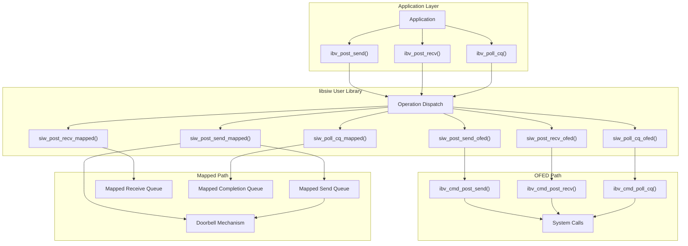
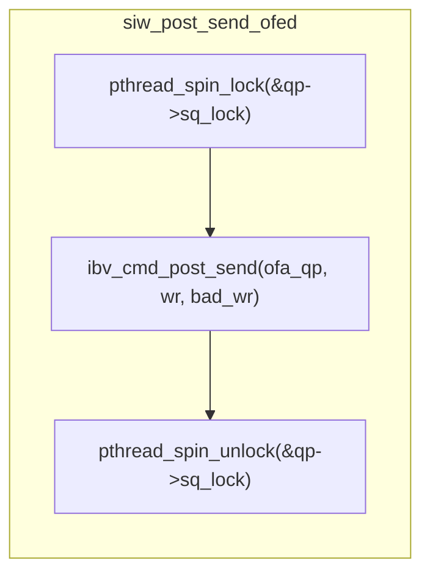
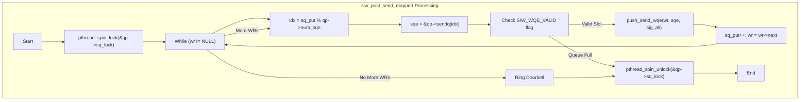
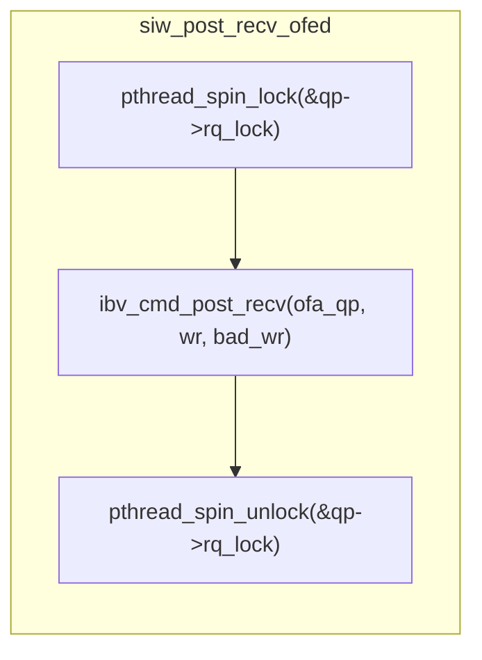
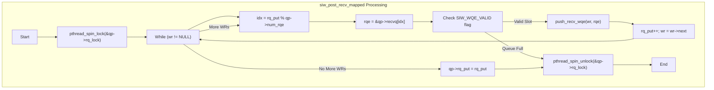
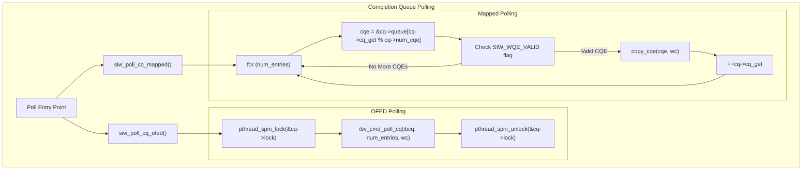
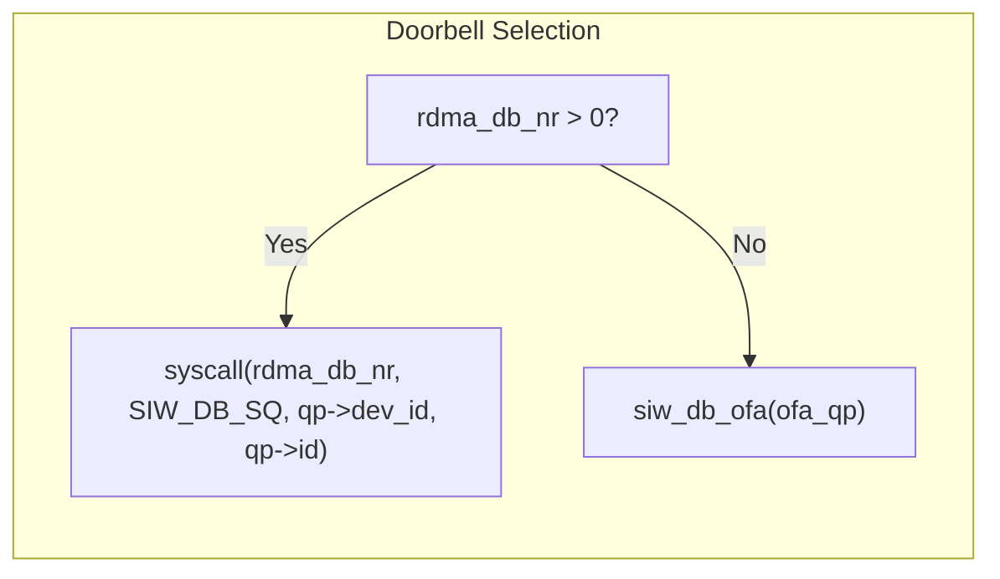

<!-- source: DeepWiki mcp.deepwiki.com · repo zrlio/softiwarp · page 4.2 User Operations · fetched 2026-11-11 -->

# User Operations

Relevant source files

The following files were used as context for generating this wiki page:

- [userlib/src/siw_uverbs.c](userlib/src/siw_uverbs.c)

This document describes the user-space operations for posting work requests and polling completions in the SoftiWARP library. It covers the dual-path architecture that provides both traditional OFED-style operations and optimized memory-mapped operations for improved performance.

For information about the underlying Verbs API implementation and device context management, see [Verbs Implementation](#4.1). For details about the kernel-user interface structures, see [User-Kernel Interface](#5).

## Dual-Path Operation Architecture

The SoftiWARP user library implements two distinct operational paths for work request processing:

1. **OFED Path**: Traditional approach using `ibv_cmd_*` functions with system calls
2. **Mapped Path**: Optimized approach using direct memory-mapped queue access

**Sources:** [userlib/src/siw_uverbs.c:85-301]()

## Send Operations

### OFED Send Path

The OFED send path provides compatibility with standard InfiniBand applications by using the traditional `ibv_cmd_post_send()` interface with proper locking:

### Mapped Send Path

The mapped send path provides optimized performance by directly accessing memory-mapped send queues:

**Sources:** [userlib/src/siw_uverbs.c:247-301]()

### Work Request Processing

The `push_send_wqe()` function handles the conversion from InfiniBand work requests to SoftiWARP send queue entries:

| Operation | IB Opcode | SiW Opcode |
|-----------|-----------|------------|
| Send | `IBV_WR_SEND` | `SIW_OP_SEND` |
| RDMA Write | `IBV_WR_RDMA_WRITE` | `SIW_OP_WRITE` |
| RDMA Read | `IBV_WR_RDMA_READ` | `SIW_OP_READ` |

| IB Send Flag | SiW WQE Flag | Description |
|--------------|--------------|-------------|
| `IBV_SEND_SIGNALED` | `SIW_WQE_SIGNALLED` | Generate completion |
| `IBV_SEND_SOLICITED` | `SIW_WQE_SOLICITED` | Solicited event |
| `IBV_SEND_INLINE` | `SIW_WQE_INLINE` | Inline data |
| `IBV_SEND_FENCE` | `SIW_WQE_READ_FENCE` | Read fence |

**Sources:** [userlib/src/siw_uverbs.c:136-221]()

## Receive Operations

### OFED Receive Path

Similar to send operations, the OFED receive path uses standard InfiniBand commands with proper synchronization:

### Mapped Receive Path

The mapped receive path directly populates receive queue entries in memory-mapped buffers:

**Sources:** [userlib/src/siw_uverbs.c:330-370](), [userlib/src/siw_uverbs.c:304-328]()

## Completion Queue Operations

### Completion Polling

The completion queue polling operations follow the same dual-path pattern:

### Completion Queue Notification

The `siw_notify_cq()` function supports both mapped and OFED notification mechanisms:

- **Mapped Mode**: Direct write to `cq->ctrl->notify` field
- **OFED Mode**: Uses `ibv_cmd_req_notify_cq()` system call

**Sources:** [userlib/src/siw_uverbs.c:64-82](), [userlib/src/siw_uverbs.c:124-134](), [userlib/src/siw_uverbs.c:468-492]()

## Doorbell Mechanisms

The mapped send path uses two doorbell mechanisms for notifying the kernel:

1. **RDMA Doorbell System Call**: `syscall(rdma_db_nr, SIW_DB_SQ, qp->dev_id, qp->id)`
2. **OFED Doorbell Fallback**: `siw_db_ofa()` using empty `ibv_cmd_post_send()` call

**Sources:** [userlib/src/siw_uverbs.c:287-296](), [userlib/src/siw_uverbs.c:223-245]()

## Completion Entry Translation

The library translates between SoftiWARP completion queue entries and InfiniBand work completions:

| SiW Opcode | IB Opcode | Operation |
|------------|-----------|-----------|
| `SIW_OP_WRITE` | `IBV_WC_RDMA_WRITE` | RDMA Write |
| `SIW_OP_READ` | `IBV_WC_RDMA_READ` | RDMA Read |
| `SIW_OP_SEND` | `IBV_WC_SEND` | Send |
| `SIW_OP_RECEIVE` | `IBV_WC_RECV` | Receive |
| `SIW_OP_FETCH_AND_ADD` | `IBV_WC_FETCH_ADD` | Atomic Fetch-Add |
| `SIW_OP_COMP_AND_SWAP` | `IBV_WC_COMP_SWAP` | Atomic Compare-Swap |

**Sources:** [userlib/src/siw_uverbs.c:415-466]()

---

