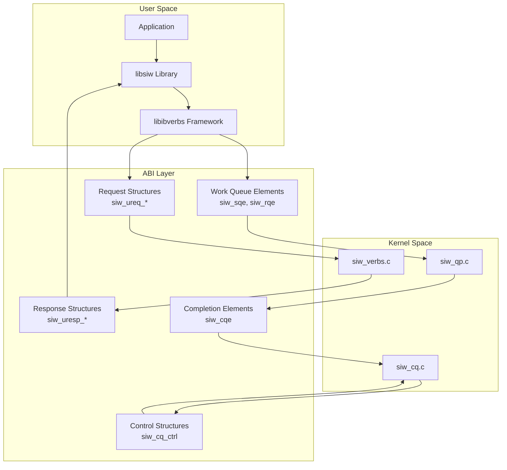
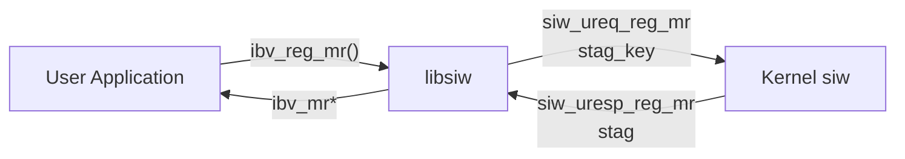
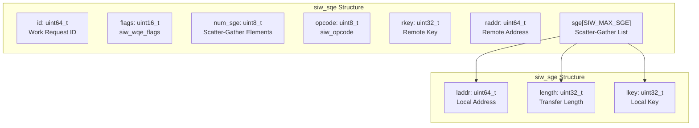
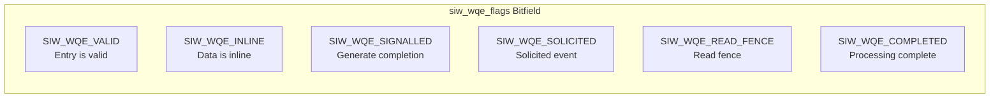
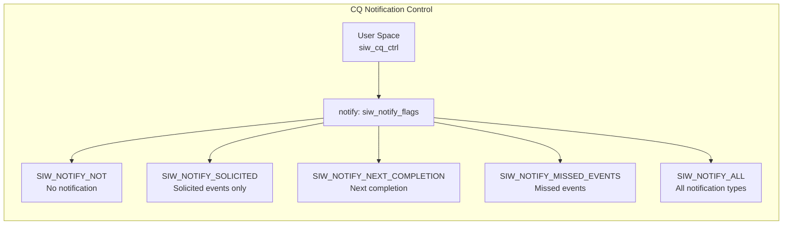
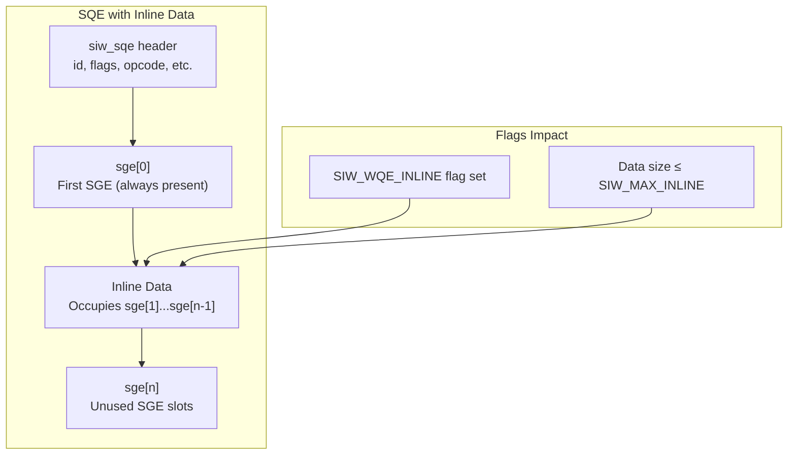

<!-- source: DeepWiki mcp.deepwiki.com · repo zrlio/softiwarp · page 5 User-Kernel Interface · fetched 2026-11-11 -->

# User-Kernel Interface

Relevant source files

The following files were used as context for generating this wiki page:

- [common/siw_user.h](common/siw_user.h)

## Purpose and Scope

This document describes the Application Binary Interface (ABI) between the user space libsiw library and the kernel space siw driver. The ABI defines the data structures, command formats, and communication protocols that enable RDMA applications to interact with the SoftiWARP kernel implementation.

For information about the user space library implementation, see [User Space Library](#4). For details about kernel driver internals, see [Kernel Driver Components](#3). For the overall system architecture, see [System Architecture](#2).

## ABI Overview

The user-kernel interface is primarily defined in the shared header file that establishes a contract between user space and kernel space components. The interface uses standard Linux kernel mechanisms including system calls, memory mapping, and shared memory regions.

### ABI Structure Overview

Sources: [common/siw_user.h:1-213]()

## Command and Response Structures

The ABI defines several command-response pairs for object creation and management operations. Each operation uses a specific request structure from user space and receives a corresponding response structure from the kernel.

### Object Creation Responses

| Structure | Purpose | Key Fields |
|-----------|---------|------------|
| `siw_uresp_create_cq` | CQ creation response | `cq_id`, `num_cqe`, `cq_key` |
| `siw_uresp_create_qp` | QP creation response | `qp_id`, `num_sqe`, `num_rqe`, `sq_key`, `rq_key` |
| `siw_uresp_create_srq` | SRQ creation response | `num_rqe`, `srq_key` |
| `siw_uresp_alloc_ctx` | Context allocation response | `dev_id`, `rdma_db_nr` |

### Memory Registration Interface

The memory registration process uses a simple request-response pattern where the user specifies a `stag_key` and receives back a complete `stag` (Steering Tag) for the registered memory region.

Sources: [common/siw_user.h:77-84]()

## Work Queue Elements

Work Queue Elements (WQEs) are the fundamental data structures for posting RDMA operations. The ABI defines separate structures for send and receive operations.

### Send Queue Element Structure

### RDMA Operation Types

The ABI defines the following RDMA operations through the `siw_opcode` enumeration:

| Opcode | Value | Description |
|--------|-------|-------------|
| `SIW_OP_WRITE` | 0 | RDMA Write |
| `SIW_OP_READ` | 1 | RDMA Read |
| `SIW_OP_SEND` | 2 | Send Message |
| `SIW_OP_SEND_WITH_IMM` | 3 | Send with Immediate Data |
| `SIW_OP_RECEIVE` | 7 | Receive Operation |
| `SIW_OP_READ_RESPONSE` | 8 | Read Response (kernel internal) |

### Work Queue Element Flags

Sources: [common/siw_user.h:149-164](), [common/siw_user.h:100-119](), [common/siw_user.h:139-146]()

## Completion Queue Elements

Completion Queue Elements (CQEs) report the status of completed RDMA operations back to user space.

### CQE Structure and Status Reporting

```mermaid
graph TB
    subgraph "siw_cqe Structure"
        CQE_ID["id: uint64_t<br/>Work Request ID"]
        CQE_FLAGS["flags: uint8_t<br/>Completion Flags"]
        CQE_OPCODE["opcode: uint8_t<br/>Completed Operation"]
        CQE_STATUS["status: uint16_t<br/>siw_wc_status"]
        CQE_BYTES["bytes: uint32_t<br/>Bytes Transferred"]
        CQE_IMM["imm_data: uint64_t<br/>Immediate Data"]
        CQE_QP["qp/qp_id: union<br/>Queue Pair Reference"]
    end
    
    subgraph "Status Values"
        SUCCESS["SIW_WC_SUCCESS"]
        LOC_LEN_ERR["SIW_WC_LOC_LEN_ERR"]
        LOC_PROT_ERR["SIW_WC_LOC_PROT_ERR"] 
        LOC_QP_OP_ERR["SIW_WC_LOC_QP_OP_ERR"]
        WR_FLUSH_ERR["SIW_WC_WR_FLUSH_ERR"]
        BAD_RESP_ERR["SIW_WC_BAD_RESP_ERR"]
        LOC_ACCESS_ERR["SIW_WC_LOC_ACCESS_ERR"]
        REM_ACCESS_ERR["SIW_WC_REM_ACCESS_ERR"]
        GENERAL_ERR["SIW_WC_GENERAL_ERR"]
    end
    
    CQE_STATUS --> SUCCESS
    CQE_STATUS --> LOC_LEN_ERR
    CQE_STATUS --> LOC_PROT_ERR
    CQE_STATUS --> LOC_QP_OP_ERR
    CQE_STATUS --> WR_FLUSH_ERR
    CQE_STATUS --> BAD_RESP_ERR
    CQE_STATUS --> LOC_ACCESS_ERR
    CQE_STATUS --> REM_ACCESS_ERR
    CQE_STATUS --> GENERAL_ERR
```

Sources: [common/siw_user.h:189-201](), [common/siw_user.h:176-187]()

## Control and Notification Structures  

The ABI provides mechanisms for controlling completion queue behavior and managing event notifications.

### Completion Queue Control

The `siw_cq_ctrl` structure enables user space to control completion queue arming and notification behavior:

### Doorbell Mechanism

The ABI defines doorbell types for efficient communication between user and kernel space:

| Doorbell Type | Value | Purpose |
|---------------|-------|---------|
| `SIW_DB_SQ` | 1 | Send Queue doorbell |

Sources: [common/siw_user.h:207-209](), [common/siw_user.h:166-174](), [common/siw_user.h:96-98]()

## Data Structure Constants and Limits

The ABI establishes several important constants that define system limits and capabilities:

### System Limits

| Constant | Value | Description |
|----------|-------|-------------|
| `SIW_MAX_SGE` | 6 | Maximum scatter-gather elements |
| `SIW_MAX_UOBJ_KEY` | 0xffffff | Maximum user object key |
| `SIW_INVAL_UOBJ_KEY` | 0x1000000 | Invalid object key marker |
| `SIW_MAX_INLINE` | `sizeof(siw_sge) * (SIW_MAX_SGE - 1)` | Maximum inline data size |

### Version and Identification

| Constant | Value | Description |
|----------|-------|-------------|
| `VERSION_ID_SOFTIWARP` | 2 | ABI version identifier |
| `SIW_NODE_DESC_COMMON` | "Software iWARP stack" | Device identification string |
| `SIW_IBDEV_PREFIX` | "siw_" | Device name prefix |

Sources: [common/siw_user.h:52-61](), [common/siw_user.h:133-137]()

## Memory Layout and Inline Data

The ABI supports inline data optimization where small data payloads can be embedded directly within work queue elements, eliminating the need for separate memory registrations.

### Inline Data Layout

The inline data mechanism allows efficient transmission of small messages by embedding the data directly in the work queue element, using the space that would otherwise be occupied by additional scatter-gather elements.

Sources: [common/siw_user.h:128-137](), [common/siw_user.h:121-126]()

---

