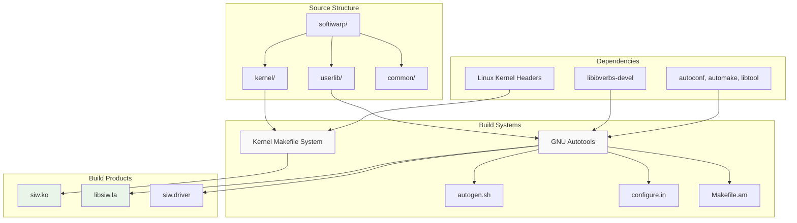
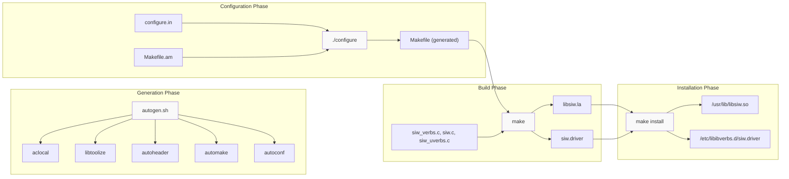
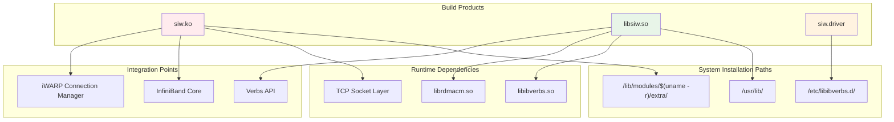

<!-- source: DeepWiki mcp.deepwiki.com · repo zrlio/softiwarp · page 6 Build System and Installation · fetched 2026-11-11 -->

# Build System and Installation

<details>
<summary>Relevant source files</summary>

The following files were used as context for generating this wiki page:

- [README.md](README.md)
- [userlib/Makefile.am](userlib/Makefile.am)
- [userlib/autogen.sh](userlib/autogen.sh)
- [userlib/configure.in](userlib/configure.in)
- [userlib/libsiw.spec.in](userlib/libsiw.spec.in)
- [userlib/siw.driver](userlib/siw.driver)

</details>


This document provides comprehensive instructions for building, configuring, and installing the SoftiWARP (siw) system components. SoftiWARP consists of two primary components that must be built and installed separately: a kernel module and a user-space library. This page covers the build systems, dependencies, installation procedures, and configuration options for both components.

For information about the system architecture and component relationships, see [System Architecture](#2). For details about the user-kernel interface specifications, see [User-Kernel Interface](#5).

## System Overview

SoftiWARP employs a dual-component architecture with separate build systems for each component. The kernel module uses a traditional Linux kernel Makefile system, while the user-space library utilizes the GNU Autotools build system for cross-platform compatibility and integration with the OpenFabrics ecosystem.

### Build Architecture Overview



**Sources:** [README.md:29-34](), [userlib/Makefile.am:1-26](), [userlib/configure.in:1-68]()

## Prerequisites and Dependencies

### System Requirements

| Component | Requirements |
|-----------|-------------|
| **Kernel Module** | Linux kernel headers, kernel build environment, gcc |
| **User Library** | libibverbs-devel, autotools suite, gcc |
| **Runtime** | libibverbs, librdmacm (optional for connection management) |

### Kernel Version Compatibility

The SoftiWARP codebase maintains compatibility with recent Linux kernel versions. The `master` branch targets the newest stable kernel, with version-specific branches maintained for older kernels. Each release is tagged with its corresponding kernel version.

**Important:** After kernel upgrades, both the kernel module and user library should be rebuilt and reinstalled to ensure compatibility.

**Sources:** [README.md:38-49](), [userlib/libsiw.spec.in:14]()

## User-Space Library Build Process

The user-space library (`libsiw`) uses the GNU Autotools build system for configuration and compilation. This provides cross-platform portability and integration with the OpenFabrics libibverbs framework.

### Autotools Build Flow



**Sources:** [userlib/autogen.sh:1-9](), [userlib/Makefile.am:13-19](), [README.md:52-58]()

### Build Commands

The standard build sequence for the user library:

```bash
cd /path/to/your/clone/userlib
./autogen.sh
./configure
make install
```

### Configuration Options

The `configure.in` script provides several build-time options:

| Option | Purpose | Default |
|--------|---------|---------|
| `--disable-libcheck` | Skip library dependency checks | enabled |
| `--enable-static` | Build static libraries | disabled |
| `--prefix` | Installation prefix | `/usr/local` |

### Library Components

The build process generates several key components:

- **`libsiw.la`**: Main shared library containing the siw verbs implementation
- **`siw.driver`**: Driver configuration file for libibverbs integration
- **Static libraries**: Optional static versions for debugging

**Sources:** [userlib/configure.in:11-26](), [userlib/Makefile.am:13-22](), [userlib/siw.driver:1-2]()

## Kernel Module Build Process

The kernel module uses a straightforward Linux kernel Makefile system. The build process integrates with the kernel build infrastructure to ensure compatibility with the target kernel version.

### Kernel Build Commands

```bash
cd /path/to/your/clone/kernel
make
```

### Module Loading Options

The kernel module supports various loading configurations:

#### Default Loading
```bash
sudo insmod ./siw.ko
```
This starts TX threads on available CPUs with automatic CPU selection.

#### CPU-Specific Loading
```bash
sudo insmod ./siw.ko tx_cpu_list=[n,m,...]
```
This allows explicit specification of CPUs for TX thread placement.

### Module Parameters

| Parameter | Type | Description | Default |
|-----------|------|-------------|---------|
| `tx_cpu_list` | string | Comma-separated list of CPU IDs for TX threads | auto-detect |

**Sources:** [README.md:61-79]()

## Installation Architecture



**Sources:** [userlib/Makefile.am:18-19](), [userlib/libsiw.spec.in:47-49](), [README.md:67-78]()

## Package Management Integration

### RPM Package Support

The user library includes RPM packaging support through the `libsiw.spec.in` template:

```bash
# Generate RPM spec file
./configure
make dist
rpmbuild -ta libsiw-*.tar.gz
```

### Package Contents

| Package | Contents | Purpose |
|---------|----------|---------|
| `libsiw` | Runtime library, driver config | Production deployment |
| `libsiw-devel` | Static libraries, headers | Development and debugging |

**Sources:** [userlib/libsiw.spec.in:20-54]()

## Configuration and Integration

### libibverbs Integration

The `siw.driver` configuration file registers the SoftiWARP driver with the libibverbs framework:

```
driver siw
```

This simple configuration enables automatic device discovery and initialization through the standard libibverbs device enumeration process.

### Runtime Configuration

The system integrates with several configuration points:

1. **Device Registration**: Automatic registration with network interfaces
2. **CPU Affinity**: Configurable TX thread placement
3. **Memory Management**: Integration with kernel memory subsystems
4. **Connection Management**: Integration with iWARP connection manager

**Sources:** [userlib/siw.driver:1-2](), [userlib/Makefile.am:18-19]()

## Troubleshooting and Compatibility

### Common Build Issues

| Issue | Cause | Solution |
|-------|-------|---------|
| Missing libibverbs headers | Development packages not installed | Install `libibverbs-devel` |
| Kernel version mismatch | Wrong branch/tag for kernel | Switch to appropriate branch/tag |
| Autotools errors | Missing build dependencies | Install `autoconf`, `automake`, `libtool` |

### Version Management

The build system includes version detection and compatibility checks:

- **Kernel Module**: Automatically detects kernel version and API changes
- **User Library**: Checks libibverbs version and feature availability
- **ABI Compatibility**: Maintains stable user-kernel interface

### Maintenance Procedures

After system updates:

1. **Kernel Updates**: Rebuild and reinstall both components
2. **libibverbs Updates**: Rebuild user library only
3. **Development Updates**: Clean rebuild recommended

**Sources:** [README.md:47-49](), [userlib/configure.in:44-55]()