# Page: Overview

# Overview

<details>
<summary>Relevant source files</summary>

The following files were used as context for generating this wiki page:

- [README.md](README.md)
- [kernel/siw.h](kernel/siw.h)
- [kernel/siw_cq.c](kernel/siw_cq.c)

</details>


## Purpose and Scope

SoftiWARP (siw) is a software implementation of the iWARP protocol suite that provides RDMA (Remote Direct Memory Access) functionality over standard TCP/IP networks without requiring dedicated RDMA hardware. This documentation covers the complete SoftiWARP system, including both the kernel driver components and the user-space library that together implement the iWARP protocols (MPA/DDP/RDMAP, IETF-RFC 5044/5041/5040) entirely in software.

For detailed information about building and installing the system, see [Build System and Installation](#6). For specifics about the kernel-userspace interface, see [User-Kernel Interface](#5).

**Note**: This repository is maintained for reference only. The SoftiWARP driver became part of upstream Linux with kernel 5.2 and is now maintained there.

## System Components

SoftiWARP consists of two primary components that work together to provide RDMA functionality:

| Component | Location | Purpose |
|-----------|----------|---------|
| Kernel Module (`siw`) | `kernel/` | Implements iWARP protocol processing, connection management, and data transfer |
| User Library (`libsiw`) | `userlib/` | Provides user-space RDMA verbs API and integrates with OpenFabrics framework |
| Common Headers | `common/` | Shared data structures and definitions between kernel and user space |

## Overall System Architecture

The following diagram shows how SoftiWARP integrates with the Linux networking stack and OpenFabrics ecosystem:

### SoftiWARP System Architecture
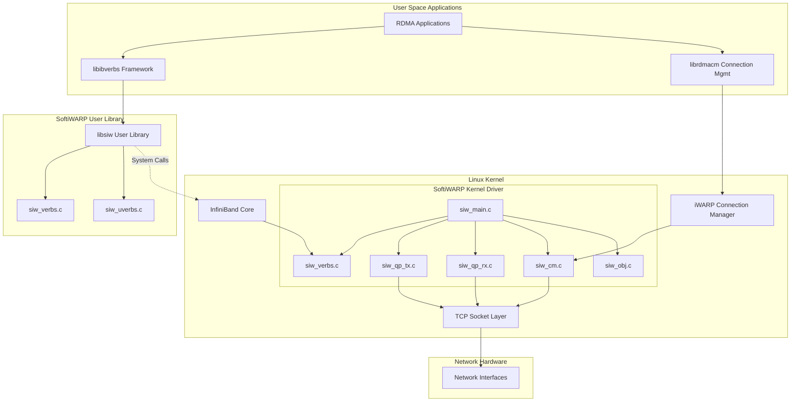

Sources: [README.md:11-34](), [kernel/siw.h:122-151]()

## Core Data Structures and Objects

SoftiWARP manages several key RDMA objects that are fundamental to its operation:

### SoftiWARP Object Hierarchy
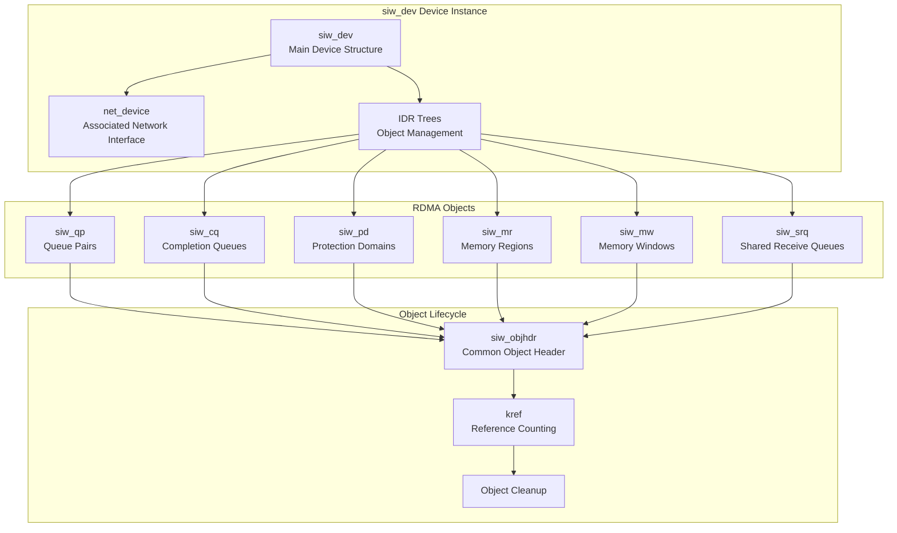

Sources: [kernel/siw.h:122-151](), [kernel/siw.h:153-157](), [kernel/siw.h:175-178]()

## iWARP Protocol Stack Implementation

SoftiWARP implements the complete iWARP protocol stack as defined by IETF RFCs:

### iWARP Protocol Layers
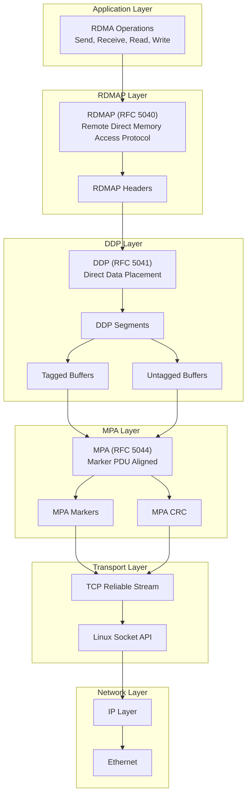

Sources: [README.md:13-17](), [kernel/siw.h:409-454](), [kernel/siw.h:483-540]()

## Data Flow Architecture

The following diagram illustrates how data flows through the SoftiWARP system from application to network:

### SoftiWARP Data Flow
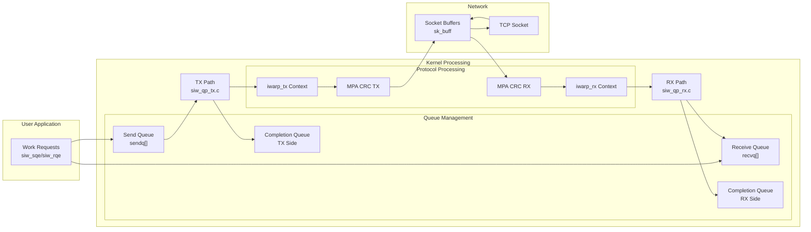

Sources: [kernel/siw.h:544-587](), [kernel/siw.h:409-454](), [kernel/siw.h:483-540]()

## Key System Characteristics

SoftiWARP provides the following key characteristics and capabilities:

- **Software-only Implementation**: No dedicated RDMA hardware required - runs over standard Ethernet
- **OpenFabrics Integration**: Compatible with standard RDMA applications through libibverbs
- **Kernel and User Space Support**: Supports both kernel-level and user-level RDMA applications  
- **TCP-based Transport**: Uses reliable TCP connections for data transport
- **Memory Management**: Efficient user memory registration and DMA operations
- **Connection Management**: Full iWARP connection establishment and teardown
- **Performance Optimization**: Multiple data paths including direct memory mapping for performance

The system limits are defined in [kernel/siw.h:68-82]() and include support for up to 102,400 Queue Pairs, 3.2M work requests, and 128 outstanding read operations per QP.

Sources: [README.md:11-28](), [kernel/siw.h:60-82](), [kernel/siw.h:90-119]()

---

# Page: System Architecture

# System Architecture

<details>
<summary>Relevant source files</summary>

The following files were used as context for generating this wiki page:

- [README.md](README.md)
- [common/siw_user.h](common/siw_user.h)
- [kernel/siw.h](kernel/siw.h)
- [kernel/siw_cq.c](kernel/siw_cq.c)

</details>


This document provides a detailed explanation of the SoftiWARP (siw) system architecture, focusing on the core data structures, component interactions, and the relationship between kernel and user space components. It covers the overall design patterns that enable software-based iWARP functionality over standard TCP sockets.

For information about specific kernel driver components, see [Kernel Driver Components](#3). For details about the user space library implementation, see [User Space Library](#4). For the user-kernel interface specifications, see [User-Kernel Interface](#5).

## Overall System Architecture

SoftiWARP implements a layered architecture that bridges RDMA applications with the Linux network stack through a software-only iWARP implementation. The system is split between user space and kernel space components that communicate through a well-defined ABI.

### System Components Overview

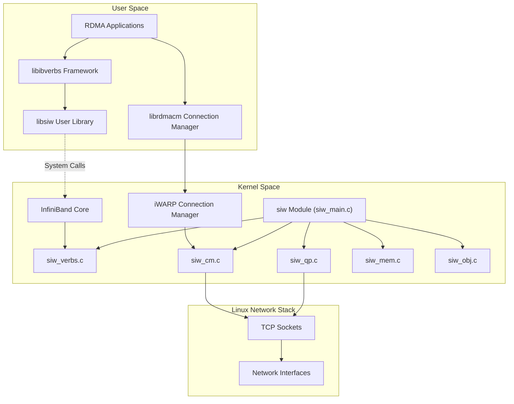

Sources: [README.md:11-28](), [kernel/siw.h:122-151]()

## Core Device and Object Management

The `siw_dev` structure serves as the central coordination point for all RDMA objects and device operations. It integrates with the OpenFabrics framework while managing object lifecycles through IDR trees and reference counting.

### Device and Object Hierarchy

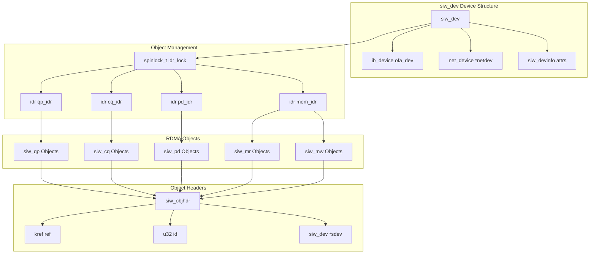

Sources: [kernel/siw.h:122-151](), [kernel/siw.h:153-157]()

## Queue Pair Architecture

Queue pairs represent the core data transfer mechanism in SoftiWARP. Each `siw_qp` contains separate transmit and receive contexts, multiple work queues, and integrates with the completion queue system.

### Queue Pair Structure and Queues

```mermaid
graph TB
    subgraph "siw_qp Structure"
        QP["siw_qp"]
        OFA_QP["ib_qp ofa_qp"]
        HDR["siw_objhdr hdr"]
        ATTRS["siw_qp_attrs attrs"]
        
        QP --> OFA_QP
        QP --> HDR
        QP --> ATTRS
    end
    
    subgraph "Work Queues"
        SENDQ["siw_sqe *sendq"]
        RECVQ["siw_rqe *recvq"]
        IRQ["siw_sqe *irq"]
        ORQ["siw_sqe *orq"]
        
        SENDQ_GET["sq_get"]
        SENDQ_PUT["sq_put"]
        RECVQ_GET["rq_get"]
        RECVQ_PUT["rq_put"]
        IRQ_GET["irq_get"]
        IRQ_PUT["irq_put"]
        ORQ_GET["orq_get"]
        ORQ_PUT["orq_put"]
        
        SENDQ --> SENDQ_GET
        SENDQ --> SENDQ_PUT
        RECVQ --> RECVQ_GET
        RECVQ --> RECVQ_PUT
        IRQ --> IRQ_GET
        IRQ --> IRQ_PUT
        ORQ --> ORQ_GET
        ORQ --> ORQ_PUT
    end
    
    subgraph "Processing Contexts"
        RX_CTX["siw_iwarp_rx rx_ctx"]
        TX_CTX["siw_iwarp_tx tx_ctx"]
        
        RX_WQE["siw_wqe wqe_active"]
        TX_WQE["siw_wqe wqe_active"]
        
        RX_CTX --> RX_WQE
        TX_CTX --> TX_WQE
    end
    
    subgraph "Associated Objects"
        PD["siw_pd *pd"]
        SCQ["siw_cq *scq"]
        RCQ["siw_cq *rcq"]
        CEP["siw_cep *cep"]
        
        PD --> SCQ
        PD --> RCQ
        PD --> CEP
    end
    
    QP --> SENDQ
    QP --> RECVQ
    QP --> IRQ
    QP --> ORQ
    QP --> RX_CTX
    QP --> TX_CTX
    QP --> PD
```

Sources: [kernel/siw.h:544-587](), [common/siw_user.h:149-164]()

## Memory Management Architecture

SoftiWARP implements a sophisticated memory management system that handles user memory registration, DMA operations, and provides both Memory Regions (MR) and Memory Windows (MW) functionality.

### Memory Object Hierarchy

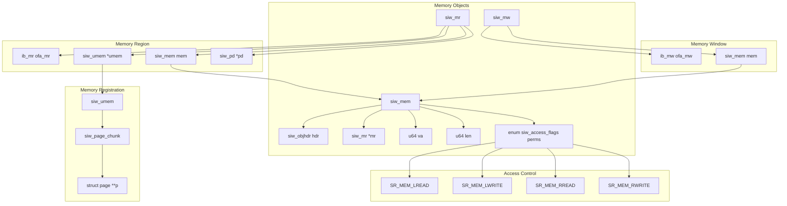

Sources: [kernel/siw.h:207-258](), [kernel/siw.h:180-190]()

## User-Kernel Communication Paths

SoftiWARP provides two distinct communication paths between user space and kernel: the standard OpenFabrics syscall interface and an optimized mapped interface for high-performance operations.

### Dual Interface Architecture

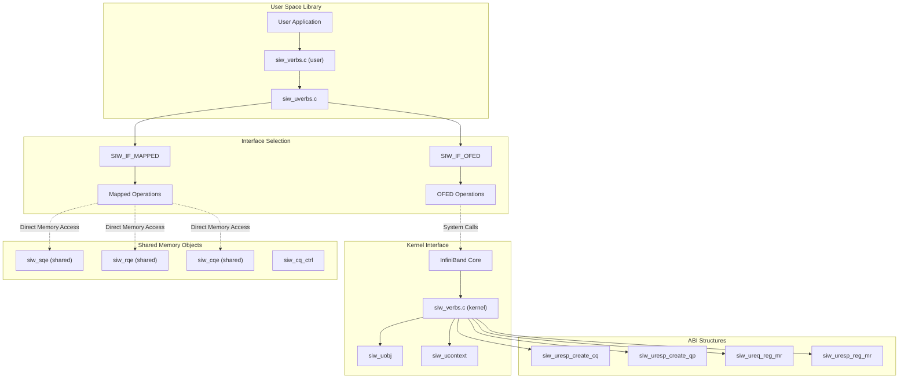

Sources: [kernel/siw.h:60-63](), [common/siw_user.h:63-95](), [kernel/siw.h:159-173]()

## Network Integration and Protocol Stack

SoftiWARP integrates with the Linux network stack through TCP sockets, implementing the complete iWARP protocol suite (MPA/DDP/RDMAP) in software while leveraging existing network infrastructure.

### Protocol Stack Integration

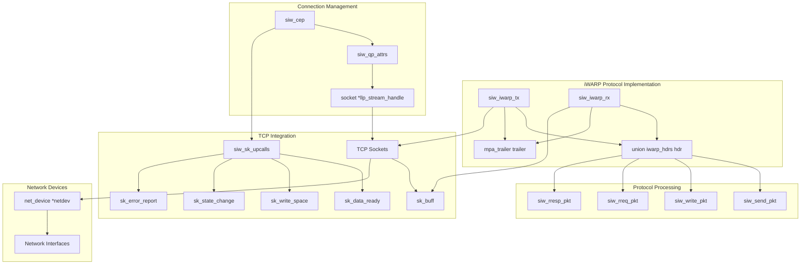

Sources: [kernel/siw.h:409-454](), [kernel/siw.h:483-540](), [kernel/siw.h:346-351](), [kernel/siw.h:391-392]()

## OpenFabrics Integration

SoftiWARP integrates seamlessly with the OpenFabrics architecture by implementing the required verb interfaces and maintaining compatibility with existing RDMA applications through the InfiniBand core layer.

### OFA Interface Implementation

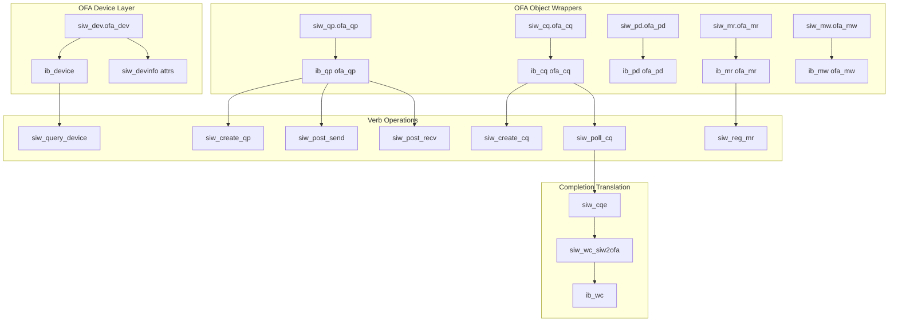

Sources: [kernel/siw.h:90-119](), [kernel/siw_cq.c:52-62](), [kernel/siw_cq.c:67-88]()

---

# Page: Kernel Driver Components

# Kernel Driver Components

<details>
<summary>Relevant source files</summary>

The following files were used as context for generating this wiki page:

- [kernel/siw.h](kernel/siw.h)
- [kernel/siw_cq.c](kernel/siw_cq.c)
- [kernel/siw_main.c](kernel/siw_main.c)

</details>


## Purpose and Scope

This page provides an overview of the kernel-space components of the SoftiWARP (siw) driver, explaining how the kernel module implements iWARP functionality and integrates with the Linux networking stack and RDMA subsystem. It covers the core architectural components, data structures, and their interactions within the kernel driver.

For detailed implementation of specific components, see: Queue Pair Transmission ([3.1](#3.1)), Connection Management ([3.2](#3.2)), Queue Pair Reception ([3.3](#3.3)), Memory Management ([3.4](#3.4)), Object Management ([3.5](#3.5)), and Device and Module Management ([3.6](#3.6)). For user-space components, see User Space Library ([4](#4)).

## Core Architecture

The SoftiWARP kernel driver implements a software-based iWARP RDMA provider that operates over standard TCP sockets. The driver integrates with the Linux InfiniBand/RDMA subsystem to provide RDMA services to applications through the standard verbs interface.

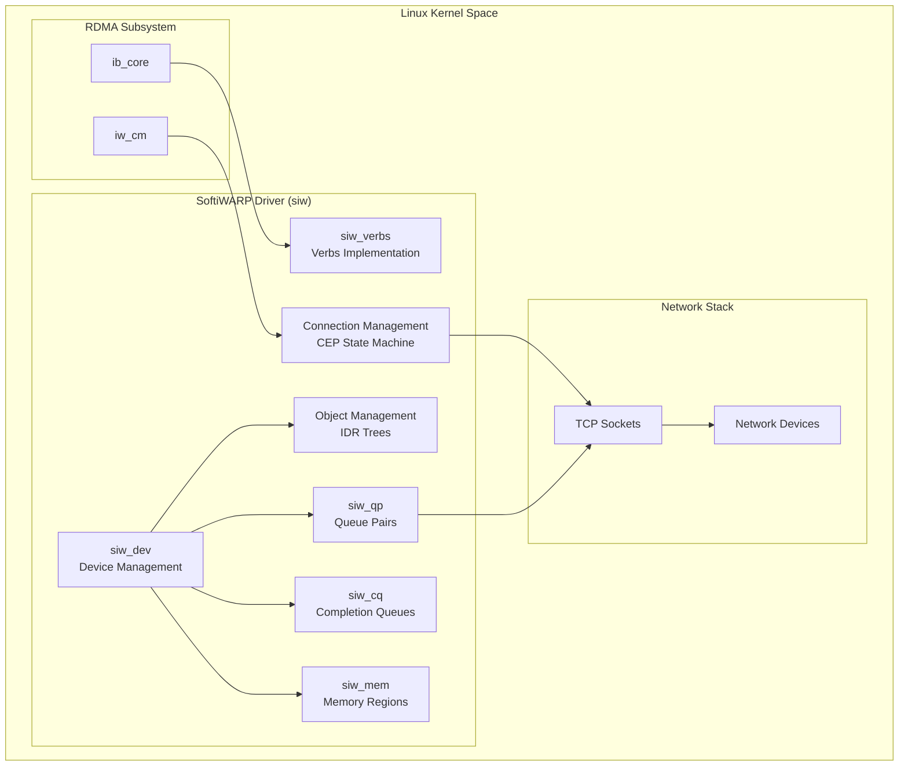

Sources: [kernel/siw.h:122-151](), [kernel/siw_main.c:341-513]()

## Device and Registration Model

The siw driver follows a one-to-one mapping between network devices and RDMA devices. Each qualified network interface gets its own `siw_dev` instance that registers with the RDMA subsystem.

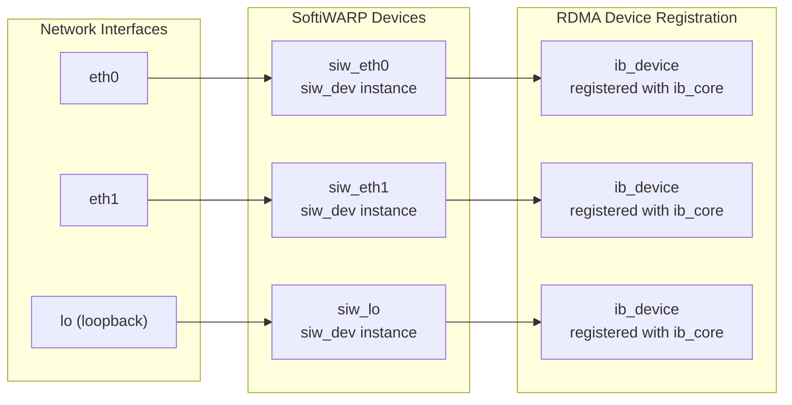

Sources: [kernel/siw_main.c:141-183](), [kernel/siw_main.c:517-620]()

## Core Data Structures

The kernel driver is built around several key data structures that represent RDMA objects and their relationships:

| Structure | Purpose | Key Fields |
|-----------|---------|------------|
| `siw_dev` | Main device representation | `netdev`, `attrs`, IDR trees, object counters |
| `siw_qp` | Queue Pair implementation | `tx_ctx`, `rx_ctx`, `sendq`, `recvq`, `attrs` |
| `siw_cq` | Completion Queue | `queue`, `cq_put`, `cq_get`, `num_cqe` |
| `siw_mem` | Memory region/window | `va`, `len`, `perms`, `stag_state` |
| `siw_pd` | Protection Domain | `hdr` (object header) |
| `siw_objhdr` | Common object header | `id`, `ref` (kref), `sdev` |

Sources: [kernel/siw.h:122-178](), [kernel/siw.h:222-258](), [kernel/siw.h:293-303](), [kernel/siw.h:544-587]()

## Object Management System

The driver uses Linux IDR (ID Radix) trees to manage RDMA objects, providing efficient lookup and allocation of object IDs. Each device maintains separate IDR trees for different object types.

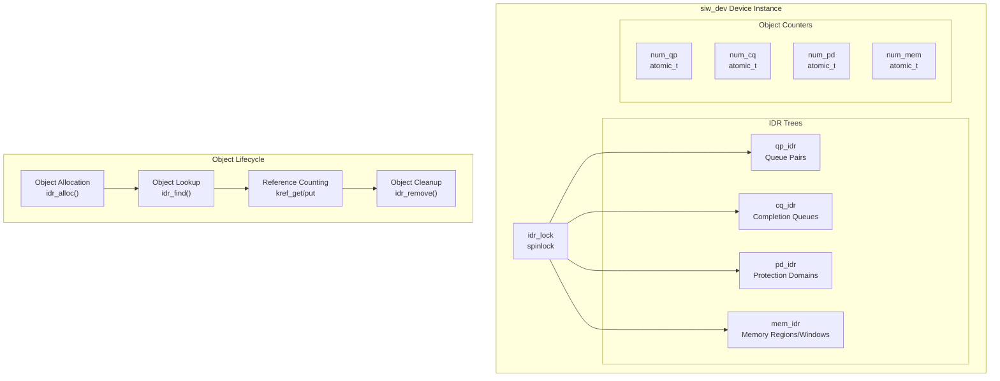

Sources: [kernel/siw.h:135-149](), [kernel/siw.h:153-157]()

## Queue Pair Processing Architecture

Queue Pairs are the core data transfer mechanism, with separate TX and RX processing contexts that handle iWARP protocol operations over TCP connections.

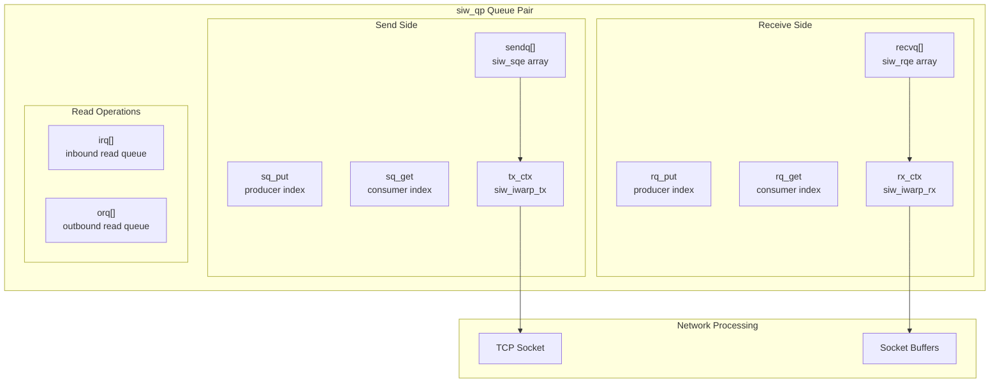

Sources: [kernel/siw.h:544-587](), [kernel/siw.h:409-454](), [kernel/siw.h:483-540]()

## Connection and State Management  

The driver implements iWARP connection establishment through Connection Endpoints (CEPs) that manage the MPA handshake protocol and coordinate with Queue Pair state transitions.

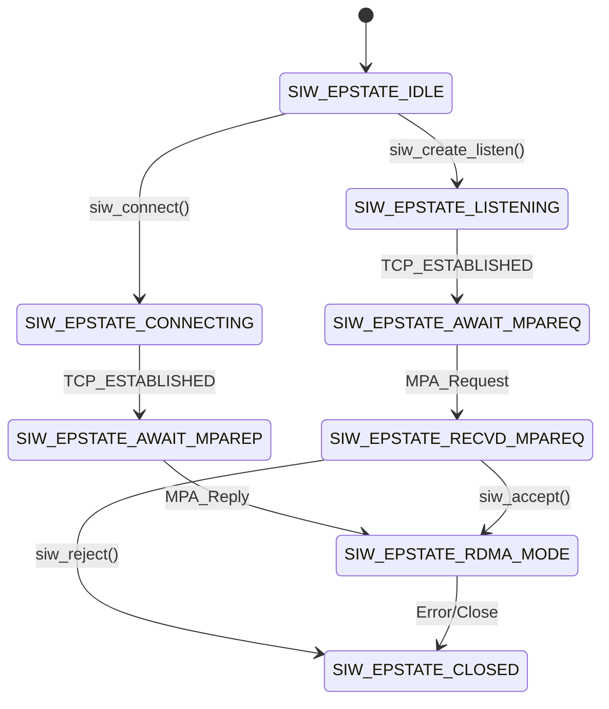

Sources: [kernel/siw.h:305-315]() (QP states), connection management implementation in sub-components

## Memory Management Integration

The driver provides RDMA memory management through integration with Linux memory management, supporting both kernel and user memory registration with DMA operations.

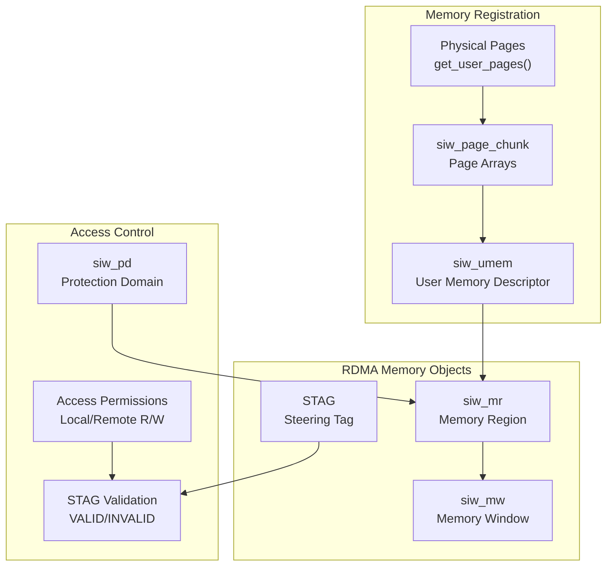

Sources: [kernel/siw.h:203-258](), [kernel/siw.h:696-723]()

## Integration Points

The kernel driver integrates with several Linux subsystems:

- **RDMA Subsystem**: Registers as an `ib_device` with verbs operations
- **Network Stack**: Uses TCP sockets for iWARP transport  
- **Memory Management**: Integrates with page allocation and DMA mapping
- **Module Framework**: Standard Linux kernel module with parameter support
- **Debug Framework**: DebugFS integration for runtime diagnostics

The driver supports both kernel clients (direct verbs calls) and user-space applications (through uverbs), with different optimizations for each path.

Sources: [kernel/siw_main.c:39-770](), [kernel/siw.h:60-63]()

---

# Page: Queue Pair Transmission

# Queue Pair Transmission

<details>
<summary>Relevant source files</summary>

The following files were used as context for generating this wiki page:

- [kernel/siw_qp.c](kernel/siw_qp.c)
- [kernel/siw_qp_tx.c](kernel/siw_qp_tx.c)
- [kernel/siw_verbs.c](kernel/siw_verbs.c)

</details>


This document covers the send queue processing, work request handling, and data transmission path in the SoftiWARP kernel driver. This is the most critical component of the system as it handles all outbound RDMA operations including SEND, WRITE, and READ requests.

For information about the receive path processing, see [Queue Pair Reception](#3.3). For connection establishment and management, see [Connection Management](#3.2).

## Overview

The Queue Pair transmission system implements the complete outbound data path for iWARP operations. It processes work requests posted by applications, manages send queue state, prepares iWARP protocol packets, and transmits data over TCP sockets. The system supports multiple operation types, zero-copy transmission optimizations, and both kernel and user-space work request posting.

## Architecture Components

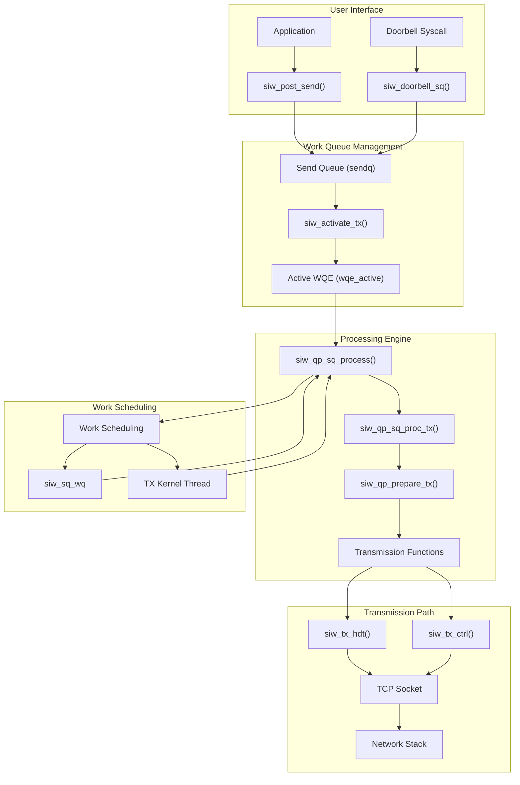

**Sources:** [kernel/siw_qp_tx.c:1040-1188](), [kernel/siw_verbs.c:1020-1217](), [kernel/siw_qp.c:787-904]()

## Work Request Posting

Applications submit work requests through the `siw_post_send()` function, which validates requests and places them in the send queue for processing.

### Post Send Flow

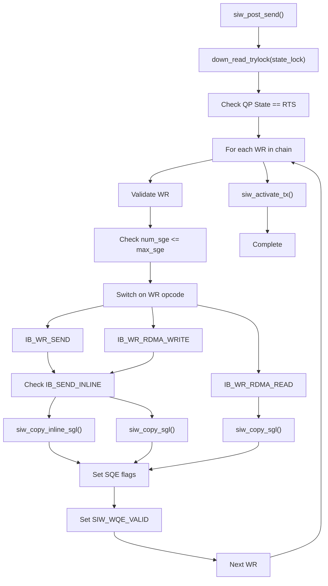

**Sources:** [kernel/siw_verbs.c:1020-1217](), [kernel/siw_verbs.c:863-873](), [kernel/siw_verbs.c:884-913]()

### Send Queue Elements

The send queue contains `siw_sqe` structures representing individual work requests:

| Field | Purpose |
|-------|---------|
| `opcode` | Operation type (SEND, WRITE, READ) |
| `flags` | Control flags (INLINE, SIGNALLED, READ_FENCE) |
| `num_sge` | Number of scatter-gather elements |
| `sge[]` | Scatter-gather list |
| `rkey`/`raddr` | Remote memory key and address for RDMA ops |
| `id` | Work request identifier for completion |

**Sources:** [kernel/siw_verbs.c:1058-1174]()

## Send Queue Processing

The core processing engine is `siw_qp_sq_process()`, which continuously processes work requests from the send queue until completion or error.

### Processing State Machine

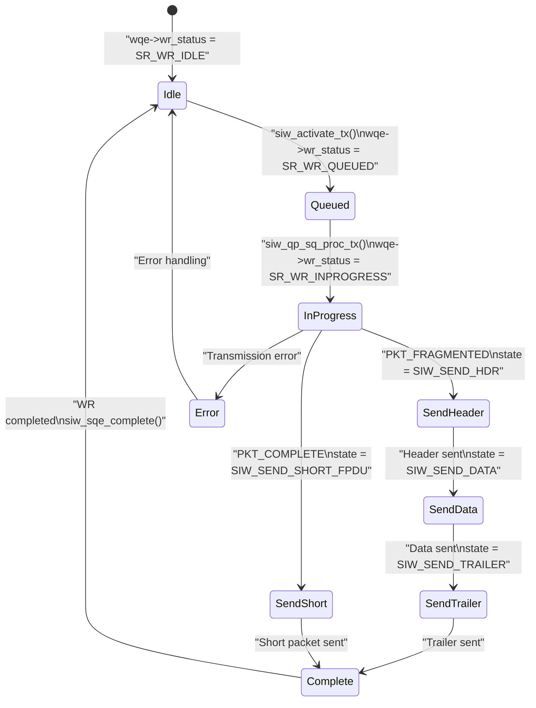

**Sources:** [kernel/siw_qp_tx.c:890-1002](), [kernel/siw_qp_tx.c:176-323]()

### Work Request Activation

The `siw_activate_tx()` function selects the next work request for processing, prioritizing pending read responses over new send queue entries:

```mermaid
graph TD
    START["siw_activate_tx()"] --> CHECK_WQE["Check wqe->wr_status == SR_WR_IDLE"]
    CHECK_WQE --> IRQ_CHECK["Check IRQ for Read Responses"]
    
    IRQ_CHECK --> IRQ_FOUND["IRQ Entry Valid"]
    IRQ_CHECK --> IRQ_EMPTY["No IRQ Entry"]
    
    IRQ_FOUND --> SETUP_RRESP["Setup READ_RESPONSE WQE"]
    SETUP_RRESP --> RETURN_1["Return 1"]
    
    IRQ_EMPTY --> SQ_CHECK["sq_get_next(qp)"]
    SQ_CHECK --> SQ_FOUND["SQE Available"]
    SQ_CHECK --> SQ_EMPTY["No SQE"]
    
    SQ_FOUND --> COPY_SQE["Copy SQE to WQE"]
    COPY_SQE --> VALIDATE["Validate Operation"]
    VALIDATE --> FENCE_CHECK["Check READ_FENCE"]
    
    FENCE_CHECK --> FENCE_SET["Set orq_fence"]
    FENCE_CHECK --> READ_OP["READ Operation"]
    FENCE_CHECK --> NORMAL["Normal Operation"]
    
    READ_OP --> ORQ_SPACE["Check ORQ Space"]
    ORQ_SPACE --> ORQ_ADD["Add to ORQ"]
    ORQ_SPACE --> ORQ_FENCE["Set orq_fence"]
    
    NORMAL --> RETURN_1
    ORQ_ADD --> RETURN_1
    FENCE_SET --> RETURN_0["Return 0"]
    ORQ_FENCE --> RETURN_0
    SQ_EMPTY --> RETURN_0
```

**Sources:** [kernel/siw_qp.c:787-904]()

## Packet Preparation and Transmission

Work requests are converted into iWARP protocol packets through `siw_qp_prepare_tx()` and transmitted via specialized functions.

### Packet Types and Preparation

| Operation | Packet Type | Header Size | Special Handling |
|-----------|-------------|-------------|------------------|
| SEND | `iwarp_send` | 16 bytes | Supports inline data |
| WRITE | `iwarp_rdma_write` | 28 bytes | Supports inline data |
| READ | `iwarp_rdma_rreq` | 36 bytes | Request only |
| READ_RESPONSE | `iwarp_rdma_rresp` | 28 bytes | Response data |

**Sources:** [kernel/siw_qp_tx.c:184-266](), [kernel/siw_qp.c:80-151]()

### Transmission Mechanisms

The system supports two primary transmission mechanisms:

#### Header-Data-Trailer (HDT) Transmission

`siw_tx_hdt()` handles fragmented packets that may span multiple TCP segments:

```mermaid
graph LR
    HDR["iWARP Header"] --> DATA["User Data"]
    DATA --> PAD["Padding"]
    PAD --> CRC["MPA CRC"]
    
    subgraph "Transmission Options"
        KVEC["Kernel IOV\n(copy)"]
        SENDPAGE["sendpage\n(zero-copy)"]
    end
    
    HDR --> KVEC
    DATA --> KVEC
    DATA --> SENDPAGE
    PAD --> KVEC
    CRC --> KVEC
```

**Sources:** [kernel/siw_qp_tx.c:480-719]()

#### Control Packet Transmission

`siw_tx_ctrl()` handles complete small packets that fit in a single TCP segment:

**Sources:** [kernel/siw_qp_tx.c:330-360]()

### Zero-Copy Optimization

For large transfers, the system can use zero-copy transmission via `sendpage()` when conditions are met:

- Payload > `SENDPAGE_THRESH`
- Work request not signalled
- No CRC calculation required
- Operation is not READ

**Sources:** [kernel/siw_qp_tx.c:314-320](), [kernel/siw_qp_tx.c:434-461]()

## Work Scheduling and Threading

The transmission system supports both workqueue-based and kernel thread-based scheduling for continued processing when transmission cannot complete immediately.

### Scheduling Architecture

```mermaid
graph TB
    subgraph "Trigger Sources"
        POST["siw_post_send()"]
        SPACE["siw_qp_llp_write_space()"]
        DB["Doorbell Syscall"]
    end
    
    subgraph "Scheduling Decision"
        TRIGGER["Scheduling Trigger"] 
        POST --> TRIGGER
        SPACE --> TRIGGER
        DB --> TRIGGER
    end
    
    subgraph "Execution Paths"
        TRIGGER --> DIRECT["Direct Execution\n(in_syscall=1)"]
        TRIGGER --> QUEUE["Queue Work"]
        
        QUEUE --> WQ_MODE["Workqueue Mode\nsiw_sq_work_handler()"]
        QUEUE --> THREAD_MODE["Kernel Thread Mode\nsiw_run_sq()"]
    end
    
    subgraph "Processing"
        DIRECT --> PROC["siw_qp_sq_process()"]
        WQ_MODE --> PROC
        THREAD_MODE --> PROC
    end
```

**Sources:** [kernel/siw_qp_tx.c:1190-1413](), [kernel/siw_qp_tx.c:1220-1260](), [kernel/siw_qp_tx.c:1295-1366]()

### Burst Control

The system implements burst control to prevent excessive CPU usage:

- Default burst size: `SQ_USER_MAXBURST`
- Configurable per-QP burst limit in `qp->tx_ctx.burst`
- Returns `-EINPROGRESS` when burst limit reached to schedule continuation

**Sources:** [kernel/siw_qp_tx.c:894-948]()

## Error Handling and Completion

### Completion Processing

Successful work requests generate completions via `siw_sqe_complete()`, which places completion queue entries (CQEs) in the associated completion queue.

### Error Conditions

| Error | Cause | Action |
|-------|-------|--------|
| `-EAGAIN` | TCP send buffer full | Schedule retry |
| `-EINVAL` | Invalid operation/parameters | Complete with error |
| `-ECONNABORTED` | Connection lost | Flush remaining work |
| `-EMSGSIZE` | Packet too large | Complete with error |

**Sources:** [kernel/siw_qp_tx.c:1122-1182](), [kernel/siw_qp.c:1049-1117]()

### Queue Flushing

When errors occur or QP transitions to error state, `siw_sq_flush()` completes all pending work requests with flush error status.

**Sources:** [kernel/siw_qp.c:1049-1117]()

---

# Page: Connection Management

# Connection Management

<details>
<summary>Relevant source files</summary>

The following files were used as context for generating this wiki page:

- [kernel/siw_cm.c](kernel/siw_cm.c)
- [kernel/siw_cm.h](kernel/siw_cm.h)
- [kernel/siw_debug.c](kernel/siw_debug.c)
- [kernel/siw_debug.h](kernel/siw_debug.h)
- [kernel/siw_obj.h](kernel/siw_obj.h)

</details>


This document covers the iWARP connection establishment and management functionality in the SoftiWARP kernel driver. Connection management handles the lifecycle of RDMA connections from initial listen/connect operations through MPA handshake to established RDMA mode. For information about queue pair operations after connection establishment, see [Queue Pair Transmission](#3.1) and [Queue Pair Reception](#3.3).

## Overview

The SoftiWARP connection management subsystem implements the iWARP connection model by bridging TCP sockets with RDMA semantics. It manages Connection Endpoints (CEPs) that represent the connection state and coordinates the MPA (Marker PDU Aligned) handshake protocol required by the iWARP specification.

The system provides both active (client) and passive (server) connection establishment through integration with the kernel's iWARP Connection Manager (IWCM) and maintains connection state through a well-defined state machine.

## Connection Endpoint Architecture

### Connection Endpoint Structure

The `siw_cep` structure serves as the central data structure for managing connection state:

```mermaid
graph TB
    subgraph "Connection Endpoint (siw_cep)"
        A[cm_id] --> B["iw_cm_id pointer"]
        C[sdev] --> D["siw_dev pointer"] 
        E[qp] --> F["Associated siw_qp"]
        G[state] --> H["siw_cep_state enum"]
        I[llp] --> J["siw_llp_info (TCP socket)"]
        K[mpa] --> L["siw_mpa_info (MPA data)"]
        M[lock] --> N["spinlock_t for synchronization"]
        O[ref] --> P["kref for reference counting"]
    end
```

**CEP State Management**
```mermaid
stateDiagram-v2
    [*] --> SIW_EPSTATE_IDLE
    SIW_EPSTATE_IDLE --> SIW_EPSTATE_LISTENING: "siw_create_listen"
    SIW_EPSTATE_IDLE --> SIW_EPSTATE_CONNECTING: "siw_connect"
    SIW_EPSTATE_LISTENING --> SIW_EPSTATE_AWAIT_MPAREQ: "TCP_ESTABLISHED"
    SIW_EPSTATE_CONNECTING --> SIW_EPSTATE_AWAIT_MPAREP: "TCP connected"
    SIW_EPSTATE_AWAIT_MPAREQ --> SIW_EPSTATE_RECVD_MPAREQ: "MPA Request received"
    SIW_EPSTATE_RECVD_MPAREQ --> SIW_EPSTATE_RDMA_MODE: "siw_accept"
    SIW_EPSTATE_RECVD_MPAREQ --> SIW_EPSTATE_CLOSED: "siw_reject"
    SIW_EPSTATE_AWAIT_MPAREP --> SIW_EPSTATE_RDMA_MODE: "MPA Reply received"
    SIW_EPSTATE_RDMA_MODE --> SIW_EPSTATE_CLOSED: "Connection closed"
    SIW_EPSTATE_AWAIT_MPAREQ --> SIW_EPSTATE_CLOSED: "Timeout/Error"
    SIW_EPSTATE_AWAIT_MPAREP --> SIW_EPSTATE_CLOSED: "Timeout/Error"
```

Sources: [kernel/siw_cm.h:48-57](), [kernel/siw_cm.h:74-108]()

### MPA Protocol Integration

The MPA handshake is implemented through the `siw_mpa_info` structure which tracks the exchange of MPA Request/Reply messages:

| Field | Purpose |
|-------|---------|
| `hdr` | MPA Request/Reply header in host byte order |
| `pdata` | Private data buffer |
| `bytes_rcvd` | Bytes received so far |

**MPA Handshake Flow**
```mermaid
sequenceDiagram
    participant Initiator as "Active Side"
    participant TCP as "TCP Connection"
    participant Target as "Passive Side"
    
    Initiator->>TCP: TCP Connect
    TCP->>Target: TCP Established
    Target->>Target: State = AWAIT_MPAREQ
    Initiator->>TCP: MPA Request + Private Data
    TCP->>Target: MPA Request
    Target->>Target: Process Request (siw_proc_mpareq)
    Target->>Target: State = RECVD_MPAREQ
    Target->>Target: IWCM Upcall (CONNECT_REQUEST)
    Note over Target: Application calls siw_accept/siw_reject
    Target->>TCP: MPA Reply + Private Data
    TCP->>Initiator: MPA Reply
    Initiator->>Initiator: Process Reply (siw_proc_mpareply)
    Initiator->>Initiator: State = RDMA_MODE
    Target->>Target: State = RDMA_MODE
```

Sources: [kernel/siw_cm.h:59-63](), [kernel/siw_cm.c:527-610](), [kernel/siw_cm.c:696-779]()

## Socket Integration

### Socket Callback Management

The connection management system integrates with Linux TCP sockets by installing custom callback functions that handle socket events:

```mermaid
graph LR
    subgraph "TCP Socket Callbacks"
        A["sk_state_change"] --> B["siw_cm_llp_state_change"]
        C["sk_data_ready"] --> D["siw_cm_llp_data_ready"] 
        E["sk_write_space"] --> F["siw_cm_llp_write_space"]
        G["sk_error_report"] --> H["siw_cm_llp_error_report"]
    end
    
    subgraph "Socket States Handled"
        I["TCP_ESTABLISHED"] --> J["Queue SIW_CM_WORK_ACCEPT"]
        K["TCP_CLOSE"] --> L["Queue SIW_CM_WORK_PEER_CLOSE"]
        M["TCP_CLOSE_WAIT"] --> N["Queue SIW_CM_WORK_PEER_CLOSE"]
    end
```

The system saves original socket callbacks in the CEP structure and restores them when the connection is torn down, ensuring proper cleanup without interfering with normal socket operation.

Sources: [kernel/siw_cm.c:102-133](), [kernel/siw_cm.c:1219-1265]()

### Connection Establishment Functions

**Active Connection Establishment**
```mermaid
flowchart TD
    A["siw_connect()"] --> B["Create TCP socket"]
    B --> C["kernel_bindconnect()"]
    C --> D["Allocate siw_cep"]
    D --> E["Associate CEP with QP"]
    E --> F["Install socket callbacks"]
    F --> G["Send MPA Request"]
    G --> H["Queue MPA timeout timer"]
    H --> I["State = AWAIT_MPAREP"]
```

**Passive Connection Establishment**
```mermaid
flowchart TD
    A["siw_create_listen()"] --> B["Create listening socket"]
    B --> C["Bind to local address"]
    C --> D["socket->ops->listen()"]
    D --> E["Allocate listener CEP"]
    E --> F["State = LISTENING"]
    F --> G["Install socket callbacks"]
    
    H["TCP_ESTABLISHED event"] --> I["siw_accept_newconn()"]
    I --> J["kernel_accept()"]
    J --> K["Create new CEP"]
    K --> L["State = AWAIT_MPAREQ"]
    L --> M["Queue MPA timeout"]
```

Sources: [kernel/siw_cm.c:1298-1449](), [kernel/siw_cm.c:1830-1909](), [kernel/siw_cm.c:785-887]()

## Asynchronous Work Processing

### Work Queue System

Connection management uses a dedicated single-threaded workqueue (`siw_cm_wq`) to handle asynchronous connection events:

| Work Type | Trigger | Handler Function |
|-----------|---------|------------------|
| `SIW_CM_WORK_ACCEPT` | TCP_ESTABLISHED on listener | `siw_accept_newconn()` |
| `SIW_CM_WORK_READ_MPAHDR` | Socket data ready | `siw_proc_mpareq/reply()` |
| `SIW_CM_WORK_CLOSE_LLP` | QP close requested | Connection cleanup |
| `SIW_CM_WORK_PEER_CLOSE` | TCP socket closed | Peer disconnect handling |
| `SIW_CM_WORK_MPATIMEOUT` | MPA timer expired | Timeout processing |

**Work Processing Flow**
```mermaid
graph TD
    A["Socket Event"] --> B["siw_cm_queue_work()"]
    B --> C["siw_get_work()"]
    C --> D["INIT_DELAYED_WORK()"]
    D --> E["queue_delayed_work()"]
    E --> F["siw_cm_work_handler()"]
    F --> G["siw_cep_set_inuse()"]
    G --> H{"Work Type?"}
    H -->|ACCEPT| I["siw_accept_newconn()"]
    H -->|READ_MPAHDR| J["siw_proc_mpareq/reply()"]
    H -->|CLOSE_LLP| K["Connection cleanup"]
    H -->|PEER_CLOSE| L["Handle peer disconnect"]
    H -->|MPATIMEOUT| M["Handle timeout"]
    I --> N["siw_cep_set_free()"]
    J --> N
    K --> N
    L --> N
    M --> N
```

Sources: [kernel/siw_cm.c:1126-1157](), [kernel/siw_cm.c:890-1122](), [kernel/siw_cm.h:113-126]()

## Connection Management API

### Primary Interface Functions

The connection management subsystem exports the following functions to the iWARP Connection Manager:

| Function | Purpose | Key Parameters |
|----------|---------|----------------|
| `siw_connect()` | Initiate active connection | `iw_cm_id`, `iw_cm_conn_param` |
| `siw_accept()` | Accept incoming connection | `iw_cm_id`, `iw_cm_conn_param` |
| `siw_reject()` | Reject incoming connection | `iw_cm_id`, private data |
| `siw_create_listen()` | Create listening endpoint | `iw_cm_id`, backlog |
| `siw_destroy_listen()` | Destroy listening endpoint | `iw_cm_id` |

**Connection Management Integration**
```mermaid
graph TB
    subgraph "Application Layer"
        A["RDMA Application"]
    end
    
    subgraph "User Space Libraries"
        B["librdmacm"]
        C["libibverbs"]
    end
    
    subgraph "Kernel Space"
        D["iWARP CM (IWCM)"]
        E["siw_connect()"]
        F["siw_accept()"] 
        G["siw_reject()"]
        H["siw_create_listen()"]
        I["siw_destroy_listen()"]
        J["siw_cm_upcall()"]
    end
    
    A --> B
    A --> C
    B --> D
    D --> E
    D --> F
    D --> G
    D --> H
    D --> I
    E --> J
    F --> J
    G --> J
    J --> D
```

### Reference Counting and Cleanup

CEPs use kernel reference counting (`kref`) for safe memory management across multiple contexts:

- CEPs are allocated with initial reference count of 1
- References are taken when associating with QPs, sockets, or work items  
- The `__siw_cep_dealloc()` function handles final cleanup when reference count reaches zero
- Cleanup includes MPA timer cancellation, socket disassociation, and work item cleanup

Sources: [kernel/siw_cm.c:134-151](), [kernel/siw_cm.c:272-294](), [kernel/siw_cm.c:457-471]()

## Error Handling and Timeouts

The connection management system implements robust error handling through:

- **MPA Timeouts**: Configurable timeouts for MPA Request (`MPAREQ_TIMEOUT`) and Reply (`MPAREP_TIMEOUT`) phases
- **Socket Error Handling**: Custom error report callbacks that propagate socket errors to the IWCM
- **State Validation**: Strict state checking to prevent invalid transitions
- **Resource Cleanup**: Automatic cleanup of sockets, timers, and references on error conditions

Sources: [kernel/siw_cm.h:110-111](), [kernel/siw_cm.c:214-225](), [kernel/siw_cm.c:1206-1217]()

---

# Page: Queue Pair Reception

# Queue Pair Reception

<details>
<summary>Relevant source files</summary>

The following files were used as context for generating this wiki page:

- [kernel/siw_qp_rx.c](kernel/siw_qp_rx.c)

</details>


## Purpose and Scope

This document covers the receive path processing in the SoftiWARP kernel driver, including DDP (Direct Data Placement) segment handling, iWARP message parsing, and data placement into target memory regions. The reception system processes incoming TCP data streams and converts them into RDMA operations targeting Queue Pairs.

For transmission path processing, see [Queue Pair Transmission](#3.1). For connection establishment, see [Connection Management](#3.2).

## Reception Architecture Overview

The SoftiWARP reception system implements a multi-stage pipeline that processes incoming TCP data and transforms it into completed RDMA operations. The system handles the complexity of reassembling fragmented DDP segments while maintaining strict ordering requirements.

```mermaid
graph TD
    TCP["TCP Socket Data"] --> RX_ENTRY["siw_tcp_rx_data()"]
    RX_ENTRY --> STATE_MACHINE["Reception State Machine"]
    
    STATE_MACHINE --> GET_HDR["SIW_GET_HDR<br/>Header Processing"]
    STATE_MACHINE --> GET_DATA_START["SIW_GET_DATA_START<br/>Begin Data Processing"]  
    STATE_MACHINE --> GET_DATA_MORE["SIW_GET_DATA_MORE<br/>Continue Data Processing"]
    STATE_MACHINE --> GET_TRAILER["SIW_GET_TRAILER<br/>CRC and Padding"]
    
    GET_HDR --> HDR_PARSE["siw_get_hdr()"]
    GET_DATA_START --> OPCODE_DISPATCH["Message Type Dispatch"]
    GET_DATA_MORE --> OPCODE_DISPATCH
    GET_TRAILER --> TRAILER_PROC["siw_get_trailer()"]
    
    OPCODE_DISPATCH --> SEND_PROC["siw_proc_send()"]
    OPCODE_DISPATCH --> WRITE_PROC["siw_proc_write()"] 
    OPCODE_DISPATCH --> RRESP_PROC["siw_proc_rresp()"]
    OPCODE_DISPATCH --> RREQ_PROC["siw_proc_rreq()"]
    
    SEND_PROC --> MEM_PLACE["Memory Placement"]
    WRITE_PROC --> MEM_PLACE
    RRESP_PROC --> MEM_PLACE
    
    MEM_PLACE --> UMEM["siw_rx_umem()<br/>User Memory"]
    MEM_PLACE --> KVA["siw_rx_kva()<br/>Kernel Memory"]
    
    TRAILER_PROC --> COMPLETE["siw_rdmap_complete()"]
    COMPLETE --> WQE_COMPLETION["Work Queue Element<br/>Completion"]
```

Sources: [kernel/siw_qp_rx.c:1201-1351]()

## DDP Segment Reassembly

The SoftiWARP receiver implements DDP reassembly with strict ordering constraints as defined by the iWARP specifications. The system relies on the transmitter's guarantee that DDP segments arrive in order for each RDMA message.

### Ordering Rules

The implementation enforces these key ordering principles:

| Rule | Description | Implementation |
|------|-------------|----------------|
| **Message Serialization** | RDMAP messages for same QP cannot be interleaved | State tracking in `siw_iwarp_rx` |
| **Segment Ordering** | DDP segments within message arrive in sequence | Error on out-of-order detection |
| **READ Response Ordering** | READ responses only start after READ request delivered | Completion fence mechanisms |

```mermaid
graph LR
    MSG1_SEG1["Message 1<br/>Segment 1"] --> MSG1_SEG2["Message 1<br/>Segment 2"]
    MSG1_SEG2 --> MSG1_SEG3["Message 1<br/>Segment 3"]
    MSG1_SEG3 --> MSG2_SEG1["Message 2<br/>Segment 1"]
    MSG2_SEG1 --> MSG2_SEG2["Message 2<br/>Segment 2"]
    
    MSG1_SEG1 -.-> ORDER_CHECK["Order Validation<br/>prev_rdmap_opcode<br/>more_ddp_segs"]
    MSG1_SEG2 -.-> ORDER_CHECK
    MSG2_SEG1 -.-> ORDER_CHECK
```

Sources: [kernel/siw_qp_rx.c:59-102]()

## Reception State Machine

The reception process operates through a finite state machine that processes each incoming socket buffer through distinct phases. The `siw_iwarp_rx` context maintains state across multiple socket buffer arrivals.

### State Transitions

```mermaid
stateDiagram-v2
    [*] --> SIW_GET_HDR
    SIW_GET_HDR --> SIW_GET_DATA_START : "Header Complete"
    SIW_GET_DATA_START --> SIW_GET_DATA_MORE : "Data Partial"
    SIW_GET_DATA_START --> SIW_GET_TRAILER : "Data Complete"
    SIW_GET_DATA_MORE --> SIW_GET_DATA_MORE : "Data Continuing"
    SIW_GET_DATA_MORE --> SIW_GET_TRAILER : "Data Complete"
    SIW_GET_TRAILER --> SIW_GET_HDR : "FPDU Complete"
    
    SIW_GET_HDR --> [*] : "Error"
    SIW_GET_DATA_START --> [*] : "Error"
    SIW_GET_DATA_MORE --> [*] : "Error"
    SIW_GET_TRAILER --> [*] : "Error"
```

### State Processing Details

| State | Function | Purpose | Next State Logic |
|-------|----------|---------|------------------|
| `SIW_GET_HDR` | `siw_get_hdr()` | Parse iWARP header | Complete → `SIW_GET_DATA_START` |
| `SIW_GET_DATA_START` | `siw_rx_data()` | Begin payload processing | Partial → `SIW_GET_DATA_MORE` |
| `SIW_GET_DATA_MORE` | `siw_rx_data()` | Continue payload processing | Complete → `SIW_GET_TRAILER` |
| `SIW_GET_TRAILER` | `siw_get_trailer()` | Process CRC and padding | Complete → `SIW_GET_HDR` |

Sources: [kernel/siw_qp_rx.c:1224-1304]()

## Header Processing

The header processing phase extracts and validates iWARP protocol headers from the incoming TCP stream. Headers have variable lengths depending on the RDMA operation type.

### Header Structure Processing

```mermaid
graph TB
    subgraph "iWARP Header Components"
        CTRL["iwarp_ctrl<br/>Fixed 8 bytes"]
        VAR_HDR["Variable Header<br/>Operation-specific"]
    end
    
    subgraph "Header Processing Flow"
        CHECK_SIZE["Check Header Size<br/>iwarp_pktinfo[opcode].hdr_len"]
        VALIDATE["Validate Versions<br/>DDP_VERSION<br/>RDMAP_VERSION"]
        EXTRACT["Extract Operation<br/>__rdmap_opcode()"]
    end
    
    CTRL --> CHECK_SIZE
    VAR_HDR --> CHECK_SIZE
    CHECK_SIZE --> VALIDATE
    VALIDATE --> EXTRACT
    
    subgraph "Operation Types"
        EXTRACT --> SEND_HDR["RDMAP_SEND<br/>RDMAP_SEND_SE"]
        EXTRACT --> WRITE_HDR["RDMAP_RDMA_WRITE"]
        EXTRACT --> READ_REQ_HDR["RDMAP_RDMA_READ_REQ"]
        EXTRACT --> READ_RESP_HDR["RDMAP_RDMA_READ_RESP"]
    end
```

### Header Validation Functions

| Operation | Validation Function | Key Checks |
|-----------|-------------------|------------|
| SEND | `siw_send_check_ntoh()` | MSN sequence, MO offset, QN validation |
| WRITE | `siw_write_check_ntoh()` | STAG/TO consistency across fragments |
| READ RESP | `siw_rresp_check_ntoh()` | STAG/TO matching with original request |

Sources: [kernel/siw_qp_rx.c:929-1026](), [kernel/siw_qp_rx.c:236-378]()

## Message Type Processing

Different RDMA operations require specialized processing logic for data placement and completion handling. Each processor function handles the specific semantics of its operation type.

### SEND Message Processing

SEND operations place data into receive work queue elements (RQEs) and generate completions for the receiving application.

```mermaid
graph TD
    SEND_START["siw_proc_send()"] --> GET_RQE["siw_rqe_get()"]
    GET_RQE --> RQE_VALID{"RQE Available?"}
    RQE_VALID -->|Yes| VALIDATE_HDR["siw_send_check_ntoh()"]
    RQE_VALID -->|No| ERROR_NOENT["-ENOENT"]
    
    VALIDATE_HDR --> DATA_LOOP["Data Placement Loop"]
    DATA_LOOP --> CHECK_SGE["siw_check_sge()"]
    CHECK_SGE --> PLACE_MEM["Memory Placement"]
    
    PLACE_MEM --> UMEM_PATH["siw_rx_umem()"]
    PLACE_MEM --> KVA_PATH["siw_rx_kva()"]
    
    UMEM_PATH --> UPDATE_PTRS["Update SGE Pointers"]
    KVA_PATH --> UPDATE_PTRS
    UPDATE_PTRS --> MORE_DATA{"More Data?"}
    MORE_DATA -->|Yes| DATA_LOOP
    MORE_DATA -->|No| COMPLETE["Complete RQE"]
```

Sources: [kernel/siw_qp_rx.c:457-551]()

### WRITE Message Processing  

WRITE operations place data directly into memory regions specified by the remote STAG (Steering Tag) and TO (Tagged Offset).

```mermaid
graph TD
    WRITE_START["siw_proc_write()"] --> VALIDATE_HDR["siw_write_check_ntoh()"]
    VALIDATE_HDR --> RESOLVE_MEM["siw_mem_id2obj()"]
    RESOLVE_MEM --> CHECK_PERMS["siw_check_mem()"]
    CHECK_PERMS --> PLACE_DATA["Data Placement"]
    
    PLACE_DATA --> UMEM_WRITE["siw_rx_umem()"]
    PLACE_DATA --> KVA_WRITE["siw_rx_kva()"]
    
    UMEM_WRITE --> UPDATE_OFFSET["Update ddp_to"]
    KVA_WRITE --> UPDATE_OFFSET
    UPDATE_OFFSET --> WRITE_COMPLETE["WRITE Complete"]
```

Sources: [kernel/siw_qp_rx.c:566-636]()

### READ Response Processing

READ responses place data into the memory region specified in the original READ request, which is retrieved from the Outbound Read Queue (ORQ).

```mermaid
graph TD
    RRESP_START["siw_proc_rresp()"] --> GET_ORQ["siw_orqe_get()"]
    GET_ORQ --> ORQ_VALID{"ORQ Entry Valid?"}
    ORQ_VALID -->|Yes| VALIDATE_RRESP["siw_rresp_check_ntoh()"]
    ORQ_VALID -->|No| ERROR_PROTO["-EPROTO"]
    
    VALIDATE_RRESP --> CHECK_TARGET["siw_check_sge()"]
    CHECK_TARGET --> PLACE_RRESP["Data Placement"]
    
    PLACE_RRESP --> UMEM_RRESP["siw_rx_umem()"]
    PLACE_RRESP --> KVA_RRESP["siw_rx_kva()"]
    
    UMEM_RRESP --> CHECK_FENCE["siw_check_tx_fence()"]
    KVA_RRESP --> CHECK_FENCE
    CHECK_FENCE --> RESUME_TX["Resume TX Processing"]
```

Sources: [kernel/siw_qp_rx.c:765-852](), [kernel/siw_qp_rx.c:729-753]()

## Memory Placement Operations

The reception system supports two primary memory placement paths: user memory (`siw_rx_umem`) and kernel virtual addresses (`siw_rx_kva`). Both paths handle data copying with optional CRC computation.

### User Memory Placement

```mermaid
graph TD
    UMEM_START["siw_rx_umem()"] --> GET_PAGE["siw_get_upage()"]
    GET_PAGE --> PAGE_VALID{"Page Valid?"}
    PAGE_VALID -->|No| ERROR_FAULT["-EFAULT"]
    PAGE_VALID -->|Yes| KMAP["kmap_atomic()"]
    
    KMAP --> COPY_DATA["skb_copy_bits()"]
    COPY_DATA --> CRC_CHECK{"CRC Enabled?"}
    CRC_CHECK -->|Yes| COMPUTE_CRC["siw_crc_page()"]
    CRC_CHECK -->|No| UPDATE_CTRS["Update Counters"]
    COMPUTE_CRC --> UPDATE_CTRS
    
    UPDATE_CTRS --> KUNMAP["kunmap_atomic()"]
    KUNMAP --> MORE_PAGES{"More Pages?"}
    MORE_PAGES -->|Yes| GET_PAGE
    MORE_PAGES -->|No| UMEM_DONE["Placement Complete"]
```

### Kernel Memory Placement

```mermaid
graph TD
    KVA_START["siw_rx_kva()"] --> COPY_KVA["skb_copy_bits()"]
    COPY_KVA --> CRC_KVA{"CRC Enabled?"}
    CRC_KVA -->|Yes| CRC_ARRAY["siw_crc_array()"]
    CRC_KVA -->|No| UPDATE_KVA["Update Counters"]
    CRC_ARRAY --> UPDATE_KVA
    UPDATE_KVA --> KVA_DONE["Placement Complete"]
```

Sources: [kernel/siw_qp_rx.c:125-199](), [kernel/siw_qp_rx.c:201-223]()

## Completion Processing

Once a complete RDMA message has been received and processed, the `siw_rdmap_complete()` function handles operation-specific completion logic and work queue element cleanup.

### Completion Flow by Operation

```mermaid
graph TD
    COMPLETE_START["siw_rdmap_complete()"] --> CHECK_OP["Check RDMAP Opcode"]
    
    CHECK_OP --> SEND_COMPLETE["RDMAP_SEND<br/>RDMAP_SEND_SE"]
    CHECK_OP --> WRITE_COMPLETE["RDMAP_RDMA_WRITE"]  
    CHECK_OP --> RREQ_COMPLETE["RDMAP_RDMA_READ_REQ"]
    CHECK_OP --> RRESP_COMPLETE["RDMAP_RDMA_READ_RESP"]
    
    SEND_COMPLETE --> UPDATE_MSN_SEND["Update MSN<br/>ddp_msn[SEND]++"]
    UPDATE_MSN_SEND --> COMPLETE_RQE["siw_rqe_complete()"]
    COMPLETE_RQE --> CLEANUP_SEND["siw_wqe_put_mem()"]
    
    WRITE_COMPLETE --> RELEASE_MEM["siw_mem_put()<br/>rx_mem(qp)"]
    
    RREQ_COMPLETE --> INIT_RESP["siw_init_rresp()"]
    
    RRESP_COMPLETE --> UPDATE_MSN_READ["Update MSN<br/>ddp_msn[READ]++"]
    UPDATE_MSN_READ --> COMPLETE_SQE["siw_sqe_complete()"]
    COMPLETE_SQE --> CLEANUP_READ["siw_wqe_put_mem()"]
    CLEANUP_READ --> TX_FENCE["siw_check_tx_fence()"]
```

### MSN (Message Sequence Number) Management

| Queue Number | Purpose | MSN Update Location |
|--------------|---------|-------------------|
| `RDMAP_UNTAGGED_QN_SEND` | SEND operations | `siw_rdmap_complete()` for SEND |
| `RDMAP_UNTAGGED_QN_RDMA_READ` | READ responses | `siw_rdmap_complete()` for RRESP |

Sources: [kernel/siw_qp_rx.c:1102-1189]()

## Error Handling and Recovery

The reception system includes comprehensive error detection and handling mechanisms to maintain protocol integrity and provide diagnostic information for debugging.

### Error Categories

```mermaid
graph TB
    subgraph "Protocol Errors"
        VERSION_ERR["Version Mismatch<br/>DDP/RDMAP versions"]
        OPCODE_ERR["Invalid Opcode<br/>Unknown operation"]
        SEQUENCE_ERR["Sequence Error<br/>MSN/MO validation"]
    end
    
    subgraph "Memory Errors"  
        ACCESS_ERR["Access Violation<br/>siw_check_sge/mem"]
        FAULT_ERR["Page Fault<br/>siw_get_upage"]
        LENGTH_ERR["Length Mismatch<br/>Buffer overflow"]
    end
    
    subgraph "CRC Errors"
        CRC_HDR_ERR["Header CRC<br/>siw_crc_rxhdr"]
        CRC_DATA_ERR["Data CRC<br/>Trailer validation"]
    end
    
    subgraph "State Errors"
        STATE_ERR["Invalid State<br/>Unexpected transitions"]
        RESOURCE_ERR["Resource Exhaustion<br/>No RQE/ORQ available"]
    end
    
    VERSION_ERR --> FATAL["Fatal Error<br/>Connection Drop"]
    OPCODE_ERR --> FATAL
    CRC_HDR_ERR --> FATAL
    CRC_DATA_ERR --> FATAL
    
    ACCESS_ERR --> QP_EVENT["QP Event<br/>IB_EVENT_QP_ACCESS_ERR"]
    SEQUENCE_ERR --> QP_EVENT
    
    STATE_ERR --> CM_DROP["siw_qp_cm_drop()"]
    RESOURCE_ERR --> CM_DROP
```

Sources: [kernel/siw_qp_rx.c:1306-1342]()

## Integration with Queue Pair Context

The reception system integrates tightly with the Queue Pair's receive context (`siw_iwarp_rx`) and coordinates with transmission processing through shared work queue elements and fence mechanisms.

### Context Structure Relationships

```mermaid
graph TB
    subgraph "siw_qp Structure"
        QP["siw_qp"] --> RX_CTX["rx_ctx: siw_iwarp_rx"]
        QP --> RQ["recvq: siw_rqe[]"]
        QP --> ORQ["orq: siw_sqe[]"]
        QP --> RX_WQE["rx_wqe: siw_wqe"]
    end
    
    subgraph "Reception Context"
        RX_CTX --> SKB_INFO["skb, skb_offset<br/>skb_new, skb_copied"]
        RX_CTX --> STATE_INFO["state, first_ddp_seg<br/>more_ddp_segs"]
        RX_CTX --> DDP_INFO["ddp_stag, ddp_to<br/>ddp_msn[]"]
        RX_CTX --> FPDU_INFO["fpdu_part_rem<br/>fpdu_part_rcvd"]
    end
    
    subgraph "Work Queue Elements"
        RX_WQE --> RQE_DATA["rqe: receive elements"]
        RX_WQE --> SQE_DATA["sqe: send elements<br/>(for READ responses)"]
        RX_WQE --> MEM_REFS["mem[]: memory references"]
    end
```

Sources: [kernel/siw_qp_rx.c:1204-1215]()

---

# Page: Memory Management

# Memory Management

<details>
<summary>Relevant source files</summary>

The following files were used as context for generating this wiki page:

- [kernel/siw_mem.c](kernel/siw_mem.c)

</details>


## Purpose and Scope

This document covers the memory management subsystem within the SoftiWARP kernel driver, focusing on how user memory regions are pinned, managed, and made available for RDMA operations. The memory management component handles user memory registration, page pinning, DMA address translation, and memory accounting within kernel limits.

For information about RDMA object lifecycle management including memory regions and protection domains, see [Object Management](#3.5). For details on how memory regions are used during data transfer, see [Queue Pair Transmission](#3.1) and [Queue Pair Reception](#3.3).

## User Memory Management Architecture

The SoftiWARP memory management system centers around the `siw_umem` structure, which represents a pinned user memory region. The system manages user virtual memory by pinning pages and organizing them into manageable chunks for efficient processing.

```mermaid
graph TB
    subgraph "User Application"
        USER_VA["User Virtual Address"]
        USER_LEN["Memory Length"]
    end
    
    subgraph "siw_umem Structure"
        UMEM["siw_umem"]
        FP_ADDR["fp_addr (first page)"]
        NUM_PAGES["num_pages"]
        PAGE_CHUNKS["page_chunk[]"]
        PID["pid"]
        MM_S["mm_s"]
    end
    
    subgraph "Page Management"
        CHUNK0["siw_page_chunk[0]"]
        CHUNK1["siw_page_chunk[1]"]
        CHUNKN["siw_page_chunk[n]"]
        PAGES0["page*[PAGES_PER_CHUNK]"]
        PAGES1["page*[PAGES_PER_CHUNK]"]
        PAGESN["page*[remaining]"]
    end
    
    subgraph "Kernel Functions"
        GET_UMEM["siw_umem_get()"]
        RELEASE_UMEM["siw_umem_release()"]
        GET_USER_PAGES["get_user_pages()"]
        PUT_PAGE["put_page()"]
    end
    
    USER_VA --> GET_UMEM
    USER_LEN --> GET_UMEM
    GET_UMEM --> UMEM
    
    UMEM --> FP_ADDR
    UMEM --> NUM_PAGES
    UMEM --> PAGE_CHUNKS
    UMEM --> PID
    
    PAGE_CHUNKS --> CHUNK0
    PAGE_CHUNKS --> CHUNK1
    PAGE_CHUNKS --> CHUNKN
    
    CHUNK0 --> PAGES0
    CHUNK1 --> PAGES1
    CHUNKN --> PAGESN
    
    GET_UMEM --> GET_USER_PAGES
    RELEASE_UMEM --> PUT_PAGE
    
    UMEM --> RELEASE_UMEM
```

The memory management system divides user memory regions into chunks to handle large memory registrations efficiently. Each chunk contains up to `PAGES_PER_CHUNK` pages, allowing the system to process memory in manageable units.

Sources: [kernel/siw_mem.c:114-185](), [kernel/siw_mem.c:77-112]()

## Memory Registration Process

The `siw_umem_get()` function implements the core memory registration logic, performing permission checks, memory limit validation, and page pinning operations.

```mermaid
flowchart TD
    START["siw_umem_get(start, len)"]
    
    PERM_CHECK["can_do_mlock()"]
    CALC_PAGES["Calculate num_pages and chunks"]
    ALLOC_UMEM["Allocate siw_umem structure"]
    GET_PID["get_task_pid(current)"]
    
    MMAP_LOCK["down_write(mmap_sem)"]
    LIMIT_CHECK["Check pinned_vm vs mlock_limit"]
    ALLOC_CHUNKS["Allocate page_chunk array"]
    
    LOOP_START["For each chunk"]
    ALLOC_PAGE_ARRAY["Allocate page* array"]
    GET_PAGES_LOOP["get_user_pages() loop"]
    UPDATE_STATS["Update pinned_vm counter"]
    NEXT_CHUNK["Next chunk"]
    
    MMAP_UNLOCK["up_write(mmap_sem)"]
    SUCCESS["Return umem"]
    
    ERROR["siw_umem_release()"]
    RETURN_ERR["Return ERR_PTR"]
    
    START --> PERM_CHECK
    PERM_CHECK -->|fail| RETURN_ERR
    PERM_CHECK -->|pass| CALC_PAGES
    CALC_PAGES --> ALLOC_UMEM
    ALLOC_UMEM -->|fail| RETURN_ERR
    ALLOC_UMEM -->|success| GET_PID
    GET_PID --> MMAP_LOCK
    MMAP_LOCK --> LIMIT_CHECK
    LIMIT_CHECK -->|exceed| ERROR
    LIMIT_CHECK -->|ok| ALLOC_CHUNKS
    ALLOC_CHUNKS -->|fail| ERROR
    ALLOC_CHUNKS -->|success| LOOP_START
    
    LOOP_START --> ALLOC_PAGE_ARRAY
    ALLOC_PAGE_ARRAY --> GET_PAGES_LOOP
    GET_PAGES_LOOP -->|fail| ERROR
    GET_PAGES_LOOP -->|success| UPDATE_STATS
    UPDATE_STATS --> NEXT_CHUNK
    NEXT_CHUNK -->|more chunks| LOOP_START
    NEXT_CHUNK -->|done| MMAP_UNLOCK
    
    MMAP_UNLOCK --> SUCCESS
    ERROR --> RETURN_ERR
```

The registration process includes several critical steps:

| Step | Function | Purpose |
|------|----------|---------|
| Permission Check | `can_do_mlock()` | Verify process can lock memory |
| Address Alignment | `PAGE_MASK`, `PAGE_ALIGN` | Align to page boundaries |
| Chunk Calculation | `CHUNK_SHIFT` | Determine number of page chunks |
| Memory Limits | `rlimit(RLIMIT_MEMLOCK)` | Enforce system memory limits |
| Page Pinning | `get_user_pages()` | Pin user pages in memory |
| Accounting | `pinned_vm` updates | Track pinned memory usage |

Sources: [kernel/siw_mem.c:114-185]()

## Memory Release and Cleanup

The memory release process handles both synchronous and asynchronous cleanup scenarios, managing process termination cases and memory accounting updates.

```mermaid
graph TD
    RELEASE_START["siw_umem_release(umem)"]
    GET_TASK["get_pid_task(umem->pid)"]
    
    subgraph "Page Cleanup Loop"
        LOOP_CHUNKS["For each page_chunk"]
        FREE_CHUNK["siw_free_chunk()"]
        PUT_PAGES["put_page() for each page"]
        KFREE_PAGES["kfree(chunk.p)"]
    end
    
    PUT_PID["put_pid(umem->pid)"]
    TASK_CHECK{"task != NULL?"}
    GET_MM["get_task_mm(task)"]
    PUT_TASK["put_task_struct(task)"]
    
    MM_CHECK{"mm_s != NULL?"}
    TRYLOCK["down_write_trylock(mmap_sem)"]
    
    SYNC_PATH["Synchronous cleanup"]
    UPDATE_PINNED["mm_s->pinned_vm -= num_pages"]
    UNLOCK_MM["up_write(mmap_sem)"]
    MMPUT["mmput(mm_s)"]
    
    ASYNC_PATH["Asynchronous cleanup"]
    INIT_WORK["INIT_WORK(&umem->work)"]
    SCHEDULE["schedule_work()"]
    
    FINAL_FREE["kfree(umem->page_chunk)"]
    FREE_UMEM["kfree(umem)"]
    
    RELEASE_START --> GET_TASK
    GET_TASK --> LOOP_CHUNKS
    LOOP_CHUNKS --> FREE_CHUNK
    FREE_CHUNK --> PUT_PAGES
    PUT_PAGES --> KFREE_PAGES
    KFREE_PAGES --> PUT_PID
    PUT_PID --> TASK_CHECK
    
    TASK_CHECK -->|yes| GET_MM
    TASK_CHECK -->|no| FINAL_FREE
    GET_MM --> PUT_TASK
    PUT_TASK --> MM_CHECK
    
    MM_CHECK -->|yes| TRYLOCK
    MM_CHECK -->|no| FINAL_FREE
    
    TRYLOCK -->|success| SYNC_PATH
    TRYLOCK -->|fail| ASYNC_PATH
    
    SYNC_PATH --> UPDATE_PINNED
    UPDATE_PINNED --> UNLOCK_MM
    UNLOCK_MM --> MMPUT
    MMPUT --> FINAL_FREE
    
    ASYNC_PATH --> INIT_WORK
    INIT_WORK --> SCHEDULE
    SCHEDULE --> RETURN
    
    FINAL_FREE --> FREE_UMEM
    FREE_UMEM --> RETURN["Return"]
    
    RETURN
```

The cleanup process includes a deferred work mechanism (`siw_umem_update_stats`) to handle cases where the memory map semaphore cannot be acquired immediately, ensuring memory accounting remains consistent even during process termination scenarios.

Sources: [kernel/siw_mem.c:77-112](), [kernel/siw_mem.c:50-65](), [kernel/siw_mem.c:67-75]()

## DMA Operations Interface

SoftiWARP implements custom DMA operations that work with kernel virtual addresses rather than physical DMA addresses, since it operates as a software-based RDMA implementation over TCP.

```mermaid
graph LR
    subgraph "InfiniBand DMA Interface"
        IB_DMA["ib_dma_mapping_ops"]
        MAP_SINGLE["map_single"]
        MAP_PAGE["map_page"]
        MAP_SG["map_sg"]
        UNMAP_OPS["unmap_* operations"]
        ALLOC_COH["alloc_coherent"]
        FREE_COH["free_coherent"]
    end
    
    subgraph "SoftiWARP Implementation"
        SIW_DMA_OPS["siw_dma_mapping_ops"]
        SIW_MAP_SINGLE["siw_dma_map_single()"]
        SIW_MAP_PAGE["siw_dma_map_page()"]
        SIW_MAP_SG["siw_dma_map_sg()"]
        SIW_UNMAP["siw_dma_unmap_*()"]
        SIW_ALLOC["siw_dma_alloc_coherent()"]
        SIW_FREE["siw_dma_free_coherent()"]
    end
    
    subgraph "Generic DMA Interface"
        GENERIC_OPS["siw_dma_generic_ops"]
        GENERIC_ALLOC["siw_dma_generic_alloc()"]
        GENERIC_MAP["siw_dma_generic_map_*()"]
        GENERIC_SYNC["siw_generic_sync_*()"]
    end
    
    subgraph "Address Translation"
        KVA["Kernel Virtual Address"]
        PAGE_ADDR["page_address(page)"]
        NO_TRANSLATION["No Physical DMA"]
    end
    
    IB_DMA --> SIW_DMA_OPS
    MAP_SINGLE --> SIW_MAP_SINGLE
    MAP_PAGE --> SIW_MAP_PAGE
    MAP_SG --> SIW_MAP_SG
    UNMAP_OPS --> SIW_UNMAP
    ALLOC_COH --> SIW_ALLOC
    FREE_COH --> SIW_FREE
    
    SIW_DMA_OPS --> GENERIC_OPS
    SIW_ALLOC --> GENERIC_ALLOC
    SIW_MAP_PAGE --> GENERIC_MAP
    SIW_UNMAP --> GENERIC_SYNC
    
    SIW_MAP_SINGLE --> KVA
    SIW_MAP_PAGE --> PAGE_ADDR
    SIW_MAP_SG --> PAGE_ADDR
    
    KVA --> NO_TRANSLATION
    PAGE_ADDR --> NO_TRANSLATION
```

Key characteristics of SoftiWARP DMA operations:

| Operation | Implementation | Purpose |
|-----------|----------------|---------|
| `siw_dma_map_single` | Return `(u64) kva` | Direct kernel virtual address mapping |
| `siw_dma_map_page` | Return `page_address(page) + offset` | Page-based virtual address mapping |
| `siw_dma_map_sg` | Set `sg->dma_address` to page addresses | Scatter-gather virtual mapping |
| `siw_dma_unmap_*` | No-op functions | No unmapping required for virtual addresses |
| `siw_dma_alloc_coherent` | `alloc_pages()` + `page_address()` | Allocate kernel pages |
| `siw_mapping_error` | Check for null address | Simple error detection |

Sources: [kernel/siw_mem.c:194-308](), [kernel/siw_mem.c:310-428]()

## Memory Accounting and Limits

The memory management system enforces system limits and tracks memory usage to prevent resource exhaustion and ensure fair resource allocation among processes.

```mermaid
graph TD
    subgraph "Memory Limit Enforcement"
        RLIMIT["rlimit(RLIMIT_MEMLOCK)"]
        MLOCK_LIMIT["mlock_limit = RLIMIT >> PAGE_SHIFT"]
        CURRENT_PINNED["current->mm->pinned_vm"]
        CHECK_LIMIT["num_pages + pinned_vm > mlock_limit"]
    end
    
    subgraph "Memory Accounting"
        ACQUIRE["Pin pages: pinned_vm += rv"]
        RELEASE["Release pages: pinned_vm -= num_pages"]
        SYNC_UPDATE["Synchronous update"]
        ASYNC_UPDATE["Asynchronous update via work_struct"]
    end
    
    subgraph "Process Context"
        CURRENT_MM["current->mm"]
        TASK_MM["get_task_mm(task)"]
        MMAP_SEM["mmap_sem protection"]
        WORK_QUEUE["siw_umem_update_stats work"]
    end
    
    RLIMIT --> MLOCK_LIMIT
    MLOCK_LIMIT --> CHECK_LIMIT
    CURRENT_PINNED --> CHECK_LIMIT
    CHECK_LIMIT -->|exceed| ENOMEM["Return -ENOMEM"]
    CHECK_LIMIT -->|ok| ACQUIRE
    
    ACQUIRE --> CURRENT_MM
    RELEASE --> SYNC_UPDATE
    RELEASE --> ASYNC_UPDATE
    
    SYNC_UPDATE --> MMAP_SEM
    ASYNC_UPDATE --> WORK_QUEUE
    WORK_QUEUE --> TASK_MM
    TASK_MM --> MMAP_SEM
    
    CURRENT_MM --> MMAP_SEM
```

The accounting system handles several critical scenarios:

**During Registration (`siw_umem_get`)**:
- Checks current process memory limits using `rlimit(RLIMIT_MEMLOCK)`
- Validates that pinning additional pages won't exceed limits
- Updates `current->mm->pinned_vm` under `mmap_sem` protection

**During Release (`siw_umem_release`)**:
- Attempts synchronous cleanup with `down_write_trylock()`
- Falls back to asynchronous cleanup via `schedule_work()` if semaphore busy
- Maintains accounting consistency across process termination

**Memory Limit Parameters**:
- `RLIMIT_MEMLOCK`: System-wide memory locking limit per process
- `pinned_vm`: Current count of pinned virtual memory pages
- `PAGES_PER_CHUNK`: Chunk size for efficient page management (defined via `CHUNK_SHIFT`)

Sources: [kernel/siw_mem.c:114-185](), [kernel/siw_mem.c:77-112](), [kernel/siw_mem.c:50-65]()

---

# Page: Object Management

# Object Management

<details>
<summary>Relevant source files</summary>

The following files were used as context for generating this wiki page:

- [kernel/siw_obj.c](kernel/siw_obj.c)

</details>


This document covers the RDMA object lifecycle management system in the SoftiWARP kernel driver. This system provides the foundational infrastructure for creating, tracking, and cleaning up all RDMA objects including Queue Pairs (QPs), Completion Queues (CQs), Protection Domains (PDs), and Memory Regions/Windows (MRs/MWs). The object management system ensures thread-safe access, automatic cleanup, and efficient lookup of objects by unique identifiers.

For information about the higher-level device and module initialization, see [Device and Module Management](#3.6). For details about memory region registration and DMA operations, see [Memory Management](#3.4).

## Object Types and Hierarchy

The SoftiWARP object management system handles four primary RDMA object types, each represented by a different IDR (ID Radix tree) within the device structure. All objects share a common header structure for unified management.

### Object Header Structure

```mermaid
graph TB
    siw_objhdr["siw_objhdr"] --> kref["kref ref"]
    siw_objhdr --> id["int id"]
    siw_objhdr --> sdev["siw_dev *sdev"]
    
    subgraph "Object Types"
        siw_qp["siw_qp"] --> qp_hdr["siw_objhdr hdr"]
        siw_cq["siw_cq"] --> cq_hdr["siw_objhdr hdr"]
        siw_pd["siw_pd"] --> pd_hdr["siw_objhdr hdr"]
        siw_mem["siw_mem"] --> mem_hdr["siw_objhdr hdr"]
    end
    
    subgraph "Memory Subtypes"
        siw_mr["siw_mr"] --> mr_mem["siw_mem mem"]
        siw_mw["siw_mw"] --> mw_mem["siw_mem mem"]
    end
    
    kref --> refcount["Reference Counting"]
    id --> lookup["Object Lookup"]
    sdev --> device["Device Association"]
```

Sources: [kernel/siw_obj.c:48-51](), [kernel/siw_obj.c:328-340](), [kernel/siw_obj.c:342-372](), [kernel/siw_obj.c:374-384](), [kernel/siw_obj.c:386-407]()

### IDR Management System

The device maintains separate IDR trees for each object type, providing fast O(log n) lookup by integer ID with thread-safe access through spinlocks.

```mermaid
graph TB
    subgraph "siw_dev Device"
        idr_lock["spinlock_t idr_lock"]
        qp_idr["struct idr qp_idr"]
        cq_idr["struct idr cq_idr"] 
        pd_idr["struct idr pd_idr"]
        mem_idr["struct idr mem_idr"]
    end
    
    subgraph "Object Storage"
        qp_objects["Queue Pair Objects"]
        cq_objects["Completion Queue Objects"]
        pd_objects["Protection Domain Objects"]
        mem_objects["Memory Region/Window Objects"]
    end
    
    idr_lock --> qp_idr
    idr_lock --> cq_idr
    idr_lock --> pd_idr
    idr_lock --> mem_idr
    
    qp_idr --> qp_objects
    cq_idr --> cq_objects
    pd_idr --> pd_objects
    mem_idr --> mem_objects
    
    subgraph "Initialization"
        siw_idr_init["siw_idr_init()"]
        siw_idr_release["siw_idr_release()"]
    end
    
    siw_idr_init --> qp_idr
    siw_idr_init --> cq_idr
    siw_idr_init --> pd_idr
    siw_idr_init --> mem_idr
```

Sources: [kernel/siw_obj.c:53-61](), [kernel/siw_obj.c:63-69]()

## Object Allocation and ID Assignment

Object allocation follows a two-phase process: first adding the object to the appropriate IDR tree with a randomly assigned ID, then initializing the object header with reference counting.

### ID Assignment Algorithm

```mermaid
flowchart TD
    start["Object Creation Request"] --> random["Generate Random pre_id"]
    random --> check_zero{"pre_id == 0?"}
    check_zero -->|Yes| random
    check_zero -->|No| attempt_alloc["Attempt IDR Allocation"]
    
    attempt_alloc --> alloc_result{"Allocation Result"}
    alloc_result -->|Success| init_obj["siw_objhdr_init()"]
    alloc_result -->|ENOSPC & pre_id != 1| retry["Set pre_id = 1, Retry"]
    alloc_result -->|ENOSPC & pre_id == 1| fail["Return ENOSPC"]
    alloc_result -->|Other Error| fail
    
    retry --> attempt_alloc
    init_obj --> set_id["Set obj->id = allocated_id"]
    set_id --> set_dev["Set obj->sdev = device"]
    set_dev --> success["Return Success"]
    
    subgraph "Version-Specific Logic"
        v3_9_plus["Kernel >= 3.9: idr_alloc()"]
        v3_9_minus["Kernel < 3.9: idr_get_new_above()"]
    end
    
    attempt_alloc --> v3_9_plus
    attempt_alloc --> v3_9_minus
```

Sources: [kernel/siw_obj.c:105-133](), [kernel/siw_obj.c:71-103](), [kernel/siw_obj.c:281-310](), [kernel/siw_obj.c:229-274]()

### Object-Specific Addition Functions

Each object type has a dedicated addition function that calls the generic `siw_add_obj()` with the appropriate IDR tree:

| Function | IDR Tree | Special Handling |
|----------|----------|------------------|
| `siw_qp_add()` | `sdev->qp_idr` | Standard random ID assignment |
| `siw_cq_add()` | `sdev->cq_idr` | Standard random ID assignment |
| `siw_pd_add()` | `sdev->pd_idr` | Standard random ID assignment |
| `siw_mem_add()` | `sdev->mem_idr` | Limited to `SIW_STAG_MAX` for STag compatibility |

Sources: [kernel/siw_obj.c:190-198](), [kernel/siw_obj.c:200-208](), [kernel/siw_obj.c:210-218](), [kernel/siw_obj.c:281-310]()

## Object Lookup and Reference Management

Object retrieval is performed through type-specific lookup functions that combine IDR lookup with automatic reference counting to ensure objects remain valid during use.

### Lookup Process Flow

```mermaid
sequenceDiagram
    participant Client
    participant Lookup_Func as "siw_*_id2obj()"
    participant siw_get_obj as "siw_get_obj()"
    participant IDR as "IDR Tree"
    participant Object as "Object"
    
    Client->>Lookup_Func: Request object by ID
    Lookup_Func->>siw_get_obj: siw_get_obj(idr, id)
    siw_get_obj->>IDR: idr_find(idr, id)
    IDR->>siw_get_obj: Return object pointer or NULL
    
    alt Object Found
        siw_get_obj->>Object: kref_get(&obj->ref)
        Object->>siw_get_obj: Increment reference count
        siw_get_obj->>Lookup_Func: Return object pointer
        Lookup_Func->>Client: Return typed object
    else Object Not Found
        siw_get_obj->>Lookup_Func: Return NULL
        Lookup_Func->>Client: Return NULL
    end
```

Sources: [kernel/siw_obj.c:135-144](), [kernel/siw_obj.c:146-153](), [kernel/siw_obj.c:155-162](), [kernel/siw_obj.c:171-188]()

### Memory Object Lookup with RCU

Memory objects require special handling due to potential access from softirq context during packet processing:

```mermaid
graph LR
    subgraph "siw_mem_id2obj() Function"
        rcu_read_lock["rcu_read_lock()"]
        get_obj["siw_get_obj()"]
        rcu_read_unlock["rcu_read_unlock()"]
        container_of["container_of()"]
    end
    
    rcu_read_lock --> get_obj
    get_obj --> rcu_read_unlock  
    rcu_read_unlock --> container_of
    
    subgraph "Context Safety"
        process_ctx["Process Context"]
        softirq_ctx["Softirq Context"]
    end
    
    process_ctx --> rcu_read_lock
    softirq_ctx --> rcu_read_lock
```

Sources: [kernel/siw_obj.c:171-188]()

## Reference Counting and Object Lifecycle

The object management system uses Linux kernel reference counting (`kref`) to ensure objects are automatically freed when no longer in use. Each object type has a specific cleanup function registered with its reference counter.

### Reference Counting Operations

```mermaid
stateDiagram-v2
    [*] --> Created: Object Allocation
    Created --> Referenced: kref_init()
    Referenced --> InUse: kref_get() calls
    InUse --> InUse: Additional kref_get()
    InUse --> Referenced: kref_put()
    Referenced --> Cleanup: Final kref_put()
    Cleanup --> [*]: Cleanup Function Called
    
    note right of Created: refcount = 1
    note right of InUse: refcount > 1  
    note right of Referenced: refcount = 1
    note right of Cleanup: refcount = 0
```

Sources: [kernel/siw_obj.c:48-51](), [kernel/siw_obj.c:410-415](), [kernel/siw_obj.c:417-422](), [kernel/siw_obj.c:424-429](), [kernel/siw_obj.c:431-436]()

### Object Cleanup Functions

Each object type has a dedicated cleanup function that handles type-specific resource deallocation:

| Object Type | Cleanup Function | Special Actions |
|-------------|------------------|-----------------|
| CQ | `siw_free_cq()` | Free queue memory with `vfree()`, decrement `num_cq` |
| QP | `siw_free_qp()` | Free send/recv/irq/orq queues, remove from device list, release CEP |
| PD | `siw_free_pd()` | Simple cleanup, decrement `num_pd` |
| Memory | `siw_free_mem()` | Handle MR vs MW cleanup, release user memory, use RCU for deferred free |

Sources: [kernel/siw_obj.c:328-340](), [kernel/siw_obj.c:342-372](), [kernel/siw_obj.c:374-384](), [kernel/siw_obj.c:386-407]()

## Work Queue Element Memory Management

The object management system also handles memory reference management for Work Queue Elements (WQEs), ensuring that memory regions referenced by work requests remain valid during processing.

### WQE Memory Reference Handling

```mermaid
graph TD
    subgraph "WQE Types and Memory Handling"
        send_ops["SEND/WRITE/SEND_WITH_IMM"]
        read_ops["READ Operations"]
        recv_ops["RECEIVE Operations"] 
        read_resp["READ_RESPONSE"]
    end
    
    subgraph "Memory Reference Actions"
        check_inline["Check SIW_WQE_INLINE Flag"]
        unref_sgl["siw_unref_mem_sgl()"]
        unref_single["Unref Single SGE"]
    end
    
    send_ops --> check_inline
    check_inline -->|Not Inline| unref_sgl
    check_inline -->|Inline| skip["Skip - No Memory Refs"]
    
    read_ops --> unref_sgl
    recv_ops --> unref_sgl
    read_resp --> unref_single
    
    unref_sgl --> mem_put["siw_mem_put() for each SGE"]
    unref_single --> mem_put
    mem_put --> kref_put["kref_put() -> Potential Cleanup"]
```

Sources: [kernel/siw_obj.c:453-476](), [kernel/siw_obj.c:441-451]()

### Memory SGE Cleanup Process

The `siw_unref_mem_sgl()` function iterates through scatter-gather entries and releases memory object references:

```mermaid
sequenceDiagram
    participant WQE as "Work Queue Element"
    participant Cleanup as "siw_wqe_put_mem()"
    participant SGE_Loop as "siw_unref_mem_sgl()"
    participant Memory as "Memory Objects"
    
    WQE->>Cleanup: siw_wqe_put_mem(wqe, opcode)
    Cleanup->>SGE_Loop: siw_unref_mem_sgl(mem, num_sge)
    
    loop For each SGE
        SGE_Loop->>Memory: Check if mem->obj != NULL
        alt Memory Object Exists
            SGE_Loop->>Memory: siw_mem_put(mem->obj)
            Memory->>Memory: kref_put() -> potential cleanup
            SGE_Loop->>SGE_Loop: Set mem->obj = NULL, advance
        else No Memory Object
            SGE_Loop->>SGE_Loop: Break loop
        end
    end
```

Sources: [kernel/siw_obj.c:441-451](), [kernel/siw_obj.c:453-476]()

---

# Page: Device and Module Management

# Device and Module Management

<details>
<summary>Relevant source files</summary>

The following files were used as context for generating this wiki page:

- [kernel/siw_main.c](kernel/siw_main.c)

</details>


This document covers the kernel module initialization, device lifecycle management, and integration with Linux networking and InfiniBand subsystems in the SoftiWARP driver. This component is responsible for creating and managing SoftiWARP devices as network interfaces come online, registering them with the InfiniBand core, and handling device events.

For information about the actual RDMA object management within devices, see [Object Management](#3.5). For details about connection endpoint management, see [Connection Management](#3.2).

## Module Lifecycle Management

The SoftiWARP kernel module follows standard Linux kernel module patterns with initialization and cleanup phases. The module registers with multiple kernel subsystems and sets up infrastructure for device management.

### Module Initialization Flow

```mermaid
flowchart TD
    A[siw_init_module] --> B["Check SENDPAGE_THRESH"]
    B --> C[bus_register]
    C --> D[device_register]
    D --> E[siw_cm_init]
    E --> F[siw_sq_worker_init]
    F --> G[siw_debug_init]
    G --> H[register_netdevice_notifier]
    H --> I["Setup TX threads (optional)"]
    I --> J["Module ready"]
    
    B -->|"Validation fails"| K[Return EINVAL]
    C -->|"Bus registration fails"| L[Cleanup and exit]
    D -->|"Device registration fails"| L
    E -->|"CM init fails"| M[Unregister device]
    F -->|"Worker init fails"| M
    H -->|"Notifier registration fails"| N[Delete debugfs]
```

The module initialization in `siw_init_module()` performs several critical setup steps:

1. **Parameter validation**: Checks that `SENDPAGE_THRESH` meets minimum requirements for inline data
2. **Bus registration**: Registers the `siw_bus` with the kernel for device organization
3. **Generic DMA device setup**: Creates a generic DMA device for RDMA operations
4. **Subsystem initialization**: Initializes connection management and send queue workers
5. **Network integration**: Registers for network device events to track interface changes

Sources: [kernel/siw_main.c:633-724]()

### Module Parameters

The module accepts several configuration parameters that control its behavior:

| Parameter | Type | Description |
|-----------|------|-------------|
| `iface_list` | string array | List of network interfaces to attach to |
| `loopback_enabled` | boolean | Enable loopback interface support |
| `tx_cpu_list` | string array | CPU affinity for TX threads (when enabled) |

Sources: [kernel/siw_main.c:67-84]()

## Device Creation and Lifecycle

SoftiWARP devices are created dynamically as network interfaces become available. Each network device that meets qualification criteria gets a corresponding SoftiWARP device.

### Device Lifecycle State Machine

```mermaid
stateDiagram-v2
    [*] --> Nonexistent
    Nonexistent --> Created : NETDEV_REGISTER + qualified
    Created --> Registered : NETDEV_UP + has_IP
    Registered --> Active : siw_device_register
    Active --> Down : NETDEV_DOWN
    Down --> Active : NETDEV_UP
    Active --> Deregistered : NETDEV_UNREGISTER
    Created --> Destroyed : NETDEV_UNREGISTER
    Deregistered --> Destroyed : siw_device_destroy
    Destroyed --> [*]
    
    note right of Created : IB_PORT_INIT
    note right of Active : IB_PORT_ACTIVE
    note right of Down : IB_PORT_DOWN
```

### Device Creation Process

The `siw_device_create()` function creates a new SoftiWARP device when a qualified network interface is detected:

```mermaid
flowchart TD
    A[siw_device_create] --> B[ib_alloc_device]
    B --> C["Allocate iw_cm_verbs"]
    C --> D["Set netdev reference"]
    D --> E["Configure IB device name"]
    E --> F["Set node GUID from MAC"]
    F --> G["Configure uverbs command mask"]
    G --> H["Set device capabilities"]
    H --> I["Initialize function pointers"]
    I --> J["Initialize IDR and lists"]
    J --> K["Set atomic counters"]
    K --> L[dev_hold]
    L --> M["Add to siw_devlist"]
```

Key aspects of device creation:

- **Memory allocation**: Uses `ib_alloc_device()` to allocate device structure
- **Network binding**: Associates with a specific `net_device` 
- **GUID generation**: Creates node GUID from network device MAC address (or device name for loopback)
- **Capability setup**: Configures supported RDMA operations and limits
- **Reference management**: Holds reference to underlying network device

Sources: [kernel/siw_main.c:341-513]()

## Network Device Integration

The module integrates tightly with the Linux networking subsystem through a netdev notifier that responds to network interface events.

### Network Event Handling

```mermaid
flowchart TD
    A[siw_netdev_event] --> B{"Event type?"}
    
    B -->|NETDEV_REGISTER| C["Device qualified?"]
    C -->|Yes| D[siw_device_create]
    C -->|No| E[Ignore]
    
    B -->|NETDEV_UP| F["Device exists?"]
    F -->|Yes| G["Has IP address?"]
    G -->|Yes| H[siw_device_register]
    G -->|No| I["Set IB_PORT_INIT"]
    F -->|No| E
    
    B -->|NETDEV_DOWN| J["Device registered?"]
    J -->|Yes| K["Set IB_PORT_DOWN + event"]
    J -->|No| E
    
    B -->|NETDEV_UNREGISTER| L["Device exists?"]
    L -->|Yes| M[siw_device_deregister]
    M --> N[siw_device_destroy]
    L -->|No| E
    
    B -->|NETDEV_CHANGEADDR| O["Device registered?"]
    O -->|Yes| P["Send LID_CHANGE event"]
    O -->|No| E
```

### Device Qualification

The `siw_dev_qualified()` function determines which network devices should have SoftiWARP support:

- **Interface filtering**: Must be in `iface_list` (if specified) or list must be empty
- **Hardware type support**: Supports Ethernet, IEEE 802, InfiniBand, and optionally loopback
- **Namespace restriction**: Only operates in `init_net` namespace

Supported ARPHRD types:
- `ARPHRD_ETHER` - Ethernet interfaces
- `ARPHRD_IEEE802` - IEEE 802 networks  
- `ARPHRD_INFINIBAND` - InfiniBand interfaces
- `ARPHRD_LOOPBACK` - Loopback (if enabled)

Sources: [kernel/siw_main.c:320-339](), [kernel/siw_main.c:517-620]()

## InfiniBand Subsystem Registration

SoftiWARP devices must register with the InfiniBand core to provide RDMA services to applications.

### Device Registration Components

```mermaid
graph TB
    subgraph "IB Device Structure"
        A["ib_device (ofa_dev)"]
        B["iw_cm_verbs"]
        C["Device attributes"]
        D["Function pointers"]
    end
    
    subgraph "Registration Process" 
        E[ib_register_device]
        F["Create sysfs attributes"]
        G[siw_debugfs_add_device]
        H["Set vendor_part_id"]
    end
    
    subgraph "Device Attributes"
        I["sw_version"]
        J["if_type"] 
    end
    
    A --> E
    E --> F
    F --> G
    G --> H
    F --> I
    F --> J
    
    A --> B
    A --> C
    A --> D
```

The registration process in `siw_device_register()`:

1. **IB registration**: Calls `ib_register_device()` to register with InfiniBand core
2. **Sysfs attributes**: Creates device-specific sysfs files for monitoring
3. **Debug support**: Adds device to debugfs infrastructure  
4. **Unique identification**: Assigns incrementing `vendor_part_id`

### Function Pointer Configuration

The device structure is populated with function pointers for all supported RDMA operations:

| Category | Functions |
|----------|-----------|
| Device queries | `siw_query_device`, `siw_query_port`, `siw_query_gid` |
| Context management | `siw_alloc_ucontext`, `siw_dealloc_ucontext` |
| Protection domains | `siw_alloc_pd`, `siw_dealloc_pd` |
| Queue pairs | `siw_create_qp`, `siw_modify_qp`, `siw_destroy_qp` |
| Completion queues | `siw_create_cq`, `siw_destroy_cq`, `siw_poll_cq` |
| Memory regions | `siw_reg_user_mr`, `siw_dereg_mr`, `siw_get_dma_mr` |
| Work posting | `siw_post_send`, `siw_post_receive` |
| Connection management | `siw_connect`, `siw_accept`, `siw_reject` |

Sources: [kernel/siw_main.c:141-183](), [kernel/siw_main.c:415-467]()

## Global Device Management

The module maintains a global list of all SoftiWARP devices and provides thread-safe access through spinlocks.

### Global Data Structures

```mermaid
graph LR
    A["siw_devlist (LIST_HEAD)"] --> B["siw_dev #1"]
    A --> C["siw_dev #2"] 
    A --> D["siw_dev #N"]
    
    E["siw_dev_lock (spinlock)"] -.-> A
    
    B --> F["netdev reference"]
    B --> G["ib_device"]
    B --> H["Object counters"]
    
    C --> I["netdev reference"]
    C --> J["ib_device"]  
    C --> K["Object counters"]
```

Key global variables:
- `siw_devlist`: Linked list of all SoftiWARP devices
- `siw_dev_lock`: Spinlock protecting device list operations
- Device lookup via `siw_dev_from_netdev()` for event handling

### Object Reference Counting

Each SoftiWARP device tracks the number of allocated objects:

```c
atomic_t num_ctx;    // User contexts
atomic_t num_srq;    // Shared receive queues  
atomic_t num_qp;     // Queue pairs
atomic_t num_cq;     // Completion queues
atomic_t num_mem;    // Memory regions
atomic_t num_pd;     // Protection domains
atomic_t num_cep;    // Connection endpoints
```

These counters are checked during device deregistration to ensure proper cleanup.

Sources: [kernel/siw_main.c:76-77](), [kernel/siw_main.c:185-225](), [kernel/siw_main.c:251-263]()

---

# Page: User Space Library

# User Space Library

<details>
<summary>Relevant source files</summary>

The following files were used as context for generating this wiki page:

- [userlib/src/siw.c](userlib/src/siw.c)
- [userlib/src/siw.h](userlib/src/siw.h)
- [userlib/src/siw_abi.h](userlib/src/siw_abi.h)
- [userlib/src/siw_uverbs.c](userlib/src/siw_uverbs.c)
- [userlib/src/siw_verbs.c](userlib/src/siw_verbs.c)

</details>


## Purpose and Scope

The SoftiWARP user space library (`libsiw`) provides a complete libibverbs-compatible implementation that enables RDMA applications to use the SoftiWARP kernel driver. This library serves as the critical bridge between user applications and the kernel driver, implementing all standard Verbs API operations while providing optimized data paths for high-performance communication.

The library supports two distinct operation modes: standard OFED syscall interface and optimized mapped memory interface. For information about the kernel driver components that this library interfaces with, see [Kernel Driver Components](#3). For details about the user-kernel interface protocols, see [User-Kernel Interface](#5).

## Library Architecture

The libsiw library integrates with the standard libibverbs framework and provides device-specific implementations of all RDMA Verbs operations. The library automatically detects the kernel driver capabilities and selects the optimal operation mode.

### Core Library Structure

```mermaid
graph TB
    subgraph "User Application"
        APP["RDMA Application"]
    end
    
    subgraph "libibverbs Framework"
        IBVERBS["libibverbs Core"]
        DRIVER_API["Driver API"]
    end
    
    subgraph "libsiw Library"
        DEVICE_OPS["siw_device_ops"]
        CONTEXT_OPS["siw_context_ops"]
        VERBS_IMPL["siw_verbs.c"]
        UVERBS_IMPL["siw_uverbs.c"]
        DEVICE_DETECT["siw_driver_init"]
    end
    
    subgraph "Kernel Interface"
        SYSCALLS["System Calls"]
        MMAP["Memory Mapping"]
    end
    
    APP --> IBVERBS
    IBVERBS --> DRIVER_API
    DRIVER_API --> DEVICE_OPS
    DEVICE_OPS --> CONTEXT_OPS
    CONTEXT_OPS --> VERBS_IMPL
    CONTEXT_OPS --> UVERBS_IMPL
    DEVICE_DETECT --> VERBS_IMPL
    
    VERBS_IMPL --> SYSCALLS
    UVERBS_IMPL --> SYSCALLS
    UVERBS_IMPL --> MMAP
```

**Sources:** [userlib/src/siw.c:147-150](), [userlib/src/siw.c:59-81]()

### Device Discovery and Registration

The library registers itself with libibverbs through the `siw_register_driver` constructor function, which enables automatic device discovery when applications initialize libibverbs.

```mermaid
graph LR
    subgraph "Device Discovery Process"
        CONSTRUCTOR["siw_register_driver"]
        INIT["siw_driver_init"]
        SYSFS_CHECK["Sysfs Validation"]
        VERSION_CHECK["Version Check"]
        IF_TYPE_CHECK["Interface Type Check"]
        DEVICE_CREATE["siw_device Creation"]
    end
    
    CONSTRUCTOR --> INIT
    INIT --> SYSFS_CHECK
    SYSFS_CHECK --> VERSION_CHECK
    VERSION_CHECK --> IF_TYPE_CHECK
    IF_TYPE_CHECK --> DEVICE_CREATE
```

**Sources:** [userlib/src/siw.c:211-214](), [userlib/src/siw.c:152-209]()

## Operation Modes

The library supports two distinct operation modes that provide different performance characteristics and kernel interaction patterns.

### OFED Mode vs Mapped Mode

| Aspect | OFED Mode | Mapped Mode |
|--------|-----------|-------------|
| Interface | Standard syscalls via `ibv_cmd_*` | Direct memory mapping + syscalls |
| Performance | Standard latency | Optimized low-latency |
| Work Request Posting | `siw_post_send_ofed` | `siw_post_send_mapped` |
| Completion Polling | `siw_poll_cq_ofed` | `siw_poll_cq_mapped` |
| Memory Access | Kernel copy required | Direct user-kernel shared memory |

```mermaid
graph TB
    subgraph "Operation Mode Selection"
        CONTEXT_ALLOC["siw_alloc_context"]
        IF_TYPE_CHECK{"siw_dev->if_type"}
        OFED_SETUP["OFED Mode Setup"]
        MAPPED_SETUP["Mapped Mode Setup"]
    end
    
    subgraph "OFED Operations"
        OFED_POST_SEND["siw_post_send_ofed"]
        OFED_POST_RECV["siw_post_recv_ofed"]
        OFED_POLL_CQ["siw_poll_cq_ofed"]
    end
    
    subgraph "Mapped Operations"
        MAPPED_POST_SEND["siw_post_send_mapped"]
        MAPPED_POST_RECV["siw_post_recv_mapped"]
        MAPPED_POLL_CQ["siw_poll_cq_mapped"]
    end
    
    CONTEXT_ALLOC --> IF_TYPE_CHECK
    IF_TYPE_CHECK -->|SIW_IF_OFED| OFED_SETUP
    IF_TYPE_CHECK -->|SIW_IF_MAPPED| MAPPED_SETUP
    
    OFED_SETUP --> OFED_POST_SEND
    OFED_SETUP --> OFED_POST_RECV
    OFED_SETUP --> OFED_POLL_CQ
    
    MAPPED_SETUP --> MAPPED_POST_SEND
    MAPPED_SETUP --> MAPPED_POST_RECV
    MAPPED_SETUP --> MAPPED_POLL_CQ
```

**Sources:** [userlib/src/siw.c:111-135](), [userlib/src/siw_uverbs.c:85-134]()

## RDMA Object Management

The library manages all standard RDMA objects through comprehensive lifecycle operations, maintaining both libibverbs compatibility and SoftiWARP-specific optimizations.

### Core Data Structures

```mermaid
graph TB
    subgraph "Device Context"
        SIW_DEVICE["siw_device"]
        SIW_CONTEXT["siw_context"]
    end
    
    subgraph "Protection Domain"
        SIW_PD["siw_pd"]
    end
    
    subgraph "Memory Objects"
        SIW_MR["siw_mr"]
    end
    
    subgraph "Queue Objects"
        SIW_QP["siw_qp"]
        SIW_CQ["siw_cq"]
        SIW_SRQ["siw_srq"]
    end
    
    subgraph "Work Queues"
        SENDQ["sendq (siw_sqe[])"]
        RECVQ["recvq (siw_rqe[])"]
        CQQUEUE["queue (siw_cqe[])"]
    end
    
    SIW_DEVICE --> SIW_CONTEXT
    SIW_CONTEXT --> SIW_PD
    SIW_PD --> SIW_MR
    SIW_PD --> SIW_QP
    SIW_PD --> SIW_CQ
    SIW_PD --> SIW_SRQ
    
    SIW_QP --> SENDQ
    SIW_QP --> RECVQ
    SIW_SRQ --> RECVQ
    SIW_CQ --> CQQUEUE
```

**Sources:** [userlib/src/siw.h:57-123]()

### Queue Pair Operations

Queue pairs represent the core communication endpoints, with the library providing optimized implementations for both operation modes.

```mermaid
graph LR
    subgraph "QP Creation Flow"
        CREATE_QP["siw_create_qp"]
        KERNEL_CMD["ibv_cmd_create_qp"]
        MMAP_SQ["mmap Send Queue"]
        MMAP_RQ["mmap Recv Queue"]
        SPINLOCK_INIT["pthread_spin_init"]
    end
    
    subgraph "QP Work Request Processing"
        POST_SEND["siw_post_send_*"]
        PUSH_SQE["push_send_wqe"]
        DOORBELL["Doorbell Ring"]
        POST_RECV["siw_post_recv_*"]
        PUSH_RQE["push_recv_wqe"]
    end
    
    CREATE_QP --> KERNEL_CMD
    KERNEL_CMD --> MMAP_SQ
    MMAP_SQ --> MMAP_RQ
    MMAP_RQ --> SPINLOCK_INIT
    
    POST_SEND --> PUSH_SQE
    PUSH_SQE --> DOORBELL
    POST_RECV --> PUSH_RQE
```

**Sources:** [userlib/src/siw_verbs.c:321-406](), [userlib/src/siw_uverbs.c:161-221]()

## Performance Optimizations

### Memory Mapping Strategy

In mapped mode, the library establishes direct memory mappings to kernel queue structures, eliminating data copying overhead for work request submission and completion polling.

```mermaid
graph TB
    subgraph "Memory Mapping Process"
        QP_CREATE["Queue Pair Creation"]
        KERNEL_ALLOC["Kernel Queue Allocation"]
        MMAP_CALL["mmap() System Call"]
        USER_ACCESS["Direct User Access"]
    end
    
    subgraph "Mapped Structures"
        SQ_MMAP["Send Queue Mapping<br/>siw_sqe[]"]
        RQ_MMAP["Recv Queue Mapping<br/>siw_rqe[]"]
        CQ_MMAP["Completion Queue Mapping<br/>siw_cqe[]"]
        CQ_CTRL["CQ Control Structure<br/>siw_cq_ctrl"]
    end
    
    QP_CREATE --> KERNEL_ALLOC
    KERNEL_ALLOC --> MMAP_CALL
    MMAP_CALL --> USER_ACCESS
    
    USER_ACCESS --> SQ_MMAP
    USER_ACCESS --> RQ_MMAP
    USER_ACCESS --> CQ_MMAP
    CQ_MMAP --> CQ_CTRL
```

**Sources:** [userlib/src/siw_verbs.c:350-394](), [userlib/src/siw_verbs.c:190-208]()

### Work Request Processing Optimization

The mapped mode implementation uses lock-free algorithms with memory barriers to ensure correct ordering while maximizing performance.

| Operation | OFED Implementation | Mapped Implementation |
|-----------|--------------------|-----------------------|
| Send WR Posting | `ibv_cmd_post_send()` | Direct `siw_sqe` write + doorbell |
| Recv WR Posting | `ibv_cmd_post_recv()` | Direct `siw_rqe` write |
| CQ Polling | `ibv_cmd_poll_cq()` | Direct `siw_cqe` read |
| Synchronization | Kernel locks | User-space spinlocks + memory barriers |

**Sources:** [userlib/src/siw_uverbs.c:247-301](), [userlib/src/siw_uverbs.c:468-492]()

### Completion Queue Notification

The library implements both solicited and unsolicited notification mechanisms, with mapped mode providing direct control structure access for optimal performance.

```mermaid
graph LR
    subgraph "CQ Notification Modes"
        NOTIFY_CALL["siw_notify_cq"]
        CTRL_CHECK{"cq->ctrl available?"}
        MAPPED_NOTIFY["Direct ctrl->notify write"]
        OFED_NOTIFY["ibv_cmd_req_notify_cq"]
    end
    
    subgraph "Notification Types"
        SOLICITED["SIW_NOTIFY_SOLICITED"]
        NEXT_COMP["SIW_NOTIFY_NEXT_COMPLETION"]
    end
    
    NOTIFY_CALL --> CTRL_CHECK
    CTRL_CHECK -->|Yes| MAPPED_NOTIFY
    CTRL_CHECK -->|No| OFED_NOTIFY
    
    MAPPED_NOTIFY --> SOLICITED
    MAPPED_NOTIFY --> NEXT_COMP
```

**Sources:** [userlib/src/siw_uverbs.c:64-82]()

---

# Page: Verbs Implementation

# Verbs Implementation

<details>
<summary>Relevant source files</summary>

The following files were used as context for generating this wiki page:

- [userlib/src/siw.c](userlib/src/siw.c)
- [userlib/src/siw.h](userlib/src/siw.h)
- [userlib/src/siw_abi.h](userlib/src/siw_abi.h)
- [userlib/src/siw_verbs.c](userlib/src/siw_verbs.c)

</details>


## Purpose and Scope

This document covers the user space implementation of the RDMA Verbs API in the SoftiWARP library (`libsiw`). The Verbs implementation provides the standard InfiniBand/RDMA programming interface to applications while abstracting the underlying software iWARP transport. This includes device discovery, resource management, and work request operations.

For information about user space work request posting and completion handling, see [User Operations](#4.2). For details about the kernel-user interface protocols, see [User-Kernel Interface](#5).

## Architecture Overview

The SoftiWARP Verbs implementation follows the standard libibverbs plugin architecture, providing device-specific implementations of all standard RDMA operations. The library supports two distinct operation modes for performance optimization: OFED mode using standard system calls, and MAPPED mode using direct memory access to kernel structures.

### Verbs Operation Flow

```mermaid
graph TD
    APP["Application"] --> LIBIBVERBS["libibverbs Framework"]
    LIBIBVERBS --> SIW_VERBS["siw_verbs.c Functions"]
    
    SIW_VERBS --> MODE_SELECT{Operation Mode}
    
    MODE_SELECT -->|"SIW_IF_OFED"| OFED_OPS["OFED Operations"]
    MODE_SELECT -->|"SIW_IF_MAPPED"| MAPPED_OPS["Mapped Operations"]
    
    OFED_OPS --> SYSCALLS["ibv_cmd_* System Calls"]
    MAPPED_OPS --> DIRECT_ACCESS["Direct Memory Access"]
    
    SYSCALLS --> KERNEL["Kernel siw Driver"]
    DIRECT_ACCESS --> MMAP_REGIONS["Memory Mapped Regions"]
    
    MMAP_REGIONS --> KERNEL
    
    subgraph "Key Functions"
        QUERY["siw_query_device<br/>siw_query_port"]
        ALLOC["siw_alloc_pd<br/>siw_create_cq<br/>siw_create_qp"]
        OPS["siw_post_send<br/>siw_poll_cq"]
    end
    
    SIW_VERBS --> QUERY
    SIW_VERBS --> ALLOC
    SIW_VERBS --> OPS
```

Sources: [userlib/src/siw.c:59-81](), [userlib/src/siw.c:111-135](), [userlib/src/siw_verbs.c:57-491]()

## Device and Context Management

The Verbs implementation begins with device discovery and context allocation. The `siw_driver_init` function identifies SoftiWARP devices by examining sysfs attributes, while `siw_alloc_context` establishes the connection between user space and the kernel driver.

### Device Discovery and Context Allocation

```mermaid
graph TB
    LIBIBVERBS["libibverbs"] --> DRIVER_INIT["siw_driver_init"]
    
    DRIVER_INIT --> SYSFS_CHECK["Check sysfs Attributes"]
    SYSFS_CHECK --> NODE_DESC_CHECK["Verify SIW_NODE_DESC_COMMON"]
    NODE_DESC_CHECK --> VERSION_CHECK["Check VERSION_ID_SOFTIWARP"]
    VERSION_CHECK --> IF_TYPE_CHECK["Check Interface Type"]
    
    IF_TYPE_CHECK --> DEV_ALLOC["Allocate siw_device"]
    DEV_ALLOC --> DEV_OPS["Set siw_dev_ops"]
    
    APP_OPEN["Application ibv_open_device"] --> ALLOC_CONTEXT["siw_alloc_context"]
    ALLOC_CONTEXT --> CONTEXT_CMD["ibv_cmd_get_context"]
    CONTEXT_CMD --> MODE_SETUP{Interface Type}
    
    MODE_SETUP -->|"SIW_IF_OFED"| OFED_SETUP["Set OFED Operations<br/>siw_post_send_ofed<br/>siw_poll_cq_ofed"]
    MODE_SETUP -->|"SIW_IF_MAPPED"| MAPPED_SETUP["Set Mapped Operations<br/>siw_post_send_mapped<br/>siw_poll_cq_mapped"]
    
    OFED_SETUP --> CONTEXT_READY["siw_context Ready"]
    MAPPED_SETUP --> CONTEXT_READY
```

The device structure `siw_device` contains the interface type that determines the operation mode, while `siw_context` stores the device ID and provides the operation function pointers.

Sources: [userlib/src/siw.c:152-209](), [userlib/src/siw.c:83-138](), [userlib/src/siw.h:57-61](), [userlib/src/siw.h:120-123]()

## Resource Management

The Verbs implementation manages five primary RDMA resource types: Protection Domains (PDs), Memory Regions (MRs), Completion Queues (CQs), Queue Pairs (QPs), and Shared Receive Queues (SRQs). Each resource type has specific allocation, configuration, and cleanup procedures.

### Resource Allocation Hierarchy

```mermaid
graph TD
    CONTEXT["siw_context"] --> PD_ALLOC["siw_alloc_pd"]
    
    PD_ALLOC --> PD["siw_pd"]
    PD --> MR_ALLOC["siw_reg_mr"]
    PD --> CQ_ALLOC["siw_create_cq"] 
    PD --> QP_ALLOC["siw_create_qp"]
    PD --> SRQ_ALLOC["siw_create_srq"]
    
    MR_ALLOC --> MR["siw_mr"]
    CQ_ALLOC --> CQ["siw_cq"]
    QP_ALLOC --> QP["siw_qp"]
    SRQ_ALLOC --> SRQ["siw_srq"]
    
    CQ --> CQ_MMAP["mmap CQ Queue<br/>siw_cqe array"]
    QP --> SQ_MMAP["mmap Send Queue<br/>siw_sqe array"]
    QP --> RQ_MMAP["mmap Recv Queue<br/>siw_rqe array"]
    SRQ --> SRQ_MMAP["mmap SRQ Queue<br/>siw_rqe array"]
    
    subgraph "Memory Regions"
        CQ_MMAP --> CQ_CTRL["siw_cq_ctrl"]
        SQ_MMAP --> SQ_ELEMENTS["siw_sqe Elements"]
        RQ_MMAP --> RQ_ELEMENTS["siw_rqe Elements"] 
        SRQ_MMAP --> SRQ_ELEMENTS["siw_rqe Elements"]
    end
```

Sources: [userlib/src/siw_verbs.c:97-125](), [userlib/src/siw_verbs.c:167-219](), [userlib/src/siw_verbs.c:321-406](), [userlib/src/siw_verbs.c:252-288]()

### Queue Pair Memory Mapping

Queue Pairs require the most complex setup due to their dual-queue structure and optional SRQ integration. The `siw_create_qp` function maps both send and receive queues into user space for direct access.

| Resource Component | Structure | Mapping Key | Size Calculation |
|-------------------|-----------|-------------|------------------|
| Send Queue | `siw_sqe` | `resp.siw.sq_key` | `num_sqe * sizeof(siw_sqe)` |
| Receive Queue | `siw_rqe` | `resp.siw.rq_key` | `num_rqe * sizeof(siw_rqe)` |
| Completion Queue | `siw_cqe` | `resp.siw.cq_key` | `num_cqe * sizeof(siw_cqe) + sizeof(siw_cq_ctrl)` |
| SRQ Queue | `siw_rqe` | `resp.siw.srq_key` | `num_rqe * sizeof(siw_rqe)` |

Sources: [userlib/src/siw_verbs.c:321-406](), [userlib/src/siw_verbs.c:350-394](), [userlib/src/siw.h:82-102]()

## Operation Mode Architecture

The SoftiWARP library implements two distinct operation modes to balance compatibility and performance. The mode selection occurs during context allocation based on the kernel driver's `if_type` setting.

### Dual-Path Operation Implementation

```mermaid
graph LR
    CONTEXT_OPS["siw_context_ops"] --> MODE_SWITCH{Interface Type}
    
    subgraph "OFED Mode (SIW_IF_OFED)"
        MODE_SWITCH -->|"if_type == SIW_IF_OFED"| OFED_ASSIGN["Assign OFED Functions"]
        OFED_ASSIGN --> POST_SEND_OFED["siw_post_send_ofed"]
        OFED_ASSIGN --> POST_RECV_OFED["siw_post_recv_ofed"]
        OFED_ASSIGN --> POLL_CQ_OFED["siw_poll_cq_ofed"]
        
        POST_SEND_OFED --> IBV_CMD_POST["ibv_cmd_post_send"]
        POST_RECV_OFED --> IBV_CMD_RECV["ibv_cmd_post_recv"]
        POLL_CQ_OFED --> IBV_CMD_POLL["ibv_cmd_poll_cq"]
    end
    
    subgraph "Mapped Mode (SIW_IF_MAPPED)"
        MODE_SWITCH -->|"if_type == SIW_IF_MAPPED"| MAPPED_ASSIGN["Assign Mapped Functions"]
        MAPPED_ASSIGN --> POST_SEND_MAPPED["siw_post_send_mapped"]
        MAPPED_ASSIGN --> POST_RECV_MAPPED["siw_post_recv_mapped"]
        MAPPED_ASSIGN --> POLL_CQ_MAPPED["siw_poll_cq_mapped"]
        
        POST_SEND_MAPPED --> DIRECT_SQ["Direct SQ Access"]
        POST_RECV_MAPPED --> DIRECT_RQ["Direct RQ Access"]
        POLL_CQ_MAPPED --> DIRECT_CQ["Direct CQ Access"]
    end
    
    IBV_CMD_POST --> KERNEL_SYSCALL["Kernel System Calls"]
    IBV_CMD_RECV --> KERNEL_SYSCALL
    IBV_CMD_POLL --> KERNEL_SYSCALL
    
    DIRECT_SQ --> MMAP_REGIONS["Memory Mapped Regions"]
    DIRECT_RQ --> MMAP_REGIONS
    DIRECT_CQ --> MMAP_REGIONS
```

The operation mode determines the function pointers assigned in the `ibv_context_ops` structure, providing transparent switching between system call-based and direct memory access approaches.

Sources: [userlib/src/siw.c:111-135](), [userlib/src/siw.h:52-55](), [userlib/src/siw.h:179-190]()

## Memory Mapping Implementation

In MAPPED mode, the library establishes direct memory access to kernel data structures through `mmap` system calls. This eliminates the overhead of system calls for data path operations while maintaining coherency through shared memory regions.

### Memory Mapping Process

```mermaid
sequenceDiagram
    participant APP as "Application"
    participant LIBSIW as "libsiw"
    participant KERNEL as "Kernel Driver"
    participant MMAP as "Memory Mapping"
    
    APP->>LIBSIW: "ibv_create_cq()"
    LIBSIW->>KERNEL: "ibv_cmd_create_cq()"
    KERNEL-->>LIBSIW: "siw_cmd_create_cq_resp"
    
    Note over LIBSIW: "Check resp.siw.cq_key <= SIW_MAX_UOBJ_KEY"
    
    LIBSIW->>MMAP: "mmap(NULL, cq_size, PROT_READ|PROT_WRITE, MAP_SHARED, ctx->cmd_fd, resp.siw.cq_key)"
    MMAP-->>LIBSIW: "cq->queue pointer"
    
    Note over LIBSIW: "cq->ctrl = &cq->queue[cq->num_cqe]"
    Note over LIBSIW: "cq->ctrl->notify = SIW_NOTIFY_NOT"
    
    LIBSIW-->>APP: "ibv_cq pointer"
    
    APP->>LIBSIW: "ibv_poll_cq_mapped()"
    LIBSIW->>LIBSIW: "Direct access to cq->queue[cq->cq_get]"
    LIBSIW-->>APP: "Completion entries"
```

The mapping process uses the kernel-provided key as an offset into the device file descriptor, establishing a shared memory region between user space and kernel space.

Sources: [userlib/src/siw_verbs.c:190-208](), [userlib/src/siw_verbs.c:269-287](), [userlib/src/siw_verbs.c:350-394]()

## Thread Safety and Synchronization

The Verbs implementation ensures thread safety through fine-grained locking using pthread spinlocks. Each resource type maintains its own synchronization mechanism to allow concurrent access while protecting critical data structures.

### Locking Hierarchy

| Resource Type | Lock Structure | Protected Operations | Lock Scope |
|---------------|----------------|---------------------|------------|
| `siw_device` | `pthread_spinlock_t lock` | Device-level operations | Device initialization |
| `siw_cq` | `pthread_spinlock_t lock` | CQ polling, notification | Per-CQ operations |
| `siw_qp` | `pthread_spinlock_t sq_lock, rq_lock` | Send/receive posting | Separate SQ/RQ locks |  
| `siw_srq` | `pthread_spinlock_t lock` | SRQ receive posting | Per-SRQ operations |

The dual-lock approach for Queue Pairs allows concurrent send and receive operations on the same QP, maximizing parallelism in multi-threaded applications.

Sources: [userlib/src/siw_verbs.c:185](), [userlib/src/siw_verbs.c:347-348](), [userlib/src/siw_verbs.c:267](), [userlib/src/siw.h:60](), [userlib/src/siw.h:92-97]()

## Integration with libibverbs Framework

The SoftiWARP Verbs implementation integrates seamlessly with the standard libibverbs framework through the plugin architecture. The `siw_context_ops` structure provides all required function pointers, while the driver registration mechanism ensures automatic discovery.

### Plugin Registration and Context Operations

```mermaid
graph TB
    CONSTRUCTOR["__attribute__((constructor))<br/>siw_register_driver"] --> IBV_REGISTER["ibv_register_driver('siw', siw_driver_init)"]
    
    IBV_REGISTER --> DRIVER_INIT["siw_driver_init"]
    DRIVER_INIT --> DEVICE_STRUCT["siw_device with siw_dev_ops"]
    
    DEVICE_STRUCT --> ALLOC_CONTEXT["siw_alloc_context"]
    ALLOC_CONTEXT --> CONTEXT_OPS["siw_context_ops Assignment"]
    
    subgraph "Context Operations Structure"
        CONTEXT_OPS --> QUERY_OPS["query_device: siw_query_device<br/>query_port: siw_query_port"]
        CONTEXT_OPS --> RESOURCE_OPS["alloc_pd: siw_alloc_pd<br/>create_cq: siw_create_cq<br/>create_qp: siw_create_qp"]
        CONTEXT_OPS --> DATA_OPS["post_send: mode-dependent<br/>post_recv: mode-dependent<br/>poll_cq: mode-dependent"]
        CONTEXT_OPS --> MGMT_OPS["reg_mr: siw_reg_mr<br/>modify_qp: siw_modify_qp"]
    end
    
    CONTEXT_OPS --> APP_CONTEXT["Application ibv_context"]
```

The constructor attribute ensures that the SoftiWARP driver is automatically registered when the library is loaded, making it available to applications through the standard `ibv_get_device_list()` interface.

Sources: [userlib/src/siw.c:211-214](), [userlib/src/siw.c:59-81](), [userlib/src/siw.c:147-150](), [userlib/src/siw_verbs.c:57-491]()

---

# Page: User Operations

# User Operations

<details>
<summary>Relevant source files</summary>

The following files were used as context for generating this wiki page:

- [userlib/src/siw_uverbs.c](userlib/src/siw_uverbs.c)

</details>


This document describes the user-space operations for posting work requests and polling completions in the SoftiWARP library. It covers the dual-path architecture that provides both traditional OFED-style operations and optimized memory-mapped operations for improved performance.

For information about the underlying Verbs API implementation and device context management, see [Verbs Implementation](#4.1). For details about the kernel-user interface structures, see [User-Kernel Interface](#5).

## Dual-Path Operation Architecture

The SoftiWARP user library implements two distinct operational paths for work request processing:

1. **OFED Path**: Traditional approach using `ibv_cmd_*` functions with system calls
2. **Mapped Path**: Optimized approach using direct memory-mapped queue access

```mermaid
graph TD
    subgraph "Application Layer"
        APP["Application"]
        IBV_POST_SEND["ibv_post_send()"]
        IBV_POST_RECV["ibv_post_recv()"]
        IBV_POLL_CQ["ibv_poll_cq()"]
    end
    
    subgraph "libsiw User Library"
        DISPATCH["Operation Dispatch"]
        OFED_SEND["siw_post_send_ofed()"]
        MAPPED_SEND["siw_post_send_mapped()"]
        OFED_RECV["siw_post_recv_ofed()"]
        MAPPED_RECV["siw_post_recv_mapped()"]
        OFED_POLL["siw_poll_cq_ofed()"]
        MAPPED_POLL["siw_poll_cq_mapped()"]
    end
    
    subgraph "OFED Path"
        IBV_CMD_SEND["ibv_cmd_post_send()"]
        IBV_CMD_RECV["ibv_cmd_post_recv()"]
        IBV_CMD_POLL["ibv_cmd_poll_cq()"]
        SYSCALL["System Calls"]
    end
    
    subgraph "Mapped Path"
        SQ_MAPPED["Mapped Send Queue"]
        RQ_MAPPED["Mapped Receive Queue"]
        CQ_MAPPED["Mapped Completion Queue"]
        DOORBELL["Doorbell Mechanism"]
    end
    
    APP --> IBV_POST_SEND
    APP --> IBV_POST_RECV
    APP --> IBV_POLL_CQ
    
    IBV_POST_SEND --> DISPATCH
    IBV_POST_RECV --> DISPATCH
    IBV_POLL_CQ --> DISPATCH
    
    DISPATCH --> OFED_SEND
    DISPATCH --> MAPPED_SEND
    DISPATCH --> OFED_RECV
    DISPATCH --> MAPPED_RECV
    DISPATCH --> OFED_POLL
    DISPATCH --> MAPPED_POLL
    
    OFED_SEND --> IBV_CMD_SEND
    OFED_RECV --> IBV_CMD_RECV
    OFED_POLL --> IBV_CMD_POLL
    
    IBV_CMD_SEND --> SYSCALL
    IBV_CMD_RECV --> SYSCALL
    IBV_CMD_POLL --> SYSCALL
    
    MAPPED_SEND --> SQ_MAPPED
    MAPPED_RECV --> RQ_MAPPED
    MAPPED_POLL --> CQ_MAPPED
    
    MAPPED_SEND --> DOORBELL
    SQ_MAPPED --> DOORBELL
```

**Sources:** [userlib/src/siw_uverbs.c:85-301]()

## Send Operations

### OFED Send Path

The OFED send path provides compatibility with standard InfiniBand applications by using the traditional `ibv_cmd_post_send()` interface with proper locking:

```mermaid
graph LR
    subgraph "siw_post_send_ofed"
        LOCK_SQ["pthread_spin_lock(&qp->sq_lock)"]
        IBV_CMD["ibv_cmd_post_send(ofa_qp, wr, bad_wr)"]
        UNLOCK_SQ["pthread_spin_unlock(&qp->sq_lock)"]
    end
    
    LOCK_SQ --> IBV_CMD
    IBV_CMD --> UNLOCK_SQ
```

### Mapped Send Path

The mapped send path provides optimized performance by directly accessing memory-mapped send queues:

```mermaid
graph TD
    subgraph "siw_post_send_mapped Processing"
        START["Start"]
        LOCK["pthread_spin_lock(&qp->sq_lock)"]
        CHECK_WR["While (wr != NULL)"]
        CALC_IDX["idx = sq_put % qp->num_sqe"]
        GET_SQE["sqe = &qp->sendq[idx]"]
        CHECK_VALID["Check SIW_WQE_VALID flag"]
        PUSH_WQE["push_send_wqe(wr, sqe, sig_all)"]
        INCREMENT["sq_put++; wr = wr->next"]
        DOORBELL["Ring Doorbell"]
        UNLOCK["pthread_spin_unlock(&qp->sq_lock)"]
        END["End"]
    end
    
    START --> LOCK
    LOCK --> CHECK_WR
    CHECK_WR --> CALC_IDX
    CALC_IDX --> GET_SQE
    GET_SQE --> CHECK_VALID
    CHECK_VALID -->|Valid Slot| PUSH_WQE
    CHECK_VALID -->|Queue Full| UNLOCK
    PUSH_WQE --> INCREMENT
    INCREMENT --> CHECK_WR
    CHECK_WR -->|More WRs| CALC_IDX
    CHECK_WR -->|No More WRs| DOORBELL
    DOORBELL --> UNLOCK
    UNLOCK --> END
```

**Sources:** [userlib/src/siw_uverbs.c:247-301]()

### Work Request Processing

The `push_send_wqe()` function handles the conversion from InfiniBand work requests to SoftiWARP send queue entries:

| Operation | IB Opcode | SiW Opcode |
|-----------|-----------|------------|
| Send | `IBV_WR_SEND` | `SIW_OP_SEND` |
| RDMA Write | `IBV_WR_RDMA_WRITE` | `SIW_OP_WRITE` |
| RDMA Read | `IBV_WR_RDMA_READ` | `SIW_OP_READ` |

| IB Send Flag | SiW WQE Flag | Description |
|--------------|--------------|-------------|
| `IBV_SEND_SIGNALED` | `SIW_WQE_SIGNALLED` | Generate completion |
| `IBV_SEND_SOLICITED` | `SIW_WQE_SOLICITED` | Solicited event |
| `IBV_SEND_INLINE` | `SIW_WQE_INLINE` | Inline data |
| `IBV_SEND_FENCE` | `SIW_WQE_READ_FENCE` | Read fence |

**Sources:** [userlib/src/siw_uverbs.c:136-221]()

## Receive Operations

### OFED Receive Path

Similar to send operations, the OFED receive path uses standard InfiniBand commands with proper synchronization:

```mermaid
graph LR
    subgraph "siw_post_recv_ofed"
        LOCK_RQ["pthread_spin_lock(&qp->rq_lock)"]
        IBV_CMD_RECV["ibv_cmd_post_recv(ofa_qp, wr, bad_wr)"]
        UNLOCK_RQ["pthread_spin_unlock(&qp->rq_lock)"]
    end
    
    LOCK_RQ --> IBV_CMD_RECV
    IBV_CMD_RECV --> UNLOCK_RQ
```

### Mapped Receive Path

The mapped receive path directly populates receive queue entries in memory-mapped buffers:

```mermaid
graph TD
    subgraph "siw_post_recv_mapped Processing"
        START_RQ["Start"]
        LOCK_RQ["pthread_spin_lock(&qp->rq_lock)"]
        WHILE_WR["While (wr != NULL)"]
        CALC_RQ_IDX["idx = rq_put % qp->num_rqe"]
        GET_RQE["rqe = &qp->recvq[idx]"]
        CHECK_RQ_VALID["Check SIW_WQE_VALID flag"]
        PUSH_RQE["push_recv_wqe(wr, rqe)"]
        INCREMENT_RQ["rq_put++; wr = wr->next"]
        UPDATE_PUT["qp->rq_put = rq_put"]
        UNLOCK_RQ["pthread_spin_unlock(&qp->rq_lock)"]
        END_RQ["End"]
    end
    
    START_RQ --> LOCK_RQ
    LOCK_RQ --> WHILE_WR
    WHILE_WR --> CALC_RQ_IDX
    CALC_RQ_IDX --> GET_RQE
    GET_RQE --> CHECK_RQ_VALID
    CHECK_RQ_VALID -->|Valid Slot| PUSH_RQE
    CHECK_RQ_VALID -->|Queue Full| UNLOCK_RQ
    PUSH_RQE --> INCREMENT_RQ
    INCREMENT_RQ --> WHILE_WR
    WHILE_WR -->|More WRs| CALC_RQ_IDX
    WHILE_WR -->|No More WRs| UPDATE_PUT
    UPDATE_PUT --> UNLOCK_RQ
    UNLOCK_RQ --> END_RQ
```

**Sources:** [userlib/src/siw_uverbs.c:330-370](), [userlib/src/siw_uverbs.c:304-328]()

## Completion Queue Operations

### Completion Polling

The completion queue polling operations follow the same dual-path pattern:

```mermaid
graph TB
    subgraph "Completion Queue Polling"
        POLL_ENTRY["Poll Entry Point"]
        OFED_POLL_PATH["siw_poll_cq_ofed()"]
        MAPPED_POLL_PATH["siw_poll_cq_mapped()"]
        
        subgraph "OFED Polling"
            OFED_LOCK["pthread_spin_lock(&cq->lock)"]
            OFED_CMD["ibv_cmd_poll_cq(ibcq, num_entries, wc)"]
            OFED_UNLOCK["pthread_spin_unlock(&cq->lock)"]
        end
        
        subgraph "Mapped Polling"
            MAPPED_LOOP["for (num_entries)"]
            GET_CQE["cqe = &cq->queue[cq->cq_get % cq->num_cqe]"]
            CHECK_CQE_VALID["Check SIW_WQE_VALID flag"]
            COPY_CQE["copy_cqe(cqe, wc)"]
            INCREMENT_GET["++cq->cq_get"]
        end
    end
    
    POLL_ENTRY --> OFED_POLL_PATH
    POLL_ENTRY --> MAPPED_POLL_PATH
    
    OFED_POLL_PATH --> OFED_LOCK
    OFED_LOCK --> OFED_CMD
    OFED_CMD --> OFED_UNLOCK
    
    MAPPED_POLL_PATH --> MAPPED_LOOP
    MAPPED_LOOP --> GET_CQE
    GET_CQE --> CHECK_CQE_VALID
    CHECK_CQE_VALID -->|Valid CQE| COPY_CQE
    CHECK_CQE_VALID -->|No More CQEs| MAPPED_LOOP
    COPY_CQE --> INCREMENT_GET
    INCREMENT_GET --> MAPPED_LOOP
```

### Completion Queue Notification

The `siw_notify_cq()` function supports both mapped and OFED notification mechanisms:

- **Mapped Mode**: Direct write to `cq->ctrl->notify` field
- **OFED Mode**: Uses `ibv_cmd_req_notify_cq()` system call

**Sources:** [userlib/src/siw_uverbs.c:64-82](), [userlib/src/siw_uverbs.c:124-134](), [userlib/src/siw_uverbs.c:468-492]()

## Doorbell Mechanisms

The mapped send path uses two doorbell mechanisms for notifying the kernel:

1. **RDMA Doorbell System Call**: `syscall(rdma_db_nr, SIW_DB_SQ, qp->dev_id, qp->id)`
2. **OFED Doorbell Fallback**: `siw_db_ofa()` using empty `ibv_cmd_post_send()` call

```mermaid
graph LR
    subgraph "Doorbell Selection"
        CHECK_RDMA_DB["rdma_db_nr > 0?"]
        RDMA_SYSCALL["syscall(rdma_db_nr, SIW_DB_SQ, qp->dev_id, qp->id)"]
        OFA_DOORBELL["siw_db_ofa(ofa_qp)"]
    end
    
    CHECK_RDMA_DB -->|Yes| RDMA_SYSCALL
    CHECK_RDMA_DB -->|No| OFA_DOORBELL
```

**Sources:** [userlib/src/siw_uverbs.c:287-296](), [userlib/src/siw_uverbs.c:223-245]()

## Completion Entry Translation

The library translates between SoftiWARP completion queue entries and InfiniBand work completions:

| SiW Opcode | IB Opcode | Operation |
|------------|-----------|-----------|
| `SIW_OP_WRITE` | `IBV_WC_RDMA_WRITE` | RDMA Write |
| `SIW_OP_READ` | `IBV_WC_RDMA_READ` | RDMA Read |
| `SIW_OP_SEND` | `IBV_WC_SEND` | Send |
| `SIW_OP_RECEIVE` | `IBV_WC_RECV` | Receive |
| `SIW_OP_FETCH_AND_ADD` | `IBV_WC_FETCH_ADD` | Atomic Fetch-Add |
| `SIW_OP_COMP_AND_SWAP` | `IBV_WC_COMP_SWAP` | Atomic Compare-Swap |

**Sources:** [userlib/src/siw_uverbs.c:415-466]()

---

# Page: User-Kernel Interface

# User-Kernel Interface

<details>
<summary>Relevant source files</summary>

The following files were used as context for generating this wiki page:

- [common/siw_user.h](common/siw_user.h)

</details>


## Purpose and Scope

This document describes the Application Binary Interface (ABI) between the user space libsiw library and the kernel space siw driver. The ABI defines the data structures, command formats, and communication protocols that enable RDMA applications to interact with the SoftiWARP kernel implementation.

For information about the user space library implementation, see [User Space Library](#4). For details about kernel driver internals, see [Kernel Driver Components](#3). For the overall system architecture, see [System Architecture](#2).

## ABI Overview

The user-kernel interface is primarily defined in the shared header file that establishes a contract between user space and kernel space components. The interface uses standard Linux kernel mechanisms including system calls, memory mapping, and shared memory regions.

### ABI Structure Overview

```mermaid
graph TB
    subgraph "User Space"
        APP["Application"]
        LIBSIW["libsiw Library"]
        LIBIBVERBS["libibverbs Framework"]
    end
    
    subgraph "ABI Layer"
        UREQ["Request Structures<br/>siw_ureq_*"]
        URESP["Response Structures<br/>siw_uresp_*"]
        WQE["Work Queue Elements<br/>siw_sqe, siw_rqe"]
        CQE["Completion Elements<br/>siw_cqe"]
        CTRL["Control Structures<br/>siw_cq_ctrl"]
    end
    
    subgraph "Kernel Space"
        SIW_VERBS["siw_verbs.c"]
        SIW_QP["siw_qp.c"]
        SIW_CQ["siw_cq.c"]
    end
    
    APP --> LIBSIW
    LIBSIW --> LIBIBVERBS
    LIBIBVERBS --> UREQ
    LIBIBVERBS --> WQE
    
    UREQ --> SIW_VERBS
    URESP --> LIBSIW
    WQE --> SIW_QP
    CQE --> SIW_CQ
    CTRL --> SIW_CQ
    
    SIW_VERBS --> URESP
    SIW_QP --> CQE
    SIW_CQ --> CTRL
```

Sources: [common/siw_user.h:1-213]()

## Command and Response Structures

The ABI defines several command-response pairs for object creation and management operations. Each operation uses a specific request structure from user space and receives a corresponding response structure from the kernel.

### Object Creation Responses

| Structure | Purpose | Key Fields |
|-----------|---------|------------|
| `siw_uresp_create_cq` | CQ creation response | `cq_id`, `num_cqe`, `cq_key` |
| `siw_uresp_create_qp` | QP creation response | `qp_id`, `num_sqe`, `num_rqe`, `sq_key`, `rq_key` |
| `siw_uresp_create_srq` | SRQ creation response | `num_rqe`, `srq_key` |
| `siw_uresp_alloc_ctx` | Context allocation response | `dev_id`, `rdma_db_nr` |

### Memory Registration Interface

```mermaid
graph LR
    USERAPP["User Application"]
    LIBSIW["libsiw"]
    KERNEL["Kernel siw"]
    
    USERAPP -->|"ibv_reg_mr()"| LIBSIW
    LIBSIW -->|"siw_ureq_reg_mr<br/>stag_key"| KERNEL
    KERNEL -->|"siw_uresp_reg_mr<br/>stag"| LIBSIW
    LIBSIW -->|"ibv_mr*"| USERAPP
```

The memory registration process uses a simple request-response pattern where the user specifies a `stag_key` and receives back a complete `stag` (Steering Tag) for the registered memory region.

Sources: [common/siw_user.h:77-84]()

## Work Queue Elements

Work Queue Elements (WQEs) are the fundamental data structures for posting RDMA operations. The ABI defines separate structures for send and receive operations.

### Send Queue Element Structure

```mermaid
graph TB
    subgraph "siw_sqe Structure"
        ID["id: uint64_t<br/>Work Request ID"]
        FLAGS["flags: uint16_t<br/>siw_wqe_flags"]
        SGE_NUM["num_sge: uint8_t<br/>Scatter-Gather Elements"]
        OPCODE["opcode: uint8_t<br/>siw_opcode"]
        RKEY["rkey: uint32_t<br/>Remote Key"]
        RADDR["raddr: uint64_t<br/>Remote Address"]
        SGE_ARRAY["sge[SIW_MAX_SGE]<br/>Scatter-Gather List"]
    end
    
    subgraph "siw_sge Structure"
        LADDR["laddr: uint64_t<br/>Local Address"]
        LENGTH["length: uint32_t<br/>Transfer Length"]
        LKEY["lkey: uint32_t<br/>Local Key"]
    end
    
    SGE_ARRAY --> LADDR
    SGE_ARRAY --> LENGTH  
    SGE_ARRAY --> LKEY
```

### RDMA Operation Types

The ABI defines the following RDMA operations through the `siw_opcode` enumeration:

| Opcode | Value | Description |
|--------|-------|-------------|
| `SIW_OP_WRITE` | 0 | RDMA Write |
| `SIW_OP_READ` | 1 | RDMA Read |
| `SIW_OP_SEND` | 2 | Send Message |
| `SIW_OP_SEND_WITH_IMM` | 3 | Send with Immediate Data |
| `SIW_OP_RECEIVE` | 7 | Receive Operation |
| `SIW_OP_READ_RESPONSE` | 8 | Read Response (kernel internal) |

### Work Queue Element Flags

```mermaid
graph LR
    subgraph "siw_wqe_flags Bitfield"
        VALID["SIW_WQE_VALID<br/>Entry is valid"]
        INLINE["SIW_WQE_INLINE<br/>Data is inline"]
        SIGNALLED["SIW_WQE_SIGNALLED<br/>Generate completion"]
        SOLICITED["SIW_WQE_SOLICITED<br/>Solicited event"]
        READ_FENCE["SIW_WQE_READ_FENCE<br/>Read fence"]
        COMPLETED["SIW_WQE_COMPLETED<br/>Processing complete"]
    end
```

Sources: [common/siw_user.h:149-164](), [common/siw_user.h:100-119](), [common/siw_user.h:139-146]()

## Completion Queue Elements

Completion Queue Elements (CQEs) report the status of completed RDMA operations back to user space.

### CQE Structure and Status Reporting

```mermaid
graph TB
    subgraph "siw_cqe Structure"
        CQE_ID["id: uint64_t<br/>Work Request ID"]
        CQE_FLAGS["flags: uint8_t<br/>Completion Flags"]
        CQE_OPCODE["opcode: uint8_t<br/>Completed Operation"]
        CQE_STATUS["status: uint16_t<br/>siw_wc_status"]
        CQE_BYTES["bytes: uint32_t<br/>Bytes Transferred"]
        CQE_IMM["imm_data: uint64_t<br/>Immediate Data"]
        CQE_QP["qp/qp_id: union<br/>Queue Pair Reference"]
    end
    
    subgraph "Status Values"
        SUCCESS["SIW_WC_SUCCESS"]
        LOC_LEN_ERR["SIW_WC_LOC_LEN_ERR"]
        LOC_PROT_ERR["SIW_WC_LOC_PROT_ERR"] 
        LOC_QP_OP_ERR["SIW_WC_LOC_QP_OP_ERR"]
        WR_FLUSH_ERR["SIW_WC_WR_FLUSH_ERR"]
        BAD_RESP_ERR["SIW_WC_BAD_RESP_ERR"]
        LOC_ACCESS_ERR["SIW_WC_LOC_ACCESS_ERR"]
        REM_ACCESS_ERR["SIW_WC_REM_ACCESS_ERR"]
        GENERAL_ERR["SIW_WC_GENERAL_ERR"]
    end
    
    CQE_STATUS --> SUCCESS
    CQE_STATUS --> LOC_LEN_ERR
    CQE_STATUS --> LOC_PROT_ERR
    CQE_STATUS --> LOC_QP_OP_ERR
    CQE_STATUS --> WR_FLUSH_ERR
    CQE_STATUS --> BAD_RESP_ERR
    CQE_STATUS --> LOC_ACCESS_ERR
    CQE_STATUS --> REM_ACCESS_ERR
    CQE_STATUS --> GENERAL_ERR
```

Sources: [common/siw_user.h:189-201](), [common/siw_user.h:176-187]()

## Control and Notification Structures  

The ABI provides mechanisms for controlling completion queue behavior and managing event notifications.

### Completion Queue Control

The `siw_cq_ctrl` structure enables user space to control completion queue arming and notification behavior:

```mermaid
graph LR
    subgraph "CQ Notification Control"
        USER_CTRL["User Space<br/>siw_cq_ctrl"]
        NOTIFY_FLAGS["notify: siw_notify_flags"]
        
        NOT["SIW_NOTIFY_NOT<br/>No notification"]
        SOLICITED["SIW_NOTIFY_SOLICITED<br/>Solicited events only"]
        NEXT["SIW_NOTIFY_NEXT_COMPLETION<br/>Next completion"]
        MISSED["SIW_NOTIFY_MISSED_EVENTS<br/>Missed events"]
        ALL["SIW_NOTIFY_ALL<br/>All notification types"]
    end
    
    USER_CTRL --> NOTIFY_FLAGS
    NOTIFY_FLAGS --> NOT
    NOTIFY_FLAGS --> SOLICITED
    NOTIFY_FLAGS --> NEXT
    NOTIFY_FLAGS --> MISSED
    NOTIFY_FLAGS --> ALL
```

### Doorbell Mechanism

The ABI defines doorbell types for efficient communication between user and kernel space:

| Doorbell Type | Value | Purpose |
|---------------|-------|---------|
| `SIW_DB_SQ` | 1 | Send Queue doorbell |

Sources: [common/siw_user.h:207-209](), [common/siw_user.h:166-174](), [common/siw_user.h:96-98]()

## Data Structure Constants and Limits

The ABI establishes several important constants that define system limits and capabilities:

### System Limits

| Constant | Value | Description |
|----------|-------|-------------|
| `SIW_MAX_SGE` | 6 | Maximum scatter-gather elements |
| `SIW_MAX_UOBJ_KEY` | 0xffffff | Maximum user object key |
| `SIW_INVAL_UOBJ_KEY` | 0x1000000 | Invalid object key marker |
| `SIW_MAX_INLINE` | `sizeof(siw_sge) * (SIW_MAX_SGE - 1)` | Maximum inline data size |

### Version and Identification

| Constant | Value | Description |
|----------|-------|-------------|
| `VERSION_ID_SOFTIWARP` | 2 | ABI version identifier |
| `SIW_NODE_DESC_COMMON` | "Software iWARP stack" | Device identification string |
| `SIW_IBDEV_PREFIX` | "siw_" | Device name prefix |

Sources: [common/siw_user.h:52-61](), [common/siw_user.h:133-137]()

## Memory Layout and Inline Data

The ABI supports inline data optimization where small data payloads can be embedded directly within work queue elements, eliminating the need for separate memory registrations.

### Inline Data Layout

```mermaid
graph TB
    subgraph "SQE with Inline Data"
        SQE_HEADER["siw_sqe header<br/>id, flags, opcode, etc."]
        SGE0["sge[0]<br/>First SGE (always present)"]
        INLINE_DATA["Inline Data<br/>Occupies sge[1]...sge[n-1]"]
        SGE_UNUSED["sge[n]<br/>Unused SGE slots"]
    end
    
    subgraph "Flags Impact"
        INLINE_FLAG["SIW_WQE_INLINE flag set"]
        DATA_SIZE["Data size ≤ SIW_MAX_INLINE"]
    end
    
    SQE_HEADER --> SGE0
    SGE0 --> INLINE_DATA
    INLINE_DATA --> SGE_UNUSED
    
    INLINE_FLAG --> INLINE_DATA
    DATA_SIZE --> INLINE_DATA
```

The inline data mechanism allows efficient transmission of small messages by embedding the data directly in the work queue element, using the space that would otherwise be occupied by additional scatter-gather elements.

Sources: [common/siw_user.h:128-137](), [common/siw_user.h:121-126]()

---

# Page: Build System and Installation

# Build System and Installation

<details>
<summary>Relevant source files</summary>

The following files were used as context for generating this wiki page:

- [README.md](README.md)
- [userlib/Makefile.am](userlib/Makefile.am)
- [userlib/autogen.sh](userlib/autogen.sh)
- [userlib/configure.in](userlib/configure.in)
- [userlib/libsiw.spec.in](userlib/libsiw.spec.in)
- [userlib/siw.driver](userlib/siw.driver)

</details>


This document provides comprehensive instructions for building, configuring, and installing the SoftiWARP (siw) system components. SoftiWARP consists of two primary components that must be built and installed separately: a kernel module and a user-space library. This page covers the build systems, dependencies, installation procedures, and configuration options for both components.

For information about the system architecture and component relationships, see [System Architecture](#2). For details about the user-kernel interface specifications, see [User-Kernel Interface](#5).

## System Overview

SoftiWARP employs a dual-component architecture with separate build systems for each component. The kernel module uses a traditional Linux kernel Makefile system, while the user-space library utilizes the GNU Autotools build system for cross-platform compatibility and integration with the OpenFabrics ecosystem.

### Build Architecture Overview

```mermaid
graph TB
    subgraph "Source Structure"
        ROOT["softiwarp/"]
        KERNEL["kernel/"]
        USERLIB["userlib/"]
        COMMON["common/"]
    end
    
    subgraph "Build Systems"
        KMAKE["Kernel Makefile System"]
        AUTOTOOLS["GNU Autotools"]
        AUTOGEN["autogen.sh"]
        CONFIGURE["configure.in"]
        MAKEFILE_AM["Makefile.am"]
    end
    
    subgraph "Dependencies"
        KERNEL_HEADERS["Linux Kernel Headers"]
        LIBIBVERBS["libibverbs-devel"]
        BUILD_TOOLS["autoconf, automake, libtool"]
    end
    
    subgraph "Build Products"
        SIW_KO["siw.ko"]
        LIBSIW_LA["libsiw.la"]
        SIW_DRIVER["siw.driver"]
    end
    
    ROOT --> KERNEL
    ROOT --> USERLIB  
    ROOT --> COMMON
    
    KERNEL --> KMAKE
    USERLIB --> AUTOTOOLS
    
    AUTOTOOLS --> AUTOGEN
    AUTOTOOLS --> CONFIGURE
    AUTOTOOLS --> MAKEFILE_AM
    
    KMAKE --> SIW_KO
    AUTOTOOLS --> LIBSIW_LA
    AUTOTOOLS --> SIW_DRIVER
    
    KERNEL_HEADERS --> KMAKE
    LIBIBVERBS --> AUTOTOOLS
    BUILD_TOOLS --> AUTOTOOLS
    
    style KMAKE fill:#f9f9f9
    style AUTOTOOLS fill:#f9f9f9
    style SIW_KO fill:#e8f5e8
    style LIBSIW_LA fill:#e8f5e8
```

**Sources:** [README.md:29-34](), [userlib/Makefile.am:1-26](), [userlib/configure.in:1-68]()

## Prerequisites and Dependencies

### System Requirements

| Component | Requirements |
|-----------|-------------|
| **Kernel Module** | Linux kernel headers, kernel build environment, gcc |
| **User Library** | libibverbs-devel, autotools suite, gcc |
| **Runtime** | libibverbs, librdmacm (optional for connection management) |

### Kernel Version Compatibility

The SoftiWARP codebase maintains compatibility with recent Linux kernel versions. The `master` branch targets the newest stable kernel, with version-specific branches maintained for older kernels. Each release is tagged with its corresponding kernel version.

**Important:** After kernel upgrades, both the kernel module and user library should be rebuilt and reinstalled to ensure compatibility.

**Sources:** [README.md:38-49](), [userlib/libsiw.spec.in:14]()

## User-Space Library Build Process

The user-space library (`libsiw`) uses the GNU Autotools build system for configuration and compilation. This provides cross-platform portability and integration with the OpenFabrics libibverbs framework.

### Autotools Build Flow

```mermaid
graph LR
    subgraph "Generation Phase"
        AUTOGEN["autogen.sh"]
        ACLOCAL["aclocal"]
        LIBTOOLIZE["libtoolize"]
        AUTOHEADER["autoheader"]
        AUTOMAKE["automake"]
        AUTOCONF["autoconf"]
    end
    
    subgraph "Configuration Phase"
        CONFIGURE_IN["configure.in"]
        CONFIGURE_EXEC["./configure"]
        MAKEFILE_AM["Makefile.am"]
        MAKEFILE_GEN["Makefile (generated)"]
    end
    
    subgraph "Build Phase"
        MAKE_BUILD["make"]
        SRC_FILES["siw_verbs.c, siw.c, siw_uverbs.c"]
        LIBSIW_LA["libsiw.la"]
        SIW_DRIVER_FILE["siw.driver"]
    end
    
    subgraph "Installation Phase"
        MAKE_INSTALL["make install"]
        LIBDIR["/usr/lib/libsiw.so"]
        CONFDIR["/etc/libibverbs.d/siw.driver"]
    end
    
    AUTOGEN --> ACLOCAL
    AUTOGEN --> LIBTOOLIZE
    AUTOGEN --> AUTOHEADER
    AUTOGEN --> AUTOMAKE
    AUTOGEN --> AUTOCONF
    
    CONFIGURE_IN --> CONFIGURE_EXEC
    MAKEFILE_AM --> CONFIGURE_EXEC
    CONFIGURE_EXEC --> MAKEFILE_GEN
    
    MAKEFILE_GEN --> MAKE_BUILD
    SRC_FILES --> MAKE_BUILD
    MAKE_BUILD --> LIBSIW_LA
    MAKE_BUILD --> SIW_DRIVER_FILE
    
    LIBSIW_LA --> MAKE_INSTALL
    SIW_DRIVER_FILE --> MAKE_INSTALL
    MAKE_INSTALL --> LIBDIR
    MAKE_INSTALL --> CONFDIR
    
    style AUTOGEN fill:#f9f9f9
    style CONFIGURE_EXEC fill:#f9f9f9
    style MAKE_BUILD fill:#f9f9f9
    style MAKE_INSTALL fill:#f9f9f9
```

**Sources:** [userlib/autogen.sh:1-9](), [userlib/Makefile.am:13-19](), [README.md:52-58]()

### Build Commands

The standard build sequence for the user library:

```bash
cd /path/to/your/clone/userlib
./autogen.sh
./configure
make install
```

### Configuration Options

The `configure.in` script provides several build-time options:

| Option | Purpose | Default |
|--------|---------|---------|
| `--disable-libcheck` | Skip library dependency checks | enabled |
| `--enable-static` | Build static libraries | disabled |
| `--prefix` | Installation prefix | `/usr/local` |

### Library Components

The build process generates several key components:

- **`libsiw.la`**: Main shared library containing the siw verbs implementation
- **`siw.driver`**: Driver configuration file for libibverbs integration
- **Static libraries**: Optional static versions for debugging

**Sources:** [userlib/configure.in:11-26](), [userlib/Makefile.am:13-22](), [userlib/siw.driver:1-2]()

## Kernel Module Build Process

The kernel module uses a straightforward Linux kernel Makefile system. The build process integrates with the kernel build infrastructure to ensure compatibility with the target kernel version.

### Kernel Build Commands

```bash
cd /path/to/your/clone/kernel
make
```

### Module Loading Options

The kernel module supports various loading configurations:

#### Default Loading
```bash
sudo insmod ./siw.ko
```
This starts TX threads on available CPUs with automatic CPU selection.

#### CPU-Specific Loading
```bash
sudo insmod ./siw.ko tx_cpu_list=[n,m,...]
```
This allows explicit specification of CPUs for TX thread placement.

### Module Parameters

| Parameter | Type | Description | Default |
|-----------|------|-------------|---------|
| `tx_cpu_list` | string | Comma-separated list of CPU IDs for TX threads | auto-detect |

**Sources:** [README.md:61-79]()

## Installation Architecture

```mermaid
graph TB
    subgraph "Build Products"
        KERNEL_MODULE["siw.ko"]
        USER_LIBRARY["libsiw.so"]
        DRIVER_CONFIG["siw.driver"]
    end
    
    subgraph "System Installation Paths"
        KERNEL_MODULES["/lib/modules/$(uname -r)/extra/"]
        SYSTEM_LIBS["/usr/lib/"]
        LIBIBVERBS_CONFIG["/etc/libibverbs.d/"]
    end
    
    subgraph "Runtime Dependencies"
        LIBIBVERBS_LIB["libibverbs.so"]
        LIBRDMACM_LIB["librdmacm.so"]
        KERNEL_TCP["TCP Socket Layer"]
    end
    
    subgraph "Integration Points"
        IB_CORE["InfiniBand Core"]
        IWCM["iWARP Connection Manager"]
        VERBS_API["Verbs API"]
    end
    
    KERNEL_MODULE --> KERNEL_MODULES
    USER_LIBRARY --> SYSTEM_LIBS
    DRIVER_CONFIG --> LIBIBVERBS_CONFIG
    
    USER_LIBRARY --> LIBIBVERBS_LIB
    USER_LIBRARY --> LIBRDMACM_LIB
    KERNEL_MODULE --> KERNEL_TCP
    
    KERNEL_MODULE --> IB_CORE
    KERNEL_MODULE --> IWCM
    USER_LIBRARY --> VERBS_API
    
    style KERNEL_MODULE fill:#ffebee
    style USER_LIBRARY fill:#e8f5e8
    style DRIVER_CONFIG fill:#fff3e0
```

**Sources:** [userlib/Makefile.am:18-19](), [userlib/libsiw.spec.in:47-49](), [README.md:67-78]()

## Package Management Integration

### RPM Package Support

The user library includes RPM packaging support through the `libsiw.spec.in` template:

```bash
# Generate RPM spec file
./configure
make dist
rpmbuild -ta libsiw-*.tar.gz
```

### Package Contents

| Package | Contents | Purpose |
|---------|----------|---------|
| `libsiw` | Runtime library, driver config | Production deployment |
| `libsiw-devel` | Static libraries, headers | Development and debugging |

**Sources:** [userlib/libsiw.spec.in:20-54]()

## Configuration and Integration

### libibverbs Integration

The `siw.driver` configuration file registers the SoftiWARP driver with the libibverbs framework:

```
driver siw
```

This simple configuration enables automatic device discovery and initialization through the standard libibverbs device enumeration process.

### Runtime Configuration

The system integrates with several configuration points:

1. **Device Registration**: Automatic registration with network interfaces
2. **CPU Affinity**: Configurable TX thread placement
3. **Memory Management**: Integration with kernel memory subsystems
4. **Connection Management**: Integration with iWARP connection manager

**Sources:** [userlib/siw.driver:1-2](), [userlib/Makefile.am:18-19]()

## Troubleshooting and Compatibility

### Common Build Issues

| Issue | Cause | Solution |
|-------|-------|---------|
| Missing libibverbs headers | Development packages not installed | Install `libibverbs-devel` |
| Kernel version mismatch | Wrong branch/tag for kernel | Switch to appropriate branch/tag |
| Autotools errors | Missing build dependencies | Install `autoconf`, `automake`, `libtool` |

### Version Management

The build system includes version detection and compatibility checks:

- **Kernel Module**: Automatically detects kernel version and API changes
- **User Library**: Checks libibverbs version and feature availability
- **ABI Compatibility**: Maintains stable user-kernel interface

### Maintenance Procedures

After system updates:

1. **Kernel Updates**: Rebuild and reinstall both components
2. **libibverbs Updates**: Rebuild user library only
3. **Development Updates**: Clean rebuild recommended

**Sources:** [README.md:47-49](), [userlib/configure.in:44-55]()