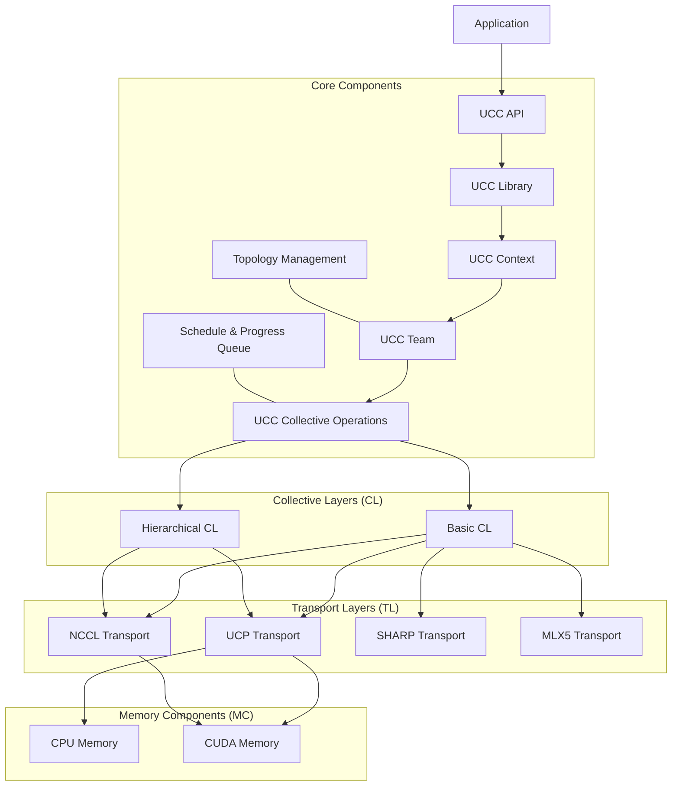
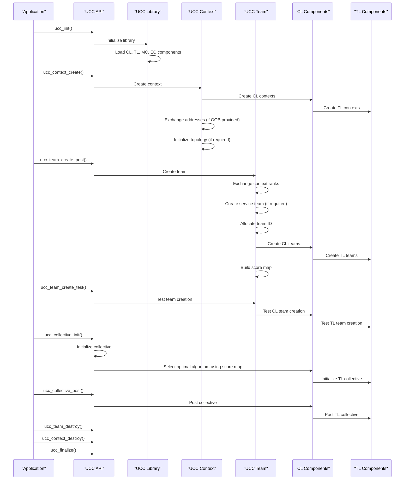

<!-- source: DeepWiki mcp.deepwiki.com · repo openucx/ucc · page 1 UCC Overview · fetched 2026-11-11 -->

# UCC Overview

Relevant source files

The following files were used as context for generating this wiki page:

- [.github/workflows/docs.yaml](.github/workflows/docs.yaml)
- [configure.ac](configure.ac)
- [docs/doxygen/collectives.md](docs/doxygen/collectives.md)
- [docs/doxygen/design.md](docs/doxygen/design.md)
- [docs/doxygen/events.md](docs/doxygen/events.md)
- [docs/doxygen/teams.md](docs/doxygen/teams.md)
- [docs/doxygen/ucc_doxygen.conf](docs/doxygen/ucc_doxygen.conf)
- [src/Makefile.am](src/Makefile.am)
- [src/components/tl/ucp/tl_ucp_lib.c](src/components/tl/ucp/tl_ucp_lib.c)
- [src/core/ucc_context.c](src/core/ucc_context.c)
- [src/core/ucc_context.h](src/core/ucc_context.h)
- [src/core/ucc_lib.c](src/core/ucc_lib.c)
- [src/core/ucc_lib.h](src/core/ucc_lib.h)
- [src/core/ucc_team.c](src/core/ucc_team.c)
- [src/core/ucc_team.h](src/core/ucc_team.h)
- [src/ucc/api/ucc.h](src/ucc/api/ucc.h)
- [src/ucc/api/ucc_def.h](src/ucc/api/ucc_def.h)

The Unified Collective Communication (UCC) framework is a high-performance library designed to provide a unified interface for collective communication operations across diverse hardware accelerators and network technologies. UCC serves as an abstraction layer that enables applications to leverage optimal collective algorithms while hiding the complexity of underlying hardware and network specifics.

For more detailed information about specific API usage, see [Context and Team Management](#2.2) and [Collective Operations](#2.3).

## Purpose and Scope

UCC aims to:

- Provide a unified API for collective operations that works across CPUs, GPUs, and other accelerators
- Support diverse network transports with automatic selection of optimal algorithms
- Enable highly scalable and performant collectives for HPC, AI/ML, and data analytics workloads
- Allow non-blocking collective operations with flexible synchronization models

## High-Level Architecture

UCC is organized into several layers that work together to provide efficient collective communication:

Sources: [src/ucc/api/ucc.h](), [src/core/ucc_lib.c](), [src/core/ucc_context.c](), [src/core/ucc_team.c](), [src/Makefile.am]()

### Key Components

- **UCC Library**: The top-level component that initializes and manages the framework
- **UCC Context**: Manages network resources and addressing information
- **UCC Team**: Represents a group of participants in collective operations
- **Collective Layers (CL)**: Implements collective algorithms (Basic, Hierarchical)
- **Transport Layers (TL)**: Interfaces with specific network technologies
- **Memory Components (MC)**: Handles different memory types (CPU, CUDA, ROCM)

## Core Components

### UCC Library

The UCC Library is the entry point to the UCC framework. It manages the initialization and finalization of UCC components, including the collective layers (CL), transport layers (TL), and memory components (MC).

Key functions:
- `ucc_init()`: Initialize the UCC library
- `ucc_finalize()`: Clean up the UCC library

Source: [src/core/ucc_lib.c]()

### UCC Context

The UCC Context abstracts network resources for collective operations. It can be configured as either exclusive (not shared) or shared. The context manages the exchange of addressing information between participants and creates internal instances of CL and TL contexts.

Key functions:
- `ucc_context_create()`: Create a UCC context
- `ucc_context_destroy()`: Clean up the UCC context

Source: [src/core/ucc_context.c](), [src/core/ucc_context.h]()

### UCC Team

The UCC Team represents a group of entities that participate in collective operations. It encapsulates team-specific networking information, manages team-level addressing, and handles the score map used for selecting optimal algorithms for collective operations.

Key functions:
- `ucc_team_create_post()`: Post team creation operation
- `ucc_team_create_test()`: Test completion of team creation
- `ucc_team_destroy()`: Clean up the UCC team

Source: [src/core/ucc_team.c](), [src/core/ucc_team.h]()

### Collective Operations

UCC supports a wide range of collective operations defined in `ucc_coll_type_t`:

```mermaid
graph TD
    COLL["UCC Collective Operations"]
    ALLGATHER["Allgather"]
    ALLGATHERV["Allgatherv"]
    ALLREDUCE["Allreduce"]
    ALLTOALL["Alltoall"]
    ALLTOALLV["Alltoallv"]
    BARRIER["Barrier"]
    BCAST["Broadcast"]
    FANIN["Fan-in"]
    FANOUT["Fan-out"]
    GATHER["Gather"]
    GATHERV["Gatherv"]
    REDUCE["Reduce"]
    REDUCE_SCATTER["Reduce-Scatter"]
    REDUCE_SCATTERV["Reduce-Scatterv"]
    SCATTER["Scatter"]
    SCATTERV["Scatterv"]
    
    COLL --> ALLGATHER
    COLL --> ALLGATHERV
    COLL --> ALLREDUCE
    COLL --> ALLTOALL
    COLL --> ALLTOALLV
    COLL --> BARRIER
    COLL --> BCAST
    COLL --> FANIN
    COLL --> FANOUT
    COLL --> GATHER
    COLL --> GATHERV
    COLL --> REDUCE
    COLL --> REDUCE_SCATTER
    COLL --> REDUCE_SCATTERV
    COLL --> SCATTER
    COLL --> SCATTERV
```

Key functions:
- `ucc_collective_init()`: Initialize a collective operation
- `ucc_collective_post()`: Post a collective operation
- `ucc_collective_test()`: Test the completion of a collective operation
- `ucc_collective_finalize()`: Clean up a collective operation

Source: [src/ucc/api/ucc.h:147-165]()

## Typical Usage Workflow

The following diagram illustrates the typical workflow for using UCC:

Sources: [src/ucc/api/ucc.h](), [src/core/ucc_lib.c](), [src/core/ucc_context.c](), [src/core/ucc_team.c]()

## Memory Types and Datatype Support

UCC supports various memory types defined in `ucc_memory_type_t`:
- `UCC_MEMORY_TYPE_HOST`: Default system memory
- `UCC_MEMORY_TYPE_CUDA`: NVIDIA CUDA memory
- `UCC_MEMORY_TYPE_CUDA_MANAGED`: NVIDIA CUDA managed memory
- `UCC_MEMORY_TYPE_ROCM`: AMD ROCM memory
- `UCC_MEMORY_TYPE_ROCM_MANAGED`: AMD ROCM managed system memory

UCC also supports various datatypes for collective operations, including int8/16/32/64/128, uint8/16/32/64/128, float16/32/64/128, bfloat16, and complex types. User-defined datatypes are supported through the `ucc_dt_create_generic()` interface.

Source: [src/ucc/api/ucc.h:170-177](), [src/ucc/api/ucc.h:201-221]()

## Transport Layer Architecture

UCC's modular architecture allows it to leverage different transport layers based on the available hardware and network configuration:

- **UCP Transport**: Uses UCX (Unified Communication X) for CPU and accelerator communication
- **NCCL Transport**: Leverages NVIDIA's NCCL library for GPU communication
- **SHARP Transport**: Uses Mellanox's Scalable Hierarchical Aggregation and Reduction Protocol
- **MLX5 Transport**: Direct interface with Mellanox hardware

The UCP transport layer is particularly important as it provides foundational communication capabilities and supports both CPU and GPU memory.

Source: [src/components/tl/ucp/tl_ucp_lib.c]()

## Version and Configuration

UCC is currently at version 1.5.0 (as defined in configure.ac). It can be configured using environment variables or through explicit API calls:

- `ucc_lib_config_read()`: Read UCC library configuration
- `ucc_context_config_read()`: Read UCC context configuration

Configuration files can override environment variables, and applications can modify configurations at runtime.

Source: [configure.ac:13-17]()

## Conclusion

UCC provides a flexible and high-performance framework for collective communication across different hardware accelerators and network technologies. By abstracting the complexities of underlying networks and providing a unified API, UCC enables applications to leverage optimal collective algorithms without dealing with hardware-specific details.

For more detailed information about specific components and their usage, refer to the other sections of this documentation.

---

