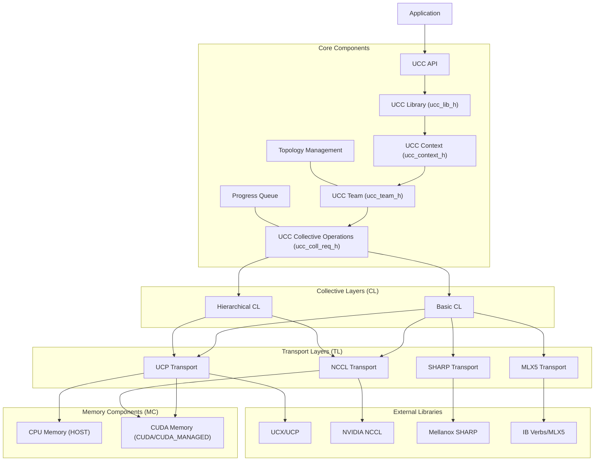
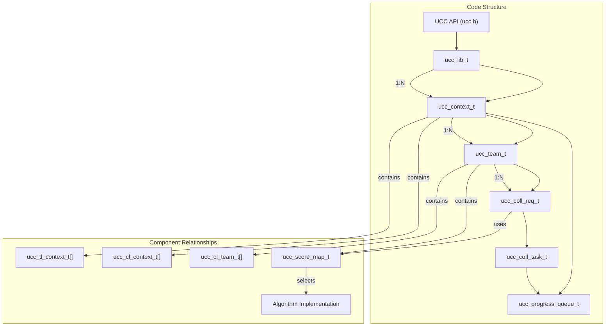
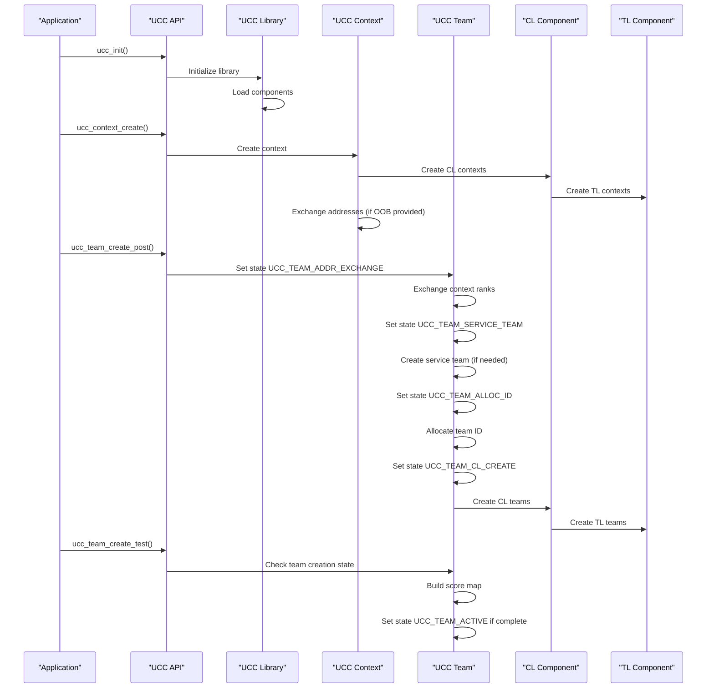
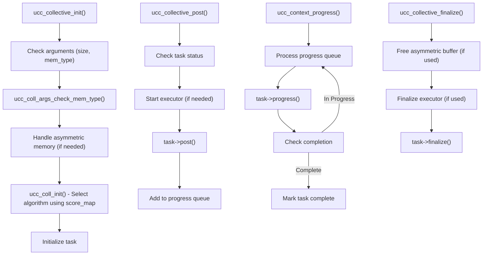
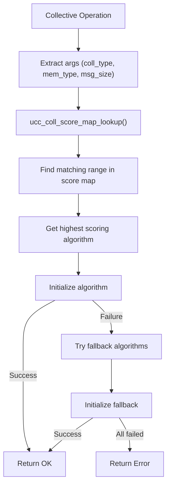

<!-- source: DeepWiki mcp.deepwiki.com · repo openucx/ucc · page 1.1 Architecture Overview · fetched 2026-11-11 -->

# Architecture Overview

Relevant source files

The following files were used as context for generating this wiki page:

- [.github/workflows/docs.yaml](.github/workflows/docs.yaml)
- [docs/doxygen/collectives.md](docs/doxygen/collectives.md)
- [docs/doxygen/design.md](docs/doxygen/design.md)
- [docs/doxygen/events.md](docs/doxygen/events.md)
- [docs/doxygen/teams.md](docs/doxygen/teams.md)
- [docs/doxygen/ucc_doxygen.conf](docs/doxygen/ucc_doxygen.conf)
- [src/coll_score/ucc_coll_score_map.c](src/coll_score/ucc_coll_score_map.c)
- [src/core/ucc_coll.c](src/core/ucc_coll.c)
- [src/core/ucc_context.c](src/core/ucc_context.c)
- [src/core/ucc_context.h](src/core/ucc_context.h)
- [src/core/ucc_team.c](src/core/ucc_team.c)
- [src/core/ucc_team.h](src/core/ucc_team.h)
- [src/ucc/api/ucc.h](src/ucc/api/ucc.h)
- [src/ucc/api/ucc_def.h](src/ucc/api/ucc_def.h)
- [src/utils/ucc_coll_utils.c](src/utils/ucc_coll_utils.c)
- [src/utils/ucc_coll_utils.h](src/utils/ucc_coll_utils.h)
- [test/gtest/utils/test_ep_map.cc](test/gtest/utils/test_ep_map.cc)

This document provides a high-level overview of the Unified Collective Communication (UCC) framework architecture. It covers the main components, their relationships, and key operational flows. For information about building and configuring UCC, see [Building and Configuration](#1.2).

## High-Level Architecture

UCC is designed with a layered architecture to provide a unified interface for collective operations across various hardware accelerators and networks. The framework consists of core components, collective layers, transport layers, and memory components that work together to deliver optimized collective communication.

Sources: [src/ucc/api/ucc.h:21-28](), [src/ucc/api/ucc.h:25-51](), [src/core/ucc_context.h:52-81](), [src/core/ucc_team.h:29-51]()

## Core Components

### UCC Library

The UCC Library (`ucc_lib_h`) serves as the entry point for applications using UCC. It initializes the framework, loads components, and manages global resources. Key aspects include:

- Initialized through `ucc_init()` and finalized with `ucc_finalize()`
- Configurable thread safety modes (SINGLE, FUNNELED, MULTIPLE)
- Manages supported collective and reduction operations
- Configurable synchronization type

The library initialization parameters are defined in `ucc_lib_params_t` structure, which includes fields for thread mode, collective types, reduction types, and synchronization type.

Sources: [src/ucc/api/ucc.h:573-579](), [src/ucc/api/ucc.h:777-785](), [src/ucc/api/ucc.h:493-497]()

### UCC Context

A UCC Context (`ucc_context_h`) abstracts network resources for collective operations. It can be shared among multiple teams or used exclusively. Key aspects include:

- Created with `ucc_context_create()` and destroyed with `ucc_context_destroy()`
- Can be either EXCLUSIVE or SHARED (defined by `ucc_context_type_t`)
- Manages address exchange for distributed processes
- Provides progress tracking through a progress queue
- Maintains topology information when available

The context contains pointers to collective layer contexts (`cl_ctx`) and transport layer contexts (`tl_ctx`), which are created during context initialization.

Sources: [src/core/ucc_context.h:52-81](), [src/core/ucc_context.c:350-360](), [src/ucc/api/ucc.h:940-947]()

### UCC Team

A UCC Team (`ucc_team_h`) represents a group of endpoints that participate in collective operations. It:

- Maintains team size, rank, and endpoint mapping
- Manages state transitions during creation (ADDR_EXCHANGE → SERVICE_TEAM → ALLOC_ID → CL_CREATE → ACTIVE)
- Builds a score map for algorithm selection
- Contains pointers to collective layer teams (`cl_teams`)

Team creation is a multi-phase process that includes address exchange, service team creation, ID allocation, and CL team creation. Teams transition through several states defined by `ucc_team_state_t`.

Sources: [src/core/ucc_team.h:21-27](), [src/core/ucc_team.h:29-51](), [src/core/ucc_team.c:413-466]()

### Collective Operations

UCC supports various collective operations defined by `ucc_coll_type_t` (Allreduce, Broadcast, Gather, etc.). Collective operations flow includes:

- Initialization with `ucc_collective_init()`
- Posting with `ucc_collective_post()`
- Progress through the context's progress queue
- Finalization with `ucc_collective_finalize()`

Collective operations support different memory types and can handle asymmetric memory configurations across team members.

Sources: [src/ucc/api/ucc.h:147-165](), [src/ucc/api/ucc.h:170-178](), [src/core/ucc_coll.c:169-323]()

## Component Relationships

The following diagram shows the key relationships between UCC components and how they interact during operation:

Sources: [src/core/ucc_context.h:52-81](), [src/core/ucc_team.h:29-51](), [src/coll_score/ucc_coll_score_map.c:114-150]()

## Operational Flows

### Context and Team Creation Flow

The following sequence diagram illustrates the process of creating contexts and teams:

Sources: [src/core/ucc_team.c:93-213](), [src/core/ucc_team.c:413-466](), [src/core/ucc_context.c:350-448]()

### Collective Operations Flow

The following diagram shows the flow of initializing, posting, and completing collective operations:

Sources: [src/core/ucc_coll.c:169-323](), [src/core/ucc_coll.c:342-388](), [src/core/ucc_coll.c:427-450]()

## Algorithm Selection

UCC uses a scoring mechanism to select the optimal algorithm for a given collective operation based on message size, memory type, and other factors.

The score map (`ucc_score_map_t`) maps collective types, memory types, and message size ranges to algorithms with associated scores. During initialization, UCC selects the highest-scoring algorithm for the given parameters and falls back to alternatives if needed.

Sources: [src/coll_score/ucc_coll_score_map.c:79-150](), [src/utils/ucc_coll_utils.h:77-88]()

## Memory Management

UCC supports multiple memory types (HOST, CUDA, ROCM, etc.) and handles asymmetric memory configurations where different team members use different memory types. The memory type enumerations and related utilities include:

- Memory types defined in `ucc_memory_type_t` (HOST, CUDA, CUDA_MANAGED, ROCM, ROCM_MANAGED)
- Memory component functions for handling different memory types
- Support for detecting memory types and handling asymmetric memory configurations

Memory utilities check and handle cases where memory types don't match across team members, creating intermediate buffers when necessary.

Sources: [src/ucc/api/ucc.h:170-178](), [src/utils/ucc_coll_utils.h:18-31](), [src/utils/ucc_coll_utils.c:62-158]()

## Summary

The UCC architecture provides a flexible and extensible framework for collective operations, supporting various transport layers, memory types, and execution engines. The layered approach with collective layers, transport layers, and memory components allows for optimal algorithm selection based on the communication needs and available hardware.

Key advantages of this architecture include:
- Support for heterogeneous systems with multiple memory types
- Scalable collective operations across large systems
- Automatic selection of optimal algorithms
- Extensibility for new hardware and network technologies

Sources: [src/ucc/api/ucc.h:21-28](), [src/core/ucc_context.h:52-81](), [src/core/ucc_team.h:29-51](), [src/coll_score/ucc_coll_score_map.c:114-150]()

---

