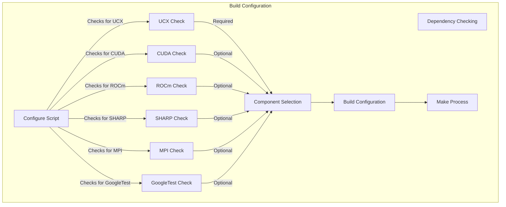
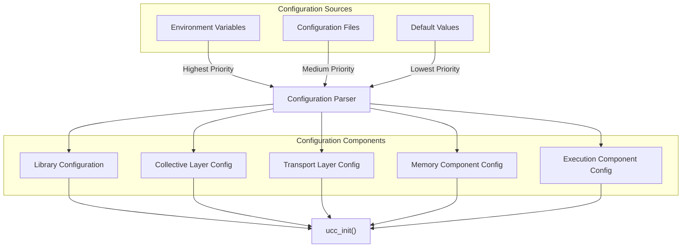
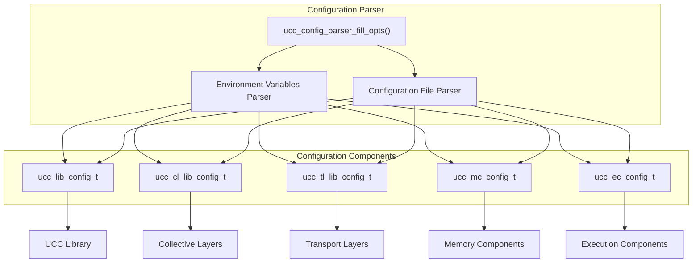
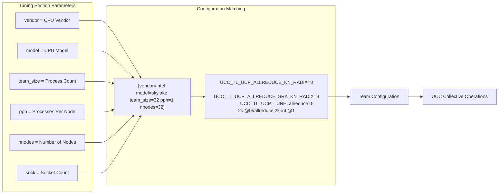
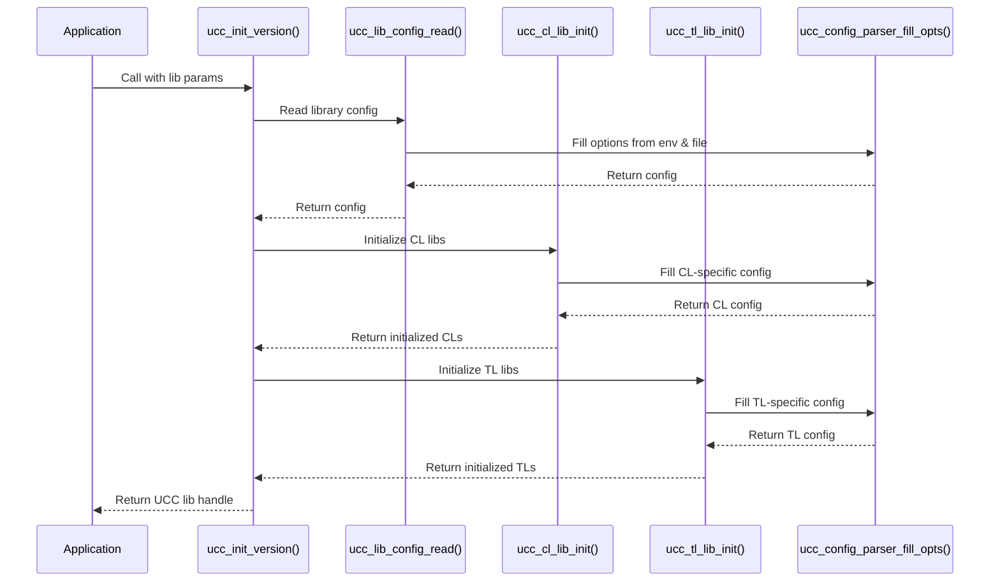

<!-- source: DeepWiki mcp.deepwiki.com · repo openucx/ucc · page 1.2 Building and Configuration · fetched 2026-11-11 -->

# Building and Configuration

<details>
<summary>Relevant source files</summary>

The following files were used as context for generating this wiki page:

- [config/m4/ucx.m4](config/m4/ucx.m4)
- [configure.ac](configure.ac)
- [contrib/ucc.conf](contrib/ucc.conf)
- [src/Makefile.am](src/Makefile.am)
- [src/components/tl/ucp/tl_ucp_lib.c](src/components/tl/ucp/tl_ucp_lib.c)
- [src/core/ucc_lib.c](src/core/ucc_lib.c)
- [src/core/ucc_lib.h](src/core/ucc_lib.h)
- [src/utils/ini.h](src/utils/ini.h)
- [src/utils/ucc_parser.c](src/utils/ucc_parser.c)
- [src/utils/ucc_parser.h](src/utils/ucc_parser.h)

</details>


This page documents how to build the UCC library and configure its runtime behavior. It covers the build system, compilation options, configuration mechanisms, and tuning parameters.

## Building UCC

UCC uses the GNU Autotools build system, with additional support for CMake.

### Prerequisites

Before building UCC, ensure you have the following dependencies:

- **Required**:
  - C compiler with C11 support
  - UCX (Unified Communication X) version 1.11 or newer
  - Autotools (autoconf, automake, libtool) or CMake

- **Optional**:
  - CUDA toolkit (for GPU support)
  - NCCL (for NVIDIA GPU collective operations)
  - ROCM/HIP (for AMD GPU support)
  - SHARP (for Mellanox SHARP acceleration)
  - Google Test (for building tests)
  - MPI (for testing and benchmarks)

### Basic Build Process

```bash
# Clone the repository
git clone https://github.com/openucx/ucc.git
cd ucc

# Configure with autotools
./autogen.sh
./configure --prefix=/path/to/install

# Build and install
make -j$(nproc)
make install
```

Sources: [configure.ac:13-121](), [src/Makefile.am:1-25]()

### Build Configuration Options

The `configure` script provides numerous options to customize the build:

| Option | Description |
|--------|-------------|
| `--prefix=PATH` | Installation directory (default: `/opt/ucf/ucc`) |
| `--with-ucx=DIR` | Path to UCX installation |
| `--with-cuda=DIR` | Path to CUDA installation for GPU support |
| `--with-nccl=DIR` | Path to NCCL installation |
| `--with-rocm=DIR` | Path to ROCm installation for AMD GPU support |
| `--with-docs-only` | Build only documentation |
| `--enable-debug` | Enable debug mode |
| `--enable-profiling` | Enable profiling support |

Sources: [configure.ac:114-121](), [configure.ac:168-189](), [config/m4/ucx.m4:1-173]()

### Conditional Component Building

The build system automatically detects available components and only builds what's supported on your system:



Sources: [configure.ac:184-290](), [src/Makefile.am:6-26]()

### Build Output

After a successful build, you'll see output similar to:

```
UCC build configuration:
      Build prefix:   /opt/ucf/ucc
Preprocessor flags:   -I/opt/ucx/include/
        C compiler:   gcc -O3 -std=gnu11
      C++ compiler:   g++ -O3 -std=c++11
     NVCC gencodes:   61 70 80
 DOCA UROM enabled:   no
ROCM architectures:   gfx908
          Perftest:   yes
             Gtest:   yes
        MC modules:   < cpu cuda rocm >
        TL modules:   < ucp >
      TLCP modules:   < >
```

Sources: [configure.ac:260-290]()

## Runtime Configuration

UCC provides a flexible configuration system that allows tuning parameters through environment variables and configuration files.

### Configuration Hierarchy



Sources: [src/core/ucc_lib.c:374-435](), [src/utils/ucc_parser.c:578-650]()

### Environment Variables

UCC uses environment variables with the prefix `UCC_` or `<PREFIX>_UCC_` where `<PREFIX>` is optional:

| Environment Variable | Description | Default |
|---------------------|-------------|---------|
| `UCC_CLS` | Comma-separated list of Collective Layers (CL) to use | "basic" |
| `UCC_LIB_TLS` | Transport Layers (TL) to use | All available |
| `UCC_LOG_LEVEL` | Logging level (error, warn, info, debug, trace) | "warn" |
| `UCC_LOG_COMPONENT` | Components to log (can use wildcards) | All |
| `UCC_CONFIG_FILE` | Path to configuration file | None |
| `UCC_THREAD_MODE` | Threading mode (single, multiple) | "single" |

Sources: [src/core/ucc_lib.c:23-31](), [src/utils/ucc_parser.c:400-417]()

### Configuration File

UCC can load configuration from INI-style files. By default, UCC looks for configuration in:

1. Path specified by `UCC_CONFIG_FILE` environment variable
2. `$HOME/.ucc/ucc.conf`
3. `<install_prefix>/etc/ucc.conf`

Example configuration file:

```ini
# Global UCC settings
UCC_CLS=basic
UCC_LOG_LEVEL=info

# Transport Layer specific settings
UCC_TL_UCP_ALLREDUCE_KN_RADIX=2

# Architecture-specific tuning section
[vendor=intel model=skylake team_size=40 ppn=40 nnodes=1]
UCC_TL_UCP_ALLREDUCE_KN_RADIX=2
UCC_TL_UCP_ALLREDUCE_SRA_KN_RADIX=0-128k:host:2,128k-inf:host:8
UCC_TL_UCP_TUNE=allreduce:0-2k:@0#allreduce:2k-inf:@1
```

Sources: [contrib/ucc.conf:1-149](), [src/utils/ini.h:1-151](), [src/utils/ucc_parser.c:401-464]()

### Configuration Components



Sources: [src/core/ucc_lib.c:23-31](), [src/core/ucc_lib.h:21-27](), [src/utils/ucc_parser.h:103-132]()

## Tuning Configuration

UCC provides a sophisticated tuning mechanism that allows optimizing collective operations based on hardware characteristics and execution parameters.

### Tuning Sections

Tuning sections in the configuration file allow specifying parameters for specific hardware and team configurations:



Sources: [contrib/ucc.conf:25-149](), [src/utils/ucc_parser.c:46-88](), [src/utils/ucc_parser.c:586-626]()

### Algorithm Selection Configuration

UCC's algorithm selection can be configured using special parameters like `UCC_TL_UCP_TUNE`, which specifies which algorithms should be used for different message sizes:

```
UCC_TL_UCP_TUNE=allreduce:0-2k:@0#allreduce:2k-inf:@1
```

This specifies:
- For allreduce operations with message sizes 0-2KB, use algorithm 0 (typically KNomial)
- For allreduce operations with message sizes > 2KB, use algorithm 1 (typically SRA)

Sources: [contrib/ucc.conf:29-30](), [src/utils/ucc_parser.c:586-626]()

### Radix Parameters

Many collective algorithms use knomial trees with configurable radices:

```
UCC_TL_UCP_ALLREDUCE_KN_RADIX=0-8k:host:2,8k-inf:host:8
```

This specifies:
- For message sizes 0-8KB, use radix 2 (binary tree)
- For message sizes > 8KB, use radix 8 (octonary tree)

Sources: [contrib/ucc.conf:25-149](), [src/components/tl/ucp/tl_ucp_lib.c:30-38]()

## Advanced Configuration Flow

The following diagram illustrates how configuration flows through the UCC initialization process:



Sources: [src/core/ucc_lib.c:292-369](), [src/utils/ucc_parser.c:629-650]()

## Practical Examples

### Building with CUDA Support

```bash
./configure --prefix=/opt/ucc --with-cuda=/usr/local/cuda \
            --with-nccl=/usr/local/nccl
make -j$(nproc)
make install
```

### Setting Environment Configuration

```bash
# Use basic and hierarchical collective layers
export UCC_CLS=basic,hier

# Set logging level to debug
export UCC_LOG_LEVEL=debug

# Run your MPI application
mpirun -np 16 ./my_application
```

### Creating a Custom Configuration File

```bash
# Create config file
cat > my_ucc.conf << EOF
# Global settings
UCC_LOG_LEVEL=info
UCC_CLS=basic,hier

# Intel Skylake-specific tuning
[vendor=intel model=skylake team_size=16 ppn=16 nnodes=1]
UCC_TL_UCP_ALLREDUCE_KN_RADIX=2
UCC_TL_UCP_TUNE=allreduce:0-8k:@0#allreduce:8k-inf:@1
EOF

# Use the config file
export UCC_CONFIG_FILE=$(pwd)/my_ucc.conf
mpirun -np 16 ./my_application
```

This completes the documentation for building and configuring UCC. For information about available collective operations, see [Collective Operations](#2.3). For details on the transport layers, see [Transport Layers](#3).

---

