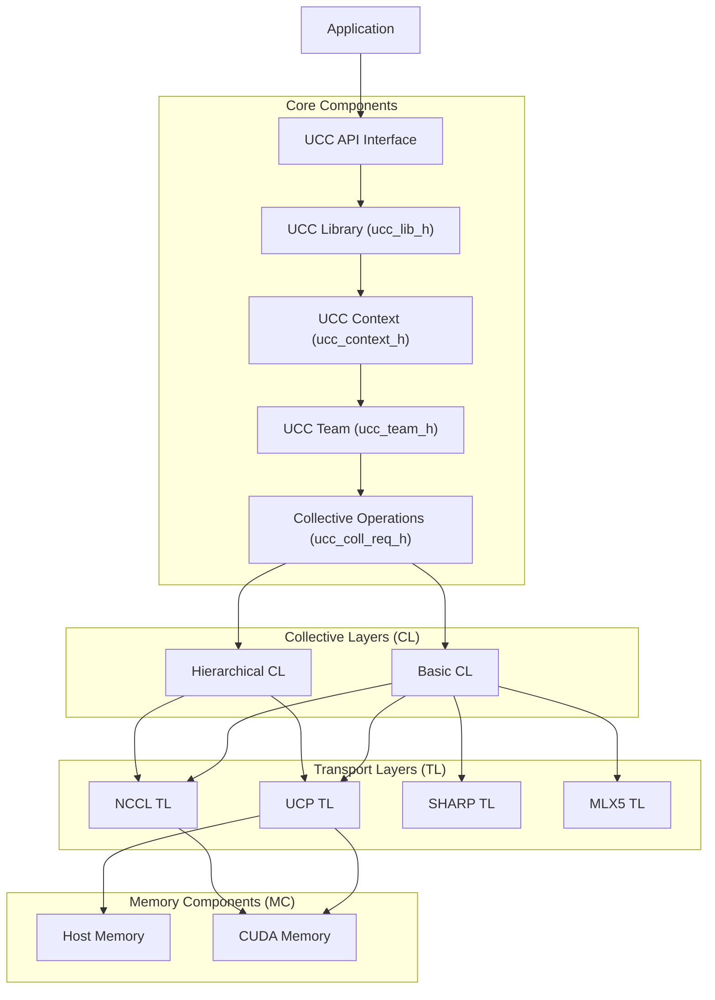
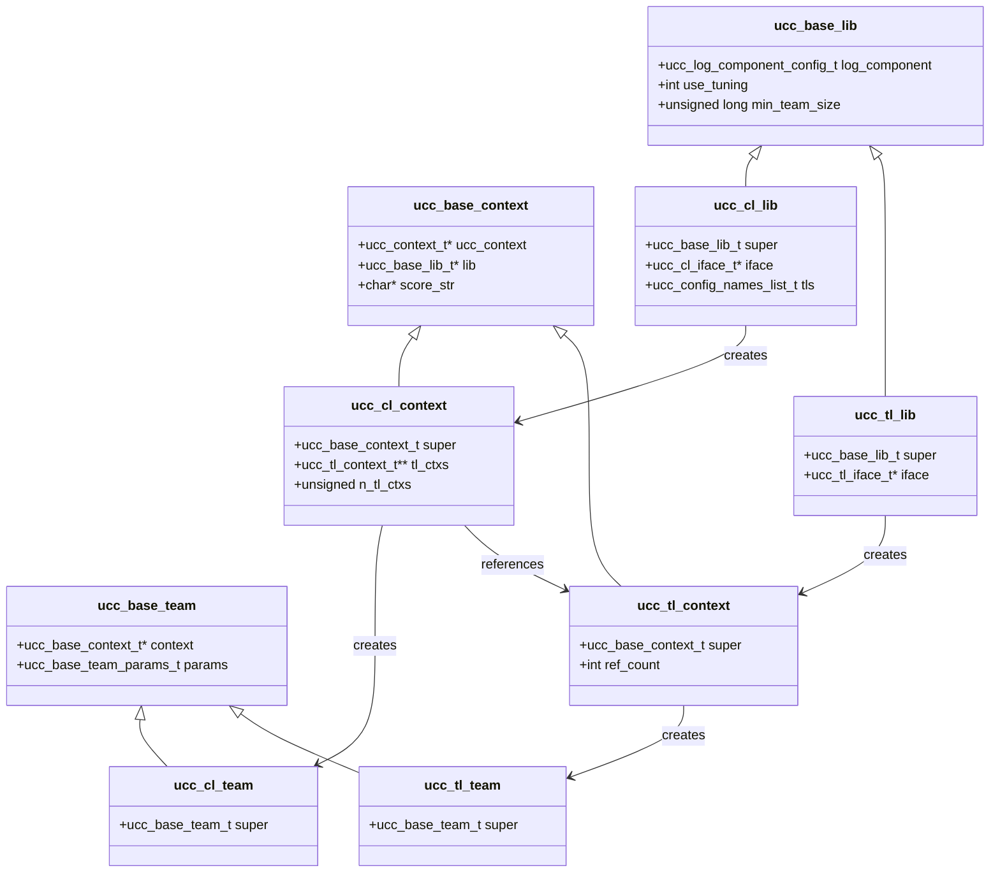
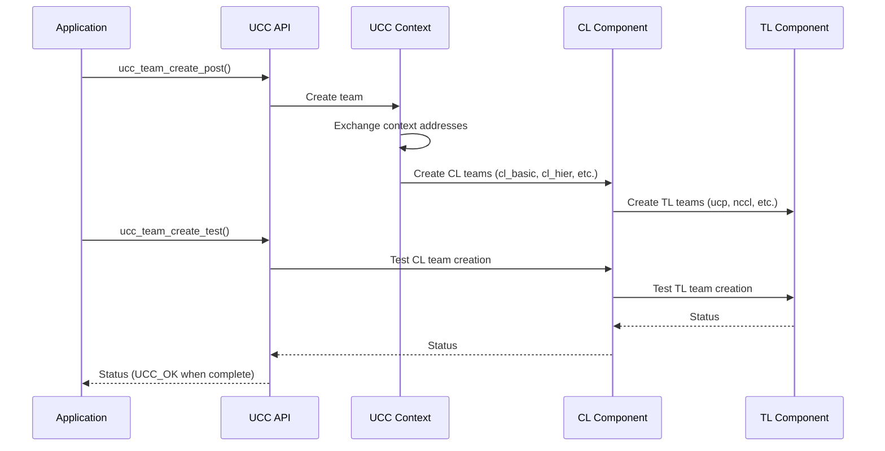
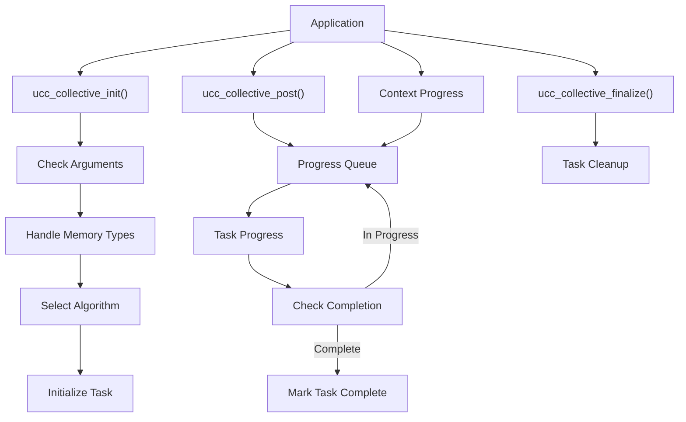
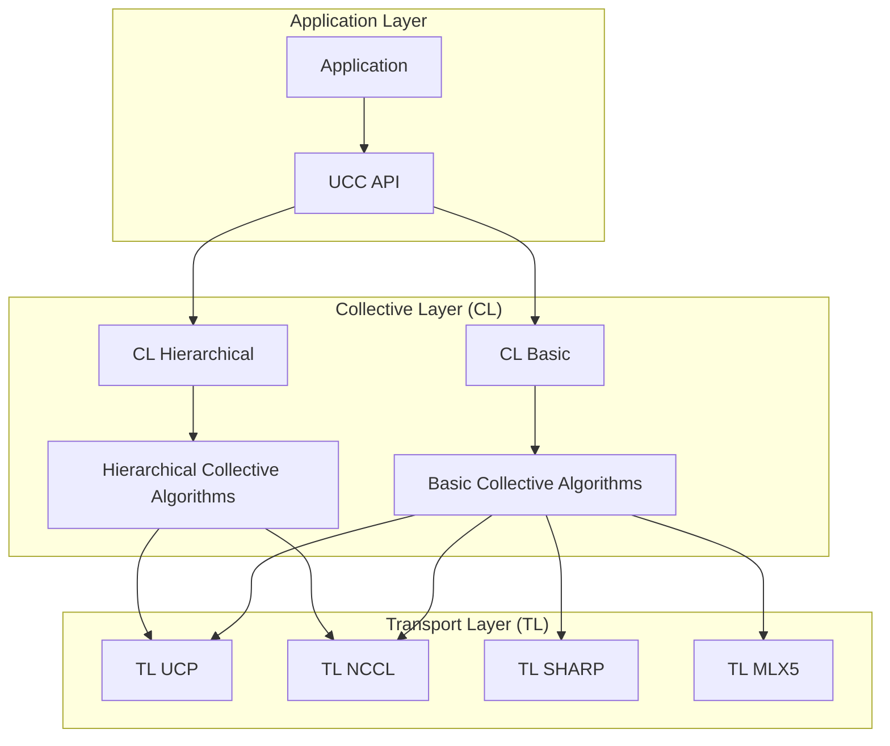
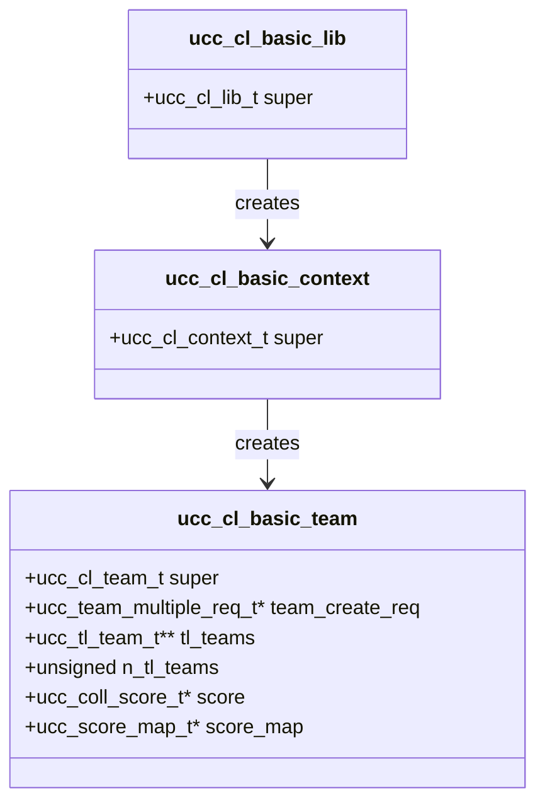
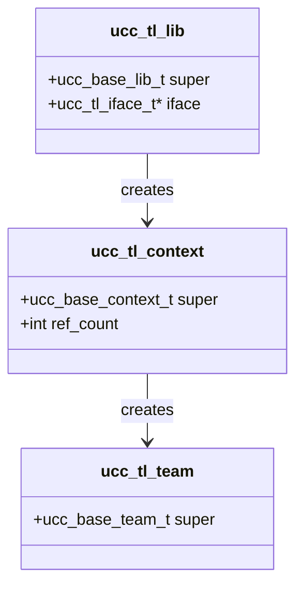
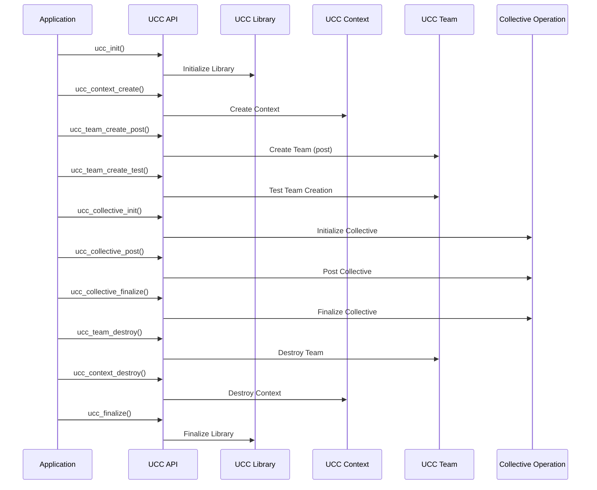

<!-- source: DeepWiki mcp.deepwiki.com · repo openucx/ucc · page 2 Core Components · fetched 2026-11-11 -->

# Core Components

<details>
<summary>Relevant source files</summary>

The following files were used as context for generating this wiki page:

- [.github/workflows/docs.yaml](.github/workflows/docs.yaml)
- [docs/doxygen/collectives.md](docs/doxygen/collectives.md)
- [docs/doxygen/design.md](docs/doxygen/design.md)
- [docs/doxygen/events.md](docs/doxygen/events.md)
- [docs/doxygen/teams.md](docs/doxygen/teams.md)
- [docs/doxygen/ucc_doxygen.conf](docs/doxygen/ucc_doxygen.conf)
- [src/components/base/ucc_base_iface.h](src/components/base/ucc_base_iface.h)
- [src/components/cl/basic/cl_basic.c](src/components/cl/basic/cl_basic.c)
- [src/components/cl/basic/cl_basic.h](src/components/cl/basic/cl_basic.h)
- [src/components/cl/basic/cl_basic_context.c](src/components/cl/basic/cl_basic_context.c)
- [src/components/cl/basic/cl_basic_lib.c](src/components/cl/basic/cl_basic_lib.c)
- [src/components/cl/basic/cl_basic_team.c](src/components/cl/basic/cl_basic_team.c)
- [src/components/cl/ucc_cl.c](src/components/cl/ucc_cl.c)
- [src/components/cl/ucc_cl.h](src/components/cl/ucc_cl.h)
- [src/components/tl/ucc_tl.c](src/components/tl/ucc_tl.c)
- [src/components/tl/ucc_tl.h](src/components/tl/ucc_tl.h)
- [src/ucc/api/ucc.h](src/ucc/api/ucc.h)
- [src/ucc/api/ucc_def.h](src/ucc/api/ucc_def.h)

</details>


The Core Components of UCC (Unified Collective Communication) form the foundational elements of the UCC framework. This page provides an overview of the core architectural components that enable collective operations across different hardware accelerators and networks. For specific details about the UCC API, see [UCC API](#2.1); for context and team management details, see [Context and Team Management](#2.2); for details about collective operations, see [Collective Operations](#2.3).

## Component Architecture Overview

UCC is designed as a modular system with several layered components that work together to provide efficient collective communication operations. The core components include:

1. **UCC Library** - The top-level component that initializes the framework and loads other components
2. **UCC Context** - Abstracts network resources for collective operations
3. **UCC Team** - Represents a group of processes/threads that participate in collective operations
4. **Collective Layers (CL)** - Implements collective algorithms and strategies
5. **Transport Layers (TL)** - Provides communication primitives over different transports
6. **Memory Components (MC)** - Manages memory across different memory spaces (CPU, GPU, etc.)

The following diagram illustrates the high-level architecture of UCC core components:



Sources: [src/ucc/api/ucc.h:19-101](), [src/components/tl/ucc_tl.h:16-23](), [src/components/cl/ucc_cl.h:17-32]()

## Component Hierarchy and Interfaces

UCC implements a hierarchical system where components are organized in multiple layers with well-defined interfaces. The following diagram shows the inheritance and relationship structure between the core components:



Sources: [src/components/base/ucc_base_iface.h:25-102](), [src/components/cl/ucc_cl.h:74-102](), [src/components/tl/ucc_tl.h:83-102]()

## UCC Library

The UCC library is the top-level component that initializes the framework and manages all other components. 

### Library Initialization

The library is initialized using the `ucc_init()` function, which creates a library handle (`ucc_lib_h`) that encapsulates the global resources and functionality of UCC.

```c
ucc_status_t ucc_init(const ucc_lib_params_t *params,
                     const ucc_lib_config_h config,
                     ucc_lib_h *lib_p);
```

The library can be configured through:
- Environment variables
- Configuration files
- Programmatic configuration via the `ucc_lib_params_t` struct

Key configuration parameters include:
- Thread mode (`UCC_THREAD_SINGLE`, `UCC_THREAD_FUNNELED`, `UCC_THREAD_MULTIPLE`)
- Supported collective types
- Supported reduction operations
- Synchronization model

Sources: [src/ucc/api/ucc.h:777-785](), [src/ucc/api/ucc.h:573-579]()

### Library Attributes

The library attributes can be queried using the `ucc_lib_get_attr()` function, which returns information about the configured parameters and capabilities of the library.

```c
ucc_status_t ucc_lib_get_attr(ucc_lib_h lib_p, ucc_lib_attr_t *lib_attr);
```

Sources: [src/ucc/api/ucc.h:830-833]()

## UCC Context

A UCC context abstracts network resources (hardware or software) required for collective operations. Contexts can be exclusive (used by a single process/thread) or shared (used by multiple processes/threads).

### Context Creation and Configuration

Contexts are created using the `ucc_context_create()` function:

```c
ucc_status_t ucc_context_create(ucc_lib_h lib_handle,
                               const ucc_context_params_t *params,
                               const ucc_context_config_h config,
                               ucc_context_h *context);
```

Key context parameters include:
- Context type (`UCC_CONTEXT_EXCLUSIVE` or `UCC_CONTEXT_SHARED`)
- Synchronization type
- Out-of-band (OOB) collective operations for context initialization
- Memory parameters for attaching memory segments

Sources: [src/ucc/api/ucc.h:840-975](), [src/ucc/api/ucc_def.h:38]()

### Context Attributes

Context attributes can be queried to understand the capabilities and configuration of a context:

```c
ucc_status_t ucc_context_get_attr(ucc_context_h context, 
                                 ucc_context_attr_t *attr);
```

Sources: [src/ucc/api/ucc.h:968-975]()

## UCC Team

A UCC team represents a group of processes or threads that participate in collective operations. Teams are created from contexts and provide the execution environment for collective operations.

### Team Creation

Teams are created in a non-blocking manner using the `ucc_team_create_post()` and `ucc_team_create_test()` functions:

```c
ucc_status_t ucc_team_create_post(ucc_context_h *contexts,
                                 uint32_t num_contexts,
                                 ucc_team_params_t *params,
                                 ucc_team_h *team);

ucc_status_t ucc_team_create_test(ucc_team_h team);
```

Team creation is a distributed operation that requires all participants to call the creation functions. The team creation process is illustrated in the following sequence diagram:



Sources: [src/components/cl/basic/cl_basic_team.c:11-206](), [src/components/tl/ucc_tl.c:271-310]()

## Collective Operations

Collective operations are communication operations that involve all members of a team. Examples include broadcast, allreduce, allgather, etc.

### Collective Types

UCC supports a wide range of collective operations defined in the `ucc_coll_type_t` enumeration:

```c
typedef enum {
    UCC_COLL_TYPE_ALLGATHER,
    UCC_COLL_TYPE_ALLGATHERV,
    UCC_COLL_TYPE_ALLREDUCE,
    UCC_COLL_TYPE_ALLTOALL,
    UCC_COLL_TYPE_ALLTOALLV,
    UCC_COLL_TYPE_BARRIER,
    UCC_COLL_TYPE_BCAST,
    UCC_COLL_TYPE_FANIN,
    UCC_COLL_TYPE_FANOUT,
    UCC_COLL_TYPE_GATHER,
    UCC_COLL_TYPE_GATHERV,
    UCC_COLL_TYPE_REDUCE,
    UCC_COLL_TYPE_REDUCE_SCATTER,
    UCC_COLL_TYPE_REDUCE_SCATTERV,
    UCC_COLL_TYPE_SCATTER,
    UCC_COLL_TYPE_SCATTERV,
    UCC_COLL_TYPE_LAST
} ucc_coll_type_t;
```

Sources: [src/ucc/api/ucc.h:147-165]()

### Collective Execution

Collective operations go through a lifecycle of initialization, execution, and finalization:



Sources: [src/components/base/ucc_base_iface.h:179-191]()

## Component Layer Relationships

The UCC framework uses a layered approach to implement collective operations:

1. **Collective Layer (CL)** - Implements high-level collective algorithms
   - Basic CL - Simple implementation directly over TLs
   - Hierarchical CL - Optimizes for multi-level topologies

2. **Transport Layer (TL)** - Implements communication primitives
   - UCP TL - Uses UCX/UCP for point-to-point communication
   - NCCL TL - Uses NVIDIA NCCL for GPU collectives
   - SHARP TL - Uses Mellanox SHARP for hardware-accelerated collectives
   - MLX5 TL - Uses Mellanox MLX5 for direct hardware operations

The following diagram shows the relationship between these layers:



Sources: [src/components/cl/ucc_cl.h:17-32](), [src/components/tl/ucc_tl.h:16-23]()

## CL Basic Component

The Basic Collective Layer (CL Basic) provides a fundamental implementation of collective operations by directly leveraging Transport Layers. It serves as the base component for collective operations.

### CL Basic Structure



Sources: [src/components/cl/basic/cl_basic.h:32-53](), [src/components/cl/basic/cl_basic_team.c:11-104]()

### Team Creation in CL Basic

The CL Basic team creation process involves:
1. Initialization of the CL Basic team structure
2. Allocation of TL team arrays
3. Creation of multiple TL teams (one for each supported TL)
4. Building a score map for algorithm selection

Sources: [src/components/cl/basic/cl_basic_team.c:11-104](), [src/components/cl/basic/cl_basic_team.c:106-168]()

## Transport Layer (TL) Component

Transport Layers provide the actual communication primitives used by Collective Layers. They abstract hardware-specific communication mechanisms.

### TL Structure



Sources: [src/components/tl/ucc_tl.h:83-101](), [src/components/tl/ucc_tl.c:26-68](), [src/components/tl/ucc_tl.c:69-89](), [src/components/tl/ucc_tl.c:271-310]()

## Component Life Cycle

The life cycle of UCC components follows a consistent pattern:

1. **Initialization**: Components are created using initialization functions
2. **Configuration**: Components are configured through parameter structures
3. **Operation**: Components perform their intended functions
4. **Cleanup**: Components are destroyed and their resources released

This pattern is applied at each level of the component hierarchy:



Sources: [src/ucc/api/ucc.h:777-785](), [src/ucc/api/ucc.h:807-809](), [src/components/cl/basic/cl_basic_context.c:10-64](), [src/components/cl/basic/cl_basic_team.c:11-104]()

## Memory Types

UCC supports various memory types to handle data in different memory spaces:

```c
typedef enum ucc_memory_type {
    UCC_MEMORY_TYPE_HOST,         // Default system memory
    UCC_MEMORY_TYPE_CUDA,         // NVIDIA CUDA memory
    UCC_MEMORY_TYPE_CUDA_MANAGED, // NVIDIA CUDA managed memory
    UCC_MEMORY_TYPE_ROCM,         // AMD ROCM memory
    UCC_MEMORY_TYPE_ROCM_MANAGED, // AMD ROCM managed system memory
    UCC_MEMORY_TYPE_LAST,
    UCC_MEMORY_TYPE_UNKNOWN = UCC_MEMORY_TYPE_LAST
} ucc_memory_type_t;
```

Sources: [src/ucc/api/ucc.h:170-178]()

## Summary

The Core Components of UCC provide a flexible and extensible framework for collective operations. The layered architecture allows for:

1. Different collective algorithms through Collective Layers (CL)
2. Different communication transports through Transport Layers (TL)
3. Support for various memory types through Memory Components (MC)

This modular design enables UCC to deliver high performance across a wide range of hardware platforms and network technologies, while presenting a unified interface to applications.

Sources: [src/ucc/api/ucc.h:21-28](), [src/components/cl/ucc_cl.h:17-32](), [src/components/tl/ucc_tl.h:16-23]()

---

