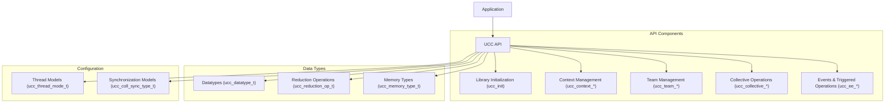
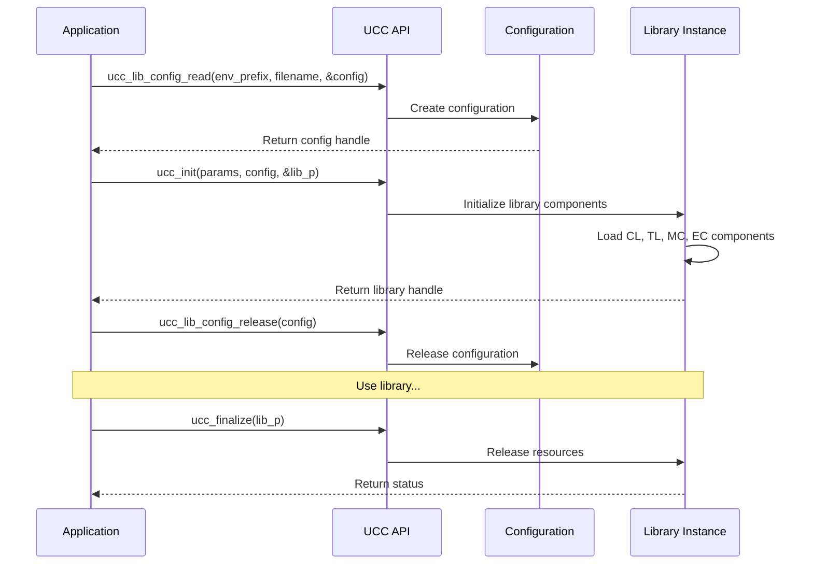
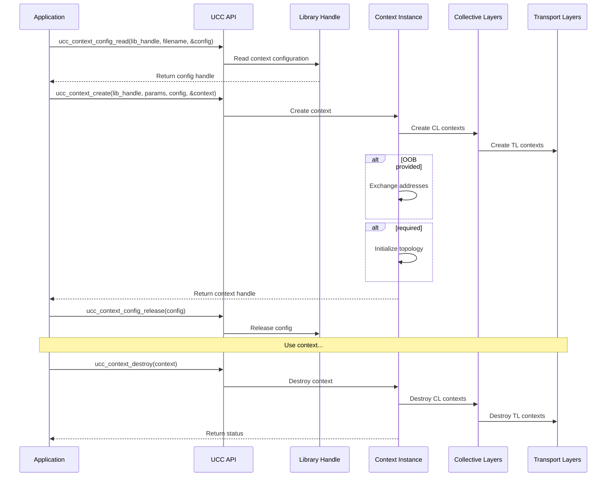
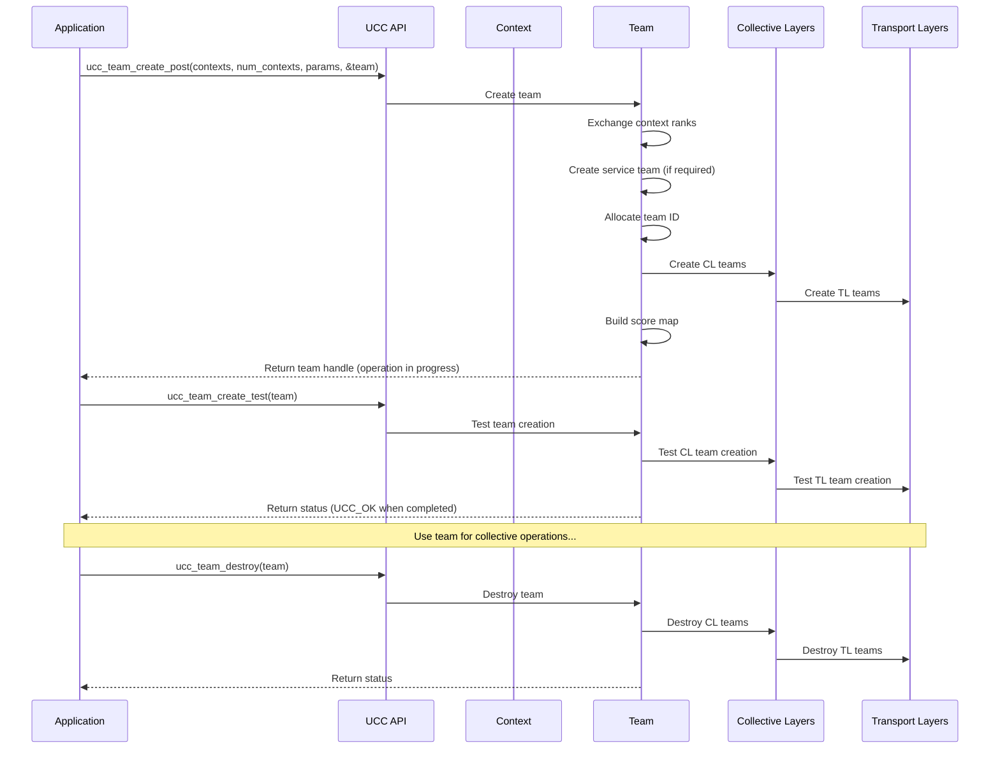
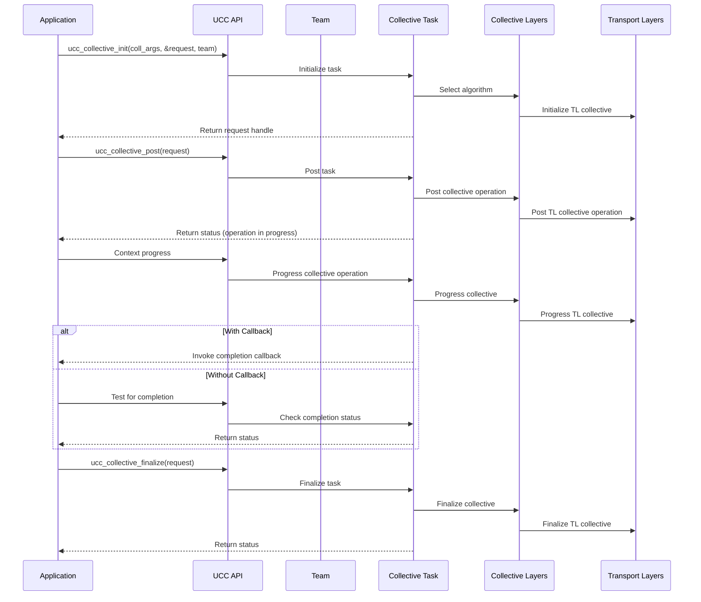
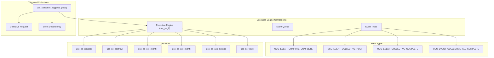

<!-- source: DeepWiki mcp.deepwiki.com · repo openucx/ucc · page 2.1 UCC API · fetched 2026-11-11 -->

# UCC API

<details>
<summary>Relevant source files</summary>

The following files were used as context for generating this wiki page:

- [.github/workflows/docs.yaml](.github/workflows/docs.yaml)
- [configure.ac](configure.ac)
- [docs/doxygen/collectives.md](docs/doxygen/collectives.md)
- [docs/doxygen/design.md](docs/doxygen/design.md)
- [docs/doxygen/events.md](docs/doxygen/events.md)
- [docs/doxygen/teams.md](docs/doxygen/teams.md)
- [docs/doxygen/ucc_doxygen.conf](docs/doxygen/ucc_doxygen.conf)
- [src/Makefile.am](src/Makefile.am)
- [src/components/tl/ucp/tl_ucp_lib.c](src/components/tl/ucp/tl_ucp_lib.c)
- [src/core/ucc_lib.c](src/core/ucc_lib.c)
- [src/core/ucc_lib.h](src/core/ucc_lib.h)
- [src/ucc/api/ucc.h](src/ucc/api/ucc.h)
- [src/ucc/api/ucc_def.h](src/ucc/api/ucc_def.h)

</details>


This page provides a detailed description of the Unified Collective Communication (UCC) API, including library initialization, context management, team creation, and collective operations. UCC provides a flexible interface for collective communication operations across various programming models and hardware platforms. For more information about the broader UCC architecture, see [Architecture Overview](#1.1).

## API Structure Overview

The UCC API consists of several main components that enable collective communication operations:



Sources: [src/ucc/api/ucc.h:21-115]()

## Library Initialization and Finalization

Using UCC starts with initializing the library and ends with finalizing it. This process creates and destroys the library handle that's required for all subsequent operations.

### Initialization Sequence



Sources: [src/ucc/api/ucc.h:727-785](), [src/core/ucc_lib.c:292-372](), [src/core/ucc_lib.c:476-509]()

### Library Configuration and Parameters

The `ucc_lib_params_t` structure allows customizing the library behavior:

```c
typedef struct ucc_lib_params {
    uint64_t                mask;           // Indicates which fields are valid
    ucc_thread_mode_t       thread_mode;    // Thread support level
    uint64_t                coll_types;     // Requested collective operations
    uint64_t                reduction_types; // Requested reduction operations
    ucc_coll_sync_type_t    sync_type;      // Synchronization type
} ucc_lib_params_t;
```

Sources: [src/ucc/api/ucc.h:573-579]()

When initializing a UCC library, the environment can be configured through the `ucc_lib_config_read()` function which reads configuration from environment variables, optionally with a custom prefix:

```c
ucc_status_t ucc_lib_config_read(const char *env_prefix, const char *filename,
                                ucc_lib_config_h *config);
```

Sources: [src/ucc/api/ucc.h:637-639](), [src/core/ucc_lib.c:374-435]()

## Context Management

A UCC context abstracts network resources for collective operations. It represents the communication resources that will be used for collective operations.

### Context Creation Process



Sources: [src/ucc/api/ucc.h:1006-1084]()

### Context Parameters

The `ucc_context_params_t` structure configures the context behavior:

```c
typedef struct ucc_context_params {
    uint64_t                mask;
    ucc_context_type_t      type;        // EXCLUSIVE or SHARED
    ucc_coll_sync_type_t    sync_type;   // Synchronization type
    ucc_context_oob_coll_t  oob;         // Out-of-band collective for address exchange
    uint64_t                ctx_id;      // Unique context identifier
    ucc_mem_map_params_t    mem_params;  // Memory segments mapping
} ucc_context_params_t;
```

Sources: [src/ucc/api/ucc.h:940-947]()

## Team Management

A UCC team encapsulates resources required for collective operations and defines the participants for these operations.

### Team Creation and Management



Sources: [docs/doxygen/teams.md:1-22]()

## Collective Operations

UCC supports a wide range of collective communication operations that can be performed on teams.

### Supported Collective Types

UCC provides numerous collective operation types defined in the `ucc_coll_type_t` enumeration:

```c
typedef enum {
    UCC_COLL_TYPE_ALLGATHER          = UCC_BIT(0),
    UCC_COLL_TYPE_ALLGATHERV         = UCC_BIT(1),
    UCC_COLL_TYPE_ALLREDUCE          = UCC_BIT(2),
    UCC_COLL_TYPE_ALLTOALL           = UCC_BIT(3),
    UCC_COLL_TYPE_ALLTOALLV          = UCC_BIT(4),
    UCC_COLL_TYPE_BARRIER            = UCC_BIT(5),
    UCC_COLL_TYPE_BCAST              = UCC_BIT(6),
    UCC_COLL_TYPE_FANIN              = UCC_BIT(7),
    UCC_COLL_TYPE_FANOUT             = UCC_BIT(8),
    UCC_COLL_TYPE_GATHER             = UCC_BIT(9),
    UCC_COLL_TYPE_GATHERV            = UCC_BIT(10),
    UCC_COLL_TYPE_REDUCE             = UCC_BIT(11),
    UCC_COLL_TYPE_REDUCE_SCATTER     = UCC_BIT(12),
    UCC_COLL_TYPE_REDUCE_SCATTERV    = UCC_BIT(13),
    UCC_COLL_TYPE_SCATTER            = UCC_BIT(14),
    UCC_COLL_TYPE_SCATTERV           = UCC_BIT(15),
    UCC_COLL_TYPE_LAST
} ucc_coll_type_t;
```

Sources: [src/ucc/api/ucc.h:147-165]()

### Collective Operation Flow



Sources: [docs/doxygen/collectives.md:1-32]()

## Datatypes and Reduction Operations

UCC supports a variety of datatypes and reduction operations for collective communications.

### Supported Datatypes

UCC provides predefined datatypes:

```c
#define UCC_DT_INT8             UCC_PREDEFINED_DT(0)
#define UCC_DT_INT16            UCC_PREDEFINED_DT(1)
#define UCC_DT_INT32            UCC_PREDEFINED_DT(2)
#define UCC_DT_INT64            UCC_PREDEFINED_DT(3)
#define UCC_DT_INT128           UCC_PREDEFINED_DT(4)
#define UCC_DT_UINT8            UCC_PREDEFINED_DT(5)
#define UCC_DT_UINT16           UCC_PREDEFINED_DT(6)
#define UCC_DT_UINT32           UCC_PREDEFINED_DT(7)
#define UCC_DT_UINT64           UCC_PREDEFINED_DT(8)
#define UCC_DT_UINT128          UCC_PREDEFINED_DT(9)
#define UCC_DT_FLOAT16          UCC_PREDEFINED_DT(10)
#define UCC_DT_FLOAT32          UCC_PREDEFINED_DT(11)
#define UCC_DT_FLOAT64          UCC_PREDEFINED_DT(12)
#define UCC_DT_BFLOAT16         UCC_PREDEFINED_DT(13)
#define UCC_DT_FLOAT128         UCC_PREDEFINED_DT(14)
#define UCC_DT_FLOAT32_COMPLEX  UCC_PREDEFINED_DT(15)
#define UCC_DT_FLOAT64_COMPLEX  UCC_PREDEFINED_DT(16)
#define UCC_DT_FLOAT128_COMPLEX UCC_PREDEFINED_DT(17)
```

Sources: [src/ucc/api/ucc.h:203-221]()

Users can also create custom datatypes using the `ucc_dt_create_generic()` function:

```c
ucc_status_t ucc_dt_create_generic(const ucc_generic_dt_ops_t *ops, 
                                  void *context,
                                  ucc_datatype_t *datatype_p);
```

Sources: [src/ucc/api/ucc.h:426-427]()

### Reduction Operations

UCC supports various reduction operations defined in the `ucc_reduction_op_t` enumeration:

```c
typedef enum {
    UCC_OP_SUM,
    UCC_OP_PROD,
    UCC_OP_MAX,
    UCC_OP_MIN,
    UCC_OP_LAND,
    UCC_OP_LOR,
    UCC_OP_LXOR,
    UCC_OP_BAND,
    UCC_OP_BOR,
    UCC_OP_BXOR,
    UCC_OP_MAXLOC,
    UCC_OP_MINLOC,
    UCC_OP_AVG,
    UCC_OP_LAST
} ucc_reduction_op_t;
```

Sources: [src/ucc/api/ucc.h:454-469]()

## Thread and Synchronization Models

UCC supports different thread and synchronization models to accommodate various application requirements.

### Thread Models

```c
typedef enum {
    UCC_THREAD_SINGLE       = 0, /* Single-threaded library model */
    UCC_THREAD_FUNNELED     = 1, /* Funnel thread model */
    UCC_THREAD_MULTIPLE     = 2  /* Multithread library model */
} ucc_thread_mode_t;
```

- **Single**: The user program must not be multithreaded
- **Funneled**: The user program may be multithreaded, but all UCC interfaces must be invoked from the same thread
- **Multiple**: The user program can be multithreaded and any thread may invoke UCC operations

Sources: [src/ucc/api/ucc.h:493-497]()

### Synchronization Models

```c
typedef enum {
    UCC_NO_SYNC_COLLECTIVES = 0, /* Non-synchronous collectives */
    UCC_SYNC_COLLECTIVES    = 1  /* Synchronous collectives */
} ucc_coll_sync_type_t;
```

- **Synchronous Collectives**: Collective communication is not started until all participants have entered the collective operation and is not completed until all participants have completed
- **Non-Synchronous Collectives**: Collective communication can start as soon as a participant enters the operation and is completed as soon as it completes locally

Sources: [src/ucc/api/ucc.h:521-524]()

## Events and Triggered Operations

UCC supports event-driven execution for collectives, particularly useful for asynchronous operations with hardware accelerators.

### Execution Engine

The execution engine provides an execution context for event-driven network execution, supporting various event types:



Sources: [docs/doxygen/events.md:1-47]()

## Memory Types

UCC supports various memory types for collective operations on different hardware:

```c
typedef enum ucc_memory_type {
    UCC_MEMORY_TYPE_HOST,         /* Default system memory */
    UCC_MEMORY_TYPE_CUDA,         /* NVIDIA CUDA memory */
    UCC_MEMORY_TYPE_CUDA_MANAGED, /* NVIDIA CUDA managed memory */
    UCC_MEMORY_TYPE_ROCM,         /* AMD ROCM memory */
    UCC_MEMORY_TYPE_ROCM_MANAGED, /* AMD ROCM managed system memory */
    UCC_MEMORY_TYPE_LAST,
    UCC_MEMORY_TYPE_UNKNOWN = UCC_MEMORY_TYPE_LAST
} ucc_memory_type_t;
```

Sources: [src/ucc/api/ucc.h:170-178]()

## Version Information

The current UCC API version can be obtained using these functions:

```c
void ucc_get_version(unsigned *major_version, unsigned *minor_version,
                     unsigned *release_number);
const char *ucc_get_version_string(void);
```

Sources: [src/ucc/api/ucc.h:724-734](), [configure.ac:14-17]()

---

