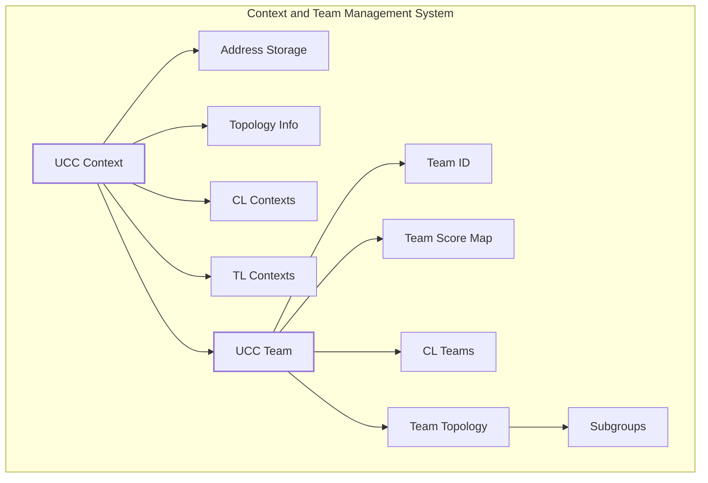
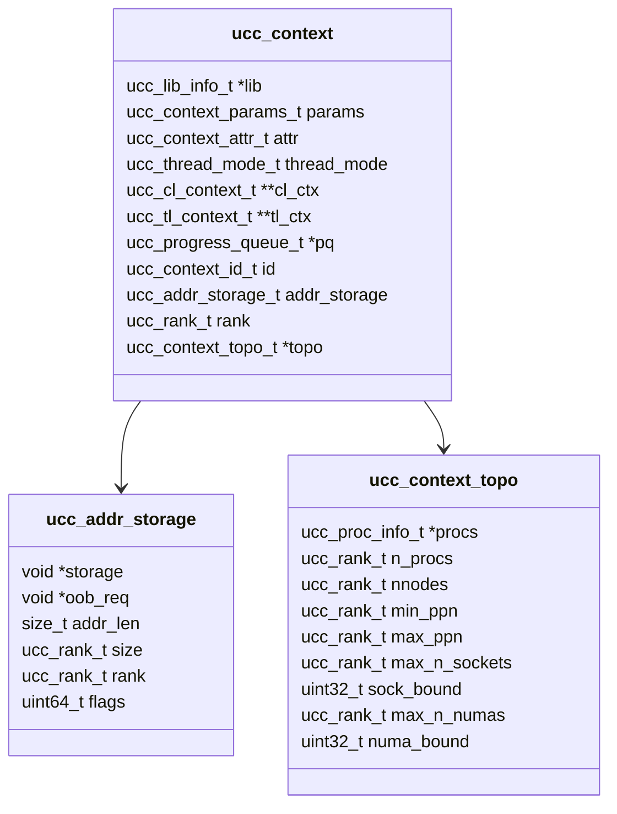
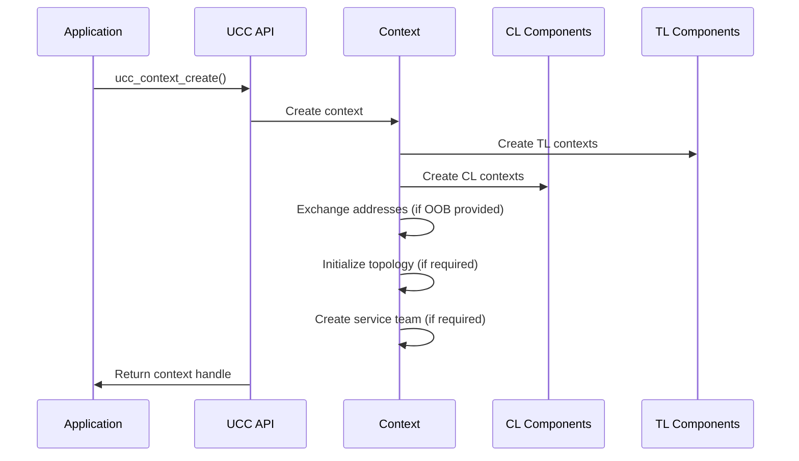
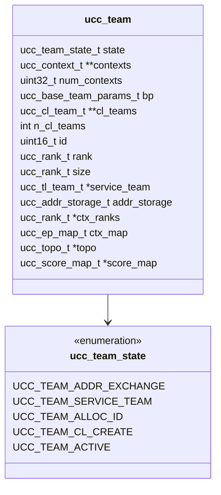
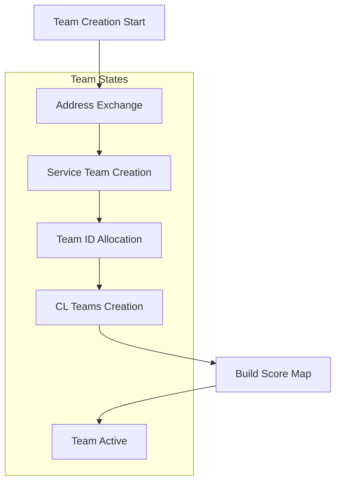
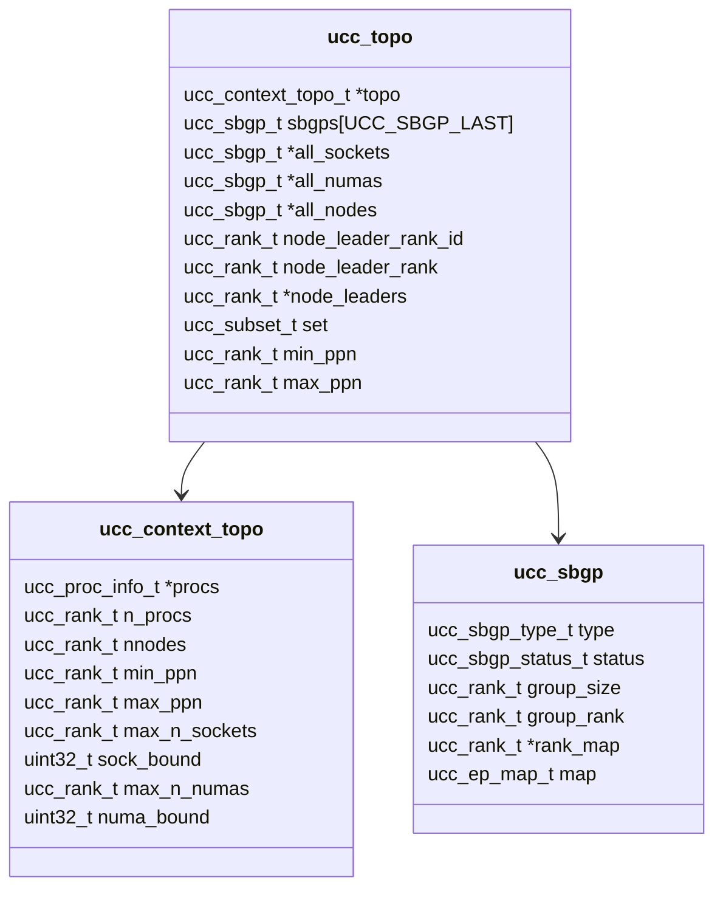
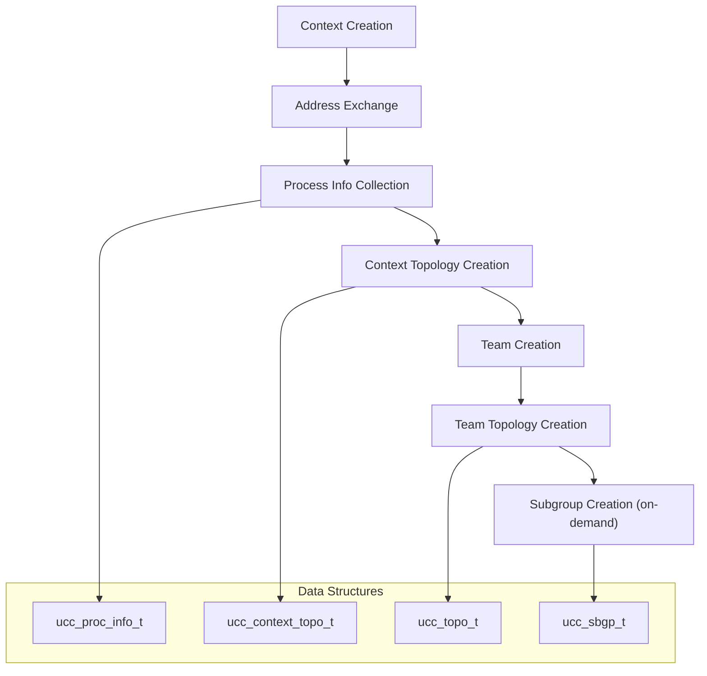
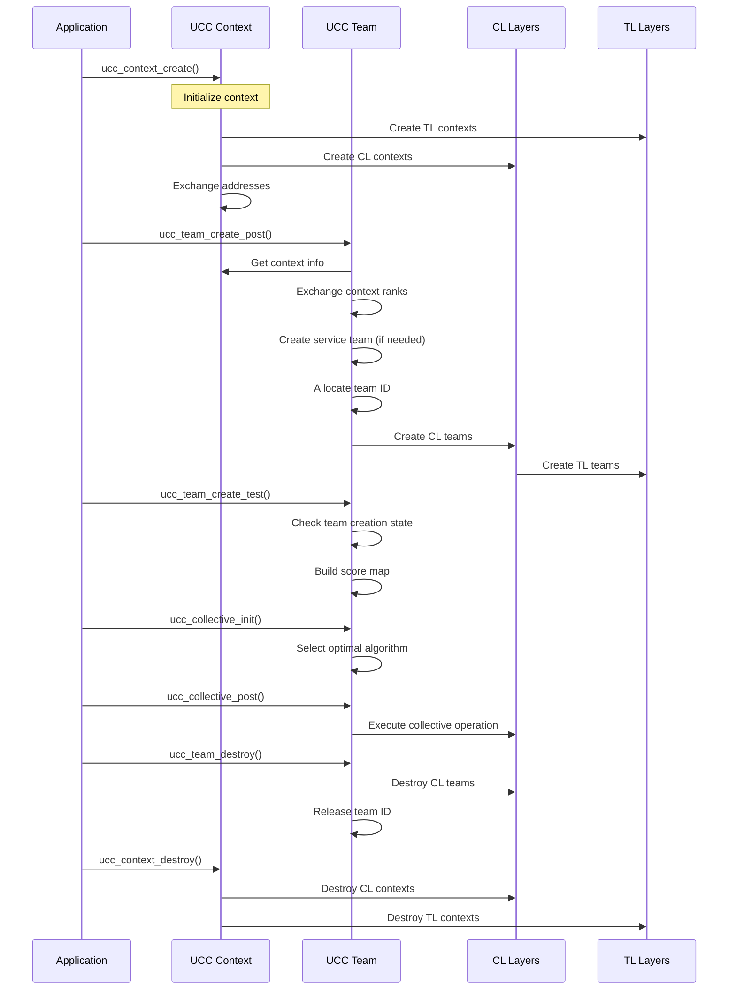
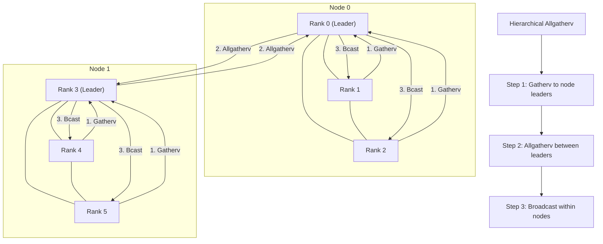

<!-- source: DeepWiki mcp.deepwiki.com · repo openucx/ucc · page 2.2 Context and Team Management · fetched 2026-11-11 -->

# Context and Team Management

Relevant source files

The following files were used as context for generating this wiki page:

- [src/components/cl/hier/allgatherv/allgatherv.c](src/components/cl/hier/allgatherv/allgatherv.c)
- [src/components/cl/hier/allgatherv/unpack.c](src/components/cl/hier/allgatherv/unpack.c)
- [src/components/topo/ucc_sbgp.c](src/components/topo/ucc_sbgp.c)
- [src/components/topo/ucc_sbgp.h](src/components/topo/ucc_sbgp.h)
- [src/components/topo/ucc_topo.c](src/components/topo/ucc_topo.c)
- [src/components/topo/ucc_topo.h](src/components/topo/ucc_topo.h)
- [src/core/ucc_context.c](src/core/ucc_context.c)
- [src/core/ucc_context.h](src/core/ucc_context.h)
- [src/core/ucc_team.c](src/core/ucc_team.c)
- [src/core/ucc_team.h](src/core/ucc_team.h)
- [test/gtest/core/test_topo.cc](test/gtest/core/test_topo.cc)

This document describes the UCC context and team management system, which provides the foundation for collective communication operations in UCC. These components handle process group management, topology discovery, and address exchange, enabling efficient collective operations across various network topologies and hardware configurations.

## Overview

UCC (Unified Collective Communication) relies on a hierarchical organization of contexts and teams to efficiently perform collective operations. A context represents a communication domain, while a team represents a group of processes within that domain that participate in collective operations.

Sources: [src/core/ucc_context.h:51-81](), [src/core/ucc_team.h:30-51]()

## UCC Context

A UCC context is a container for the collective communication resources that facilitates communication between processes. It serves as a foundation for creating teams and holds references to contexts of various collective layers (CLs) and transport layers (TLs).

### Context Structure

Sources: [src/core/ucc_context.h:51-81](), [src/core/ucc_context.h:35-50](), [src/components/topo/ucc_topo.h:16-32]()

### Context Creation

Context creation follows these steps:

1. Initialize UCC library
2. Read context configuration
3. Create TL (Transport Layer) contexts
4. Create CL (Collective Layer) contexts
5. Exchange addressing information (if OOB provided)
6. Initialize topology information (if required)
7. Create service team (if required)

Sources: [src/core/ucc_context.c:594-868]()

### Address Exchange

When a context is created with Out-of-Band (OOB) communication capabilities, it performs address exchange to enable process identification and connection:

1. Each process provides its local address
2. OOB allgather collects addresses from all processes
3. Address information is stored in `addr_storage`
4. Each address contains process information (node, socket, NUMA)
5. Addressing information is used during team creation and collective operations

Sources: [src/core/ucc_context.c:449-571]()

## UCC Team

A UCC team represents a group of processes that participate in collective operations. Teams are created from contexts and can span multiple nodes, sockets, and NUMA domains.

### Team Structure

Sources: [src/core/ucc_team.h:30-51](), [src/core/ucc_team.h:21-27]()

### Team Creation Process

Team creation is a multi-stage process that involves:

1. **Address Exchange**: Exchange addressing information between team members
2. **Service Team Creation**: Create a service team for internal operations (if required)
3. **Team ID Allocation**: Allocate a unique team ID
4. **CL Teams Creation**: Create collective layer teams
5. **Score Map Building**: Build a score map for selecting optimal algorithms

Sources: [src/core/ucc_team.c:413-480](), [src/core/ucc_team.h:21-27]()

### Team ID Allocation

Each team requires a unique ID within its context. Team IDs can be:

1. **User-provided**: If specified during team creation (highest bit set)
2. **Automatically allocated**: Using a bitmap-based pool managed by the context

The ID allocation process:
1. Each process starts with all bits set in its local pool
2. Perform an allreduce with a bitwise AND to find bits still set in all processes
3. Each process selects the first available bit
4. ID is used for distinguishing teams during collective operations

Sources: [src/core/ucc_team.c:559-646]()

## Topology Management

Topology information is crucial for optimizing collective operations. UCC collects information about the process layout across nodes, sockets, and NUMA domains.

### Topology Structure

Sources: [src/components/topo/ucc_topo.h:16-32](), [src/components/topo/ucc_topo.h:46-75](), [src/components/topo/ucc_sbgp.h:51-58]()

### Subgroup Types

Subgroups (SBGPs) represent processes with specific topological relationships:

| Subgroup Type | Description |
|---------------|-------------|
| `UCC_SBGP_NUMA` | Processes on the same NUMA domain |
| `UCC_SBGP_SOCKET` | Processes on the same socket |
| `UCC_SBGP_NODE` | Processes on the same node |
| `UCC_SBGP_NODE_LEADERS` | One process from each node (typically rank 0 on each node) |
| `UCC_SBGP_NET` | Processes with the same local node rank across all nodes |
| `UCC_SBGP_SOCKET_LEADERS` | One process from each socket (typically rank 0 on each socket) |
| `UCC_SBGP_NUMA_LEADERS` | One process from each NUMA domain |
| `UCC_SBGP_FULL` | All processes in the team |
| `UCC_SBGP_FULL_HOST_ORDERED` | All processes ordered by host, socket, NUMA |

Sources: [src/components/topo/ucc_sbgp.h:11-40]()

### Subgroup States

Each subgroup can have one of the following states:

| State | Description |
|-------|-------------|
| `UCC_SBGP_NOT_INIT` | Subgroup has not been initialized yet |
| `UCC_SBGP_DISABLED` | Subgroup exists but the current process is not part of it |
| `UCC_SBGP_ENABLED` | Subgroup exists and the current process is part of it |
| `UCC_SBGP_NOT_EXISTS` | Subgroup does not exist for this team |

Sources: [src/components/topo/ucc_sbgp.h:42-48]()

### Topology Discovery

Topology discovery happens in several steps:

1. During context creation, if OOB is provided, processes exchange their process information
2. Process information includes host hash, socket ID, NUMA ID, and other details
3. Context-level topology (`ucc_context_topo_t`) is created based on this information
4. Later, when teams are created, team-level topology (`ucc_topo_t`) is created as a subset of context topology
5. Subgroups are created on-demand when needed for collective operations

Sources: [src/components/topo/ucc_topo.c:103-153](), [src/components/topo/ucc_topo.c:164-192]()

## Team and Context Relationship Flow

The following diagram shows the relationship and flow between contexts and teams:

Sources: [src/core/ucc_context.c:861-938](), [src/core/ucc_team.c:93-214](), [src/core/ucc_team.c:496-557]()

## Implementation Details

### Context Implementation

The UCC context is implemented in `ucc_context_t` and includes:

- References to underlying CL and TL contexts
- Addressing information (`addr_storage`)
- Topology information
- Progress queue for handling collective operations
- Team ID pool for team ID allocation

The context creation function `ucc_context_create_proc_info` performs:
1. Creating TL contexts
2. Creating CL contexts
3. Initializing progress queue
4. Exchanging addresses (if OOB provided)
5. Initializing topology (if needed)
6. Creating service team (if needed)

Sources: [src/core/ucc_context.c:594-868]()

### Team Implementation

The UCC team is implemented in `ucc_team_t` and includes:

- References to contexts
- CL teams
- Topology information
- Score map for algorithm selection
- Team state information

Team creation follows multiple states:
1. `UCC_TEAM_ADDR_EXCHANGE`: Exchange addressing information
2. `UCC_TEAM_SERVICE_TEAM`: Create service team (if needed)
3. `UCC_TEAM_ALLOC_ID`: Allocate team ID
4. `UCC_TEAM_CL_CREATE`: Create CL teams
5. `UCC_TEAM_ACTIVE`: Team is ready for collective operations

Sources: [src/core/ucc_team.c:413-480](), [src/core/ucc_team.h:21-27]()

### Topology Implementation

Topology information is stored in two main structures:
- `ucc_context_topo_t`: Context-level topology information
- `ucc_topo_t`: Team-level topology information

Subgroups are created on-demand when needed for collective operations. The function `ucc_topo_get_sbgp` returns a subgroup of a specified type, creating it if it doesn't exist.

Sources: [src/components/topo/ucc_topo.c:235-244](), [src/components/topo/ucc_topo.h:91-92]()

## Usage Example: Collective Operation with Topology Awareness

Hierarchical collective operations use topology information for optimized execution. For example, the hierarchical allgatherv algorithm uses node awareness:

1. Step 1: Gatherv within each node to the node leader
2. Step 2: Allgatherv between node leaders
3. Step 3: Broadcast from node leader to other processes in the node

This approach reduces network traffic by leveraging fast intra-node communication.

Sources: [src/components/cl/hier/allgatherv/allgatherv.c:123-419]()

## Summary

The UCC Context and Team Management system provides:

1. **Context Management**: Creates and manages communication contexts
2. **Team Management**: Creates and manages groups of processes for collective operations
3. **Topology Discovery**: Collects and organizes information about process layout
4. **Subgroup Creation**: Creates subgroups for topology-aware operations
5. **Address Exchange**: Exchanges addressing information between processes

This system forms the foundation for efficient collective communication operations in UCC, enabling optimized performance across various network topologies and hardware configurations.

---

