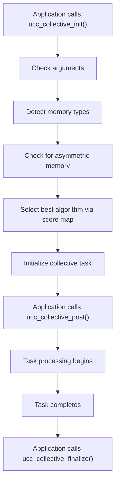
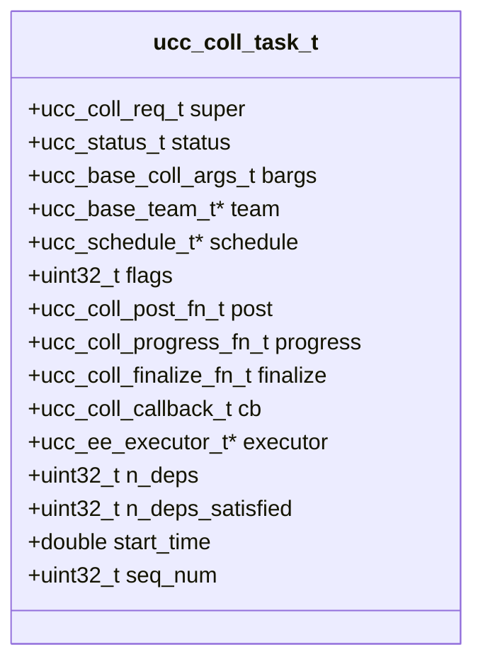
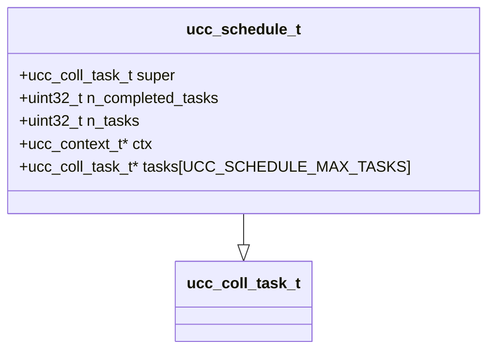
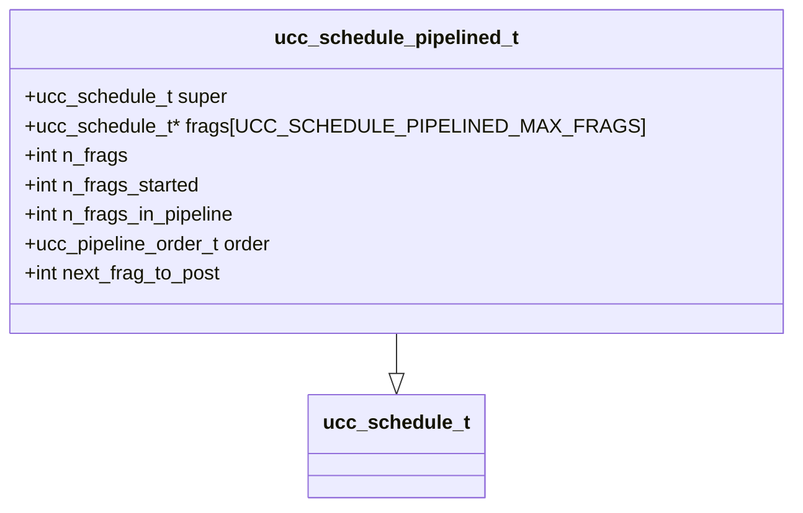
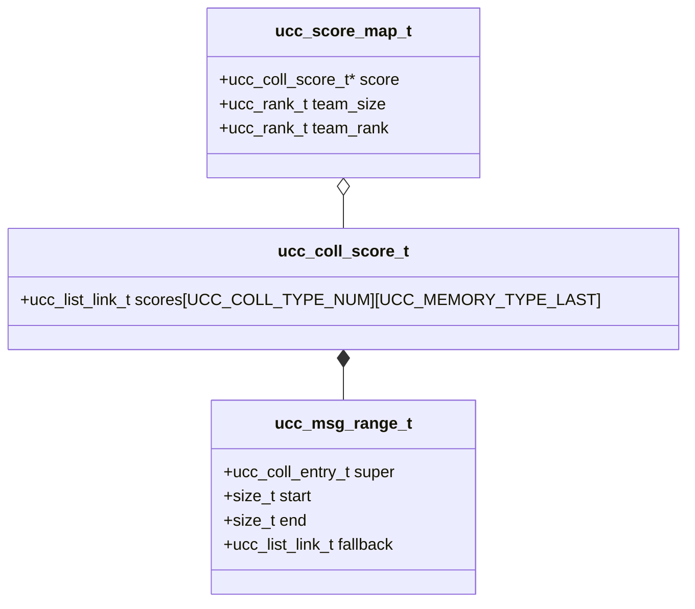
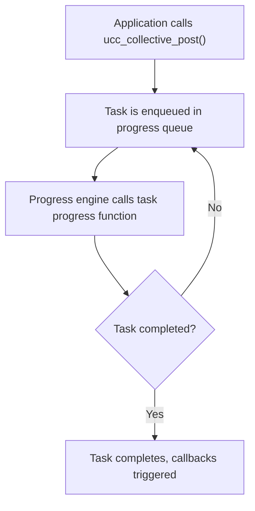
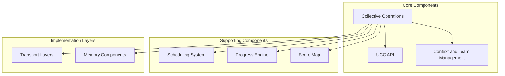

<!-- source: DeepWiki mcp.deepwiki.com · repo openucx/ucc · page 2.3 Collective Operations · fetched 2026-11-11 -->

# Collective Operations

Relevant source files

The following files were used as context for generating this wiki page:

- [src/coll_score/ucc_coll_score_map.c](src/coll_score/ucc_coll_score_map.c)
- [src/components/cl/hier/allreduce/allreduce_rab.c](src/components/cl/hier/allreduce/allreduce_rab.c)
- [src/core/ucc_coll.c](src/core/ucc_coll.c)
- [src/core/ucc_progress_queue.c](src/core/ucc_progress_queue.c)
- [src/core/ucc_progress_queue.h](src/core/ucc_progress_queue.h)
- [src/core/ucc_progress_queue_mt.c](src/core/ucc_progress_queue_mt.c)
- [src/core/ucc_progress_queue_st.c](src/core/ucc_progress_queue_st.c)
- [src/schedule/ucc_schedule.c](src/schedule/ucc_schedule.c)
- [src/schedule/ucc_schedule.h](src/schedule/ucc_schedule.h)
- [src/schedule/ucc_schedule_pipelined.c](src/schedule/ucc_schedule_pipelined.c)
- [src/schedule/ucc_schedule_pipelined.h](src/schedule/ucc_schedule_pipelined.h)
- [src/utils/ucc_atomic.h](src/utils/ucc_atomic.h)
- [src/utils/ucc_coll_utils.c](src/utils/ucc_coll_utils.c)
- [src/utils/ucc_coll_utils.h](src/utils/ucc_coll_utils.h)
- [test/gtest/utils/test_ep_map.cc](test/gtest/utils/test_ep_map.cc)

This page describes the collective communication operations supported by UCC, how they are initialized, executed, and completed. For information about the UCC API functions that provide access to these operations, see [UCC API](#2.1). To understand how team contexts are established, see [Context and Team Management](#2.2).

## Supported Collective Operations

UCC supports the following collective operations, defined in the `ucc_coll_type_t` enumeration:

| Operation | Description |
|-----------|-------------|
| ALLREDUCE | Combines data from all processes and distributes the result back to all processes |
| ALLGATHER | Each process contributes data that is distributed to all processes |
| ALLGATHERV | Like Allgather but with variable data sizes |
| ALLTOALL | Each process sends distinct data to each process |
| ALLTOALLV | Like Alltoall but with variable data sizes |
| BARRIER | Synchronizes all processes |
| BCAST | Sends data from one process to all processes |
| FANIN | Data flows from multiple processes to one root process |
| FANOUT | Data flows from one root process to multiple processes |
| GATHER | Collects data from all processes to one process |
| GATHERV | Like Gather but with variable data sizes |
| REDUCE | Combines data from all processes to one process |
| REDUCE_SCATTER | Combines data from all processes and scatters the results among processes |
| REDUCE_SCATTERV | Like Reduce-Scatter but with variable data sizes |
| SCATTER | Distributes data from one process to all processes |
| SCATTERV | Like Scatter but with variable data sizes |

Sources: [src/utils/ucc_coll_utils.c:21-39]()

## Collective Operation Lifecycle

The lifecycle of a collective operation in UCC consists of the following stages:

Sources: [src/core/ucc_coll.c:169-323](), [src/core/ucc_coll.c:342-388](), [src/core/ucc_coll.c:452-475]()

### Initialization

When a collective operation is initialized via `ucc_collective_init()`, UCC performs the following steps:

1. Verifies the team is in active state
2. Checks if the operation has zero-size data (creates a lightweight stub task if so)
3. Detects memory types for the source and destination buffers
4. Validates argument consistency
5. Handles asymmetric memory cases (when different processes use different memory types)
6. Selects the optimal algorithm using the score map
7. Initializes the collective task
8. Sets up an execution engine/executor if needed

Sources: [src/core/ucc_coll.c:169-323]()

### Posting

When a collective is posted via `ucc_collective_post()`, UCC:

1. Handles any required asymmetric buffer memory copies
2. Verifies the task is in a valid state for posting
3. Records the start time if timeout tracking is required
4. Starts the executor if one is required
5. Calls the task-specific post function

Sources: [src/core/ucc_coll.c:342-388]()

### Progress and Completion

Collective tasks are progressed through:

1. The task is placed in a progress queue
2. The progress queue processes the task according to the threading model
3. When a task completes (successfully or with error), its completion callbacks are invoked
4. For asymmetric memory operations, data is copied back to the original buffers

Sources: [src/core/ucc_progress_queue_st.c:19-55](), [src/core/ucc_progress_queue_mt.c:68-102]()

### Finalization

When a collective is finalized via `ucc_collective_finalize()`, UCC:

1. Verifies the task is not still in progress
2. Frees any asymmetric memory resources
3. Finalizes any executors
4. Calls the task-specific finalize function to release resources

Sources: [src/core/ucc_coll.c:452-475]()

## Collective Task Structure

Collective operations in UCC are represented by the `ucc_coll_task_t` structure, which contains all the information needed to execute and track a collective operation:

Key components include:
- `super`: The user-visible request handle
- `status`: The internal task status (distinct from user-visible status)
- `bargs`: The collective arguments including operation type, buffers, data types
- `team`: The team on which the collective operates
- `post`, `progress`, `finalize`: Function pointers for task state management
- `n_deps`, `n_deps_satisfied`: For handling task dependencies
- `start_time`: For timeout tracking

Sources: [src/schedule/ucc_schedule.h:81-116]()

## Scheduling and Task Management

UCC employs a sophisticated scheduling system to manage task execution and dependencies.

### Basic Schedule

A basic schedule (`ucc_schedule_t`) manages a set of tasks, ensuring they are executed in the proper order:

When a schedule is started, it manages the launch of its contained tasks and tracks their completion.

Sources: [src/schedule/ucc_schedule.h:123-129](), [src/schedule/ucc_schedule.c:198-259]()

### Pipelined Schedule

For large messages, UCC utilizes pipelined scheduling (`ucc_schedule_pipelined_t`) to improve performance by breaking operations into fragments and overlapping their execution:

The pipelined schedule supports three execution modes:
- `UCC_PIPELINE_PARALLEL`: Fragments execute concurrently
- `UCC_PIPELINE_ORDERED`: Fragments start in order but may overlap
- `UCC_PIPELINE_SEQUENTIAL`: Each fragment completes before the next begins

Sources: [src/schedule/ucc_schedule_pipelined.h:35-46](), [src/schedule/ucc_schedule_pipelined.c:149-251]()

## Algorithm Selection

UCC selects the optimal algorithm for each collective operation using a scoring system based on:
- Operation type
- Message size
- Memory type
- Team size

### Score Map

The score map maps collective types, memory types, and message size ranges to specific algorithm implementations:

The selection process:
1. Looks up the collective type and memory type
2. Finds the message size range containing the current message
3. Selects the algorithm with the highest score in that range
4. Falls back to alternative algorithms if the first choice fails

Sources: [src/coll_score/ucc_coll_score_map.c:79-150]()

## Progress Engine

Collective tasks are progressed through a queue-based system that supports different threading models:

UCC provides different progress queue implementations:
- `ucc_pq_st_t`: Single-threaded progress queue
- `ucc_pq_mt_t`: Lock-free multi-threaded progress queue
- `ucc_pq_mt_locked_t`: Lock-based multi-threaded progress queue

Sources: [src/core/ucc_progress_queue_st.c:19-55](), [src/core/ucc_progress_queue_mt.c:68-102]()

## Special Considerations

### Asymmetric Memory Handling

When processes use different memory types (e.g., GPU memory on some ranks and CPU memory on others), UCC:
1. Detects the asymmetry during initialization
2. Allocates temporary buffers of the required memory type
3. Copies data between the original and temporary buffers as needed
4. Handles cleanup during finalization

Sources: [src/utils/ucc_coll_utils.c:108-276]()

### Zero-Size Messages

For collective operations with zero-size messages, UCC creates a lightweight stub task that completes immediately without communication.

Sources: [src/core/ucc_coll.c:188-204]()

### Timeouts

UCC supports timeout detection for collective operations:
1. Task start time is recorded during posting
2. The progress function periodically checks if timeout has been exceeded
3. If a timeout occurs, the task is marked as failed with `UCC_ERR_TIMED_OUT`

Sources: [src/core/ucc_progress_queue_st.c:34-46](), [src/core/ucc_progress_queue_mt.c:80-92]()

## Relationship to Other Components

Collective operations in UCC rely on several other system components:

Sources: [src/core/ucc_coll.c:169-323](), [src/schedule/ucc_schedule.h:81-116](), [src/coll_score/ucc_coll_score_map.c:79-150]()

---

