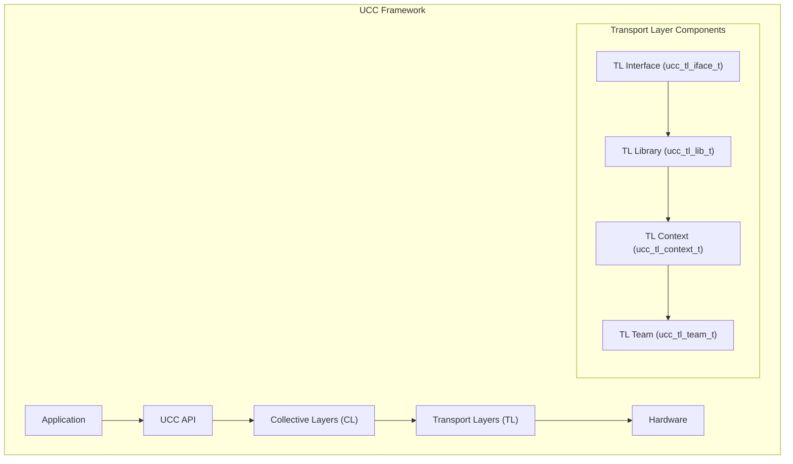
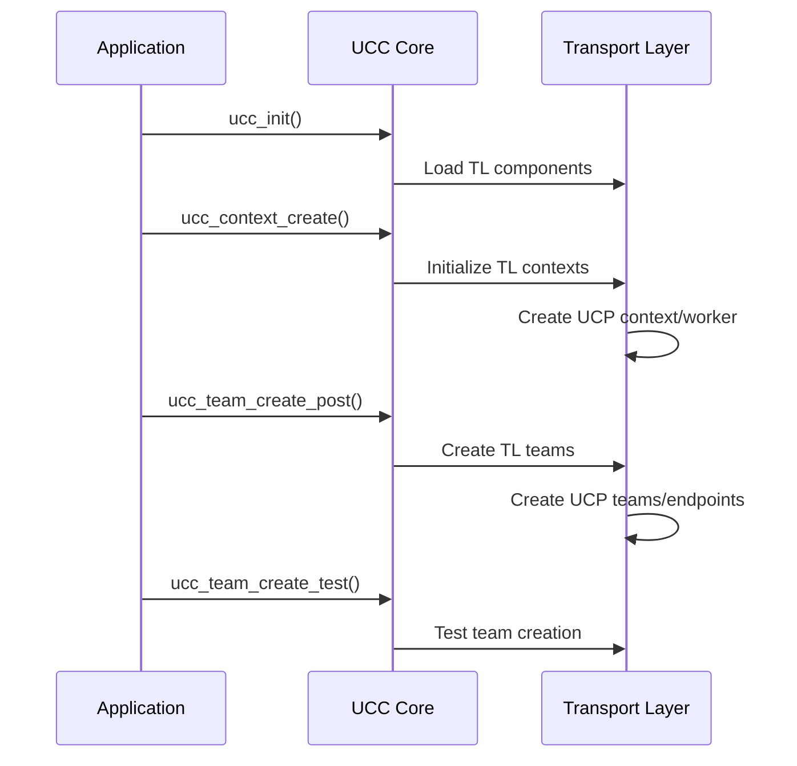
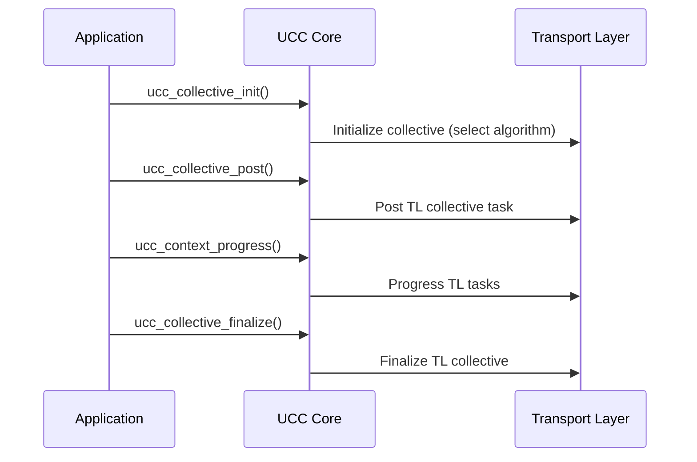
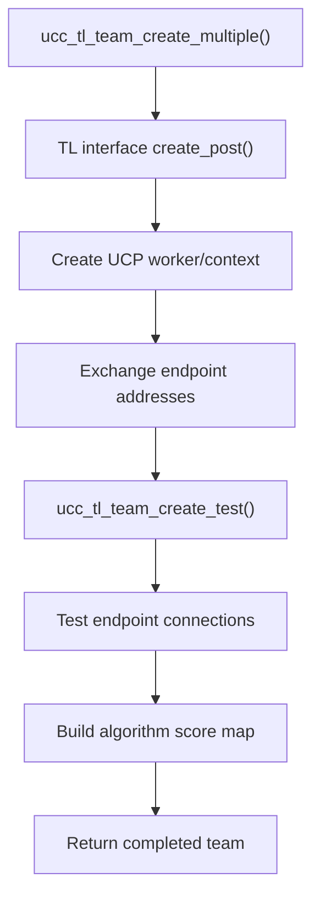
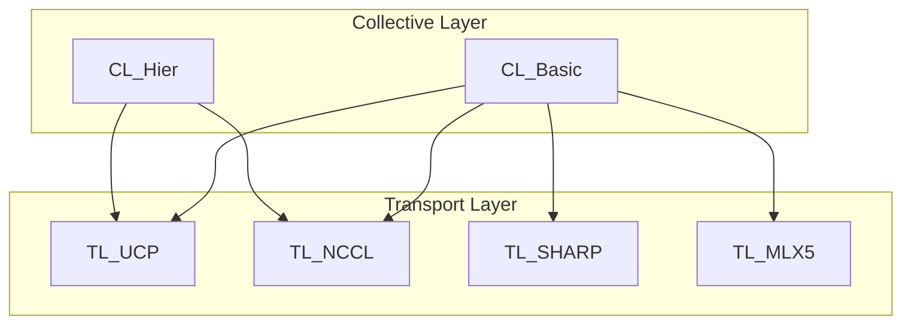

<!-- source: DeepWiki mcp.deepwiki.com · repo openucx/ucc · page 3 Transport Layers · fetched 2026-11-11 -->

# Transport Layers

<details>
<summary>Relevant source files</summary>

The following files were used as context for generating this wiki page:

- [src/components/base/ucc_base_iface.h](src/components/base/ucc_base_iface.h)
- [src/components/cl/basic/cl_basic.c](src/components/cl/basic/cl_basic.c)
- [src/components/cl/basic/cl_basic.h](src/components/cl/basic/cl_basic.h)
- [src/components/cl/basic/cl_basic_context.c](src/components/cl/basic/cl_basic_context.c)
- [src/components/cl/basic/cl_basic_lib.c](src/components/cl/basic/cl_basic_lib.c)
- [src/components/cl/basic/cl_basic_team.c](src/components/cl/basic/cl_basic_team.c)
- [src/components/cl/ucc_cl.c](src/components/cl/ucc_cl.c)
- [src/components/cl/ucc_cl.h](src/components/cl/ucc_cl.h)
- [src/components/tl/ucc_tl.c](src/components/tl/ucc_tl.c)
- [src/components/tl/ucc_tl.h](src/components/tl/ucc_tl.h)
- [src/components/tl/ucp/Makefile.am](src/components/tl/ucp/Makefile.am)
- [src/components/tl/ucp/tl_ucp.c](src/components/tl/ucp/tl_ucp.c)
- [src/components/tl/ucp/tl_ucp.h](src/components/tl/ucp/tl_ucp.h)
- [src/components/tl/ucp/tl_ucp_coll.c](src/components/tl/ucp/tl_ucp_coll.c)
- [src/components/tl/ucp/tl_ucp_coll.h](src/components/tl/ucp/tl_ucp_coll.h)
- [src/components/tl/ucp/tl_ucp_context.c](src/components/tl/ucp/tl_ucp_context.c)
- [src/components/tl/ucp/tl_ucp_ep.c](src/components/tl/ucp/tl_ucp_ep.c)
- [src/components/tl/ucp/tl_ucp_ep.h](src/components/tl/ucp/tl_ucp_ep.h)
- [src/components/tl/ucp/tl_ucp_sendrecv.h](src/components/tl/ucp/tl_ucp_sendrecv.h)
- [src/components/tl/ucp/tl_ucp_team.c](src/components/tl/ucp/tl_ucp_team.c)

</details>


Transport Layers (TL) in UCC provide an internal interface that abstracts hardware communication capabilities for collective operations. While Collective Layers (CL) focus on higher-level programming models, Transport Layers specifically handle the efficient implementation of communication primitives over various hardware transports. This page documents the architecture, components, and implementation of Transport Layers in UCC.

For information about Collective Layers, see [Core Components](#2).

## Transport Layer Architecture

Transport Layers form a crucial middle layer in the UCC framework, sitting between Collective Layers and the actual hardware communication facilities. They provide hardware-specific implementations of collective operations that Collective Layers can leverage to implement their algorithms.

**Transport Layer Hierarchy**



Sources: [src/components/tl/ucc_tl.h:15-25](). [src/components/tl/ucp/tl_ucp.h:7-44]().

## Transport Layer Components

The Transport Layer abstraction consists of several key components:

```mermaid
classDiagram
    class "ucc_tl_iface_t" {
        +ucc_component_iface_t super
        +lib_iface
        +context_iface
        +team_iface
        +coll_iface
        +service_coll
        +alg_info[]
        +coll_plugins
    }
    
    class "ucc_tl_lib_t" {
        +ucc_base_lib_t super
        +ucc_tl_iface_t* iface
    }
    
    class "ucc_tl_context_t" {
        +ucc_base_context_t super
        +int ref_count
    }
    
    class "ucc_tl_team_t" {
        +ucc_base_team_t super
    }
    
    "ucc_tl_iface_t" <-- "ucc_tl_lib_t" : references
    "ucc_tl_lib_t" <-- "ucc_tl_context_t" : associated with
    "ucc_tl_context_t" <-- "ucc_tl_team_t" : belongs to
```

- **TL Interface (`ucc_tl_iface_t`)**: Defines the interface that a transport layer must implement.
- **TL Library (`ucc_tl_lib_t`)**: An instantiation of a specific transport layer library.
- **TL Context (`ucc_tl_context_t`)**: Represents a communication context within a transport layer.
- **TL Team (`ucc_tl_team_t`)**: Represents a group of processes that participate in collective operations.

Sources: [src/components/tl/ucc_tl.h:25-102](). [src/components/tl/ucp/tl_ucp.h:39-163]().

## Available Transport Layers

UCC currently supports several transport layers, each specializing in different hardware and communication protocols:

| Transport Layer | Description | Key Features |
|----------------|-------------|--------------|
| UCP | UCX Communication Protocol transport | General purpose transport supporting various networks |
| NCCL | NVIDIA Collective Communication Library | GPU-optimized transport for NVIDIA hardware |
| SHARP | Scalable Hierarchical Aggregation and Reduction Protocol | Hardware-accelerated collectives on Mellanox networks |
| MLX5 | Mellanox 5th generation transport | Direct hardware access for Mellanox NICs |

The Transport Layer mechanism in UCC allows adding new transports without changing the higher-level components.

Sources: [src/components/tl/ucp/Makefile.am:109-137](). [src/components/tl/ucp/tl_ucp.c:27-34]().

## UCP Transport Layer

The UCP transport layer is the most general-purpose transport in UCC, supporting a wide range of networks and hardware through UCX.

### UCP Transport Structure

```mermaid
classDiagram
    class "ucc_tl_ucp_iface_t" {
        +ucc_tl_iface_t super
    }
    
    class "ucc_tl_ucp_lib_t" {
        +ucc_tl_lib_t super
        +ucc_tl_ucp_lib_config_t cfg
    }
    
    class "ucc_tl_ucp_context_t" {
        +ucc_tl_context_t super
        +ucc_tl_ucp_context_config_t cfg
        +ucc_tl_ucp_worker_t worker
        +ucc_tl_ucp_worker_t service_worker
        +copy functions
    }
    
    class "ucc_tl_ucp_worker_t" {
        +ucp_context_h ucp_context
        +ucp_worker_h ucp_worker
        +ucp_address_t* worker_address
        +tl_ucp_ep_hash_t* ep_hash
        +ucp_ep_h* eps
    }
    
    class "ucc_tl_ucp_team_t" {
        +ucc_tl_team_t super
        +ucc_status_t status
        +ucc_tl_ucp_worker_t* worker
        +ucc_topo_t* topo
    }
    
    "ucc_tl_ucp_iface_t" <-- "ucc_tl_ucp_lib_t" : references
    "ucc_tl_ucp_lib_t" <-- "ucc_tl_ucp_context_t" : associated with
    "ucc_tl_ucp_context_t" <-- "ucc_tl_ucp_team_t" : belongs to
    "ucc_tl_ucp_worker_t" --* "ucc_tl_ucp_context_t" : contains
    "ucc_tl_ucp_worker_t" <-- "ucc_tl_ucp_team_t" : references
```

Sources: [src/components/tl/ucp/tl_ucp.h:39-163](). [src/components/tl/ucp/tl_ucp_team.c:44-117]().

### UCP Transport Components

1. **UCP Interface** (`ucc_tl_ucp_iface_t`): The interface definition for the UCP transport.
2. **UCP Library** (`ucc_tl_ucp_lib_t`): Manages UCP-specific configuration and initialization.
3. **UCP Context** (`ucc_tl_ucp_context_t`): Manages UCP workers and memory registration.
4. **UCP Worker** (`ucc_tl_ucp_worker_t`): Wraps UCP worker objects and endpoint management.
5. **UCP Team** (`ucc_tl_ucp_team_t`): Represents a team of processes for collective operations.

One of the unique aspects of the UCP transport is its ability to handle both service and regular communication, with specialized workers for each purpose.

Sources: [src/components/tl/ucp/tl_ucp_context.c:138-353](). [src/components/tl/ucp/tl_ucp_team.c:16-116]().

## Collective Operations in Transport Layers

Transport layers implement various collective operations that form the building blocks of higher-level collective algorithms.

### Collective Task Structure

```mermaid
classDiagram
    class "ucc_tl_ucp_task_t" {
        +ucc_coll_task_t super
        +uint32_t flags
        +tagged communication state
        +onesided communication state
        +algorithm-specific state
    }
    
    class "ucc_coll_task_t" {
        +status
        +progress()
        +finalize()
    }
    
    "ucc_coll_task_t" <|-- "ucc_tl_ucp_task_t" : inherits
```

The UCP transport layer supports a wide range of collective operations:

| Collective Type | Supported Algorithms |
|-----------------|----------------------|
| Allreduce | Knomial, SRA-Knomial, Sliding Window, DBT |
| Allgather | Knomial, Ring, Neighbor, Bruck |
| Alltoall | Pairwise, Bruck, One-sided |
| Barrier | Knomial |
| Broadcast | Knomial, SAG-Knomial, DBT |
| Reduce | Knomial, DBT, SRG |
| Reduce-Scatter | Knomial, Ring |

Sources: [src/components/tl/ucp/tl_ucp_coll.h:99-277](). [src/components/tl/ucp/tl_ucp_coll.c:100-187](). [src/components/tl/ucp/tl_ucp.h:218-233]().

## Transport Layer Lifecycle

### Initialization



The initialization process involves loading transport layer components, creating contexts, and establishing teams for collective communication.

Sources: [src/components/tl/ucp/tl_ucp_context.c:139-338](). [src/components/tl/ucp/tl_ucp_team.c:181-216]().

### Collective Execution



Collective operations are executed through a consistent pattern of initialization, posting, progress, and finalization across all transport layers.

Sources: [src/components/tl/ucp/tl_ucp_coll.c:189-246](). [src/components/tl/ucp/tl_ucp_coll.h:297-348]().

## Implementation of Transport Layer Teams

Transport layer teams are created through the following process:

1. **Team Creation Post**: Initiates asynchronous team creation.
2. **Endpoint Connection**: Establishes connections between team members.
3. **Team Creation Test**: Tests for completion of team creation.
4. **Score Building**: Builds a score map for selecting optimal algorithms.



Sources: [src/components/tl/ucc_tl.c:207-251](). [src/components/tl/ucp/tl_ucp_team.c:181-220]().

## Relationship with Collective Layers

Transport layers provide the building blocks that collective layers use to implement higher-level collective algorithms:



For example, the Basic collective layer may create multiple transport layer teams to leverage different hardware capabilities for different collective operations.

Sources: [src/components/cl/basic/cl_basic_team.c:11-67](). [src/components/cl/basic/cl_basic_lib.c:31-51]().

## Send/Receive Operations

Transport layers implement point-to-point communication primitives that serve as building blocks for collective operations:

```mermaid
classDiagram
    class "Send/Recv Operations" {
        +ucc_tl_ucp_send_nb()
        +ucc_tl_ucp_recv_nb()
        +ucc_tl_ucp_send_nz()
        +ucc_tl_ucp_recv_nz()
    }
    
    class "Completion Callbacks" {
        +ucc_tl_ucp_send_completion_cb_st()
        +ucc_tl_ucp_recv_completion_cb_st()
        +ucc_tl_ucp_send_completion_cb_mt()
        +ucc_tl_ucp_recv_completion_cb_mt()
    }
    
    "Send/Recv Operations" --> "Completion Callbacks" : use
```

These operations handle both single-threaded (st) and multi-threaded (mt) usage scenarios, with appropriate callback handling for each.

Sources: [src/components/tl/ucp/tl_ucp_sendrecv.h:73-244](). [src/components/tl/ucp/tl_ucp_coll.c:100-178]().

## Summary

Transport Layers in UCC provide a modular infrastructure for implementing collective operations on various hardware transports. This modularity allows UCC to support diverse hardware while presenting a unified API to higher-level components. The UCP transport serves as the primary general-purpose transport, with specialized transports (NCCL, SHARP, MLX5) providing optimized implementations for specific hardware.

---

