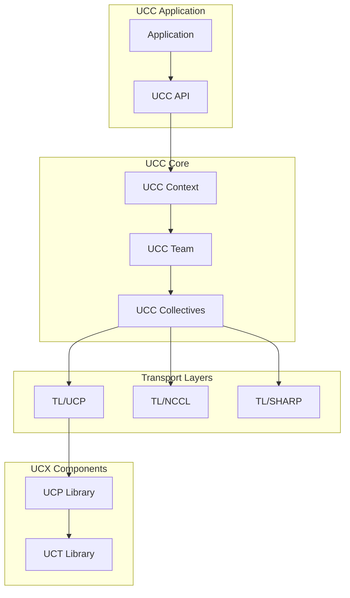
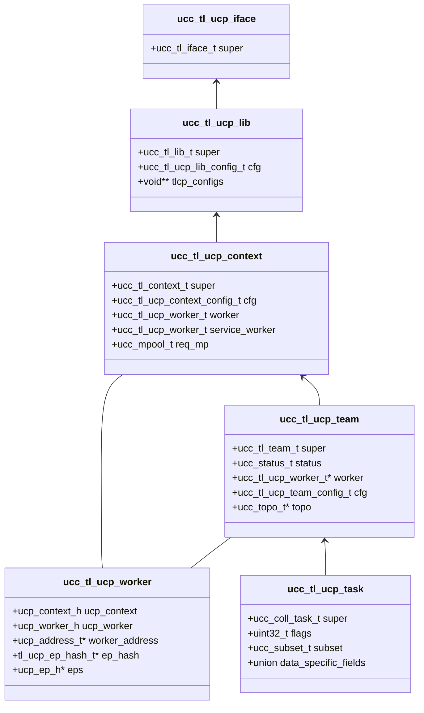
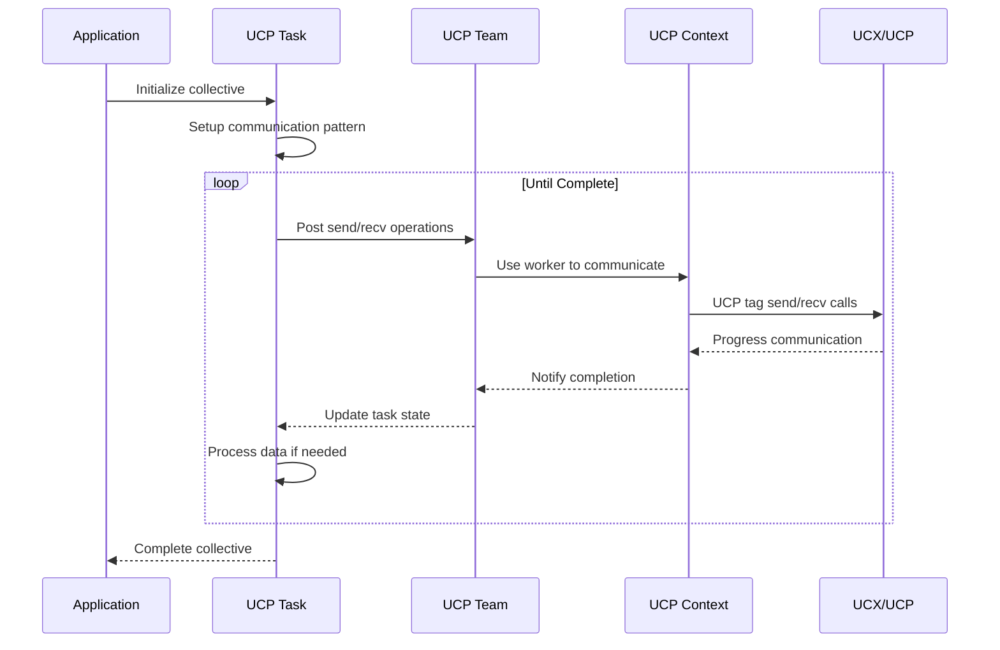
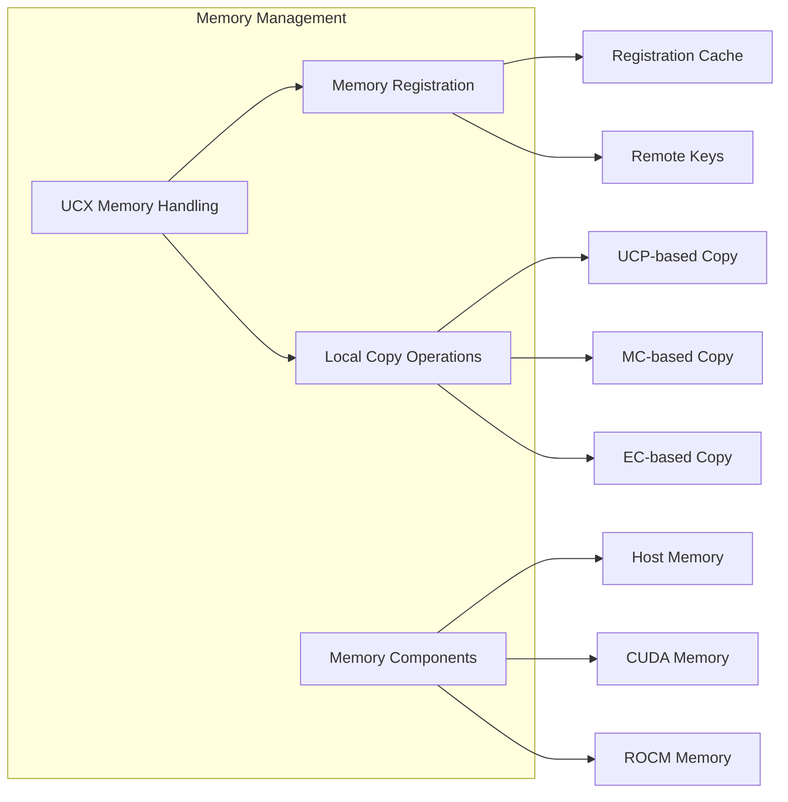

<!-- source: DeepWiki mcp.deepwiki.com · repo openucx/ucc · page 3.1 UCP Transport Layer · fetched 2026-11-11 -->

# UCP Transport Layer

<details>
<summary>Relevant source files</summary>

The following files were used as context for generating this wiki page:

- [src/coll_patterns/recursive_knomial.h](src/coll_patterns/recursive_knomial.h)
- [src/coll_patterns/sra_knomial.h](src/coll_patterns/sra_knomial.h)
- [src/components/tl/ucp/Makefile.am](src/components/tl/ucp/Makefile.am)
- [src/components/tl/ucp/allgather/allgather_knomial.c](src/components/tl/ucp/allgather/allgather_knomial.c)
- [src/components/tl/ucp/allreduce/allreduce.c](src/components/tl/ucp/allreduce/allreduce.c)
- [src/components/tl/ucp/allreduce/allreduce.h](src/components/tl/ucp/allreduce/allreduce.h)
- [src/components/tl/ucp/allreduce/allreduce_knomial.c](src/components/tl/ucp/allreduce/allreduce_knomial.c)
- [src/components/tl/ucp/allreduce/allreduce_sra_knomial.c](src/components/tl/ucp/allreduce/allreduce_sra_knomial.c)
- [src/components/tl/ucp/bcast/bcast_sag_knomial.c](src/components/tl/ucp/bcast/bcast_sag_knomial.c)
- [src/components/tl/ucp/reduce_scatter/reduce_scatter_knomial.c](src/components/tl/ucp/reduce_scatter/reduce_scatter_knomial.c)
- [src/components/tl/ucp/scatter/scatter_knomial.c](src/components/tl/ucp/scatter/scatter_knomial.c)
- [src/components/tl/ucp/tl_ucp.c](src/components/tl/ucp/tl_ucp.c)
- [src/components/tl/ucp/tl_ucp.h](src/components/tl/ucp/tl_ucp.h)
- [src/components/tl/ucp/tl_ucp_coll.c](src/components/tl/ucp/tl_ucp_coll.c)
- [src/components/tl/ucp/tl_ucp_coll.h](src/components/tl/ucp/tl_ucp_coll.h)
- [src/components/tl/ucp/tl_ucp_context.c](src/components/tl/ucp/tl_ucp_context.c)
- [src/components/tl/ucp/tl_ucp_ep.c](src/components/tl/ucp/tl_ucp_ep.c)
- [src/components/tl/ucp/tl_ucp_ep.h](src/components/tl/ucp/tl_ucp_ep.h)
- [src/components/tl/ucp/tl_ucp_sendrecv.h](src/components/tl/ucp/tl_ucp_sendrecv.h)
- [src/components/tl/ucp/tl_ucp_service_coll.c](src/components/tl/ucp/tl_ucp_service_coll.c)
- [src/components/tl/ucp/tl_ucp_team.c](src/components/tl/ucp/tl_ucp_team.c)

</details>


This document describes the UCP (UCX Protocol) Transport Layer within the UCC framework. The UCP transport layer provides communication primitives based on the UCX communication library, enabling efficient collective operations across different hardware architectures. It implements a wide range of collective algorithms optimized for both latency and bandwidth.

For information about other transport layers like NCCL and SHARP, see [NCCL Transport Layer](#3.2) and [SHARP Transport Layer](#3.3) respectively.

## 1. Architecture Overview

The UCP Transport Layer is one of several transport layers in UCC that provides actual communication capabilities. It serves as a bridge between UCC's collective operations and UCX's point-to-point communication primitives.



Sources: [src/components/tl/ucp/tl_ucp.h:39-43](), [src/components/tl/ucp/tl_ucp.c:27-29]()

## 2. UCP Transport Layer Components

The UCP transport layer consists of several key components that work together to provide communication services:



Sources: [src/components/tl/ucp/tl_ucp.h:39-164](), [src/components/tl/ucp/tl_ucp_coll.h:99-192]()

### 2.1 UCP Interface and Library

The UCP transport layer interface (`ucc_tl_ucp_iface_t`) is the entry point for UCC to interact with this transport layer. It defines the available collectives and capabilities.

The UCP library (`ucc_tl_ucp_lib_t`) holds configuration parameters such as:
- Radix values for knomial-based algorithms
- Buffer sizes for sliding window algorithms
- Number of concurrent operations for various algorithms
- Topology-related settings

Sources: [src/components/tl/ucp/tl_ucp.h:39-43](), [src/components/tl/ucp/tl_ucp.h:107-113](), [src/components/tl/ucp/tl_ucp.c:35-224]()

### 2.2 UCP Context

The UCP context (`ucc_tl_ucp_context_t`) manages UCX resources including:
- UCP workers for communication
- Memory management for communication buffers
- Request pools for collective operations
- Service workers for specialized operations

The context is responsible for initializing UCP, creating UCP workers, and managing the memory registration that will be used by collective operations.

Sources: [src/components/tl/ucp/tl_ucp.h:189-214](), [src/components/tl/ucp/tl_ucp_context.c:139-353]()

### 2.3 UCP Team

The UCP team (`ucc_tl_ucp_team_t`) represents a group of processes that participate in collective operations. It contains:
- References to worker objects for communication
- Configuration for collective algorithms
- Topology information for optimization
- Memory segments for collective operations

Teams are created based on the context and maintain their own configuration which can be tuned for specific use cases.

Sources: [src/components/tl/ucp/tl_ucp.h:147-163](), [src/components/tl/ucp/tl_ucp_team.c:44-117]()

### 2.4 UCP Task

The UCP task (`ucc_tl_ucp_task_t`) represents a single collective operation. It contains:
- Algorithm-specific data and state
- Send/receive tracking information
- Memory buffers for the operation
- Progress tracking state

Tasks are initialized for specific collective operations and are the primary units of work in the UCP transport layer.

Sources: [src/components/tl/ucp/tl_ucp_coll.h:99-192](), [src/components/tl/ucp/tl_ucp_coll.c:189-246]()

## 3. Communication Model

The UCP transport layer uses UCX's tag-based point-to-point communication model as the foundation for implementing collective operations.



Sources: [src/components/tl/ucp/tl_ucp_sendrecv.h:74-344](), [src/components/tl/ucp/tl_ucp_coll.c:100-150]()

### 3.1 Tagged Messaging

The UCP transport layer leverages UCX's tag-based messaging system with a custom tag format:

```
+----------------+---------------+----------------+----------------+--------------+-------------+
| User Tag Bits  | Tag Bits      | Sender Bits    | Scope Bits     | Scope ID Bits| ID Bits     |
+----------------+---------------+----------------+----------------+--------------+-------------+
```

This tagging scheme ensures messages are correctly routed to the intended recipients in complex collective operations. The tag components include:
- **User Tag**: Application-provided tag
- **Tag**: Operation-specific tag 
- **Sender**: Rank of the sender
- **Scope/Scope ID**: Team scope information
- **ID**: Team or operation ID

Sources: [src/components/tl/ucp/tl_ucp_sendrecv.h:37-58]()

### 3.2 Send/Receive Operations

The UCP transport layer provides high-level send and receive operations that handle:
- Thread safety (single-threaded vs multi-threaded modes)
- Memory type awareness (CPU, CUDA, ROCM)
- Completion tracking
- Error handling

These operations underpin all collective algorithms in the UCP transport layer.

Sources: [src/components/tl/ucp/tl_ucp_sendrecv.h:74-344](), [src/components/tl/ucp/tl_ucp_coll.c:100-178]()

## 4. Collective Algorithms

The UCP transport layer implements numerous collective algorithms optimized for different scenarios.

```mermaid
graph TD
    subgraph "UCP Collective Algorithms"
        AR["Allreduce Algorithms"]
        AG["Allgather Algorithms"]
        BC["Broadcast Algorithms"]
        RD["Reduce Algorithms"]
        RS["Reduce-Scatter Algorithms"]
        AT["Alltoall Algorithms"]
        OT["Other Collectives"]
    end
    
    subgraph "Allreduce Implementations"
        AR_KN["Knomial"]
        AR_SRA["SRA Knomial"]
        AR_SW["Sliding Window"]
        AR_DBT["Double Binary Tree"]
    end
    
    subgraph "Allgather Implementations"
        AG_KN["Knomial"]
        AG_RING["Ring"]
        AG_NBR["Neighbor"]
        AG_BRUCK["Bruck"]
    end
    
    subgraph "Broadcast Implementations"
        BC_KN["Knomial"]
        BC_SAG["SAG Knomial"]
        BC_DBT["Double Binary Tree"]
    end
    
    AR --> AR_KN
    AR --> AR_SRA
    AR --> AR_SW
    AR --> AR_DBT
    
    AG --> AG_KN
    AG --> AG_RING
    AG --> AG_NBR
    AG --> AG_BRUCK
    
    BC --> BC_KN
    BC --> BC_SAG
    BC --> BC_DBT
```



Sources: [src/components/tl/ucp/Makefile.am:42-105](), [src/components/tl/ucp/tl_ucp.c:384-418]()

### 4.1 Knomial Pattern Algorithms

Many algorithms in the UCP transport layer are based on the knomial pattern, which is a generalization of the binomial pattern to arbitrary radices. These algorithms include:
- Recursive knomial for latency-optimized operations
- Scatter-Reduce-Allgather (SRA) knomial for bandwidth-optimized operations
- Scatter-Allgather (SAG) knomial for bandwidth-optimized broadcast

Key properties of knomial-based algorithms:
- Support for arbitrary radix (branch factor)
- Handling of non-power-of-radix team sizes
- Optimal bandwidth utilization
- Tunable for different network topologies

Sources: [src/coll_patterns/recursive_knomial.h:13-157](), [src/components/tl/ucp/allreduce/allreduce_knomial.c:21-269](), [src/coll_patterns/sra_knomial.h:12-128]()

### 4.2 Algorithm Selection

The UCP transport layer uses a sophisticated algorithm selection system based on:
- Message size
- Memory type
- Team size
- Network topology
- Tunable configuration

Each collective operation has multiple algorithm implementations that are selected based on these factors to provide optimal performance for different scenarios.

Sources: [src/components/tl/ucp/tl_ucp_coll.c:247-439](), [src/components/tl/ucp/tl_ucp_team.c:222-314]()

## 5. Memory Management

The UCP transport layer handles multiple memory types including:
- Host memory
- CUDA device memory
- CUDA managed memory
- ROCM device memory
- ROCM managed memory



Sources: [src/components/tl/ucp/tl_ucp.h:341-348](), [src/components/tl/ucp/tl_ucp_context.c:307-335]()

### 5.1 Memory Registration

For one-sided operations and RDMA, the UCP transport layer registers memory with UCX:
- Registering local memory for access by remote processes
- Exchanging memory keys for remote access
- Managing memory registration lifecycle

Memory registration information is shared during team creation to enable one-sided operations later.

Sources: [src/components/tl/ucp/tl_ucp_context.c:392-583](), [src/components/tl/ucp/tl_ucp.c:350-380]()

### 5.2 Memory Copy Operations

The UCP transport layer provides multiple methods for local memory copies:
- UCP-based copy: Using UCP functions for memory copies
- MC-based copy: Using memory components for type-aware copies
- EC-based copy: Using execution components for potentially accelerated copies

The copy method is configurable and can be selected based on the memory types involved and performance characteristics.

Sources: [src/components/tl/ucp/tl_ucp_context.c:307-335]()

## 6. Advanced Features

### 6.1 Topology Awareness

The UCP transport layer can leverage topology information to optimize collective algorithms:
- Node-level awareness for multi-node operations
- Socket-level awareness for multi-socket operations
- Rank reordering based on topology for optimal communication

Topology information can be used to select appropriate algorithm radices and optimize communication patterns.

Sources: [src/components/tl/ucp/tl_ucp_team.c:16-42](), [src/components/tl/ucp/tl_ucp_team.c:94-113]()

### 6.2 Pipelined Execution

For large message operations, pipelining is used to overlap computation and communication:
- Breaking large messages into smaller chunks
- Processing chunks in parallel
- Adaptive pipeline depth and chunk size

Pipelining is particularly beneficial for bandwidth-intensive operations like allreduce, allgather, and broadcast with large messages.

Sources: [src/components/tl/ucp/allreduce/allreduce_sra_knomial.c:38-242]()

### 6.3 Service Operations

The UCP transport layer provides service operations for internal UCC use:
- Service allreduce for internal synchronization
- Service allgather for internal information exchange
- Service broadcast for internal information distribution

These operations can use a dedicated service worker to avoid interference with regular collective operations.

Sources: [src/components/tl/ucp/tl_ucp_service_coll.c:14-293](), [src/components/tl/ucp/tl_ucp_context.c:35-85]()

## 7. Configuration Options

The UCP transport layer provides numerous configuration options to tune its behavior:

| Category | Parameter | Description | Default |
|----------|-----------|-------------|---------|
| General | `KN_RADIX` | Default radix for knomial algorithms | 0 (auto) |
| Allreduce | `ALLREDUCE_KN_RADIX` | Radix for knomial allreduce | auto |
| Allreduce | `ALLREDUCE_SRA_KN_RADIX` | Radix for SRA knomial allreduce | auto |
| Allreduce | `ALLREDUCE_SLIDING_WIN_BUF_SIZE` | Buffer size for sliding window allreduce | 65536 |
| Allgather | `ALLGATHER_KN_RADIX` | Radix for knomial allgather | auto |
| Broadcast | `BCAST_KN_RADIX` | Radix for knomial broadcast | 4 |
| Broadcast | `BCAST_SAG_KN_RADIX` | Radix for SAG knomial broadcast | auto |
| Reduce | `REDUCE_KN_RADIX` | Radix for knomial reduce | 4 |
| Performance | `PRECONNECT` | Threshold for endpoint preconnection | 0 |
| Threading | `SERVICE_WORKER` | Use separate worker for service collectives | no |

These options can be configured through environment variables or configuration files, and many are automatically tuned based on the system characteristics.

Sources: [src/components/tl/ucp/tl_ucp.c:35-224](), [src/components/tl/ucp/tl_ucp_context.c:235-284]()

## 8. Conclusion

The UCP Transport Layer is a powerful component of the UCC framework, providing high-performance collective operations using UCX communication primitives. It offers a wide range of algorithms optimized for different scenarios, handles various memory types, and provides advanced features like topology awareness and pipelining.

With its configurability and rich feature set, the UCP Transport Layer is suitable for a wide range of high-performance computing applications and can be tuned for optimal performance on different systems and network architectures.

---

