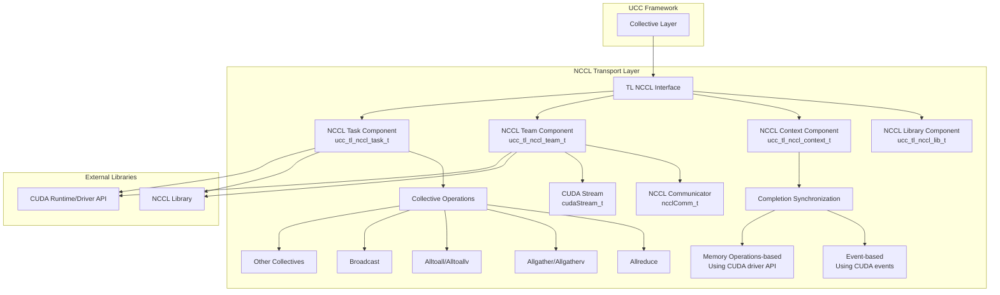
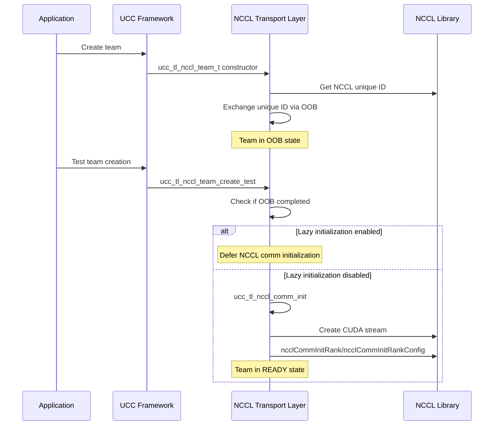

<!-- source: DeepWiki mcp.deepwiki.com · repo openucx/ucc · page 3.2 NCCL Transport Layer · fetched 2026-11-11 -->

# NCCL Transport Layer

<details>
<summary>Relevant source files</summary>

The following files were used as context for generating this wiki page:

- [src/components/cl/basic/cl_basic_coll.c](src/components/cl/basic/cl_basic_coll.c)
- [src/components/tl/nccl/Makefile.am](src/components/tl/nccl/Makefile.am)
- [src/components/tl/nccl/allgatherv/allgatherv.c](src/components/tl/nccl/allgatherv/allgatherv.c)
- [src/components/tl/nccl/allgatherv/allgatherv.h](src/components/tl/nccl/allgatherv/allgatherv.h)
- [src/components/tl/nccl/tl_nccl.c](src/components/tl/nccl/tl_nccl.c)
- [src/components/tl/nccl/tl_nccl.h](src/components/tl/nccl/tl_nccl.h)
- [src/components/tl/nccl/tl_nccl_coll.c](src/components/tl/nccl/tl_nccl_coll.c)
- [src/components/tl/nccl/tl_nccl_coll.h](src/components/tl/nccl/tl_nccl_coll.h)
- [src/components/tl/nccl/tl_nccl_context.c](src/components/tl/nccl/tl_nccl_context.c)
- [src/components/tl/nccl/tl_nccl_team.c](src/components/tl/nccl/tl_nccl_team.c)

</details>


This document describes the NCCL (NVIDIA Collective Communications Library) Transport Layer in the UCC framework. The NCCL transport layer enables efficient execution of collective operations on NVIDIA GPUs by leveraging the highly optimized NCCL library. For information about other transport layers, see [UCP Transport Layer](#3.1), [SHARP Transport Layer](#3.3), and [MLX5 Transport Layer](#3.4).

## Overview

The NCCL Transport Layer (TL) provides a bridge between the UCC framework and NVIDIA's NCCL library, allowing UCC to execute collective operations on CUDA-enabled devices. This transport layer is automatically selected by UCC when operations involve CUDA memory and NVIDIA GPUs are available.

### NCCL Transport Layer Architecture



Sources: [src/components/tl/nccl/tl_nccl.h:56-105](), [src/components/tl/nccl/tl_nccl_context.c:36-97](), [src/components/tl/nccl/tl_nccl_team.c:15-61]()

## Components

### Library Component

The NCCL Transport Layer library component (`ucc_tl_nccl_lib_t`) inherits from `ucc_tl_lib_t` and is responsible for the initialization of the NCCL transport layer.

### Context Component

The context component (`ucc_tl_nccl_context_t`) manages:
- Memory pools for task allocation
- Completion synchronization configuration
- Scratch memory for temporary operations

```c
typedef struct ucc_tl_nccl_context {
    ucc_tl_context_t             super;
    ucc_tl_nccl_context_config_t cfg;
    ucc_mpool_t                  req_mp;
    void                        *scratch_buf;
} ucc_tl_nccl_context_t;
```

Sources: [src/components/tl/nccl/tl_nccl.h:87-92](), [src/components/tl/nccl/tl_nccl_context.c:141-207]()

### Team Component

The team component (`ucc_tl_nccl_team_t`) manages:
- NCCL communicator (`ncclComm_t`)
- CUDA stream for operations
- Team state management (OOB, initialization, ready, error)

```c
typedef struct ucc_tl_nccl_team {
    ucc_tl_team_t        super;
    int                  comm_state;
    ncclUniqueId        *unique_id;
    void                *oob_req;
    ncclComm_t           nccl_comm;
    cudaStream_t         stream;
} ucc_tl_nccl_team_t;
```

Sources: [src/components/tl/nccl/tl_nccl.h:96-103](), [src/components/tl/nccl/tl_nccl_team.c:15-116]()

### Task Component

The task component (`ucc_tl_nccl_task_t`) represents a collective operation and manages:
- Operation state tracking
- Completion synchronization
- Algorithm-specific data

```c
typedef struct ucc_tl_nccl_task {
    ucc_coll_task_t         super;
    ucc_status_t            host_status;
    ucc_status_t            nccl_progress_st;
    ucc_status_t           *dev_status;
    void                   *completed;
    union {
        struct {
            ucc_mc_buffer_header_t *scratch;
            size_t                  max_count;
        } allgatherv_bcopy;
    };
} ucc_tl_nccl_task_t;
```

Sources: [src/components/tl/nccl/tl_nccl.h:105-117](), [src/components/tl/nccl/tl_nccl_coll.c:130-190]()

## Team Creation and Initialization

The NCCL transport layer team creation involves several steps:



Sources: [src/components/tl/nccl/tl_nccl_team.c:15-229]()

### NCCL Communicator States

The NCCL communicator can be in one of several states:

| State | Description |
|-------|-------------|
| `TL_NCCL_COMM_STATE_ERROR` | Error occurred during initialization or operation |
| `TL_NCCL_COMM_STATE_OOB` | Team is exchanging NCCL unique IDs through OOB |
| `TL_NCCL_COMM_STATE_INIT_TEAM` | Team is initialized but communicator is not |
| `TL_NCCL_COMM_STATE_INIT_COMM` | Communicator initialization in progress |
| `TL_NCCL_COMM_STATE_DESTROY_COMM` | Communicator is being destroyed |
| `TL_NCCL_COMM_STATE_READY` | Communicator is ready for operations |

Sources: [src/components/tl/nccl/tl_nccl.h:48-55](), [src/components/tl/nccl/tl_nccl_team.c:118-192]()

## Collective Operations

The NCCL transport layer supports a wide range of collective operations:

```mermaid
graph TD
    TASK["ucc_tl_nccl_task_t"]
    
    TASK --> ALLTOALL["Alltoall<br>ucc_tl_nccl_alltoall_init"]
    TASK --> ALLTOALLV["Alltoallv<br>ucc_tl_nccl_alltoallv_init"]
    TASK --> ALLGATHER["Allgather<br>ucc_tl_nccl_allgather_init"]
    TASK --> ALLGATHERV["Allgatherv<br>ucc_tl_nccl_allgatherv_init"]
    TASK --> ALLREDUCE["Allreduce<br>ucc_tl_nccl_allreduce_init"]
    TASK --> BCAST["Bcast<br>ucc_tl_nccl_bcast_init"]
    TASK --> REDUCE["Reduce<br>ucc_tl_nccl_reduce_init"]
    TASK --> REDUCE_SCATTER["Reduce-Scatter<br>ucc_tl_nccl_reduce_scatter_init"]
    TASK --> BARRIER["Barrier<br>ucc_tl_nccl_barrier_init"]
    TASK --> GATHER["Gather<br>ucc_tl_nccl_gather_init"]
    TASK --> GATHERV["Gatherv<br>ucc_tl_nccl_gatherv_init"]
    TASK --> SCATTER["Scatter<br>ucc_tl_nccl_scatter_init"]
    TASK --> SCATTERV["Scatterv<br>ucc_tl_nccl_scatterv_init"]
    
    ALLTOALL --> START_ALLTOALL["ucc_tl_nccl_alltoall_start"]
    ALLTOALLV --> START_ALLTOALLV["ucc_tl_nccl_alltoallv_start"]
    ALLGATHER --> START_ALLGATHER["ucc_tl_nccl_allgather_start"]
    ALLGATHERV --> START_ALLGATHERV["ucc_tl_nccl_allgatherv_p2p_start"]
    ALLREDUCE --> START_ALLREDUCE["ucc_tl_nccl_allreduce_start"]
    BCAST --> START_BCAST["ucc_tl_nccl_bcast_start"]
    REDUCE --> START_REDUCE["ucc_tl_nccl_reduce_start"]
    REDUCE_SCATTER --> START_REDUCE_SCATTER["ucc_tl_nccl_reduce_scatter_start"]
    BARRIER --> START_BARRIER["ucc_tl_nccl_allreduce_start (reused)"]
    GATHER --> START_GATHER["ucc_tl_nccl_gather_start"]
    GATHERV --> START_GATHERV["ucc_tl_nccl_gatherv_start"]
    SCATTER --> START_SCATTER["ucc_tl_nccl_scatter_start"]
    SCATTERV --> START_SCATTERV["ucc_tl_nccl_scatterv_start"]
```



Sources: [src/components/tl/nccl/tl_nccl_team.c:231-300](), [src/components/tl/nccl/tl_nccl_coll.c:265-873]()

### Collective Task Creation

When a collective operation is requested, the NCCL transport layer:

1. Initializes a task from a memory pool
2. Sets up the task with the appropriate collective initialization function
3. When posted, executes the corresponding NCCL operation
4. Handles completion synchronization

Sources: [src/components/tl/nccl/tl_nccl_coll.c:130-190](), [src/components/tl/nccl/tl_nccl_team.c:231-300]()

## Type Conversions

### UCC to NCCL Datatype Mapping

The NCCL transport layer maps UCC datatypes to NCCL datatypes:

| UCC Datatype | NCCL Datatype |
|--------------|---------------|
| UCC_DT_INT8 | ncclInt8 |
| UCC_DT_INT32 | ncclInt32 |
| UCC_DT_INT64 | ncclInt64 |
| UCC_DT_UINT8 | ncclUint8 |
| UCC_DT_UINT32 | ncclUint32 |
| UCC_DT_UINT64 | ncclUint64 |
| UCC_DT_FLOAT16 | ncclFloat16 |
| UCC_DT_FLOAT32 | ncclFloat32 |
| UCC_DT_FLOAT64 | ncclFloat64 |
| UCC_DT_BFLOAT16 | ncclBfloat16 (if supported) |

Sources: [src/components/tl/nccl/tl_nccl_coll.c:21-53]()

### UCC to NCCL Reduction Operation Mapping

Similarly, UCC reduction operations are mapped to NCCL reduction operations:

| UCC Operation | NCCL Operation |
|---------------|----------------|
| UCC_OP_SUM | ncclSum |
| UCC_OP_PROD | ncclProd |
| UCC_OP_MAX | ncclMax |
| UCC_OP_MIN | ncclMin |
| UCC_OP_AVG | ncclAvg (for NCCL ≥ 2.10.3) |

Sources: [src/components/tl/nccl/tl_nccl_coll.c:55-73]()

## Completion Synchronization

The NCCL transport layer supports two types of completion synchronization:

1. **Event-based synchronization**: Uses CUDA events to signal completion
2. **Memory operations-based synchronization**: Uses CUDA driver API memory operations for potentially lower overhead

The synchronization type can be configured through the `SYNC` parameter, with available options:
- `event`: Use CUDA events for synchronization
- `driver`: Use memory operations for synchronization
- `auto`: Automatically select the best method (default)

Sources: [src/components/tl/nccl/tl_nccl.h:67-72](), [src/components/tl/nccl/tl_nccl_context.c:141-207](), [src/components/tl/nccl/tl_nccl_coll.c:228-263]()

## Configuration

The NCCL Transport Layer can be configured with several options:

| Option | Default | Description |
|--------|---------|-------------|
| `SYNC` | `auto` | Determines how UCC tests completion of NCCL collective operations |
| `BLOCKING` | `yes` | Whether to use blocking or non-blocking communicator initialization |
| `LAZY_INIT` | `yes` | Whether to initialize NCCL communicator on first collective operation |

Sources: [src/components/tl/nccl/tl_nccl.c:25-51]()

## Special Algorithms

For some collectives like Allgatherv, the NCCL transport layer implements multiple algorithms:

1. **P2P-based Allgatherv**: Uses point-to-point NCCL operations
2. **Buffered Copy Allgatherv**: Uses a temporary buffer for better performance with irregular data sizes
3. **Broadcast-based Allgatherv**: Uses NCCL broadcast operations

Different algorithms are automatically selected based on message size and memory type:

```
allgatherv:cuda:0-16k:@0#allgatherv:cuda:16k-1M:@1#allgatherv:cuda:1M-inf:@2#allgatherv:cuda_managed:0-inf:@0
```

Sources: [src/components/tl/nccl/allgatherv/allgatherv.h:19-21](), [src/components/tl/nccl/allgatherv/allgatherv.c:14-52]()

## Integration with Execution Engine

The NCCL transport layer can be integrated with UCC's Execution Engine (EE) to enable triggered operations. When a task is triggered, it uses the CUDA stream provided by the execution engine instead of the team's default stream.

Sources: [src/components/tl/nccl/tl_nccl_coll.c:192-212]()

## Error Handling

Error handling in the NCCL transport layer involves:

1. Checking NCCL operation return codes
2. Converting NCCL errors to UCC status codes
3. Setting team state to ERROR on failure
4. Aborting NCCL communicator when necessary

The NCCL_CHECK_GOTO macro is used throughout the code to simplify error handling:

```c
NCCLCHECK_GOTO(_cmd, _label, _st, _lib, _task_st, _comm, _check_nb)
```

Sources: [src/components/tl/nccl/tl_nccl.h:161-170](), [src/components/tl/nccl/tl_nccl_team.c:71-116]()

## Conclusion

The NCCL Transport Layer provides an essential bridge between the UCC framework and NVIDIA's NCCL library, enabling high-performance GPU-accelerated collective operations. It supports a comprehensive set of collectives with different algorithms, offers flexible configuration options, and integrates with UCC's execution engines and memory components.

---

