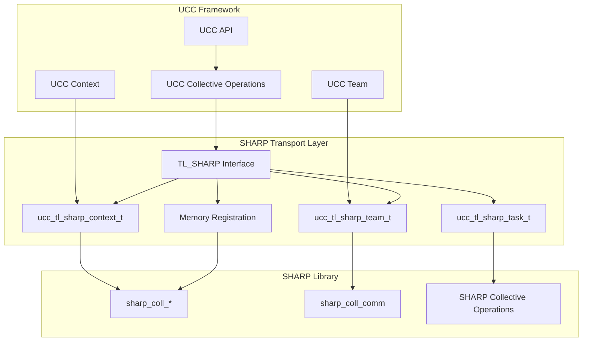
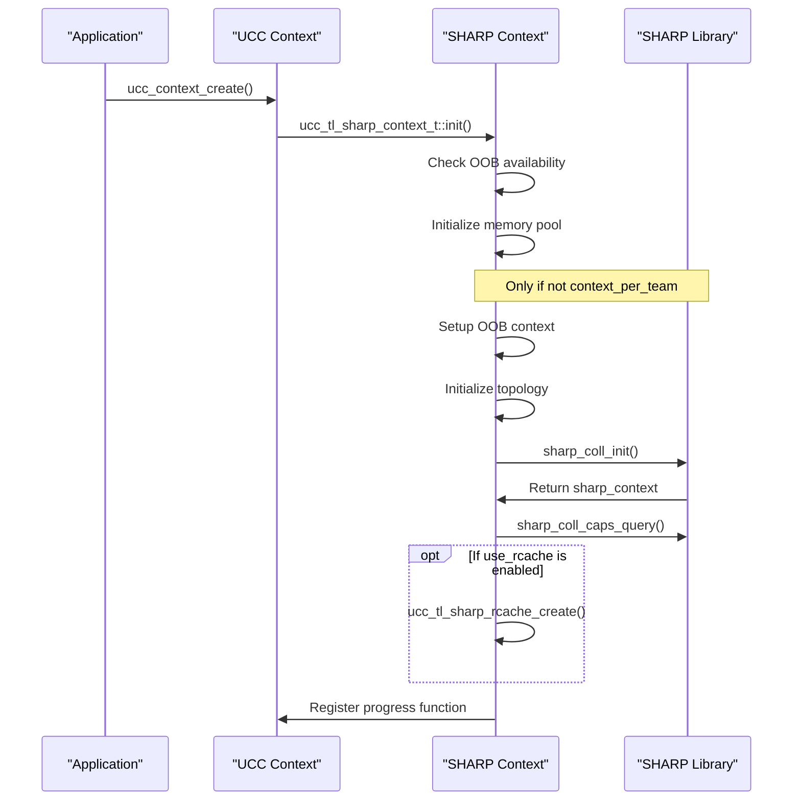
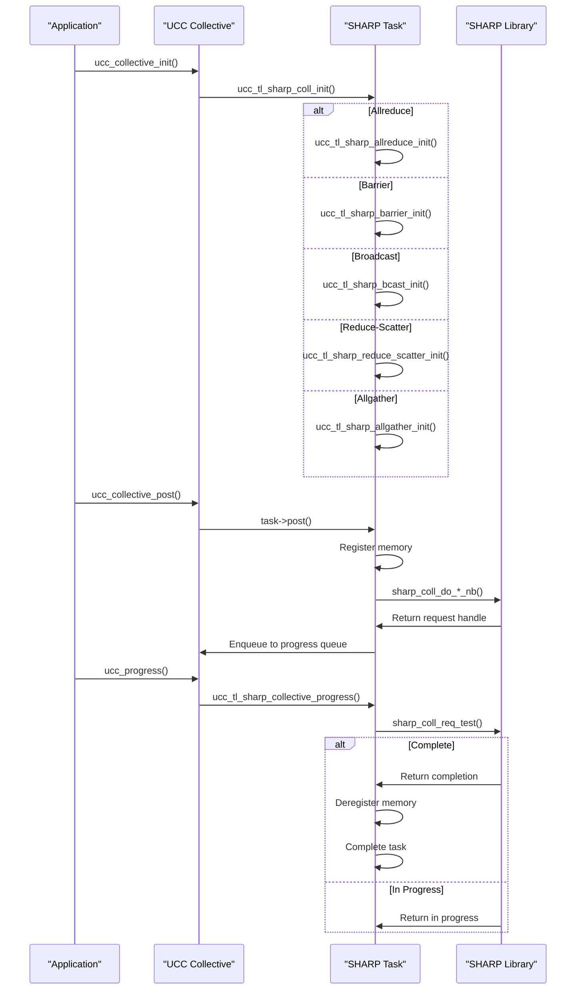
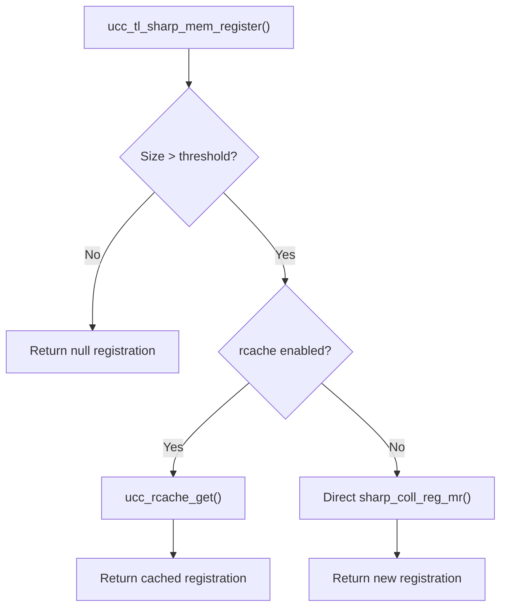

<!-- source: DeepWiki mcp.deepwiki.com · repo openucx/ucc · page 3.3 SHARP Transport Layer · fetched 2026-11-11 -->

# SHARP Transport Layer

<details>
<summary>Relevant source files</summary>

The following files were used as context for generating this wiki page:

- [config/m4/sharp.m4](config/m4/sharp.m4)
- [src/components/tl/self/tl_self_lib.c](src/components/tl/self/tl_self_lib.c)
- [src/components/tl/sharp/tl_sharp.c](src/components/tl/sharp/tl_sharp.c)
- [src/components/tl/sharp/tl_sharp.h](src/components/tl/sharp/tl_sharp.h)
- [src/components/tl/sharp/tl_sharp_coll.c](src/components/tl/sharp/tl_sharp_coll.c)
- [src/components/tl/sharp/tl_sharp_coll.h](src/components/tl/sharp/tl_sharp_coll.h)
- [src/components/tl/sharp/tl_sharp_context.c](src/components/tl/sharp/tl_sharp_context.c)
- [src/components/tl/sharp/tl_sharp_lib.c](src/components/tl/sharp/tl_sharp_lib.c)
- [src/components/tl/sharp/tl_sharp_team.c](src/components/tl/sharp/tl_sharp_team.c)

</details>


The SHARP Transport Layer in UCC integrates with Mellanox/NVIDIA's SHARP (Scalable Hierarchical Aggregation and Reduction Protocol) technology, providing hardware-accelerated collective operations for high-performance computing environments. This component enables UCC to leverage specialized network hardware to accelerate collective communication operations across large-scale systems.

## Overview

SHARP Transport Layer acts as a bridge between UCC collective operations and the underlying SHARP library, allowing applications to benefit from in-network computing capabilities without modifying their code. It converts UCC collective operations into SHARP-specific API calls and manages the lifecycle of SHARP resources.

### Architecture and Components



Sources: [src/components/tl/sharp/tl_sharp.h:34-158](src/components/tl/sharp/tl_sharp.h:34-158)

## Key Components

### Library Component

The SHARP TL library component (`ucc_tl_sharp_lib_t`) initializes the transport layer and stores configuration options like using internal OOB (Out-Of-Band) communication.

### Context Component

The SHARP context (`ucc_tl_sharp_context_t`) creates and manages the SHARP communication context. It holds:

- A pointer to the SHARP library context (`sharp_context`)
- Configuration parameters
- Memory registration cache
- OOB communication context for initialization
- Request memory pool

### Team Component

The SHARP team (`ucc_tl_sharp_team_t`) represents a group of processes that can communicate using SHARP collectives. It contains:

- A reference to the SHARP context
- SHARP communication group (`sharp_comm`)
- Memory registration cache
- Topology information

### Task Component

The SHARP task (`ucc_tl_sharp_task_t`) represents an ongoing collective operation. It includes:

- SHARP request handle
- Memory registration handles
- Pointers to source and destination buffers

Sources: [src/components/tl/sharp/tl_sharp.h:34-125](src/components/tl/sharp/tl_sharp.h:34-125)

## Initialization Process

### Context Initialization

The context initialization process involves:

1. Checking for valid OOB communication
2. Setting up thread mode and context parameters
3. Creating a memory pool for task allocation
4. Initializing the SHARP context with topology information
5. Creating registration cache if enabled
6. Registering SHARP progress function with UCC



Sources: [src/components/tl/sharp/tl_sharp_context.c:286-379](src/components/tl/sharp/tl_sharp_context.c:286-379), [src/components/tl/sharp/tl_sharp_context.c:433-497](src/components/tl/sharp/tl_sharp_context.c:433-497)

### Team Creation

The team creation process involves:

1. Setting up the team's OOB communication
2. Initializing team topology
3. Creating a SHARP context if using per-team contexts
4. Initializing a SHARP communication group with team information
5. Setting up datatype mappings between UCC and SHARP

Sources: [src/components/tl/sharp/tl_sharp_team.c:14-165](src/components/tl/sharp/tl_sharp_team.c:14-165)

## Collective Operations

The SHARP Transport Layer supports the following collective operations:

| Operation | Description | Function |
|-----------|-------------|----------|
| Allreduce | Combines values from all processes and distributes result | `ucc_tl_sharp_allreduce_start` |
| Barrier | Synchronizes all processes | `ucc_tl_sharp_barrier_start` |
| Broadcast | Distributes data from root to all processes | `ucc_tl_sharp_bcast_start` |
| Reduce-Scatter | Combines values and scatters results | `ucc_tl_sharp_reduce_scatter_start` |
| Allgather | Gathers data from all processes to all processes | `ucc_tl_sharp_allgather_start` |

The implementation of each collective operation follows a similar pattern:

1. Register memory regions with SHARP
2. Set up operation-specific parameters
3. Call the corresponding SHARP collective function
4. Enqueue the task for progress tracking



Sources: [src/components/tl/sharp/tl_sharp_coll.c:222-598](src/components/tl/sharp/tl_sharp_coll.c:222-598)

### Example: Allreduce Operation

The Allreduce operation in SHARP Transport Layer:

1. Registers source and destination buffers with SHARP
2. Sets up the reduction specification with datatype, operation, and buffer details
3. Calls `sharp_coll_do_allreduce_nb` to initiate the operation
4. Tracks completion and deregisters memory when finished

Sources: [src/components/tl/sharp/tl_sharp_coll.c:242-300](src/components/tl/sharp/tl_sharp_coll.c:242-300)

## Memory Management

SHARP Transport Layer includes memory registration facilities for RDMA operations:

### Registration Cache

The registration cache (`rcache`) optimizes repeated memory registrations:

1. When a memory region is registered, it first checks the cache
2. If the region is found in the cache, it reuses the registration
3. Otherwise, it registers with SHARP and adds to the cache
4. The cache handles memory events like unmapping to maintain consistency

### Memory Registration Process



Sources: [src/components/tl/sharp/tl_sharp_context.c:216-284](src/components/tl/sharp/tl_sharp_context.c:216-284), [src/components/tl/sharp/tl_sharp_coll.c:102-167](src/components/tl/sharp/tl_sharp_coll.c:102-167)

## OOB Communication

SHARP requires out-of-band (OOB) communication for initialization. The SHARP Transport Layer supports two OOB mechanisms:

1. **User-provided OOB**: Uses OOB functions provided by the application
   - `ucc_tl_sharp_oob_barrier`: Implements barrier using user OOB
   - `ucc_tl_sharp_oob_gather`: Implements gather using user OOB
   - `ucc_tl_sharp_oob_bcast`: Implements broadcast using user OOB

2. **Service team OOB**: Uses UCC's service team for OOB operations
   - `ucc_tl_sharp_service_barrier`: Implements barrier using service team
   - `ucc_tl_sharp_service_gather`: Implements gather using service team
   - `ucc_tl_sharp_service_bcast`: Implements broadcast using service team

The choice between these mechanisms is controlled by the `USE_INTERNAL_OOB` configuration option.

Sources: [src/components/tl/sharp/tl_sharp_context.c:12-214](src/components/tl/sharp/tl_sharp_context.c:12-214)

## Configuration Options

The SHARP Transport Layer can be configured with various options:

### Library Configuration

- `USE_INTERNAL_OOB`: Controls whether to use UCC's service team for OOB communication

### Context Configuration

- `DEVICES`: List of SHARP devices to use
- `USE_RCACHE`: Enable registration cache for memory
- `REG_THRESH`: Threshold for memory registration
- `UPROGRESS_NUM_POLLS`: Number of polls for user progress
- `CONTEXT_PER_TEAM`: Create SHARP context per team
- `ENABLE_LAZY_GROUP_ALLOC`: Enable lazy group resource allocation
- `RAND_SEED`: Seed for random job ID
- `TEAM_MAX_PPN`: Maximum processes per node
- `USE_MULTI_CHANNEL`: Enable SHARP multi-channel feature

Sources: [src/components/tl/sharp/tl_sharp.c:18-80](src/components/tl/sharp/tl_sharp.c:18-80)

## Type Mapping

SHARP Transport Layer maps UCC datatypes and operations to SHARP-specific types:

### Datatype Mapping

UCC datatypes are mapped to SHARP datatypes using the `ucc_to_sharp_dtype` array. For example:
- `UCC_DT_INT32` → `SHARP_DTYPE_INT`
- `UCC_DT_FLOAT32` → `SHARP_DTYPE_FLOAT`
- `UCC_DT_FLOAT64` → `SHARP_DTYPE_DOUBLE`

### Operation Mapping

UCC reduction operations are mapped to SHARP operations using the `ucc_to_sharp_reduce_op` array. For example:
- `UCC_OP_SUM` → `SHARP_OP_SUM`
- `UCC_OP_MAX` → `SHARP_OP_MAX`
- `UCC_OP_MIN` → `SHARP_OP_MIN`

### Memory Type Mapping

UCC memory types are mapped to SHARP memory types using the `ucc_to_sharp_memtype` array:
- `UCC_MEMORY_TYPE_HOST` → `SHARP_MEM_TYPE_HOST`
- `UCC_MEMORY_TYPE_CUDA` → `SHARP_MEM_TYPE_CUDA`

Sources: [src/components/tl/sharp/tl_sharp_coll.c:29-79](src/components/tl/sharp/tl_sharp_coll.c:29-79)

## Error Handling

The SHARP Transport Layer converts SHARP error codes to UCC status codes for consistent error reporting:

```
SHARP_COLL_SUCCESS     → UCC_OK
SHARP_COLL_ENOMEM      → UCC_ERR_NO_MEMORY
SHARP_COLL_ENOT_SUPP   → UCC_ERR_NOT_SUPPORTED
SHARP_COLL_EINVAL      → UCC_ERR_INVALID_PARAM
SHARP_COLL_ENO_RESOURCE → UCC_ERR_NO_RESOURCE
```

Sources: [src/components/tl/sharp/tl_sharp_coll.c:81-98](src/components/tl/sharp/tl_sharp_coll.c:81-98)

## Integration With UCC Score System

The SHARP Transport Layer integrates with UCC's score system to enable algorithm selection:

1. It defines a default score value for SHARP-based collectives
2. It provides algorithm selection strings that disable certain collectives for small messages
3. The team's score system maps collective operations to their implementations based on these scores

This allows UCC to automatically select the optimal algorithm for each collective operation based on message size, datatype, and other factors.

Sources: [src/components/tl/sharp/tl_sharp_team.c:274-329](src/components/tl/sharp/tl_sharp_team.c:274-329)

## Build and Configuration

The SHARP Transport Layer is conditionally built based on the availability of the SHARP library. Configuration is done through the `config/m4/sharp.m4` file which:

1. Checks for SHARP headers and libraries
2. Sets up compiler and linker flags
3. Determines available SHARP features through feature checks

To build UCC with SHARP support, the `--with-sharp` configuration option can be specified with the path to the SHARP installation.

Sources: [config/m4/sharp.m4:6-64](config/m4/sharp.m4:6-64)

---

