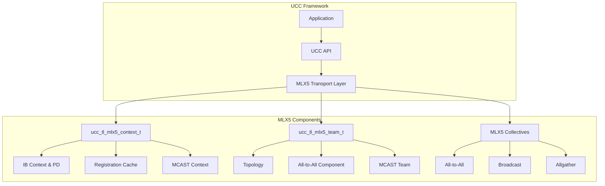
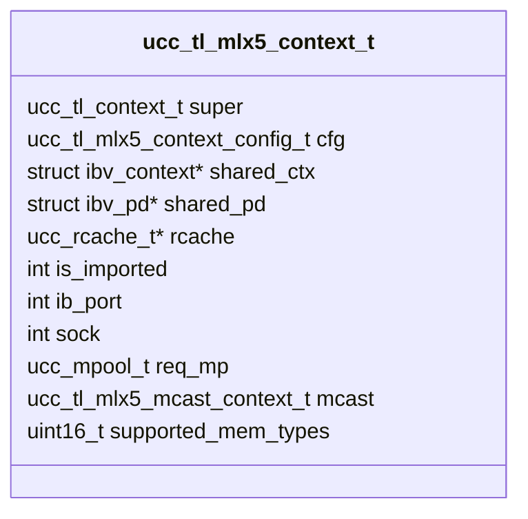
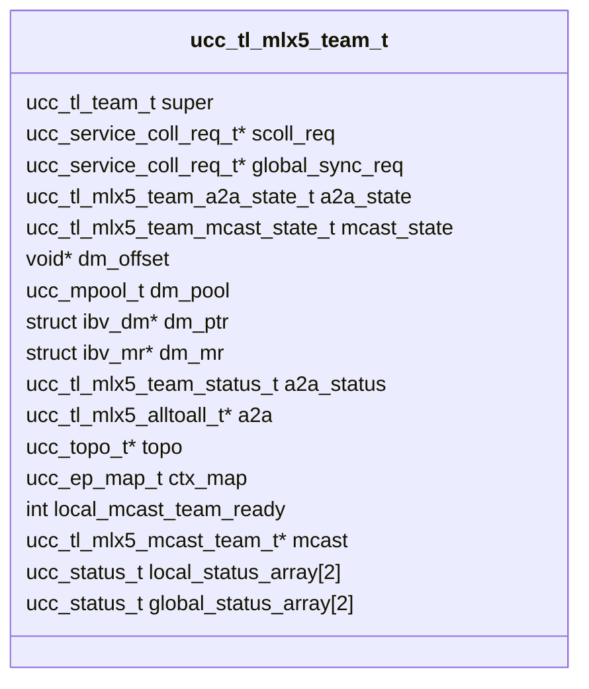
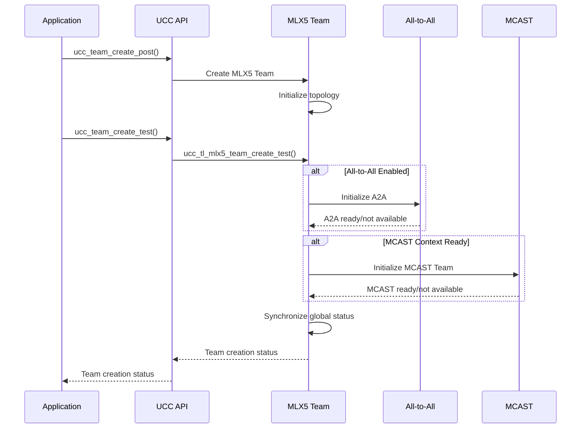
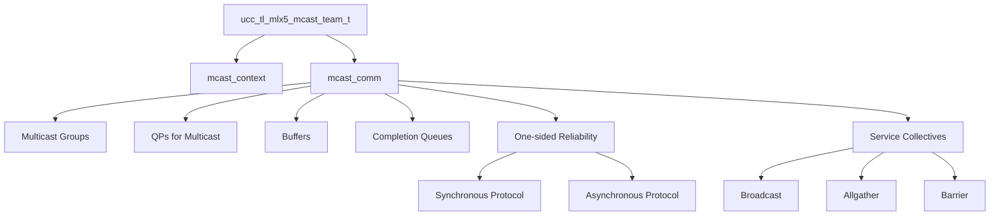
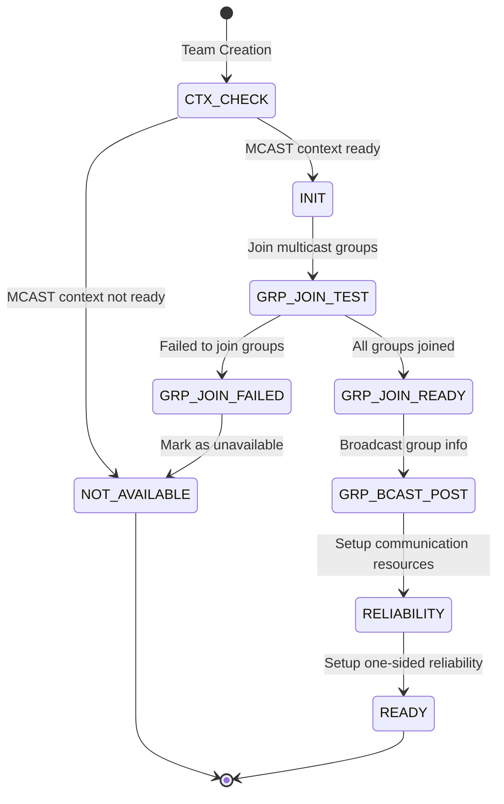
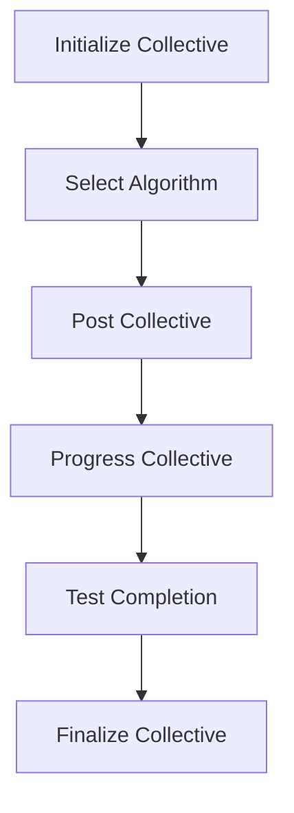

<!-- source: DeepWiki mcp.deepwiki.com · repo openucx/ucc · page 3.4 MLX5 Transport Layer · fetched 2026-11-11 -->

# MLX5 Transport Layer

Relevant source files

The following files were used as context for generating this wiki page:

- [src/components/tl/mlx5/Makefile.am](src/components/tl/mlx5/Makefile.am)
- [src/components/tl/mlx5/mcast/tl_mlx5_mcast.h](src/components/tl/mlx5/mcast/tl_mlx5_mcast.h)
- [src/components/tl/mlx5/mcast/tl_mlx5_mcast_allgather.c](src/components/tl/mlx5/mcast/tl_mlx5_mcast_allgather.c)
- [src/components/tl/mlx5/mcast/tl_mlx5_mcast_context.c](src/components/tl/mlx5/mcast/tl_mlx5_mcast_context.c)
- [src/components/tl/mlx5/mcast/tl_mlx5_mcast_helper.c](src/components/tl/mlx5/mcast/tl_mlx5_mcast_helper.c)
- [src/components/tl/mlx5/mcast/tl_mlx5_mcast_helper.h](src/components/tl/mlx5/mcast/tl_mlx5_mcast_helper.h)
- [src/components/tl/mlx5/mcast/tl_mlx5_mcast_one_sided_progress.c](src/components/tl/mlx5/mcast/tl_mlx5_mcast_one_sided_progress.c)
- [src/components/tl/mlx5/mcast/tl_mlx5_mcast_one_sided_progress.h](src/components/tl/mlx5/mcast/tl_mlx5_mcast_one_sided_progress.h)
- [src/components/tl/mlx5/mcast/tl_mlx5_mcast_service_coll.c](src/components/tl/mlx5/mcast/tl_mlx5_mcast_service_coll.c)
- [src/components/tl/mlx5/mcast/tl_mlx5_mcast_team.c](src/components/tl/mlx5/mcast/tl_mlx5_mcast_team.c)
- [src/components/tl/mlx5/tl_mlx5.c](src/components/tl/mlx5/tl_mlx5.c)
- [src/components/tl/mlx5/tl_mlx5.h](src/components/tl/mlx5/tl_mlx5.h)
- [src/components/tl/mlx5/tl_mlx5_context.c](src/components/tl/mlx5/tl_mlx5_context.c)
- [src/components/tl/mlx5/tl_mlx5_team.c](src/components/tl/mlx5/tl_mlx5_team.c)

The MLX5 Transport Layer is a specialized communication component within UCC (Unified Collective Communication) that leverages Mellanox MLX5 InfiniBand hardware to provide high-performance collective communication operations. It particularly focuses on multicast capabilities for operations like broadcast and allgather, as well as optimized all-to-all communication.

## Architecture

The MLX5 transport layer consists of several key components that work together to provide efficient collective operations:

Sources: [src/components/tl/mlx5/tl_mlx5.h:85-106](), [src/components/tl/mlx5/tl_mlx5_context.c:51-97](), [src/components/tl/mlx5/tl_mlx5_team.c:54-96]()

### Key Components

1. **MLX5 Context (`ucc_tl_mlx5_context_t`)**: Base context that manages shared resources for the transport layer
2. **MLX5 Team (`ucc_tl_mlx5_team_t`)**: Represents a group of processes participating in collective operations
3. **Multicast Component**: Provides hardware multicast capabilities for broadcast and allgather operations
4. **All-to-All Component**: Specialized component for optimizing all-to-all operations

## MLX5 Context

The MLX5 context maintains resources shared across all collective operations within a UCC context.

The context initialization includes:
1. Setting configuration parameters
2. Detecting GPU-Direct RDMA capabilities for CUDA memory support
3. Initializing a memory pool for requests
4. Setting up the multicast (MCAST) context when enabled

Sources: [src/components/tl/mlx5/tl_mlx5.h:94-106](), [src/components/tl/mlx5/tl_mlx5_context.c:51-97]()

## MLX5 Team

The MLX5 team represents a group of processes/ranks participating in collective operations. It manages team-specific resources and components.

Team creation involves:
1. Initializing topology
2. Setting up all-to-all (a2a) component if enabled
3. Creating a multicast (MCAST) team if the context is ready
4. Synchronizing component status across all ranks

Sources: [src/components/tl/mlx5/tl_mlx5.h:154-172](), [src/components/tl/mlx5/tl_mlx5_team.c:54-96]()

### Team Creation Process

The team creation follows a multi-phase approach to ensure all components are properly initialized:

Sources: [src/components/tl/mlx5/tl_mlx5_team.c:157-305]()

## Multicast (MCAST) Component

The MCAST component is a key feature of the MLX5 transport layer, leveraging InfiniBand hardware multicast capabilities for efficient collective operations.

### MCAST Structure

Sources: [src/components/tl/mlx5/mcast/tl_mlx5_mcast.h:371-375](), [src/components/tl/mlx5/mcast/tl_mlx5_mcast.h:326-369]()

### MCAST Team Creation

The creation of a MCAST team involves multiple steps and state transitions:

Sources: [src/components/tl/mlx5/mcast/tl_mlx5_mcast_team.c:360-625]()

### One-Sided Reliability

A unique feature of the MCAST component is its one-sided reliability mechanism, which ensures reliable collective operations even with hardware multicast. It supports two protocols:

1. **Synchronous Protocol**: Uses OOB allgather to exchange send buffer addresses and keys, then RDMA READ for reliability
2. **Asynchronous Protocol**: Uses temporal slots and RDMA READ for reliability

Sources: [src/components/tl/mlx5/mcast/tl_mlx5_mcast_one_sided_progress.c:11-176]()

## Collective Operations

The MLX5 transport layer supports several collective operations:

| Operation | Implementation | Features |
|-----------|----------------|----------|
| Broadcast | MCAST-based | Hardware multicast with reliability |
| Allgather | MCAST-based | Hardware multicast with reliability |
| All-to-All | Specialized component | Optimized for MLX5 hardware |

### Operation Workflow

Collective operations follow this workflow:

For MCAST-based operations like broadcast and allgather, two protocols are supported:

1. **Eager Protocol**: Uses internal staging buffers for small messages
2. **Zero-Copy Protocol**: Uses direct user buffers for large messages

Sources: [src/components/tl/mlx5/mcast/tl_mlx5_mcast_allgather.c:165-247]()

## Configuration

The MLX5 transport layer can be configured through various environment variables:

| Environment Variable | Description | Default |
|---------------------|-------------|---------|
| UCC_TL_MLX5_MCAST_ENABLE | Enable multicast capabilities | 0 |
| UCC_TL_MLX5_MCAST_BCAST_ENABLE | Enable MCAST-based broadcast | 1 |
| UCC_TL_MLX5_MCAST_ALLGATHER_ENABLE | Enable MCAST-based allgather | 0 |
| UCC_TL_MLX5_ALLTOALL_ENABLE | Enable accelerated all-to-all | 1 |
| UCC_TL_MLX5_NET_DEVICES | Specify network devices to use | (empty) |

Many other configuration options control aspects like QP settings, reliability, and buffer sizes.

Sources: [src/components/tl/mlx5/tl_mlx5.c:179-213]()

## Summary

The MLX5 Transport Layer provides high-performance collective operations by leveraging Mellanox's MLX5 InfiniBand hardware. Its key features include:

1. Hardware multicast for efficient broadcast and allgather operations
2. One-sided reliability mechanisms for ensuring correct operation
3. Optimized all-to-all implementation
4. Support for GPU memory with CUDA-aware operations

These capabilities make it a valuable transport layer for high-performance computing applications requiring efficient collective communication.

---

