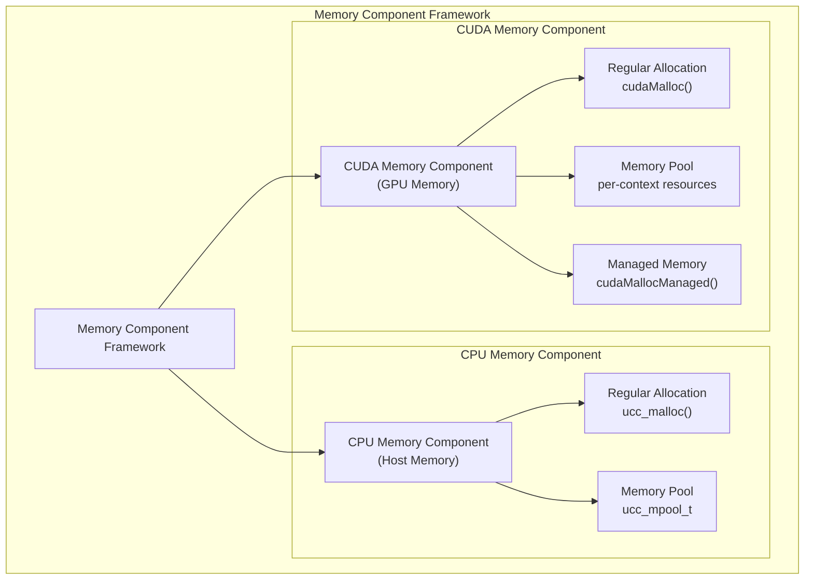
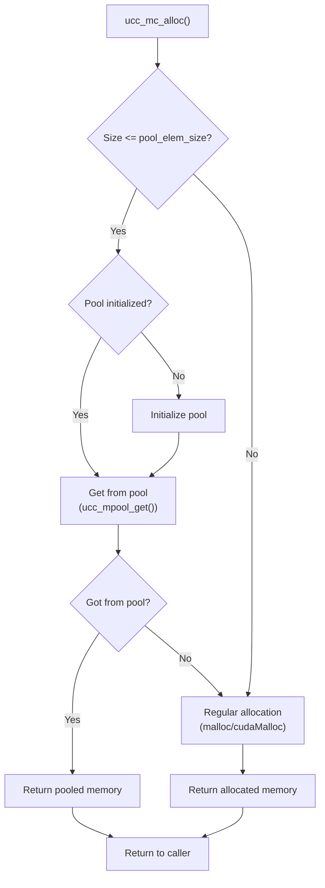
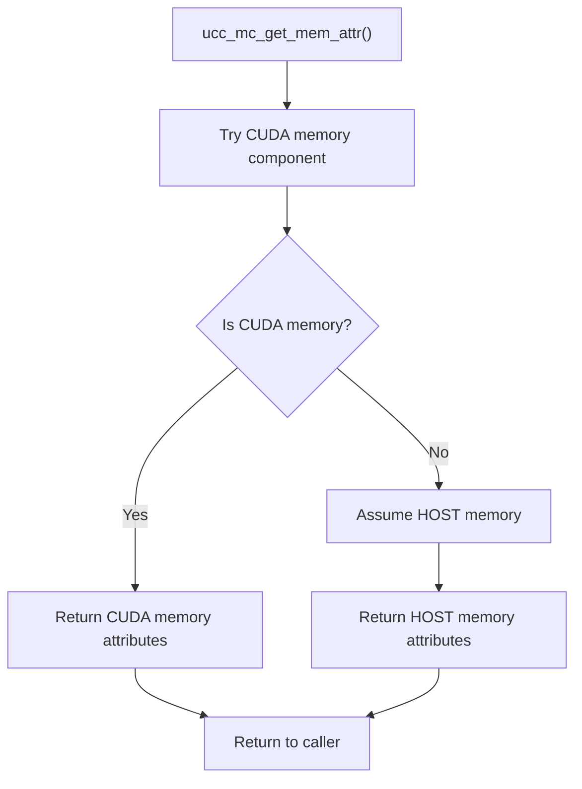
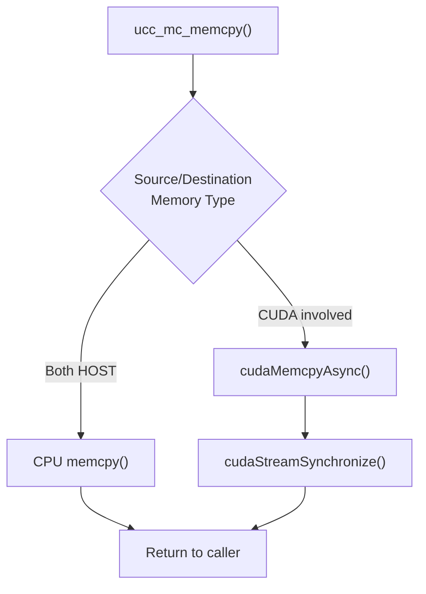
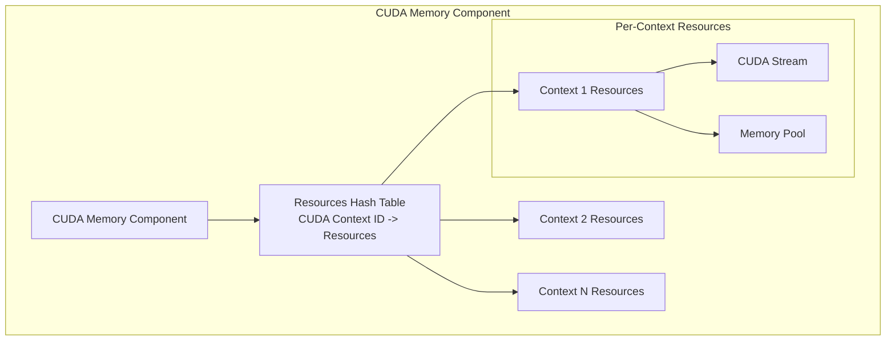
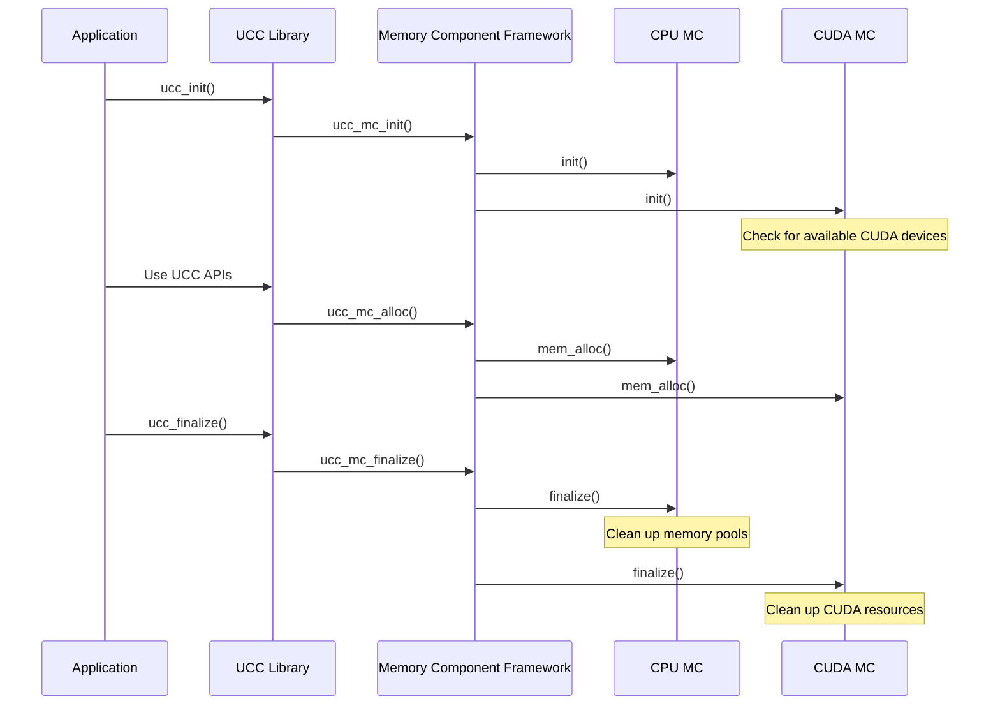

<!-- source: DeepWiki mcp.deepwiki.com · repo openucx/ucc · page 4 Memory Components · fetched 2026-11-11 -->

# Memory Components

<details>
<summary>Relevant source files</summary>

The following files were used as context for generating this wiki page:

- [src/components/mc/base/ucc_mc_base.h](src/components/mc/base/ucc_mc_base.h)
- [src/components/mc/cpu/mc_cpu.c](src/components/mc/cpu/mc_cpu.c)
- [src/components/mc/cuda/mc_cuda.c](src/components/mc/cuda/mc_cuda.c)
- [src/components/mc/cuda/mc_cuda.h](src/components/mc/cuda/mc_cuda.h)
- [test/gtest/core/test_mc.cc](test/gtest/core/test_mc.cc)
- [test/gtest/core/test_mc_cuda.cc](test/gtest/core/test_mc_cuda.cc)

</details>


Memory Components (MC) in the UCC framework provide a unified interface to manage different types of memory (CPU, GPU) used during collective operations. These components handle memory allocation, deallocation, memory copy between different memory types, memory type detection, and memory attribute querying. Memory Components are essential building blocks that support the Transport Layers (TL) by providing the memory management functionality required for data movement during collective operations.

For information about how Memory Components integrate with Transport Layers, see [Transport Layers](#3).

## Memory Component Architecture

Memory Components in UCC follow a component-based architecture with a base interface (`ucc_mc_base_t`) and specific implementations for different memory types.

```mermaid
classDiagram
    class "ucc_mc_base_t" {
        +ucc_component_iface_t super
        +uint32_t ref_cnt
        +ucc_ee_type_t ee_type
        +ucc_memory_type_t type
        +ucc_mc_config_t* config
        +init()
        +get_attr()
        +finalize()
        +ucc_mc_ops_t ops
    }
    
    class "ucc_mc_ops_t" {
        +mem_query()
        +mem_alloc()
        +mem_free()
        +memcpy()
        +memset()
        +flush()
    }
    
    class "ucc_mc_cpu_t" {
        +ucc_mc_base_t super
        +ucc_spinlock_t mpool_init_spinlock
        +ucc_thread_mode_t thread_mode
        +ucc_mpool_t mpool
        +int mpool_init_flag
    }
    
    class "ucc_mc_cuda_t" {
        +ucc_mc_base_t super
        +ucc_spinlock_t init_spinlock
        +ucc_thread_mode_t thread_mode
        +ucc_mc_cuda_resources_hash_t* resources_hash
    }
    
    "ucc_mc_base_t" --> "ucc_mc_ops_t" : contains
    "ucc_mc_cpu_t" --|> "ucc_mc_base_t" : extends
    "ucc_mc_cuda_t" --|> "ucc_mc_base_t" : extends
```

Sources: [src/components/mc/base/ucc_mc_base.h:116-127](), [src/components/mc/cpu/mc_cpu.c:200-222](), [src/components/mc/cuda/mc_cuda.h:17-22]()

### Memory Component Base Interface

The Memory Component base interface (`ucc_mc_base_t`) defines the common structure and operations that all memory components must implement:

1. **Lifecycle Management**:
   - `init()`: Initialize the memory component
   - `finalize()`: Clean up and release resources
   - `get_attr()`: Query component attributes

2. **Memory Operations** (`ucc_mc_ops_t`):
   - `mem_query()`: Query memory attributes (type, base address, etc.)
   - `mem_alloc()`: Allocate memory
   - `mem_free()`: Free allocated memory
   - `memcpy()`: Copy data between memory areas
   - `memset()`: Set memory to a specific value
   - `flush()`: Flush memory (when applicable)

Sources: [src/components/mc/base/ucc_mc_base.h:104-114](), [src/components/mc/base/ucc_mc_base.h:116-127]()

### Memory Buffer Header

All memory allocated through memory components is tracked using a buffer header structure:

```c
typedef struct ucc_mc_buffer_header {
    ucc_memory_type_t mt;      // Memory type
    int               from_pool; // Flag indicating if memory is from a pool
    void             *addr;      // Actual memory address
} ucc_mc_buffer_header_t;
```

Sources: [src/components/mc/base/ucc_mc_base.h:21-25]()

## Available Memory Components

UCC currently provides two memory component implementations:

| Component | Memory Type | Description |
|-----------|-------------|-------------|
| CPU MC | `UCC_MEMORY_TYPE_HOST` | Manages CPU/host memory allocations |
| CUDA MC | `UCC_MEMORY_TYPE_CUDA`, `UCC_MEMORY_TYPE_CUDA_MANAGED` | Manages NVIDIA GPU memory allocations |



Sources: [src/components/mc/cpu/mc_cpu.c:200-222](), [src/components/mc/cuda/mc_cuda.c:426-447]()

### CPU Memory Component

The CPU Memory Component (`ucc_mc_cpu`) manages host memory allocations. It provides:

1. **Memory allocation**: Allocates host memory using `ucc_malloc()`
2. **Memory pooling**: Uses a memory pool for efficient allocation of smaller memory chunks
3. **Thread safety**: Supports multiple threads with appropriate synchronization

Key implementation details:
- Regular memory allocation is done via `ucc_malloc()`
- Memory pooling is implemented using `ucc_mpool_t` for efficient handling of smaller allocations
- Thread safety is ensured through spin locks

Sources: [src/components/mc/cpu/mc_cpu.c:28-52](), [src/components/mc/cpu/mc_cpu.c:48-66](), [src/components/mc/cpu/mc_cpu.c:68-83](), [src/components/mc/cpu/mc_cpu.c:131-162]()

### CUDA Memory Component

The CUDA Memory Component (`ucc_mc_cuda`) manages NVIDIA GPU memory. It provides:

1. **GPU memory allocation**: Allocates device memory using `cudaMalloc()`
2. **Managed memory**: Supports unified memory using `cudaMallocManaged()`
3. **Memory pooling**: Uses per-CUDA-context memory pools for efficient allocation
4. **Memory type detection**: Identifies different types of CUDA memory
5. **CUDA resources management**: Maintains streams and other resources per CUDA context

Key implementation details:
- Maintains a hash table of resources per CUDA context
- Memory pooling is implemented using per-context memory pools
- Supports different CUDA memory types (device, managed)
- Provides memory consistency operations through the CUDA flush API (when available)

Sources: [src/components/mc/cuda/mc_cuda.c:48-109](), [src/components/mc/cuda/mc_cuda.c:126-157](), [src/components/mc/cuda/mc_cuda.c:159-188](), [src/components/mc/cuda/mc_cuda.c:354-409]()

## Memory Allocation and Pooling

Both CPU and CUDA memory components implement memory pooling for efficient allocation of smaller memory chunks. The workflow for memory allocation is:



Sources: [src/components/mc/cpu/mc_cpu.c:68-83](), [src/components/mc/cpu/mc_cpu.c:131-162](), [src/components/mc/cuda/mc_cuda.c:159-188](), [src/components/mc/cuda/mc_cuda.c:215-229]()

### Memory Pool Configuration

Memory pooling can be configured through the following parameters:

| Component | Config Parameter | Default | Description |
|-----------|------------------|---------|-------------|
| CPU MC | `MC_CPU_MPOOL_ELEM_SIZE` | 1MB | Size of each element in CPU memory pool |
| CPU MC | `MC_CPU_MPOOL_MAX_ELEMS` | 8 | Maximum number of elements in CPU memory pool |
| CUDA MC | `MC_CUDA_MPOOL_ELEM_SIZE` | 1MB | Size of each element in CUDA memory pool |
| CUDA MC | `MC_CUDA_MPOOL_MAX_ELEMS` | 8 | Maximum number of elements in CUDA memory pool |

Sources: [src/components/mc/cpu/mc_cpu.c:13-25](), [src/components/mc/cuda/mc_cuda.c:13-26]()

## Memory Type Detection and Querying

UCC provides a memory attribute querying mechanism to determine memory type, base address, and allocation size for a given pointer:



For CUDA memory, the implementation uses CUDA APIs:
- `cudaPointerGetAttributes()` to determine memory type
- `cuMemGetAddressRange()` to determine base address and allocation size

Memory types recognized by UCC include:
- `UCC_MEMORY_TYPE_HOST`: CPU memory
- `UCC_MEMORY_TYPE_CUDA`: NVIDIA GPU device memory
- `UCC_MEMORY_TYPE_CUDA_MANAGED`: NVIDIA GPU managed/unified memory

Sources: [src/components/mc/cuda/mc_cuda.c:285-352](), [test/gtest/core/test_mc_cuda.cc:124-197]()

## Memory Copy Operations

UCC memory components provide memory copy operations between different memory types through the `memcpy` operation:



For CUDA memory, the implementation:
1. Obtains CUDA resources (stream) for the current CUDA context
2. Performs asynchronous memory copy using `cudaMemcpyAsync()`
3. Synchronizes the CUDA stream using `cudaStreamSynchronize()`

Sources: [src/components/mc/cpu/mc_cpu.c:164-172](), [src/components/mc/cuda/mc_cuda.c:231-260]()

## CUDA Resources Management

The CUDA memory component maintains a hash table of resources per CUDA context to support operations in multi-GPU environments:



Key aspects of CUDA resources management:
1. Each CUDA context gets its own set of resources (stream, memory pool)
2. Resources are created on-demand when first accessed
3. Thread safety is ensured through spin locks
4. Resources are cleaned up during finalization

Sources: [src/components/mc/cuda/mc_cuda.c:354-409](), [src/components/mc/cuda/mc_cuda.c:411-424]()

## Memory Component Initialization and Finalization

Memory components follow a standard lifecycle:



Each memory component maintains a reference count to track its usage. The component is fully finalized only when the reference count reaches zero.

Sources: [src/components/mc/cpu/mc_cpu.c:28-38](), [src/components/mc/cpu/mc_cpu.c:189-198](), [src/components/mc/cuda/mc_cuda.c:48-109](), [src/components/mc/cuda/mc_cuda.c:411-424](), [test/gtest/core/test_mc.cc:107-129]()

## Summary

Memory Components in UCC provide a unified interface for managing different types of memory used in collective operations. They abstract away the complexities of working with different memory types (host, GPU) and provide efficient memory allocation through pooling. The flexible component architecture allows for easy extension to support additional memory types in the future.

---

