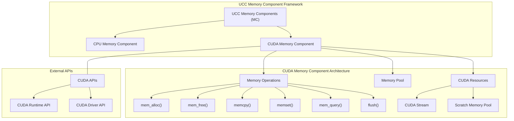
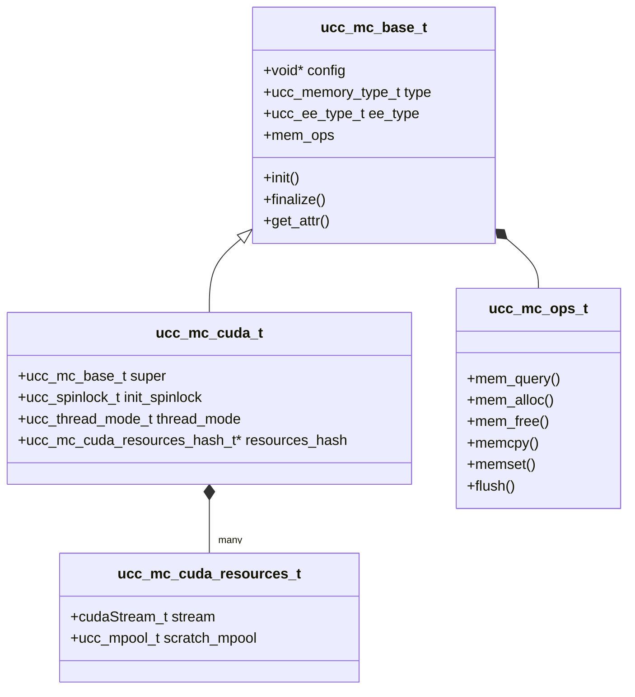
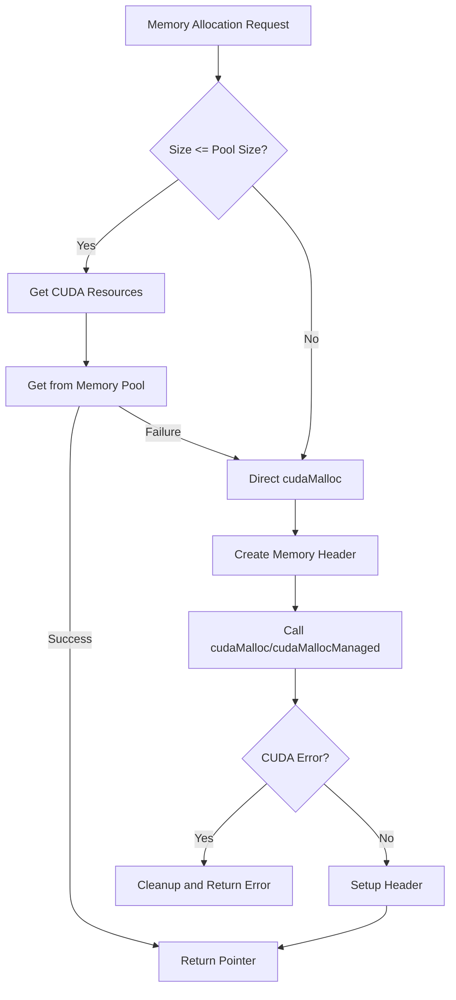
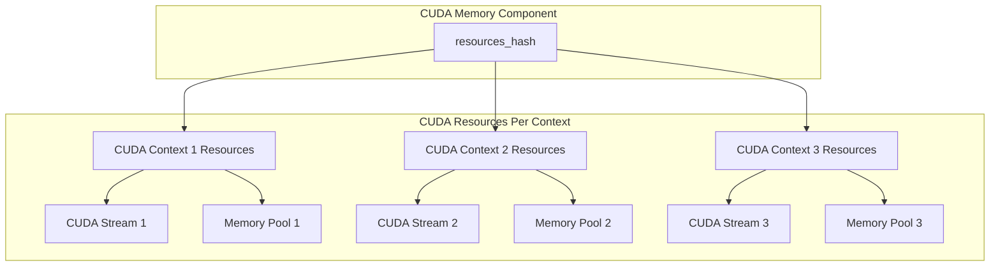

<!-- source: DeepWiki mcp.deepwiki.com · repo openucx/ucc · page 4.1 CUDA Memory Component · fetched 2026-11-11 -->

# CUDA Memory Component

Relevant source files

The following files were used as context for generating this wiki page:

- [src/components/mc/base/ucc_mc_base.h](src/components/mc/base/ucc_mc_base.h)
- [src/components/mc/cpu/mc_cpu.c](src/components/mc/cpu/mc_cpu.c)
- [src/components/mc/cuda/mc_cuda.c](src/components/mc/cuda/mc_cuda.c)
- [src/components/mc/cuda/mc_cuda.h](src/components/mc/cuda/mc_cuda.h)
- [test/gtest/core/test_mc.cc](test/gtest/core/test_mc.cc)
- [test/gtest/core/test_mc_cuda.cc](test/gtest/core/test_mc_cuda.cc)

The CUDA Memory Component in UCC provides functionality for managing NVIDIA GPU memory operations within the Unified Collective Communication framework. It enables allocation, freeing, copying, querying, and manipulation of CUDA device and managed memory, enabling UCC to efficiently work with GPU data.

## Component Overview

The CUDA Memory Component (MC) is part of UCC's Memory Component framework, which abstracts memory operations across different memory types. This component specifically handles CUDA (GPU) memory and integrates with NVIDIA's CUDA Runtime and Driver APIs to provide efficient memory management for GPU-accelerated collective communications.

Sources: [src/components/mc/cuda/mc_cuda.h:1-34](), [src/components/mc/cuda/mc_cuda.c:1-453]()

## Architecture and Implementation

The CUDA Memory Component is implemented as a singleton structure `ucc_mc_cuda_t` that extends the base memory component interface. It maintains a thread mode setting and a hash table of CUDA resources for different CUDA contexts.

Sources: [src/components/mc/cuda/mc_cuda.h:17-22](), [src/components/mc/base/ucc_mc_base.h:116-127]()

### Key Structures

1. **ucc_mc_cuda_t**: The main component structure that extends the base memory component
2. **ucc_mc_cuda_resources_t**: Per-CUDA-context resources including a CUDA stream and memory pool
3. **ucc_mc_cuda_config_t**: Configuration structure for the CUDA memory component

The CUDA Memory Component is registered during UCC initialization and provides memory operations for CUDA device and managed memory.

Sources: [src/components/mc/cuda/mc_cuda.c:426-447]()

## Memory Operations

The CUDA Memory Component implements the following memory operations:

| Operation | Function | Description |
|-----------|----------|-------------|
| Memory Query | `ucc_mc_cuda_mem_query` | Detects memory type and attributes of a given pointer |
| Memory Allocation | `ucc_mc_cuda_mem_alloc` | Allocates CUDA memory |
| Memory Pool Allocation | `ucc_mc_cuda_mem_pool_alloc` | Allocates memory from pool when possible |
| Memory Free | `ucc_mc_cuda_mem_free` | Frees allocated CUDA memory |
| Memory Copy | `ucc_mc_cuda_memcpy` | Copies data between different memory types |
| Memory Set | `ucc_mc_cuda_memset` | Sets memory to a specific value |
| Flush | `ucc_mc_cuda_flush_*` | Handles memory consistency (GPU Direct RDMA) |

### Memory Allocation Flow

Sources: [src/components/mc/cuda/mc_cuda.c:126-188]()

### Memory Type Detection

The CUDA Memory Component can detect and handle different types of CUDA memory:

1. **CUDA Device Memory** (`UCC_MEMORY_TYPE_CUDA`)
2. **CUDA Managed Memory** (`UCC_MEMORY_TYPE_CUDA_MANAGED`)
3. **Host Memory** (`UCC_MEMORY_TYPE_HOST`)

Memory type detection is performed using CUDA pointer attributes functions which query the underlying CUDA driver for information about the memory.

Sources: [src/components/mc/cuda/mc_cuda.c:285-352]()

## Memory Pool Management

The CUDA Memory Component implements a memory pool system for efficient small memory allocations. Instead of calling `cudaMalloc` for each allocation, it maintains a pool of pre-allocated memory chunks that can be quickly distributed for small allocations.

Key aspects of memory pooling:

1. **Per-Context Pools**: Each CUDA context has its own memory pool
2. **Configurable Size**: Pool element size and maximum elements are configurable
3. **Fast Path**: Small allocations use the pool for better performance
4. **Fallback Mechanism**: Falls back to direct allocation when pool is exhausted

Memory pool configuration is controlled by these parameters:

| Parameter | Default | Description |
|-----------|---------|-------------|
| `MC_CUDA_MPOOL_ELEM_SIZE` | 1MB | Size of each element in the memory pool |
| `MC_CUDA_MPOOL_MAX_ELEMS` | 8 | Maximum number of elements in the pool |

When `MC_CUDA_MPOOL_MAX_ELEMS` is set to 0, the pool mechanism is disabled, and all allocations use direct CUDA allocation calls.

Sources: [src/components/mc/cuda/mc_cuda.c:13-26](), [src/components/mc/cuda/mc_cuda.c:159-188]()

## CUDA Context Resources Management

A key aspect of the CUDA Memory Component is its ability to manage resources per CUDA context. When multiple GPUs are in use, each with its own CUDA context, the component maintains separate resources (streams, memory pools) for each context.

The component uses a hashing mechanism to store and retrieve resources for each CUDA context. The context ID is used as a key in the hash table.

Key points about resource management:

1. **Lazy Initialization**: Resources are created on-demand when first accessed
2. **Thread Safety**: Spinlocks protect resource initialization
3. **Resource Reuse**: Subsequent operations using the same context reuse existing resources
4. **Resource Cleanup**: Resources are cleaned up during component finalization

Sources: [src/components/mc/cuda/mc_cuda.c:354-409](), [src/components/mc/cuda/mc_cuda.c:411-424]()

## Memory Consistency and GPU Direct RDMA Support

The CUDA Memory Component provides memory consistency operations for GPU Direct RDMA through the `flush` operation. This functionality is important for ensuring proper ordering of memory operations when using remote direct memory access with GPUs.

The implementation selects the appropriate flush method based on:

1. Driver version (requires CUDA 11.3 or later)
2. GPU capabilities (must support flush operations)
3. Supported flush modes (target vs. owner)

Depending on these factors, one of these flush methods is selected:

- `ucc_mc_cuda_flush_not_supported`: For devices/drivers without consistency API support
- `ucc_mc_cuda_flush_no_op`: For devices where no explicit flush is needed
- `ucc_mc_cuda_flush_to_owner`: For devices requiring explicit flush to memory owner

Sources: [src/components/mc/cuda/mc_cuda.c:28-46](), [src/components/mc/cuda/mc_cuda.c:67-102]()

## Thread Safety

The CUDA Memory Component maintains thread safety through spinlocks:

1. **Initialization Spinlock**: Protects first-time component initialization
2. **Resource Creation**: Protects resource creation for new CUDA contexts

This design allows the component to be used safely in multithreaded environments while minimizing lock contention by using per-context resources.

Sources: [src/components/mc/cuda/mc_cuda.c:106](), [src/components/mc/cuda/mc_cuda.c:383-407]()

## Usage Examples

The CUDA Memory Component is used throughout UCC for GPU memory operations. A common usage pattern is:

1. Detect memory type using `ucc_mc_get_mem_attr`
2. Allocate memory with `ucc_mc_alloc`
3. Perform operations on the memory
4. Free memory with `ucc_mc_free`

Test cases demonstrate this usage pattern with different memory types and operations.

Sources: [test/gtest/core/test_mc_cuda.cc:92-212]()

## Integration with UCC

The CUDA Memory Component integrates with the rest of UCC through the base memory component interface. Collective operations use it to handle GPU memory, enabling efficient GPU-based collectives.

Within UCC's overall architecture, the CUDA Memory Component interacts primarily with:

1. The UCC Memory Component framework
2. Transport layers that operate on GPU memory (especially NCCL Transport)
3. Collective layers that implement GPU-aware collective operations

For more details on how memory components fit into the overall UCC architecture, see [Architecture Overview](#1.1).

---

