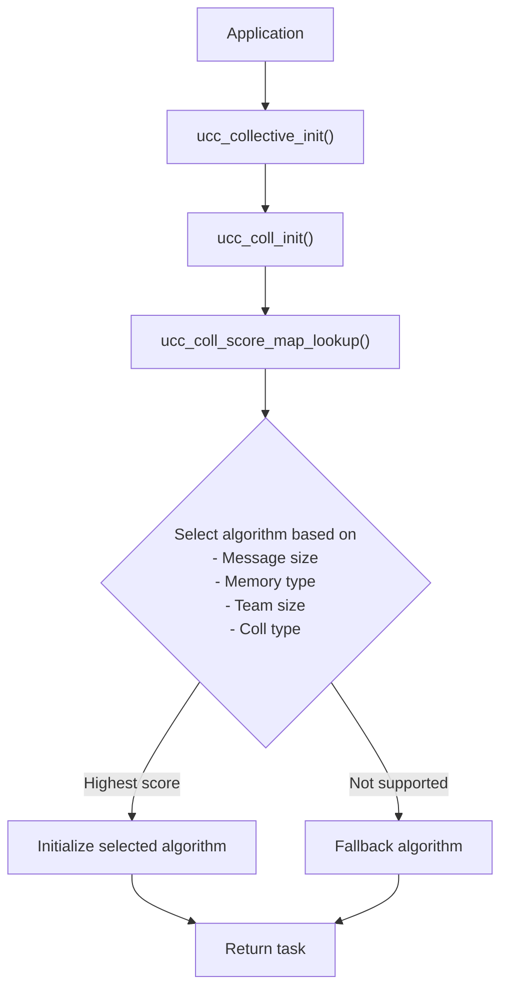
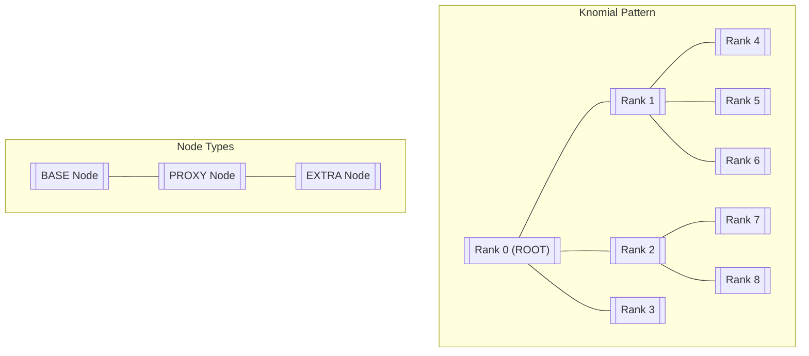
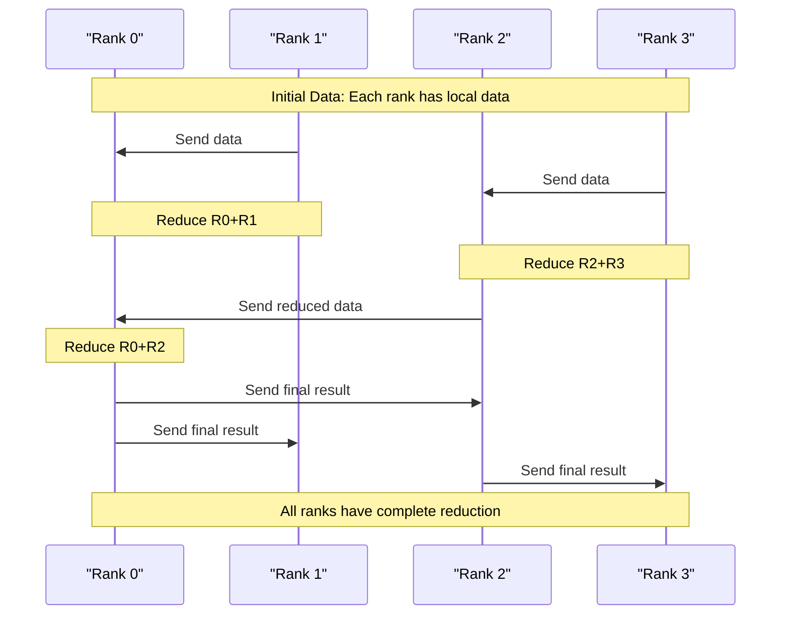
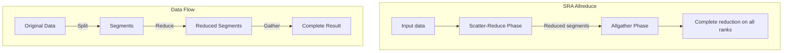
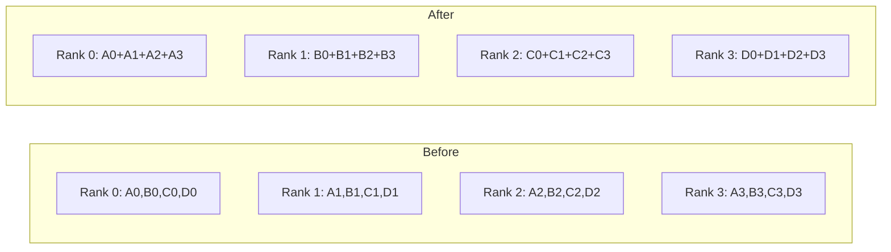
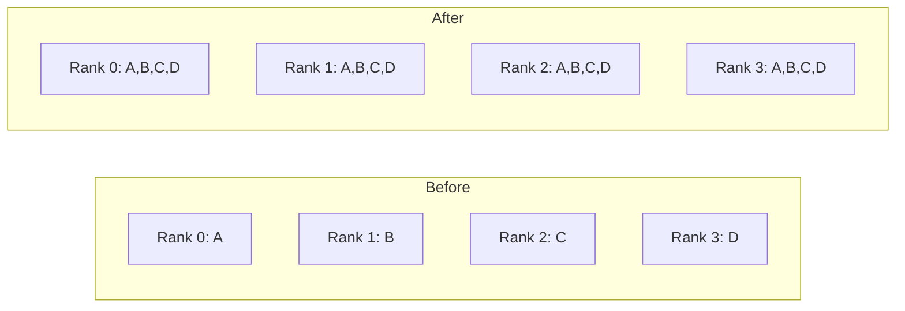
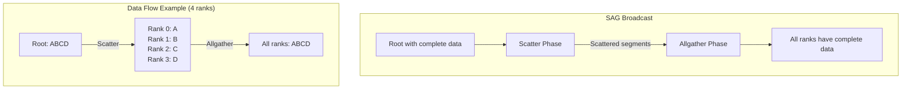
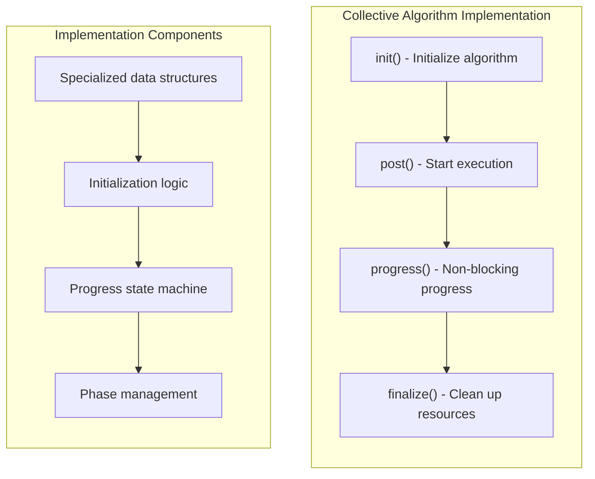

<!-- source: DeepWiki mcp.deepwiki.com · repo openucx/ucc · page 5 Collective Algorithms · fetched 2026-11-11 -->

# Collective Algorithms

Relevant source files

The following files were used as context for generating this wiki page:

- [src/coll_patterns/recursive_knomial.h](src/coll_patterns/recursive_knomial.h)
- [src/coll_patterns/sra_knomial.h](src/coll_patterns/sra_knomial.h)
- [src/coll_score/ucc_coll_score_map.c](src/coll_score/ucc_coll_score_map.c)
- [src/components/tl/ucp/allgather/allgather_knomial.c](src/components/tl/ucp/allgather/allgather_knomial.c)
- [src/components/tl/ucp/allreduce/allreduce.c](src/components/tl/ucp/allreduce/allreduce.c)
- [src/components/tl/ucp/allreduce/allreduce.h](src/components/tl/ucp/allreduce/allreduce.h)
- [src/components/tl/ucp/allreduce/allreduce_knomial.c](src/components/tl/ucp/allreduce/allreduce_knomial.c)
- [src/components/tl/ucp/allreduce/allreduce_sra_knomial.c](src/components/tl/ucp/allreduce/allreduce_sra_knomial.c)
- [src/components/tl/ucp/bcast/bcast_sag_knomial.c](src/components/tl/ucp/bcast/bcast_sag_knomial.c)
- [src/components/tl/ucp/reduce_scatter/reduce_scatter_knomial.c](src/components/tl/ucp/reduce_scatter/reduce_scatter_knomial.c)
- [src/components/tl/ucp/scatter/scatter_knomial.c](src/components/tl/ucp/scatter/scatter_knomial.c)
- [src/components/tl/ucp/tl_ucp_service_coll.c](src/components/tl/ucp/tl_ucp_service_coll.c)
- [src/core/ucc_coll.c](src/core/ucc_coll.c)
- [src/utils/ucc_coll_utils.c](src/utils/ucc_coll_utils.c)
- [src/utils/ucc_coll_utils.h](src/utils/ucc_coll_utils.h)
- [test/gtest/utils/test_ep_map.cc](test/gtest/utils/test_ep_map.cc)

This page provides a detailed overview of the collective algorithms implemented in UCC (Unified Collective Communication) framework. It explains how collective algorithms are selected, their core concepts, and specific implementations for various collective operations. For information about specific collective operation types, see [Collective Operations](#2.3).

## Algorithm Selection Mechanism

UCC uses a scoring mechanism to select the most appropriate algorithm for a given collective operation based on various factors such as message size, memory type, and team topology.

The algorithm selection process works as follows:

1. The application calls `ucc_collective_init()` with the desired collective operation arguments
2. UCC uses the score map to identify the most appropriate algorithm based on:
   - Collective operation type (allreduce, broadcast, allgather, etc.)
   - Message size (different algorithms optimize for different size ranges)
   - Memory type (host, CUDA, ROCM, etc.)
   - Team size and topology

The score map is populated during initialization based on the configuration, and each algorithm registers its preferred operating ranges.

Sources: [src/coll_score/ucc_coll_score_map.c:79-112](), [src/core/ucc_coll.c:169-246]()

## Knomial Algorithms

Knomial algorithms are the foundation for many collective operations in UCC. They extend the concept of binomial algorithms by allowing each node to communicate with up to k nodes (radix) in each step rather than just one.

UCC knomial algorithms define three types of nodes:
- **BASE**: Participates in the main loop of the recursive algorithm
- **PROXY**: Participates in the main loop and also communicates with EXTRA nodes
- **EXTRA**: Only communicates with its PROXY node

This organization allows for efficient handling of team sizes that aren't exact powers of the radix.

Sources: [src/coll_patterns/recursive_knomial.h:13-17](), [src/coll_patterns/recursive_knomial.h:84-128]()

### Key Concepts and Parameters:

1. **Radix (k)**: Number of peers a node communicates with in each step
2. **Iteration**: Current step in the recursive algorithm
3. **Node type**: Whether a node is BASE, PROXY, or EXTRA
4. **Block size/offset**: How data is partitioned among ranks

The knomial pattern is implemented with a flexible state machine that allows progress in a non-blocking manner, crucial for high-performance communication.

Sources: [src/coll_patterns/recursive_knomial.h:302-339]()

## Allreduce Algorithms

### Knomial Allreduce

The knomial allreduce algorithm utilizes recursive k-ary communication to efficiently reduce and broadcast data. This algorithm is optimized for latency and is typically selected for small to medium message sizes.

The operation proceeds as follows:
1. Extra nodes send their data to their proxy nodes
2. Each rank exchanges data with loop peers based on the knomial pattern
3. Reduction operations are performed on received data in each step
4. After all iterations, all ranks have the complete reduced result

Sources: [src/components/tl/ucp/allreduce/allreduce_knomial.c:21-181]()

### SRA Knomial (Scatter-Reduce-Allgather)

SRA Knomial decomposes the allreduce operation into two distinct phases:
1. **Scatter-reduce**: Data is scattered and reduced among ranks
2. **Allgather**: Reduced segments are gathered to all ranks

This algorithm is optimized for bandwidth efficiency and typically selected for larger message sizes.

The SRA algorithm is particularly efficient for large message sizes as it:
- Minimizes data transfer volume
- Distributes reduction work across ranks
- Pipelined execution for better resource utilization

Sources: [src/components/tl/ucp/allreduce/allreduce_sra_knomial.c:40-243]()

## Reduce-Scatter Algorithms

The Reduce-Scatter knomial algorithm performs reduction and scattering in a single operation. Each rank ends up with a portion of the complete reduction.

Key features include:
- Efficient calculation of segment sizes and offsets
- Support for different data distributions and memory types
- Optimized communication pattern based on the knomial structure

Sources: [src/components/tl/ucp/reduce_scatter/reduce_scatter_knomial.c:52-564]()

## Allgather Algorithms

The Allgather knomial algorithm efficiently gathers data from all ranks and distributes it to all participants. It supports both uniform and variable-sized data distributions.

The algorithm uses:
- Segment-based communication to minimize data transfer
- Efficient handling of non-uniform data distributions (allgatherv)
- Specialized patterns for different memory types

Sources: [src/components/tl/ucp/allgather/allgather_knomial.c:56-324]()

## Broadcast Algorithms

### SAG Knomial (Scatter-Allgather)

The SAG broadcast algorithm decomposes the broadcast operation into two phases:
1. **Scatter**: The root scatters portions of the data to all ranks
2. **Allgather**: All ranks exchange their portions to build the complete data

This algorithm is particularly effective for:
- Large message broadcasts
- Optimizing bandwidth utilization
- Distributing communication load across the network

Sources: [src/components/tl/ucp/bcast/bcast_sag_knomial.c:39-142]()

## Performance Considerations

Several factors influence algorithm performance and selection:

| Factor | Impact | Optimization |
|--------|--------|--------------|
| Message Size | Small messages favor latency-optimized algorithms Large messages favor bandwidth-optimized algorithms | Use different algorithms based on message size thresholds |
| Memory Type | GPU memory requires different optimizations than host memory | Memory-type specific algorithm selection and tuning |
| Team Size | Some algorithms perform better with specific team sizes | Adjust radix based on team size |
| Network Topology | Network characteristics affect optimal communication patterns | Use topology-aware algorithms when available |
| Radix | Higher radix can reduce steps but increases per-step communication | Tune radix based on network capabilities |

Key tuning options:
- Adjust message size thresholds for algorithm selection
- Configure radix for knomial algorithms
- Enable pipelining for large messages
- Use topology awareness for optimized communication

Sources: [src/components/tl/ucp/allreduce/allreduce_sra_knomial.c:164-193](), [src/components/tl/ucp/allreduce/allreduce.h:23-24]()

## Algorithm Implementation Structure

The collective algorithm implementations in UCC follow a common pattern:

Each algorithm implementation typically consists of:
1. **Initialization function**: Sets up algorithm-specific state
2. **Start function**: Begins algorithm execution
3. **Progress function**: Advances algorithm state, typically using a state machine approach
4. **Finalize function**: Cleans up resources

This structure enables non-blocking progress and efficient resource utilization across the framework.

Sources: [src/components/tl/ucp/allreduce/allreduce_knomial.c:183-269](), [src/components/tl/ucp/reduce_scatter/reduce_scatter_knomial.c:385-422]()

---

