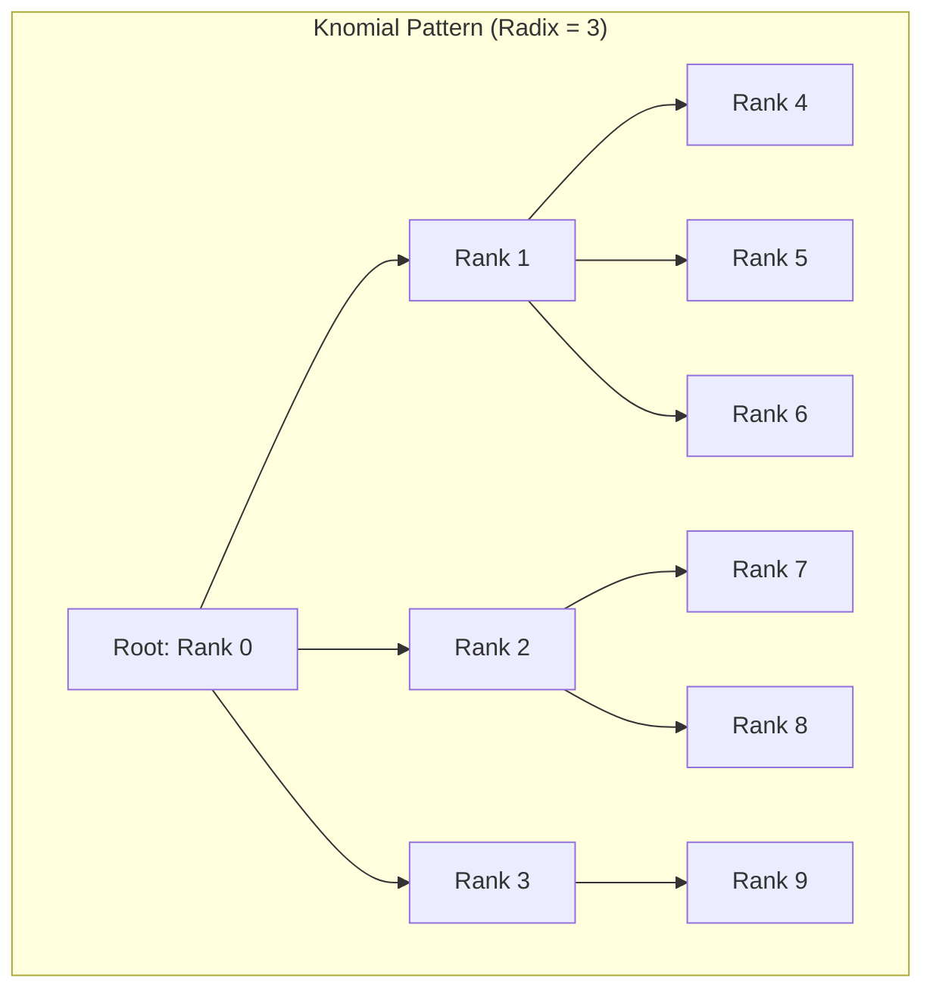
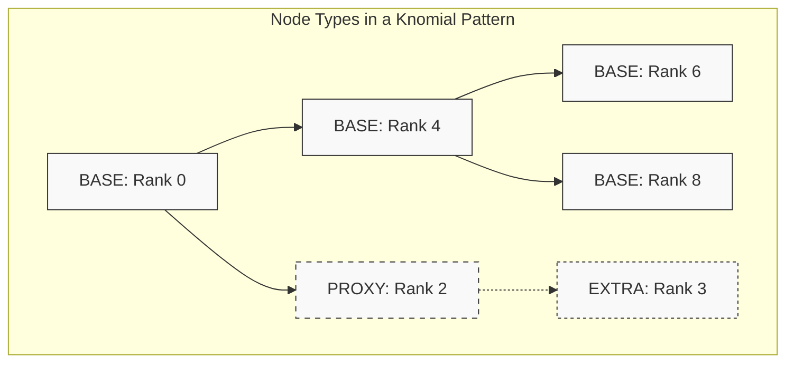
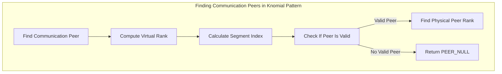
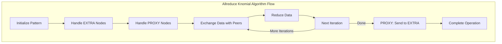
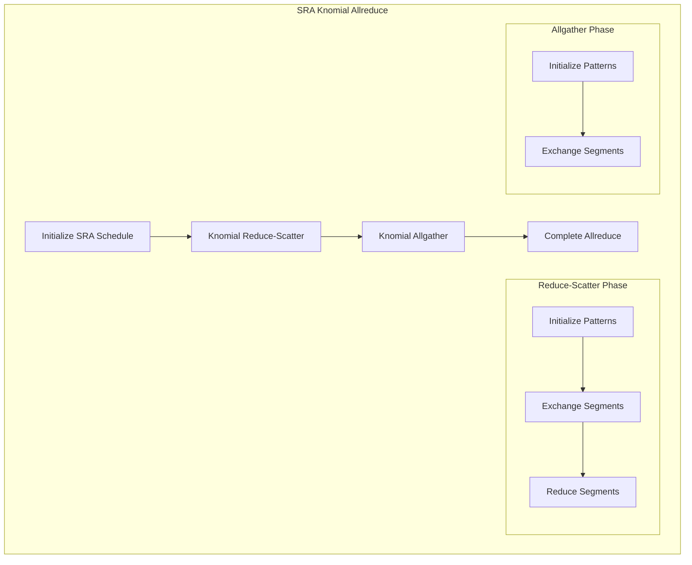
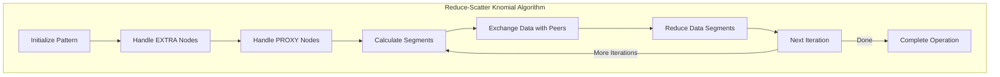
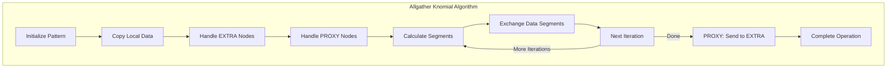
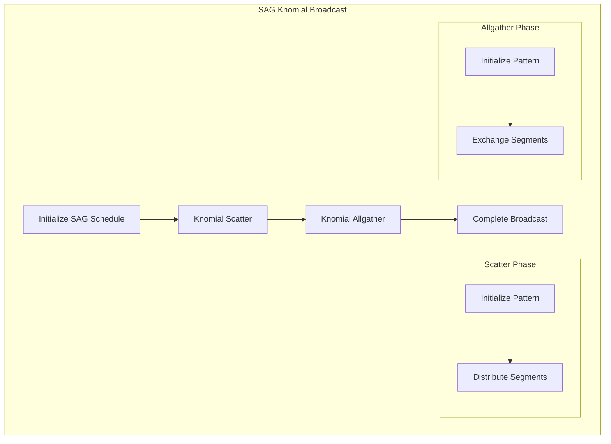
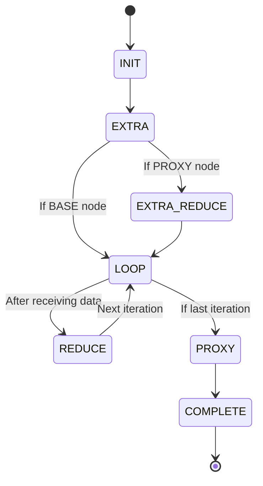
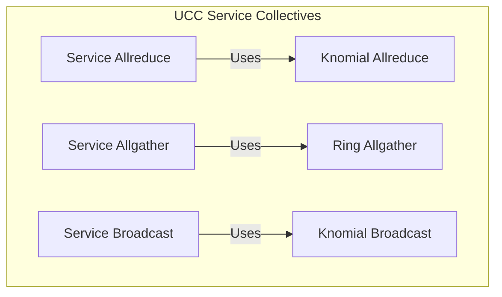

<!-- source: DeepWiki mcp.deepwiki.com · repo openucx/ucc · page 5.1 Knomial Algorithms · fetched 2026-11-11 -->

# Knomial Algorithms

<details>
<summary>Relevant source files</summary>

The following files were used as context for generating this wiki page:

- [src/coll_patterns/recursive_knomial.h](src/coll_patterns/recursive_knomial.h)
- [src/coll_patterns/sra_knomial.h](src/coll_patterns/sra_knomial.h)
- [src/components/tl/ucp/allgather/allgather_knomial.c](src/components/tl/ucp/allgather/allgather_knomial.c)
- [src/components/tl/ucp/allreduce/allreduce.c](src/components/tl/ucp/allreduce/allreduce.c)
- [src/components/tl/ucp/allreduce/allreduce.h](src/components/tl/ucp/allreduce/allreduce.h)
- [src/components/tl/ucp/allreduce/allreduce_knomial.c](src/components/tl/ucp/allreduce/allreduce_knomial.c)
- [src/components/tl/ucp/allreduce/allreduce_sra_knomial.c](src/components/tl/ucp/allreduce/allreduce_sra_knomial.c)
- [src/components/tl/ucp/bcast/bcast_sag_knomial.c](src/components/tl/ucp/bcast/bcast_sag_knomial.c)
- [src/components/tl/ucp/reduce_scatter/reduce_scatter_knomial.c](src/components/tl/ucp/reduce_scatter/reduce_scatter_knomial.c)
- [src/components/tl/ucp/scatter/scatter_knomial.c](src/components/tl/ucp/scatter/scatter_knomial.c)
- [src/components/tl/ucp/tl_ucp_service_coll.c](src/components/tl/ucp/tl_ucp_service_coll.c)

</details>


This document describes the k-nomial (knomial) algorithms used in UCC for efficient collective operations. Knomial algorithms are recursive tree-based algorithms that generalize binomial tree patterns to arbitrary radix values. They are primarily used for implementing latency-optimized and bandwidth-optimized collective operations like allreduce, reduce_scatter, allgather, and broadcast.

For topology-aware optimizations of these algorithms, see [Topology-Aware Algorithms](#5.2).

## Basic Concepts

Knomial algorithms use a recursive pattern to organize communication between processes, forming a k-way tree structure (where k is the radix). These algorithms divide ranks into different node types and implement efficient exchange patterns to optimize communication.

### Key Terms

- **Radix**: The branching factor (k) of the tree, representing the maximum number of children per node
- **Iteration**: Each step in the recursive algorithm
- **Node Types**: Classification of processes into BASE, PROXY, or EXTRA nodes
- **Segment**: A portion of the data buffer assigned to a process



Sources:
- [src/coll_patterns/recursive_knomial.h:10-57]()
- [src/coll_patterns/recursive_knomial.h:84-136]()

## Node Types and Tree Structure

The knomial algorithms classify nodes into three types:

1. **BASE nodes**: Participate in the main loop of the recursive knomial algorithm
2. **PROXY nodes**: Participate in the main loop and relay data to/from EXTRA nodes
3. **EXTRA nodes**: Only exchange data with their assigned PROXY nodes

When the number of ranks is not a power of the radix, the algorithm handles "extra" ranks efficiently by assigning them to proxy nodes.



Sources:
- [src/coll_patterns/recursive_knomial.h:13-17]()
- [src/coll_patterns/recursive_knomial.h:110-112]()

## Pattern Initialization and Iterations

The knomial pattern is initialized with the team size, rank, and radix. The algorithm then calculates the optimal communication strategy for all iterations.

Key pattern initialization properties:
- **radix**: The branching factor of the tree
- **size**: The total number of ranks
- **n_iters**: Number of iterations in the algorithm
- **n_extra**: Number of "extra" ranks to be served by "proxies"
- **node_type**: Type of the current rank (BASE, PROXY, or EXTRA)
- **iteration**: Current iteration in the algorithm execution

For each iteration, the algorithm determines:
1. Which ranks to communicate with
2. What segments of data to exchange
3. How to combine received data

```mermaid
sequenceDiagram
    participant App as Application
    participant Init as Pattern Initialization
    participant Loop as Iteration Loop
    participant Progress as Progress Engine
    
    App->>Init: Initialize with team size, rank, radix
    Init-->>App: Pattern created
    App->>Loop: Start algorithm
    
    Loop->>Progress: Run first iteration
    activate Progress
    Progress-->>Loop: Iteration complete
    deactivate Progress
    
    Loop->>Progress: Run second iteration
    activate Progress
    Progress-->>Loop: Iteration complete
    deactivate Progress
    
    Loop->>Loop: Process continues until all iterations complete
    
    Loop-->>App: Algorithm complete
```

Sources:
- [src/coll_patterns/recursive_knomial.h:84-136]()
- [src/coll_patterns/recursive_knomial.h:150-166]()

## Calculating Communication Peers

The algorithm determines communication peers for each iteration using segment indices and offsets. The key functions for calculating peers include:

- `ucc_knomial_pattern_get_loop_peer`: Determines the peer for a given rank and loop step
- `ucc_knomial_pattern_loop_rank`: Converts between virtual and physical ranks
- `ucc_kn_compute_seg_index`: Calculates segment index in the exchange group
- `ucc_sra_kn_compute_seg_size`: Computes the size of a segment
- `ucc_sra_kn_compute_seg_offset`: Computes the offset of a segment



Sources:
- [src/coll_patterns/recursive_knomial.h:182-197]()
- [src/coll_patterns/sra_knomial.h:27-67]()

## Allreduce Knomial Algorithm

The allreduce knomial algorithm implements a latency-optimized version of the allreduce collective operation using the knomial pattern.

Key characteristics:
- Optimized for small and medium-sized messages
- Direct communication between ranks in each iteration
- Combined reduce and broadcast operations in a recursive pattern

The implementation includes:
- `ucc_tl_ucp_allreduce_knomial_init_common`: Common initialization for the allreduce knomial algorithm
- `ucc_tl_ucp_allreduce_knomial_start`: Starts the allreduce operation
- `ucc_tl_ucp_allreduce_knomial_progress`: Progresses the operation through iterations
- `ucc_tl_ucp_allreduce_knomial_finalize`: Cleans up resources after completion



Sources:
- [src/components/tl/ucp/allreduce/allreduce_knomial.c:21-181]()
- [src/components/tl/ucp/allreduce/allreduce_knomial.c:183-212]()
- [src/components/tl/ucp/allreduce/allreduce.h:41-43]()

## SRA Knomial Algorithm for Allreduce

The SRA (Scatter-Reduce-Allgather) Knomial algorithm implements a bandwidth-optimized version of allreduce. It performs allreduce as a sequence of knomial reduce-scatter followed by knomial allgather.

Key characteristics:
- Optimized for large message sizes
- Extends the Rabenseifner SRA algorithm to support arbitrary radix
- Provides better bandwidth utilization compared to the basic knomial allreduce



Sources:
- [src/components/tl/ucp/allreduce/allreduce_sra_knomial.c:18-39]()
- [src/components/tl/ucp/allreduce/allreduce_sra_knomial.c:40-84]()
- [src/components/tl/ucp/allreduce/allreduce_sra_knomial.c:195-243]()

## Reduce-Scatter Knomial Algorithm

The reduce-scatter knomial algorithm implements the reduce-scatter collective operation using the knomial pattern.

Key aspects:
- Supports both regular and irregular distributions
- Handles different memory types
- Can be used as part of other algorithms (like SRA)

The algorithm's workflow:
1. Initialize the knomial pattern with backward iteration
2. Calculate segment sizes and offsets for each rank
3. Exchange and reduce data segments in each iteration
4. Final data distribution to all ranks



Sources:
- [src/components/tl/ucp/reduce_scatter/reduce_scatter_knomial.c:211-383]()
- [src/components/tl/ucp/reduce_scatter/reduce_scatter_knomial.c:479-565]()

## Allgather Knomial Algorithm

The allgather knomial algorithm implements the allgather collective operation using the knomial pattern.

Key aspects:
- Supports both regular and irregular distributions
- Handles different memory types
- Can be used independently or as part of other algorithms

The algorithm's workflow:
1. Initialize the knomial pattern
2. Calculate segments for each rank
3. Exchange data segments in each iteration
4. Final distribution to EXTRA nodes



Sources:
- [src/components/tl/ucp/allgather/allgather_knomial.c:56-197]()
- [src/components/tl/ucp/allgather/allgather_knomial.c:281-324]()

## Broadcast SAG Knomial Algorithm

The Broadcast SAG (Scatter-Allgather) Knomial algorithm implements a bandwidth-optimized version of broadcast. It performs broadcast as a sequence of knomial scatter followed by knomial allgather.

Key characteristics:
- Optimized for large message sizes
- Extends the traditional broadcast algorithms to support arbitrary radix
- Provides better bandwidth utilization for large messages



Sources:
- [src/components/tl/ucp/bcast/bcast_sag_knomial.c:19-38]()
- [src/components/tl/ucp/bcast/bcast_sag_knomial.c:39-142]()

## Implementation Details

### Pattern Structure

The `ucc_knomial_pattern_t` structure holds the state and parameters of a knomial pattern:

```
typedef struct ucc_knomial_pattern {
    ucc_kn_radix_t radix;         /* knomial tree radix */
    uint8_t        type;          /* pattern type */
    uint8_t        iteration;     /* current iteration */
    uint8_t        n_iters;       /* number of iterations in knomial algorithm */
    uint8_t        pow_radix_sup; /* smallest integer N such that (radix ** N) >= size */
    uint8_t        node_type;     /* type of current rank: BASE, PROXY or EXTRA */
    uint8_t        backward;      /* boolean, iteration direction */
    ucc_rank_t     radix_pow;     /* power of radix for current algorithm iteration */
    ucc_rank_t     full_pow_size; /* largest power of radix <= size */
    ucc_rank_t     size;          /* total number of ranks */
    ucc_rank_t     rank;          /* process rank */
    ucc_rank_t     n_extra;       /* number of "extra" ranks to be served by "proxies" */
    // Additional fields for specific algorithms
} ucc_knomial_pattern_t;
```

Sources:
- [src/coll_patterns/recursive_knomial.h:30-57]()

### Progress State Machine

Knomial algorithms in UCC use a state machine for non-blocking progress. The states include:

- `UCC_KN_PHASE_INIT`: Initial phase
- `UCC_KN_PHASE_LOOP`: Main exchange loop
- `UCC_KN_PHASE_REDUCE`: Reduction operation
- `UCC_KN_PHASE_EXTRA`: Handling EXTRA nodes
- `UCC_KN_PHASE_EXTRA_REDUCE`: Reducing data from EXTRA nodes
- `UCC_KN_PHASE_PROXY`: Handling PROXY nodes
- `UCC_KN_PHASE_COMPLETE`: Completion phase

The progress function can be interrupted and resumed at any phase, allowing for efficient non-blocking operation.



Sources:
- [src/coll_patterns/recursive_knomial.h:302-328]()
- [src/components/tl/ucp/allreduce/allreduce_knomial.c:16-19]()
- [src/components/tl/ucp/allreduce/allreduce_knomial.c:48-178]()

### Configuration and Performance Tuning

Knomial algorithms can be tuned through various parameters:

| Parameter | Description | Default |
|-----------|-------------|---------|
| `allreduce_kn_radix` | Radix for knomial allreduce | Varies by context |
| `allreduce_sra_kn_radix` | Radix for SRA knomial allreduce | Varies by context |
| `reduce_scatter_kn_radix` | Radix for knomial reduce-scatter | Varies by context |
| `allgather_kn_radix` | Radix for knomial allgather | Varies by context |
| `bcast_sag_kn_radix` | Radix for SAG knomial broadcast | Varies by context |

The selection of radix depends on factors like:
- Message size
- Number of ranks
- Memory type
- Hardware architecture

Larger radix values often provide better performance for larger messages, while smaller radix values are more efficient for small messages or large process counts.

Sources:
- [src/components/tl/ucp/allreduce/allreduce.h:23-24]()
- [src/components/tl/ucp/allreduce/allreduce_knomial.c:195-202]()
- [src/components/tl/ucp/reduce_scatter/reduce_scatter_knomial.c:561-562]()

## Usage in Service Collectives

Knomial algorithms are also used in UCC service collectives, which are internal operations required for UCC functionality:



Sources:
- [src/components/tl/ucp/tl_ucp_service_coll.c:74-139]()
- [src/components/tl/ucp/tl_ucp_service_coll.c:141-194]()
- [src/components/tl/ucp/tl_ucp_service_coll.c:196-240]()

## Summary

Knomial algorithms in UCC provide:
1. Efficient collective communication with configurable radix
2. Support for both latency-optimized and bandwidth-optimized variants
3. Handling of non-power-of-k team sizes with PROXY and EXTRA nodes
4. Non-blocking progress through a state machine approach
5. Support for various memory types and data distributions

These algorithms serve as the foundation for many collective operations in UCC, providing scalable performance across different message sizes and process counts.

---

