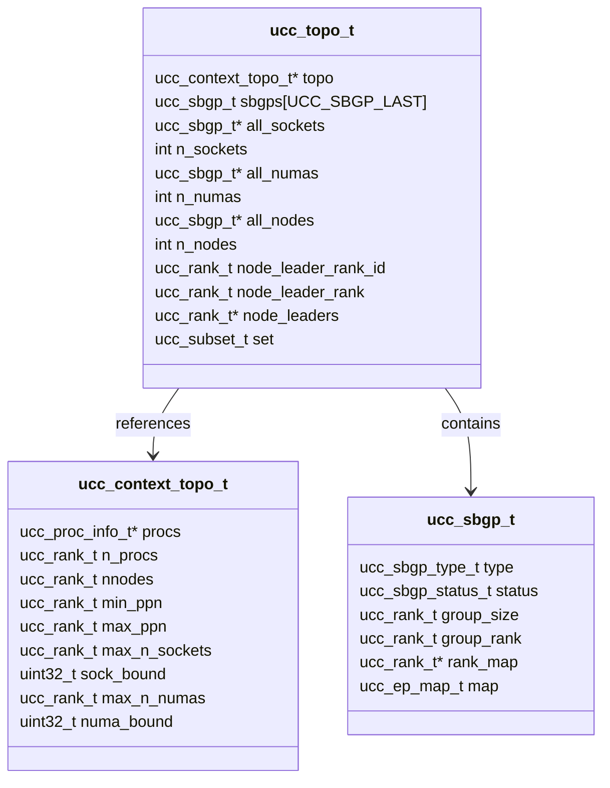
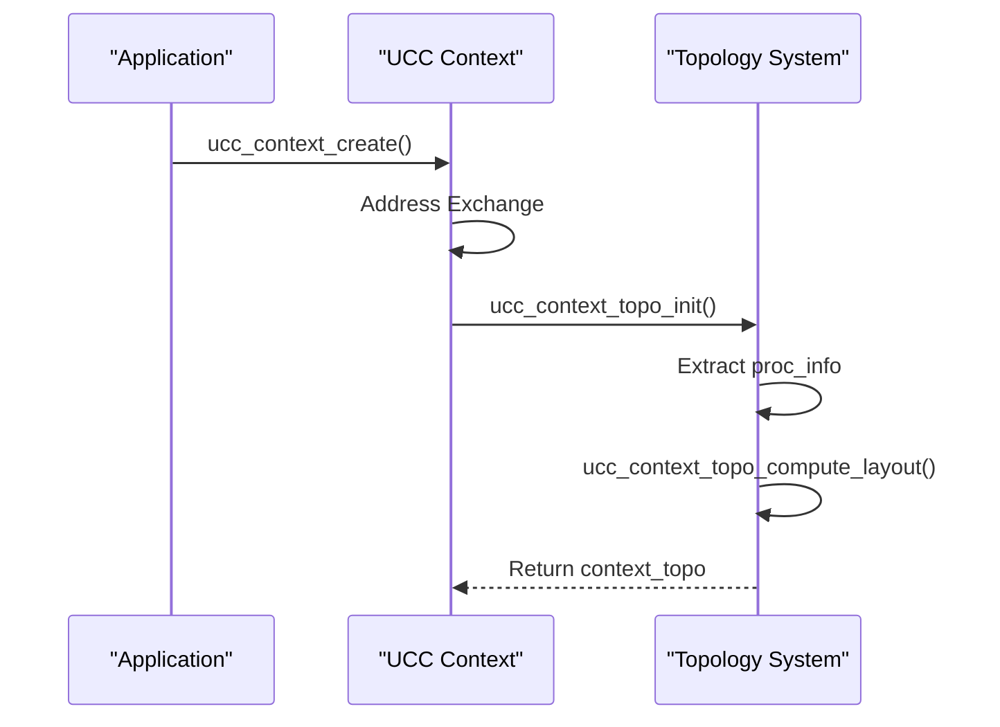
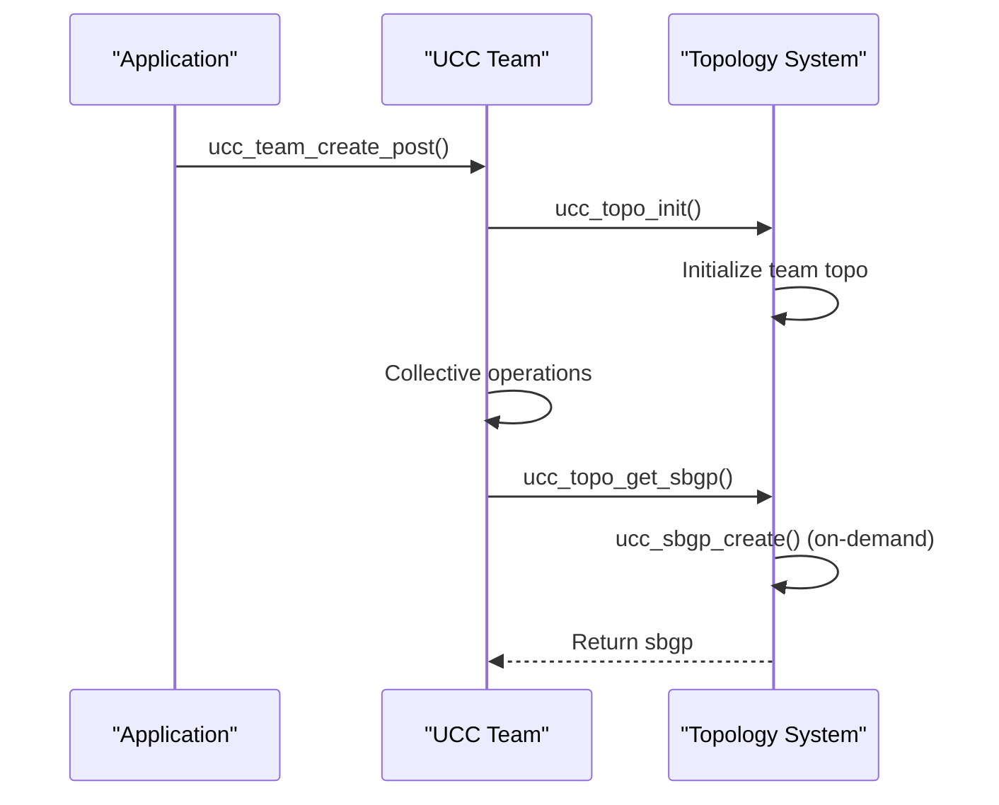
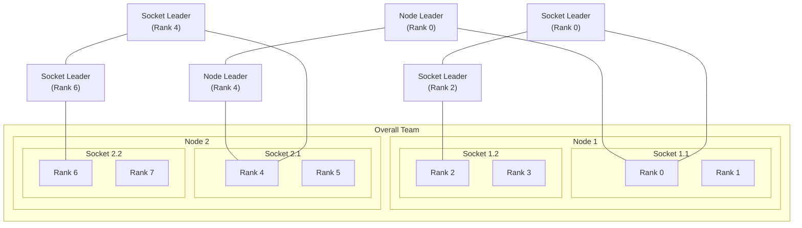
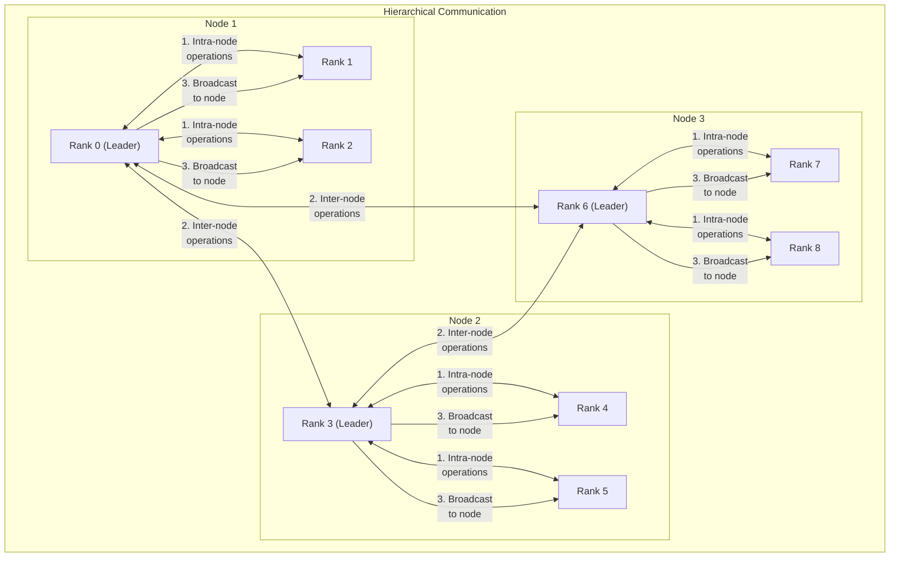
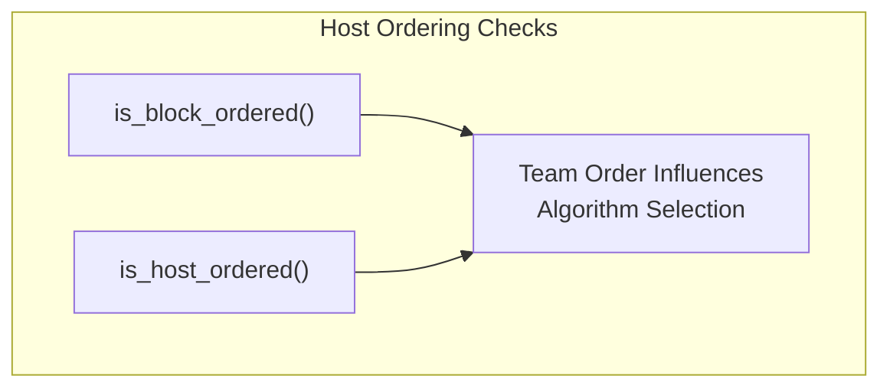
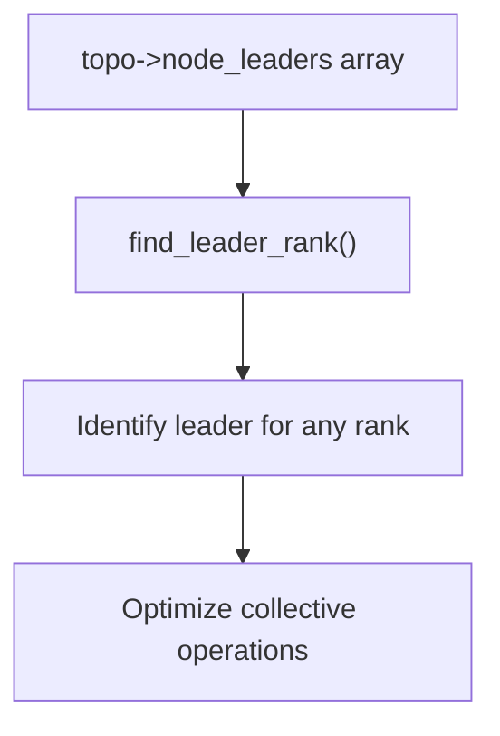
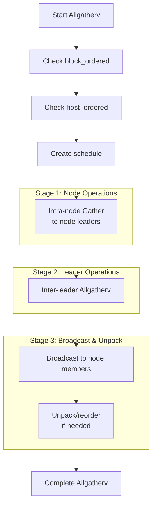

<!-- source: DeepWiki mcp.deepwiki.com · repo openucx/ucc · page 5.2 Topology-Aware Algorithms · fetched 2026-11-11 -->

# Topology-Aware Algorithms

Relevant source files

The following files were used as context for generating this wiki page:

- [src/components/cl/hier/allgatherv/allgatherv.c](src/components/cl/hier/allgatherv/allgatherv.c)
- [src/components/cl/hier/allgatherv/unpack.c](src/components/cl/hier/allgatherv/unpack.c)
- [src/components/topo/ucc_sbgp.c](src/components/topo/ucc_sbgp.c)
- [src/components/topo/ucc_sbgp.h](src/components/topo/ucc_sbgp.h)
- [src/components/topo/ucc_topo.c](src/components/topo/ucc_topo.c)
- [src/components/topo/ucc_topo.h](src/components/topo/ucc_topo.h)
- [test/gtest/core/test_topo.cc](test/gtest/core/test_topo.cc)

This page describes the topology awareness system in UCC and how collective algorithms utilize topology information to optimize performance. For information about specific algorithm implementations like Knomial algorithms, see [Knomial Algorithms](#5.1).

## Overview

Topology-aware algorithms in UCC optimize collective operations by leveraging the hierarchical structure of computing systems (nodes, sockets, NUMA domains). By understanding the physical layout of processes, these algorithms can minimize expensive network communication, prioritize shared memory transfers, and reduce overall latency.

The UCC topology system provides:
- Discovery and representation of hardware topology
- Creation of topology-based process subgroups
- Optimization of collective operations using topology information

Sources: [src/components/topo/ucc_topo.h:10-15]()

## Topology Representation

UCC represents topology information at two levels:

1. **Context-level topology** (`ucc_context_topo_t`): Captures global topology for all processes in a context
2. **Team-level topology** (`ucc_topo_t`): Represents topology for a subset of processes (like a team)

### Topology Data Structures

Sources: [src/components/topo/ucc_topo.h:16-75]()

### Subgroup Types

The topology system uses subgroups (sbgps) to represent different levels of the hardware hierarchy:

| Subgroup Type | Description | Creation Function |
|---------------|-------------|-------------------|
| `UCC_SBGP_NODE` | Processes on the same node | `ucc_sbgp_create_node` |
| `UCC_SBGP_SOCKET` | Processes on the same socket | Implicit in `ucc_sbgp_create` |
| `UCC_SBGP_NUMA` | Processes on the same NUMA domain | Implicit in `ucc_sbgp_create` |
| `UCC_SBGP_NODE_LEADERS` | One process from each node | Implicit in `ucc_sbgp_create` |
| `UCC_SBGP_SOCKET_LEADERS` | One process from each socket | Implicit in `ucc_sbgp_create` |
| `UCC_SBGP_NUMA_LEADERS` | One process from each NUMA domain | Implicit in `ucc_sbgp_create` |
| `UCC_SBGP_NET` | Processes with same local rank across nodes | Implicit in `ucc_sbgp_create` |
| `UCC_SBGP_FULL` | All processes in the team | Implicit in `ucc_sbgp_create` |
| `UCC_SBGP_FULL_HOST_ORDERED` | All processes ordered by host, socket, NUMA | Implicit in `ucc_sbgp_create` |

Sources: [src/components/topo/ucc_sbgp.h:11-40](), [src/components/topo/ucc_sbgp.c:543-603]()

## Topology Discovery and Initialization

### Context-Level Discovery

The context-level topology is initialized during context creation after address exchange. This consists of:

1. Collecting processor information (`ucc_proc_info_t`) from all processes
2. Computing layout information (nodes, processes per node)
3. Determining socket and NUMA binding

Sources: [src/components/topo/ucc_topo.c:103-153](), [src/components/topo/ucc_topo.c:31-101]()

### Team-Level Initialization

Team-level topology is initialized for a subset of processes (like a team):

1. Creating a team topology referring to the context topology
2. Initializing subgroups on-demand when needed
3. Computing team-specific topology properties

Sources: [src/components/topo/ucc_topo.c:163-192](), [src/components/topo/ucc_topo.c:235-244]()

## Hierarchical Process Organization

Topology-aware algorithms rely on a hierarchical organization of processes:

UCC creates various subgroups for different collective operations:

1. **Node subgroups**: Groups of processes on the same node
2. **Socket subgroups**: Groups of processes on the same socket
3. **NUMA subgroups**: Groups of processes on the same NUMA domain
4. **Leader subgroups**: Representatives from each node/socket/NUMA
5. **Network subgroups**: Processes with same local rank across nodes

Sources: [src/components/topo/ucc_sbgp.c:100-175](), [src/components/topo/ucc_sbgp.c:177-313]()

## Optimization Techniques

Topology-aware algorithms use several techniques to optimize collective operations:

### 1. Hierarchical Communication

Sources: [src/components/cl/hier/allgatherv/allgatherv.c:123-194]()

### 2. Block and Host Ordering

UCC checks if processes are arranged in a way that is conducive to efficient communication:

1. **Block Ordering**: Checks if ranks within nodes are contiguous
2. **Host Ordering**: Checks if node leader ranks are in ascending order

These properties allow more efficient operations with reduced reordering:

Sources: [src/components/cl/hier/allgatherv/allgatherv.c:67-121]()

### 3. Leader Selection and Management

Node leaders are carefully selected to optimize communication:

1. First process on each node by default (configurable via `node_leader_rank_id`)
2. Leaders are stored in a node_leaders array for efficient lookup
3. Used for inter-node communication

Sources: [src/components/cl/hier/allgatherv/allgatherv.c:45-65](), [src/components/topo/ucc_topo.c:380-450]()

## Example: Hierarchical Allgatherv

The hierarchical allgatherv algorithm demonstrates topology-aware optimization:

This algorithm:
1. First gathers data to node leaders using shared memory
2. Performs allgatherv among node leaders using network
3. Broadcasts results back to node members
4. Unpacks/reorders data if necessary

Sources: [src/components/cl/hier/allgatherv/allgatherv.c:123-419](), [src/components/cl/hier/allgatherv/unpack.c:1-205]()

## Performance Considerations

Topology-aware algorithms offer several benefits:

1. **Reduced network traffic**: By minimizing inter-node communication
2. **Improved scalability**: By leveraging hierarchical communication patterns
3. **Better locality**: By respecting hardware topology boundaries

However, they have some considerations:

1. **Overhead**: Discovery and management of topology information adds overhead
2. **Complexity**: More complex implementation compared to flat algorithms
3. **Binding sensitivity**: Performance depends on process binding to hardware

### When to Use Topology-Aware Algorithms

Topology-aware algorithms are most beneficial when:

- Running on multiple nodes with high inter-node communication costs
- Process binding is consistent and matches hardware topology
- The collective operation involves significant data exchange
- The application has regular communication patterns

Sources: [src/components/topo/ucc_topo.c:245-256](), [src/components/topo/ucc_topo.h:115-148]()

---

