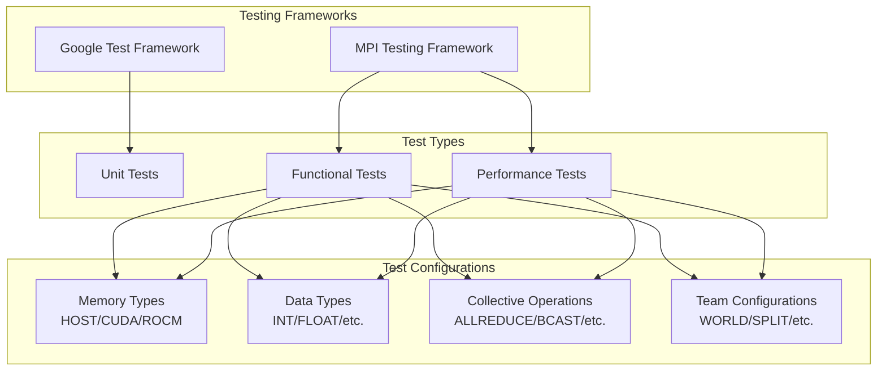
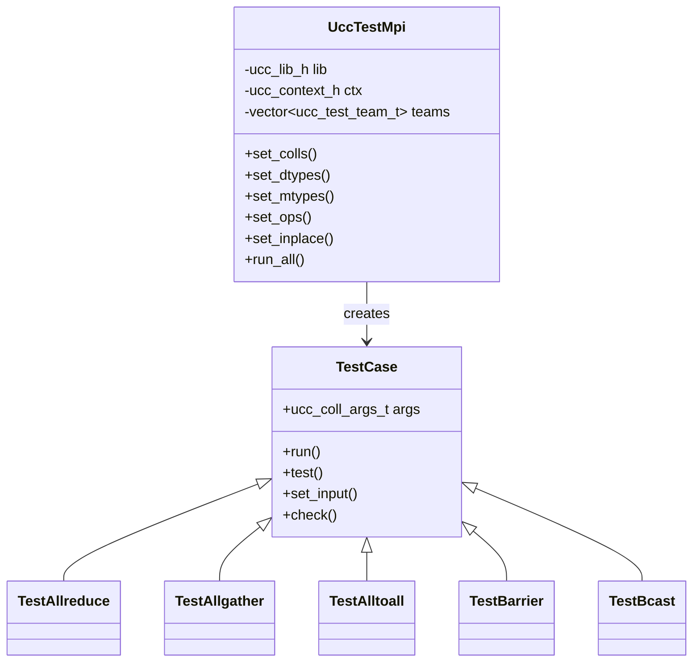
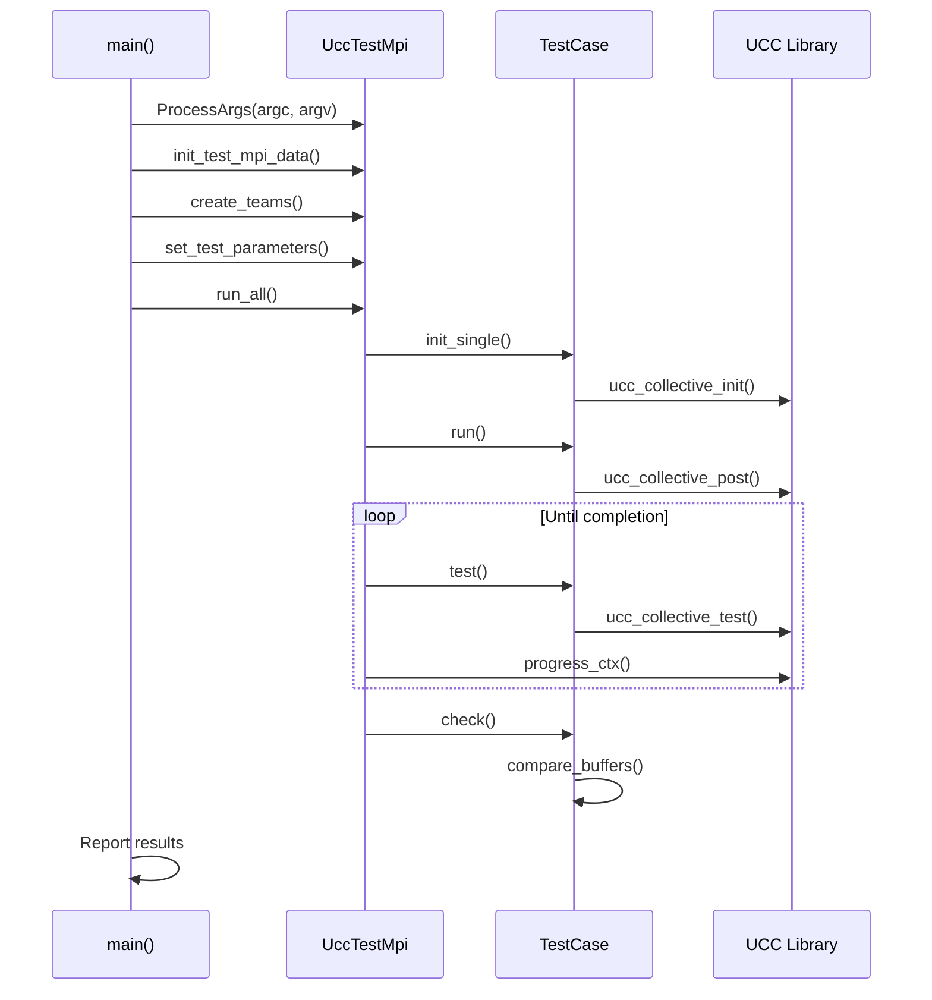
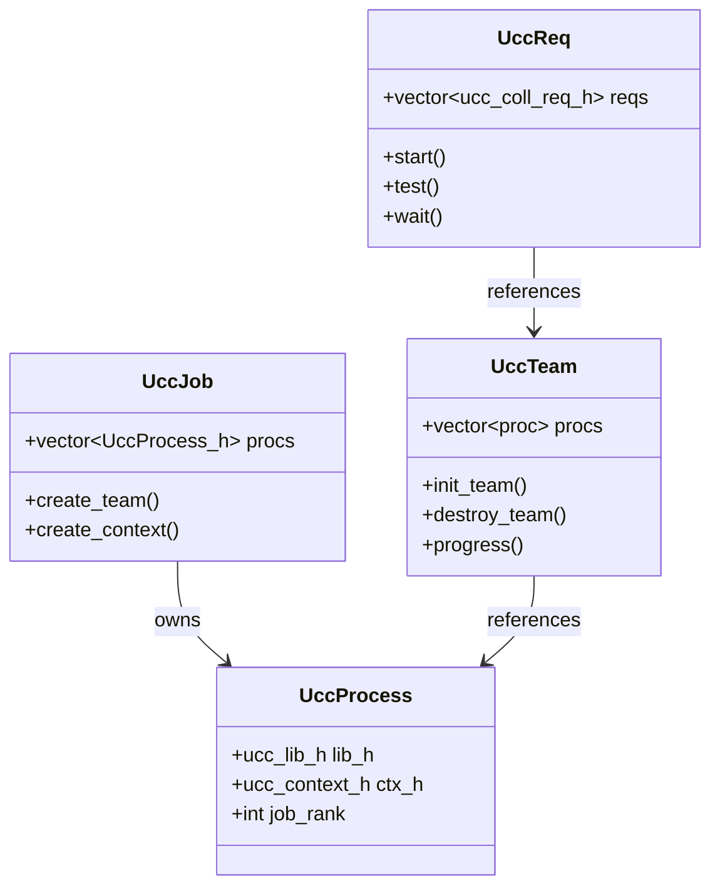

<!-- source: DeepWiki mcp.deepwiki.com · repo openucx/ucc · page 6 Testing Framework · fetched 2026-11-11 -->

# Testing Framework

<details>
<summary>Relevant source files</summary>

The following files were used as context for generating this wiki page:

- [test/gtest/Makefile.am](test/gtest/Makefile.am)
- [test/gtest/common/test.h](test/gtest/common/test.h)
- [test/gtest/common/test_ucc.cc](test/gtest/common/test_ucc.cc)
- [test/gtest/common/test_ucc.h](test/gtest/common/test_ucc.h)
- [test/gtest/core/test_team.cc](test/gtest/core/test_team.cc)
- [test/mpi/Makefile.am](test/mpi/Makefile.am)
- [test/mpi/buffer.cc](test/mpi/buffer.cc)
- [test/mpi/main.cc](test/mpi/main.cc)
- [test/mpi/test_allgather.cc](test/mpi/test_allgather.cc)
- [test/mpi/test_allgatherv.cc](test/mpi/test_allgatherv.cc)
- [test/mpi/test_allreduce.cc](test/mpi/test_allreduce.cc)
- [test/mpi/test_alltoall.cc](test/mpi/test_alltoall.cc)
- [test/mpi/test_alltoallv.cc](test/mpi/test_alltoallv.cc)
- [test/mpi/test_barrier.cc](test/mpi/test_barrier.cc)
- [test/mpi/test_bcast.cc](test/mpi/test_bcast.cc)
- [test/mpi/test_case.cc](test/mpi/test_case.cc)
- [test/mpi/test_mpi.cc](test/mpi/test_mpi.cc)
- [test/mpi/test_mpi.h](test/mpi/test_mpi.h)

</details>


This document provides an overview of the UCC (Unified Collective Communication) testing framework. It describes the architecture, components, and usage of the testing infrastructure used to validate UCC functionality.

UCC employs two complementary testing frameworks:
1. **MPI-based Testing Framework** - For real-world performance and functionality testing across multiple nodes and processes
2. **Google Test-based Framework** - For unit testing individual components

For information about specific collective algorithms, see [Collective Algorithms](#5).

## Architecture Overview



Sources: [test/mpi/test_mpi.h](), [test/gtest/common/test_ucc.h]()

## MPI Testing Framework

The MPI testing framework provides a comprehensive environment for testing UCC collective operations across multiple processes. It uses MPI to initialize and coordinate the test infrastructure.

### Core Components



Sources: [test/mpi/test_mpi.h:289-387](), [test/mpi/test_case.cc:9-226]()

The MPI testing framework is structured around two primary classes:

1. **UccTestMpi**: The main controller class that:
   - Initializes the UCC library and context
   - Creates team configurations
   - Configures test parameters (collectives, data types, memory types, etc.)
   - Executes test cases
   
2. **TestCase**: Abstract base class for all collective operation tests that:
   - Implements common test functionality
   - Provides virtual methods for specific test implementations
   - Handles resource allocation and cleanup

### Test Execution Flow



Sources: [test/mpi/main.cc:574-771](), [test/mpi/test_mpi.cc:477-535]()

### Collective Test Implementation

Each collective operation has a dedicated test class derived from TestCase, which implements the specific test logic:

- **TestAllgather**: Tests the allgather collective operation
- **TestAllreduce**: Tests the allreduce collective operation
- **TestBarrier**: Tests the barrier collective operation
- **TestBcast**: Tests the broadcast collective operation
- **TestAlltoall**: Tests the alltoall collective operation
- etc.

Each test implementation provides:
- Data initialization logic specific to the collective
- Result validation specific to the collective
- Test parameter handling

Sources: [test/mpi/test_allgather.cc](), [test/mpi/test_allreduce.cc](), [test/mpi/test_barrier.cc](), [test/mpi/test_bcast.cc](), [test/mpi/test_alltoall.cc]()

### Command Line Interface

The MPI testing framework provides an extensive command-line interface for configuring test parameters:

| Option | Description | Example |
|--------|-------------|---------|
| `-c, --colls` | List of collectives to test | `--colls=allreduce,bcast` |
| `-t, --teams` | Team configurations | `--teams=world,half` |
| `-M, --mtypes` | Memory types | `--mtypes=host,cuda` |
| `-d, --dtypes` | Data types | `--dtypes=int32,float32` |
| `-o, --ops` | Reduction operations | `--ops=sum,max` |
| `-m, --msgsize` | Message size range | `--msgsize=8:1048576:8` |
| `-I, --inplace` | Inplace mode | `--inplace=1` |
| `-P, --persistent` | Persistent mode | `--persistent=0` |
| `-i, --iter` | Test iterations | `--iter=10` |

Sources: [test/mpi/main.cc:87-111](), [test/mpi/main.cc:464-572]()

### Running MPI Tests

To run the MPI tests:

1. Build UCC with MPI test support
2. Execute the `ucc_test_mpi` binary with appropriate MPI launcher and test parameters

Example:
```
mpirun -np 4 ./ucc_test_mpi --colls=allreduce,bcast --teams=world --mtypes=host --dtypes=float32 --ops=sum --msgsize=8:1024:2
```

A test report is generated at the end of the execution, showing the number of tests passed, failed, and skipped for each collective operation.

Sources: [test/mpi/main.cc:714-752]()

## Google Test Framework

The Google Test framework provides unit testing capabilities for UCC components. It simulates a UCC environment within a single process using threads to mimic multiple processes.

### Core Components



Sources: [test/gtest/common/test_ucc.h:123-247](), [test/gtest/common/test_ucc.cc:14-578]()

The Google Test framework consists of several key classes:

1. **UccProcess**: Represents a single UCC process with its own library handle and context
2. **UccTeam**: Represents a team of UCC processes
3. **UccJob**: Provides an environment with multiple UCC processes
4. **UccReq**: Represents a collective request

These classes work together to simulate a multi-process UCC environment within a single process, enabling unit testing of UCC components.

### Test Implementation

Tests are implemented using the Google Test framework, with:

- **Test Fixtures**: Base classes that set up the test environment
- **Test Cases**: Individual test scenarios that exercise specific functionality
- **Test Parameters**: To test different configurations

Example test implementations include:

- Core component tests (context, team, library)
- Transport layer tests
- Collective algorithm tests
- Utility function tests

Sources: [test/gtest/core/test_team.cc](), [test/gtest/Makefile.am:67-110]()

### Running Google Tests

To run the Google Tests:

1. Build UCC with Google Test support
2. Execute the `gtest` binary with appropriate test filters and parameters

Example:
```
./gtest --gtest_filter=test_team.*
```

Additional targets are provided in the Makefile:

- `make test`: Run all tests
- `make test_gdb`: Run tests under GDB
- `make test_valgrind`: Run tests under Valgrind

Sources: [test/gtest/Makefile.am:188-206]()

## Test Coverage

The testing framework provides comprehensive coverage of UCC functionality:

| Component | Test Approach | Framework |
|-----------|---------------|-----------|
| Library Initialization | Unit Tests | Google Test |
| Context Management | Unit Tests | Google Test |
| Team Creation | Unit Tests | Google Test |
| Collective Operations | Functional Tests | MPI |
| Memory Management | Unit Tests | Google Test |
| Topology Management | Unit Tests | Google Test |
| Transport Layers | Unit & Functional Tests | Both |
| Configuration System | Unit Tests | Google Test |

Sources: [test/gtest/Makefile.am:67-110](), [test/mpi/Makefile.am:12-31]()

## Extending the Testing Framework

### Adding New Collective Tests

To add a new collective test to the MPI testing framework:

1. Create a new class derived from `TestCase`
2. Implement the required virtual methods:
   - `set_input()`: Initialize test data
   - `check()`: Validate test results
3. Add the new test class to `TestCase::init_single()` in [test/mpi/test_case.cc]()
4. Update the collective list in [test/mpi/main.cc]()

Sources: [test/mpi/test_case.cc:27-65]()

### Adding New Unit Tests

To add new unit tests using the Google Test framework:

1. Create a new test file in the appropriate directory
2. Define test fixtures and test cases using the Google Test macros
3. Add the new file to the `gtest_SOURCES` list in [test/gtest/Makefile.am]()

Sources: [test/gtest/Makefile.am:67-110]()

## Summary

The UCC testing framework provides a comprehensive testing environment that combines:

1. MPI-based tests for real-world functionality testing across multiple processes
2. Google Test-based unit tests for component-level testing

This dual approach ensures thorough validation of UCC functionality at both the component level and system level, helping maintain reliability and performance of the UCC library.

---

