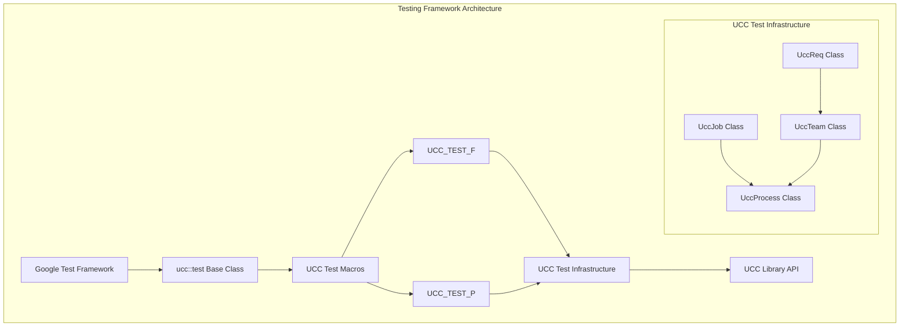
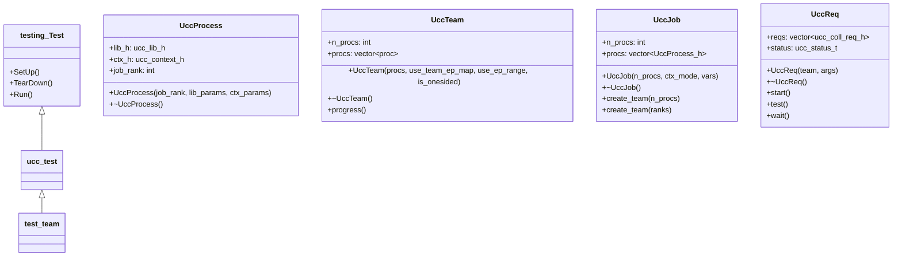
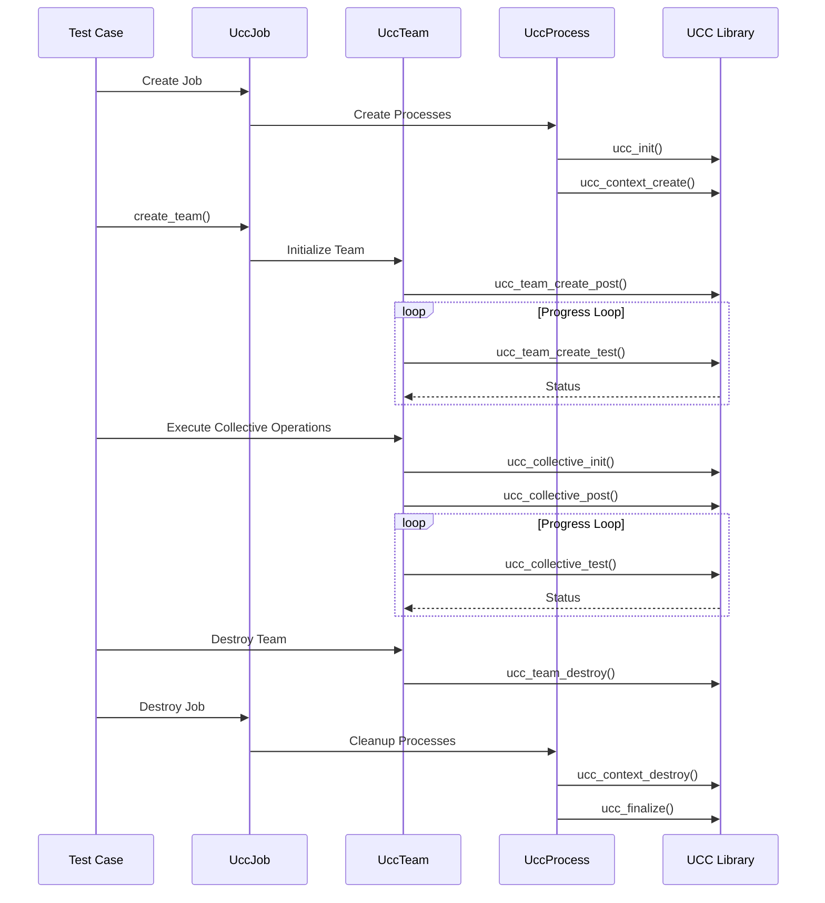

<!-- source: DeepWiki mcp.deepwiki.com · repo openucx/ucc · page 6.1 Google Test Framework · fetched 2026-11-11 -->

# Google Test Framework

<details>
<summary>Relevant source files</summary>

The following files were used as context for generating this wiki page:

- [test/gtest/Makefile.am](test/gtest/Makefile.am)
- [test/gtest/common/test.h](test/gtest/common/test.h)
- [test/gtest/common/test_ucc.cc](test/gtest/common/test_ucc.cc)
- [test/gtest/common/test_ucc.h](test/gtest/common/test_ucc.h)
- [test/gtest/core/test_team.cc](test/gtest/core/test_team.cc)

</details>


This document describes the Google Test framework implementation in UCC (Unified Collective Communication), explaining how tests are organized, structured, and executed. The testing infrastructure allows for comprehensive verification of UCC components, from low-level utilities to complex collective operations.

## Overview

UCC uses Google Test (gtest), a popular C++ testing framework, to implement its unit testing capabilities. The framework is extended with UCC-specific utilities that facilitate testing distributed operations across multiple processes and teams.



Sources: [test/gtest/common/test.h:1-30](), [test/gtest/common/test_ucc.h:1-273]()

## Test Organization and Structure

### Directory Structure

The tests are organized in the `test/gtest` directory with subdirectories for different UCC components:

- `common/` - Contains common test utilities and base classes
- `core/` - Tests for core UCC components (library, context, team, etc.)
- `coll/` - Tests for collective operations (allreduce, allgather, etc.)
- `utils/` - Tests for utility functions
- `tl/` - Tests for transport layers (UCP, NCCL, SHARP, MLX5)

### Test File Structure

Each test file typically defines one or more test classes that extend from `ucc::test` (which itself extends `testing::Test` from Google Test). Tests are implemented using either simple fixtures (`UCC_TEST_F`) or parameterized tests (`UCC_TEST_P`).



Sources: [test/gtest/common/test.h:23-30](), [test/gtest/core/test_team.cc:12-14](), [test/gtest/common/test_ucc.h:119-247]()

## UCC Testing Infrastructure

The UCC testing infrastructure provides several key classes that help set up and run tests:

### UccProcess

Represents a single process in a UCC job. It initializes a UCC library and context, providing the foundation for testing UCC operations.

```cpp
UccProcess(int _job_rank, 
           const ucc_lib_params_t &lib_params = default_lib_params,
           const ucc_context_params_t &cp = default_ctx_params);
```

The `UccProcess` constructor initializes a UCC library instance and creates a context for testing purposes. Each process is assigned a unique rank within the job.

### UccTeam

Represents a team of UCC processes. It handles team creation, destruction, and provides utilities for team-based operations.

```cpp
UccTeam(std::vector<UccProcess_h> &_procs, 
        bool use_team_ep_map = false,
        bool use_ep_range = true, 
        bool is_onesided = false);
```

The `UccTeam` class creates a team from a vector of UCC processes, establishes communication between team members, and provides methods for team progress and collective operations.

### UccJob

Represents a collection of UCC processes that can form multiple teams. It provides methods for creating teams of different sizes and configurations.

```cpp
UccJob(int _n_procs = 2, 
       ucc_job_ctx_mode_t _ctx_mode = UCC_JOB_CTX_GLOBAL,
       ucc_job_env_t vars = ucc_job_env_t());
```

The `UccJob` constructor creates a specified number of UCC processes and initializes them with the given context mode and environment variables.

### UccReq

Wraps UCC collective requests, providing methods for starting, testing, and waiting for operations to complete.

```cpp
UccReq(UccTeam_h _team, ucc_coll_args_t *args);
UccReq(UccTeam_h _team, UccCollCtxVec args);
```

The `UccReq` class initializes collective operations for each process in a team and provides methods to start, test, and wait for their completion.

Sources: [test/gtest/common/test_ucc.h:120-147](), [test/gtest/common/test_ucc.h:152-191](), [test/gtest/common/test_ucc.h:197-224](), [test/gtest/common/test_ucc.h:226-247]()

## Test Execution Flow

A typical UCC test follows this execution flow:



Sources: [test/gtest/common/test_ucc.cc:14-49](), [test/gtest/common/test_ucc.cc:253-272](), [test/gtest/common/test_ucc.cc:580-673]()

## Building and Running Tests

The UCC test framework provides several ways to build and run tests:

### Building Tests

Tests are built using the standard build system. When configured with Google Test support, the build system creates a `gtest` executable that contains all the test cases.

```bash
make gtest
```

### Running Tests

#### Regular Test Execution

Tests can be run using the `make test` command:

```bash
make test
```

Specific tests can be selected using the `GTEST_FILTER` environment variable:

```bash
GTEST_FILTER="test_team.*" make test
```

#### Debugging Tests

Tests can be run with a debugger using the `make test_gdb` command:

```bash
make test_gdb
```

#### Memory Testing

Tests can be run with Valgrind for memory leak detection:

```bash
make test_valgrind
```

Sources: [test/gtest/Makefile.am:14-21](), [test/gtest/Makefile.am:187-191](), [test/gtest/Makefile.am:195-202](), [test/gtest/Makefile.am:204-206]()

## Writing UCC Tests

### Creating Test Fixtures

Test fixtures are used when the same setup is needed for multiple test cases. They are defined using the `UCC_TEST_F` macro:

```cpp
class test_team : public ucc::test {
};

UCC_TEST_F(test_team, team_create_destroy_ctx_local)
{
    int team_size = 4;
    UccJob job(8, UccJob::UCC_JOB_CTX_LOCAL);
    UccTeam_h team = job.create_team(team_size);
    // Test assertions go here
}
```

### Parameterized Tests

Parameterized tests allow running the same test code with different parameters. They are defined using the `UCC_TEST_P` macro:

```cpp
class test_team : public ucc::test, public::testing::WithParamInterface<int> {
};

UCC_TEST_P(test_team, team_create_destroy_ctx_global)
{
    int team_size = GetParam();
    UccTeam_h team = UccJob::getStaticJob()->create_team(team_size);
    // Test assertions go here
}

INSTANTIATE_TEST_CASE_P(, test_team,
                        ::testing::Values(1, 2, 8, 7));
```

### Common Testing Patterns

Common patterns used in UCC tests include:

1. **Creating and destroying teams of different sizes**:
   ```cpp
   UccTeam_h team = UccJob::getStaticJob()->create_team(team_size);
   ```

2. **Testing team creation with different context modes**:
   ```cpp
   UccJob job(8, UccJob::UCC_JOB_CTX_LOCAL);
   UccTeam_h team = job.create_team(team_size);
   ```

3. **Testing collective operations**:
   ```cpp
   UccReq req(team, &coll_args);
   req.start();
   req.wait();
   ```

4. **Accessing specific team members for verification**:
   ```cpp
   ucc_team_h team = teams[i].get()->procs[test_rank].team;
   ```

Sources: [test/gtest/core/test_team.cc:27-37](), [test/gtest/core/test_team.cc:16-25](), [test/gtest/core/test_team.cc:39-45]()

## Testing Components

The UCC test framework includes tests for various components:

| Component Type | Test Files | Description |
|----------------|------------|-------------|
| Core Components | `core/test_lib.cc`<br>`core/test_context.cc`<br>`core/test_team.cc` | Tests for UCC library initialization, context creation, and team management |
| Collective Operations | `coll/test_barrier.cc`<br>`coll/test_allreduce.cc`<br>`coll/test_bcast.cc`<br>etc. | Tests for various collective operations |
| Transport Layers | `tl/tl_test.cc`<br>`tl/mlx5/test_tl_mlx5.cc` | Tests for transport layer components |
| Utilities | `utils/test_string.cc`<br>`utils/test_math.cc`<br>etc. | Tests for utility functions |

Sources: [test/gtest/Makefile.am:67-110]()

## Static Job and Teams

The UCC test framework provides static job and team instances for convenience:

```cpp
UccJob* UccJob::getStaticJob()
{
    if (!staticUccJob) {
        staticUccJob = new UccJob(UccJob::staticUccJobSize);
    }
    return staticUccJob;
}

const std::vector<UccTeam_h> &UccJob::getStaticTeams()
{
    // Creates and returns static teams of predefined sizes
}
```

These static instances are useful for tests that don't need to create custom jobs or teams.

Sources: [test/gtest/common/test_ucc.cc:512-547]()

## Configuration and Environment

Tests can be configured through various environment variables:

```
UCC_HANDLE_ERRORS        ?= freeze
UCC_LOG_LEVEL            ?= warn
UCC_LOG_PRINT_ENABLE     ?= y
GTEST_FILTER             ?= *
GTEST_EXTRA_ARGS         ?=
```

These variables control error handling, logging, and test filtering.

Sources: [test/gtest/Makefile.am:15-19]()

## Conclusion

The Google Test framework in UCC provides a comprehensive environment for testing UCC components at various levels. It extends the standard Google Test framework with UCC-specific classes and utilities that facilitate testing of distributed operations. The framework allows for flexible test configuration, debugging, and memory testing to ensure the reliability and correctness of the UCC implementation.

---

