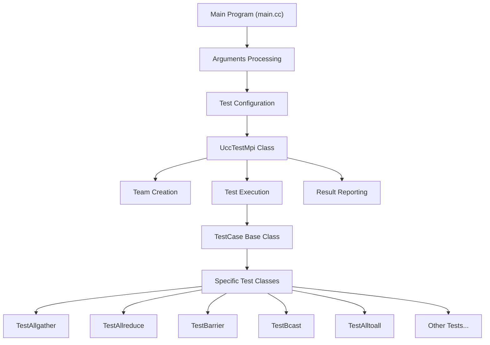
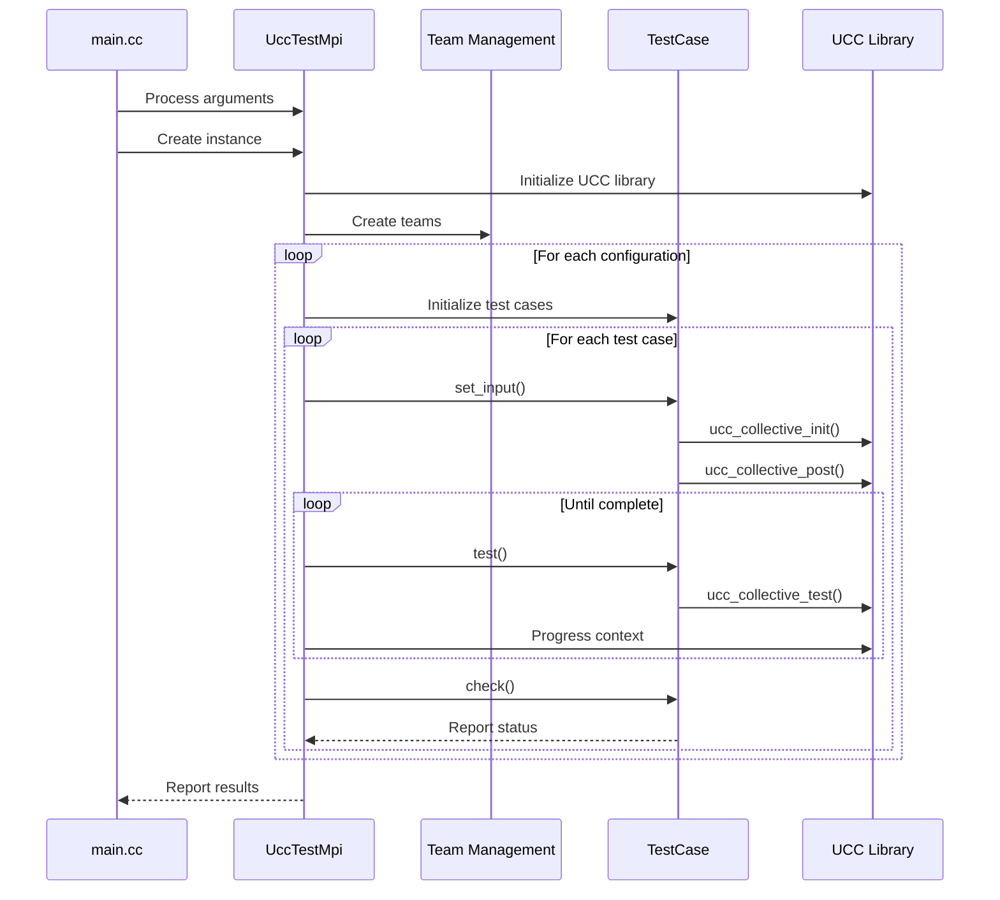
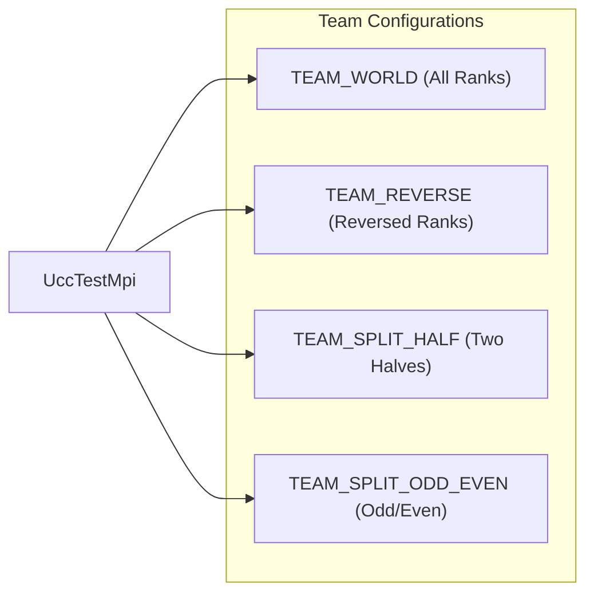
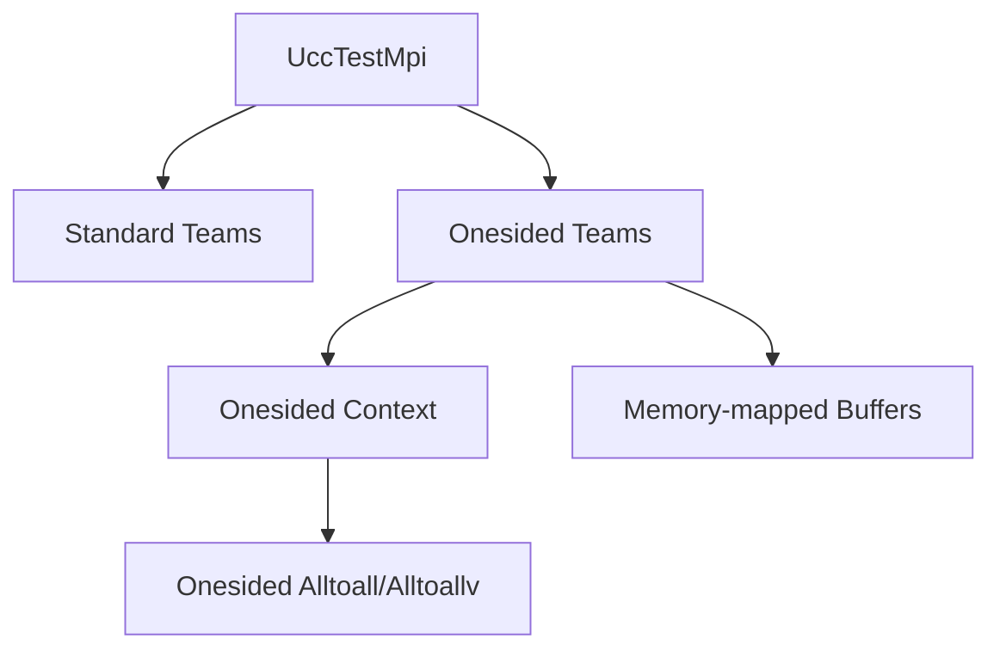

<!-- source: DeepWiki mcp.deepwiki.com · repo openucx/ucc · page 6.2 MPI Testing · fetched 2026-11-11 -->

# MPI Testing

<details>
<summary>Relevant source files</summary>

The following files were used as context for generating this wiki page:

- [test/mpi/Makefile.am](test/mpi/Makefile.am)
- [test/mpi/buffer.cc](test/mpi/buffer.cc)
- [test/mpi/main.cc](test/mpi/main.cc)
- [test/mpi/test_allgather.cc](test/mpi/test_allgather.cc)
- [test/mpi/test_allgatherv.cc](test/mpi/test_allgatherv.cc)
- [test/mpi/test_allreduce.cc](test/mpi/test_allreduce.cc)
- [test/mpi/test_alltoall.cc](test/mpi/test_alltoall.cc)
- [test/mpi/test_alltoallv.cc](test/mpi/test_alltoallv.cc)
- [test/mpi/test_barrier.cc](test/mpi/test_barrier.cc)
- [test/mpi/test_bcast.cc](test/mpi/test_bcast.cc)
- [test/mpi/test_case.cc](test/mpi/test_case.cc)
- [test/mpi/test_mpi.cc](test/mpi/test_mpi.cc)
- [test/mpi/test_mpi.h](test/mpi/test_mpi.h)

</details>


This document explains the MPI-based testing framework used in UCC (Unified Collective Communication) to validate and ensure proper functionality of collective communication operations. The framework provides a comprehensive set of tests that verify UCC operations across different hardware, memory types, and communication patterns.

For information about Google Test-based unit testing, see [Google Test Framework](#6.1).

## Overview

The MPI testing framework in UCC is designed to test all supported collective operations across various configurations. It uses MPI as the underlying framework to launch and coordinate tests across multiple processes, ensuring that UCC collective operations work correctly in distributed environments.

The framework allows testing of:
- All supported collective operations (Allreduce, Allgather, Barrier, etc.)
- Various data types (int8/16/32/64, float32/64, etc.)
- Different memory types (Host, CUDA, ROCm)
- Various message sizes
- Different team formations
- In-place and non-in-place operations
- Persistent and non-persistent operations
- Triggered operations
- Onesided operations

Sources: [test/mpi/main.cc:15-63](), [test/mpi/test_mpi.h:96-128]()

## Architecture

The MPI testing framework consists of several key components working together to provide comprehensive testing capabilities.

### Architecture Diagram



Sources: [test/mpi/main.cc:574-771](), [test/mpi/test_mpi.cc:41-132](), [test/mpi/test_case.cc:9-65]()

### Key Components

1. **Main Program**: Processes command-line arguments, initializes MPI, and orchestrates the overall test execution.

2. **UccTestMpi Class**: The main class that manages test configurations, creates teams, and executes tests.

3. **TestCase Class**: Base class for all specific test implementations, providing common functionality like initialization, execution, and result checking.

4. **Specific Test Classes**: Implementations for each collective operation (TestAllgather, TestAllreduce, etc.).

5. **Team Management**: Creates and manages different team configurations for testing.

Sources: [test/mpi/test_mpi.h:307-387](), [test/mpi/test_mpi.cc:41-132](), [test/mpi/test_case.cc:9-65]()

## Test Execution Flow

The testing framework follows a specific execution flow to ensure comprehensive testing of UCC collective operations.



Sources: [test/mpi/main.cc:574-771](), [test/mpi/test_mpi.cc:477-535](), [test/mpi/test_mpi.cc:537-690]()

## Test Configuration

The testing framework is highly configurable, allowing for comprehensive testing of various aspects of the UCC library.

### Command-line Options

The testing framework supports numerous command-line options to configure the tests. Some key options include:

| Option | Description |
|--------|-------------|
| `-c, --colls` | Specify which collective operations to test |
| `-t, --teams` | Specify which team configurations to test |
| `-M, --mtypes` | Specify which memory types to test |
| `-d, --dtypes` | Specify which data types to test |
| `-o, --ops` | Specify which reduction operations to test |
| `-m, --msgsize` | Specify message size range to test |
| `-I, --inplace` | Enable/disable in-place operations |
| `-P, --persistent` | Enable/disable persistent operations |
| `-r, --root` | Configure root selection for rooted operations |
| `-i, --iter` | Set number of iterations for each test |
| `-T, --thread-multiple` | Enable multi-threaded testing |
| `-v, --verbose` | Enable verbose logging |
| `--triggered` | Enable triggered operations |

Sources: [test/mpi/main.cc:86-111](), [test/mpi/main.cc:464-494]()

### Configurable Test Parameters

The framework provides flexibility to test multiple combinations of:

1. **Collective Operations**: Barrier, Allreduce, Allgather, Bcast, etc.
2. **Team Configurations**: World, Reverse, Split-Half, Odd-Even
3. **Memory Types**: Host, CUDA, ROCm, etc.
4. **Data Types**: INT8/16/32/64, FLOAT32/64, etc.
5. **Operation Types**: SUM, MAX, MIN, etc.
6. **Message Sizes**: Configurable range
7. **In-place Operations**: Yes/No
8. **Persistent Operations**: Yes/No
9. **Triggered Operations**: Yes/No

Sources: [test/mpi/main.cc:19-63](), [test/mpi/test_mpi.cc:134-161]()

## Test Case Implementation

Each collective operation has a dedicated test class derived from the `TestCase` base class.

### TestCase Base Class

The `TestCase` class provides:
1. Common initialization and execution logic
2. Memory management
3. Result verification
4. Progress tracking

Sources: [test/mpi/test_mpi.h:262-305](), [test/mpi/test_case.cc:174-225]()

### Specific Test Classes

Each test class implements:
1. `set_input()`: Initializes test data
2. `check()`: Verifies test results
3. `str()`: Provides a string representation of the test

The test classes include:
- `TestAllgather`: Tests the Allgather operation
- `TestAllreduce`: Tests the Allreduce operation
- `TestBarrier`: Tests the Barrier operation
- `TestBcast`: Tests the Broadcast operation
- And many more...

Sources: [test/mpi/test_mpi.h:389-527](), [test/mpi/test_allgather.cc:10-85](), [test/mpi/test_allreduce.cc:10-106]()

## Team Management

The framework supports testing with different team configurations to ensure UCC works correctly across various process groupings.

### Supported Team Configurations

1. **TEAM_WORLD**: All processes
2. **TEAM_REVERSE**: Processes in reverse order
3. **TEAM_SPLIT_HALF**: Split into two groups
4. **TEAM_SPLIT_ODD_EVEN**: Odd and even ranks grouped separately



Sources: [test/mpi/test_mpi.h:102-107](), [test/mpi/test_mpi.cc:144-161](), [test/mpi/test_mpi.cc:229-242]()

### Team Creation Process

1. The `create_teams()` method creates the requested team configurations
2. For each team configuration, `create_team()` creates both MPI communicator and UCC team
3. The `create_ucc_team()` method initializes a UCC team using the MPI communicator

Sources: [test/mpi/test_mpi.cc:182-227](), [test/mpi/test_mpi.cc:229-242]()

## Collective Operations Testing

The framework supports testing all collective operations implemented in UCC.

### Supported Collective Operations

The framework can test all UCC collective operations:

| Collective | Description | Test Class |
|------------|-------------|------------|
| Barrier | Synchronization barrier | TestBarrier |
| Allreduce | Reduce and distribute results | TestAllreduce |
| Allgather | Gather and distribute data | TestAllgather |
| Allgatherv | Variable-size gather and distribute | TestAllgatherv |
| Bcast | Broadcast from root | TestBcast |
| Alltoall | All-to-all exchange | TestAlltoall |
| Alltoallv | Variable-size all-to-all | TestAlltoallv |
| Reduce | Reduction to root | TestReduce |
| Reduce_scatter | Reduce and scatter results | TestReduceScatter |
| Reduce_scatterv | Variable-size reduce-scatter | TestReduceScatterv |
| Gather | Gather to root | TestGather |
| Gatherv | Variable-size gather | TestGatherv |
| Scatter | Scatter from root | TestScatter |
| Scatterv | Variable-size scatter | TestScatterv |

Sources: [test/mpi/main.cc:19-26](), [test/mpi/test_case.cc:27-65]()

### Testing Matrix

The framework tests operations across various combinations of:
- Data types
- Memory types
- Message sizes
- Team configurations
- In-place/out-of-place operations
- Persistent/non-persistent operations
- Triggered/non-triggered operations

Sources: [test/mpi/test_mpi.cc:537-690]()

## Advanced Features

The framework supports testing several advanced features of UCC.

### In-place Operations

Tests can be configured to use in-place operations, where the input and output buffers are the same.

Sources: [test/mpi/test_mpi.cc:321-334](), [test/mpi/main.cc:54](), [test/mpi/main.cc:309-326]()

### Persistent Operations

The framework can test persistent operations, where a collective operation is initialized once and executed multiple times.

Sources: [test/mpi/test_mpi.cc:358-365](), [test/mpi/main.cc:55](), [test/mpi/main.cc:328-345]()

### Triggered Operations

Tests can be configured to use triggered operations, where collective operations are started based on events.

Sources: [test/mpi/test_mpi.cc:362-365](), [test/mpi/main.cc:56](), [test/mpi/main.cc:347-364](), [test/mpi/test_case.cc:67-93]()

### Onesided Operations

The framework supports testing onesided operations, which use memory-mapped buffers.



Sources: [test/mpi/test_mpi.cc:72-112](), [test/mpi/test_alltoall.cc:20-67](), [test/mpi/test_alltoallv.cc:22-180]()

## Running Tests and Reporting

The framework provides detailed reporting of test results.

### Test Execution

Tests are executed for all configured combinations, with progress monitoring and result verification.

Sources: [test/mpi/main.cc:649-681](), [test/mpi/test_mpi.cc:662-690]()

### Result Reporting

After all tests are completed, a comprehensive report is generated showing:
1. Number of tests executed
2. Number of tests passed
3. Number of tests failed
4. Number of tests skipped
5. Breakdown by collective operation
6. Total execution time

```
===== UCC MPI TEST REPORT =====
collective             tests    passed    failed   skipped
barrier                  xxx       xxx       xxx       xxx
allreduce                xxx       xxx       xxx       xxx
...

===== UCC MPI TEST SUMMARY =====
total tests:  xxx
passed:       xxx
skipped:      xxx
failed:       xxx
elapsed:      xxxs
```

Sources: [test/mpi/main.cc:706-763]()

## Usage Examples

### Basic Usage

To run all tests with default settings:

```bash
mpirun -np 4 ./ucc_test_mpi
```

### Testing Specific Collectives

To test only Allreduce and Barrier:

```bash
mpirun -np 4 ./ucc_test_mpi -c allreduce,barrier
```

### Testing with Specific Data Types

To test with INT32 and FLOAT64:

```bash
mpirun -np 4 ./ucc_test_mpi -d int32,float64
```

### Testing Message Size Range

To test message sizes from 8 bytes to 8MB:

```bash
mpirun -np 4 ./ucc_test_mpi -m 8:8388608:8
```

### Testing In-place Operations

To test in-place operations:

```bash
mpirun -np 4 ./ucc_test_mpi -I 1
```

### Testing Persistent Operations

To test persistent operations:

```bash
mpirun -np 4 ./ucc_test_mpi -P 1
```

Sources: [test/mpi/main.cc:86-111](), [test/mpi/main.cc:464-572]()

## Extending the Framework

To extend the framework with new collective operation tests:

1. Create a new test class derived from `TestCase`
2. Implement the required methods: `set_input()`, `check()`, etc.
3. Add the new test class to the `init_single()` method in `test_case.cc`

Sources: [test/mpi/test_case.cc:27-65](), [test/mpi/test_mpi.h:389-527]()

---

