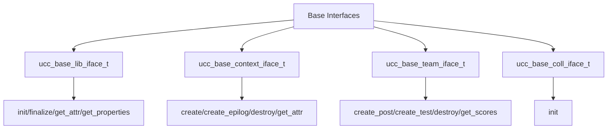
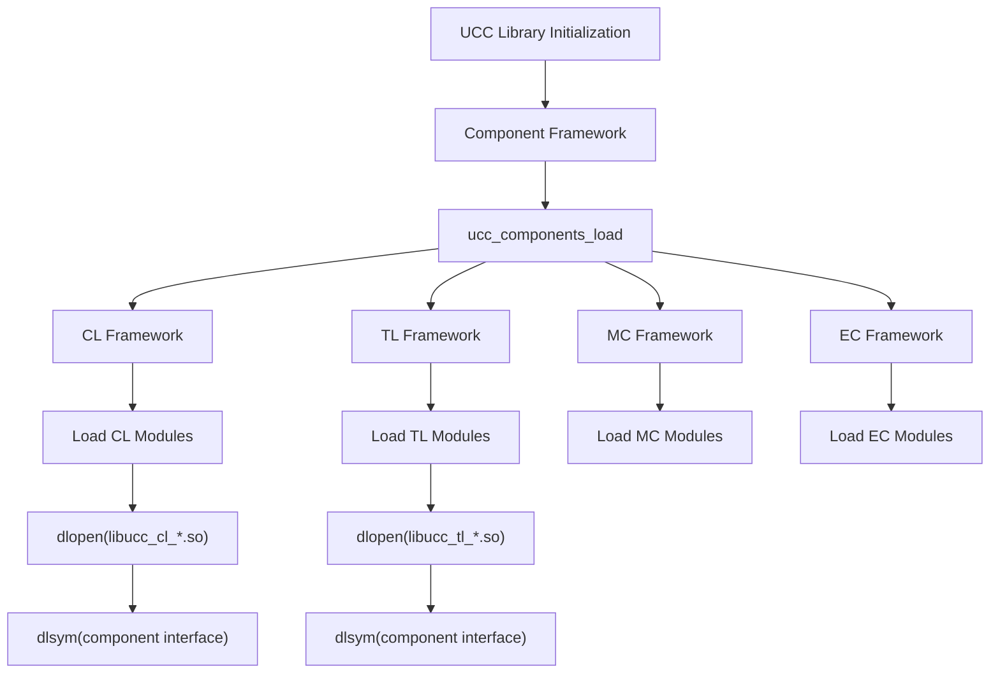
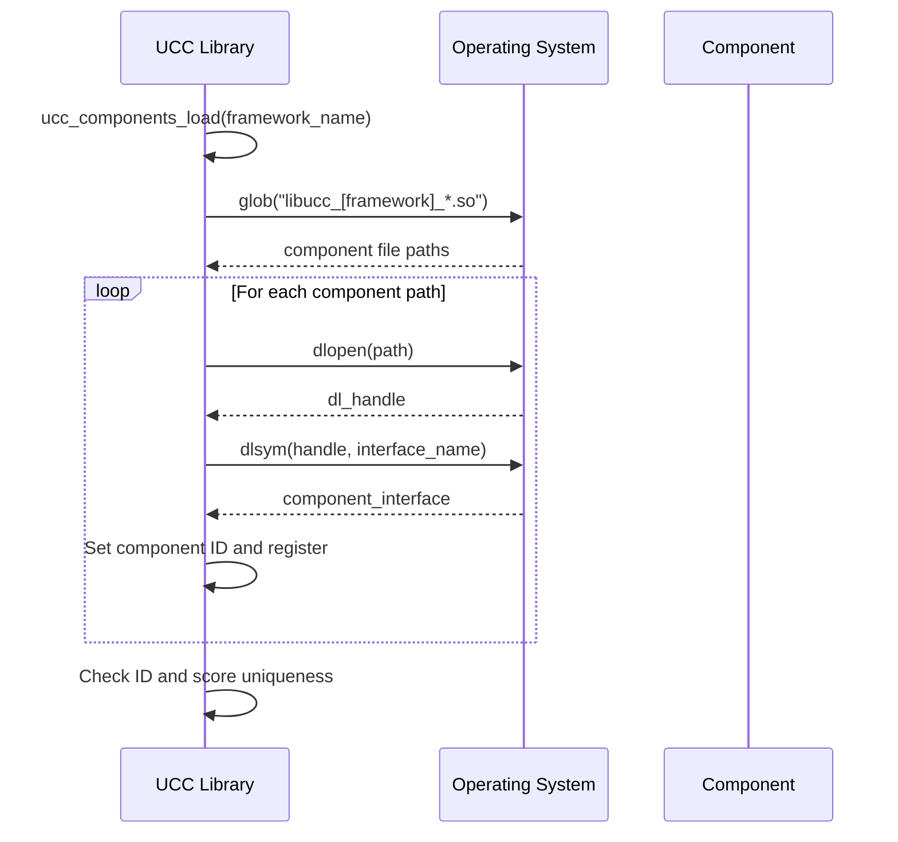
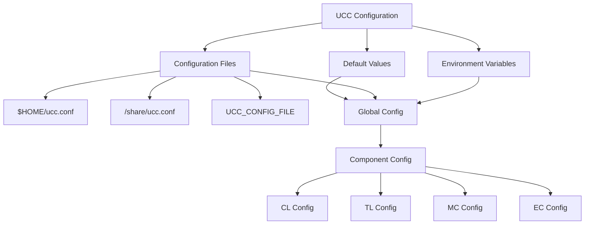
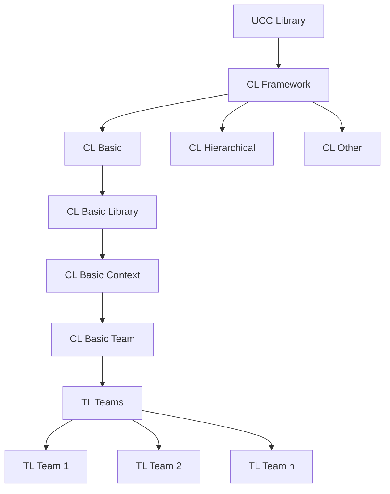
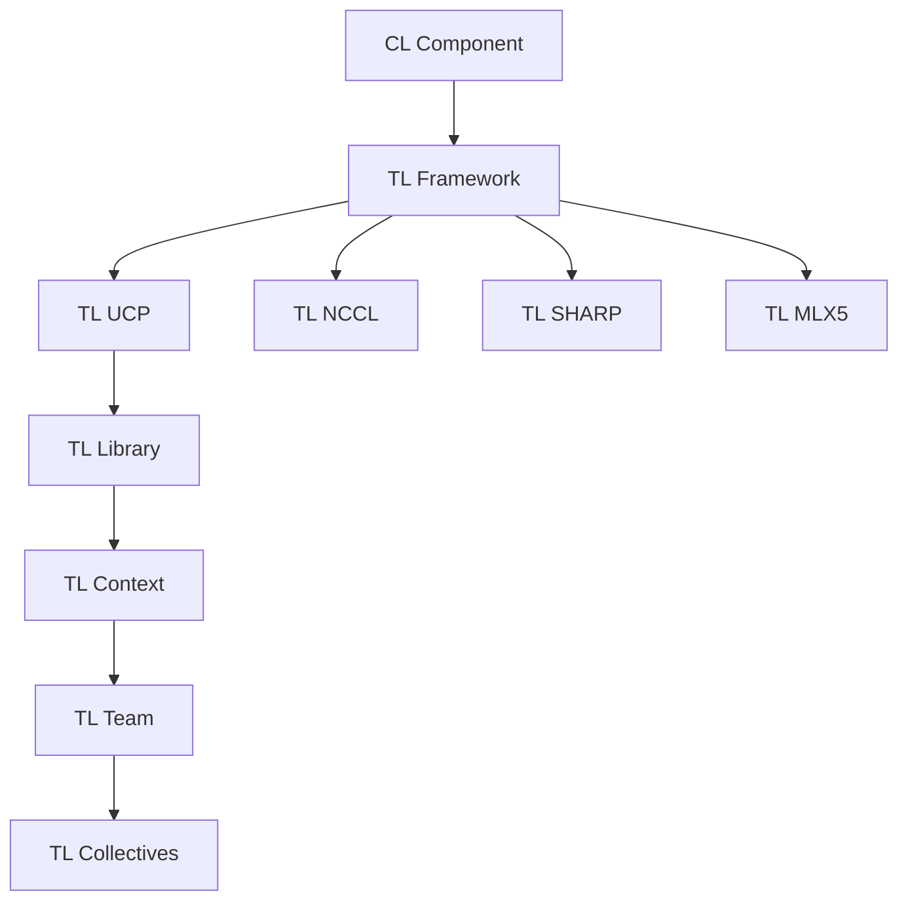

<!-- source: DeepWiki mcp.deepwiki.com · repo openucx/ucc · page 7 Supporting Components · fetched 2026-11-11 -->

# Supporting Components

<details>
<summary>Relevant source files</summary>

The following files were used as context for generating this wiki page:

- [src/components/base/ucc_base_iface.h](src/components/base/ucc_base_iface.h)
- [src/components/cl/basic/cl_basic.c](src/components/cl/basic/cl_basic.c)
- [src/components/cl/basic/cl_basic.h](src/components/cl/basic/cl_basic.h)
- [src/components/cl/basic/cl_basic_context.c](src/components/cl/basic/cl_basic_context.c)
- [src/components/cl/basic/cl_basic_lib.c](src/components/cl/basic/cl_basic_lib.c)
- [src/components/cl/basic/cl_basic_team.c](src/components/cl/basic/cl_basic_team.c)
- [src/components/cl/ucc_cl.c](src/components/cl/ucc_cl.c)
- [src/components/cl/ucc_cl.h](src/components/cl/ucc_cl.h)
- [src/components/tl/ucc_tl.c](src/components/tl/ucc_tl.c)
- [src/components/tl/ucc_tl.h](src/components/tl/ucc_tl.h)
- [src/core/ucc_constructor.c](src/core/ucc_constructor.c)
- [src/core/ucc_global_opts.c](src/core/ucc_global_opts.c)
- [src/core/ucc_global_opts.h](src/core/ucc_global_opts.h)
- [src/utils/ucc_compiler_def.h](src/utils/ucc_compiler_def.h)
- [src/utils/ucc_component.c](src/utils/ucc_component.c)
- [src/utils/ucc_component.h](src/utils/ucc_component.h)
- [src/utils/ucc_log.h](src/utils/ucc_log.h)
- [test/gtest/common/test_obj_size.cc](test/gtest/common/test_obj_size.cc)
- [test/gtest/utils/test_cfg_file.cc](test/gtest/utils/test_cfg_file.cc)

</details>


This document describes the foundational elements that support the Unified Collective Communication (UCC) framework. These components provide the infrastructure that enables the modular architecture of UCC, allowing different collective layers and transport layers to interact seamlessly. For information about specific implementations of Collective Layers, see [Core Components](#2), and for Transport Layers, see [Transport Layers](#3).

## Base Interfaces

The base interfaces in UCC define common structures and functions that specific components must implement. These interfaces provide a consistent pattern for all components, enabling the modularity of the UCC framework.

### Base Interface Hierarchy



Sources: [src/components/base/ucc_base_iface.h:81-194]()

### Key Base Structures

The UCC framework defines several core base structures:

| Structure | Description | Key Fields |
|-----------|-------------|------------|
| `ucc_base_lib_t` | Base library component | `log_component`, `use_tuning`, `min_team_size` |
| `ucc_base_context_t` | Base context component | `ucc_context`, `lib`, `score_str` |
| `ucc_base_team_t` | Base team component | `context`, `params` |
| `ucc_base_coll_args_t` | Base collective arguments | `mask`, `args`, `team`, `max_frag_count` |

These structures are extended by Collective Layer (CL) and Transport Layer (TL) components to provide specific functionality.

Sources: [src/components/base/ucc_base_iface.h:25-30](), [src/components/base/ucc_base_iface.h:100-104](), [src/components/base/ucc_base_iface.h:148-151](), [src/components/base/ucc_base_iface.h:179-186]()

### Interface Declaration Pattern

UCC uses a consistent macro-based pattern for declaring component interfaces:

```c
#define UCC_BASE_IFACE_DECLARE(_F, _f, _name, _NAME)                           \
    ucc_##_f##_name##_iface_t ucc_##_f##_name = {                              \
        UCC_IFACE_CFG(_F, _f, lib, _name, _NAME),                              \
        UCC_IFACE_CFG(_F, _f, context, _name, _NAME),                          \
        .super.super.score = UCC_##_F##_NAME##_DEFAULT_SCORE,                  \
        .super.super.name  = UCC_PP_MAKE_STRING(_name),                        \
        .super.lib.init    = UCC_CLASS_NEW_FUNC_NAME(ucc_##_f##_name##_lib_t), \
        /* ... additional interface functions ... */                           \
    };
```

This macro is specialized for different component types:
- `UCC_CL_IFACE_DECLARE` for Collective Layer components
- `UCC_TL_IFACE_DECLARE` for Transport Layer components

Sources: [src/components/base/ucc_base_iface.h:212-249](), [src/components/cl/ucc_cl.h:103-109](), [src/components/tl/ucc_tl.h:103-104]()

## Component Framework

The Component Framework manages the discovery, loading, and initialization of UCC components. It provides the foundation for UCC's extensible architecture.

### Component Framework Architecture



Sources: [src/core/ucc_constructor.c:99-197](), [src/utils/ucc_component.c:113-207]()

### Component Interface Structure

Each component implements the `ucc_component_iface_t` interface:

```c
typedef struct ucc_component_iface {
    const char    *name;      // Component name
    unsigned long  id;        // Unique identifier (hash of name)
    void          *dl_handle; // Handle to dynamically loaded library
    ucc_score_t    score;     // Component's default score
} ucc_component_iface_t;
```

The component ID is a hash of its name, ensuring uniqueness. Components are ranked by score, with higher-scored components preferred when multiple options are available.

Sources: [src/utils/ucc_component.h:17-22](), [src/utils/ucc_component.c:71]()

### Component Loading Process

The component loading process follows these steps:

1. Search for shared libraries matching patterns like `libucc_cl_*.so` in the component path
2. Load each library using `dlopen`
3. Get the component interface structure using `dlsym`
4. Verify component ID and score uniqueness
5. Register the component with the framework



Sources: [src/utils/ucc_component.c:25-80](), [src/utils/ucc_component.c:99-111]()

## Configuration System

The Configuration System manages UCC settings through environment variables, configuration files, and default values.

### Configuration Sources



Sources: [src/core/ucc_constructor.c:20-67](), [src/core/ucc_global_opts.h:16-40]()

### Global Configuration

The global configuration is defined in `ucc_global_config_t` and includes settings for:

- Logging levels and components
- Component paths
- Profiling options
- Configuration file handling

```c
typedef struct ucc_global_config {
    ucc_log_component_config_t log_component;
    ucc_log_component_config_t coll_trace;
    ucc_component_framework_t  cl_framework;
    ucc_component_framework_t  tl_framework;
    ucc_component_framework_t  mc_framework;
    ucc_component_framework_t  ec_framework;
    char *component_path;
    char *install_path;
    int   initialized;
    uint64_t profile_mode;
    char *profile_file;
    size_t profile_log_size;
    char *cfg_filename;
    ucc_file_config_t *file_cfg;
} ucc_global_config_t;
```

Sources: [src/core/ucc_global_opts.h:16-40](), [src/core/ucc_global_opts.c:14-23]()

### Configuration Tables

UCC uses configuration tables to define and parse configuration options. Each component defines its own table structure:

```c
ucc_config_field_t ucc_cl_lib_config_table[] = {
    {"", "", NULL, ucc_offsetof(ucc_cl_lib_config_t, super),
     UCC_CONFIG_TYPE_TABLE(ucc_base_lib_config_table)},
    
    {"TLS", "all", "List of TLs used by a given CL component...",
     ucc_offsetof(ucc_cl_lib_config_t, tls),
     UCC_CONFIG_TYPE_ALLOW_LIST},
    
    {NULL}
};
```

These tables define the options' names, default values, documentation, memory offset, and type.

Sources: [src/components/cl/ucc_cl.c:12-23](), [src/components/tl/ucc_tl.c:12-17]()

### Configuration Precedence

Configuration values follow a precedence order:
1. Environment variables (highest priority)
2. Configuration files
3. Default values (lowest priority)

This allows for flexible configuration at different levels while maintaining sensible defaults.

Sources: [test/gtest/utils/test_cfg_file.cc:101-114]()

## Component Framework Usage

The component frameworks are used across different layers in UCC:

### CL Framework Usage

The Collective Layer framework loads and manages CL components:



Sources: [src/components/cl/basic/cl_basic_team.c:11-57](), [src/components/cl/basic/cl_basic_context.c:10-62]()

### TL Framework Usage

The Transport Layer framework loads and manages TL components:



Sources: [src/components/tl/ucc_tl.h:16-23](), [src/components/tl/ucc_tl.c:271-304]()

## Logging System

UCC provides a comprehensive logging system that enables component-specific logging at different verbosity levels.

### Logging Components

Each component can define its own logging component with a specific level:

```c
typedef struct ucc_base_lib {
    ucc_log_component_config_t log_component;
    int                        use_tuning;
    unsigned long              min_team_size;
} ucc_base_lib_t;
```

Sources: [src/components/base/ucc_base_iface.h:25-29]()

### Logging Macros

UCC provides macros for different logging levels:

```c
#define base_error(_lib, _fmt, ...)                                 \
    ucc_base_log(_lib, UCC_LOG_LEVEL_ERROR, _fmt, ##__VA_ARGS__)
#define base_warn(_lib, _fmt, ...)                                  \
    ucc_base_log(_lib, UCC_LOG_LEVEL_WARN, _fmt, ##__VA_ARGS__)
#define base_info(_lib, _fmt, ...)                                  \
    ucc_base_log(_lib, UCC_LOG_LEVEL_INFO, _fmt, ##__VA_ARGS__)
#define base_debug(_lib, _fmt, ...)                                 \
    ucc_base_log(_lib, UCC_LOG_LEVEL_DEBUG, _fmt, ##__VA_ARGS__)
#define base_trace(_lib, _fmt, ...)                                 \
    ucc_base_log(_lib, UCC_LOG_LEVEL_TRACE, _fmt, ##__VA_ARGS__)
```

These macros allow for consistent logging across components while filtering based on the configured log level.

Sources: [src/components/base/ucc_base_iface.h:255-264](), [src/utils/ucc_log.h:37-59]()

## Compiler Utilities

UCC includes various compiler-specific utilities that enhance performance and provide consistent behavior across platforms.

### Common Compiler Definitions

```c
#define ucc_likely(x)        ucs_likely(x)
#define ucc_unlikely(x)      ucs_unlikely(x)
#define ucc_compiler_fence() asm volatile(""::: "memory")
#define UCC_STATIC_ASSERT(_cond) switch(0) {case 0:case (_cond):;}
```

Sources: [src/utils/ucc_compiler_def.h:27-44]()

### Error Handling Macros

```c
#define UCC_CHECK_GOTO(_cmd, _label, _status)                                  \
    do {                                                                       \
        _status = (_cmd);                                                      \
        if (ucc_unlikely(_status != UCC_OK)) {                                 \
            goto _label;                                                       \
        }                                                                      \
    } while (0)
```

Sources: [src/utils/ucc_compiler_def.h:119-125]()

## Summary

The supporting components in UCC provide the foundational infrastructure for the entire framework. The base interfaces define common structures and functions, the component framework enables dynamic loading of modules, the configuration system provides flexible customization, and utility components like logging and compiler utilities ensure consistent behavior across the codebase.

These components work together to enable UCC's modular architecture, where different Collective Layers can leverage multiple Transport Layers to deliver high-performance collective communication.

Sources: [src/components/base/ucc_base_iface.h](), [src/utils/ucc_component.c](), [src/utils/ucc_component.h](), [src/core/ucc_constructor.c](), [src/core/ucc_global_opts.h]()

---

