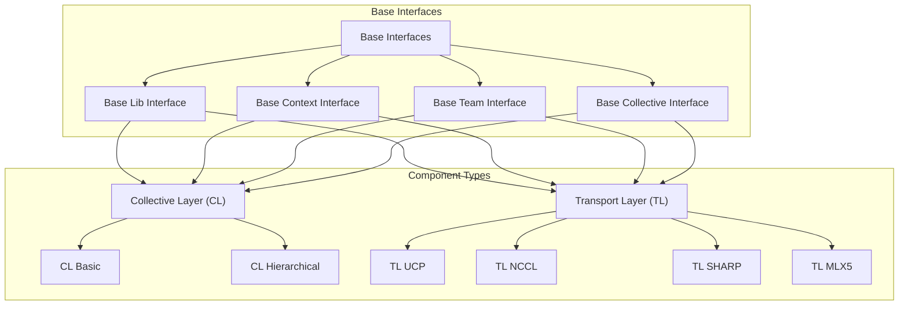
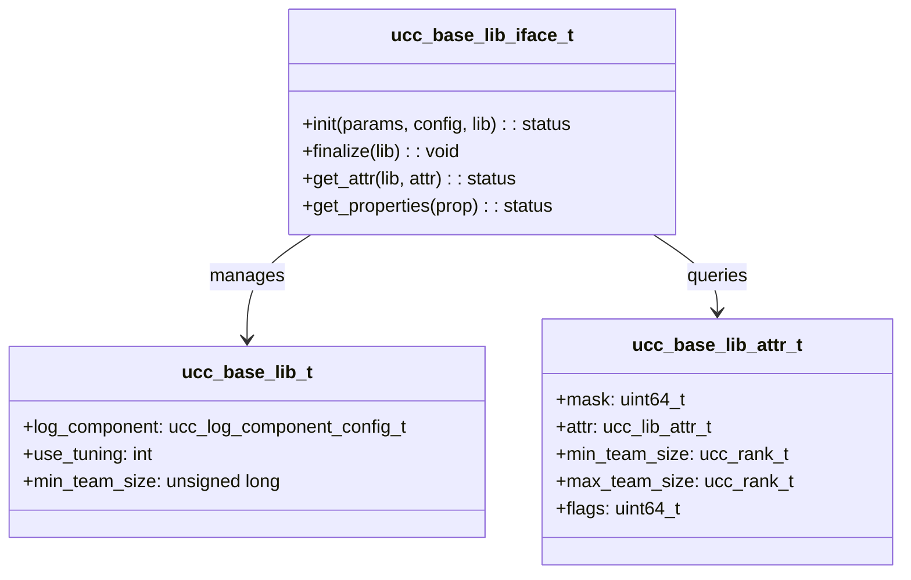
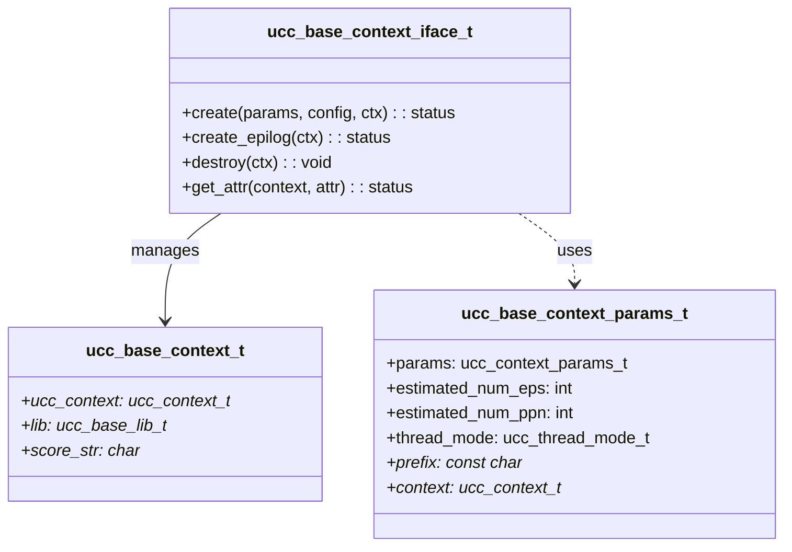
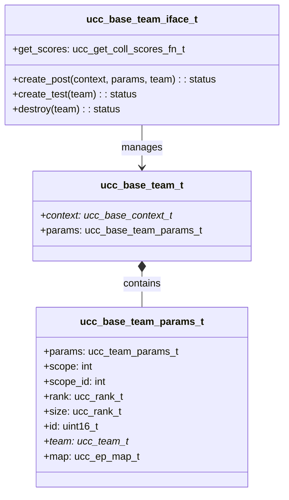
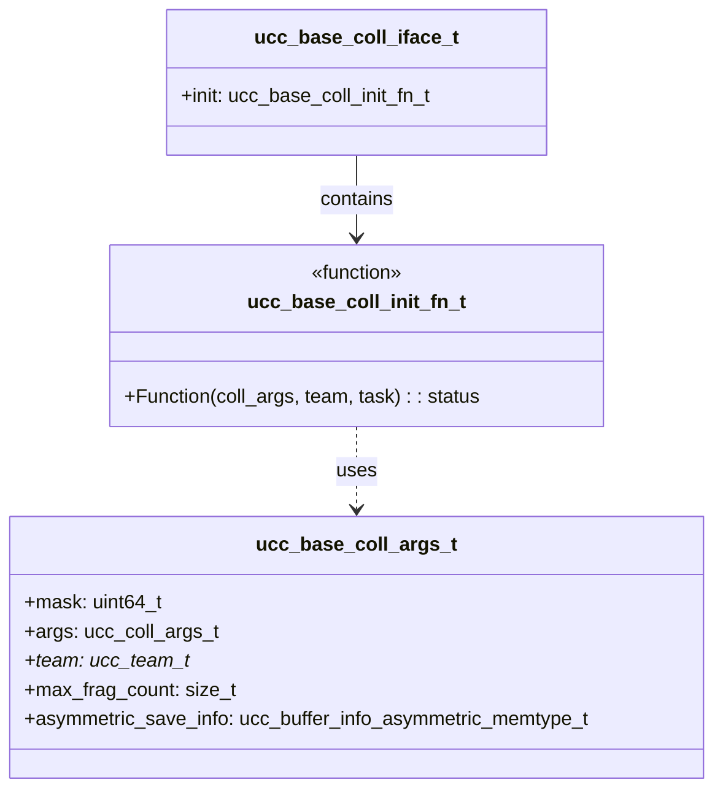
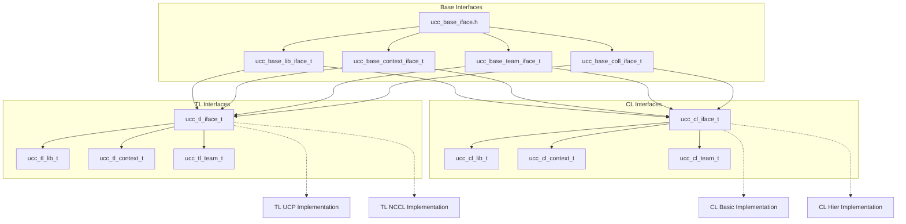
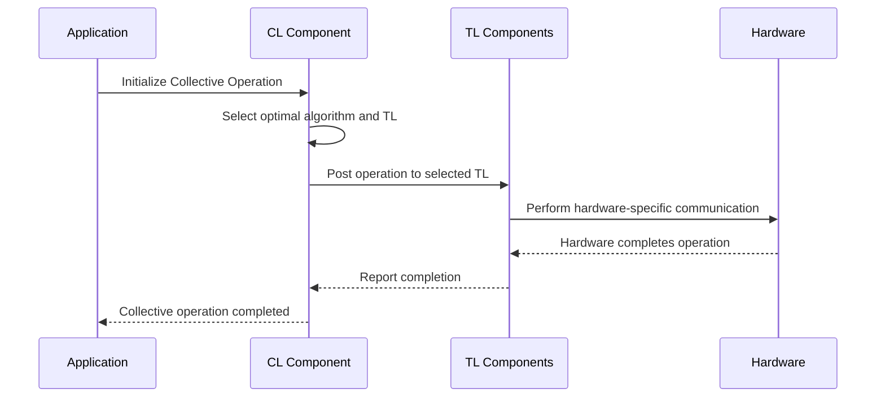
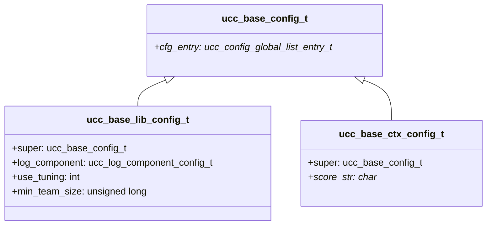

<!-- source: DeepWiki mcp.deepwiki.com · repo openucx/ucc · page 7.1 Base Interfaces · fetched 2026-11-11 -->

# Base Interfaces

<details>
<summary>Relevant source files</summary>

The following files were used as context for generating this wiki page:

- [src/components/base/ucc_base_iface.h](src/components/base/ucc_base_iface.h)
- [src/components/cl/basic/cl_basic.c](src/components/cl/basic/cl_basic.c)
- [src/components/cl/basic/cl_basic.h](src/components/cl/basic/cl_basic.h)
- [src/components/cl/basic/cl_basic_context.c](src/components/cl/basic/cl_basic_context.c)
- [src/components/cl/basic/cl_basic_lib.c](src/components/cl/basic/cl_basic_lib.c)
- [src/components/cl/basic/cl_basic_team.c](src/components/cl/basic/cl_basic_team.c)
- [src/components/cl/ucc_cl.c](src/components/cl/ucc_cl.c)
- [src/components/cl/ucc_cl.h](src/components/cl/ucc_cl.h)
- [src/components/tl/ucc_tl.c](src/components/tl/ucc_tl.c)
- [src/components/tl/ucc_tl.h](src/components/tl/ucc_tl.h)

</details>


Base interfaces form the foundation of the UCC component architecture by providing standard, abstract interfaces that components must implement. These interfaces define the contract between the framework and specific implementations, enabling modularity, component interoperability, and extension capabilities.

For information about how these interfaces are used in the component framework, see [Component Framework](#7.4).

## Overview

The UCC framework uses a layered architecture with two main component types:

1. **Collective Layers (CL)** - Implement programming models and provide high-level collective operations
2. **Transport Layers (TL)** - Provide hardware-specific communication primitives

Both component types use common base interfaces that establish a consistent API contract throughout the framework.



**Diagram Title: UCC Base Interfaces in Component Architecture**

Sources: [src/components/base/ucc_base_iface.h:1-266](), [src/components/cl/ucc_cl.h:1-125](), [src/components/tl/ucc_tl.h:1-173]()

## Base Interface Types

The base interfaces are defined in `ucc_base_iface.h` and consist of four main types of interfaces:

### 1. Library Interface

The library interface provides initialization, finalization, and attribute querying for components:



**Diagram Title: Library Base Interface Structure**

Sources: [src/components/base/ucc_base_iface.h:25-89]()

### 2. Context Interface

The context interface handles communication context creation, destruction, and attribute querying:



**Diagram Title: Context Base Interface Structure**

Sources: [src/components/base/ucc_base_iface.h:91-126]()

### 3. Team Interface

The team interface handles team creation, testing, destruction, and score retrieval:



**Diagram Title: Team Base Interface Structure**

Sources: [src/components/base/ucc_base_iface.h:128-163]()

### 4. Collective Interface

The collective interface handles the initialization of collective operations:



**Diagram Title: Collective Base Interface Structure**

Sources: [src/components/base/ucc_base_iface.h:165-194]()

## Interface Implementation Pattern

Components implement these base interfaces using a standardized pattern facilitated by macros. The `UCC_BASE_IFACE_DECLARE` macro is the foundation for interface declarations in both CL and TL components.

### Inheritance in Component Types

The diagram below shows how both Collective Layer (CL) and Transport Layer (TL) components extend the base interfaces:



**Diagram Title: Base Interface Inheritance in Component Architecture**

Sources: [src/components/cl/ucc_cl.h:63-72](), [src/components/tl/ucc_tl.h:71-82]()

### Interface Declaration Macros

The `UCC_BASE_IFACE_DECLARE` macro [src/components/base/ucc_base_iface.h:212-249]() is the core mechanism for interface declaration, which both CL and TL layers adapt:

```
TL Interface Declaration:
- UCC_TL_IFACE_DECLARE(_name, _NAME) wraps UCC_BASE_IFACE_DECLARE

CL Interface Declaration:
- UCC_CL_IFACE_DECLARE(_name, _NAME) wraps UCC_BASE_IFACE_DECLARE with additional type setup
```

Example of interface declaration for CL Basic component:

```c
UCC_CL_IFACE_DECLARE(basic, BASIC);
```

This expands to set up all the required function pointers and configuration entries for the CL Basic component.

Sources: [src/components/cl/basic/cl_basic.c:55](), [src/components/tl/ucc_tl.h:103-104](), [src/components/cl/ucc_cl.h:103-108]()

## Component Lifecycle Using Base Interfaces

The base interfaces define a consistent lifecycle for all UCC components:

| Lifecycle Phase | Base Interface Function | Purpose |
|----------------|-------------------------|---------|
| Initialization | `init` | Set up component resources |
| Context Creation | `create` | Create a communication context |
| Team Formation | `create_post`/`create_test` | Create a team of processes |
| Collective Operation | `init` (collective) | Initialize collective operations |
| Team Destruction | `destroy` (team) | Clean up team resources |
| Context Destruction | `destroy` (context) | Clean up context resources |
| Finalization | `finalize` | Release all component resources |

Sources: [src/components/base/ucc_base_iface.h:82-88](), [src/components/base/ucc_base_iface.h:118-125](), [src/components/base/ucc_base_iface.h:156-162]()

## Relationship between CL and TL Components

The Collective Layer (CL) components use Transport Layer (TL) components to perform actual communication:



**Diagram Title: CL-TL Interaction for Collective Operations**

The CL Basic component specifically demonstrates this relationship by:
1. Creating TL teams during team creation
2. Obtaining score maps from each TL team
3. Merging the scores to create an optimal selection strategy
4. Using the appropriate TL for each collective operation

Sources: [src/components/cl/basic/cl_basic_team.c:11-168](), [src/components/tl/ucc_tl.c:207-251]()

## Base Interface Configuration

Each base interface includes configuration mechanisms:



**Diagram Title: Base Interface Configuration Hierarchy**

This configuration system allows for consistent parameter handling across all components through:
1. Global configuration tables for base lib and context
2. Component-specific configuration extensions
3. Unified configuration reading and parsing

Sources: [src/components/base/ucc_base_iface.h:31-45](), [src/components/base/ucc_base_iface.h:196-204]()

## Summary

The base interfaces in UCC provide:

1. **Standard contract** - Consistent API for all components
2. **Modularity** - Components can be developed independently
3. **Interoperability** - Components can work together seamlessly
4. **Extensibility** - New components can be added without changing the framework

These interfaces form the foundation of UCC's flexible, modular architecture that enables high-performance collective operations across diverse hardware and software environments.

---

