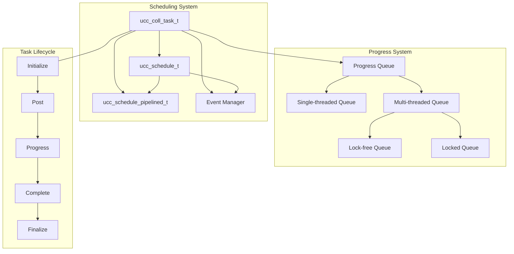
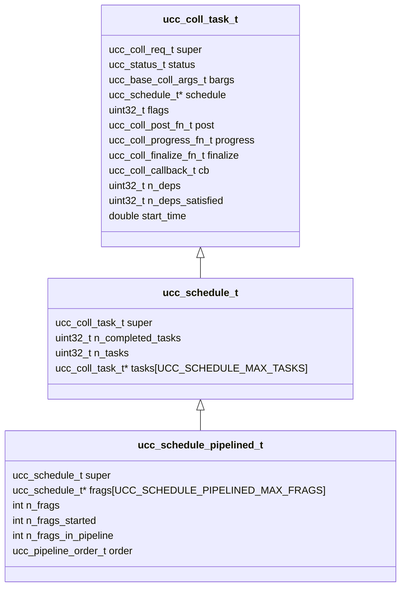
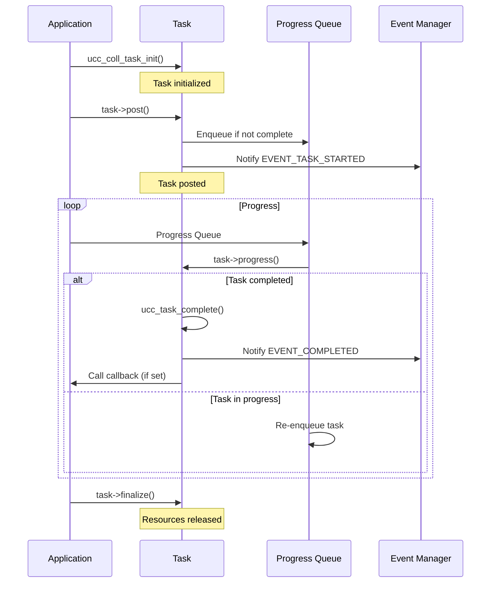
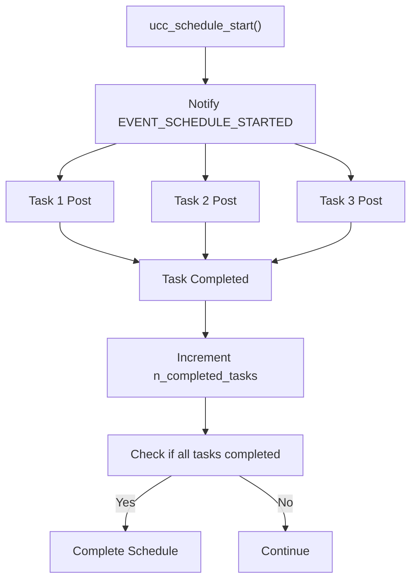
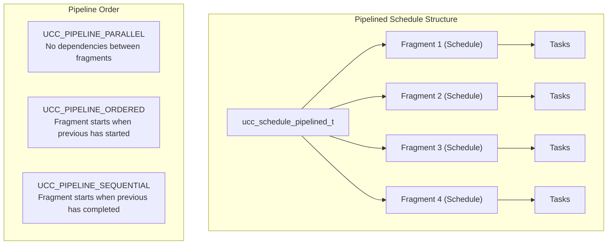
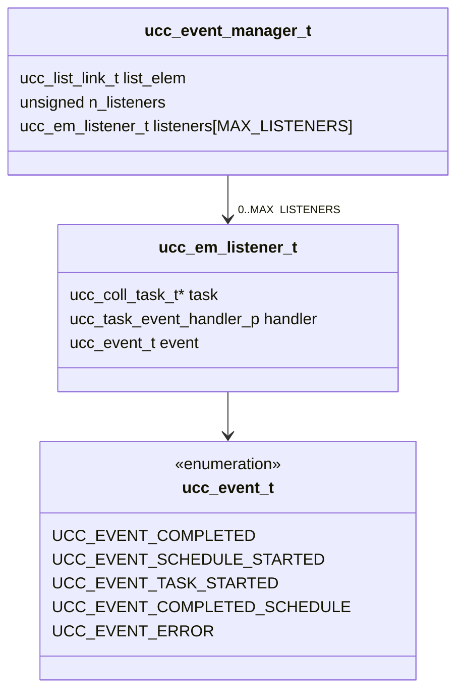
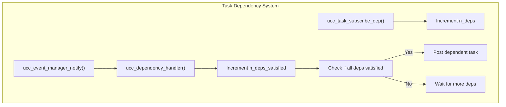
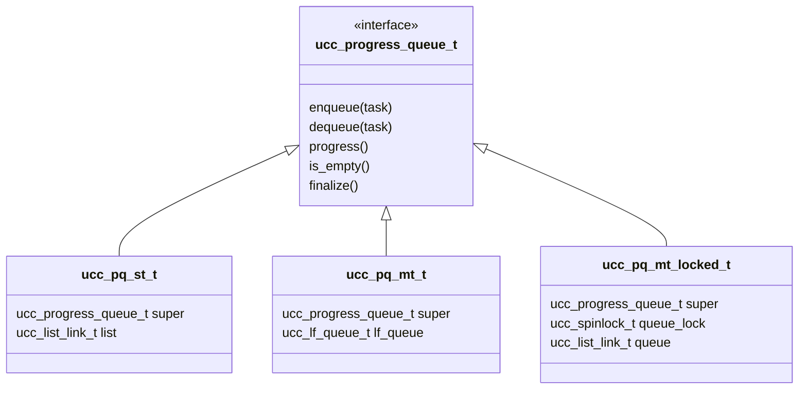
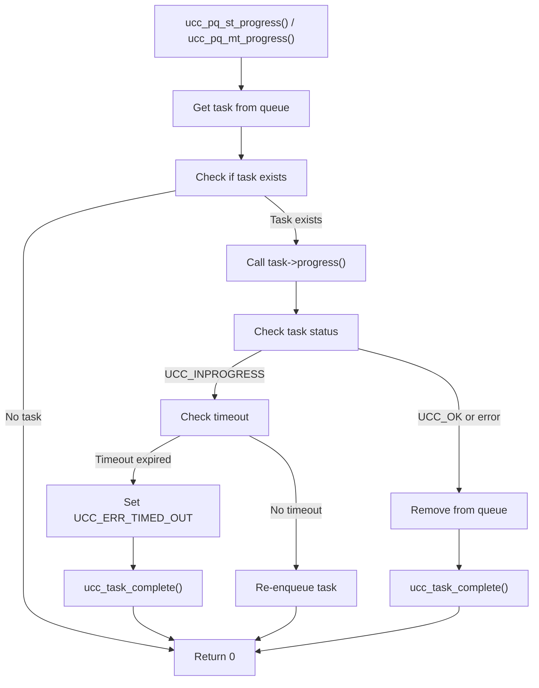
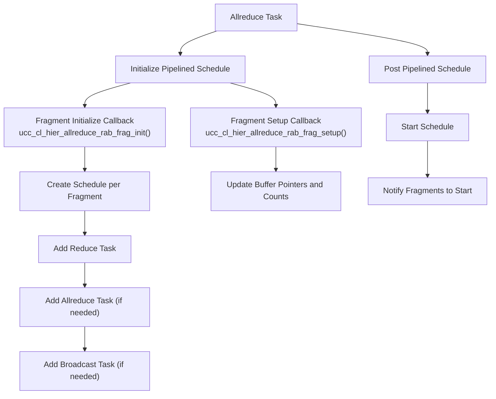

<!-- source: DeepWiki mcp.deepwiki.com · repo openucx/ucc · page 7.2 Scheduling and Progress · fetched 2026-11-11 -->

# Scheduling and Progress

Relevant source files

The following files were used as context for generating this wiki page:

- [src/components/cl/hier/allreduce/allreduce_rab.c](src/components/cl/hier/allreduce/allreduce_rab.c)
- [src/core/ucc_progress_queue.c](src/core/ucc_progress_queue.c)
- [src/core/ucc_progress_queue.h](src/core/ucc_progress_queue.h)
- [src/core/ucc_progress_queue_mt.c](src/core/ucc_progress_queue_mt.c)
- [src/core/ucc_progress_queue_st.c](src/core/ucc_progress_queue_st.c)
- [src/schedule/ucc_schedule.c](src/schedule/ucc_schedule.c)
- [src/schedule/ucc_schedule.h](src/schedule/ucc_schedule.h)
- [src/schedule/ucc_schedule_pipelined.c](src/schedule/ucc_schedule_pipelined.c)
- [src/schedule/ucc_schedule_pipelined.h](src/schedule/ucc_schedule_pipelined.h)
- [src/utils/ucc_atomic.h](src/utils/ucc_atomic.h)

This page documents the scheduling and progress mechanisms in UCC (Unified Collective Communication) framework. It covers how collective operations are scheduled, how dependencies between operations are managed, and how progress of operations is tracked and advanced.

## Overview

The UCC scheduling system provides efficient execution of collective communication operations through task-based execution models. The progress system ensures collective operations make forward progress toward completion in both single-threaded and multi-threaded environments.

Sources: [src/schedule/ucc_schedule.h](), [src/core/ucc_progress_queue.h](), [src/schedule/ucc_schedule_pipelined.h]()

## Task System

The fundamental unit of work in UCC is a task, represented by the `ucc_coll_task_t` structure. Tasks encapsulate collective operations like allreduce, broadcast, etc., and can be executed directly or as part of a schedule.

Sources: [src/schedule/ucc_schedule.h:81-116](), [src/schedule/ucc_schedule.h:123-129](), [src/schedule/ucc_schedule_pipelined.h:71-90]()

### Task Lifecycle

Each task in UCC follows a well-defined lifecycle:

1. **Initialization**: Task is created and configured with operation parameters
2. **Posting**: Task execution is initiated
3. **Progress**: Task execution is advanced until completion
4. **Completion**: Task is marked as completed and resources can be released
5. **Finalization**: Resources associated with the task are freed

Sources: [src/schedule/ucc_schedule.h:131-157](), [src/schedule/ucc_schedule.c:104-131](), [src/schedule/ucc_schedule.c:169-241]()

## Schedules

A schedule is a collection of tasks with dependencies between them. The UCC framework provides two types of schedules:

1. **Basic Schedule (`ucc_schedule_t`)**: A simple collection of tasks that executes them according to their dependencies.
2. **Pipelined Schedule (`ucc_schedule_pipelined_t`)**: A more complex schedule that allows tasks to be executed in a pipelined manner for better performance.

### Basic Schedule

A basic schedule manages a collection of tasks and tracks their completion. When all tasks complete, the schedule is considered complete.

Sources: [src/schedule/ucc_schedule.h:123-129](), [src/schedule/ucc_schedule.c:214-225](), [src/schedule/ucc_schedule.c:243-252]()

### Pipelined Schedule

Pipelined schedules enable fragmented execution of large collective operations, which improves performance by allowing overlapping of communication and computation.

The pipelined schedule supports three execution modes:

| Pipeline Order | Description | Event Dependency |
|----------------|-------------|------------------|
| `UCC_PIPELINE_PARALLEL` | Tasks of different fragments can run concurrently | No dependency |
| `UCC_PIPELINE_ORDERED` | Tasks of different fragments are ordered by start events | `UCC_EVENT_TASK_STARTED` |
| `UCC_PIPELINE_SEQUENTIAL` | Tasks of different fragments are ordered by completion | `UCC_EVENT_COMPLETED` |

Sources: [src/schedule/ucc_schedule_pipelined.h:35-46](), [src/schedule/ucc_schedule_pipelined.h:71-90](), [src/schedule/ucc_schedule_pipelined.c:149-251]()

## Event Management System

The event management system enables communication between tasks through events. Tasks can subscribe to events from other tasks and be notified when those events occur.

Key event management functions:

- `ucc_event_manager_subscribe()`: Registers a task to be notified when a specific event occurs
- `ucc_event_manager_notify()`: Notifies all listeners of an event
- `ucc_dependency_handler()`: Handles dependencies between tasks

Sources: [src/schedule/ucc_schedule.h:21-29](), [src/schedule/ucc_schedule.h:52-62](), [src/schedule/ucc_schedule.c:44-68](), [src/schedule/ucc_schedule.c:172-196]()

### Task Dependencies

Tasks can have dependencies on other tasks, which are managed through the event system. When a dependency is satisfied, the dependent task can be executed.

The `n_deps` and `n_deps_satisfied` counters in the task structure track dependencies. When `n_deps_satisfied` equals `n_deps`, the task is ready to execute.

Sources: [src/schedule/ucc_schedule.h:243-252](), [src/schedule/ucc_schedule_pipelined.c:253-274]()

## Progress System

The progress system is responsible for advancing the execution of tasks. It uses a progress queue to track tasks that need to be progressed.

### Progress Queue

UCC provides different implementations of the progress queue for different threading models:

1. **Single-Threaded Queue (`ucc_pq_st_t`)**: Used when UCC is in single-threaded mode.
2. **Multi-Threaded Queue**: Used when UCC is in multi-threaded mode.
   - **Lock-Free Queue (`ucc_pq_mt_t`)**: Uses lock-free mechanisms for better performance.
   - **Locked Queue (`ucc_pq_mt_locked_t`)**: Uses locks for simpler implementation.

Sources: [src/core/ucc_progress_queue.h:13-20](), [src/core/ucc_progress_queue_st.c:14-17](), [src/core/ucc_progress_queue_mt.c:17-26]()

### Progress Flow

The progress function is responsible for advancing the execution of tasks in the progress queue:

Sources: [src/core/ucc_progress_queue_st.c:19-56](), [src/core/ucc_progress_queue_mt.c:68-102]()

## Schedule Example: Pipelined Allreduce

Here's a real-world example of how UCC uses the scheduling system to implement a pipelined allreduce operation:

Sources: [src/components/cl/hier/allreduce/allreduce_rab.c:192-202](), [src/components/cl/hier/allreduce/allreduce_rab.c:42-77](), [src/components/cl/hier/allreduce/allreduce_rab.c:204-220]()

## Atomic Operations

The scheduling and progress system relies on atomic operations for thread safety, particularly when tracking task dependencies and schedule completion. These operations are defined in the `ucc_atomic.h` file and are used throughout the codebase.

| Atomic Operation | Description |
|------------------|-------------|
| `ucc_atomic_fadd32()` | Atomically adds to a 32-bit value and returns the old value |
| `ucc_atomic_add32()` | Atomically adds to a 32-bit value |
| `ucc_atomic_cswap64()` | Atomically compare-and-swap a 64-bit value |

Sources: [src/utils/ucc_atomic.h](), [src/schedule/ucc_schedule_pipelined.c:259](), [src/schedule/ucc_schedule.c:205]()

## Summary

The scheduling and progress system in UCC provides a flexible framework for executing collective operations efficiently. Key features include:

1. **Task-based execution**: Operations are represented as tasks that can be executed directly or as part of a schedule.
2. **Dependency management**: Tasks can have dependencies on other tasks, which are managed through the event system.
3. **Pipelined execution**: Large operations can be fragmented and executed in a pipelined manner for better performance.
4. **Thread safety**: The progress system supports both single-threaded and multi-threaded environments.
5. **Progress tracking**: The progress queue tracks tasks that need to be progressed and advances their execution.

This system enables UCC to efficiently execute complex collective communication operations across various hardware accelerators and networks.

---

