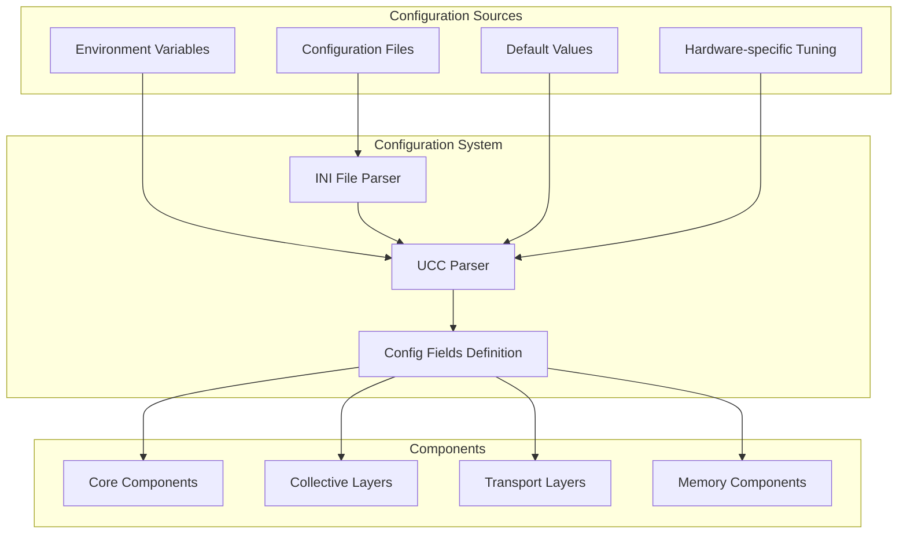
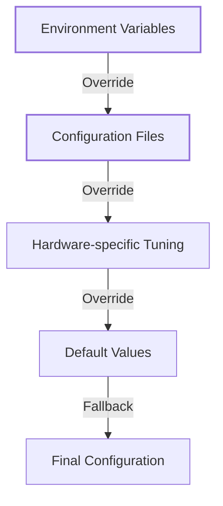
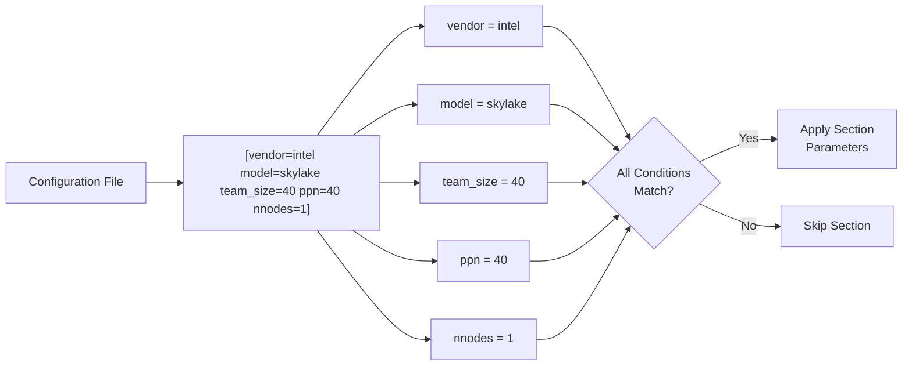
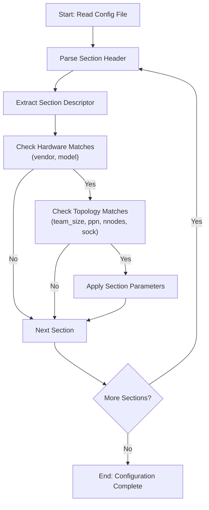
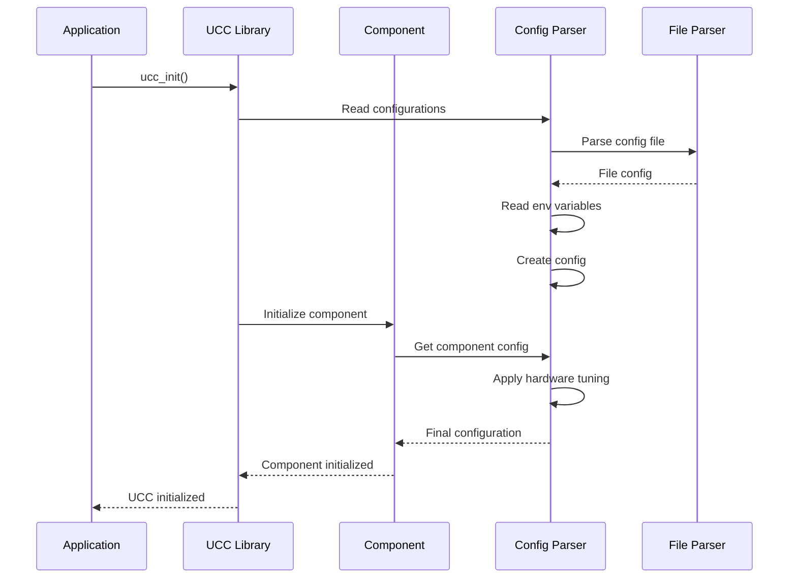
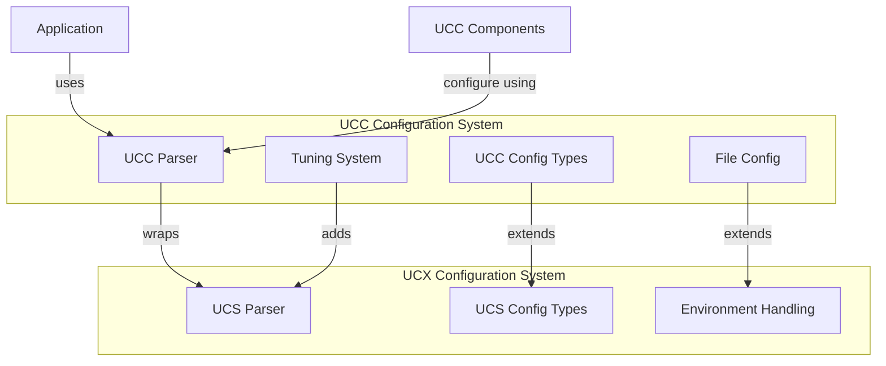

<!-- source: DeepWiki mcp.deepwiki.com · repo openucx/ucc · page 7.3 Configuration System · fetched 2026-11-11 -->

# Configuration System

<details>
<summary>Relevant source files</summary>

The following files were used as context for generating this wiki page:

- [config/m4/ucx.m4](config/m4/ucx.m4)
- [contrib/ucc.conf](contrib/ucc.conf)
- [src/utils/ini.h](src/utils/ini.h)
- [src/utils/ucc_parser.c](src/utils/ucc_parser.c)
- [src/utils/ucc_parser.h](src/utils/ucc_parser.h)

</details>


The UCC Configuration System provides a flexible mechanism for configuring UCC components through environment variables, configuration files, and automatic hardware-aware tuning. This page documents the architecture, components, and usage patterns of the configuration system. For information about building UCC, see [Building and Configuration](#1.2).

## Configuration Architecture

The UCC Configuration System is built on top of the UCX Configuration System (UCS) with additional UCC-specific extensions. It manages configuration options for all UCC components, from the core library to transport layers and collective operations.



Sources: [src/utils/ucc_parser.h:6-325](), [src/utils/ucc_parser.c:6-979]()

### Configuration Hierarchy

UCC uses a hierarchical approach to resolve configuration values, ensuring that more specific settings override more general ones:



The configuration system follows this priority order:
1. Environment variables (highest priority)
2. Configuration files
3. Hardware-specific tuning sections
4. Default values (lowest priority)

Sources: [src/utils/ucc_parser.c:344-505](), [src/utils/ucc_parser.c:628-649]()

## Configuration Methods

### Environment Variables

UCC components can be configured using environment variables with the prefix `UCC_` followed by component-specific prefixes. For example:

| Component | Environment Variable Prefix | Example |
|-----------|---------------------------|---------|
| Core UCC | `UCC_` | `UCC_LOG_LEVEL` |
| UCP Transport Layer | `UCC_TL_UCP_` | `UCC_TL_UCP_TUNE` |
| NCCL Transport Layer | `UCC_TL_NCCL_` | `UCC_TL_NCCL_TUNE` |
| Basic Collective Layer | `UCC_CL_BASIC_` | `UCC_CL_BASIC_TLS` |

Sources: [src/utils/ucc_parser.c:525-543]()

### Configuration Files

UCC can be configured using INI-format configuration files. The default configuration file is typically installed at `<prefix>/etc/ucc.conf`. Configuration files follow this format:

```
# Global configuration settings
UCC_TL_UCP_TUNE=allreduce:0-4k:@0#allreduce:4k-inf:@1

# Hardware-specific tuning section
[vendor=intel model=skylake team_size=40 ppn=40 nnodes=1]
UCC_TL_UCP_ALLREDUCE_KN_RADIX=2
UCC_TL_UCP_TUNE=allreduce:0-2k:@0#allreduce:2k-inf:@1
```

The configuration file supports:
- Global settings (applied to all scenarios)
- Hardware-specific tuning sections (applied conditionally based on system characteristics)
- Comments starting with `#` or `;`

Sources: [contrib/ucc.conf:1-149](), [src/utils/ini.h:37-47]()

## Hardware-aware Configuration

One of the unique features of UCC's configuration system is its ability to apply different configurations based on hardware and topology characteristics.

### Tuning Sections

Tuning sections in configuration files allow hardware-specific parameters to be applied only when the runtime environment matches the specified criteria. Section headers use key-value pairs to define conditions:



Supported tuning parameters:
- `vendor`: CPU vendor (intel, amd, nvidia, etc.)
- `model`: CPU model (broadwell, skylake, rome, grace, etc.)
- `team_size`: Number of ranks in the team
- `ppn`: Processes per node
- `sock`: Number of processes per socket
- `nnodes`: Number of nodes

Sources: [src/utils/ucc_parser.h:103-123](), [src/utils/ucc_parser.c:128-197]()

### Section Matching Algorithm

When UCC reads the configuration file, it evaluates each tuning section against the current hardware and topology:



The algorithm ensures that configuration parameters are only applied when the section descriptor matches the current execution environment.

Sources: [src/utils/ucc_parser.c:46-88](), [src/utils/ucc_parser.c:586-626]()

## Configuration API

The UCC Configuration API provides functions for managing configuration options across all UCC components.

### Key Configuration Functions

| Function | Description |
|----------|-------------|
| `ucc_config_parser_fill_opts()` | Fills a configuration structure with values from environment and config file |
| `ucc_parse_file_config()` | Parses a configuration file |
| `ucc_config_parser_set_value()` | Sets a configuration option value |
| `ucc_config_parser_print_opts()` | Prints configuration options |
| `ucc_add_team_sections()` | Applies team-specific tuning sections |

Sources: [src/utils/ucc_parser.h:158-169](), [src/utils/ucc_parser.h:172-190]()

### Configuration Data Types

UCC supports various configuration data types:

| Type | Description |
|------|-------------|
| `UCC_CONFIG_TYPE_STRING` | String values |
| `UCC_CONFIG_TYPE_INT` | Integer values |
| `UCC_CONFIG_TYPE_UINT` | Unsigned integer values |
| `UCC_CONFIG_TYPE_BOOL` | Boolean values (0/1) |
| `UCC_CONFIG_TYPE_ENUM` | Enumerated values |
| `UCC_CONFIG_TYPE_ARRAY` | Array of values |
| `UCC_CONFIG_TYPE_ALLOW_LIST` | Allow list |
| `UCC_CONFIG_TYPE_MEMUNITS` | Memory units values |
| `UCC_CONFIG_TYPE_TERNARY` | Yes/No/Auto values |
| `UCC_CONFIG_TYPE_PIPELINE_PARAMS` | Pipeline parameters |
| `UCC_CONFIG_TYPE_UINT_RANGED` | Ranged unsigned integer values |

Sources: [src/utils/ucc_parser.h:63-86](), [src/utils/ucc_parser.h:284-320]()

### Configuration Workflow

The following diagram illustrates how configuration is applied during UCC initialization:



Sources: [src/utils/ucc_parser.c:629-650](), [src/utils/ucc_parser.c:586-626]()

## Example Configuration File

Below is an example configuration file showing various configuration options:

```ini
# Default TLS configuration
UCC_CL_BASIC_TLS=^sharp,nccl
UCC_CL_HIER_NODE_SBGP_TLS=^sharp,nccl
UCC_CL_HIER_NODE_LEADERS_SBGP_TLS=^sharp,nccl,cuda
UCC_CL_HIER_NET_SBGP_TLS=^sharp,nccl,cuda
UCC_CL_HIER_FULL_SBGP_TLS=ucp

# Tuning section for Intel Skylake CPUs with 40 processes on 1 node
[vendor=intel model=skylake team_size=40 ppn=40 nnodes=1]
UCC_TL_UCP_ALLREDUCE_KN_RADIX=2
UCC_TL_UCP_ALLREDUCE_SRA_KN_RADIX=0-128k:host:2,128k-inf:host:8
UCC_TL_UCP_TUNE=allreduce:0-2k:@0#allreduce:2k-inf:@1

# Tuning section for AMD Rome CPUs with 128 processes on 1 node
[vendor=amd model=rome team_size=128 ppn=128 nnodes=1]
UCC_TL_UCP_ALLREDUCE_KN_RADIX=2
UCC_TL_UCP_ALLREDUCE_SRA_KN_RADIX=0-64k:host:4,64k-inf:host:8
UCC_TL_UCP_TUNE=allreduce:0-1k:@0#allreduce:1k-inf:@1
```

Sources: [contrib/ucc.conf:1-149]()

This configuration file demonstrates:
1. Default transport layer selection configurations
2. CPU-specific tuning sections for different architectures
3. Data size-based algorithm selection using the `UCC_TL_UCP_TUNE` parameter

## Integration with UCX

The UCC Configuration System is built on top of the UCX Configuration System, which provides the foundation for parsing and managing configuration options.



The UCC Configuration System:
1. Wraps UCX configuration functions with UCC equivalents
2. Extends UCX types with UCC-specific types
3. Adds hardware-aware tuning capabilities
4. Supports configuration through files

Sources: [src/utils/ucc_parser.h:26-29](), [config/m4/ucx.m4:107-148]()

---

