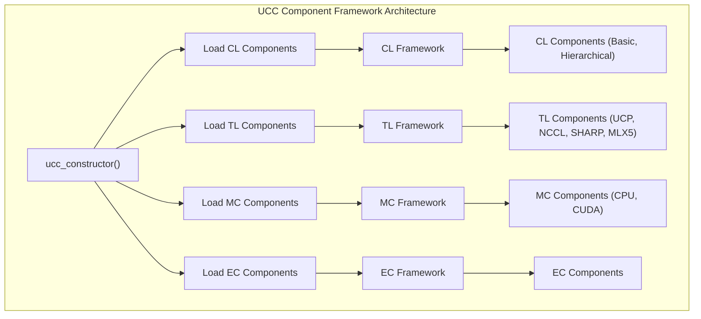
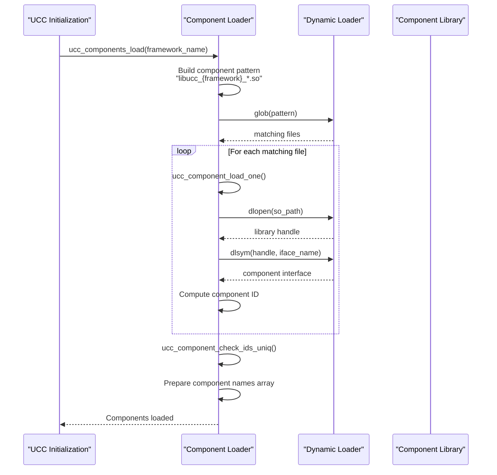
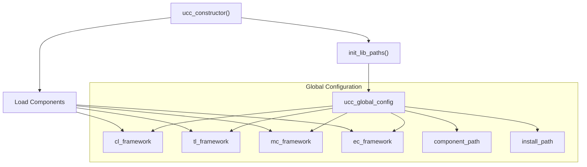
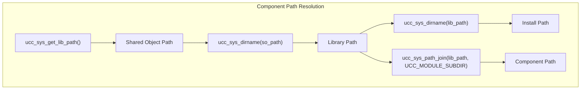

<!-- source: DeepWiki mcp.deepwiki.com · repo openucx/ucc · page 7.4 Component Framework · fetched 2026-11-11 -->

# Component Framework

<details>
<summary>Relevant source files</summary>

The following files were used as context for generating this wiki page:

- [src/core/ucc_constructor.c](src/core/ucc_constructor.c)
- [src/core/ucc_global_opts.c](src/core/ucc_global_opts.c)
- [src/core/ucc_global_opts.h](src/core/ucc_global_opts.h)
- [src/utils/ucc_compiler_def.h](src/utils/ucc_compiler_def.h)
- [src/utils/ucc_component.c](src/utils/ucc_component.c)
- [src/utils/ucc_component.h](src/utils/ucc_component.h)
- [src/utils/ucc_log.h](src/utils/ucc_log.h)
- [test/gtest/common/test_obj_size.cc](test/gtest/common/test_obj_size.cc)
- [test/gtest/utils/test_cfg_file.cc](test/gtest/utils/test_cfg_file.cc)

</details>


The Component Framework is the foundation of UCC's modular architecture, responsible for dynamically loading, initializing, and managing different types of components. This framework enables UCC to support various collective algorithms, transport protocols, memory types, and execution environments through a plugin-based architecture.

## Overview

The UCC Component Framework implements a plugin architecture that divides functionality into four distinct frameworks:

1. **Collective Layer (CL)** - Implements collective communication algorithms
2. **Transport Layer (TL)** - Provides communication transport mechanisms
3. **Memory Component (MC)** - Handles different memory types (e.g., CPU, GPU)
4. **Execution Component (EC)** - Supports different execution models for triggered operations



Sources: [src/core/ucc_constructor.c:131-171](), [src/core/ucc_global_opts.h:16-25]()

## Component Structure

Each component in the framework implements the `ucc_component_iface_t` interface, which provides metadata about the component and functions for its lifecycle management.

```mermaid
classDiagram
    class "ucc_component_iface_t" {
        +const char* name
        +unsigned long id
        +void* dl_handle
        +ucc_score_t score
    }
    
    class "ucc_component_framework_t" {
        +char* framework_name
        +int n_components
        +ucc_component_iface_t** components
        +ucc_config_names_array_t names
    }
    
    "ucc_component_framework_t" o-- "ucc_component_iface_t" : contains
```

Sources: [src/utils/ucc_component.h:17-29]()

## Component Loading Process

The component loading process occurs during UCC initialization. The process involves:

1. Finding shared libraries matching the pattern `libucc_<framework>_*.so`
2. Dynamically loading these libraries
3. Retrieving component interfaces from the loaded libraries
4. Validating components (checking for unique IDs and scores)



Sources: [src/utils/ucc_component.c:25-207](), [src/core/ucc_constructor.c:131-170]()

## Component Loading Implementation

The component loading is implemented in the `ucc_components_load` function, which:

1. Constructs the search pattern based on the framework name
2. Searches for matching shared libraries in the component path
3. Attempts to load each matching library
4. Builds a list of successfully loaded components

The actual loading of a single component is handled by `ucc_component_load_one`, which:

1. Extracts the component name from the library filename
2. Opens the library using `dlopen`
3. Retrieves the component interface using `dlsym`
4. Initializes the component interface with its library handle and ID

Sources: [src/utils/ucc_component.c:113-207](), [src/utils/ucc_component.c:25-80]()

## Component Identification and Uniqueness

Each component must have a unique identifier and score within its framework:

1. **Component ID**: Generated from the component name using a hash function (`ucc_str_hash_djb2`)
2. **Component Score**: Set by the component itself, used for prioritization

The framework verifies uniqueness of these attributes using `ucc_component_check_ids_uniq` and `ucc_component_check_scores_uniq`.

Sources: [src/utils/ucc_component.c:99-111](), [src/utils/ucc_component.c:179-189]()

## Global Configuration Integration

The Component Framework is integrated with UCC's global configuration system:

1. Component paths are determined during UCC initialization
2. Component configuration can be specified through environment variables and configuration files
3. The loaded components are stored in the global configuration structure



Sources: [src/core/ucc_global_opts.h:16-25](), [src/core/ucc_constructor.c:69-92](), [src/core/ucc_constructor.c:131-171]()

## Component Framework Usage

The Component Framework provides several utility functions for working with components:

1. `ucc_get_component`: Retrieves a component by name from a framework
2. `ucc_get_framework_components_list`: Creates a list of all component names in a framework

These functions allow other parts of UCC to interact with components dynamically.

Sources: [src/utils/ucc_component.c:209-249]()

## Component Path Resolution

The component search path is determined during initialization:

1. The library path is identified using `ucc_sys_get_lib_path`
2. The component path is set to `<lib_path>/ucc` by default
3. Components are loaded from this path during UCC initialization



Sources: [src/core/ucc_constructor.c:69-92]()

## Error Handling

The Component Framework implements error handling for various failure scenarios:

1. Missing component libraries
2. Failed library loading
3. Missing component interfaces
4. Component ID or score collisions

For critical frameworks like CL and MC, failures are treated as errors, while for optional frameworks like EC, some failures may be handled as warnings.

Sources: [src/utils/ucc_component.c:134-136](), [src/utils/ucc_component.c:155-157](), [src/core/ucc_constructor.c:160-170]()

## Relation to Other Subsystems

The Component Framework interacts with several other UCC subsystems:

1. **Configuration System**: Components can be enabled/disabled and configured through the configuration system (see [Configuration System](#7.3))
2. **Base Interfaces**: Components implement base interfaces to integrate with the rest of UCC (see [Base Interfaces](#7.1))
3. **Collective Operations**: Collective Layer components implement collective operations (see [Collective Operations](#2.3))
4. **Context and Team Management**: Components participate in context and team creation/destruction (see [Context and Team Management](#2.2))

## Summary

The Component Framework is the backbone of UCC's plugin architecture, allowing it to:

1. Dynamically discover and load components at runtime
2. Support multiple implementations of the same functionality
3. Select components based on their capabilities and priorities
4. Extend functionality without modifying the core library

This modular approach enables UCC to adapt to different hardware and software environments, providing optimal collective communication implementations for each scenario.