# Page: UCC Overview

# UCC Overview

<details>
<summary>Relevant source files</summary>

The following files were used as context for generating this wiki page:

- [.github/workflows/docs.yaml](.github/workflows/docs.yaml)
- [configure.ac](configure.ac)
- [docs/doxygen/collectives.md](docs/doxygen/collectives.md)
- [docs/doxygen/design.md](docs/doxygen/design.md)
- [docs/doxygen/events.md](docs/doxygen/events.md)
- [docs/doxygen/teams.md](docs/doxygen/teams.md)
- [docs/doxygen/ucc_doxygen.conf](docs/doxygen/ucc_doxygen.conf)
- [src/Makefile.am](src/Makefile.am)
- [src/components/tl/ucp/tl_ucp_lib.c](src/components/tl/ucp/tl_ucp_lib.c)
- [src/core/ucc_context.c](src/core/ucc_context.c)
- [src/core/ucc_context.h](src/core/ucc_context.h)
- [src/core/ucc_lib.c](src/core/ucc_lib.c)
- [src/core/ucc_lib.h](src/core/ucc_lib.h)
- [src/core/ucc_team.c](src/core/ucc_team.c)
- [src/core/ucc_team.h](src/core/ucc_team.h)
- [src/ucc/api/ucc.h](src/ucc/api/ucc.h)
- [src/ucc/api/ucc_def.h](src/ucc/api/ucc_def.h)

</details>


The Unified Collective Communication (UCC) framework is a high-performance library designed to provide a unified interface for collective communication operations across diverse hardware accelerators and network technologies. UCC serves as an abstraction layer that enables applications to leverage optimal collective algorithms while hiding the complexity of underlying hardware and network specifics.

For more detailed information about specific API usage, see [Context and Team Management](#2.2) and [Collective Operations](#2.3).

## Purpose and Scope

UCC aims to:

- Provide a unified API for collective operations that works across CPUs, GPUs, and other accelerators
- Support diverse network transports with automatic selection of optimal algorithms
- Enable highly scalable and performant collectives for HPC, AI/ML, and data analytics workloads
- Allow non-blocking collective operations with flexible synchronization models

## High-Level Architecture

UCC is organized into several layers that work together to provide efficient collective communication:

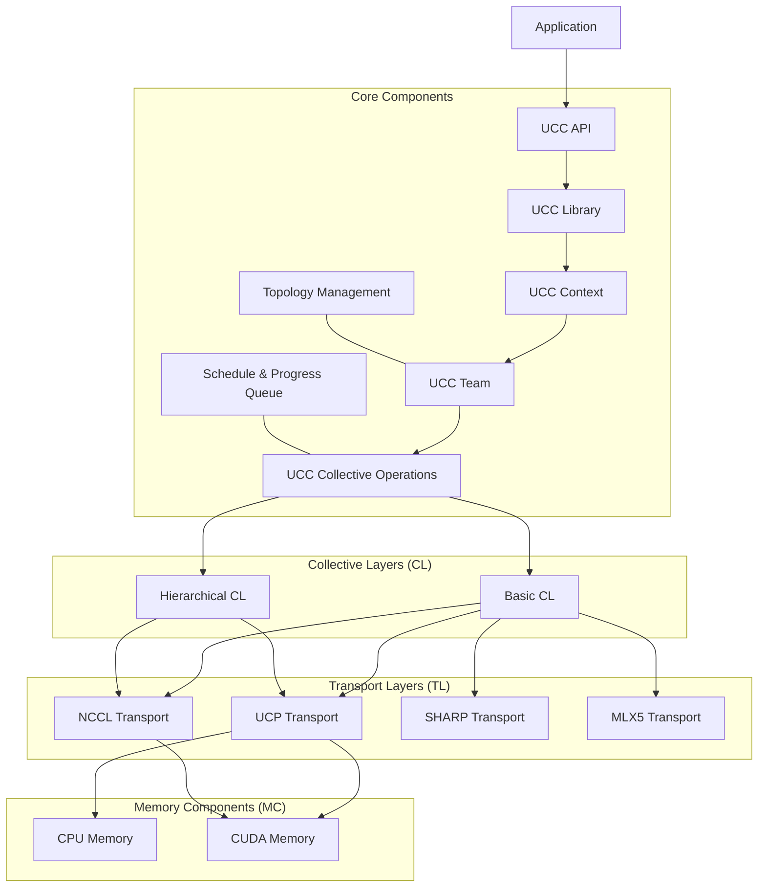

Sources: [src/ucc/api/ucc.h](), [src/core/ucc_lib.c](), [src/core/ucc_context.c](), [src/core/ucc_team.c](), [src/Makefile.am]()

### Key Components

- **UCC Library**: The top-level component that initializes and manages the framework
- **UCC Context**: Manages network resources and addressing information
- **UCC Team**: Represents a group of participants in collective operations
- **Collective Layers (CL)**: Implements collective algorithms (Basic, Hierarchical)
- **Transport Layers (TL)**: Interfaces with specific network technologies
- **Memory Components (MC)**: Handles different memory types (CPU, CUDA, ROCM)

## Core Components

### UCC Library

The UCC Library is the entry point to the UCC framework. It manages the initialization and finalization of UCC components, including the collective layers (CL), transport layers (TL), and memory components (MC).

Key functions:
- `ucc_init()`: Initialize the UCC library
- `ucc_finalize()`: Clean up the UCC library

Source: [src/core/ucc_lib.c]()

### UCC Context

The UCC Context abstracts network resources for collective operations. It can be configured as either exclusive (not shared) or shared. The context manages the exchange of addressing information between participants and creates internal instances of CL and TL contexts.

Key functions:
- `ucc_context_create()`: Create a UCC context
- `ucc_context_destroy()`: Clean up the UCC context

Source: [src/core/ucc_context.c](), [src/core/ucc_context.h]()

### UCC Team

The UCC Team represents a group of entities that participate in collective operations. It encapsulates team-specific networking information, manages team-level addressing, and handles the score map used for selecting optimal algorithms for collective operations.

Key functions:
- `ucc_team_create_post()`: Post team creation operation
- `ucc_team_create_test()`: Test completion of team creation
- `ucc_team_destroy()`: Clean up the UCC team

Source: [src/core/ucc_team.c](), [src/core/ucc_team.h]()

### Collective Operations

UCC supports a wide range of collective operations defined in `ucc_coll_type_t`:

```mermaid
graph TD
    COLL["UCC Collective Operations"]
    ALLGATHER["Allgather"]
    ALLGATHERV["Allgatherv"]
    ALLREDUCE["Allreduce"]
    ALLTOALL["Alltoall"]
    ALLTOALLV["Alltoallv"]
    BARRIER["Barrier"]
    BCAST["Broadcast"]
    FANIN["Fan-in"]
    FANOUT["Fan-out"]
    GATHER["Gather"]
    GATHERV["Gatherv"]
    REDUCE["Reduce"]
    REDUCE_SCATTER["Reduce-Scatter"]
    REDUCE_SCATTERV["Reduce-Scatterv"]
    SCATTER["Scatter"]
    SCATTERV["Scatterv"]
    
    COLL --> ALLGATHER
    COLL --> ALLGATHERV
    COLL --> ALLREDUCE
    COLL --> ALLTOALL
    COLL --> ALLTOALLV
    COLL --> BARRIER
    COLL --> BCAST
    COLL --> FANIN
    COLL --> FANOUT
    COLL --> GATHER
    COLL --> GATHERV
    COLL --> REDUCE
    COLL --> REDUCE_SCATTER
    COLL --> REDUCE_SCATTERV
    COLL --> SCATTER
    COLL --> SCATTERV
```

Key functions:
- `ucc_collective_init()`: Initialize a collective operation
- `ucc_collective_post()`: Post a collective operation
- `ucc_collective_test()`: Test the completion of a collective operation
- `ucc_collective_finalize()`: Clean up a collective operation

Source: [src/ucc/api/ucc.h:147-165]()

## Typical Usage Workflow

The following diagram illustrates the typical workflow for using UCC:

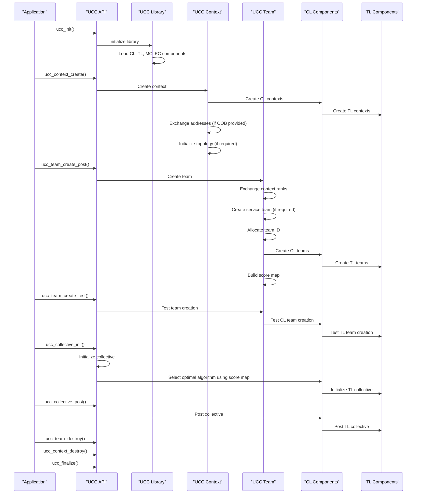

Sources: [src/ucc/api/ucc.h](), [src/core/ucc_lib.c](), [src/core/ucc_context.c](), [src/core/ucc_team.c]()

## Memory Types and Datatype Support

UCC supports various memory types defined in `ucc_memory_type_t`:
- `UCC_MEMORY_TYPE_HOST`: Default system memory
- `UCC_MEMORY_TYPE_CUDA`: NVIDIA CUDA memory
- `UCC_MEMORY_TYPE_CUDA_MANAGED`: NVIDIA CUDA managed memory
- `UCC_MEMORY_TYPE_ROCM`: AMD ROCM memory
- `UCC_MEMORY_TYPE_ROCM_MANAGED`: AMD ROCM managed system memory

UCC also supports various datatypes for collective operations, including int8/16/32/64/128, uint8/16/32/64/128, float16/32/64/128, bfloat16, and complex types. User-defined datatypes are supported through the `ucc_dt_create_generic()` interface.

Source: [src/ucc/api/ucc.h:170-177](), [src/ucc/api/ucc.h:201-221]()

## Transport Layer Architecture

UCC's modular architecture allows it to leverage different transport layers based on the available hardware and network configuration:

- **UCP Transport**: Uses UCX (Unified Communication X) for CPU and accelerator communication
- **NCCL Transport**: Leverages NVIDIA's NCCL library for GPU communication
- **SHARP Transport**: Uses Mellanox's Scalable Hierarchical Aggregation and Reduction Protocol
- **MLX5 Transport**: Direct interface with Mellanox hardware

The UCP transport layer is particularly important as it provides foundational communication capabilities and supports both CPU and GPU memory.

Source: [src/components/tl/ucp/tl_ucp_lib.c]()

## Version and Configuration

UCC is currently at version 1.5.0 (as defined in configure.ac). It can be configured using environment variables or through explicit API calls:

- `ucc_lib_config_read()`: Read UCC library configuration
- `ucc_context_config_read()`: Read UCC context configuration

Configuration files can override environment variables, and applications can modify configurations at runtime.

Source: [configure.ac:13-17]()

## Conclusion

UCC provides a flexible and high-performance framework for collective communication across different hardware accelerators and network technologies. By abstracting the complexities of underlying networks and providing a unified API, UCC enables applications to leverage optimal collective algorithms without dealing with hardware-specific details.

For more detailed information about specific components and their usage, refer to the other sections of this documentation.

---

# Page: Architecture Overview

# Architecture Overview

<details>
<summary>Relevant source files</summary>

The following files were used as context for generating this wiki page:

- [.github/workflows/docs.yaml](.github/workflows/docs.yaml)
- [docs/doxygen/collectives.md](docs/doxygen/collectives.md)
- [docs/doxygen/design.md](docs/doxygen/design.md)
- [docs/doxygen/events.md](docs/doxygen/events.md)
- [docs/doxygen/teams.md](docs/doxygen/teams.md)
- [docs/doxygen/ucc_doxygen.conf](docs/doxygen/ucc_doxygen.conf)
- [src/coll_score/ucc_coll_score_map.c](src/coll_score/ucc_coll_score_map.c)
- [src/core/ucc_coll.c](src/core/ucc_coll.c)
- [src/core/ucc_context.c](src/core/ucc_context.c)
- [src/core/ucc_context.h](src/core/ucc_context.h)
- [src/core/ucc_team.c](src/core/ucc_team.c)
- [src/core/ucc_team.h](src/core/ucc_team.h)
- [src/ucc/api/ucc.h](src/ucc/api/ucc.h)
- [src/ucc/api/ucc_def.h](src/ucc/api/ucc_def.h)
- [src/utils/ucc_coll_utils.c](src/utils/ucc_coll_utils.c)
- [src/utils/ucc_coll_utils.h](src/utils/ucc_coll_utils.h)
- [test/gtest/utils/test_ep_map.cc](test/gtest/utils/test_ep_map.cc)

</details>


This document provides a high-level overview of the Unified Collective Communication (UCC) framework architecture. It covers the main components, their relationships, and key operational flows. For information about building and configuring UCC, see [Building and Configuration](#1.2).

## High-Level Architecture

UCC is designed with a layered architecture to provide a unified interface for collective operations across various hardware accelerators and networks. The framework consists of core components, collective layers, transport layers, and memory components that work together to deliver optimized collective communication.

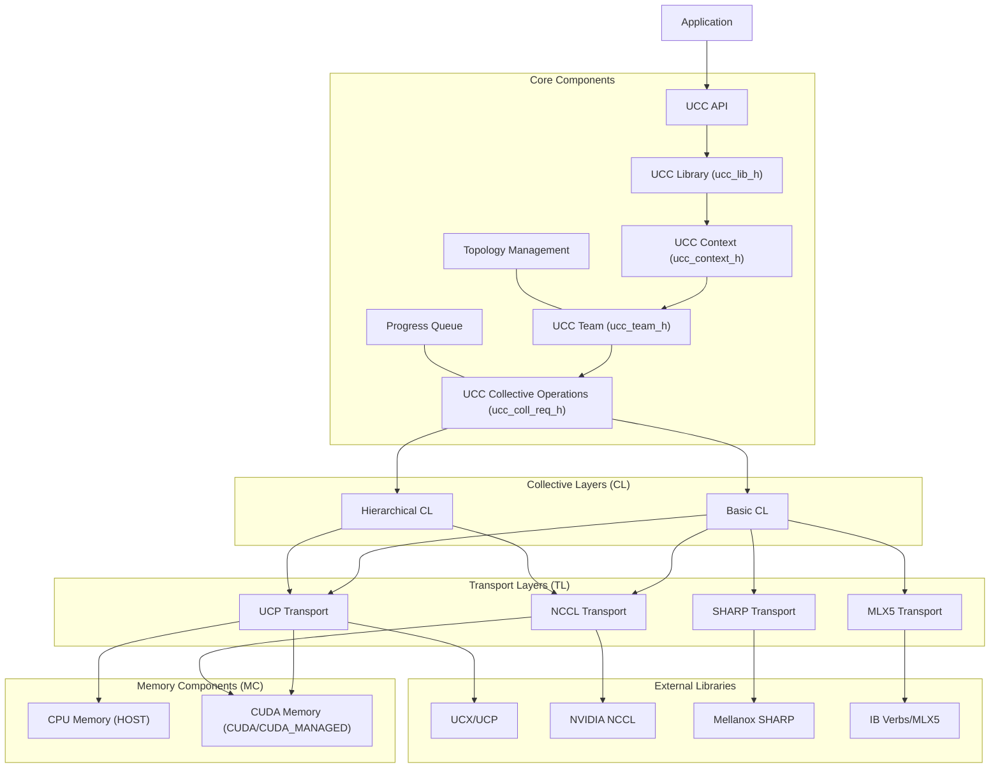

Sources: [src/ucc/api/ucc.h:21-28](), [src/ucc/api/ucc.h:25-51](), [src/core/ucc_context.h:52-81](), [src/core/ucc_team.h:29-51]()

## Core Components

### UCC Library

The UCC Library (`ucc_lib_h`) serves as the entry point for applications using UCC. It initializes the framework, loads components, and manages global resources. Key aspects include:

- Initialized through `ucc_init()` and finalized with `ucc_finalize()`
- Configurable thread safety modes (SINGLE, FUNNELED, MULTIPLE)
- Manages supported collective and reduction operations
- Configurable synchronization type

The library initialization parameters are defined in `ucc_lib_params_t` structure, which includes fields for thread mode, collective types, reduction types, and synchronization type.

Sources: [src/ucc/api/ucc.h:573-579](), [src/ucc/api/ucc.h:777-785](), [src/ucc/api/ucc.h:493-497]()

### UCC Context

A UCC Context (`ucc_context_h`) abstracts network resources for collective operations. It can be shared among multiple teams or used exclusively. Key aspects include:

- Created with `ucc_context_create()` and destroyed with `ucc_context_destroy()`
- Can be either EXCLUSIVE or SHARED (defined by `ucc_context_type_t`)
- Manages address exchange for distributed processes
- Provides progress tracking through a progress queue
- Maintains topology information when available

The context contains pointers to collective layer contexts (`cl_ctx`) and transport layer contexts (`tl_ctx`), which are created during context initialization.

Sources: [src/core/ucc_context.h:52-81](), [src/core/ucc_context.c:350-360](), [src/ucc/api/ucc.h:940-947]()

### UCC Team

A UCC Team (`ucc_team_h`) represents a group of endpoints that participate in collective operations. It:

- Maintains team size, rank, and endpoint mapping
- Manages state transitions during creation (ADDR_EXCHANGE → SERVICE_TEAM → ALLOC_ID → CL_CREATE → ACTIVE)
- Builds a score map for algorithm selection
- Contains pointers to collective layer teams (`cl_teams`)

Team creation is a multi-phase process that includes address exchange, service team creation, ID allocation, and CL team creation. Teams transition through several states defined by `ucc_team_state_t`.

Sources: [src/core/ucc_team.h:21-27](), [src/core/ucc_team.h:29-51](), [src/core/ucc_team.c:413-466]()

### Collective Operations

UCC supports various collective operations defined by `ucc_coll_type_t` (Allreduce, Broadcast, Gather, etc.). Collective operations flow includes:

- Initialization with `ucc_collective_init()`
- Posting with `ucc_collective_post()`
- Progress through the context's progress queue
- Finalization with `ucc_collective_finalize()`

Collective operations support different memory types and can handle asymmetric memory configurations across team members.

Sources: [src/ucc/api/ucc.h:147-165](), [src/ucc/api/ucc.h:170-178](), [src/core/ucc_coll.c:169-323]()

## Component Relationships

The following diagram shows the key relationships between UCC components and how they interact during operation:

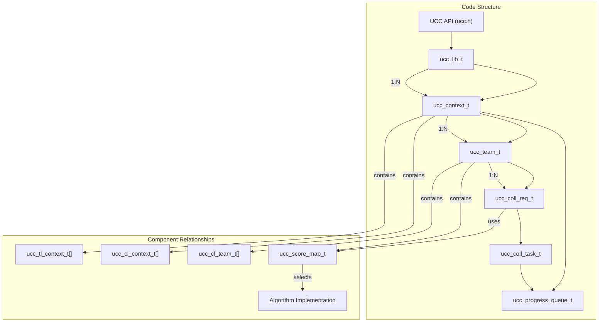

Sources: [src/core/ucc_context.h:52-81](), [src/core/ucc_team.h:29-51](), [src/coll_score/ucc_coll_score_map.c:114-150]()

## Operational Flows

### Context and Team Creation Flow

The following sequence diagram illustrates the process of creating contexts and teams:

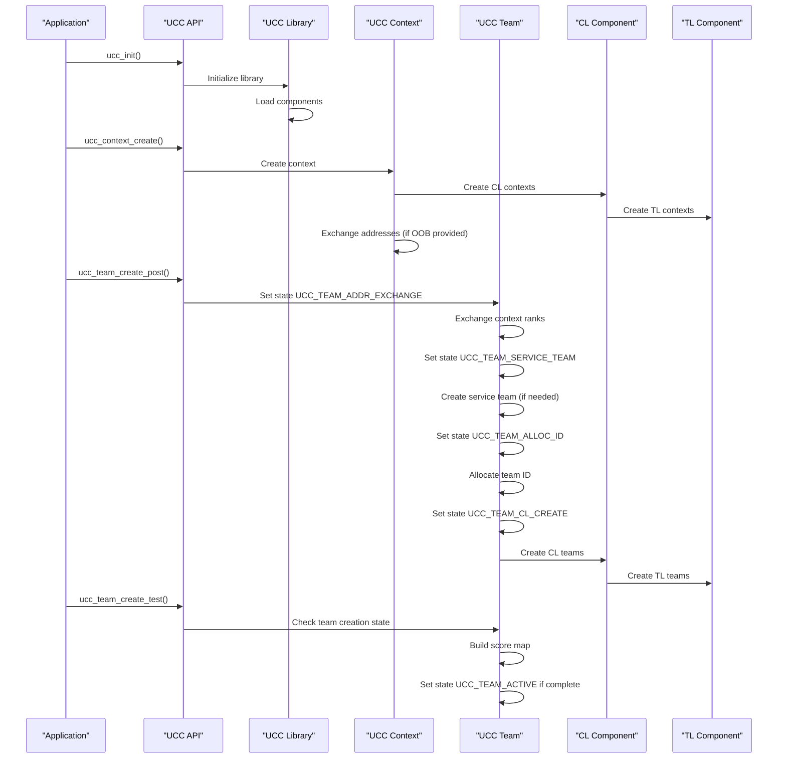

Sources: [src/core/ucc_team.c:93-213](), [src/core/ucc_team.c:413-466](), [src/core/ucc_context.c:350-448]()

### Collective Operations Flow

The following diagram shows the flow of initializing, posting, and completing collective operations:

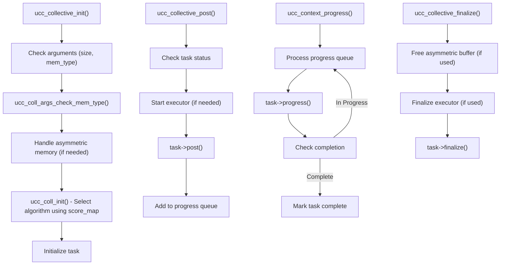

Sources: [src/core/ucc_coll.c:169-323](), [src/core/ucc_coll.c:342-388](), [src/core/ucc_coll.c:427-450]()

## Algorithm Selection

UCC uses a scoring mechanism to select the optimal algorithm for a given collective operation based on message size, memory type, and other factors.

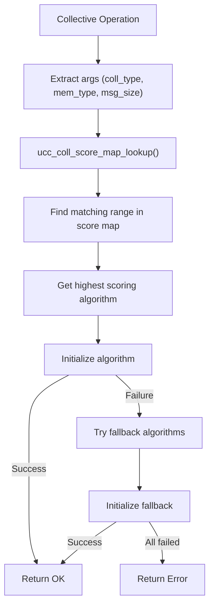

The score map (`ucc_score_map_t`) maps collective types, memory types, and message size ranges to algorithms with associated scores. During initialization, UCC selects the highest-scoring algorithm for the given parameters and falls back to alternatives if needed.

Sources: [src/coll_score/ucc_coll_score_map.c:79-150](), [src/utils/ucc_coll_utils.h:77-88]()

## Memory Management

UCC supports multiple memory types (HOST, CUDA, ROCM, etc.) and handles asymmetric memory configurations where different team members use different memory types. The memory type enumerations and related utilities include:

- Memory types defined in `ucc_memory_type_t` (HOST, CUDA, CUDA_MANAGED, ROCM, ROCM_MANAGED)
- Memory component functions for handling different memory types
- Support for detecting memory types and handling asymmetric memory configurations

Memory utilities check and handle cases where memory types don't match across team members, creating intermediate buffers when necessary.

Sources: [src/ucc/api/ucc.h:170-178](), [src/utils/ucc_coll_utils.h:18-31](), [src/utils/ucc_coll_utils.c:62-158]()

## Summary

The UCC architecture provides a flexible and extensible framework for collective operations, supporting various transport layers, memory types, and execution engines. The layered approach with collective layers, transport layers, and memory components allows for optimal algorithm selection based on the communication needs and available hardware.

Key advantages of this architecture include:
- Support for heterogeneous systems with multiple memory types
- Scalable collective operations across large systems
- Automatic selection of optimal algorithms
- Extensibility for new hardware and network technologies

Sources: [src/ucc/api/ucc.h:21-28](), [src/core/ucc_context.h:52-81](), [src/core/ucc_team.h:29-51](), [src/coll_score/ucc_coll_score_map.c:114-150]()

---

# Page: Building and Configuration

# Building and Configuration

<details>
<summary>Relevant source files</summary>

The following files were used as context for generating this wiki page:

- [config/m4/ucx.m4](config/m4/ucx.m4)
- [configure.ac](configure.ac)
- [contrib/ucc.conf](contrib/ucc.conf)
- [src/Makefile.am](src/Makefile.am)
- [src/components/tl/ucp/tl_ucp_lib.c](src/components/tl/ucp/tl_ucp_lib.c)
- [src/core/ucc_lib.c](src/core/ucc_lib.c)
- [src/core/ucc_lib.h](src/core/ucc_lib.h)
- [src/utils/ini.h](src/utils/ini.h)
- [src/utils/ucc_parser.c](src/utils/ucc_parser.c)
- [src/utils/ucc_parser.h](src/utils/ucc_parser.h)

</details>


This page documents how to build the UCC library and configure its runtime behavior. It covers the build system, compilation options, configuration mechanisms, and tuning parameters.

## Building UCC

UCC uses the GNU Autotools build system, with additional support for CMake.

### Prerequisites

Before building UCC, ensure you have the following dependencies:

- **Required**:
  - C compiler with C11 support
  - UCX (Unified Communication X) version 1.11 or newer
  - Autotools (autoconf, automake, libtool) or CMake

- **Optional**:
  - CUDA toolkit (for GPU support)
  - NCCL (for NVIDIA GPU collective operations)
  - ROCM/HIP (for AMD GPU support)
  - SHARP (for Mellanox SHARP acceleration)
  - Google Test (for building tests)
  - MPI (for testing and benchmarks)

### Basic Build Process

```bash
# Clone the repository
git clone https://github.com/openucx/ucc.git
cd ucc

# Configure with autotools
./autogen.sh
./configure --prefix=/path/to/install

# Build and install
make -j$(nproc)
make install
```

Sources: [configure.ac:13-121](), [src/Makefile.am:1-25]()

### Build Configuration Options

The `configure` script provides numerous options to customize the build:

| Option | Description |
|--------|-------------|
| `--prefix=PATH` | Installation directory (default: `/opt/ucf/ucc`) |
| `--with-ucx=DIR` | Path to UCX installation |
| `--with-cuda=DIR` | Path to CUDA installation for GPU support |
| `--with-nccl=DIR` | Path to NCCL installation |
| `--with-rocm=DIR` | Path to ROCm installation for AMD GPU support |
| `--with-docs-only` | Build only documentation |
| `--enable-debug` | Enable debug mode |
| `--enable-profiling` | Enable profiling support |

Sources: [configure.ac:114-121](), [configure.ac:168-189](), [config/m4/ucx.m4:1-173]()

### Conditional Component Building

The build system automatically detects available components and only builds what's supported on your system:

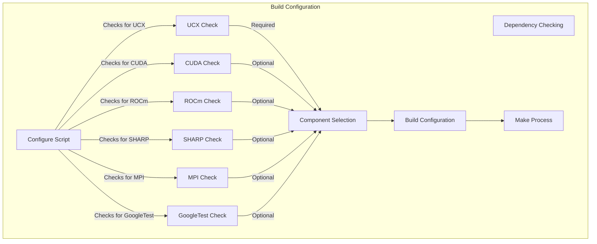

Sources: [configure.ac:184-290](), [src/Makefile.am:6-26]()

### Build Output

After a successful build, you'll see output similar to:

```
UCC build configuration:
      Build prefix:   /opt/ucf/ucc
Preprocessor flags:   -I/opt/ucx/include/
        C compiler:   gcc -O3 -std=gnu11
      C++ compiler:   g++ -O3 -std=c++11
     NVCC gencodes:   61 70 80
 DOCA UROM enabled:   no
ROCM architectures:   gfx908
          Perftest:   yes
             Gtest:   yes
        MC modules:   < cpu cuda rocm >
        TL modules:   < ucp >
      TLCP modules:   < >
```

Sources: [configure.ac:260-290]()

## Runtime Configuration

UCC provides a flexible configuration system that allows tuning parameters through environment variables and configuration files.

### Configuration Hierarchy

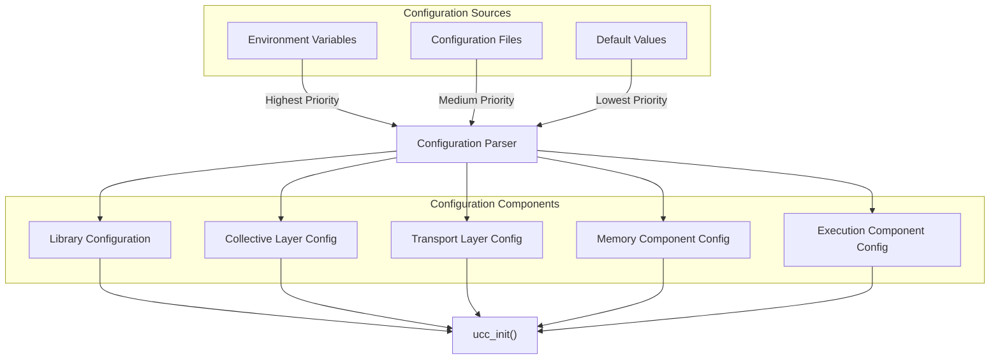

Sources: [src/core/ucc_lib.c:374-435](), [src/utils/ucc_parser.c:578-650]()

### Environment Variables

UCC uses environment variables with the prefix `UCC_` or `<PREFIX>_UCC_` where `<PREFIX>` is optional:

| Environment Variable | Description | Default |
|---------------------|-------------|---------|
| `UCC_CLS` | Comma-separated list of Collective Layers (CL) to use | "basic" |
| `UCC_LIB_TLS` | Transport Layers (TL) to use | All available |
| `UCC_LOG_LEVEL` | Logging level (error, warn, info, debug, trace) | "warn" |
| `UCC_LOG_COMPONENT` | Components to log (can use wildcards) | All |
| `UCC_CONFIG_FILE` | Path to configuration file | None |
| `UCC_THREAD_MODE` | Threading mode (single, multiple) | "single" |

Sources: [src/core/ucc_lib.c:23-31](), [src/utils/ucc_parser.c:400-417]()

### Configuration File

UCC can load configuration from INI-style files. By default, UCC looks for configuration in:

1. Path specified by `UCC_CONFIG_FILE` environment variable
2. `$HOME/.ucc/ucc.conf`
3. `<install_prefix>/etc/ucc.conf`

Example configuration file:

```ini
# Global UCC settings
UCC_CLS=basic
UCC_LOG_LEVEL=info

# Transport Layer specific settings
UCC_TL_UCP_ALLREDUCE_KN_RADIX=2

# Architecture-specific tuning section
[vendor=intel model=skylake team_size=40 ppn=40 nnodes=1]
UCC_TL_UCP_ALLREDUCE_KN_RADIX=2
UCC_TL_UCP_ALLREDUCE_SRA_KN_RADIX=0-128k:host:2,128k-inf:host:8
UCC_TL_UCP_TUNE=allreduce:0-2k:@0#allreduce:2k-inf:@1
```

Sources: [contrib/ucc.conf:1-149](), [src/utils/ini.h:1-151](), [src/utils/ucc_parser.c:401-464]()

### Configuration Components

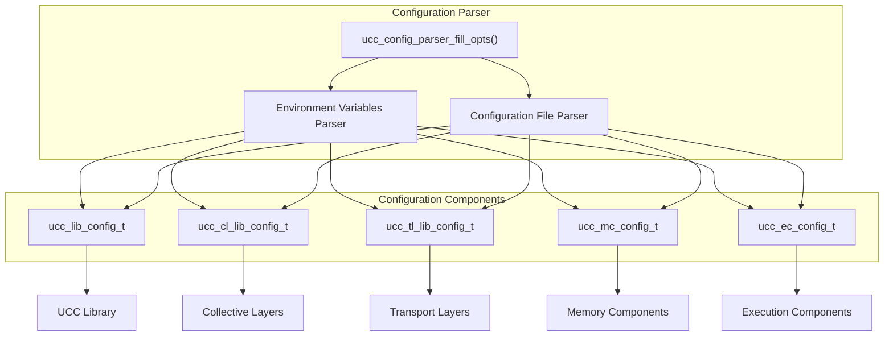

Sources: [src/core/ucc_lib.c:23-31](), [src/core/ucc_lib.h:21-27](), [src/utils/ucc_parser.h:103-132]()

## Tuning Configuration

UCC provides a sophisticated tuning mechanism that allows optimizing collective operations based on hardware characteristics and execution parameters.

### Tuning Sections

Tuning sections in the configuration file allow specifying parameters for specific hardware and team configurations:

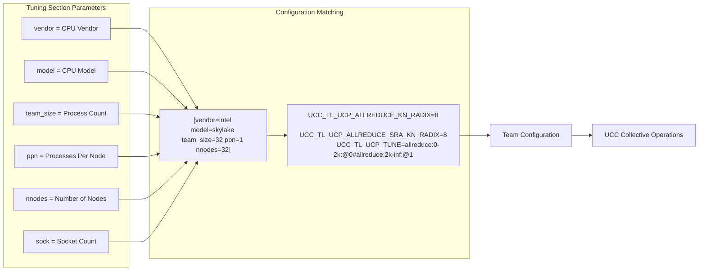

Sources: [contrib/ucc.conf:25-149](), [src/utils/ucc_parser.c:46-88](), [src/utils/ucc_parser.c:586-626]()

### Algorithm Selection Configuration

UCC's algorithm selection can be configured using special parameters like `UCC_TL_UCP_TUNE`, which specifies which algorithms should be used for different message sizes:

```
UCC_TL_UCP_TUNE=allreduce:0-2k:@0#allreduce:2k-inf:@1
```

This specifies:
- For allreduce operations with message sizes 0-2KB, use algorithm 0 (typically KNomial)
- For allreduce operations with message sizes > 2KB, use algorithm 1 (typically SRA)

Sources: [contrib/ucc.conf:29-30](), [src/utils/ucc_parser.c:586-626]()

### Radix Parameters

Many collective algorithms use knomial trees with configurable radices:

```
UCC_TL_UCP_ALLREDUCE_KN_RADIX=0-8k:host:2,8k-inf:host:8
```

This specifies:
- For message sizes 0-8KB, use radix 2 (binary tree)
- For message sizes > 8KB, use radix 8 (octonary tree)

Sources: [contrib/ucc.conf:25-149](), [src/components/tl/ucp/tl_ucp_lib.c:30-38]()

## Advanced Configuration Flow

The following diagram illustrates how configuration flows through the UCC initialization process:

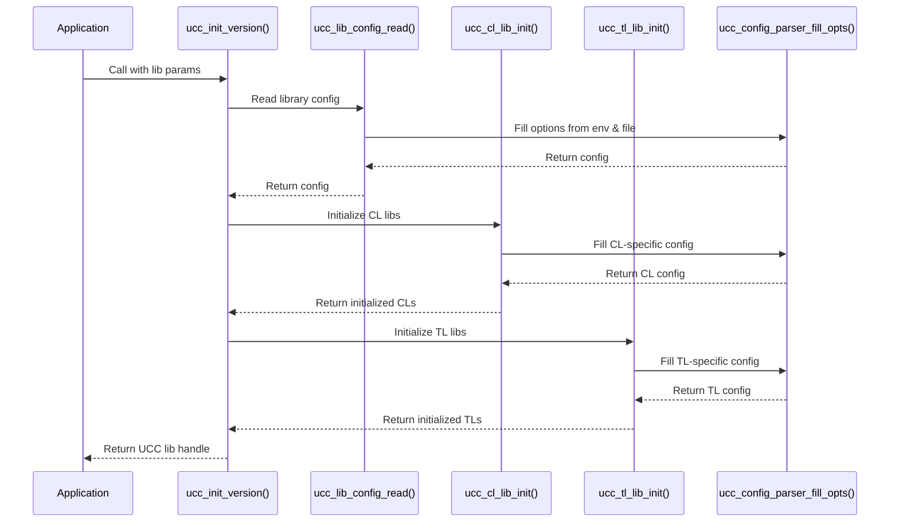

Sources: [src/core/ucc_lib.c:292-369](), [src/utils/ucc_parser.c:629-650]()

## Practical Examples

### Building with CUDA Support

```bash
./configure --prefix=/opt/ucc --with-cuda=/usr/local/cuda \
            --with-nccl=/usr/local/nccl
make -j$(nproc)
make install
```

### Setting Environment Configuration

```bash
# Use basic and hierarchical collective layers
export UCC_CLS=basic,hier

# Set logging level to debug
export UCC_LOG_LEVEL=debug

# Run your MPI application
mpirun -np 16 ./my_application
```

### Creating a Custom Configuration File

```bash
# Create config file
cat > my_ucc.conf << EOF
# Global settings
UCC_LOG_LEVEL=info
UCC_CLS=basic,hier

# Intel Skylake-specific tuning
[vendor=intel model=skylake team_size=16 ppn=16 nnodes=1]
UCC_TL_UCP_ALLREDUCE_KN_RADIX=2
UCC_TL_UCP_TUNE=allreduce:0-8k:@0#allreduce:8k-inf:@1
EOF

# Use the config file
export UCC_CONFIG_FILE=$(pwd)/my_ucc.conf
mpirun -np 16 ./my_application
```

This completes the documentation for building and configuring UCC. For information about available collective operations, see [Collective Operations](#2.3). For details on the transport layers, see [Transport Layers](#3).

---

# Page: Core Components

# Core Components

<details>
<summary>Relevant source files</summary>

The following files were used as context for generating this wiki page:

- [.github/workflows/docs.yaml](.github/workflows/docs.yaml)
- [docs/doxygen/collectives.md](docs/doxygen/collectives.md)
- [docs/doxygen/design.md](docs/doxygen/design.md)
- [docs/doxygen/events.md](docs/doxygen/events.md)
- [docs/doxygen/teams.md](docs/doxygen/teams.md)
- [docs/doxygen/ucc_doxygen.conf](docs/doxygen/ucc_doxygen.conf)
- [src/components/base/ucc_base_iface.h](src/components/base/ucc_base_iface.h)
- [src/components/cl/basic/cl_basic.c](src/components/cl/basic/cl_basic.c)
- [src/components/cl/basic/cl_basic.h](src/components/cl/basic/cl_basic.h)
- [src/components/cl/basic/cl_basic_context.c](src/components/cl/basic/cl_basic_context.c)
- [src/components/cl/basic/cl_basic_lib.c](src/components/cl/basic/cl_basic_lib.c)
- [src/components/cl/basic/cl_basic_team.c](src/components/cl/basic/cl_basic_team.c)
- [src/components/cl/ucc_cl.c](src/components/cl/ucc_cl.c)
- [src/components/cl/ucc_cl.h](src/components/cl/ucc_cl.h)
- [src/components/tl/ucc_tl.c](src/components/tl/ucc_tl.c)
- [src/components/tl/ucc_tl.h](src/components/tl/ucc_tl.h)
- [src/ucc/api/ucc.h](src/ucc/api/ucc.h)
- [src/ucc/api/ucc_def.h](src/ucc/api/ucc_def.h)

</details>


The Core Components of UCC (Unified Collective Communication) form the foundational elements of the UCC framework. This page provides an overview of the core architectural components that enable collective operations across different hardware accelerators and networks. For specific details about the UCC API, see [UCC API](#2.1); for context and team management details, see [Context and Team Management](#2.2); for details about collective operations, see [Collective Operations](#2.3).

## Component Architecture Overview

UCC is designed as a modular system with several layered components that work together to provide efficient collective communication operations. The core components include:

1. **UCC Library** - The top-level component that initializes the framework and loads other components
2. **UCC Context** - Abstracts network resources for collective operations
3. **UCC Team** - Represents a group of processes/threads that participate in collective operations
4. **Collective Layers (CL)** - Implements collective algorithms and strategies
5. **Transport Layers (TL)** - Provides communication primitives over different transports
6. **Memory Components (MC)** - Manages memory across different memory spaces (CPU, GPU, etc.)

The following diagram illustrates the high-level architecture of UCC core components:

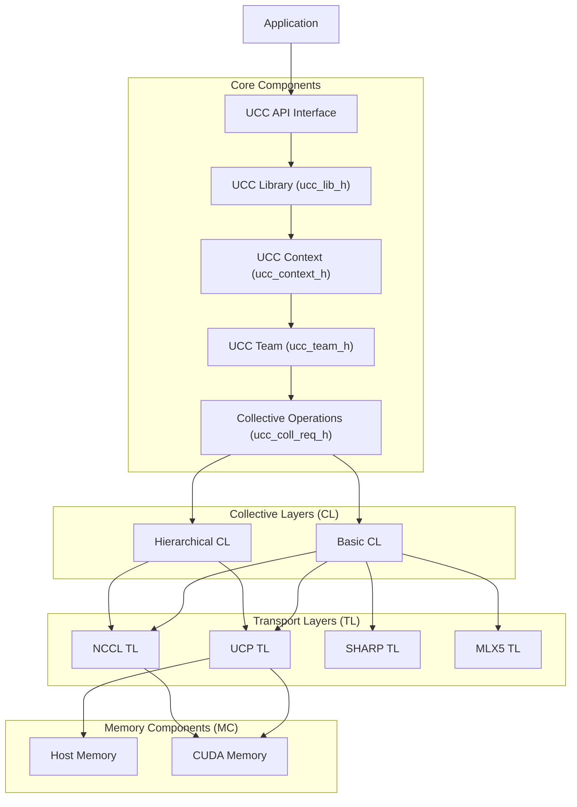

Sources: [src/ucc/api/ucc.h:19-101](), [src/components/tl/ucc_tl.h:16-23](), [src/components/cl/ucc_cl.h:17-32]()

## Component Hierarchy and Interfaces

UCC implements a hierarchical system where components are organized in multiple layers with well-defined interfaces. The following diagram shows the inheritance and relationship structure between the core components:

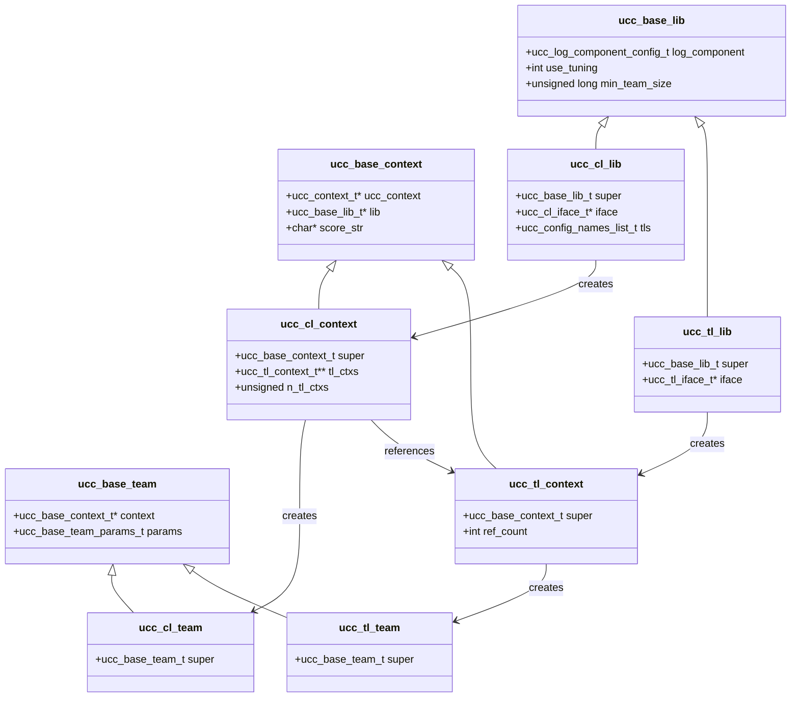

Sources: [src/components/base/ucc_base_iface.h:25-102](), [src/components/cl/ucc_cl.h:74-102](), [src/components/tl/ucc_tl.h:83-102]()

## UCC Library

The UCC library is the top-level component that initializes the framework and manages all other components. 

### Library Initialization

The library is initialized using the `ucc_init()` function, which creates a library handle (`ucc_lib_h`) that encapsulates the global resources and functionality of UCC.

```c
ucc_status_t ucc_init(const ucc_lib_params_t *params,
                     const ucc_lib_config_h config,
                     ucc_lib_h *lib_p);
```

The library can be configured through:
- Environment variables
- Configuration files
- Programmatic configuration via the `ucc_lib_params_t` struct

Key configuration parameters include:
- Thread mode (`UCC_THREAD_SINGLE`, `UCC_THREAD_FUNNELED`, `UCC_THREAD_MULTIPLE`)
- Supported collective types
- Supported reduction operations
- Synchronization model

Sources: [src/ucc/api/ucc.h:777-785](), [src/ucc/api/ucc.h:573-579]()

### Library Attributes

The library attributes can be queried using the `ucc_lib_get_attr()` function, which returns information about the configured parameters and capabilities of the library.

```c
ucc_status_t ucc_lib_get_attr(ucc_lib_h lib_p, ucc_lib_attr_t *lib_attr);
```

Sources: [src/ucc/api/ucc.h:830-833]()

## UCC Context

A UCC context abstracts network resources (hardware or software) required for collective operations. Contexts can be exclusive (used by a single process/thread) or shared (used by multiple processes/threads).

### Context Creation and Configuration

Contexts are created using the `ucc_context_create()` function:

```c
ucc_status_t ucc_context_create(ucc_lib_h lib_handle,
                               const ucc_context_params_t *params,
                               const ucc_context_config_h config,
                               ucc_context_h *context);
```

Key context parameters include:
- Context type (`UCC_CONTEXT_EXCLUSIVE` or `UCC_CONTEXT_SHARED`)
- Synchronization type
- Out-of-band (OOB) collective operations for context initialization
- Memory parameters for attaching memory segments

Sources: [src/ucc/api/ucc.h:840-975](), [src/ucc/api/ucc_def.h:38]()

### Context Attributes

Context attributes can be queried to understand the capabilities and configuration of a context:

```c
ucc_status_t ucc_context_get_attr(ucc_context_h context, 
                                 ucc_context_attr_t *attr);
```

Sources: [src/ucc/api/ucc.h:968-975]()

## UCC Team

A UCC team represents a group of processes or threads that participate in collective operations. Teams are created from contexts and provide the execution environment for collective operations.

### Team Creation

Teams are created in a non-blocking manner using the `ucc_team_create_post()` and `ucc_team_create_test()` functions:

```c
ucc_status_t ucc_team_create_post(ucc_context_h *contexts,
                                 uint32_t num_contexts,
                                 ucc_team_params_t *params,
                                 ucc_team_h *team);

ucc_status_t ucc_team_create_test(ucc_team_h team);
```

Team creation is a distributed operation that requires all participants to call the creation functions. The team creation process is illustrated in the following sequence diagram:

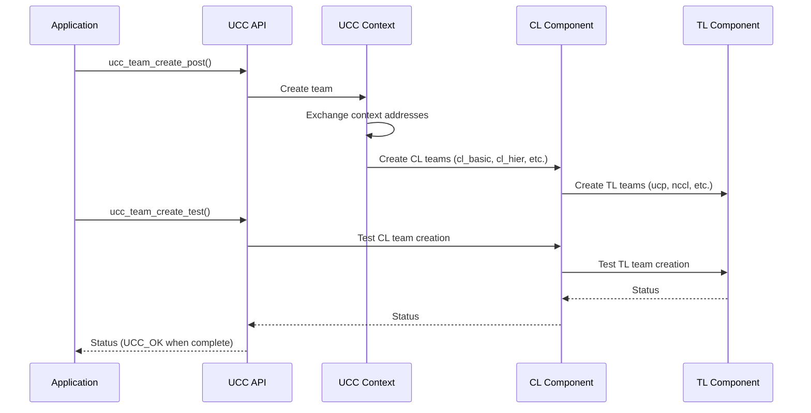

Sources: [src/components/cl/basic/cl_basic_team.c:11-206](), [src/components/tl/ucc_tl.c:271-310]()

## Collective Operations

Collective operations are communication operations that involve all members of a team. Examples include broadcast, allreduce, allgather, etc.

### Collective Types

UCC supports a wide range of collective operations defined in the `ucc_coll_type_t` enumeration:

```c
typedef enum {
    UCC_COLL_TYPE_ALLGATHER,
    UCC_COLL_TYPE_ALLGATHERV,
    UCC_COLL_TYPE_ALLREDUCE,
    UCC_COLL_TYPE_ALLTOALL,
    UCC_COLL_TYPE_ALLTOALLV,
    UCC_COLL_TYPE_BARRIER,
    UCC_COLL_TYPE_BCAST,
    UCC_COLL_TYPE_FANIN,
    UCC_COLL_TYPE_FANOUT,
    UCC_COLL_TYPE_GATHER,
    UCC_COLL_TYPE_GATHERV,
    UCC_COLL_TYPE_REDUCE,
    UCC_COLL_TYPE_REDUCE_SCATTER,
    UCC_COLL_TYPE_REDUCE_SCATTERV,
    UCC_COLL_TYPE_SCATTER,
    UCC_COLL_TYPE_SCATTERV,
    UCC_COLL_TYPE_LAST
} ucc_coll_type_t;
```

Sources: [src/ucc/api/ucc.h:147-165]()

### Collective Execution

Collective operations go through a lifecycle of initialization, execution, and finalization:

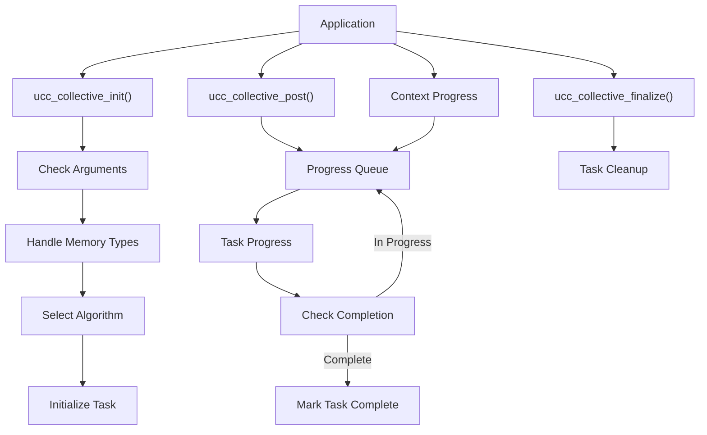

Sources: [src/components/base/ucc_base_iface.h:179-191]()

## Component Layer Relationships

The UCC framework uses a layered approach to implement collective operations:

1. **Collective Layer (CL)** - Implements high-level collective algorithms
   - Basic CL - Simple implementation directly over TLs
   - Hierarchical CL - Optimizes for multi-level topologies

2. **Transport Layer (TL)** - Implements communication primitives
   - UCP TL - Uses UCX/UCP for point-to-point communication
   - NCCL TL - Uses NVIDIA NCCL for GPU collectives
   - SHARP TL - Uses Mellanox SHARP for hardware-accelerated collectives
   - MLX5 TL - Uses Mellanox MLX5 for direct hardware operations

The following diagram shows the relationship between these layers:

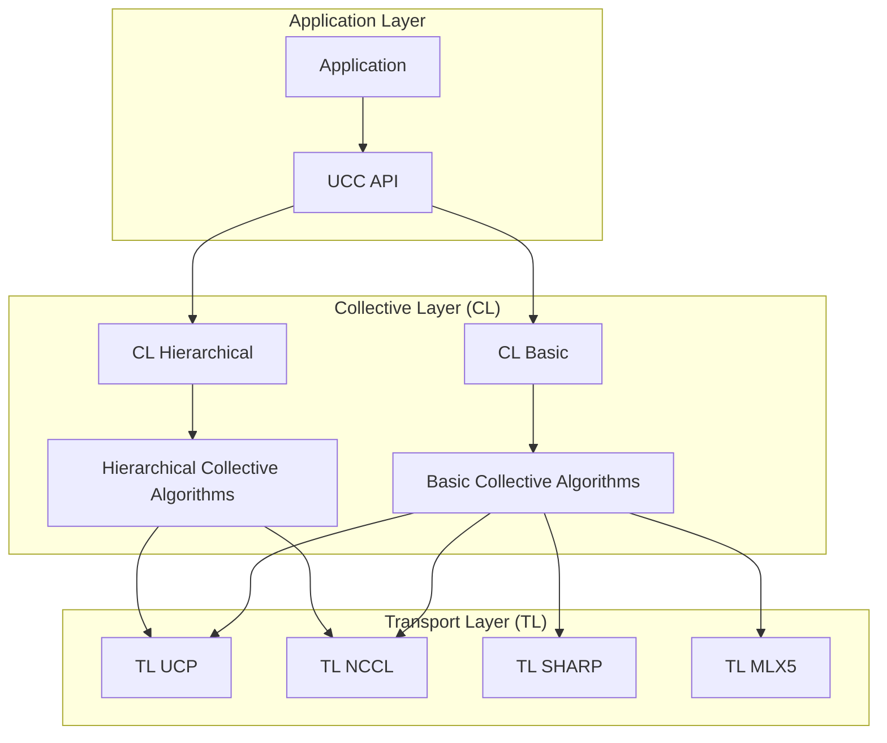

Sources: [src/components/cl/ucc_cl.h:17-32](), [src/components/tl/ucc_tl.h:16-23]()

## CL Basic Component

The Basic Collective Layer (CL Basic) provides a fundamental implementation of collective operations by directly leveraging Transport Layers. It serves as the base component for collective operations.

### CL Basic Structure

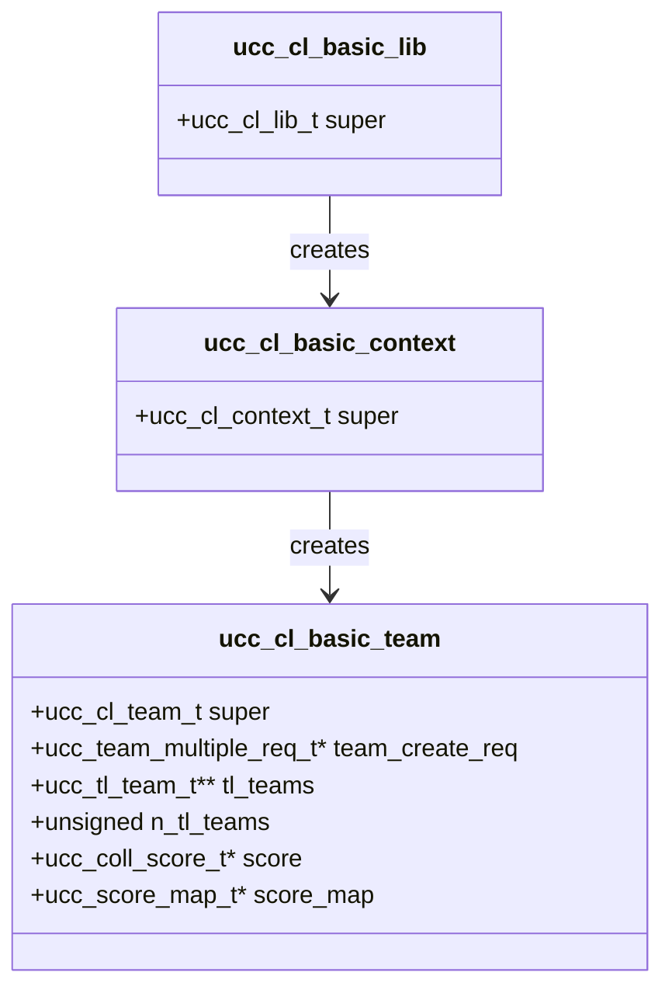

Sources: [src/components/cl/basic/cl_basic.h:32-53](), [src/components/cl/basic/cl_basic_team.c:11-104]()

### Team Creation in CL Basic

The CL Basic team creation process involves:
1. Initialization of the CL Basic team structure
2. Allocation of TL team arrays
3. Creation of multiple TL teams (one for each supported TL)
4. Building a score map for algorithm selection

Sources: [src/components/cl/basic/cl_basic_team.c:11-104](), [src/components/cl/basic/cl_basic_team.c:106-168]()

## Transport Layer (TL) Component

Transport Layers provide the actual communication primitives used by Collective Layers. They abstract hardware-specific communication mechanisms.

### TL Structure

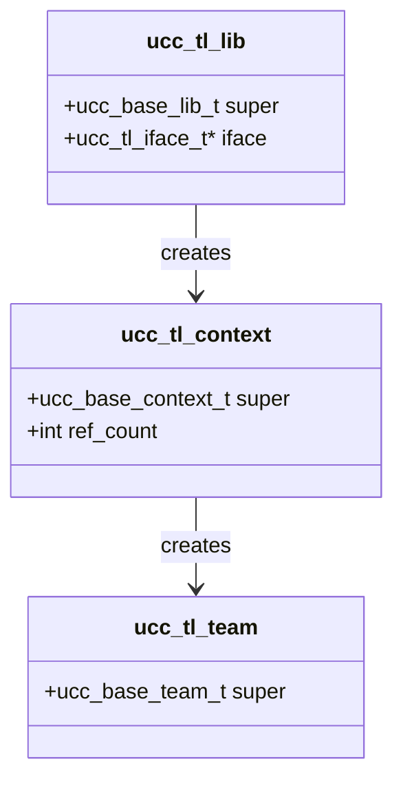

Sources: [src/components/tl/ucc_tl.h:83-101](), [src/components/tl/ucc_tl.c:26-68](), [src/components/tl/ucc_tl.c:69-89](), [src/components/tl/ucc_tl.c:271-310]()

## Component Life Cycle

The life cycle of UCC components follows a consistent pattern:

1. **Initialization**: Components are created using initialization functions
2. **Configuration**: Components are configured through parameter structures
3. **Operation**: Components perform their intended functions
4. **Cleanup**: Components are destroyed and their resources released

This pattern is applied at each level of the component hierarchy:

```mermaid
sequenceDiagram
    participant App as Application
    participant UCC as UCC API
    participant Lib as UCC Library
    participant Ctx as UCC Context
    participant Team as UCC Team
    participant Coll as Collective Operation
    
    App->>UCC: ucc_init()
    UCC->>Lib: Initialize Library
    
    App->>UCC: ucc_context_create()
    UCC->>Ctx: Create Context
    
    App->>UCC: ucc_team_create_post()
    UCC->>Team: Create Team (post)
    
    App->>UCC: ucc_team_create_test()
    UCC->>Team: Test Team Creation
    
    App->>UCC: ucc_collective_init()
    UCC->>Coll: Initialize Collective
    
    App->>UCC: ucc_collective_post()
    UCC->>Coll: Post Collective
    
    App->>UCC: ucc_collective_finalize()
    UCC->>Coll: Finalize Collective
    
    App->>UCC: ucc_team_destroy()
    UCC->>Team: Destroy Team
    
    App->>UCC: ucc_context_destroy()
    UCC->>Ctx: Destroy Context
    
    App->>UCC: ucc_finalize()
    UCC->>Lib: Finalize Library
```

Sources: [src/ucc/api/ucc.h:777-785](), [src/ucc/api/ucc.h:807-809](), [src/components/cl/basic/cl_basic_context.c:10-64](), [src/components/cl/basic/cl_basic_team.c:11-104]()

## Memory Types

UCC supports various memory types to handle data in different memory spaces:

```c
typedef enum ucc_memory_type {
    UCC_MEMORY_TYPE_HOST,         // Default system memory
    UCC_MEMORY_TYPE_CUDA,         // NVIDIA CUDA memory
    UCC_MEMORY_TYPE_CUDA_MANAGED, // NVIDIA CUDA managed memory
    UCC_MEMORY_TYPE_ROCM,         // AMD ROCM memory
    UCC_MEMORY_TYPE_ROCM_MANAGED, // AMD ROCM managed system memory
    UCC_MEMORY_TYPE_LAST,
    UCC_MEMORY_TYPE_UNKNOWN = UCC_MEMORY_TYPE_LAST
} ucc_memory_type_t;
```

Sources: [src/ucc/api/ucc.h:170-178]()

## Summary

The Core Components of UCC provide a flexible and extensible framework for collective operations. The layered architecture allows for:

1. Different collective algorithms through Collective Layers (CL)
2. Different communication transports through Transport Layers (TL)
3. Support for various memory types through Memory Components (MC)

This modular design enables UCC to deliver high performance across a wide range of hardware platforms and network technologies, while presenting a unified interface to applications.

Sources: [src/ucc/api/ucc.h:21-28](), [src/components/cl/ucc_cl.h:17-32](), [src/components/tl/ucc_tl.h:16-23]()

---

# Page: UCC API

# UCC API

<details>
<summary>Relevant source files</summary>

The following files were used as context for generating this wiki page:

- [.github/workflows/docs.yaml](.github/workflows/docs.yaml)
- [configure.ac](configure.ac)
- [docs/doxygen/collectives.md](docs/doxygen/collectives.md)
- [docs/doxygen/design.md](docs/doxygen/design.md)
- [docs/doxygen/events.md](docs/doxygen/events.md)
- [docs/doxygen/teams.md](docs/doxygen/teams.md)
- [docs/doxygen/ucc_doxygen.conf](docs/doxygen/ucc_doxygen.conf)
- [src/Makefile.am](src/Makefile.am)
- [src/components/tl/ucp/tl_ucp_lib.c](src/components/tl/ucp/tl_ucp_lib.c)
- [src/core/ucc_lib.c](src/core/ucc_lib.c)
- [src/core/ucc_lib.h](src/core/ucc_lib.h)
- [src/ucc/api/ucc.h](src/ucc/api/ucc.h)
- [src/ucc/api/ucc_def.h](src/ucc/api/ucc_def.h)

</details>


This page provides a detailed description of the Unified Collective Communication (UCC) API, including library initialization, context management, team creation, and collective operations. UCC provides a flexible interface for collective communication operations across various programming models and hardware platforms. For more information about the broader UCC architecture, see [Architecture Overview](#1.1).

## API Structure Overview

The UCC API consists of several main components that enable collective communication operations:

```mermaid
graph TD
    App["Application"] --> API["UCC API"]
    
    subgraph "API Components"
        API --> LibInit["Library Initialization (ucc_init)"]
        API --> CtxMgmt["Context Management (ucc_context_*)"]
        API --> TeamMgmt["Team Management (ucc_team_*)"]
        API --> CollOps["Collective Operations (ucc_collective_*)"]
        API --> EventOps["Events & Triggered Operations (ucc_ee_*)"]
    end
    
    subgraph "Data Types"
        API --> DataTypes["Datatypes (ucc_datatype_t)"]
        API --> ReductionOps["Reduction Operations (ucc_reduction_op_t)"]
        API --> MemTypes["Memory Types (ucc_memory_type_t)"]
    end
    
    subgraph "Configuration"
        API --> ThreadModel["Thread Models (ucc_thread_mode_t)"]
        API --> SyncModel["Synchronization Models (ucc_coll_sync_type_t)"]
    end
```

Sources: [src/ucc/api/ucc.h:21-115]()

## Library Initialization and Finalization

Using UCC starts with initializing the library and ends with finalizing it. This process creates and destroys the library handle that's required for all subsequent operations.

### Initialization Sequence

```mermaid
sequenceDiagram
    participant App as Application
    participant API as UCC API
    participant Config as Configuration
    participant Lib as Library Instance
    
    App->>API: ucc_lib_config_read(env_prefix, filename, &config)
    API->>Config: Create configuration
    Config-->>App: Return config handle
    
    App->>API: ucc_init(params, config, &lib_p)
    API->>Lib: Initialize library components
    Lib->>Lib: Load CL, TL, MC, EC components
    Lib-->>App: Return library handle
    
    App->>API: ucc_lib_config_release(config)
    API->>Config: Release configuration
    
    Note over App,Lib: Use library...
    
    App->>API: ucc_finalize(lib_p)
    API->>Lib: Release resources
    Lib-->>App: Return status
```

Sources: [src/ucc/api/ucc.h:727-785](), [src/core/ucc_lib.c:292-372](), [src/core/ucc_lib.c:476-509]()

### Library Configuration and Parameters

The `ucc_lib_params_t` structure allows customizing the library behavior:

```c
typedef struct ucc_lib_params {
    uint64_t                mask;           // Indicates which fields are valid
    ucc_thread_mode_t       thread_mode;    // Thread support level
    uint64_t                coll_types;     // Requested collective operations
    uint64_t                reduction_types; // Requested reduction operations
    ucc_coll_sync_type_t    sync_type;      // Synchronization type
} ucc_lib_params_t;
```

Sources: [src/ucc/api/ucc.h:573-579]()

When initializing a UCC library, the environment can be configured through the `ucc_lib_config_read()` function which reads configuration from environment variables, optionally with a custom prefix:

```c
ucc_status_t ucc_lib_config_read(const char *env_prefix, const char *filename,
                                ucc_lib_config_h *config);
```

Sources: [src/ucc/api/ucc.h:637-639](), [src/core/ucc_lib.c:374-435]()

## Context Management

A UCC context abstracts network resources for collective operations. It represents the communication resources that will be used for collective operations.

### Context Creation Process

```mermaid
sequenceDiagram
    participant App as Application
    participant API as UCC API
    participant Lib as Library Handle
    participant Ctx as Context Instance
    participant CL as Collective Layers
    participant TL as Transport Layers
    
    App->>API: ucc_context_config_read(lib_handle, filename, &config)
    API->>Lib: Read context configuration
    Lib-->>App: Return config handle
    
    App->>API: ucc_context_create(lib_handle, params, config, &context)
    API->>Ctx: Create context
    Ctx->>CL: Create CL contexts
    CL->>TL: Create TL contexts
    
    alt OOB provided
        Ctx->>Ctx: Exchange addresses
    end
    
    alt required
        Ctx->>Ctx: Initialize topology
    end
    
    Ctx-->>App: Return context handle
    
    App->>API: ucc_context_config_release(config)
    API->>Lib: Release config
    
    Note over App,TL: Use context...
    
    App->>API: ucc_context_destroy(context)
    API->>Ctx: Destroy context
    Ctx->>CL: Destroy CL contexts
    CL->>TL: Destroy TL contexts
    Ctx-->>App: Return status
```

Sources: [src/ucc/api/ucc.h:1006-1084]()

### Context Parameters

The `ucc_context_params_t` structure configures the context behavior:

```c
typedef struct ucc_context_params {
    uint64_t                mask;
    ucc_context_type_t      type;        // EXCLUSIVE or SHARED
    ucc_coll_sync_type_t    sync_type;   // Synchronization type
    ucc_context_oob_coll_t  oob;         // Out-of-band collective for address exchange
    uint64_t                ctx_id;      // Unique context identifier
    ucc_mem_map_params_t    mem_params;  // Memory segments mapping
} ucc_context_params_t;
```

Sources: [src/ucc/api/ucc.h:940-947]()

## Team Management

A UCC team encapsulates resources required for collective operations and defines the participants for these operations.

### Team Creation and Management

```mermaid
sequenceDiagram
    participant App as Application
    participant API as UCC API
    participant Ctx as Context
    participant Team as Team
    participant CL as Collective Layers
    participant TL as Transport Layers
    
    App->>API: ucc_team_create_post(contexts, num_contexts, params, &team)
    API->>Team: Create team
    Team->>Team: Exchange context ranks
    Team->>Team: Create service team (if required)
    Team->>Team: Allocate team ID
    Team->>CL: Create CL teams
    CL->>TL: Create TL teams
    Team->>Team: Build score map
    Team-->>App: Return team handle (operation in progress)
    
    App->>API: ucc_team_create_test(team)
    API->>Team: Test team creation
    Team->>CL: Test CL team creation
    CL->>TL: Test TL team creation
    Team-->>App: Return status (UCC_OK when completed)
    
    Note over App,TL: Use team for collective operations...
    
    App->>API: ucc_team_destroy(team)
    API->>Team: Destroy team
    Team->>CL: Destroy CL teams
    CL->>TL: Destroy TL teams
    Team-->>App: Return status
```

Sources: [docs/doxygen/teams.md:1-22]()

## Collective Operations

UCC supports a wide range of collective communication operations that can be performed on teams.

### Supported Collective Types

UCC provides numerous collective operation types defined in the `ucc_coll_type_t` enumeration:

```c
typedef enum {
    UCC_COLL_TYPE_ALLGATHER          = UCC_BIT(0),
    UCC_COLL_TYPE_ALLGATHERV         = UCC_BIT(1),
    UCC_COLL_TYPE_ALLREDUCE          = UCC_BIT(2),
    UCC_COLL_TYPE_ALLTOALL           = UCC_BIT(3),
    UCC_COLL_TYPE_ALLTOALLV          = UCC_BIT(4),
    UCC_COLL_TYPE_BARRIER            = UCC_BIT(5),
    UCC_COLL_TYPE_BCAST              = UCC_BIT(6),
    UCC_COLL_TYPE_FANIN              = UCC_BIT(7),
    UCC_COLL_TYPE_FANOUT             = UCC_BIT(8),
    UCC_COLL_TYPE_GATHER             = UCC_BIT(9),
    UCC_COLL_TYPE_GATHERV            = UCC_BIT(10),
    UCC_COLL_TYPE_REDUCE             = UCC_BIT(11),
    UCC_COLL_TYPE_REDUCE_SCATTER     = UCC_BIT(12),
    UCC_COLL_TYPE_REDUCE_SCATTERV    = UCC_BIT(13),
    UCC_COLL_TYPE_SCATTER            = UCC_BIT(14),
    UCC_COLL_TYPE_SCATTERV           = UCC_BIT(15),
    UCC_COLL_TYPE_LAST
} ucc_coll_type_t;
```

Sources: [src/ucc/api/ucc.h:147-165]()

### Collective Operation Flow

```mermaid
sequenceDiagram
    participant App as Application
    participant API as UCC API
    participant Team as Team
    participant Task as Collective Task
    participant CL as Collective Layers
    participant TL as Transport Layers
    
    App->>API: ucc_collective_init(coll_args, &request, team)
    API->>Task: Initialize task
    Task->>CL: Select algorithm
    CL->>TL: Initialize TL collective
    Task-->>App: Return request handle
    
    App->>API: ucc_collective_post(request)
    API->>Task: Post task
    Task->>CL: Post collective operation
    CL->>TL: Post TL collective operation
    Task-->>App: Return status (operation in progress)
    
    App->>API: Context progress
    API->>Task: Progress collective operation
    Task->>CL: Progress collective 
    CL->>TL: Progress TL collective
    
    alt With Callback
        Task-->>App: Invoke completion callback
    else Without Callback
        App->>API: Test for completion
        API->>Task: Check completion status
        Task-->>App: Return status
    end
    
    App->>API: ucc_collective_finalize(request)
    API->>Task: Finalize task
    Task->>CL: Finalize collective
    CL->>TL: Finalize TL collective
    Task-->>App: Return status
```

Sources: [docs/doxygen/collectives.md:1-32]()

## Datatypes and Reduction Operations

UCC supports a variety of datatypes and reduction operations for collective communications.

### Supported Datatypes

UCC provides predefined datatypes:

```c
#define UCC_DT_INT8             UCC_PREDEFINED_DT(0)
#define UCC_DT_INT16            UCC_PREDEFINED_DT(1)
#define UCC_DT_INT32            UCC_PREDEFINED_DT(2)
#define UCC_DT_INT64            UCC_PREDEFINED_DT(3)
#define UCC_DT_INT128           UCC_PREDEFINED_DT(4)
#define UCC_DT_UINT8            UCC_PREDEFINED_DT(5)
#define UCC_DT_UINT16           UCC_PREDEFINED_DT(6)
#define UCC_DT_UINT32           UCC_PREDEFINED_DT(7)
#define UCC_DT_UINT64           UCC_PREDEFINED_DT(8)
#define UCC_DT_UINT128          UCC_PREDEFINED_DT(9)
#define UCC_DT_FLOAT16          UCC_PREDEFINED_DT(10)
#define UCC_DT_FLOAT32          UCC_PREDEFINED_DT(11)
#define UCC_DT_FLOAT64          UCC_PREDEFINED_DT(12)
#define UCC_DT_BFLOAT16         UCC_PREDEFINED_DT(13)
#define UCC_DT_FLOAT128         UCC_PREDEFINED_DT(14)
#define UCC_DT_FLOAT32_COMPLEX  UCC_PREDEFINED_DT(15)
#define UCC_DT_FLOAT64_COMPLEX  UCC_PREDEFINED_DT(16)
#define UCC_DT_FLOAT128_COMPLEX UCC_PREDEFINED_DT(17)
```

Sources: [src/ucc/api/ucc.h:203-221]()

Users can also create custom datatypes using the `ucc_dt_create_generic()` function:

```c
ucc_status_t ucc_dt_create_generic(const ucc_generic_dt_ops_t *ops, 
                                  void *context,
                                  ucc_datatype_t *datatype_p);
```

Sources: [src/ucc/api/ucc.h:426-427]()

### Reduction Operations

UCC supports various reduction operations defined in the `ucc_reduction_op_t` enumeration:

```c
typedef enum {
    UCC_OP_SUM,
    UCC_OP_PROD,
    UCC_OP_MAX,
    UCC_OP_MIN,
    UCC_OP_LAND,
    UCC_OP_LOR,
    UCC_OP_LXOR,
    UCC_OP_BAND,
    UCC_OP_BOR,
    UCC_OP_BXOR,
    UCC_OP_MAXLOC,
    UCC_OP_MINLOC,
    UCC_OP_AVG,
    UCC_OP_LAST
} ucc_reduction_op_t;
```

Sources: [src/ucc/api/ucc.h:454-469]()

## Thread and Synchronization Models

UCC supports different thread and synchronization models to accommodate various application requirements.

### Thread Models

```c
typedef enum {
    UCC_THREAD_SINGLE       = 0, /* Single-threaded library model */
    UCC_THREAD_FUNNELED     = 1, /* Funnel thread model */
    UCC_THREAD_MULTIPLE     = 2  /* Multithread library model */
} ucc_thread_mode_t;
```

- **Single**: The user program must not be multithreaded
- **Funneled**: The user program may be multithreaded, but all UCC interfaces must be invoked from the same thread
- **Multiple**: The user program can be multithreaded and any thread may invoke UCC operations

Sources: [src/ucc/api/ucc.h:493-497]()

### Synchronization Models

```c
typedef enum {
    UCC_NO_SYNC_COLLECTIVES = 0, /* Non-synchronous collectives */
    UCC_SYNC_COLLECTIVES    = 1  /* Synchronous collectives */
} ucc_coll_sync_type_t;
```

- **Synchronous Collectives**: Collective communication is not started until all participants have entered the collective operation and is not completed until all participants have completed
- **Non-Synchronous Collectives**: Collective communication can start as soon as a participant enters the operation and is completed as soon as it completes locally

Sources: [src/ucc/api/ucc.h:521-524]()

## Events and Triggered Operations

UCC supports event-driven execution for collectives, particularly useful for asynchronous operations with hardware accelerators.

### Execution Engine

The execution engine provides an execution context for event-driven network execution, supporting various event types:

```mermaid
graph TD
    subgraph "Execution Engine Components"
        EE["Execution Engine (ucc_ee_h)"]
        EQ["Event Queue"]
        ET["Event Types"]
    end
    
    subgraph "Event Types"
        ET --> EC["UCC_EVENT_COMPUTE_COMPLETE"]
        ET --> EP["UCC_EVENT_COLLECTIVE_POST"]
        ET --> ECP["UCC_EVENT_COLLECTIVE_COMPLETE"]
        ET --> EAC["UCC_EVENT_COLLECTIVE_ALL_COMPLETE"]
    end
    
    subgraph "Operations"
        EE --> Create["ucc_ee_create()"]
        EE --> Destroy["ucc_ee_destroy()"]
        EE --> SetEvent["ucc_ee_set_event()"]
        EE --> GetEvent["ucc_ee_get_event()"]
        EE --> AckEvent["ucc_ee_ack_event()"]
        EE --> Wait["ucc_ee_wait()"]
    end
    
    subgraph "Triggered Collectives"
        TC["ucc_collective_triggered_post()"] --> EE
        TC --> CollReq["Collective Request"]
        TC --> Event["Event Dependency"]
    end
```

Sources: [docs/doxygen/events.md:1-47]()

## Memory Types

UCC supports various memory types for collective operations on different hardware:

```c
typedef enum ucc_memory_type {
    UCC_MEMORY_TYPE_HOST,         /* Default system memory */
    UCC_MEMORY_TYPE_CUDA,         /* NVIDIA CUDA memory */
    UCC_MEMORY_TYPE_CUDA_MANAGED, /* NVIDIA CUDA managed memory */
    UCC_MEMORY_TYPE_ROCM,         /* AMD ROCM memory */
    UCC_MEMORY_TYPE_ROCM_MANAGED, /* AMD ROCM managed system memory */
    UCC_MEMORY_TYPE_LAST,
    UCC_MEMORY_TYPE_UNKNOWN = UCC_MEMORY_TYPE_LAST
} ucc_memory_type_t;
```

Sources: [src/ucc/api/ucc.h:170-178]()

## Version Information

The current UCC API version can be obtained using these functions:

```c
void ucc_get_version(unsigned *major_version, unsigned *minor_version,
                     unsigned *release_number);
const char *ucc_get_version_string(void);
```

Sources: [src/ucc/api/ucc.h:724-734](), [configure.ac:14-17]()

---

# Page: Context and Team Management

# Context and Team Management

<details>
<summary>Relevant source files</summary>

The following files were used as context for generating this wiki page:

- [src/components/cl/hier/allgatherv/allgatherv.c](src/components/cl/hier/allgatherv/allgatherv.c)
- [src/components/cl/hier/allgatherv/unpack.c](src/components/cl/hier/allgatherv/unpack.c)
- [src/components/topo/ucc_sbgp.c](src/components/topo/ucc_sbgp.c)
- [src/components/topo/ucc_sbgp.h](src/components/topo/ucc_sbgp.h)
- [src/components/topo/ucc_topo.c](src/components/topo/ucc_topo.c)
- [src/components/topo/ucc_topo.h](src/components/topo/ucc_topo.h)
- [src/core/ucc_context.c](src/core/ucc_context.c)
- [src/core/ucc_context.h](src/core/ucc_context.h)
- [src/core/ucc_team.c](src/core/ucc_team.c)
- [src/core/ucc_team.h](src/core/ucc_team.h)
- [test/gtest/core/test_topo.cc](test/gtest/core/test_topo.cc)

</details>


This document describes the UCC context and team management system, which provides the foundation for collective communication operations in UCC. These components handle process group management, topology discovery, and address exchange, enabling efficient collective operations across various network topologies and hardware configurations.

## Overview

UCC (Unified Collective Communication) relies on a hierarchical organization of contexts and teams to efficiently perform collective operations. A context represents a communication domain, while a team represents a group of processes within that domain that participate in collective operations.

```mermaid
graph TD
    subgraph "Context and Team Management System"
        CTX["UCC Context"] --> ADDR["Address Storage"]
        CTX --> TOPO["Topology Info"]
        CTX --> CL_CTX["CL Contexts"]
        CTX --> TL_CTX["TL Contexts"]
        
        TEAM["UCC Team"] --> TEAM_ID["Team ID"]
        TEAM --> TEAM_MAP["Team Score Map"]
        TEAM --> CL_TEAMS["CL Teams"]
        TEAM --> TEAM_TOPO["Team Topology"]
        
        CTX --> TEAM
        TEAM_TOPO --> SBGP["Subgroups"]
    end
    
    style CTX stroke-width:2px
    style TEAM stroke-width:2px
```

Sources: [src/core/ucc_context.h:51-81](), [src/core/ucc_team.h:30-51]()

## UCC Context

A UCC context is a container for the collective communication resources that facilitates communication between processes. It serves as a foundation for creating teams and holds references to contexts of various collective layers (CLs) and transport layers (TLs).

### Context Structure

```mermaid
classDiagram
    class ucc_context {
        ucc_lib_info_t *lib
        ucc_context_params_t params
        ucc_context_attr_t attr
        ucc_thread_mode_t thread_mode
        ucc_cl_context_t **cl_ctx
        ucc_tl_context_t **tl_ctx
        ucc_progress_queue_t *pq
        ucc_context_id_t id
        ucc_addr_storage_t addr_storage
        ucc_rank_t rank
        ucc_context_topo_t *topo
    }
    
    class ucc_addr_storage {
        void *storage
        void *oob_req
        size_t addr_len
        ucc_rank_t size
        ucc_rank_t rank
        uint64_t flags
    }
    
    class ucc_context_topo {
        ucc_proc_info_t *procs
        ucc_rank_t n_procs
        ucc_rank_t nnodes
        ucc_rank_t min_ppn
        ucc_rank_t max_ppn
        ucc_rank_t max_n_sockets
        uint32_t sock_bound
        ucc_rank_t max_n_numas
        uint32_t numa_bound
    }
    
    ucc_context --> ucc_addr_storage
    ucc_context --> ucc_context_topo
```

Sources: [src/core/ucc_context.h:51-81](), [src/core/ucc_context.h:35-50](), [src/components/topo/ucc_topo.h:16-32]()

### Context Creation

Context creation follows these steps:

1. Initialize UCC library
2. Read context configuration
3. Create TL (Transport Layer) contexts
4. Create CL (Collective Layer) contexts
5. Exchange addressing information (if OOB provided)
6. Initialize topology information (if required)
7. Create service team (if required)

```mermaid
sequenceDiagram
    participant App as Application
    participant UCC as UCC API
    participant Ctx as Context
    participant CL as CL Components
    participant TL as TL Components
    
    App->>UCC: ucc_context_create()
    UCC->>Ctx: Create context
    Ctx->>TL: Create TL contexts
    Ctx->>CL: Create CL contexts
    Ctx->>Ctx: Exchange addresses (if OOB provided)
    Ctx->>Ctx: Initialize topology (if required)
    Ctx->>Ctx: Create service team (if required)
    UCC->>App: Return context handle
```

Sources: [src/core/ucc_context.c:594-868]()

### Address Exchange

When a context is created with Out-of-Band (OOB) communication capabilities, it performs address exchange to enable process identification and connection:

1. Each process provides its local address
2. OOB allgather collects addresses from all processes
3. Address information is stored in `addr_storage`
4. Each address contains process information (node, socket, NUMA)
5. Addressing information is used during team creation and collective operations

Sources: [src/core/ucc_context.c:449-571]()

## UCC Team

A UCC team represents a group of processes that participate in collective operations. Teams are created from contexts and can span multiple nodes, sockets, and NUMA domains.

### Team Structure

```mermaid
classDiagram
    class ucc_team {
        ucc_team_state_t state
        ucc_context_t **contexts
        uint32_t num_contexts
        ucc_base_team_params_t bp
        ucc_cl_team_t **cl_teams
        int n_cl_teams
        uint16_t id
        ucc_rank_t rank
        ucc_rank_t size
        ucc_tl_team_t *service_team
        ucc_addr_storage_t addr_storage
        ucc_rank_t *ctx_ranks
        ucc_ep_map_t ctx_map
        ucc_topo_t *topo
        ucc_score_map_t *score_map
    }
    
    class ucc_team_state {
        <<enumeration>>
        UCC_TEAM_ADDR_EXCHANGE
        UCC_TEAM_SERVICE_TEAM
        UCC_TEAM_ALLOC_ID
        UCC_TEAM_CL_CREATE
        UCC_TEAM_ACTIVE
    }
    
    ucc_team --> ucc_team_state
```

Sources: [src/core/ucc_team.h:30-51](), [src/core/ucc_team.h:21-27]()

### Team Creation Process

Team creation is a multi-stage process that involves:

1. **Address Exchange**: Exchange addressing information between team members
2. **Service Team Creation**: Create a service team for internal operations (if required)
3. **Team ID Allocation**: Allocate a unique team ID
4. **CL Teams Creation**: Create collective layer teams
5. **Score Map Building**: Build a score map for selecting optimal algorithms

```mermaid
flowchart TD
    START["Team Creation Start"] --> ADDR_EXCHANGE["Address Exchange"]
    ADDR_EXCHANGE --> SERVICE_TEAM["Service Team Creation"]
    SERVICE_TEAM --> ALLOC_ID["Team ID Allocation"]
    ALLOC_ID --> CL_CREATE["CL Teams Creation"]
    CL_CREATE --> BUILD_SCORE["Build Score Map"]
    BUILD_SCORE --> ACTIVE["Team Active"]
    
    subgraph "Team States"
        ADDR_EXCHANGE
        SERVICE_TEAM
        ALLOC_ID
        CL_CREATE
        ACTIVE
    end
```

Sources: [src/core/ucc_team.c:413-480](), [src/core/ucc_team.h:21-27]()

### Team ID Allocation

Each team requires a unique ID within its context. Team IDs can be:

1. **User-provided**: If specified during team creation (highest bit set)
2. **Automatically allocated**: Using a bitmap-based pool managed by the context

The ID allocation process:
1. Each process starts with all bits set in its local pool
2. Perform an allreduce with a bitwise AND to find bits still set in all processes
3. Each process selects the first available bit
4. ID is used for distinguishing teams during collective operations

Sources: [src/core/ucc_team.c:559-646]()

## Topology Management

Topology information is crucial for optimizing collective operations. UCC collects information about the process layout across nodes, sockets, and NUMA domains.

### Topology Structure

```mermaid
classDiagram
    class ucc_context_topo {
        ucc_proc_info_t *procs
        ucc_rank_t n_procs
        ucc_rank_t nnodes
        ucc_rank_t min_ppn
        ucc_rank_t max_ppn
        ucc_rank_t max_n_sockets
        uint32_t sock_bound
        ucc_rank_t max_n_numas
        uint32_t numa_bound
    }
    
    class ucc_topo {
        ucc_context_topo_t *topo
        ucc_sbgp_t sbgps[UCC_SBGP_LAST]
        ucc_sbgp_t *all_sockets
        ucc_sbgp_t *all_numas
        ucc_sbgp_t *all_nodes
        ucc_rank_t node_leader_rank_id
        ucc_rank_t node_leader_rank
        ucc_rank_t *node_leaders
        ucc_subset_t set
        ucc_rank_t min_ppn
        ucc_rank_t max_ppn
    }
    
    class ucc_sbgp {
        ucc_sbgp_type_t type
        ucc_sbgp_status_t status
        ucc_rank_t group_size
        ucc_rank_t group_rank
        ucc_rank_t *rank_map
        ucc_ep_map_t map
    }
    
    ucc_topo --> ucc_context_topo
    ucc_topo --> ucc_sbgp
```

Sources: [src/components/topo/ucc_topo.h:16-32](), [src/components/topo/ucc_topo.h:46-75](), [src/components/topo/ucc_sbgp.h:51-58]()

### Subgroup Types

Subgroups (SBGPs) represent processes with specific topological relationships:

| Subgroup Type | Description |
|---------------|-------------|
| `UCC_SBGP_NUMA` | Processes on the same NUMA domain |
| `UCC_SBGP_SOCKET` | Processes on the same socket |
| `UCC_SBGP_NODE` | Processes on the same node |
| `UCC_SBGP_NODE_LEADERS` | One process from each node (typically rank 0 on each node) |
| `UCC_SBGP_NET` | Processes with the same local node rank across all nodes |
| `UCC_SBGP_SOCKET_LEADERS` | One process from each socket (typically rank 0 on each socket) |
| `UCC_SBGP_NUMA_LEADERS` | One process from each NUMA domain |
| `UCC_SBGP_FULL` | All processes in the team |
| `UCC_SBGP_FULL_HOST_ORDERED` | All processes ordered by host, socket, NUMA |

Sources: [src/components/topo/ucc_sbgp.h:11-40]()

### Subgroup States

Each subgroup can have one of the following states:

| State | Description |
|-------|-------------|
| `UCC_SBGP_NOT_INIT` | Subgroup has not been initialized yet |
| `UCC_SBGP_DISABLED` | Subgroup exists but the current process is not part of it |
| `UCC_SBGP_ENABLED` | Subgroup exists and the current process is part of it |
| `UCC_SBGP_NOT_EXISTS` | Subgroup does not exist for this team |

Sources: [src/components/topo/ucc_sbgp.h:42-48]()

### Topology Discovery

Topology discovery happens in several steps:

1. During context creation, if OOB is provided, processes exchange their process information
2. Process information includes host hash, socket ID, NUMA ID, and other details
3. Context-level topology (`ucc_context_topo_t`) is created based on this information
4. Later, when teams are created, team-level topology (`ucc_topo_t`) is created as a subset of context topology
5. Subgroups are created on-demand when needed for collective operations

```mermaid
flowchart TD
    CTX_CREATE["Context Creation"] --> ADDR_EXCHANGE["Address Exchange"]
    ADDR_EXCHANGE --> PROC_INFO["Process Info Collection"]
    PROC_INFO --> CTX_TOPO["Context Topology Creation"]
    CTX_TOPO --> TEAM_CREATE["Team Creation"]
    TEAM_CREATE --> TEAM_TOPO["Team Topology Creation"]
    TEAM_TOPO --> SBGP_CREATE["Subgroup Creation (on-demand)"]
    
    subgraph "Data Structures"
        PROC_INFO_DS["ucc_proc_info_t"]
        CTX_TOPO_DS["ucc_context_topo_t"]
        TOPO_DS["ucc_topo_t"]
        SBGP_DS["ucc_sbgp_t"]
    end
    
    PROC_INFO --> PROC_INFO_DS
    CTX_TOPO --> CTX_TOPO_DS
    TEAM_TOPO --> TOPO_DS
    SBGP_CREATE --> SBGP_DS
```

Sources: [src/components/topo/ucc_topo.c:103-153](), [src/components/topo/ucc_topo.c:164-192]()

## Team and Context Relationship Flow

The following diagram shows the relationship and flow between contexts and teams:

```mermaid
sequenceDiagram
    participant App as Application
    participant Context as UCC Context
    participant Team as UCC Team
    participant CL as CL Layers
    participant TL as TL Layers
    
    App->>Context: ucc_context_create()
    Note over Context: Initialize context
    Context->>TL: Create TL contexts
    Context->>CL: Create CL contexts
    Context->>Context: Exchange addresses
    
    App->>Team: ucc_team_create_post()
    Team->>Context: Get context info
    Team->>Team: Exchange context ranks
    Team->>Team: Create service team (if needed)
    Team->>Team: Allocate team ID
    Team->>CL: Create CL teams
    CL->>TL: Create TL teams
    
    App->>Team: ucc_team_create_test()
    Team->>Team: Check team creation state
    Team->>Team: Build score map
    
    App->>Team: ucc_collective_init()
    Team->>Team: Select optimal algorithm
    
    App->>Team: ucc_collective_post()
    Team->>CL: Execute collective operation
    
    App->>Team: ucc_team_destroy()
    Team->>CL: Destroy CL teams
    Team->>Team: Release team ID
    
    App->>Context: ucc_context_destroy()
    Context->>CL: Destroy CL contexts
    Context->>TL: Destroy TL contexts
```

Sources: [src/core/ucc_context.c:861-938](), [src/core/ucc_team.c:93-214](), [src/core/ucc_team.c:496-557]()

## Implementation Details

### Context Implementation

The UCC context is implemented in `ucc_context_t` and includes:

- References to underlying CL and TL contexts
- Addressing information (`addr_storage`)
- Topology information
- Progress queue for handling collective operations
- Team ID pool for team ID allocation

The context creation function `ucc_context_create_proc_info` performs:
1. Creating TL contexts
2. Creating CL contexts
3. Initializing progress queue
4. Exchanging addresses (if OOB provided)
5. Initializing topology (if needed)
6. Creating service team (if needed)

Sources: [src/core/ucc_context.c:594-868]()

### Team Implementation

The UCC team is implemented in `ucc_team_t` and includes:

- References to contexts
- CL teams
- Topology information
- Score map for algorithm selection
- Team state information

Team creation follows multiple states:
1. `UCC_TEAM_ADDR_EXCHANGE`: Exchange addressing information
2. `UCC_TEAM_SERVICE_TEAM`: Create service team (if needed)
3. `UCC_TEAM_ALLOC_ID`: Allocate team ID
4. `UCC_TEAM_CL_CREATE`: Create CL teams
5. `UCC_TEAM_ACTIVE`: Team is ready for collective operations

Sources: [src/core/ucc_team.c:413-480](), [src/core/ucc_team.h:21-27]()

### Topology Implementation

Topology information is stored in two main structures:
- `ucc_context_topo_t`: Context-level topology information
- `ucc_topo_t`: Team-level topology information

Subgroups are created on-demand when needed for collective operations. The function `ucc_topo_get_sbgp` returns a subgroup of a specified type, creating it if it doesn't exist.

Sources: [src/components/topo/ucc_topo.c:235-244](), [src/components/topo/ucc_topo.h:91-92]()

## Usage Example: Collective Operation with Topology Awareness

Hierarchical collective operations use topology information for optimized execution. For example, the hierarchical allgatherv algorithm uses node awareness:

1. Step 1: Gatherv within each node to the node leader
2. Step 2: Allgatherv between node leaders
3. Step 3: Broadcast from node leader to other processes in the node

This approach reduces network traffic by leveraging fast intra-node communication.

```mermaid
flowchart TD
    ALLGATHERV["Hierarchical Allgatherv"]
    
    subgraph "Node 0"
        N0R0["Rank 0 (Leader)"]
        N0R1["Rank 1"]
        N0R2["Rank 2"]
        N0R0 --- N0R1
        N0R0 --- N0R2
        N0R1 --- N0R2
    end
    
    subgraph "Node 1"
        N1R3["Rank 3 (Leader)"]
        N1R4["Rank 4"]
        N1R5["Rank 5"]
        N1R3 --- N1R4
        N1R3 --- N1R5
        N1R4 --- N1R5
    end
    
    STEP1["Step 1: Gatherv to node leaders"]
    STEP2["Step 2: Allgatherv between leaders"]
    STEP3["Step 3: Broadcast within nodes"]
    
    ALLGATHERV --> STEP1
    STEP1 --> STEP2
    STEP2 --> STEP3
    
    N0R1 --"1. Gatherv"--> N0R0
    N0R2 --"1. Gatherv"--> N0R0
    N1R4 --"1. Gatherv"--> N1R3
    N1R5 --"1. Gatherv"--> N1R3
    
    N0R0 --"2. Allgatherv"--> N1R3
    N1R3 --"2. Allgatherv"--> N0R0
    
    N0R0 --"3. Bcast"--> N0R1
    N0R0 --"3. Bcast"--> N0R2
    N1R3 --"3. Bcast"--> N1R4
    N1R3 --"3. Bcast"--> N1R5
```

Sources: [src/components/cl/hier/allgatherv/allgatherv.c:123-419]()

## Summary

The UCC Context and Team Management system provides:

1. **Context Management**: Creates and manages communication contexts
2. **Team Management**: Creates and manages groups of processes for collective operations
3. **Topology Discovery**: Collects and organizes information about process layout
4. **Subgroup Creation**: Creates subgroups for topology-aware operations
5. **Address Exchange**: Exchanges addressing information between processes

This system forms the foundation for efficient collective communication operations in UCC, enabling optimized performance across various network topologies and hardware configurations.

---

# Page: Collective Operations

# Collective Operations

<details>
<summary>Relevant source files</summary>

The following files were used as context for generating this wiki page:

- [src/coll_score/ucc_coll_score_map.c](src/coll_score/ucc_coll_score_map.c)
- [src/components/cl/hier/allreduce/allreduce_rab.c](src/components/cl/hier/allreduce/allreduce_rab.c)
- [src/core/ucc_coll.c](src/core/ucc_coll.c)
- [src/core/ucc_progress_queue.c](src/core/ucc_progress_queue.c)
- [src/core/ucc_progress_queue.h](src/core/ucc_progress_queue.h)
- [src/core/ucc_progress_queue_mt.c](src/core/ucc_progress_queue_mt.c)
- [src/core/ucc_progress_queue_st.c](src/core/ucc_progress_queue_st.c)
- [src/schedule/ucc_schedule.c](src/schedule/ucc_schedule.c)
- [src/schedule/ucc_schedule.h](src/schedule/ucc_schedule.h)
- [src/schedule/ucc_schedule_pipelined.c](src/schedule/ucc_schedule_pipelined.c)
- [src/schedule/ucc_schedule_pipelined.h](src/schedule/ucc_schedule_pipelined.h)
- [src/utils/ucc_atomic.h](src/utils/ucc_atomic.h)
- [src/utils/ucc_coll_utils.c](src/utils/ucc_coll_utils.c)
- [src/utils/ucc_coll_utils.h](src/utils/ucc_coll_utils.h)
- [test/gtest/utils/test_ep_map.cc](test/gtest/utils/test_ep_map.cc)

</details>


This page describes the collective communication operations supported by UCC, how they are initialized, executed, and completed. For information about the UCC API functions that provide access to these operations, see [UCC API](#2.1). To understand how team contexts are established, see [Context and Team Management](#2.2).

## Supported Collective Operations

UCC supports the following collective operations, defined in the `ucc_coll_type_t` enumeration:

| Operation | Description |
|-----------|-------------|
| ALLREDUCE | Combines data from all processes and distributes the result back to all processes |
| ALLGATHER | Each process contributes data that is distributed to all processes |
| ALLGATHERV | Like Allgather but with variable data sizes |
| ALLTOALL | Each process sends distinct data to each process |
| ALLTOALLV | Like Alltoall but with variable data sizes |
| BARRIER | Synchronizes all processes |
| BCAST | Sends data from one process to all processes |
| FANIN | Data flows from multiple processes to one root process |
| FANOUT | Data flows from one root process to multiple processes |
| GATHER | Collects data from all processes to one process |
| GATHERV | Like Gather but with variable data sizes |
| REDUCE | Combines data from all processes to one process |
| REDUCE_SCATTER | Combines data from all processes and scatters the results among processes |
| REDUCE_SCATTERV | Like Reduce-Scatter but with variable data sizes |
| SCATTER | Distributes data from one process to all processes |
| SCATTERV | Like Scatter but with variable data sizes |

Sources: [src/utils/ucc_coll_utils.c:21-39]()

## Collective Operation Lifecycle

The lifecycle of a collective operation in UCC consists of the following stages:

```mermaid
graph TD
    A["Application calls ucc_collective_init()"] --> B["Check arguments"]
    B --> C["Detect memory types"]
    C --> D["Check for asymmetric memory"]
    D --> E["Select best algorithm via score map"]
    E --> F["Initialize collective task"]
    F --> G["Application calls ucc_collective_post()"]
    G --> H["Task processing begins"]
    H --> I["Task completes"]
    I --> J["Application calls ucc_collective_finalize()"]
```

Sources: [src/core/ucc_coll.c:169-323](), [src/core/ucc_coll.c:342-388](), [src/core/ucc_coll.c:452-475]()

### Initialization

When a collective operation is initialized via `ucc_collective_init()`, UCC performs the following steps:

1. Verifies the team is in active state
2. Checks if the operation has zero-size data (creates a lightweight stub task if so)
3. Detects memory types for the source and destination buffers
4. Validates argument consistency
5. Handles asymmetric memory cases (when different processes use different memory types)
6. Selects the optimal algorithm using the score map
7. Initializes the collective task
8. Sets up an execution engine/executor if needed

Sources: [src/core/ucc_coll.c:169-323]()

### Posting

When a collective is posted via `ucc_collective_post()`, UCC:

1. Handles any required asymmetric buffer memory copies
2. Verifies the task is in a valid state for posting
3. Records the start time if timeout tracking is required
4. Starts the executor if one is required
5. Calls the task-specific post function

Sources: [src/core/ucc_coll.c:342-388]()

### Progress and Completion

Collective tasks are progressed through:

1. The task is placed in a progress queue
2. The progress queue processes the task according to the threading model
3. When a task completes (successfully or with error), its completion callbacks are invoked
4. For asymmetric memory operations, data is copied back to the original buffers

Sources: [src/core/ucc_progress_queue_st.c:19-55](), [src/core/ucc_progress_queue_mt.c:68-102]()

### Finalization

When a collective is finalized via `ucc_collective_finalize()`, UCC:

1. Verifies the task is not still in progress
2. Frees any asymmetric memory resources
3. Finalizes any executors
4. Calls the task-specific finalize function to release resources

Sources: [src/core/ucc_coll.c:452-475]()

## Collective Task Structure

Collective operations in UCC are represented by the `ucc_coll_task_t` structure, which contains all the information needed to execute and track a collective operation:

```mermaid
classDiagram
    class ucc_coll_task_t {
        +ucc_coll_req_t super
        +ucc_status_t status
        +ucc_base_coll_args_t bargs
        +ucc_base_team_t* team
        +ucc_schedule_t* schedule
        +uint32_t flags
        +ucc_coll_post_fn_t post
        +ucc_coll_progress_fn_t progress
        +ucc_coll_finalize_fn_t finalize
        +ucc_coll_callback_t cb
        +ucc_ee_executor_t* executor
        +uint32_t n_deps
        +uint32_t n_deps_satisfied
        +double start_time
        +uint32_t seq_num
    }
```

Key components include:
- `super`: The user-visible request handle
- `status`: The internal task status (distinct from user-visible status)
- `bargs`: The collective arguments including operation type, buffers, data types
- `team`: The team on which the collective operates
- `post`, `progress`, `finalize`: Function pointers for task state management
- `n_deps`, `n_deps_satisfied`: For handling task dependencies
- `start_time`: For timeout tracking

Sources: [src/schedule/ucc_schedule.h:81-116]()

## Scheduling and Task Management

UCC employs a sophisticated scheduling system to manage task execution and dependencies.

### Basic Schedule

A basic schedule (`ucc_schedule_t`) manages a set of tasks, ensuring they are executed in the proper order:

```mermaid
classDiagram
    class ucc_schedule_t {
        +ucc_coll_task_t super
        +uint32_t n_completed_tasks
        +uint32_t n_tasks
        +ucc_context_t* ctx
        +ucc_coll_task_t* tasks[UCC_SCHEDULE_MAX_TASKS]
    }
    ucc_schedule_t --|> ucc_coll_task_t
```

When a schedule is started, it manages the launch of its contained tasks and tracks their completion.

Sources: [src/schedule/ucc_schedule.h:123-129](), [src/schedule/ucc_schedule.c:198-259]()

### Pipelined Schedule

For large messages, UCC utilizes pipelined scheduling (`ucc_schedule_pipelined_t`) to improve performance by breaking operations into fragments and overlapping their execution:

```mermaid
classDiagram
    class ucc_schedule_pipelined_t {
        +ucc_schedule_t super
        +ucc_schedule_t* frags[UCC_SCHEDULE_PIPELINED_MAX_FRAGS]
        +int n_frags
        +int n_frags_started
        +int n_frags_in_pipeline
        +ucc_pipeline_order_t order
        +int next_frag_to_post
    }
    ucc_schedule_pipelined_t --|> ucc_schedule_t
```

The pipelined schedule supports three execution modes:
- `UCC_PIPELINE_PARALLEL`: Fragments execute concurrently
- `UCC_PIPELINE_ORDERED`: Fragments start in order but may overlap
- `UCC_PIPELINE_SEQUENTIAL`: Each fragment completes before the next begins

Sources: [src/schedule/ucc_schedule_pipelined.h:35-46](), [src/schedule/ucc_schedule_pipelined.c:149-251]()

## Algorithm Selection

UCC selects the optimal algorithm for each collective operation using a scoring system based on:
- Operation type
- Message size
- Memory type
- Team size

### Score Map

The score map maps collective types, memory types, and message size ranges to specific algorithm implementations:

```mermaid
classDiagram
    class ucc_score_map_t {
        +ucc_coll_score_t* score
        +ucc_rank_t team_size
        +ucc_rank_t team_rank
    }

    class ucc_coll_score_t {
        +ucc_list_link_t scores[UCC_COLL_TYPE_NUM][UCC_MEMORY_TYPE_LAST]
    }

    class ucc_msg_range_t {
        +ucc_coll_entry_t super
        +size_t start
        +size_t end
        +ucc_list_link_t fallback
    }

    ucc_score_map_t o-- ucc_coll_score_t
    ucc_coll_score_t *-- ucc_msg_range_t
```

The selection process:
1. Looks up the collective type and memory type
2. Finds the message size range containing the current message
3. Selects the algorithm with the highest score in that range
4. Falls back to alternative algorithms if the first choice fails

Sources: [src/coll_score/ucc_coll_score_map.c:79-150]()

## Progress Engine

Collective tasks are progressed through a queue-based system that supports different threading models:

```mermaid
graph TD
    A["Application calls ucc_collective_post()"] --> B["Task is enqueued in progress queue"]
    B --> C["Progress engine calls task progress function"]
    C --> D{Task completed?}
    D -- No --> B
    D -- Yes --> E["Task completes, callbacks triggered"]
```

UCC provides different progress queue implementations:
- `ucc_pq_st_t`: Single-threaded progress queue
- `ucc_pq_mt_t`: Lock-free multi-threaded progress queue
- `ucc_pq_mt_locked_t`: Lock-based multi-threaded progress queue

Sources: [src/core/ucc_progress_queue_st.c:19-55](), [src/core/ucc_progress_queue_mt.c:68-102]()

## Special Considerations

### Asymmetric Memory Handling

When processes use different memory types (e.g., GPU memory on some ranks and CPU memory on others), UCC:
1. Detects the asymmetry during initialization
2. Allocates temporary buffers of the required memory type
3. Copies data between the original and temporary buffers as needed
4. Handles cleanup during finalization

Sources: [src/utils/ucc_coll_utils.c:108-276]()

### Zero-Size Messages

For collective operations with zero-size messages, UCC creates a lightweight stub task that completes immediately without communication.

Sources: [src/core/ucc_coll.c:188-204]()

### Timeouts

UCC supports timeout detection for collective operations:
1. Task start time is recorded during posting
2. The progress function periodically checks if timeout has been exceeded
3. If a timeout occurs, the task is marked as failed with `UCC_ERR_TIMED_OUT`

Sources: [src/core/ucc_progress_queue_st.c:34-46](), [src/core/ucc_progress_queue_mt.c:80-92]()

## Relationship to Other Components

Collective operations in UCC rely on several other system components:

```mermaid
graph TD
    A["Collective Operations"] --> B["UCC API"]
    A --> C["Context and Team Management"]
    A --> D["Transport Layers"]
    A --> E["Memory Components"]
    
    subgraph "Core Components"
        B
        C
        A
    end
    
    subgraph "Supporting Components"
        F["Scheduling System"]
        G["Progress Engine"]
        H["Score Map"]
    end
    
    A --> F
    A --> G
    A --> H
    
    subgraph "Implementation Layers"
        D
        E
    end
```

Sources: [src/core/ucc_coll.c:169-323](), [src/schedule/ucc_schedule.h:81-116](), [src/coll_score/ucc_coll_score_map.c:79-150]()

---

# Page: Transport Layers

# Transport Layers

<details>
<summary>Relevant source files</summary>

The following files were used as context for generating this wiki page:

- [src/components/base/ucc_base_iface.h](src/components/base/ucc_base_iface.h)
- [src/components/cl/basic/cl_basic.c](src/components/cl/basic/cl_basic.c)
- [src/components/cl/basic/cl_basic.h](src/components/cl/basic/cl_basic.h)
- [src/components/cl/basic/cl_basic_context.c](src/components/cl/basic/cl_basic_context.c)
- [src/components/cl/basic/cl_basic_lib.c](src/components/cl/basic/cl_basic_lib.c)
- [src/components/cl/basic/cl_basic_team.c](src/components/cl/basic/cl_basic_team.c)
- [src/components/cl/ucc_cl.c](src/components/cl/ucc_cl.c)
- [src/components/cl/ucc_cl.h](src/components/cl/ucc_cl.h)
- [src/components/tl/ucc_tl.c](src/components/tl/ucc_tl.c)
- [src/components/tl/ucc_tl.h](src/components/tl/ucc_tl.h)
- [src/components/tl/ucp/Makefile.am](src/components/tl/ucp/Makefile.am)
- [src/components/tl/ucp/tl_ucp.c](src/components/tl/ucp/tl_ucp.c)
- [src/components/tl/ucp/tl_ucp.h](src/components/tl/ucp/tl_ucp.h)
- [src/components/tl/ucp/tl_ucp_coll.c](src/components/tl/ucp/tl_ucp_coll.c)
- [src/components/tl/ucp/tl_ucp_coll.h](src/components/tl/ucp/tl_ucp_coll.h)
- [src/components/tl/ucp/tl_ucp_context.c](src/components/tl/ucp/tl_ucp_context.c)
- [src/components/tl/ucp/tl_ucp_ep.c](src/components/tl/ucp/tl_ucp_ep.c)
- [src/components/tl/ucp/tl_ucp_ep.h](src/components/tl/ucp/tl_ucp_ep.h)
- [src/components/tl/ucp/tl_ucp_sendrecv.h](src/components/tl/ucp/tl_ucp_sendrecv.h)
- [src/components/tl/ucp/tl_ucp_team.c](src/components/tl/ucp/tl_ucp_team.c)

</details>


Transport Layers (TL) in UCC provide an internal interface that abstracts hardware communication capabilities for collective operations. While Collective Layers (CL) focus on higher-level programming models, Transport Layers specifically handle the efficient implementation of communication primitives over various hardware transports. This page documents the architecture, components, and implementation of Transport Layers in UCC.

For information about Collective Layers, see [Core Components](#2).

## Transport Layer Architecture

Transport Layers form a crucial middle layer in the UCC framework, sitting between Collective Layers and the actual hardware communication facilities. They provide hardware-specific implementations of collective operations that Collective Layers can leverage to implement their algorithms.

**Transport Layer Hierarchy**

```mermaid
graph TD
    subgraph "UCC Framework"
        App["Application"]
        API["UCC API"]
        CL["Collective Layers (CL)"]
        TL["Transport Layers (TL)"]
        HW["Hardware"]
        
        App --> API
        API --> CL
        CL --> TL
        TL --> HW
        
        subgraph "Transport Layer Components"
            TLI["TL Interface (ucc_tl_iface_t)"]
            TLL["TL Library (ucc_tl_lib_t)"]
            TLC["TL Context (ucc_tl_context_t)"]
            TLT["TL Team (ucc_tl_team_t)"]
            
            TLI --> TLL
            TLL --> TLC
            TLC --> TLT
        end
    end
```

Sources: [src/components/tl/ucc_tl.h:15-25](). [src/components/tl/ucp/tl_ucp.h:7-44]().

## Transport Layer Components

The Transport Layer abstraction consists of several key components:

```mermaid
classDiagram
    class "ucc_tl_iface_t" {
        +ucc_component_iface_t super
        +lib_iface
        +context_iface
        +team_iface
        +coll_iface
        +service_coll
        +alg_info[]
        +coll_plugins
    }
    
    class "ucc_tl_lib_t" {
        +ucc_base_lib_t super
        +ucc_tl_iface_t* iface
    }
    
    class "ucc_tl_context_t" {
        +ucc_base_context_t super
        +int ref_count
    }
    
    class "ucc_tl_team_t" {
        +ucc_base_team_t super
    }
    
    "ucc_tl_iface_t" <-- "ucc_tl_lib_t" : references
    "ucc_tl_lib_t" <-- "ucc_tl_context_t" : associated with
    "ucc_tl_context_t" <-- "ucc_tl_team_t" : belongs to
```

- **TL Interface (`ucc_tl_iface_t`)**: Defines the interface that a transport layer must implement.
- **TL Library (`ucc_tl_lib_t`)**: An instantiation of a specific transport layer library.
- **TL Context (`ucc_tl_context_t`)**: Represents a communication context within a transport layer.
- **TL Team (`ucc_tl_team_t`)**: Represents a group of processes that participate in collective operations.

Sources: [src/components/tl/ucc_tl.h:25-102](). [src/components/tl/ucp/tl_ucp.h:39-163]().

## Available Transport Layers

UCC currently supports several transport layers, each specializing in different hardware and communication protocols:

| Transport Layer | Description | Key Features |
|----------------|-------------|--------------|
| UCP | UCX Communication Protocol transport | General purpose transport supporting various networks |
| NCCL | NVIDIA Collective Communication Library | GPU-optimized transport for NVIDIA hardware |
| SHARP | Scalable Hierarchical Aggregation and Reduction Protocol | Hardware-accelerated collectives on Mellanox networks |
| MLX5 | Mellanox 5th generation transport | Direct hardware access for Mellanox NICs |

The Transport Layer mechanism in UCC allows adding new transports without changing the higher-level components.

Sources: [src/components/tl/ucp/Makefile.am:109-137](). [src/components/tl/ucp/tl_ucp.c:27-34]().

## UCP Transport Layer

The UCP transport layer is the most general-purpose transport in UCC, supporting a wide range of networks and hardware through UCX.

### UCP Transport Structure

```mermaid
classDiagram
    class "ucc_tl_ucp_iface_t" {
        +ucc_tl_iface_t super
    }
    
    class "ucc_tl_ucp_lib_t" {
        +ucc_tl_lib_t super
        +ucc_tl_ucp_lib_config_t cfg
    }
    
    class "ucc_tl_ucp_context_t" {
        +ucc_tl_context_t super
        +ucc_tl_ucp_context_config_t cfg
        +ucc_tl_ucp_worker_t worker
        +ucc_tl_ucp_worker_t service_worker
        +copy functions
    }
    
    class "ucc_tl_ucp_worker_t" {
        +ucp_context_h ucp_context
        +ucp_worker_h ucp_worker
        +ucp_address_t* worker_address
        +tl_ucp_ep_hash_t* ep_hash
        +ucp_ep_h* eps
    }
    
    class "ucc_tl_ucp_team_t" {
        +ucc_tl_team_t super
        +ucc_status_t status
        +ucc_tl_ucp_worker_t* worker
        +ucc_topo_t* topo
    }
    
    "ucc_tl_ucp_iface_t" <-- "ucc_tl_ucp_lib_t" : references
    "ucc_tl_ucp_lib_t" <-- "ucc_tl_ucp_context_t" : associated with
    "ucc_tl_ucp_context_t" <-- "ucc_tl_ucp_team_t" : belongs to
    "ucc_tl_ucp_worker_t" --* "ucc_tl_ucp_context_t" : contains
    "ucc_tl_ucp_worker_t" <-- "ucc_tl_ucp_team_t" : references
```

Sources: [src/components/tl/ucp/tl_ucp.h:39-163](). [src/components/tl/ucp/tl_ucp_team.c:44-117]().

### UCP Transport Components

1. **UCP Interface** (`ucc_tl_ucp_iface_t`): The interface definition for the UCP transport.
2. **UCP Library** (`ucc_tl_ucp_lib_t`): Manages UCP-specific configuration and initialization.
3. **UCP Context** (`ucc_tl_ucp_context_t`): Manages UCP workers and memory registration.
4. **UCP Worker** (`ucc_tl_ucp_worker_t`): Wraps UCP worker objects and endpoint management.
5. **UCP Team** (`ucc_tl_ucp_team_t`): Represents a team of processes for collective operations.

One of the unique aspects of the UCP transport is its ability to handle both service and regular communication, with specialized workers for each purpose.

Sources: [src/components/tl/ucp/tl_ucp_context.c:138-353](). [src/components/tl/ucp/tl_ucp_team.c:16-116]().

## Collective Operations in Transport Layers

Transport layers implement various collective operations that form the building blocks of higher-level collective algorithms.

### Collective Task Structure

```mermaid
classDiagram
    class "ucc_tl_ucp_task_t" {
        +ucc_coll_task_t super
        +uint32_t flags
        +tagged communication state
        +onesided communication state
        +algorithm-specific state
    }
    
    class "ucc_coll_task_t" {
        +status
        +progress()
        +finalize()
    }
    
    "ucc_coll_task_t" <|-- "ucc_tl_ucp_task_t" : inherits
```

The UCP transport layer supports a wide range of collective operations:

| Collective Type | Supported Algorithms |
|-----------------|----------------------|
| Allreduce | Knomial, SRA-Knomial, Sliding Window, DBT |
| Allgather | Knomial, Ring, Neighbor, Bruck |
| Alltoall | Pairwise, Bruck, One-sided |
| Barrier | Knomial |
| Broadcast | Knomial, SAG-Knomial, DBT |
| Reduce | Knomial, DBT, SRG |
| Reduce-Scatter | Knomial, Ring |

Sources: [src/components/tl/ucp/tl_ucp_coll.h:99-277](). [src/components/tl/ucp/tl_ucp_coll.c:100-187](). [src/components/tl/ucp/tl_ucp.h:218-233]().

## Transport Layer Lifecycle

### Initialization

```mermaid
sequenceDiagram
    participant App as Application
    participant Core as UCC Core
    participant TL as Transport Layer
    
    App->>Core: ucc_init()
    Core->>TL: Load TL components
    App->>Core: ucc_context_create()
    Core->>TL: Initialize TL contexts
    TL->>TL: Create UCP context/worker
    App->>Core: ucc_team_create_post()
    Core->>TL: Create TL teams
    TL->>TL: Create UCP teams/endpoints
    App->>Core: ucc_team_create_test()
    Core->>TL: Test team creation
```

The initialization process involves loading transport layer components, creating contexts, and establishing teams for collective communication.

Sources: [src/components/tl/ucp/tl_ucp_context.c:139-338](). [src/components/tl/ucp/tl_ucp_team.c:181-216]().

### Collective Execution

```mermaid
sequenceDiagram
    participant App as Application
    participant Core as UCC Core
    participant TL as Transport Layer
    
    App->>Core: ucc_collective_init()
    Core->>TL: Initialize collective (select algorithm)
    App->>Core: ucc_collective_post()
    Core->>TL: Post TL collective task
    App->>Core: ucc_context_progress()
    Core->>TL: Progress TL tasks
    App->>Core: ucc_collective_finalize()
    Core->>TL: Finalize TL collective
```

Collective operations are executed through a consistent pattern of initialization, posting, progress, and finalization across all transport layers.

Sources: [src/components/tl/ucp/tl_ucp_coll.c:189-246](). [src/components/tl/ucp/tl_ucp_coll.h:297-348]().

## Implementation of Transport Layer Teams

Transport layer teams are created through the following process:

1. **Team Creation Post**: Initiates asynchronous team creation.
2. **Endpoint Connection**: Establishes connections between team members.
3. **Team Creation Test**: Tests for completion of team creation.
4. **Score Building**: Builds a score map for selecting optimal algorithms.

```mermaid
flowchart TD
    A["ucc_tl_team_create_multiple()"] --> B["TL interface create_post()"]
    B --> C["Create UCP worker/context"]
    C --> D["Exchange endpoint addresses"]
    D --> E["ucc_tl_team_create_test()"]
    E --> F["Test endpoint connections"]
    F --> G["Build algorithm score map"]
    G --> H["Return completed team"]
```

Sources: [src/components/tl/ucc_tl.c:207-251](). [src/components/tl/ucp/tl_ucp_team.c:181-220]().

## Relationship with Collective Layers

Transport layers provide the building blocks that collective layers use to implement higher-level collective algorithms:

```mermaid
graph TD
    subgraph "Collective Layer"
        CL_Basic["CL_Basic"] 
        CL_Hier["CL_Hier"]
    end
    
    subgraph "Transport Layer"
        TL_UCP["TL_UCP"]
        TL_NCCL["TL_NCCL"]
        TL_SHARP["TL_SHARP"]
        TL_MLX5["TL_MLX5"]
    end
    
    CL_Basic --> TL_UCP
    CL_Basic --> TL_NCCL
    CL_Basic --> TL_SHARP
    CL_Basic --> TL_MLX5
    
    CL_Hier --> TL_UCP
    CL_Hier --> TL_NCCL
```

For example, the Basic collective layer may create multiple transport layer teams to leverage different hardware capabilities for different collective operations.

Sources: [src/components/cl/basic/cl_basic_team.c:11-67](). [src/components/cl/basic/cl_basic_lib.c:31-51]().

## Send/Receive Operations

Transport layers implement point-to-point communication primitives that serve as building blocks for collective operations:

```mermaid
classDiagram
    class "Send/Recv Operations" {
        +ucc_tl_ucp_send_nb()
        +ucc_tl_ucp_recv_nb()
        +ucc_tl_ucp_send_nz()
        +ucc_tl_ucp_recv_nz()
    }
    
    class "Completion Callbacks" {
        +ucc_tl_ucp_send_completion_cb_st()
        +ucc_tl_ucp_recv_completion_cb_st()
        +ucc_tl_ucp_send_completion_cb_mt()
        +ucc_tl_ucp_recv_completion_cb_mt()
    }
    
    "Send/Recv Operations" --> "Completion Callbacks" : use
```

These operations handle both single-threaded (st) and multi-threaded (mt) usage scenarios, with appropriate callback handling for each.

Sources: [src/components/tl/ucp/tl_ucp_sendrecv.h:73-244](). [src/components/tl/ucp/tl_ucp_coll.c:100-178]().

## Summary

Transport Layers in UCC provide a modular infrastructure for implementing collective operations on various hardware transports. This modularity allows UCC to support diverse hardware while presenting a unified API to higher-level components. The UCP transport serves as the primary general-purpose transport, with specialized transports (NCCL, SHARP, MLX5) providing optimized implementations for specific hardware.

---

# Page: UCP Transport Layer

# UCP Transport Layer

<details>
<summary>Relevant source files</summary>

The following files were used as context for generating this wiki page:

- [src/coll_patterns/recursive_knomial.h](src/coll_patterns/recursive_knomial.h)
- [src/coll_patterns/sra_knomial.h](src/coll_patterns/sra_knomial.h)
- [src/components/tl/ucp/Makefile.am](src/components/tl/ucp/Makefile.am)
- [src/components/tl/ucp/allgather/allgather_knomial.c](src/components/tl/ucp/allgather/allgather_knomial.c)
- [src/components/tl/ucp/allreduce/allreduce.c](src/components/tl/ucp/allreduce/allreduce.c)
- [src/components/tl/ucp/allreduce/allreduce.h](src/components/tl/ucp/allreduce/allreduce.h)
- [src/components/tl/ucp/allreduce/allreduce_knomial.c](src/components/tl/ucp/allreduce/allreduce_knomial.c)
- [src/components/tl/ucp/allreduce/allreduce_sra_knomial.c](src/components/tl/ucp/allreduce/allreduce_sra_knomial.c)
- [src/components/tl/ucp/bcast/bcast_sag_knomial.c](src/components/tl/ucp/bcast/bcast_sag_knomial.c)
- [src/components/tl/ucp/reduce_scatter/reduce_scatter_knomial.c](src/components/tl/ucp/reduce_scatter/reduce_scatter_knomial.c)
- [src/components/tl/ucp/scatter/scatter_knomial.c](src/components/tl/ucp/scatter/scatter_knomial.c)
- [src/components/tl/ucp/tl_ucp.c](src/components/tl/ucp/tl_ucp.c)
- [src/components/tl/ucp/tl_ucp.h](src/components/tl/ucp/tl_ucp.h)
- [src/components/tl/ucp/tl_ucp_coll.c](src/components/tl/ucp/tl_ucp_coll.c)
- [src/components/tl/ucp/tl_ucp_coll.h](src/components/tl/ucp/tl_ucp_coll.h)
- [src/components/tl/ucp/tl_ucp_context.c](src/components/tl/ucp/tl_ucp_context.c)
- [src/components/tl/ucp/tl_ucp_ep.c](src/components/tl/ucp/tl_ucp_ep.c)
- [src/components/tl/ucp/tl_ucp_ep.h](src/components/tl/ucp/tl_ucp_ep.h)
- [src/components/tl/ucp/tl_ucp_sendrecv.h](src/components/tl/ucp/tl_ucp_sendrecv.h)
- [src/components/tl/ucp/tl_ucp_service_coll.c](src/components/tl/ucp/tl_ucp_service_coll.c)
- [src/components/tl/ucp/tl_ucp_team.c](src/components/tl/ucp/tl_ucp_team.c)

</details>


This document describes the UCP (UCX Protocol) Transport Layer within the UCC framework. The UCP transport layer provides communication primitives based on the UCX communication library, enabling efficient collective operations across different hardware architectures. It implements a wide range of collective algorithms optimized for both latency and bandwidth.

For information about other transport layers like NCCL and SHARP, see [NCCL Transport Layer](#3.2) and [SHARP Transport Layer](#3.3) respectively.

## 1. Architecture Overview

The UCP Transport Layer is one of several transport layers in UCC that provides actual communication capabilities. It serves as a bridge between UCC's collective operations and UCX's point-to-point communication primitives.

```mermaid
graph TD
    subgraph "UCC Application"
        APP["Application"]
        UCC_API["UCC API"]
    end

    subgraph "UCC Core"
        CONTEXT["UCC Context"]
        TEAM["UCC Team"]
        COLL["UCC Collectives"]
    end

    subgraph "Transport Layers"
        TL_UCP["TL/UCP"]
        TL_NCCL["TL/NCCL"]
        TL_SHARP["TL/SHARP"]
    end

    subgraph "UCX Components"
        UCP["UCP Library"]
        UCT["UCT Library"]
    end

    APP --> UCC_API
    UCC_API --> CONTEXT
    CONTEXT --> TEAM
    TEAM --> COLL
    
    COLL --> TL_UCP
    COLL --> TL_NCCL
    COLL --> TL_SHARP
    
    TL_UCP --> UCP
    UCP --> UCT
```

Sources: [src/components/tl/ucp/tl_ucp.h:39-43](), [src/components/tl/ucp/tl_ucp.c:27-29]()

## 2. UCP Transport Layer Components

The UCP transport layer consists of several key components that work together to provide communication services:

```mermaid
classDiagram
    class ucc_tl_ucp_iface {
        +ucc_tl_iface_t super
    }
    
    class ucc_tl_ucp_lib {
        +ucc_tl_lib_t super
        +ucc_tl_ucp_lib_config_t cfg
        +void** tlcp_configs
    }
    
    class ucc_tl_ucp_context {
        +ucc_tl_context_t super
        +ucc_tl_ucp_context_config_t cfg
        +ucc_tl_ucp_worker_t worker
        +ucc_tl_ucp_worker_t service_worker
        +ucc_mpool_t req_mp
    }
    
    class ucc_tl_ucp_team {
        +ucc_tl_team_t super
        +ucc_status_t status
        +ucc_tl_ucp_worker_t* worker
        +ucc_tl_ucp_team_config_t cfg
        +ucc_topo_t* topo
    }
    
    class ucc_tl_ucp_worker {
        +ucp_context_h ucp_context
        +ucp_worker_h ucp_worker
        +ucp_address_t* worker_address
        +tl_ucp_ep_hash_t* ep_hash
        +ucp_ep_h* eps
    }
    
    class ucc_tl_ucp_task {
        +ucc_coll_task_t super
        +uint32_t flags
        +ucc_subset_t subset
        +union data_specific_fields
    }
    
    ucc_tl_ucp_iface <-- ucc_tl_ucp_lib
    ucc_tl_ucp_lib <-- ucc_tl_ucp_context
    ucc_tl_ucp_context <-- ucc_tl_ucp_team
    ucc_tl_ucp_context -- ucc_tl_ucp_worker
    ucc_tl_ucp_team -- ucc_tl_ucp_worker
    ucc_tl_ucp_team <-- ucc_tl_ucp_task
```

Sources: [src/components/tl/ucp/tl_ucp.h:39-164](), [src/components/tl/ucp/tl_ucp_coll.h:99-192]()

### 2.1 UCP Interface and Library

The UCP transport layer interface (`ucc_tl_ucp_iface_t`) is the entry point for UCC to interact with this transport layer. It defines the available collectives and capabilities.

The UCP library (`ucc_tl_ucp_lib_t`) holds configuration parameters such as:
- Radix values for knomial-based algorithms
- Buffer sizes for sliding window algorithms
- Number of concurrent operations for various algorithms
- Topology-related settings

Sources: [src/components/tl/ucp/tl_ucp.h:39-43](), [src/components/tl/ucp/tl_ucp.h:107-113](), [src/components/tl/ucp/tl_ucp.c:35-224]()

### 2.2 UCP Context

The UCP context (`ucc_tl_ucp_context_t`) manages UCX resources including:
- UCP workers for communication
- Memory management for communication buffers
- Request pools for collective operations
- Service workers for specialized operations

The context is responsible for initializing UCP, creating UCP workers, and managing the memory registration that will be used by collective operations.

Sources: [src/components/tl/ucp/tl_ucp.h:189-214](), [src/components/tl/ucp/tl_ucp_context.c:139-353]()

### 2.3 UCP Team

The UCP team (`ucc_tl_ucp_team_t`) represents a group of processes that participate in collective operations. It contains:
- References to worker objects for communication
- Configuration for collective algorithms
- Topology information for optimization
- Memory segments for collective operations

Teams are created based on the context and maintain their own configuration which can be tuned for specific use cases.

Sources: [src/components/tl/ucp/tl_ucp.h:147-163](), [src/components/tl/ucp/tl_ucp_team.c:44-117]()

### 2.4 UCP Task

The UCP task (`ucc_tl_ucp_task_t`) represents a single collective operation. It contains:
- Algorithm-specific data and state
- Send/receive tracking information
- Memory buffers for the operation
- Progress tracking state

Tasks are initialized for specific collective operations and are the primary units of work in the UCP transport layer.

Sources: [src/components/tl/ucp/tl_ucp_coll.h:99-192](), [src/components/tl/ucp/tl_ucp_coll.c:189-246]()

## 3. Communication Model

The UCP transport layer uses UCX's tag-based point-to-point communication model as the foundation for implementing collective operations.

```mermaid
sequenceDiagram
    participant App as Application
    participant Task as UCP Task
    participant Team as UCP Team
    participant Ctx as UCP Context
    participant UCP as UCX/UCP
    
    App->>Task: Initialize collective
    Task->>Task: Setup communication pattern
    
    loop Until Complete
        Task->>Team: Post send/recv operations
        Team->>Ctx: Use worker to communicate
        Ctx->>UCP: UCP tag send/recv calls
        UCP-->>Ctx: Progress communication
        Ctx-->>Team: Notify completion
        Team-->>Task: Update task state
        Task->>Task: Process data if needed
    end
    
    Task-->>App: Complete collective
```

Sources: [src/components/tl/ucp/tl_ucp_sendrecv.h:74-344](), [src/components/tl/ucp/tl_ucp_coll.c:100-150]()

### 3.1 Tagged Messaging

The UCP transport layer leverages UCX's tag-based messaging system with a custom tag format:

```
+----------------+---------------+----------------+----------------+--------------+-------------+
| User Tag Bits  | Tag Bits      | Sender Bits    | Scope Bits     | Scope ID Bits| ID Bits     |
+----------------+---------------+----------------+----------------+--------------+-------------+
```

This tagging scheme ensures messages are correctly routed to the intended recipients in complex collective operations. The tag components include:
- **User Tag**: Application-provided tag
- **Tag**: Operation-specific tag 
- **Sender**: Rank of the sender
- **Scope/Scope ID**: Team scope information
- **ID**: Team or operation ID

Sources: [src/components/tl/ucp/tl_ucp_sendrecv.h:37-58]()

### 3.2 Send/Receive Operations

The UCP transport layer provides high-level send and receive operations that handle:
- Thread safety (single-threaded vs multi-threaded modes)
- Memory type awareness (CPU, CUDA, ROCM)
- Completion tracking
- Error handling

These operations underpin all collective algorithms in the UCP transport layer.

Sources: [src/components/tl/ucp/tl_ucp_sendrecv.h:74-344](), [src/components/tl/ucp/tl_ucp_coll.c:100-178]()

## 4. Collective Algorithms

The UCP transport layer implements numerous collective algorithms optimized for different scenarios.

```mermaid
graph TD
    subgraph "UCP Collective Algorithms"
        AR["Allreduce Algorithms"]
        AG["Allgather Algorithms"]
        BC["Broadcast Algorithms"]
        RD["Reduce Algorithms"]
        RS["Reduce-Scatter Algorithms"]
        AT["Alltoall Algorithms"]
        OT["Other Collectives"]
    end
    
    subgraph "Allreduce Implementations"
        AR_KN["Knomial"]
        AR_SRA["SRA Knomial"]
        AR_SW["Sliding Window"]
        AR_DBT["Double Binary Tree"]
    end
    
    subgraph "Allgather Implementations"
        AG_KN["Knomial"]
        AG_RING["Ring"]
        AG_NBR["Neighbor"]
        AG_BRUCK["Bruck"]
    end
    
    subgraph "Broadcast Implementations"
        BC_KN["Knomial"]
        BC_SAG["SAG Knomial"]
        BC_DBT["Double Binary Tree"]
    end
    
    AR --> AR_KN
    AR --> AR_SRA
    AR --> AR_SW
    AR --> AR_DBT
    
    AG --> AG_KN
    AG --> AG_RING
    AG --> AG_NBR
    AG --> AG_BRUCK
    
    BC --> BC_KN
    BC --> BC_SAG
    BC --> BC_DBT
```

Sources: [src/components/tl/ucp/Makefile.am:42-105](), [src/components/tl/ucp/tl_ucp.c:384-418]()

### 4.1 Knomial Pattern Algorithms

Many algorithms in the UCP transport layer are based on the knomial pattern, which is a generalization of the binomial pattern to arbitrary radices. These algorithms include:
- Recursive knomial for latency-optimized operations
- Scatter-Reduce-Allgather (SRA) knomial for bandwidth-optimized operations
- Scatter-Allgather (SAG) knomial for bandwidth-optimized broadcast

Key properties of knomial-based algorithms:
- Support for arbitrary radix (branch factor)
- Handling of non-power-of-radix team sizes
- Optimal bandwidth utilization
- Tunable for different network topologies

Sources: [src/coll_patterns/recursive_knomial.h:13-157](), [src/components/tl/ucp/allreduce/allreduce_knomial.c:21-269](), [src/coll_patterns/sra_knomial.h:12-128]()

### 4.2 Algorithm Selection

The UCP transport layer uses a sophisticated algorithm selection system based on:
- Message size
- Memory type
- Team size
- Network topology
- Tunable configuration

Each collective operation has multiple algorithm implementations that are selected based on these factors to provide optimal performance for different scenarios.

Sources: [src/components/tl/ucp/tl_ucp_coll.c:247-439](), [src/components/tl/ucp/tl_ucp_team.c:222-314]()

## 5. Memory Management

The UCP transport layer handles multiple memory types including:
- Host memory
- CUDA device memory
- CUDA managed memory
- ROCM device memory
- ROCM managed memory

```mermaid
graph LR
    subgraph "Memory Management"
        MC["Memory Components"]
        UCX_MEM["UCX Memory Handling"]
        REG["Memory Registration"]
        COPY["Local Copy Operations"]
    end
    
    MC --> HOST["Host Memory"]
    MC --> CUDA["CUDA Memory"]
    MC --> ROCM["ROCM Memory"]
    
    COPY --> UCP_COPY["UCP-based Copy"]
    COPY --> MC_COPY["MC-based Copy"]
    COPY --> EC_COPY["EC-based Copy"]
    
    REG --> RCACHE["Registration Cache"]
    REG --> RKEY["Remote Keys"]
    
    UCX_MEM --> REG
    UCX_MEM --> COPY
```

Sources: [src/components/tl/ucp/tl_ucp.h:341-348](), [src/components/tl/ucp/tl_ucp_context.c:307-335]()

### 5.1 Memory Registration

For one-sided operations and RDMA, the UCP transport layer registers memory with UCX:
- Registering local memory for access by remote processes
- Exchanging memory keys for remote access
- Managing memory registration lifecycle

Memory registration information is shared during team creation to enable one-sided operations later.

Sources: [src/components/tl/ucp/tl_ucp_context.c:392-583](), [src/components/tl/ucp/tl_ucp.c:350-380]()

### 5.2 Memory Copy Operations

The UCP transport layer provides multiple methods for local memory copies:
- UCP-based copy: Using UCP functions for memory copies
- MC-based copy: Using memory components for type-aware copies
- EC-based copy: Using execution components for potentially accelerated copies

The copy method is configurable and can be selected based on the memory types involved and performance characteristics.

Sources: [src/components/tl/ucp/tl_ucp_context.c:307-335]()

## 6. Advanced Features

### 6.1 Topology Awareness

The UCP transport layer can leverage topology information to optimize collective algorithms:
- Node-level awareness for multi-node operations
- Socket-level awareness for multi-socket operations
- Rank reordering based on topology for optimal communication

Topology information can be used to select appropriate algorithm radices and optimize communication patterns.

Sources: [src/components/tl/ucp/tl_ucp_team.c:16-42](), [src/components/tl/ucp/tl_ucp_team.c:94-113]()

### 6.2 Pipelined Execution

For large message operations, pipelining is used to overlap computation and communication:
- Breaking large messages into smaller chunks
- Processing chunks in parallel
- Adaptive pipeline depth and chunk size

Pipelining is particularly beneficial for bandwidth-intensive operations like allreduce, allgather, and broadcast with large messages.

Sources: [src/components/tl/ucp/allreduce/allreduce_sra_knomial.c:38-242]()

### 6.3 Service Operations

The UCP transport layer provides service operations for internal UCC use:
- Service allreduce for internal synchronization
- Service allgather for internal information exchange
- Service broadcast for internal information distribution

These operations can use a dedicated service worker to avoid interference with regular collective operations.

Sources: [src/components/tl/ucp/tl_ucp_service_coll.c:14-293](), [src/components/tl/ucp/tl_ucp_context.c:35-85]()

## 7. Configuration Options

The UCP transport layer provides numerous configuration options to tune its behavior:

| Category | Parameter | Description | Default |
|----------|-----------|-------------|---------|
| General | `KN_RADIX` | Default radix for knomial algorithms | 0 (auto) |
| Allreduce | `ALLREDUCE_KN_RADIX` | Radix for knomial allreduce | auto |
| Allreduce | `ALLREDUCE_SRA_KN_RADIX` | Radix for SRA knomial allreduce | auto |
| Allreduce | `ALLREDUCE_SLIDING_WIN_BUF_SIZE` | Buffer size for sliding window allreduce | 65536 |
| Allgather | `ALLGATHER_KN_RADIX` | Radix for knomial allgather | auto |
| Broadcast | `BCAST_KN_RADIX` | Radix for knomial broadcast | 4 |
| Broadcast | `BCAST_SAG_KN_RADIX` | Radix for SAG knomial broadcast | auto |
| Reduce | `REDUCE_KN_RADIX` | Radix for knomial reduce | 4 |
| Performance | `PRECONNECT` | Threshold for endpoint preconnection | 0 |
| Threading | `SERVICE_WORKER` | Use separate worker for service collectives | no |

These options can be configured through environment variables or configuration files, and many are automatically tuned based on the system characteristics.

Sources: [src/components/tl/ucp/tl_ucp.c:35-224](), [src/components/tl/ucp/tl_ucp_context.c:235-284]()

## 8. Conclusion

The UCP Transport Layer is a powerful component of the UCC framework, providing high-performance collective operations using UCX communication primitives. It offers a wide range of algorithms optimized for different scenarios, handles various memory types, and provides advanced features like topology awareness and pipelining.

With its configurability and rich feature set, the UCP Transport Layer is suitable for a wide range of high-performance computing applications and can be tuned for optimal performance on different systems and network architectures.

---

# Page: NCCL Transport Layer

# NCCL Transport Layer

<details>
<summary>Relevant source files</summary>

The following files were used as context for generating this wiki page:

- [src/components/cl/basic/cl_basic_coll.c](src/components/cl/basic/cl_basic_coll.c)
- [src/components/tl/nccl/Makefile.am](src/components/tl/nccl/Makefile.am)
- [src/components/tl/nccl/allgatherv/allgatherv.c](src/components/tl/nccl/allgatherv/allgatherv.c)
- [src/components/tl/nccl/allgatherv/allgatherv.h](src/components/tl/nccl/allgatherv/allgatherv.h)
- [src/components/tl/nccl/tl_nccl.c](src/components/tl/nccl/tl_nccl.c)
- [src/components/tl/nccl/tl_nccl.h](src/components/tl/nccl/tl_nccl.h)
- [src/components/tl/nccl/tl_nccl_coll.c](src/components/tl/nccl/tl_nccl_coll.c)
- [src/components/tl/nccl/tl_nccl_coll.h](src/components/tl/nccl/tl_nccl_coll.h)
- [src/components/tl/nccl/tl_nccl_context.c](src/components/tl/nccl/tl_nccl_context.c)
- [src/components/tl/nccl/tl_nccl_team.c](src/components/tl/nccl/tl_nccl_team.c)

</details>


This document describes the NCCL (NVIDIA Collective Communications Library) Transport Layer in the UCC framework. The NCCL transport layer enables efficient execution of collective operations on NVIDIA GPUs by leveraging the highly optimized NCCL library. For information about other transport layers, see [UCP Transport Layer](#3.1), [SHARP Transport Layer](#3.3), and [MLX5 Transport Layer](#3.4).

## Overview

The NCCL Transport Layer (TL) provides a bridge between the UCC framework and NVIDIA's NCCL library, allowing UCC to execute collective operations on CUDA-enabled devices. This transport layer is automatically selected by UCC when operations involve CUDA memory and NVIDIA GPUs are available.

### NCCL Transport Layer Architecture

```mermaid
graph TD
    subgraph "UCC Framework"
        CL["Collective Layer"]
    end
    
    subgraph "NCCL Transport Layer"
        TL_NCCL["TL NCCL Interface"]
        TL_NCCL --> TL_NCCL_LIB["NCCL Library Component<br>ucc_tl_nccl_lib_t"]
        TL_NCCL --> TL_NCCL_CTX["NCCL Context Component<br>ucc_tl_nccl_context_t"]
        TL_NCCL --> TL_NCCL_TEAM["NCCL Team Component<br>ucc_tl_nccl_team_t"]
        TL_NCCL --> TL_NCCL_TASK["NCCL Task Component<br>ucc_tl_nccl_task_t"]
        
        TL_NCCL_CTX --> COMPLETION_SYNC["Completion Synchronization"]
        COMPLETION_SYNC --> EVENT_SYNC["Event-based<br>Using CUDA events"]
        COMPLETION_SYNC --> MEMOPS_SYNC["Memory Operations-based<br>Using CUDA driver API"]
        
        TL_NCCL_TEAM --> NCCL_COMM["NCCL Communicator<br>ncclComm_t"]
        TL_NCCL_TEAM --> CUDA_STREAM["CUDA Stream<br>cudaStream_t"]
        
        TL_NCCL_TASK --> COLL_OPS["Collective Operations"]
        COLL_OPS --> ALLREDUCE["Allreduce"]
        COLL_OPS --> ALLGATHER["Allgather/Allgatherv"]
        COLL_OPS --> ALLTOALL["Alltoall/Alltoallv"]
        COLL_OPS --> BCAST["Broadcast"]
        COLL_OPS --> OTHER_COLLS["Other Collectives"]
    end
    
    subgraph "External Libraries"
        NCCL_LIB["NCCL Library"]
        CUDA_LIB["CUDA Runtime/Driver API"]
    end
    
    CL --> TL_NCCL
    TL_NCCL_TASK --> NCCL_LIB
    TL_NCCL_TASK --> CUDA_LIB
    TL_NCCL_TEAM --> NCCL_LIB
    TL_NCCL_TEAM --> CUDA_LIB
```

Sources: [src/components/tl/nccl/tl_nccl.h:56-105](), [src/components/tl/nccl/tl_nccl_context.c:36-97](), [src/components/tl/nccl/tl_nccl_team.c:15-61]()

## Components

### Library Component

The NCCL Transport Layer library component (`ucc_tl_nccl_lib_t`) inherits from `ucc_tl_lib_t` and is responsible for the initialization of the NCCL transport layer.

### Context Component

The context component (`ucc_tl_nccl_context_t`) manages:
- Memory pools for task allocation
- Completion synchronization configuration
- Scratch memory for temporary operations

```c
typedef struct ucc_tl_nccl_context {
    ucc_tl_context_t             super;
    ucc_tl_nccl_context_config_t cfg;
    ucc_mpool_t                  req_mp;
    void                        *scratch_buf;
} ucc_tl_nccl_context_t;
```

Sources: [src/components/tl/nccl/tl_nccl.h:87-92](), [src/components/tl/nccl/tl_nccl_context.c:141-207]()

### Team Component

The team component (`ucc_tl_nccl_team_t`) manages:
- NCCL communicator (`ncclComm_t`)
- CUDA stream for operations
- Team state management (OOB, initialization, ready, error)

```c
typedef struct ucc_tl_nccl_team {
    ucc_tl_team_t        super;
    int                  comm_state;
    ncclUniqueId        *unique_id;
    void                *oob_req;
    ncclComm_t           nccl_comm;
    cudaStream_t         stream;
} ucc_tl_nccl_team_t;
```

Sources: [src/components/tl/nccl/tl_nccl.h:96-103](), [src/components/tl/nccl/tl_nccl_team.c:15-116]()

### Task Component

The task component (`ucc_tl_nccl_task_t`) represents a collective operation and manages:
- Operation state tracking
- Completion synchronization
- Algorithm-specific data

```c
typedef struct ucc_tl_nccl_task {
    ucc_coll_task_t         super;
    ucc_status_t            host_status;
    ucc_status_t            nccl_progress_st;
    ucc_status_t           *dev_status;
    void                   *completed;
    union {
        struct {
            ucc_mc_buffer_header_t *scratch;
            size_t                  max_count;
        } allgatherv_bcopy;
    };
} ucc_tl_nccl_task_t;
```

Sources: [src/components/tl/nccl/tl_nccl.h:105-117](), [src/components/tl/nccl/tl_nccl_coll.c:130-190]()

## Team Creation and Initialization

The NCCL transport layer team creation involves several steps:

```mermaid
sequenceDiagram
    participant App as Application
    participant UCC as UCC Framework
    participant NCCL_TL as NCCL Transport Layer
    participant NCCL_LIB as NCCL Library
    
    App->>UCC: Create team
    UCC->>NCCL_TL: ucc_tl_nccl_team_t constructor
    NCCL_TL->>NCCL_LIB: Get NCCL unique ID
    NCCL_TL->>NCCL_TL: Exchange unique ID via OOB
    Note over NCCL_TL: Team in OOB state
    
    App->>UCC: Test team creation
    UCC->>NCCL_TL: ucc_tl_nccl_team_create_test
    NCCL_TL->>NCCL_TL: Check if OOB completed
    
    alt Lazy initialization enabled
        Note over NCCL_TL: Defer NCCL comm initialization
    else Lazy initialization disabled
        NCCL_TL->>NCCL_TL: ucc_tl_nccl_comm_init
        NCCL_TL->>NCCL_LIB: Create CUDA stream
        NCCL_TL->>NCCL_LIB: ncclCommInitRank/ncclCommInitRankConfig
        Note over NCCL_TL: Team in READY state
    end
```

Sources: [src/components/tl/nccl/tl_nccl_team.c:15-229]()

### NCCL Communicator States

The NCCL communicator can be in one of several states:

| State | Description |
|-------|-------------|
| `TL_NCCL_COMM_STATE_ERROR` | Error occurred during initialization or operation |
| `TL_NCCL_COMM_STATE_OOB` | Team is exchanging NCCL unique IDs through OOB |
| `TL_NCCL_COMM_STATE_INIT_TEAM` | Team is initialized but communicator is not |
| `TL_NCCL_COMM_STATE_INIT_COMM` | Communicator initialization in progress |
| `TL_NCCL_COMM_STATE_DESTROY_COMM` | Communicator is being destroyed |
| `TL_NCCL_COMM_STATE_READY` | Communicator is ready for operations |

Sources: [src/components/tl/nccl/tl_nccl.h:48-55](), [src/components/tl/nccl/tl_nccl_team.c:118-192]()

## Collective Operations

The NCCL transport layer supports a wide range of collective operations:

```mermaid
graph TD
    TASK["ucc_tl_nccl_task_t"]
    
    TASK --> ALLTOALL["Alltoall<br>ucc_tl_nccl_alltoall_init"]
    TASK --> ALLTOALLV["Alltoallv<br>ucc_tl_nccl_alltoallv_init"]
    TASK --> ALLGATHER["Allgather<br>ucc_tl_nccl_allgather_init"]
    TASK --> ALLGATHERV["Allgatherv<br>ucc_tl_nccl_allgatherv_init"]
    TASK --> ALLREDUCE["Allreduce<br>ucc_tl_nccl_allreduce_init"]
    TASK --> BCAST["Bcast<br>ucc_tl_nccl_bcast_init"]
    TASK --> REDUCE["Reduce<br>ucc_tl_nccl_reduce_init"]
    TASK --> REDUCE_SCATTER["Reduce-Scatter<br>ucc_tl_nccl_reduce_scatter_init"]
    TASK --> BARRIER["Barrier<br>ucc_tl_nccl_barrier_init"]
    TASK --> GATHER["Gather<br>ucc_tl_nccl_gather_init"]
    TASK --> GATHERV["Gatherv<br>ucc_tl_nccl_gatherv_init"]
    TASK --> SCATTER["Scatter<br>ucc_tl_nccl_scatter_init"]
    TASK --> SCATTERV["Scatterv<br>ucc_tl_nccl_scatterv_init"]
    
    ALLTOALL --> START_ALLTOALL["ucc_tl_nccl_alltoall_start"]
    ALLTOALLV --> START_ALLTOALLV["ucc_tl_nccl_alltoallv_start"]
    ALLGATHER --> START_ALLGATHER["ucc_tl_nccl_allgather_start"]
    ALLGATHERV --> START_ALLGATHERV["ucc_tl_nccl_allgatherv_p2p_start"]
    ALLREDUCE --> START_ALLREDUCE["ucc_tl_nccl_allreduce_start"]
    BCAST --> START_BCAST["ucc_tl_nccl_bcast_start"]
    REDUCE --> START_REDUCE["ucc_tl_nccl_reduce_start"]
    REDUCE_SCATTER --> START_REDUCE_SCATTER["ucc_tl_nccl_reduce_scatter_start"]
    BARRIER --> START_BARRIER["ucc_tl_nccl_allreduce_start (reused)"]
    GATHER --> START_GATHER["ucc_tl_nccl_gather_start"]
    GATHERV --> START_GATHERV["ucc_tl_nccl_gatherv_start"]
    SCATTER --> START_SCATTER["ucc_tl_nccl_scatter_start"]
    SCATTERV --> START_SCATTERV["ucc_tl_nccl_scatterv_start"]
```

Sources: [src/components/tl/nccl/tl_nccl_team.c:231-300](), [src/components/tl/nccl/tl_nccl_coll.c:265-873]()

### Collective Task Creation

When a collective operation is requested, the NCCL transport layer:

1. Initializes a task from a memory pool
2. Sets up the task with the appropriate collective initialization function
3. When posted, executes the corresponding NCCL operation
4. Handles completion synchronization

Sources: [src/components/tl/nccl/tl_nccl_coll.c:130-190](), [src/components/tl/nccl/tl_nccl_team.c:231-300]()

## Type Conversions

### UCC to NCCL Datatype Mapping

The NCCL transport layer maps UCC datatypes to NCCL datatypes:

| UCC Datatype | NCCL Datatype |
|--------------|---------------|
| UCC_DT_INT8 | ncclInt8 |
| UCC_DT_INT32 | ncclInt32 |
| UCC_DT_INT64 | ncclInt64 |
| UCC_DT_UINT8 | ncclUint8 |
| UCC_DT_UINT32 | ncclUint32 |
| UCC_DT_UINT64 | ncclUint64 |
| UCC_DT_FLOAT16 | ncclFloat16 |
| UCC_DT_FLOAT32 | ncclFloat32 |
| UCC_DT_FLOAT64 | ncclFloat64 |
| UCC_DT_BFLOAT16 | ncclBfloat16 (if supported) |

Sources: [src/components/tl/nccl/tl_nccl_coll.c:21-53]()

### UCC to NCCL Reduction Operation Mapping

Similarly, UCC reduction operations are mapped to NCCL reduction operations:

| UCC Operation | NCCL Operation |
|---------------|----------------|
| UCC_OP_SUM | ncclSum |
| UCC_OP_PROD | ncclProd |
| UCC_OP_MAX | ncclMax |
| UCC_OP_MIN | ncclMin |
| UCC_OP_AVG | ncclAvg (for NCCL ≥ 2.10.3) |

Sources: [src/components/tl/nccl/tl_nccl_coll.c:55-73]()

## Completion Synchronization

The NCCL transport layer supports two types of completion synchronization:

1. **Event-based synchronization**: Uses CUDA events to signal completion
2. **Memory operations-based synchronization**: Uses CUDA driver API memory operations for potentially lower overhead

The synchronization type can be configured through the `SYNC` parameter, with available options:
- `event`: Use CUDA events for synchronization
- `driver`: Use memory operations for synchronization
- `auto`: Automatically select the best method (default)

Sources: [src/components/tl/nccl/tl_nccl.h:67-72](), [src/components/tl/nccl/tl_nccl_context.c:141-207](), [src/components/tl/nccl/tl_nccl_coll.c:228-263]()

## Configuration

The NCCL Transport Layer can be configured with several options:

| Option | Default | Description |
|--------|---------|-------------|
| `SYNC` | `auto` | Determines how UCC tests completion of NCCL collective operations |
| `BLOCKING` | `yes` | Whether to use blocking or non-blocking communicator initialization |
| `LAZY_INIT` | `yes` | Whether to initialize NCCL communicator on first collective operation |

Sources: [src/components/tl/nccl/tl_nccl.c:25-51]()

## Special Algorithms

For some collectives like Allgatherv, the NCCL transport layer implements multiple algorithms:

1. **P2P-based Allgatherv**: Uses point-to-point NCCL operations
2. **Buffered Copy Allgatherv**: Uses a temporary buffer for better performance with irregular data sizes
3. **Broadcast-based Allgatherv**: Uses NCCL broadcast operations

Different algorithms are automatically selected based on message size and memory type:

```
allgatherv:cuda:0-16k:@0#allgatherv:cuda:16k-1M:@1#allgatherv:cuda:1M-inf:@2#allgatherv:cuda_managed:0-inf:@0
```

Sources: [src/components/tl/nccl/allgatherv/allgatherv.h:19-21](), [src/components/tl/nccl/allgatherv/allgatherv.c:14-52]()

## Integration with Execution Engine

The NCCL transport layer can be integrated with UCC's Execution Engine (EE) to enable triggered operations. When a task is triggered, it uses the CUDA stream provided by the execution engine instead of the team's default stream.

Sources: [src/components/tl/nccl/tl_nccl_coll.c:192-212]()

## Error Handling

Error handling in the NCCL transport layer involves:

1. Checking NCCL operation return codes
2. Converting NCCL errors to UCC status codes
3. Setting team state to ERROR on failure
4. Aborting NCCL communicator when necessary

The NCCL_CHECK_GOTO macro is used throughout the code to simplify error handling:

```c
NCCLCHECK_GOTO(_cmd, _label, _st, _lib, _task_st, _comm, _check_nb)
```

Sources: [src/components/tl/nccl/tl_nccl.h:161-170](), [src/components/tl/nccl/tl_nccl_team.c:71-116]()

## Conclusion

The NCCL Transport Layer provides an essential bridge between the UCC framework and NVIDIA's NCCL library, enabling high-performance GPU-accelerated collective operations. It supports a comprehensive set of collectives with different algorithms, offers flexible configuration options, and integrates with UCC's execution engines and memory components.

---

# Page: SHARP Transport Layer

# SHARP Transport Layer

<details>
<summary>Relevant source files</summary>

The following files were used as context for generating this wiki page:

- [config/m4/sharp.m4](config/m4/sharp.m4)
- [src/components/tl/self/tl_self_lib.c](src/components/tl/self/tl_self_lib.c)
- [src/components/tl/sharp/tl_sharp.c](src/components/tl/sharp/tl_sharp.c)
- [src/components/tl/sharp/tl_sharp.h](src/components/tl/sharp/tl_sharp.h)
- [src/components/tl/sharp/tl_sharp_coll.c](src/components/tl/sharp/tl_sharp_coll.c)
- [src/components/tl/sharp/tl_sharp_coll.h](src/components/tl/sharp/tl_sharp_coll.h)
- [src/components/tl/sharp/tl_sharp_context.c](src/components/tl/sharp/tl_sharp_context.c)
- [src/components/tl/sharp/tl_sharp_lib.c](src/components/tl/sharp/tl_sharp_lib.c)
- [src/components/tl/sharp/tl_sharp_team.c](src/components/tl/sharp/tl_sharp_team.c)

</details>


The SHARP Transport Layer in UCC integrates with Mellanox/NVIDIA's SHARP (Scalable Hierarchical Aggregation and Reduction Protocol) technology, providing hardware-accelerated collective operations for high-performance computing environments. This component enables UCC to leverage specialized network hardware to accelerate collective communication operations across large-scale systems.

## Overview

SHARP Transport Layer acts as a bridge between UCC collective operations and the underlying SHARP library, allowing applications to benefit from in-network computing capabilities without modifying their code. It converts UCC collective operations into SHARP-specific API calls and manages the lifecycle of SHARP resources.

### Architecture and Components

```mermaid
graph TD
    subgraph "UCC Framework"
        UCC_API["UCC API"]
        UCC_COLL["UCC Collective Operations"]
        UCC_CTX["UCC Context"]
        UCC_TEAM["UCC Team"]
    end
    
    subgraph "SHARP Transport Layer"
        SHARP_TL["TL_SHARP Interface"]
        SHARP_CTX["ucc_tl_sharp_context_t"]
        SHARP_TEAM["ucc_tl_sharp_team_t"] 
        SHARP_TASK["ucc_tl_sharp_task_t"]
        SHARP_MEM["Memory Registration"]
    end
    
    subgraph "SHARP Library"
        SHARP_LIB["sharp_coll_*"]
        SHARP_COMM["sharp_coll_comm"]
        SHARP_OPS["SHARP Collective Operations"]
    end
    
    UCC_API --> UCC_COLL
    UCC_COLL --> SHARP_TL
    UCC_CTX --> SHARP_CTX
    UCC_TEAM --> SHARP_TEAM
    
    SHARP_TL --> SHARP_CTX
    SHARP_TL --> SHARP_TEAM
    SHARP_TL --> SHARP_TASK
    SHARP_TL --> SHARP_MEM
    
    SHARP_CTX --> SHARP_LIB
    SHARP_TEAM --> SHARP_COMM
    SHARP_TASK --> SHARP_OPS
    SHARP_MEM --> SHARP_LIB
```

Sources: [src/components/tl/sharp/tl_sharp.h:34-158](src/components/tl/sharp/tl_sharp.h:34-158)

## Key Components

### Library Component

The SHARP TL library component (`ucc_tl_sharp_lib_t`) initializes the transport layer and stores configuration options like using internal OOB (Out-Of-Band) communication.

### Context Component

The SHARP context (`ucc_tl_sharp_context_t`) creates and manages the SHARP communication context. It holds:

- A pointer to the SHARP library context (`sharp_context`)
- Configuration parameters
- Memory registration cache
- OOB communication context for initialization
- Request memory pool

### Team Component

The SHARP team (`ucc_tl_sharp_team_t`) represents a group of processes that can communicate using SHARP collectives. It contains:

- A reference to the SHARP context
- SHARP communication group (`sharp_comm`)
- Memory registration cache
- Topology information

### Task Component

The SHARP task (`ucc_tl_sharp_task_t`) represents an ongoing collective operation. It includes:

- SHARP request handle
- Memory registration handles
- Pointers to source and destination buffers

Sources: [src/components/tl/sharp/tl_sharp.h:34-125](src/components/tl/sharp/tl_sharp.h:34-125)

## Initialization Process

### Context Initialization

The context initialization process involves:

1. Checking for valid OOB communication
2. Setting up thread mode and context parameters
3. Creating a memory pool for task allocation
4. Initializing the SHARP context with topology information
5. Creating registration cache if enabled
6. Registering SHARP progress function with UCC

```mermaid
sequenceDiagram
    participant App as "Application"
    participant UCC as "UCC Context"
    participant CTX as "SHARP Context"
    participant SHARP as "SHARP Library"
    
    App->>UCC: ucc_context_create()
    UCC->>CTX: ucc_tl_sharp_context_t::init()
    CTX->>CTX: Check OOB availability
    CTX->>CTX: Initialize memory pool
    
    Note over CTX,SHARP: Only if not context_per_team
    CTX->>CTX: Setup OOB context
    CTX->>CTX: Initialize topology
    CTX->>SHARP: sharp_coll_init()
    SHARP->>CTX: Return sharp_context
    CTX->>SHARP: sharp_coll_caps_query()
    
    opt If use_rcache is enabled
        CTX->>CTX: ucc_tl_sharp_rcache_create()
    end
    
    CTX->>UCC: Register progress function
```

Sources: [src/components/tl/sharp/tl_sharp_context.c:286-379](src/components/tl/sharp/tl_sharp_context.c:286-379), [src/components/tl/sharp/tl_sharp_context.c:433-497](src/components/tl/sharp/tl_sharp_context.c:433-497)

### Team Creation

The team creation process involves:

1. Setting up the team's OOB communication
2. Initializing team topology
3. Creating a SHARP context if using per-team contexts
4. Initializing a SHARP communication group with team information
5. Setting up datatype mappings between UCC and SHARP

Sources: [src/components/tl/sharp/tl_sharp_team.c:14-165](src/components/tl/sharp/tl_sharp_team.c:14-165)

## Collective Operations

The SHARP Transport Layer supports the following collective operations:

| Operation | Description | Function |
|-----------|-------------|----------|
| Allreduce | Combines values from all processes and distributes result | `ucc_tl_sharp_allreduce_start` |
| Barrier | Synchronizes all processes | `ucc_tl_sharp_barrier_start` |
| Broadcast | Distributes data from root to all processes | `ucc_tl_sharp_bcast_start` |
| Reduce-Scatter | Combines values and scatters results | `ucc_tl_sharp_reduce_scatter_start` |
| Allgather | Gathers data from all processes to all processes | `ucc_tl_sharp_allgather_start` |

The implementation of each collective operation follows a similar pattern:

1. Register memory regions with SHARP
2. Set up operation-specific parameters
3. Call the corresponding SHARP collective function
4. Enqueue the task for progress tracking

```mermaid
sequenceDiagram
    participant App as "Application"
    participant UCC as "UCC Collective"
    participant Task as "SHARP Task"
    participant SHARP as "SHARP Library"
    
    App->>UCC: ucc_collective_init()
    UCC->>Task: ucc_tl_sharp_coll_init()
    
    alt Allreduce
        Task->>Task: ucc_tl_sharp_allreduce_init()
    else Barrier
        Task->>Task: ucc_tl_sharp_barrier_init()
    else Broadcast
        Task->>Task: ucc_tl_sharp_bcast_init()
    else Reduce-Scatter
        Task->>Task: ucc_tl_sharp_reduce_scatter_init()
    else Allgather
        Task->>Task: ucc_tl_sharp_allgather_init()
    end
    
    App->>UCC: ucc_collective_post()
    UCC->>Task: task->post()
    
    Task->>Task: Register memory
    Task->>SHARP: sharp_coll_do_*_nb()
    SHARP->>Task: Return request handle
    
    Task->>UCC: Enqueue to progress queue
    
    App->>UCC: ucc_progress()
    UCC->>Task: ucc_tl_sharp_collective_progress()
    Task->>SHARP: sharp_coll_req_test()
    
    alt Complete
        SHARP->>Task: Return completion
        Task->>Task: Deregister memory
        Task->>Task: Complete task
    else In Progress
        SHARP->>Task: Return in progress
    end
```

Sources: [src/components/tl/sharp/tl_sharp_coll.c:222-598](src/components/tl/sharp/tl_sharp_coll.c:222-598)

### Example: Allreduce Operation

The Allreduce operation in SHARP Transport Layer:

1. Registers source and destination buffers with SHARP
2. Sets up the reduction specification with datatype, operation, and buffer details
3. Calls `sharp_coll_do_allreduce_nb` to initiate the operation
4. Tracks completion and deregisters memory when finished

Sources: [src/components/tl/sharp/tl_sharp_coll.c:242-300](src/components/tl/sharp/tl_sharp_coll.c:242-300)

## Memory Management

SHARP Transport Layer includes memory registration facilities for RDMA operations:

### Registration Cache

The registration cache (`rcache`) optimizes repeated memory registrations:

1. When a memory region is registered, it first checks the cache
2. If the region is found in the cache, it reuses the registration
3. Otherwise, it registers with SHARP and adds to the cache
4. The cache handles memory events like unmapping to maintain consistency

### Memory Registration Process

```mermaid
flowchart TD
    A["ucc_tl_sharp_mem_register()"] --> B{"Size > threshold?"}
    B -->|No| C["Return null registration"]
    B -->|Yes| D{"rcache enabled?"}
    D -->|Yes| E["ucc_rcache_get()"]
    E --> F["Return cached registration"]
    D -->|No| G["Direct sharp_coll_reg_mr()"]
    G --> H["Return new registration"]
```

Sources: [src/components/tl/sharp/tl_sharp_context.c:216-284](src/components/tl/sharp/tl_sharp_context.c:216-284), [src/components/tl/sharp/tl_sharp_coll.c:102-167](src/components/tl/sharp/tl_sharp_coll.c:102-167)

## OOB Communication

SHARP requires out-of-band (OOB) communication for initialization. The SHARP Transport Layer supports two OOB mechanisms:

1. **User-provided OOB**: Uses OOB functions provided by the application
   - `ucc_tl_sharp_oob_barrier`: Implements barrier using user OOB
   - `ucc_tl_sharp_oob_gather`: Implements gather using user OOB
   - `ucc_tl_sharp_oob_bcast`: Implements broadcast using user OOB

2. **Service team OOB**: Uses UCC's service team for OOB operations
   - `ucc_tl_sharp_service_barrier`: Implements barrier using service team
   - `ucc_tl_sharp_service_gather`: Implements gather using service team
   - `ucc_tl_sharp_service_bcast`: Implements broadcast using service team

The choice between these mechanisms is controlled by the `USE_INTERNAL_OOB` configuration option.

Sources: [src/components/tl/sharp/tl_sharp_context.c:12-214](src/components/tl/sharp/tl_sharp_context.c:12-214)

## Configuration Options

The SHARP Transport Layer can be configured with various options:

### Library Configuration

- `USE_INTERNAL_OOB`: Controls whether to use UCC's service team for OOB communication

### Context Configuration

- `DEVICES`: List of SHARP devices to use
- `USE_RCACHE`: Enable registration cache for memory
- `REG_THRESH`: Threshold for memory registration
- `UPROGRESS_NUM_POLLS`: Number of polls for user progress
- `CONTEXT_PER_TEAM`: Create SHARP context per team
- `ENABLE_LAZY_GROUP_ALLOC`: Enable lazy group resource allocation
- `RAND_SEED`: Seed for random job ID
- `TEAM_MAX_PPN`: Maximum processes per node
- `USE_MULTI_CHANNEL`: Enable SHARP multi-channel feature

Sources: [src/components/tl/sharp/tl_sharp.c:18-80](src/components/tl/sharp/tl_sharp.c:18-80)

## Type Mapping

SHARP Transport Layer maps UCC datatypes and operations to SHARP-specific types:

### Datatype Mapping

UCC datatypes are mapped to SHARP datatypes using the `ucc_to_sharp_dtype` array. For example:
- `UCC_DT_INT32` → `SHARP_DTYPE_INT`
- `UCC_DT_FLOAT32` → `SHARP_DTYPE_FLOAT`
- `UCC_DT_FLOAT64` → `SHARP_DTYPE_DOUBLE`

### Operation Mapping

UCC reduction operations are mapped to SHARP operations using the `ucc_to_sharp_reduce_op` array. For example:
- `UCC_OP_SUM` → `SHARP_OP_SUM`
- `UCC_OP_MAX` → `SHARP_OP_MAX`
- `UCC_OP_MIN` → `SHARP_OP_MIN`

### Memory Type Mapping

UCC memory types are mapped to SHARP memory types using the `ucc_to_sharp_memtype` array:
- `UCC_MEMORY_TYPE_HOST` → `SHARP_MEM_TYPE_HOST`
- `UCC_MEMORY_TYPE_CUDA` → `SHARP_MEM_TYPE_CUDA`

Sources: [src/components/tl/sharp/tl_sharp_coll.c:29-79](src/components/tl/sharp/tl_sharp_coll.c:29-79)

## Error Handling

The SHARP Transport Layer converts SHARP error codes to UCC status codes for consistent error reporting:

```
SHARP_COLL_SUCCESS     → UCC_OK
SHARP_COLL_ENOMEM      → UCC_ERR_NO_MEMORY
SHARP_COLL_ENOT_SUPP   → UCC_ERR_NOT_SUPPORTED
SHARP_COLL_EINVAL      → UCC_ERR_INVALID_PARAM
SHARP_COLL_ENO_RESOURCE → UCC_ERR_NO_RESOURCE
```

Sources: [src/components/tl/sharp/tl_sharp_coll.c:81-98](src/components/tl/sharp/tl_sharp_coll.c:81-98)

## Integration With UCC Score System

The SHARP Transport Layer integrates with UCC's score system to enable algorithm selection:

1. It defines a default score value for SHARP-based collectives
2. It provides algorithm selection strings that disable certain collectives for small messages
3. The team's score system maps collective operations to their implementations based on these scores

This allows UCC to automatically select the optimal algorithm for each collective operation based on message size, datatype, and other factors.

Sources: [src/components/tl/sharp/tl_sharp_team.c:274-329](src/components/tl/sharp/tl_sharp_team.c:274-329)

## Build and Configuration

The SHARP Transport Layer is conditionally built based on the availability of the SHARP library. Configuration is done through the `config/m4/sharp.m4` file which:

1. Checks for SHARP headers and libraries
2. Sets up compiler and linker flags
3. Determines available SHARP features through feature checks

To build UCC with SHARP support, the `--with-sharp` configuration option can be specified with the path to the SHARP installation.

Sources: [config/m4/sharp.m4:6-64](config/m4/sharp.m4:6-64)

---

# Page: MLX5 Transport Layer

# MLX5 Transport Layer

<details>
<summary>Relevant source files</summary>

The following files were used as context for generating this wiki page:

- [src/components/tl/mlx5/Makefile.am](src/components/tl/mlx5/Makefile.am)
- [src/components/tl/mlx5/mcast/tl_mlx5_mcast.h](src/components/tl/mlx5/mcast/tl_mlx5_mcast.h)
- [src/components/tl/mlx5/mcast/tl_mlx5_mcast_allgather.c](src/components/tl/mlx5/mcast/tl_mlx5_mcast_allgather.c)
- [src/components/tl/mlx5/mcast/tl_mlx5_mcast_context.c](src/components/tl/mlx5/mcast/tl_mlx5_mcast_context.c)
- [src/components/tl/mlx5/mcast/tl_mlx5_mcast_helper.c](src/components/tl/mlx5/mcast/tl_mlx5_mcast_helper.c)
- [src/components/tl/mlx5/mcast/tl_mlx5_mcast_helper.h](src/components/tl/mlx5/mcast/tl_mlx5_mcast_helper.h)
- [src/components/tl/mlx5/mcast/tl_mlx5_mcast_one_sided_progress.c](src/components/tl/mlx5/mcast/tl_mlx5_mcast_one_sided_progress.c)
- [src/components/tl/mlx5/mcast/tl_mlx5_mcast_one_sided_progress.h](src/components/tl/mlx5/mcast/tl_mlx5_mcast_one_sided_progress.h)
- [src/components/tl/mlx5/mcast/tl_mlx5_mcast_service_coll.c](src/components/tl/mlx5/mcast/tl_mlx5_mcast_service_coll.c)
- [src/components/tl/mlx5/mcast/tl_mlx5_mcast_team.c](src/components/tl/mlx5/mcast/tl_mlx5_mcast_team.c)
- [src/components/tl/mlx5/tl_mlx5.c](src/components/tl/mlx5/tl_mlx5.c)
- [src/components/tl/mlx5/tl_mlx5.h](src/components/tl/mlx5/tl_mlx5.h)
- [src/components/tl/mlx5/tl_mlx5_context.c](src/components/tl/mlx5/tl_mlx5_context.c)
- [src/components/tl/mlx5/tl_mlx5_team.c](src/components/tl/mlx5/tl_mlx5_team.c)

</details>


The MLX5 Transport Layer is a specialized communication component within UCC (Unified Collective Communication) that leverages Mellanox MLX5 InfiniBand hardware to provide high-performance collective communication operations. It particularly focuses on multicast capabilities for operations like broadcast and allgather, as well as optimized all-to-all communication.

## Architecture

The MLX5 transport layer consists of several key components that work together to provide efficient collective operations:

```mermaid
graph TD
    subgraph "UCC Framework"
        App["Application"] --> UCC_API["UCC API"]
        UCC_API --> TL_MLX5["MLX5 Transport Layer"]
    end
    
    subgraph "MLX5 Components"
        TL_MLX5 --> MLX5_CTX["ucc_tl_mlx5_context_t"]
        TL_MLX5 --> MLX5_TEAM["ucc_tl_mlx5_team_t"]
        TL_MLX5 --> MLX5_COLL["MLX5 Collectives"]
        
        MLX5_CTX --> MLX5_IB["IB Context & PD"]
        MLX5_CTX --> MLX5_RCACHE["Registration Cache"]
        MLX5_CTX --> MLX5_MCAST_CTX["MCAST Context"]
        
        MLX5_TEAM --> MLX5_TOPO["Topology"]
        MLX5_TEAM --> MLX5_A2A["All-to-All Component"]
        MLX5_TEAM --> MLX5_MCAST_TEAM["MCAST Team"]
        
        MLX5_COLL --> MLX5_COLL_A2A["All-to-All"]
        MLX5_COLL --> MLX5_COLL_BCAST["Broadcast"]
        MLX5_COLL --> MLX5_COLL_ALLGATHER["Allgather"]
    end
```

Sources: [src/components/tl/mlx5/tl_mlx5.h:85-106](), [src/components/tl/mlx5/tl_mlx5_context.c:51-97](), [src/components/tl/mlx5/tl_mlx5_team.c:54-96]()

### Key Components

1. **MLX5 Context (`ucc_tl_mlx5_context_t`)**: Base context that manages shared resources for the transport layer
2. **MLX5 Team (`ucc_tl_mlx5_team_t`)**: Represents a group of processes participating in collective operations
3. **Multicast Component**: Provides hardware multicast capabilities for broadcast and allgather operations
4. **All-to-All Component**: Specialized component for optimizing all-to-all operations

## MLX5 Context

The MLX5 context maintains resources shared across all collective operations within a UCC context.

```mermaid
classDiagram
    class ucc_tl_mlx5_context_t {
        ucc_tl_context_t super
        ucc_tl_mlx5_context_config_t cfg
        struct ibv_context* shared_ctx
        struct ibv_pd* shared_pd
        ucc_rcache_t* rcache
        int is_imported
        int ib_port
        int sock
        ucc_mpool_t req_mp
        ucc_tl_mlx5_mcast_context_t mcast
        uint16_t supported_mem_types
    }
```

The context initialization includes:
1. Setting configuration parameters
2. Detecting GPU-Direct RDMA capabilities for CUDA memory support
3. Initializing a memory pool for requests
4. Setting up the multicast (MCAST) context when enabled

Sources: [src/components/tl/mlx5/tl_mlx5.h:94-106](), [src/components/tl/mlx5/tl_mlx5_context.c:51-97]()

## MLX5 Team

The MLX5 team represents a group of processes/ranks participating in collective operations. It manages team-specific resources and components.

```mermaid
classDiagram
    class ucc_tl_mlx5_team_t {
        ucc_tl_team_t super
        ucc_service_coll_req_t* scoll_req
        ucc_service_coll_req_t* global_sync_req
        ucc_tl_mlx5_team_a2a_state_t a2a_state
        ucc_tl_mlx5_team_mcast_state_t mcast_state
        void* dm_offset
        ucc_mpool_t dm_pool
        struct ibv_dm* dm_ptr
        struct ibv_mr* dm_mr
        ucc_tl_mlx5_team_status_t a2a_status
        ucc_tl_mlx5_alltoall_t* a2a
        ucc_topo_t* topo
        ucc_ep_map_t ctx_map
        int local_mcast_team_ready
        ucc_tl_mlx5_mcast_team_t* mcast
        ucc_status_t local_status_array[2]
        ucc_status_t global_status_array[2]
    }
```

Team creation involves:
1. Initializing topology
2. Setting up all-to-all (a2a) component if enabled
3. Creating a multicast (MCAST) team if the context is ready
4. Synchronizing component status across all ranks

Sources: [src/components/tl/mlx5/tl_mlx5.h:154-172](), [src/components/tl/mlx5/tl_mlx5_team.c:54-96]()

### Team Creation Process

The team creation follows a multi-phase approach to ensure all components are properly initialized:

```mermaid
sequenceDiagram
    participant App as Application
    participant API as UCC API
    participant Team as MLX5 Team
    participant A2A as All-to-All
    participant MCAST as MCAST
    
    App->>API: ucc_team_create_post()
    API->>Team: Create MLX5 Team
    Team->>Team: Initialize topology
    
    App->>API: ucc_team_create_test()
    API->>Team: ucc_tl_mlx5_team_create_test()
    
    alt All-to-All Enabled
        Team->>A2A: Initialize A2A
        A2A-->>Team: A2A ready/not available
    end
    
    alt MCAST Context Ready
        Team->>MCAST: Initialize MCAST Team
        MCAST-->>Team: MCAST ready/not available
    end
    
    Team->>Team: Synchronize global status
    Team-->>API: Team creation status
    API-->>App: Team creation status
```

Sources: [src/components/tl/mlx5/tl_mlx5_team.c:157-305]()

## Multicast (MCAST) Component

The MCAST component is a key feature of the MLX5 transport layer, leveraging InfiniBand hardware multicast capabilities for efficient collective operations.

### MCAST Structure

```mermaid
graph TD
    MCAST_TEAM["ucc_tl_mlx5_mcast_team_t"] --> MCAST_CTX["mcast_context"]
    MCAST_TEAM --> MCAST_COMM["mcast_comm"]
    
    MCAST_COMM --> MCAST_GROUPS["Multicast Groups"]
    MCAST_COMM --> MCAST_QPS["QPs for Multicast"]
    MCAST_COMM --> MCAST_BUFS["Buffers"]
    MCAST_COMM --> MCAST_CQS["Completion Queues"]
    MCAST_COMM --> MCAST_RELIABILITY["One-sided Reliability"]
    
    MCAST_RELIABILITY --> MCAST_SYNC["Synchronous Protocol"]
    MCAST_RELIABILITY --> MCAST_ASYNC["Asynchronous Protocol"]
    
    MCAST_COMM --> MCAST_SERVICE["Service Collectives"]
    MCAST_SERVICE --> MCAST_BCAST_SVC["Broadcast"]
    MCAST_SERVICE --> MCAST_AG_SVC["Allgather"]
    MCAST_SERVICE --> MCAST_BARRIER_SVC["Barrier"]
```

Sources: [src/components/tl/mlx5/mcast/tl_mlx5_mcast.h:371-375](), [src/components/tl/mlx5/mcast/tl_mlx5_mcast.h:326-369]()

### MCAST Team Creation

The creation of a MCAST team involves multiple steps and state transitions:

```mermaid
stateDiagram-v2
    [*] --> CTX_CHECK: Team Creation
    CTX_CHECK --> INIT: MCAST context ready
    CTX_CHECK --> NOT_AVAILABLE: MCAST context not ready
    
    INIT --> GRP_JOIN_TEST: Join multicast groups
    GRP_JOIN_TEST --> GRP_JOIN_READY: All groups joined
    GRP_JOIN_TEST --> GRP_JOIN_FAILED: Failed to join groups
    
    GRP_JOIN_READY --> GRP_BCAST_POST: Broadcast group info
    GRP_JOIN_FAILED --> NOT_AVAILABLE: Mark as unavailable
    
    GRP_BCAST_POST --> RELIABILITY: Setup communication resources
    RELIABILITY --> READY: Setup one-sided reliability
    
    NOT_AVAILABLE --> [*]
    READY --> [*]
```

Sources: [src/components/tl/mlx5/mcast/tl_mlx5_mcast_team.c:360-625]()

### One-Sided Reliability

A unique feature of the MCAST component is its one-sided reliability mechanism, which ensures reliable collective operations even with hardware multicast. It supports two protocols:

1. **Synchronous Protocol**: Uses OOB allgather to exchange send buffer addresses and keys, then RDMA READ for reliability
2. **Asynchronous Protocol**: Uses temporal slots and RDMA READ for reliability

Sources: [src/components/tl/mlx5/mcast/tl_mlx5_mcast_one_sided_progress.c:11-176]()

## Collective Operations

The MLX5 transport layer supports several collective operations:

| Operation | Implementation | Features |
|-----------|----------------|----------|
| Broadcast | MCAST-based | Hardware multicast with reliability |
| Allgather | MCAST-based | Hardware multicast with reliability |
| All-to-All | Specialized component | Optimized for MLX5 hardware |

### Operation Workflow

Collective operations follow this workflow:

```mermaid
graph TD
    INIT["Initialize Collective"] --> SELECT["Select Algorithm"]
    SELECT --> POST["Post Collective"]
    POST --> PROGRESS["Progress Collective"]
    PROGRESS --> TEST["Test Completion"]
    TEST --> FINALIZE["Finalize Collective"]
```

For MCAST-based operations like broadcast and allgather, two protocols are supported:

1. **Eager Protocol**: Uses internal staging buffers for small messages
2. **Zero-Copy Protocol**: Uses direct user buffers for large messages

Sources: [src/components/tl/mlx5/mcast/tl_mlx5_mcast_allgather.c:165-247]()

## Configuration

The MLX5 transport layer can be configured through various environment variables:

| Environment Variable | Description | Default |
|---------------------|-------------|---------|
| UCC_TL_MLX5_MCAST_ENABLE | Enable multicast capabilities | 0 |
| UCC_TL_MLX5_MCAST_BCAST_ENABLE | Enable MCAST-based broadcast | 1 |
| UCC_TL_MLX5_MCAST_ALLGATHER_ENABLE | Enable MCAST-based allgather | 0 |
| UCC_TL_MLX5_ALLTOALL_ENABLE | Enable accelerated all-to-all | 1 |
| UCC_TL_MLX5_NET_DEVICES | Specify network devices to use | (empty) |

Many other configuration options control aspects like QP settings, reliability, and buffer sizes.

Sources: [src/components/tl/mlx5/tl_mlx5.c:179-213]()

## Summary

The MLX5 Transport Layer provides high-performance collective operations by leveraging Mellanox's MLX5 InfiniBand hardware. Its key features include:

1. Hardware multicast for efficient broadcast and allgather operations
2. One-sided reliability mechanisms for ensuring correct operation
3. Optimized all-to-all implementation
4. Support for GPU memory with CUDA-aware operations

These capabilities make it a valuable transport layer for high-performance computing applications requiring efficient collective communication.

---

# Page: Memory Components

# Memory Components

<details>
<summary>Relevant source files</summary>

The following files were used as context for generating this wiki page:

- [src/components/mc/base/ucc_mc_base.h](src/components/mc/base/ucc_mc_base.h)
- [src/components/mc/cpu/mc_cpu.c](src/components/mc/cpu/mc_cpu.c)
- [src/components/mc/cuda/mc_cuda.c](src/components/mc/cuda/mc_cuda.c)
- [src/components/mc/cuda/mc_cuda.h](src/components/mc/cuda/mc_cuda.h)
- [test/gtest/core/test_mc.cc](test/gtest/core/test_mc.cc)
- [test/gtest/core/test_mc_cuda.cc](test/gtest/core/test_mc_cuda.cc)

</details>


Memory Components (MC) in the UCC framework provide a unified interface to manage different types of memory (CPU, GPU) used during collective operations. These components handle memory allocation, deallocation, memory copy between different memory types, memory type detection, and memory attribute querying. Memory Components are essential building blocks that support the Transport Layers (TL) by providing the memory management functionality required for data movement during collective operations.

For information about how Memory Components integrate with Transport Layers, see [Transport Layers](#3).

## Memory Component Architecture

Memory Components in UCC follow a component-based architecture with a base interface (`ucc_mc_base_t`) and specific implementations for different memory types.

```mermaid
classDiagram
    class "ucc_mc_base_t" {
        +ucc_component_iface_t super
        +uint32_t ref_cnt
        +ucc_ee_type_t ee_type
        +ucc_memory_type_t type
        +ucc_mc_config_t* config
        +init()
        +get_attr()
        +finalize()
        +ucc_mc_ops_t ops
    }
    
    class "ucc_mc_ops_t" {
        +mem_query()
        +mem_alloc()
        +mem_free()
        +memcpy()
        +memset()
        +flush()
    }
    
    class "ucc_mc_cpu_t" {
        +ucc_mc_base_t super
        +ucc_spinlock_t mpool_init_spinlock
        +ucc_thread_mode_t thread_mode
        +ucc_mpool_t mpool
        +int mpool_init_flag
    }
    
    class "ucc_mc_cuda_t" {
        +ucc_mc_base_t super
        +ucc_spinlock_t init_spinlock
        +ucc_thread_mode_t thread_mode
        +ucc_mc_cuda_resources_hash_t* resources_hash
    }
    
    "ucc_mc_base_t" --> "ucc_mc_ops_t" : contains
    "ucc_mc_cpu_t" --|> "ucc_mc_base_t" : extends
    "ucc_mc_cuda_t" --|> "ucc_mc_base_t" : extends
```

Sources: [src/components/mc/base/ucc_mc_base.h:116-127](), [src/components/mc/cpu/mc_cpu.c:200-222](), [src/components/mc/cuda/mc_cuda.h:17-22]()

### Memory Component Base Interface

The Memory Component base interface (`ucc_mc_base_t`) defines the common structure and operations that all memory components must implement:

1. **Lifecycle Management**:
   - `init()`: Initialize the memory component
   - `finalize()`: Clean up and release resources
   - `get_attr()`: Query component attributes

2. **Memory Operations** (`ucc_mc_ops_t`):
   - `mem_query()`: Query memory attributes (type, base address, etc.)
   - `mem_alloc()`: Allocate memory
   - `mem_free()`: Free allocated memory
   - `memcpy()`: Copy data between memory areas
   - `memset()`: Set memory to a specific value
   - `flush()`: Flush memory (when applicable)

Sources: [src/components/mc/base/ucc_mc_base.h:104-114](), [src/components/mc/base/ucc_mc_base.h:116-127]()

### Memory Buffer Header

All memory allocated through memory components is tracked using a buffer header structure:

```c
typedef struct ucc_mc_buffer_header {
    ucc_memory_type_t mt;      // Memory type
    int               from_pool; // Flag indicating if memory is from a pool
    void             *addr;      // Actual memory address
} ucc_mc_buffer_header_t;
```

Sources: [src/components/mc/base/ucc_mc_base.h:21-25]()

## Available Memory Components

UCC currently provides two memory component implementations:

| Component | Memory Type | Description |
|-----------|-------------|-------------|
| CPU MC | `UCC_MEMORY_TYPE_HOST` | Manages CPU/host memory allocations |
| CUDA MC | `UCC_MEMORY_TYPE_CUDA`, `UCC_MEMORY_TYPE_CUDA_MANAGED` | Manages NVIDIA GPU memory allocations |

```mermaid
graph TD
    subgraph "Memory Component Framework"
        MC["Memory Component Framework"]
        MC --> MC_CPU["CPU Memory Component<br>(Host Memory)"]
        MC --> MC_CUDA["CUDA Memory Component<br>(GPU Memory)"]
        
        subgraph "CPU Memory Component"
            MC_CPU --> CPU_ALLOC["Regular Allocation<br>ucc_malloc()"]
            MC_CPU --> CPU_MPOOL["Memory Pool<br>ucc_mpool_t"]
        end
        
        subgraph "CUDA Memory Component"
            MC_CUDA --> CUDA_ALLOC["Regular Allocation<br>cudaMalloc()"]
            MC_CUDA --> CUDA_MPOOL["Memory Pool<br>per-context resources"]
            MC_CUDA --> CUDA_MANAGED["Managed Memory<br>cudaMallocManaged()"]
        end
    end
```

Sources: [src/components/mc/cpu/mc_cpu.c:200-222](), [src/components/mc/cuda/mc_cuda.c:426-447]()

### CPU Memory Component

The CPU Memory Component (`ucc_mc_cpu`) manages host memory allocations. It provides:

1. **Memory allocation**: Allocates host memory using `ucc_malloc()`
2. **Memory pooling**: Uses a memory pool for efficient allocation of smaller memory chunks
3. **Thread safety**: Supports multiple threads with appropriate synchronization

Key implementation details:
- Regular memory allocation is done via `ucc_malloc()`
- Memory pooling is implemented using `ucc_mpool_t` for efficient handling of smaller allocations
- Thread safety is ensured through spin locks

Sources: [src/components/mc/cpu/mc_cpu.c:28-52](), [src/components/mc/cpu/mc_cpu.c:48-66](), [src/components/mc/cpu/mc_cpu.c:68-83](), [src/components/mc/cpu/mc_cpu.c:131-162]()

### CUDA Memory Component

The CUDA Memory Component (`ucc_mc_cuda`) manages NVIDIA GPU memory. It provides:

1. **GPU memory allocation**: Allocates device memory using `cudaMalloc()`
2. **Managed memory**: Supports unified memory using `cudaMallocManaged()`
3. **Memory pooling**: Uses per-CUDA-context memory pools for efficient allocation
4. **Memory type detection**: Identifies different types of CUDA memory
5. **CUDA resources management**: Maintains streams and other resources per CUDA context

Key implementation details:
- Maintains a hash table of resources per CUDA context
- Memory pooling is implemented using per-context memory pools
- Supports different CUDA memory types (device, managed)
- Provides memory consistency operations through the CUDA flush API (when available)

Sources: [src/components/mc/cuda/mc_cuda.c:48-109](), [src/components/mc/cuda/mc_cuda.c:126-157](), [src/components/mc/cuda/mc_cuda.c:159-188](), [src/components/mc/cuda/mc_cuda.c:354-409]()

## Memory Allocation and Pooling

Both CPU and CUDA memory components implement memory pooling for efficient allocation of smaller memory chunks. The workflow for memory allocation is:

```mermaid
flowchart TD
    START["ucc_mc_alloc()"] --> CHECK_POOL{"Size <= pool_elem_size?"}
    CHECK_POOL -->|Yes| POOL_AVAIL{"Pool initialized?"}
    CHECK_POOL -->|No| REGULAR["Regular allocation<br>(malloc/cudaMalloc)"]
    
    POOL_AVAIL -->|Yes| POOL_GET["Get from pool<br>(ucc_mpool_get())"]
    POOL_AVAIL -->|No| INIT_POOL["Initialize pool"]
    INIT_POOL --> POOL_GET
    
    POOL_GET --> POOL_SUCCESS{"Got from pool?"}
    POOL_SUCCESS -->|Yes| RETURN_POOL["Return pooled memory"]
    POOL_SUCCESS -->|No| REGULAR
    
    REGULAR --> RETURN_REG["Return allocated memory"]
    
    RETURN_POOL --> END["Return to caller"]
    RETURN_REG --> END
```

Sources: [src/components/mc/cpu/mc_cpu.c:68-83](), [src/components/mc/cpu/mc_cpu.c:131-162](), [src/components/mc/cuda/mc_cuda.c:159-188](), [src/components/mc/cuda/mc_cuda.c:215-229]()

### Memory Pool Configuration

Memory pooling can be configured through the following parameters:

| Component | Config Parameter | Default | Description |
|-----------|------------------|---------|-------------|
| CPU MC | `MC_CPU_MPOOL_ELEM_SIZE` | 1MB | Size of each element in CPU memory pool |
| CPU MC | `MC_CPU_MPOOL_MAX_ELEMS` | 8 | Maximum number of elements in CPU memory pool |
| CUDA MC | `MC_CUDA_MPOOL_ELEM_SIZE` | 1MB | Size of each element in CUDA memory pool |
| CUDA MC | `MC_CUDA_MPOOL_MAX_ELEMS` | 8 | Maximum number of elements in CUDA memory pool |

Sources: [src/components/mc/cpu/mc_cpu.c:13-25](), [src/components/mc/cuda/mc_cuda.c:13-26]()

## Memory Type Detection and Querying

UCC provides a memory attribute querying mechanism to determine memory type, base address, and allocation size for a given pointer:

```mermaid
flowchart TD
    START["ucc_mc_get_mem_attr()"] --> TRY_CUDA["Try CUDA memory component"]
    TRY_CUDA --> CUDA_SUCCESS{"Is CUDA memory?"}
    CUDA_SUCCESS -->|Yes| RETURN_CUDA["Return CUDA memory attributes"]
    CUDA_SUCCESS -->|No| ASSUME_HOST["Assume HOST memory"]
    ASSUME_HOST --> RETURN_HOST["Return HOST memory attributes"]
    
    RETURN_CUDA --> END["Return to caller"]
    RETURN_HOST --> END
```

For CUDA memory, the implementation uses CUDA APIs:
- `cudaPointerGetAttributes()` to determine memory type
- `cuMemGetAddressRange()` to determine base address and allocation size

Memory types recognized by UCC include:
- `UCC_MEMORY_TYPE_HOST`: CPU memory
- `UCC_MEMORY_TYPE_CUDA`: NVIDIA GPU device memory
- `UCC_MEMORY_TYPE_CUDA_MANAGED`: NVIDIA GPU managed/unified memory

Sources: [src/components/mc/cuda/mc_cuda.c:285-352](), [test/gtest/core/test_mc_cuda.cc:124-197]()

## Memory Copy Operations

UCC memory components provide memory copy operations between different memory types through the `memcpy` operation:

```mermaid
flowchart TD
    START["ucc_mc_memcpy()"] --> CHECK_TYPE{"Source/Destination<br>Memory Type"}
    CHECK_TYPE -->|Both HOST| CPU_MEMCPY["CPU memcpy()"]
    CHECK_TYPE -->|CUDA involved| CUDA_MEMCPY["cudaMemcpyAsync()"]
    
    CPU_MEMCPY --> END["Return to caller"]
    CUDA_MEMCPY --> CUDA_SYNC["cudaStreamSynchronize()"]
    CUDA_SYNC --> END
```

For CUDA memory, the implementation:
1. Obtains CUDA resources (stream) for the current CUDA context
2. Performs asynchronous memory copy using `cudaMemcpyAsync()`
3. Synchronizes the CUDA stream using `cudaStreamSynchronize()`

Sources: [src/components/mc/cpu/mc_cpu.c:164-172](), [src/components/mc/cuda/mc_cuda.c:231-260]()

## CUDA Resources Management

The CUDA memory component maintains a hash table of resources per CUDA context to support operations in multi-GPU environments:

```mermaid
graph TD
    subgraph "CUDA Memory Component"
        CUDA_MC["CUDA Memory Component"] --> RESOURCES_HASH["Resources Hash Table<br>CUDA Context ID -> Resources"]
        
        RESOURCES_HASH --> CTX1["Context 1 Resources"]
        RESOURCES_HASH --> CTX2["Context 2 Resources"]
        RESOURCES_HASH --> CTX_N["Context N Resources"]
        
        subgraph "Per-Context Resources"
            CTX1 --> STREAM1["CUDA Stream"]
            CTX1 --> MPOOL1["Memory Pool"]
        end
    end
```

Key aspects of CUDA resources management:
1. Each CUDA context gets its own set of resources (stream, memory pool)
2. Resources are created on-demand when first accessed
3. Thread safety is ensured through spin locks
4. Resources are cleaned up during finalization

Sources: [src/components/mc/cuda/mc_cuda.c:354-409](), [src/components/mc/cuda/mc_cuda.c:411-424]()

## Memory Component Initialization and Finalization

Memory components follow a standard lifecycle:

```mermaid
sequenceDiagram
    participant App as Application
    participant UCC as UCC Library
    participant MC as Memory Component Framework
    participant CPU_MC as CPU MC
    participant CUDA_MC as CUDA MC
    
    App->>UCC: ucc_init()
    UCC->>MC: ucc_mc_init()
    MC->>CPU_MC: init()
    MC->>CUDA_MC: init()
    Note over CUDA_MC: Check for available CUDA devices
    
    App->>UCC: Use UCC APIs
    UCC->>MC: ucc_mc_alloc()
    MC->>CPU_MC: mem_alloc()
    MC->>CUDA_MC: mem_alloc()
    
    App->>UCC: ucc_finalize()
    UCC->>MC: ucc_mc_finalize()
    MC->>CPU_MC: finalize()
    Note over CPU_MC: Clean up memory pools
    MC->>CUDA_MC: finalize()
    Note over CUDA_MC: Clean up CUDA resources
```

Each memory component maintains a reference count to track its usage. The component is fully finalized only when the reference count reaches zero.

Sources: [src/components/mc/cpu/mc_cpu.c:28-38](), [src/components/mc/cpu/mc_cpu.c:189-198](), [src/components/mc/cuda/mc_cuda.c:48-109](), [src/components/mc/cuda/mc_cuda.c:411-424](), [test/gtest/core/test_mc.cc:107-129]()

## Summary

Memory Components in UCC provide a unified interface for managing different types of memory used in collective operations. They abstract away the complexities of working with different memory types (host, GPU) and provide efficient memory allocation through pooling. The flexible component architecture allows for easy extension to support additional memory types in the future.

---

# Page: CUDA Memory Component

# CUDA Memory Component

<details>
<summary>Relevant source files</summary>

The following files were used as context for generating this wiki page:

- [src/components/mc/base/ucc_mc_base.h](src/components/mc/base/ucc_mc_base.h)
- [src/components/mc/cpu/mc_cpu.c](src/components/mc/cpu/mc_cpu.c)
- [src/components/mc/cuda/mc_cuda.c](src/components/mc/cuda/mc_cuda.c)
- [src/components/mc/cuda/mc_cuda.h](src/components/mc/cuda/mc_cuda.h)
- [test/gtest/core/test_mc.cc](test/gtest/core/test_mc.cc)
- [test/gtest/core/test_mc_cuda.cc](test/gtest/core/test_mc_cuda.cc)

</details>


The CUDA Memory Component in UCC provides functionality for managing NVIDIA GPU memory operations within the Unified Collective Communication framework. It enables allocation, freeing, copying, querying, and manipulation of CUDA device and managed memory, enabling UCC to efficiently work with GPU data.

## Component Overview

The CUDA Memory Component (MC) is part of UCC's Memory Component framework, which abstracts memory operations across different memory types. This component specifically handles CUDA (GPU) memory and integrates with NVIDIA's CUDA Runtime and Driver APIs to provide efficient memory management for GPU-accelerated collective communications.

```mermaid
graph TD
    subgraph "UCC Memory Component Framework"
        MC["UCC Memory Components (MC)"]
        MC --> MC_CPU["CPU Memory Component"]
        MC --> MC_CUDA["CUDA Memory Component"]
    end
    
    subgraph "CUDA Memory Component Architecture"
        MC_CUDA --> CUDA_OPS["Memory Operations"]
        MC_CUDA --> CUDA_POOL["Memory Pool"]
        MC_CUDA --> CUDA_RESOURCES["CUDA Resources"]
        
        CUDA_OPS --> OP_ALLOC["mem_alloc()"]
        CUDA_OPS --> OP_FREE["mem_free()"]
        CUDA_OPS --> OP_MEMCPY["memcpy()"]
        CUDA_OPS --> OP_MEMSET["memset()"]
        CUDA_OPS --> OP_QUERY["mem_query()"]
        CUDA_OPS --> OP_FLUSH["flush()"]
        
        CUDA_RESOURCES --> RES_STREAM["CUDA Stream"]
        CUDA_RESOURCES --> RES_MPOOL["Scratch Memory Pool"]
    end
    
    subgraph "External APIs"
        CUDA_API["CUDA APIs"]
        CUDA_API --> RUNTIME["CUDA Runtime API"]
        CUDA_API --> DRIVER["CUDA Driver API"]
    end
    
    MC_CUDA --- CUDA_API
```

Sources: [src/components/mc/cuda/mc_cuda.h:1-34](), [src/components/mc/cuda/mc_cuda.c:1-453]()

## Architecture and Implementation

The CUDA Memory Component is implemented as a singleton structure `ucc_mc_cuda_t` that extends the base memory component interface. It maintains a thread mode setting and a hash table of CUDA resources for different CUDA contexts.

```mermaid
classDiagram
    class ucc_mc_base_t {
        +void* config
        +ucc_memory_type_t type
        +ucc_ee_type_t ee_type
        +init()
        +finalize()
        +get_attr()
        +mem_ops
    }
    
    class ucc_mc_cuda_t {
        +ucc_mc_base_t super
        +ucc_spinlock_t init_spinlock
        +ucc_thread_mode_t thread_mode
        +ucc_mc_cuda_resources_hash_t* resources_hash
    }
    
    class ucc_mc_ops_t {
        +mem_query()
        +mem_alloc()
        +mem_free()
        +memcpy()
        +memset()
        +flush()
    }
    
    class ucc_mc_cuda_resources_t {
        +cudaStream_t stream
        +ucc_mpool_t scratch_mpool
    }
    
    ucc_mc_base_t <|-- ucc_mc_cuda_t
    ucc_mc_base_t *-- ucc_mc_ops_t
    ucc_mc_cuda_t *-- "many" ucc_mc_cuda_resources_t
```

Sources: [src/components/mc/cuda/mc_cuda.h:17-22](), [src/components/mc/base/ucc_mc_base.h:116-127]()

### Key Structures

1. **ucc_mc_cuda_t**: The main component structure that extends the base memory component
2. **ucc_mc_cuda_resources_t**: Per-CUDA-context resources including a CUDA stream and memory pool
3. **ucc_mc_cuda_config_t**: Configuration structure for the CUDA memory component

The CUDA Memory Component is registered during UCC initialization and provides memory operations for CUDA device and managed memory.

Sources: [src/components/mc/cuda/mc_cuda.c:426-447]()

## Memory Operations

The CUDA Memory Component implements the following memory operations:

| Operation | Function | Description |
|-----------|----------|-------------|
| Memory Query | `ucc_mc_cuda_mem_query` | Detects memory type and attributes of a given pointer |
| Memory Allocation | `ucc_mc_cuda_mem_alloc` | Allocates CUDA memory |
| Memory Pool Allocation | `ucc_mc_cuda_mem_pool_alloc` | Allocates memory from pool when possible |
| Memory Free | `ucc_mc_cuda_mem_free` | Frees allocated CUDA memory |
| Memory Copy | `ucc_mc_cuda_memcpy` | Copies data between different memory types |
| Memory Set | `ucc_mc_cuda_memset` | Sets memory to a specific value |
| Flush | `ucc_mc_cuda_flush_*` | Handles memory consistency (GPU Direct RDMA) |

### Memory Allocation Flow

```mermaid
flowchart TD
    START["Memory Allocation Request"] --> CHECK_POOL{"Size <= Pool Size?"}
    CHECK_POOL -- "Yes" --> GET_RESOURCES["Get CUDA Resources"]
    CHECK_POOL -- "No" --> DIRECT_ALLOC["Direct cudaMalloc"]
    
    GET_RESOURCES --> POOL_ALLOC["Get from Memory Pool"]
    POOL_ALLOC -- "Success" --> RETURN_PTR["Return Pointer"]
    POOL_ALLOC -- "Failure" --> DIRECT_ALLOC
    
    DIRECT_ALLOC --> CREATE_HEADER["Create Memory Header"]
    CREATE_HEADER --> CUDA_MALLOC["Call cudaMalloc/cudaMallocManaged"]
    CUDA_MALLOC --> CHECK_ERROR{"CUDA Error?"}
    CHECK_ERROR -- "Yes" --> CLEANUP["Cleanup and Return Error"]
    CHECK_ERROR -- "No" --> SETUP_HEADER["Setup Header"]
    SETUP_HEADER --> RETURN_PTR
```

Sources: [src/components/mc/cuda/mc_cuda.c:126-188]()

### Memory Type Detection

The CUDA Memory Component can detect and handle different types of CUDA memory:

1. **CUDA Device Memory** (`UCC_MEMORY_TYPE_CUDA`)
2. **CUDA Managed Memory** (`UCC_MEMORY_TYPE_CUDA_MANAGED`)
3. **Host Memory** (`UCC_MEMORY_TYPE_HOST`)

Memory type detection is performed using CUDA pointer attributes functions which query the underlying CUDA driver for information about the memory.

Sources: [src/components/mc/cuda/mc_cuda.c:285-352]()

## Memory Pool Management

The CUDA Memory Component implements a memory pool system for efficient small memory allocations. Instead of calling `cudaMalloc` for each allocation, it maintains a pool of pre-allocated memory chunks that can be quickly distributed for small allocations.

Key aspects of memory pooling:

1. **Per-Context Pools**: Each CUDA context has its own memory pool
2. **Configurable Size**: Pool element size and maximum elements are configurable
3. **Fast Path**: Small allocations use the pool for better performance
4. **Fallback Mechanism**: Falls back to direct allocation when pool is exhausted

Memory pool configuration is controlled by these parameters:

| Parameter | Default | Description |
|-----------|---------|-------------|
| `MC_CUDA_MPOOL_ELEM_SIZE` | 1MB | Size of each element in the memory pool |
| `MC_CUDA_MPOOL_MAX_ELEMS` | 8 | Maximum number of elements in the pool |

When `MC_CUDA_MPOOL_MAX_ELEMS` is set to 0, the pool mechanism is disabled, and all allocations use direct CUDA allocation calls.

Sources: [src/components/mc/cuda/mc_cuda.c:13-26](), [src/components/mc/cuda/mc_cuda.c:159-188]()

## CUDA Context Resources Management

A key aspect of the CUDA Memory Component is its ability to manage resources per CUDA context. When multiple GPUs are in use, each with its own CUDA context, the component maintains separate resources (streams, memory pools) for each context.

```mermaid
graph TD
    subgraph "CUDA Memory Component"
        RESOURCES_HASH["resources_hash"]
    end
    
    subgraph "CUDA Resources Per Context"
        CTX1["CUDA Context 1 Resources"]
        CTX2["CUDA Context 2 Resources"]
        CTX3["CUDA Context 3 Resources"]
        
        STREAM1["CUDA Stream 1"]
        MPOOL1["Memory Pool 1"]
        
        STREAM2["CUDA Stream 2"]
        MPOOL2["Memory Pool 2"]
        
        STREAM3["CUDA Stream 3"]
        MPOOL3["Memory Pool 3"]
    end
    
    RESOURCES_HASH --> CTX1
    RESOURCES_HASH --> CTX2
    RESOURCES_HASH --> CTX3
    
    CTX1 --> STREAM1
    CTX1 --> MPOOL1
    
    CTX2 --> STREAM2
    CTX2 --> MPOOL2
    
    CTX3 --> STREAM3
    CTX3 --> MPOOL3
```

The component uses a hashing mechanism to store and retrieve resources for each CUDA context. The context ID is used as a key in the hash table.

Key points about resource management:

1. **Lazy Initialization**: Resources are created on-demand when first accessed
2. **Thread Safety**: Spinlocks protect resource initialization
3. **Resource Reuse**: Subsequent operations using the same context reuse existing resources
4. **Resource Cleanup**: Resources are cleaned up during component finalization

Sources: [src/components/mc/cuda/mc_cuda.c:354-409](), [src/components/mc/cuda/mc_cuda.c:411-424]()

## Memory Consistency and GPU Direct RDMA Support

The CUDA Memory Component provides memory consistency operations for GPU Direct RDMA through the `flush` operation. This functionality is important for ensuring proper ordering of memory operations when using remote direct memory access with GPUs.

The implementation selects the appropriate flush method based on:

1. Driver version (requires CUDA 11.3 or later)
2. GPU capabilities (must support flush operations)
3. Supported flush modes (target vs. owner)

Depending on these factors, one of these flush methods is selected:

- `ucc_mc_cuda_flush_not_supported`: For devices/drivers without consistency API support
- `ucc_mc_cuda_flush_no_op`: For devices where no explicit flush is needed
- `ucc_mc_cuda_flush_to_owner`: For devices requiring explicit flush to memory owner

Sources: [src/components/mc/cuda/mc_cuda.c:28-46](), [src/components/mc/cuda/mc_cuda.c:67-102]()

## Thread Safety

The CUDA Memory Component maintains thread safety through spinlocks:

1. **Initialization Spinlock**: Protects first-time component initialization
2. **Resource Creation**: Protects resource creation for new CUDA contexts

This design allows the component to be used safely in multithreaded environments while minimizing lock contention by using per-context resources.

Sources: [src/components/mc/cuda/mc_cuda.c:106](), [src/components/mc/cuda/mc_cuda.c:383-407]()

## Usage Examples

The CUDA Memory Component is used throughout UCC for GPU memory operations. A common usage pattern is:

1. Detect memory type using `ucc_mc_get_mem_attr`
2. Allocate memory with `ucc_mc_alloc`
3. Perform operations on the memory
4. Free memory with `ucc_mc_free`

Test cases demonstrate this usage pattern with different memory types and operations.

Sources: [test/gtest/core/test_mc_cuda.cc:92-212]()

## Integration with UCC

The CUDA Memory Component integrates with the rest of UCC through the base memory component interface. Collective operations use it to handle GPU memory, enabling efficient GPU-based collectives.

Within UCC's overall architecture, the CUDA Memory Component interacts primarily with:

1. The UCC Memory Component framework
2. Transport layers that operate on GPU memory (especially NCCL Transport)
3. Collective layers that implement GPU-aware collective operations

For more details on how memory components fit into the overall UCC architecture, see [Architecture Overview](#1.1).

---

# Page: Collective Algorithms

# Collective Algorithms

<details>
<summary>Relevant source files</summary>

The following files were used as context for generating this wiki page:

- [src/coll_patterns/recursive_knomial.h](src/coll_patterns/recursive_knomial.h)
- [src/coll_patterns/sra_knomial.h](src/coll_patterns/sra_knomial.h)
- [src/coll_score/ucc_coll_score_map.c](src/coll_score/ucc_coll_score_map.c)
- [src/components/tl/ucp/allgather/allgather_knomial.c](src/components/tl/ucp/allgather/allgather_knomial.c)
- [src/components/tl/ucp/allreduce/allreduce.c](src/components/tl/ucp/allreduce/allreduce.c)
- [src/components/tl/ucp/allreduce/allreduce.h](src/components/tl/ucp/allreduce/allreduce.h)
- [src/components/tl/ucp/allreduce/allreduce_knomial.c](src/components/tl/ucp/allreduce/allreduce_knomial.c)
- [src/components/tl/ucp/allreduce/allreduce_sra_knomial.c](src/components/tl/ucp/allreduce/allreduce_sra_knomial.c)
- [src/components/tl/ucp/bcast/bcast_sag_knomial.c](src/components/tl/ucp/bcast/bcast_sag_knomial.c)
- [src/components/tl/ucp/reduce_scatter/reduce_scatter_knomial.c](src/components/tl/ucp/reduce_scatter/reduce_scatter_knomial.c)
- [src/components/tl/ucp/scatter/scatter_knomial.c](src/components/tl/ucp/scatter/scatter_knomial.c)
- [src/components/tl/ucp/tl_ucp_service_coll.c](src/components/tl/ucp/tl_ucp_service_coll.c)
- [src/core/ucc_coll.c](src/core/ucc_coll.c)
- [src/utils/ucc_coll_utils.c](src/utils/ucc_coll_utils.c)
- [src/utils/ucc_coll_utils.h](src/utils/ucc_coll_utils.h)
- [test/gtest/utils/test_ep_map.cc](test/gtest/utils/test_ep_map.cc)

</details>


This page provides a detailed overview of the collective algorithms implemented in UCC (Unified Collective Communication) framework. It explains how collective algorithms are selected, their core concepts, and specific implementations for various collective operations. For information about specific collective operation types, see [Collective Operations](#2.3).

## Algorithm Selection Mechanism

UCC uses a scoring mechanism to select the most appropriate algorithm for a given collective operation based on various factors such as message size, memory type, and team topology.

```mermaid
flowchart TD
    A["Application"] --> B["ucc_collective_init()"]
    B --> C["ucc_coll_init()"]
    C --> D["ucc_coll_score_map_lookup()"]
    D --> E{"Select algorithm based on<br>- Message size<br>- Memory type<br>- Team size<br>- Coll type"}
    E -->|"Highest score"| F["Initialize selected algorithm"]
    E -->|"Not supported"| G["Fallback algorithm"]
    F --> H["Return task"]
    G --> H
```

The algorithm selection process works as follows:

1. The application calls `ucc_collective_init()` with the desired collective operation arguments
2. UCC uses the score map to identify the most appropriate algorithm based on:
   - Collective operation type (allreduce, broadcast, allgather, etc.)
   - Message size (different algorithms optimize for different size ranges)
   - Memory type (host, CUDA, ROCM, etc.)
   - Team size and topology

The score map is populated during initialization based on the configuration, and each algorithm registers its preferred operating ranges.

Sources: [src/coll_score/ucc_coll_score_map.c:79-112](), [src/core/ucc_coll.c:169-246]()

## Knomial Algorithms

Knomial algorithms are the foundation for many collective operations in UCC. They extend the concept of binomial algorithms by allowing each node to communicate with up to k nodes (radix) in each step rather than just one.

```mermaid
flowchart TD
    subgraph "Knomial Pattern"
        K0[["Rank 0 (ROOT)"]] --- K1[["Rank 1"]]
        K0 --- K2[["Rank 2"]]
        K0 --- K3[["Rank 3"]]
        K1 --- K4[["Rank 4"]]
        K1 --- K5[["Rank 5"]]
        K1 --- K6[["Rank 6"]]
        K2 --- K7[["Rank 7"]]
        K2 --- K8[["Rank 8"]]
    end
    
    subgraph "Node Types"
        N1[["BASE Node"]] --- N2[["PROXY Node"]]
        N2 --- N3[["EXTRA Node"]]
    end
```

UCC knomial algorithms define three types of nodes:
- **BASE**: Participates in the main loop of the recursive algorithm
- **PROXY**: Participates in the main loop and also communicates with EXTRA nodes
- **EXTRA**: Only communicates with its PROXY node

This organization allows for efficient handling of team sizes that aren't exact powers of the radix.

Sources: [src/coll_patterns/recursive_knomial.h:13-17](), [src/coll_patterns/recursive_knomial.h:84-128]()

### Key Concepts and Parameters:

1. **Radix (k)**: Number of peers a node communicates with in each step
2. **Iteration**: Current step in the recursive algorithm
3. **Node type**: Whether a node is BASE, PROXY, or EXTRA
4. **Block size/offset**: How data is partitioned among ranks

The knomial pattern is implemented with a flexible state machine that allows progress in a non-blocking manner, crucial for high-performance communication.

Sources: [src/coll_patterns/recursive_knomial.h:302-339]()

## Allreduce Algorithms

### Knomial Allreduce

The knomial allreduce algorithm utilizes recursive k-ary communication to efficiently reduce and broadcast data. This algorithm is optimized for latency and is typically selected for small to medium message sizes.

```mermaid
sequenceDiagram
    participant R0 as "Rank 0"
    participant R1 as "Rank 1"
    participant R2 as "Rank 2"
    participant R3 as "Rank 3"
    
    Note over R0,R3: Initial Data: Each rank has local data
    
    R1->>R0: Send data
    R3->>R2: Send data
    
    Note over R0,R1: Reduce R0+R1
    Note over R2,R3: Reduce R2+R3
    
    R2->>R0: Send reduced data
    
    Note over R0: Reduce R0+R2
    
    R0->>R2: Send final result
    R0->>R1: Send final result
    R2->>R3: Send final result
    
    Note over R0,R3: All ranks have complete reduction
```

The operation proceeds as follows:
1. Extra nodes send their data to their proxy nodes
2. Each rank exchanges data with loop peers based on the knomial pattern
3. Reduction operations are performed on received data in each step
4. After all iterations, all ranks have the complete reduced result

Sources: [src/components/tl/ucp/allreduce/allreduce_knomial.c:21-181]()

### SRA Knomial (Scatter-Reduce-Allgather)

SRA Knomial decomposes the allreduce operation into two distinct phases:
1. **Scatter-reduce**: Data is scattered and reduced among ranks
2. **Allgather**: Reduced segments are gathered to all ranks

This algorithm is optimized for bandwidth efficiency and typically selected for larger message sizes.

```mermaid
flowchart TD
    subgraph "SRA Allreduce"
        S["Input data"] --> SR["Scatter-Reduce Phase"]
        SR --> |"Reduced segments"| AG["Allgather Phase"]
        AG --> R["Complete reduction on all ranks"]
    end
    
    subgraph "Data Flow"
        D1["Original Data"] --> |"Split"| D2["Segments"]
        D2 --> |"Reduce"| D3["Reduced Segments"]
        D3 --> |"Gather"| D4["Complete Result"]
    end
```

The SRA algorithm is particularly efficient for large message sizes as it:
- Minimizes data transfer volume
- Distributes reduction work across ranks
- Pipelined execution for better resource utilization

Sources: [src/components/tl/ucp/allreduce/allreduce_sra_knomial.c:40-243]()

## Reduce-Scatter Algorithms

The Reduce-Scatter knomial algorithm performs reduction and scattering in a single operation. Each rank ends up with a portion of the complete reduction.

```mermaid
flowchart LR
    subgraph "Before"
        B1["Rank 0: A0,B0,C0,D0"]
        B2["Rank 1: A1,B1,C1,D1"]
        B3["Rank 2: A2,B2,C2,D2"]
        B4["Rank 3: A3,B3,C3,D3"]
    end
    
    subgraph "After"
        A1["Rank 0: A0+A1+A2+A3"]
        A2["Rank 1: B0+B1+B2+B3"]
        A3["Rank 2: C0+C1+C2+C3"]
        A4["Rank 3: D0+D1+D2+D3"]
    end
```

Key features include:
- Efficient calculation of segment sizes and offsets
- Support for different data distributions and memory types
- Optimized communication pattern based on the knomial structure

Sources: [src/components/tl/ucp/reduce_scatter/reduce_scatter_knomial.c:52-564]()

## Allgather Algorithms

The Allgather knomial algorithm efficiently gathers data from all ranks and distributes it to all participants. It supports both uniform and variable-sized data distributions.

```mermaid
flowchart LR
    subgraph "Before"
        B1["Rank 0: A"]
        B2["Rank 1: B"]
        B3["Rank 2: C"]
        B4["Rank 3: D"]
    end
    
    subgraph "After"
        A1["Rank 0: A,B,C,D"]
        A2["Rank 1: A,B,C,D"]
        A3["Rank 2: A,B,C,D"]
        A4["Rank 3: A,B,C,D"]
    end
```

The algorithm uses:
- Segment-based communication to minimize data transfer
- Efficient handling of non-uniform data distributions (allgatherv)
- Specialized patterns for different memory types

Sources: [src/components/tl/ucp/allgather/allgather_knomial.c:56-324]()

## Broadcast Algorithms

### SAG Knomial (Scatter-Allgather)

The SAG broadcast algorithm decomposes the broadcast operation into two phases:
1. **Scatter**: The root scatters portions of the data to all ranks
2. **Allgather**: All ranks exchange their portions to build the complete data

```mermaid
flowchart TD
    subgraph "SAG Broadcast"
        R["Root with complete data"] --> S["Scatter Phase"]
        S --> |"Scattered segments"| AG["Allgather Phase"]
        AG --> C["All ranks have complete data"]
    end
    
    subgraph "Data Flow Example (4 ranks)"
        D1["Root: ABCD"] --> |"Scatter"| D2["Rank 0: A<br>Rank 1: B<br>Rank 2: C<br>Rank 3: D"]
        D2 --> |"Allgather"| D3["All ranks: ABCD"]
    end
```

This algorithm is particularly effective for:
- Large message broadcasts
- Optimizing bandwidth utilization
- Distributing communication load across the network

Sources: [src/components/tl/ucp/bcast/bcast_sag_knomial.c:39-142]()

## Performance Considerations

Several factors influence algorithm performance and selection:

| Factor | Impact | Optimization |
|--------|--------|--------------|
| Message Size | Small messages favor latency-optimized algorithms<br>Large messages favor bandwidth-optimized algorithms | Use different algorithms based on message size thresholds |
| Memory Type | GPU memory requires different optimizations than host memory | Memory-type specific algorithm selection and tuning |
| Team Size | Some algorithms perform better with specific team sizes | Adjust radix based on team size |
| Network Topology | Network characteristics affect optimal communication patterns | Use topology-aware algorithms when available |
| Radix | Higher radix can reduce steps but increases per-step communication | Tune radix based on network capabilities |

Key tuning options:
- Adjust message size thresholds for algorithm selection
- Configure radix for knomial algorithms
- Enable pipelining for large messages
- Use topology awareness for optimized communication

Sources: [src/components/tl/ucp/allreduce/allreduce_sra_knomial.c:164-193](), [src/components/tl/ucp/allreduce/allreduce.h:23-24]()

## Algorithm Implementation Structure

The collective algorithm implementations in UCC follow a common pattern:

```mermaid
flowchart TD
    subgraph "Collective Algorithm Implementation"
        direction TB
        I["init() - Initialize algorithm"] --> P["post() - Start execution"]
        P --> G["progress() - Non-blocking progress"]
        G --> F["finalize() - Clean up resources"]
    end
    
    subgraph "Implementation Components"
        direction TB
        S1["Specialized data structures"] --> S2["Initialization logic"]
        S2 --> S3["Progress state machine"]
        S3 --> S4["Phase management"]
    end
```

Each algorithm implementation typically consists of:
1. **Initialization function**: Sets up algorithm-specific state
2. **Start function**: Begins algorithm execution
3. **Progress function**: Advances algorithm state, typically using a state machine approach
4. **Finalize function**: Cleans up resources

This structure enables non-blocking progress and efficient resource utilization across the framework.

Sources: [src/components/tl/ucp/allreduce/allreduce_knomial.c:183-269](), [src/components/tl/ucp/reduce_scatter/reduce_scatter_knomial.c:385-422]()

---

# Page: Knomial Algorithms

# Knomial Algorithms

<details>
<summary>Relevant source files</summary>

The following files were used as context for generating this wiki page:

- [src/coll_patterns/recursive_knomial.h](src/coll_patterns/recursive_knomial.h)
- [src/coll_patterns/sra_knomial.h](src/coll_patterns/sra_knomial.h)
- [src/components/tl/ucp/allgather/allgather_knomial.c](src/components/tl/ucp/allgather/allgather_knomial.c)
- [src/components/tl/ucp/allreduce/allreduce.c](src/components/tl/ucp/allreduce/allreduce.c)
- [src/components/tl/ucp/allreduce/allreduce.h](src/components/tl/ucp/allreduce/allreduce.h)
- [src/components/tl/ucp/allreduce/allreduce_knomial.c](src/components/tl/ucp/allreduce/allreduce_knomial.c)
- [src/components/tl/ucp/allreduce/allreduce_sra_knomial.c](src/components/tl/ucp/allreduce/allreduce_sra_knomial.c)
- [src/components/tl/ucp/bcast/bcast_sag_knomial.c](src/components/tl/ucp/bcast/bcast_sag_knomial.c)
- [src/components/tl/ucp/reduce_scatter/reduce_scatter_knomial.c](src/components/tl/ucp/reduce_scatter/reduce_scatter_knomial.c)
- [src/components/tl/ucp/scatter/scatter_knomial.c](src/components/tl/ucp/scatter/scatter_knomial.c)
- [src/components/tl/ucp/tl_ucp_service_coll.c](src/components/tl/ucp/tl_ucp_service_coll.c)

</details>


This document describes the k-nomial (knomial) algorithms used in UCC for efficient collective operations. Knomial algorithms are recursive tree-based algorithms that generalize binomial tree patterns to arbitrary radix values. They are primarily used for implementing latency-optimized and bandwidth-optimized collective operations like allreduce, reduce_scatter, allgather, and broadcast.

For topology-aware optimizations of these algorithms, see [Topology-Aware Algorithms](#5.2).

## Basic Concepts

Knomial algorithms use a recursive pattern to organize communication between processes, forming a k-way tree structure (where k is the radix). These algorithms divide ranks into different node types and implement efficient exchange patterns to optimize communication.

### Key Terms

- **Radix**: The branching factor (k) of the tree, representing the maximum number of children per node
- **Iteration**: Each step in the recursive algorithm
- **Node Types**: Classification of processes into BASE, PROXY, or EXTRA nodes
- **Segment**: A portion of the data buffer assigned to a process

```mermaid
graph TD
    subgraph "Knomial Pattern (Radix = 3)"
        root["Root: Rank 0"]
        r1["Rank 1"]
        r2["Rank 2"]
        r3["Rank 3"]
        r4["Rank 4"]
        r5["Rank 5"]
        r6["Rank 6"]
        r7["Rank 7"]
        r8["Rank 8"]
        r9["Rank 9"]
        
        root --> r1
        root --> r2
        root --> r3
        r1 --> r4
        r1 --> r5
        r1 --> r6
        r2 --> r7
        r2 --> r8
        r3 --> r9
    end
```

Sources:
- [src/coll_patterns/recursive_knomial.h:10-57]()
- [src/coll_patterns/recursive_knomial.h:84-136]()

## Node Types and Tree Structure

The knomial algorithms classify nodes into three types:

1. **BASE nodes**: Participate in the main loop of the recursive knomial algorithm
2. **PROXY nodes**: Participate in the main loop and relay data to/from EXTRA nodes
3. **EXTRA nodes**: Only exchange data with their assigned PROXY nodes

When the number of ranks is not a power of the radix, the algorithm handles "extra" ranks efficiently by assigning them to proxy nodes.

```mermaid
graph TD
    subgraph "Node Types in a Knomial Pattern"
        base1["BASE: Rank 0"]
        base2["BASE: Rank 4"]
        base3["BASE: Rank 6"]
        base4["BASE: Rank 8"]
        
        proxy1["PROXY: Rank 2"]
        
        extra1["EXTRA: Rank 3"]
        
        base1 --> base2
        base1 --> proxy1
        base2 --> base3
        base2 --> base4
        
        proxy1 -.-> extra1
        
        classDef base fill:#f9f9f9,stroke:#333
        classDef proxy fill:#f9f9f9,stroke:#333,stroke-dasharray: 5 5
        classDef extra fill:#f9f9f9,stroke:#333,stroke-dasharray: 3 3
        
        class base1,base2,base3,base4 base
        class proxy1 proxy
        class extra1 extra
    end
```

Sources:
- [src/coll_patterns/recursive_knomial.h:13-17]()
- [src/coll_patterns/recursive_knomial.h:110-112]()

## Pattern Initialization and Iterations

The knomial pattern is initialized with the team size, rank, and radix. The algorithm then calculates the optimal communication strategy for all iterations.

Key pattern initialization properties:
- **radix**: The branching factor of the tree
- **size**: The total number of ranks
- **n_iters**: Number of iterations in the algorithm
- **n_extra**: Number of "extra" ranks to be served by "proxies"
- **node_type**: Type of the current rank (BASE, PROXY, or EXTRA)
- **iteration**: Current iteration in the algorithm execution

For each iteration, the algorithm determines:
1. Which ranks to communicate with
2. What segments of data to exchange
3. How to combine received data

```mermaid
sequenceDiagram
    participant App as Application
    participant Init as Pattern Initialization
    participant Loop as Iteration Loop
    participant Progress as Progress Engine
    
    App->>Init: Initialize with team size, rank, radix
    Init-->>App: Pattern created
    App->>Loop: Start algorithm
    
    Loop->>Progress: Run first iteration
    activate Progress
    Progress-->>Loop: Iteration complete
    deactivate Progress
    
    Loop->>Progress: Run second iteration
    activate Progress
    Progress-->>Loop: Iteration complete
    deactivate Progress
    
    Loop->>Loop: Process continues until all iterations complete
    
    Loop-->>App: Algorithm complete
```

Sources:
- [src/coll_patterns/recursive_knomial.h:84-136]()
- [src/coll_patterns/recursive_knomial.h:150-166]()

## Calculating Communication Peers

The algorithm determines communication peers for each iteration using segment indices and offsets. The key functions for calculating peers include:

- `ucc_knomial_pattern_get_loop_peer`: Determines the peer for a given rank and loop step
- `ucc_knomial_pattern_loop_rank`: Converts between virtual and physical ranks
- `ucc_kn_compute_seg_index`: Calculates segment index in the exchange group
- `ucc_sra_kn_compute_seg_size`: Computes the size of a segment
- `ucc_sra_kn_compute_seg_offset`: Computes the offset of a segment

```mermaid
graph TD
    subgraph "Finding Communication Peers in Knomial Pattern"
        start["Find Communication Peer"]
        compute_vrank["Compute Virtual Rank"]
        compute_index["Calculate Segment Index"]
        check_bounds["Check If Peer Is Valid"]
        find_peer["Find Physical Peer Rank"]
        
        start --> compute_vrank
        compute_vrank --> compute_index
        compute_index --> check_bounds
        check_bounds -->|"Valid Peer"| find_peer
        check_bounds -->|"No Valid Peer"| return_null["Return PEER_NULL"]
    end
```

Sources:
- [src/coll_patterns/recursive_knomial.h:182-197]()
- [src/coll_patterns/sra_knomial.h:27-67]()

## Allreduce Knomial Algorithm

The allreduce knomial algorithm implements a latency-optimized version of the allreduce collective operation using the knomial pattern.

Key characteristics:
- Optimized for small and medium-sized messages
- Direct communication between ranks in each iteration
- Combined reduce and broadcast operations in a recursive pattern

The implementation includes:
- `ucc_tl_ucp_allreduce_knomial_init_common`: Common initialization for the allreduce knomial algorithm
- `ucc_tl_ucp_allreduce_knomial_start`: Starts the allreduce operation
- `ucc_tl_ucp_allreduce_knomial_progress`: Progresses the operation through iterations
- `ucc_tl_ucp_allreduce_knomial_finalize`: Cleans up resources after completion

```mermaid
flowchart TB
    subgraph "Allreduce Knomial Algorithm Flow"
        init["Initialize Pattern"]
        extra["Handle EXTRA Nodes"]
        proxy["Handle PROXY Nodes"]
        loop_exchange["Exchange Data with Peers"]
        reduce["Reduce Data"]
        next_iter["Next Iteration"]
        proxy_final["PROXY: Send to EXTRA"]
        complete["Complete Operation"]
        
        init --> extra
        extra --> proxy
        proxy --> loop_exchange
        loop_exchange --> reduce
        reduce --> next_iter
        next_iter -->|"More Iterations"| loop_exchange
        next_iter -->|"Done"| proxy_final
        proxy_final --> complete
    end
```

Sources:
- [src/components/tl/ucp/allreduce/allreduce_knomial.c:21-181]()
- [src/components/tl/ucp/allreduce/allreduce_knomial.c:183-212]()
- [src/components/tl/ucp/allreduce/allreduce.h:41-43]()

## SRA Knomial Algorithm for Allreduce

The SRA (Scatter-Reduce-Allgather) Knomial algorithm implements a bandwidth-optimized version of allreduce. It performs allreduce as a sequence of knomial reduce-scatter followed by knomial allgather.

Key characteristics:
- Optimized for large message sizes
- Extends the Rabenseifner SRA algorithm to support arbitrary radix
- Provides better bandwidth utilization compared to the basic knomial allreduce

```mermaid
graph TD
    subgraph "SRA Knomial Allreduce"
        init["Initialize SRA Schedule"]
        rs["Knomial Reduce-Scatter"]
        ag["Knomial Allgather"]
        complete["Complete Allreduce"]
        
        init --> rs
        rs --> ag
        ag --> complete
        
        subgraph "Reduce-Scatter Phase"
            rs_init["Initialize Patterns"]
            rs_exchange["Exchange Segments"]
            rs_reduce["Reduce Segments"]
            
            rs_init --> rs_exchange --> rs_reduce
        end
        
        subgraph "Allgather Phase"
            ag_init["Initialize Patterns"]
            ag_exchange["Exchange Segments"]
            
            ag_init --> ag_exchange
        end
    end
```

Sources:
- [src/components/tl/ucp/allreduce/allreduce_sra_knomial.c:18-39]()
- [src/components/tl/ucp/allreduce/allreduce_sra_knomial.c:40-84]()
- [src/components/tl/ucp/allreduce/allreduce_sra_knomial.c:195-243]()

## Reduce-Scatter Knomial Algorithm

The reduce-scatter knomial algorithm implements the reduce-scatter collective operation using the knomial pattern.

Key aspects:
- Supports both regular and irregular distributions
- Handles different memory types
- Can be used as part of other algorithms (like SRA)

The algorithm's workflow:
1. Initialize the knomial pattern with backward iteration
2. Calculate segment sizes and offsets for each rank
3. Exchange and reduce data segments in each iteration
4. Final data distribution to all ranks

```mermaid
flowchart TB
    subgraph "Reduce-Scatter Knomial Algorithm"
        init["Initialize Pattern"]
        extra["Handle EXTRA Nodes"]
        proxy["Handle PROXY Nodes"]
        calc_segments["Calculate Segments"]
        exchange_data["Exchange Data with Peers"]
        reduce_data["Reduce Data Segments"]
        next_iter["Next Iteration"]
        complete["Complete Operation"]
        
        init --> extra
        extra --> proxy
        proxy --> calc_segments
        calc_segments --> exchange_data
        exchange_data --> reduce_data
        reduce_data --> next_iter
        next_iter -->|"More Iterations"| calc_segments
        next_iter -->|"Done"| complete
    end
```

Sources:
- [src/components/tl/ucp/reduce_scatter/reduce_scatter_knomial.c:211-383]()
- [src/components/tl/ucp/reduce_scatter/reduce_scatter_knomial.c:479-565]()

## Allgather Knomial Algorithm

The allgather knomial algorithm implements the allgather collective operation using the knomial pattern.

Key aspects:
- Supports both regular and irregular distributions
- Handles different memory types
- Can be used independently or as part of other algorithms

The algorithm's workflow:
1. Initialize the knomial pattern
2. Calculate segments for each rank
3. Exchange data segments in each iteration
4. Final distribution to EXTRA nodes

```mermaid
flowchart TB
    subgraph "Allgather Knomial Algorithm"
        init["Initialize Pattern"]
        copydata["Copy Local Data"]
        extra["Handle EXTRA Nodes"]
        proxy["Handle PROXY Nodes"]
        calc_segments["Calculate Segments"]
        exchange_data["Exchange Data Segments"]
        next_iter["Next Iteration"]
        proxy_final["PROXY: Send to EXTRA"]
        complete["Complete Operation"]
        
        init --> copydata
        copydata --> extra
        extra --> proxy
        proxy --> calc_segments
        calc_segments --> exchange_data
        exchange_data --> next_iter
        next_iter -->|"More Iterations"| calc_segments
        next_iter -->|"Done"| proxy_final
        proxy_final --> complete
    end
```

Sources:
- [src/components/tl/ucp/allgather/allgather_knomial.c:56-197]()
- [src/components/tl/ucp/allgather/allgather_knomial.c:281-324]()

## Broadcast SAG Knomial Algorithm

The Broadcast SAG (Scatter-Allgather) Knomial algorithm implements a bandwidth-optimized version of broadcast. It performs broadcast as a sequence of knomial scatter followed by knomial allgather.

Key characteristics:
- Optimized for large message sizes
- Extends the traditional broadcast algorithms to support arbitrary radix
- Provides better bandwidth utilization for large messages

```mermaid
graph TD
    subgraph "SAG Knomial Broadcast"
        init["Initialize SAG Schedule"]
        scatter["Knomial Scatter"]
        allgather["Knomial Allgather"]
        complete["Complete Broadcast"]
        
        init --> scatter
        scatter --> allgather
        allgather --> complete
        
        subgraph "Scatter Phase"
            scatter_init["Initialize Pattern"]
            scatter_distribute["Distribute Segments"]
            
            scatter_init --> scatter_distribute
        end
        
        subgraph "Allgather Phase"
            allgather_init["Initialize Pattern"]
            allgather_exchange["Exchange Segments"]
            
            allgather_init --> allgather_exchange
        end
    end
```

Sources:
- [src/components/tl/ucp/bcast/bcast_sag_knomial.c:19-38]()
- [src/components/tl/ucp/bcast/bcast_sag_knomial.c:39-142]()

## Implementation Details

### Pattern Structure

The `ucc_knomial_pattern_t` structure holds the state and parameters of a knomial pattern:

```
typedef struct ucc_knomial_pattern {
    ucc_kn_radix_t radix;         /* knomial tree radix */
    uint8_t        type;          /* pattern type */
    uint8_t        iteration;     /* current iteration */
    uint8_t        n_iters;       /* number of iterations in knomial algorithm */
    uint8_t        pow_radix_sup; /* smallest integer N such that (radix ** N) >= size */
    uint8_t        node_type;     /* type of current rank: BASE, PROXY or EXTRA */
    uint8_t        backward;      /* boolean, iteration direction */
    ucc_rank_t     radix_pow;     /* power of radix for current algorithm iteration */
    ucc_rank_t     full_pow_size; /* largest power of radix <= size */
    ucc_rank_t     size;          /* total number of ranks */
    ucc_rank_t     rank;          /* process rank */
    ucc_rank_t     n_extra;       /* number of "extra" ranks to be served by "proxies" */
    // Additional fields for specific algorithms
} ucc_knomial_pattern_t;
```

Sources:
- [src/coll_patterns/recursive_knomial.h:30-57]()

### Progress State Machine

Knomial algorithms in UCC use a state machine for non-blocking progress. The states include:

- `UCC_KN_PHASE_INIT`: Initial phase
- `UCC_KN_PHASE_LOOP`: Main exchange loop
- `UCC_KN_PHASE_REDUCE`: Reduction operation
- `UCC_KN_PHASE_EXTRA`: Handling EXTRA nodes
- `UCC_KN_PHASE_EXTRA_REDUCE`: Reducing data from EXTRA nodes
- `UCC_KN_PHASE_PROXY`: Handling PROXY nodes
- `UCC_KN_PHASE_COMPLETE`: Completion phase

The progress function can be interrupted and resumed at any phase, allowing for efficient non-blocking operation.

```mermaid
stateDiagram-v2
    [*] --> INIT
    INIT --> EXTRA
    EXTRA --> EXTRA_REDUCE: If PROXY node
    EXTRA --> LOOP: If BASE node
    EXTRA_REDUCE --> LOOP
    LOOP --> REDUCE: After receiving data
    REDUCE --> LOOP: Next iteration
    LOOP --> PROXY: If last iteration
    PROXY --> COMPLETE
    COMPLETE --> [*]
```

Sources:
- [src/coll_patterns/recursive_knomial.h:302-328]()
- [src/components/tl/ucp/allreduce/allreduce_knomial.c:16-19]()
- [src/components/tl/ucp/allreduce/allreduce_knomial.c:48-178]()

### Configuration and Performance Tuning

Knomial algorithms can be tuned through various parameters:

| Parameter | Description | Default |
|-----------|-------------|---------|
| `allreduce_kn_radix` | Radix for knomial allreduce | Varies by context |
| `allreduce_sra_kn_radix` | Radix for SRA knomial allreduce | Varies by context |
| `reduce_scatter_kn_radix` | Radix for knomial reduce-scatter | Varies by context |
| `allgather_kn_radix` | Radix for knomial allgather | Varies by context |
| `bcast_sag_kn_radix` | Radix for SAG knomial broadcast | Varies by context |

The selection of radix depends on factors like:
- Message size
- Number of ranks
- Memory type
- Hardware architecture

Larger radix values often provide better performance for larger messages, while smaller radix values are more efficient for small messages or large process counts.

Sources:
- [src/components/tl/ucp/allreduce/allreduce.h:23-24]()
- [src/components/tl/ucp/allreduce/allreduce_knomial.c:195-202]()
- [src/components/tl/ucp/reduce_scatter/reduce_scatter_knomial.c:561-562]()

## Usage in Service Collectives

Knomial algorithms are also used in UCC service collectives, which are internal operations required for UCC functionality:

```mermaid
graph TD
    subgraph "UCC Service Collectives"
        service_allreduce["Service Allreduce"]
        service_allgather["Service Allgather"]
        service_bcast["Service Broadcast"]
        
        service_allreduce -->|"Uses"| knomial_allreduce["Knomial Allreduce"]
        service_allgather -->|"Uses"| ring_allgather["Ring Allgather"]
        service_bcast -->|"Uses"| knomial_bcast["Knomial Broadcast"]
    end
```

Sources:
- [src/components/tl/ucp/tl_ucp_service_coll.c:74-139]()
- [src/components/tl/ucp/tl_ucp_service_coll.c:141-194]()
- [src/components/tl/ucp/tl_ucp_service_coll.c:196-240]()

## Summary

Knomial algorithms in UCC provide:
1. Efficient collective communication with configurable radix
2. Support for both latency-optimized and bandwidth-optimized variants
3. Handling of non-power-of-k team sizes with PROXY and EXTRA nodes
4. Non-blocking progress through a state machine approach
5. Support for various memory types and data distributions

These algorithms serve as the foundation for many collective operations in UCC, providing scalable performance across different message sizes and process counts.

---

# Page: Topology-Aware Algorithms

# Topology-Aware Algorithms

<details>
<summary>Relevant source files</summary>

The following files were used as context for generating this wiki page:

- [src/components/cl/hier/allgatherv/allgatherv.c](src/components/cl/hier/allgatherv/allgatherv.c)
- [src/components/cl/hier/allgatherv/unpack.c](src/components/cl/hier/allgatherv/unpack.c)
- [src/components/topo/ucc_sbgp.c](src/components/topo/ucc_sbgp.c)
- [src/components/topo/ucc_sbgp.h](src/components/topo/ucc_sbgp.h)
- [src/components/topo/ucc_topo.c](src/components/topo/ucc_topo.c)
- [src/components/topo/ucc_topo.h](src/components/topo/ucc_topo.h)
- [test/gtest/core/test_topo.cc](test/gtest/core/test_topo.cc)

</details>


This page describes the topology awareness system in UCC and how collective algorithms utilize topology information to optimize performance. For information about specific algorithm implementations like Knomial algorithms, see [Knomial Algorithms](#5.1).

## Overview

Topology-aware algorithms in UCC optimize collective operations by leveraging the hierarchical structure of computing systems (nodes, sockets, NUMA domains). By understanding the physical layout of processes, these algorithms can minimize expensive network communication, prioritize shared memory transfers, and reduce overall latency.

The UCC topology system provides:
- Discovery and representation of hardware topology
- Creation of topology-based process subgroups
- Optimization of collective operations using topology information

Sources: [src/components/topo/ucc_topo.h:10-15]()

## Topology Representation

UCC represents topology information at two levels:

1. **Context-level topology** (`ucc_context_topo_t`): Captures global topology for all processes in a context
2. **Team-level topology** (`ucc_topo_t`): Represents topology for a subset of processes (like a team)

### Topology Data Structures

```mermaid
classDiagram
    class ucc_context_topo_t {
        ucc_proc_info_t* procs
        ucc_rank_t n_procs
        ucc_rank_t nnodes
        ucc_rank_t min_ppn
        ucc_rank_t max_ppn
        ucc_rank_t max_n_sockets
        uint32_t sock_bound
        ucc_rank_t max_n_numas
        uint32_t numa_bound
    }
    
    class ucc_topo_t {
        ucc_context_topo_t* topo
        ucc_sbgp_t sbgps[UCC_SBGP_LAST]
        ucc_sbgp_t* all_sockets
        int n_sockets
        ucc_sbgp_t* all_numas
        int n_numas
        ucc_sbgp_t* all_nodes
        int n_nodes
        ucc_rank_t node_leader_rank_id
        ucc_rank_t node_leader_rank
        ucc_rank_t* node_leaders
        ucc_subset_t set
    }
    
    class ucc_sbgp_t {
        ucc_sbgp_type_t type
        ucc_sbgp_status_t status
        ucc_rank_t group_size
        ucc_rank_t group_rank
        ucc_rank_t* rank_map
        ucc_ep_map_t map
    }
    
    ucc_topo_t --> ucc_context_topo_t : references
    ucc_topo_t --> ucc_sbgp_t : contains
```

Sources: [src/components/topo/ucc_topo.h:16-75]()

### Subgroup Types

The topology system uses subgroups (sbgps) to represent different levels of the hardware hierarchy:

| Subgroup Type | Description | Creation Function |
|---------------|-------------|-------------------|
| `UCC_SBGP_NODE` | Processes on the same node | `ucc_sbgp_create_node` |
| `UCC_SBGP_SOCKET` | Processes on the same socket | Implicit in `ucc_sbgp_create` |
| `UCC_SBGP_NUMA` | Processes on the same NUMA domain | Implicit in `ucc_sbgp_create` |
| `UCC_SBGP_NODE_LEADERS` | One process from each node | Implicit in `ucc_sbgp_create` |
| `UCC_SBGP_SOCKET_LEADERS` | One process from each socket | Implicit in `ucc_sbgp_create` |
| `UCC_SBGP_NUMA_LEADERS` | One process from each NUMA domain | Implicit in `ucc_sbgp_create` |
| `UCC_SBGP_NET` | Processes with same local rank across nodes | Implicit in `ucc_sbgp_create` |
| `UCC_SBGP_FULL` | All processes in the team | Implicit in `ucc_sbgp_create` |
| `UCC_SBGP_FULL_HOST_ORDERED` | All processes ordered by host, socket, NUMA | Implicit in `ucc_sbgp_create` |

Sources: [src/components/topo/ucc_sbgp.h:11-40](), [src/components/topo/ucc_sbgp.c:543-603]()

## Topology Discovery and Initialization

### Context-Level Discovery

The context-level topology is initialized during context creation after address exchange. This consists of:

1. Collecting processor information (`ucc_proc_info_t`) from all processes
2. Computing layout information (nodes, processes per node)
3. Determining socket and NUMA binding

```mermaid
sequenceDiagram
    participant App as "Application"
    participant Context as "UCC Context"
    participant Topo as "Topology System"
    
    App->>Context: ucc_context_create()
    Context->>Context: Address Exchange
    Context->>Topo: ucc_context_topo_init()
    Topo->>Topo: Extract proc_info
    Topo->>Topo: ucc_context_topo_compute_layout()
    Topo-->>Context: Return context_topo
```

Sources: [src/components/topo/ucc_topo.c:103-153](), [src/components/topo/ucc_topo.c:31-101]()

### Team-Level Initialization

Team-level topology is initialized for a subset of processes (like a team):

1. Creating a team topology referring to the context topology
2. Initializing subgroups on-demand when needed
3. Computing team-specific topology properties

```mermaid
sequenceDiagram
    participant App as "Application"
    participant Team as "UCC Team"
    participant Topo as "Topology System"
    
    App->>Team: ucc_team_create_post()
    Team->>Topo: ucc_topo_init()
    Topo->>Topo: Initialize team topo
    Team->>Team: Collective operations
    Team->>Topo: ucc_topo_get_sbgp()
    Topo->>Topo: ucc_sbgp_create() (on-demand)
    Topo-->>Team: Return sbgp
```

Sources: [src/components/topo/ucc_topo.c:163-192](), [src/components/topo/ucc_topo.c:235-244]()

## Hierarchical Process Organization

Topology-aware algorithms rely on a hierarchical organization of processes:

```mermaid
graph TD
    subgraph "Overall Team"
        subgraph "Node 1"
            subgraph "Socket 1.1"
                P0["Rank 0"]
                P1["Rank 1"]
            end
            subgraph "Socket 1.2"
                P2["Rank 2"]
                P3["Rank 3"]
            end
        end
        
        subgraph "Node 2"
            subgraph "Socket 2.1"
                P4["Rank 4"]
                P5["Rank 5"]
            end
            subgraph "Socket 2.2"
                P6["Rank 6"]
                P7["Rank 7"]
            end
        end
    end
    
    NL1["Node Leader\n(Rank 0)"] --- P0
    NL2["Node Leader\n(Rank 4)"] --- P4
    
    SL1["Socket Leader\n(Rank 0)"] --- P0
    SL2["Socket Leader\n(Rank 2)"] --- P2
    SL3["Socket Leader\n(Rank 4)"] --- P4
    SL4["Socket Leader\n(Rank 6)"] --- P6
    
    NL1 --- NL2
    
    SL1 --- SL2
    SL3 --- SL4
```

UCC creates various subgroups for different collective operations:

1. **Node subgroups**: Groups of processes on the same node
2. **Socket subgroups**: Groups of processes on the same socket
3. **NUMA subgroups**: Groups of processes on the same NUMA domain
4. **Leader subgroups**: Representatives from each node/socket/NUMA
5. **Network subgroups**: Processes with same local rank across nodes

Sources: [src/components/topo/ucc_sbgp.c:100-175](), [src/components/topo/ucc_sbgp.c:177-313]()

## Optimization Techniques

Topology-aware algorithms use several techniques to optimize collective operations:

### 1. Hierarchical Communication

```mermaid
graph TD
    subgraph "Hierarchical Communication"
        subgraph "Node 1"
            P0["Rank 0 (Leader)"]
            P1["Rank 1"]
            P2["Rank 2"]
        end
        
        subgraph "Node 2"
            P3["Rank 3 (Leader)"]
            P4["Rank 4"]
            P5["Rank 5"]
        end
        
        subgraph "Node 3"
            P6["Rank 6 (Leader)"]
            P7["Rank 7"]
            P8["Rank 8"]
        end
        
        P0 <--"1. Intra-node\noperations"--> P1
        P0 <--"1. Intra-node\noperations"--> P2
        
        P3 <--"1. Intra-node\noperations"--> P4
        P3 <--"1. Intra-node\noperations"--> P5
        
        P6 <--"1. Intra-node\noperations"--> P7
        P6 <--"1. Intra-node\noperations"--> P8
        
        P0 <--"2. Inter-node\noperations"--> P3
        P3 <--"2. Inter-node\noperations"--> P6
        P0 <--"2. Inter-node\noperations"--> P6
        
        P0 --"3. Broadcast\nto node"--> P1
        P0 --"3. Broadcast\nto node"--> P2
        
        P3 --"3. Broadcast\nto node"--> P4
        P3 --"3. Broadcast\nto node"--> P5
        
        P6 --"3. Broadcast\nto node"--> P7
        P6 --"3. Broadcast\nto node"--> P8
    end
```

Sources: [src/components/cl/hier/allgatherv/allgatherv.c:123-194]()

### 2. Block and Host Ordering

UCC checks if processes are arranged in a way that is conducive to efficient communication:

1. **Block Ordering**: Checks if ranks within nodes are contiguous
2. **Host Ordering**: Checks if node leader ranks are in ascending order

These properties allow more efficient operations with reduced reordering:

```mermaid
graph TD
    subgraph "Host Ordering Checks"
        BO["is_block_ordered()"] --> TOI["Team Order Influences\nAlgorithm Selection"]
        HO["is_host_ordered()"] --> TOI
    end
```

Sources: [src/components/cl/hier/allgatherv/allgatherv.c:67-121]()

### 3. Leader Selection and Management

Node leaders are carefully selected to optimize communication:

1. First process on each node by default (configurable via `node_leader_rank_id`)
2. Leaders are stored in a node_leaders array for efficient lookup
3. Used for inter-node communication

```mermaid
flowchart TD
    TNL["topo->node_leaders array"] --> FR["find_leader_rank()"]
    FR --> ID["Identify leader for any rank"]
    ID --> OP["Optimize collective operations"]
```

Sources: [src/components/cl/hier/allgatherv/allgatherv.c:45-65](), [src/components/topo/ucc_topo.c:380-450]()

## Example: Hierarchical Allgatherv

The hierarchical allgatherv algorithm demonstrates topology-aware optimization:

```mermaid
flowchart TD
    Start["Start Allgatherv"] --> BO["Check block_ordered"]
    BO --> HO["Check host_ordered"]
    HO --> CG["Create schedule"]
    
    subgraph "Stage 1: Node Operations"
        NG["Intra-node Gather\nto node leaders"]
    end
    
    subgraph "Stage 2: Leader Operations"
        LA["Inter-leader Allgatherv"]
    end
    
    subgraph "Stage 3: Broadcast & Unpack"
        NB["Broadcast to node members"]
        UP["Unpack/reorder\nif needed"]
    end
    
    CG --> NG
    NG --> LA
    LA --> NB
    NB --> UP
    UP --> Finish["Complete Allgatherv"]
```

This algorithm:
1. First gathers data to node leaders using shared memory
2. Performs allgatherv among node leaders using network
3. Broadcasts results back to node members
4. Unpacks/reorders data if necessary

Sources: [src/components/cl/hier/allgatherv/allgatherv.c:123-419](), [src/components/cl/hier/allgatherv/unpack.c:1-205]()

## Performance Considerations

Topology-aware algorithms offer several benefits:

1. **Reduced network traffic**: By minimizing inter-node communication
2. **Improved scalability**: By leveraging hierarchical communication patterns
3. **Better locality**: By respecting hardware topology boundaries

However, they have some considerations:

1. **Overhead**: Discovery and management of topology information adds overhead
2. **Complexity**: More complex implementation compared to flat algorithms
3. **Binding sensitivity**: Performance depends on process binding to hardware

### When to Use Topology-Aware Algorithms

Topology-aware algorithms are most beneficial when:

- Running on multiple nodes with high inter-node communication costs
- Process binding is consistent and matches hardware topology
- The collective operation involves significant data exchange
- The application has regular communication patterns

Sources: [src/components/topo/ucc_topo.c:245-256](), [src/components/topo/ucc_topo.h:115-148]()

---

# Page: Testing Framework

# Testing Framework

<details>
<summary>Relevant source files</summary>

The following files were used as context for generating this wiki page:

- [test/gtest/Makefile.am](test/gtest/Makefile.am)
- [test/gtest/common/test.h](test/gtest/common/test.h)
- [test/gtest/common/test_ucc.cc](test/gtest/common/test_ucc.cc)
- [test/gtest/common/test_ucc.h](test/gtest/common/test_ucc.h)
- [test/gtest/core/test_team.cc](test/gtest/core/test_team.cc)
- [test/mpi/Makefile.am](test/mpi/Makefile.am)
- [test/mpi/buffer.cc](test/mpi/buffer.cc)
- [test/mpi/main.cc](test/mpi/main.cc)
- [test/mpi/test_allgather.cc](test/mpi/test_allgather.cc)
- [test/mpi/test_allgatherv.cc](test/mpi/test_allgatherv.cc)
- [test/mpi/test_allreduce.cc](test/mpi/test_allreduce.cc)
- [test/mpi/test_alltoall.cc](test/mpi/test_alltoall.cc)
- [test/mpi/test_alltoallv.cc](test/mpi/test_alltoallv.cc)
- [test/mpi/test_barrier.cc](test/mpi/test_barrier.cc)
- [test/mpi/test_bcast.cc](test/mpi/test_bcast.cc)
- [test/mpi/test_case.cc](test/mpi/test_case.cc)
- [test/mpi/test_mpi.cc](test/mpi/test_mpi.cc)
- [test/mpi/test_mpi.h](test/mpi/test_mpi.h)

</details>


This document provides an overview of the UCC (Unified Collective Communication) testing framework. It describes the architecture, components, and usage of the testing infrastructure used to validate UCC functionality.

UCC employs two complementary testing frameworks:
1. **MPI-based Testing Framework** - For real-world performance and functionality testing across multiple nodes and processes
2. **Google Test-based Framework** - For unit testing individual components

For information about specific collective algorithms, see [Collective Algorithms](#5).

## Architecture Overview

```mermaid
graph TD
    subgraph "Testing Frameworks"
        GTEST["Google Test Framework"]
        MPI["MPI Testing Framework"]
    end

    subgraph "Test Types"
        UNIT["Unit Tests"]
        FUNC["Functional Tests"]
        PERF["Performance Tests"]
    end

    subgraph "Test Configurations"
        MEM_TYPES["Memory Types<br>HOST/CUDA/ROCM"]
        DATA_TYPES["Data Types<br>INT/FLOAT/etc."]
        COLLS["Collective Operations<br>ALLREDUCE/BCAST/etc."]
        TEAMS["Team Configurations<br>WORLD/SPLIT/etc."]
    end

    GTEST --> UNIT
    MPI --> FUNC
    MPI --> PERF
    
    FUNC --> MEM_TYPES
    FUNC --> DATA_TYPES
    FUNC --> COLLS
    FUNC --> TEAMS
    
    PERF --> MEM_TYPES
    PERF --> DATA_TYPES
    PERF --> COLLS
    PERF --> TEAMS
```

Sources: [test/mpi/test_mpi.h](), [test/gtest/common/test_ucc.h]()

## MPI Testing Framework

The MPI testing framework provides a comprehensive environment for testing UCC collective operations across multiple processes. It uses MPI to initialize and coordinate the test infrastructure.

### Core Components

```mermaid
classDiagram
    class UccTestMpi {
        -ucc_lib_h lib
        -ucc_context_h ctx
        -vector~ucc_test_team_t~ teams
        +set_colls()
        +set_dtypes()
        +set_mtypes()
        +set_ops()
        +set_inplace()
        +run_all()
    }
    
    class TestCase {
        +ucc_coll_args_t args
        +run()
        +test()
        +set_input()
        +check()
    }
    
    TestCase <|-- TestAllreduce
    TestCase <|-- TestAllgather
    TestCase <|-- TestAlltoall
    TestCase <|-- TestBarrier
    TestCase <|-- TestBcast
    
    UccTestMpi --> TestCase : creates
```

Sources: [test/mpi/test_mpi.h:289-387](), [test/mpi/test_case.cc:9-226]()

The MPI testing framework is structured around two primary classes:

1. **UccTestMpi**: The main controller class that:
   - Initializes the UCC library and context
   - Creates team configurations
   - Configures test parameters (collectives, data types, memory types, etc.)
   - Executes test cases
   
2. **TestCase**: Abstract base class for all collective operation tests that:
   - Implements common test functionality
   - Provides virtual methods for specific test implementations
   - Handles resource allocation and cleanup

### Test Execution Flow

```mermaid
sequenceDiagram
    participant Main as main()
    participant UccTestMpi as UccTestMpi
    participant TestCase as TestCase
    participant UCC as UCC Library
    
    Main->>UccTestMpi: ProcessArgs(argc, argv)
    Main->>UccTestMpi: init_test_mpi_data()
    Main->>UccTestMpi: create_teams()
    Main->>UccTestMpi: set_test_parameters()
    Main->>UccTestMpi: run_all()
    
    UccTestMpi->>TestCase: init_single()
    TestCase->>UCC: ucc_collective_init()
    UccTestMpi->>TestCase: run()
    TestCase->>UCC: ucc_collective_post()
    
    loop Until completion
        UccTestMpi->>TestCase: test()
        TestCase->>UCC: ucc_collective_test()
        UccTestMpi->>UCC: progress_ctx()
    end
    
    UccTestMpi->>TestCase: check()
    TestCase->>TestCase: compare_buffers()
    Main->>Main: Report results
```

Sources: [test/mpi/main.cc:574-771](), [test/mpi/test_mpi.cc:477-535]()

### Collective Test Implementation

Each collective operation has a dedicated test class derived from TestCase, which implements the specific test logic:

- **TestAllgather**: Tests the allgather collective operation
- **TestAllreduce**: Tests the allreduce collective operation
- **TestBarrier**: Tests the barrier collective operation
- **TestBcast**: Tests the broadcast collective operation
- **TestAlltoall**: Tests the alltoall collective operation
- etc.

Each test implementation provides:
- Data initialization logic specific to the collective
- Result validation specific to the collective
- Test parameter handling

Sources: [test/mpi/test_allgather.cc](), [test/mpi/test_allreduce.cc](), [test/mpi/test_barrier.cc](), [test/mpi/test_bcast.cc](), [test/mpi/test_alltoall.cc]()

### Command Line Interface

The MPI testing framework provides an extensive command-line interface for configuring test parameters:

| Option | Description | Example |
|--------|-------------|---------|
| `-c, --colls` | List of collectives to test | `--colls=allreduce,bcast` |
| `-t, --teams` | Team configurations | `--teams=world,half` |
| `-M, --mtypes` | Memory types | `--mtypes=host,cuda` |
| `-d, --dtypes` | Data types | `--dtypes=int32,float32` |
| `-o, --ops` | Reduction operations | `--ops=sum,max` |
| `-m, --msgsize` | Message size range | `--msgsize=8:1048576:8` |
| `-I, --inplace` | Inplace mode | `--inplace=1` |
| `-P, --persistent` | Persistent mode | `--persistent=0` |
| `-i, --iter` | Test iterations | `--iter=10` |

Sources: [test/mpi/main.cc:87-111](), [test/mpi/main.cc:464-572]()

### Running MPI Tests

To run the MPI tests:

1. Build UCC with MPI test support
2. Execute the `ucc_test_mpi` binary with appropriate MPI launcher and test parameters

Example:
```
mpirun -np 4 ./ucc_test_mpi --colls=allreduce,bcast --teams=world --mtypes=host --dtypes=float32 --ops=sum --msgsize=8:1024:2
```

A test report is generated at the end of the execution, showing the number of tests passed, failed, and skipped for each collective operation.

Sources: [test/mpi/main.cc:714-752]()

## Google Test Framework

The Google Test framework provides unit testing capabilities for UCC components. It simulates a UCC environment within a single process using threads to mimic multiple processes.

### Core Components

```mermaid
classDiagram
    class UccProcess {
        +ucc_lib_h lib_h
        +ucc_context_h ctx_h
        +int job_rank
    }
    
    class UccTeam {
        +vector~proc~ procs
        +init_team()
        +destroy_team()
        +progress()
    }
    
    class UccJob {
        +vector~UccProcess_h~ procs
        +create_team()
        +create_context()
    }
    
    class UccReq {
        +vector~ucc_coll_req_h~ reqs
        +start()
        +test()
        +wait()
    }
    
    UccJob --> UccProcess : owns
    UccTeam --> UccProcess : references
    UccReq --> UccTeam : references
```

Sources: [test/gtest/common/test_ucc.h:123-247](), [test/gtest/common/test_ucc.cc:14-578]()

The Google Test framework consists of several key classes:

1. **UccProcess**: Represents a single UCC process with its own library handle and context
2. **UccTeam**: Represents a team of UCC processes
3. **UccJob**: Provides an environment with multiple UCC processes
4. **UccReq**: Represents a collective request

These classes work together to simulate a multi-process UCC environment within a single process, enabling unit testing of UCC components.

### Test Implementation

Tests are implemented using the Google Test framework, with:

- **Test Fixtures**: Base classes that set up the test environment
- **Test Cases**: Individual test scenarios that exercise specific functionality
- **Test Parameters**: To test different configurations

Example test implementations include:

- Core component tests (context, team, library)
- Transport layer tests
- Collective algorithm tests
- Utility function tests

Sources: [test/gtest/core/test_team.cc](), [test/gtest/Makefile.am:67-110]()

### Running Google Tests

To run the Google Tests:

1. Build UCC with Google Test support
2. Execute the `gtest` binary with appropriate test filters and parameters

Example:
```
./gtest --gtest_filter=test_team.*
```

Additional targets are provided in the Makefile:

- `make test`: Run all tests
- `make test_gdb`: Run tests under GDB
- `make test_valgrind`: Run tests under Valgrind

Sources: [test/gtest/Makefile.am:188-206]()

## Test Coverage

The testing framework provides comprehensive coverage of UCC functionality:

| Component | Test Approach | Framework |
|-----------|---------------|-----------|
| Library Initialization | Unit Tests | Google Test |
| Context Management | Unit Tests | Google Test |
| Team Creation | Unit Tests | Google Test |
| Collective Operations | Functional Tests | MPI |
| Memory Management | Unit Tests | Google Test |
| Topology Management | Unit Tests | Google Test |
| Transport Layers | Unit & Functional Tests | Both |
| Configuration System | Unit Tests | Google Test |

Sources: [test/gtest/Makefile.am:67-110](), [test/mpi/Makefile.am:12-31]()

## Extending the Testing Framework

### Adding New Collective Tests

To add a new collective test to the MPI testing framework:

1. Create a new class derived from `TestCase`
2. Implement the required virtual methods:
   - `set_input()`: Initialize test data
   - `check()`: Validate test results
3. Add the new test class to `TestCase::init_single()` in [test/mpi/test_case.cc]()
4. Update the collective list in [test/mpi/main.cc]()

Sources: [test/mpi/test_case.cc:27-65]()

### Adding New Unit Tests

To add new unit tests using the Google Test framework:

1. Create a new test file in the appropriate directory
2. Define test fixtures and test cases using the Google Test macros
3. Add the new file to the `gtest_SOURCES` list in [test/gtest/Makefile.am]()

Sources: [test/gtest/Makefile.am:67-110]()

## Summary

The UCC testing framework provides a comprehensive testing environment that combines:

1. MPI-based tests for real-world functionality testing across multiple processes
2. Google Test-based unit tests for component-level testing

This dual approach ensures thorough validation of UCC functionality at both the component level and system level, helping maintain reliability and performance of the UCC library.

---

# Page: Google Test Framework

# Google Test Framework

<details>
<summary>Relevant source files</summary>

The following files were used as context for generating this wiki page:

- [test/gtest/Makefile.am](test/gtest/Makefile.am)
- [test/gtest/common/test.h](test/gtest/common/test.h)
- [test/gtest/common/test_ucc.cc](test/gtest/common/test_ucc.cc)
- [test/gtest/common/test_ucc.h](test/gtest/common/test_ucc.h)
- [test/gtest/core/test_team.cc](test/gtest/core/test_team.cc)

</details>


This document describes the Google Test framework implementation in UCC (Unified Collective Communication), explaining how tests are organized, structured, and executed. The testing infrastructure allows for comprehensive verification of UCC components, from low-level utilities to complex collective operations.

## Overview

UCC uses Google Test (gtest), a popular C++ testing framework, to implement its unit testing capabilities. The framework is extended with UCC-specific utilities that facilitate testing distributed operations across multiple processes and teams.

```mermaid
graph TD
    subgraph "Testing Framework Architecture"
        GoogleTest["Google Test Framework"] --> UccTest["ucc::test Base Class"]
        UccTest --> TestMacros["UCC Test Macros"]
        TestMacros --> UCC_TEST_F["UCC_TEST_F"]
        TestMacros --> UCC_TEST_P["UCC_TEST_P"]
        
        subgraph "UCC Test Infrastructure"
            UccProcess["UccProcess Class"]
            UccTeam["UccTeam Class"]
            UccJob["UccJob Class"]
            UccReq["UccReq Class"]
            
            UccJob --> UccProcess
            UccTeam --> UccProcess
            UccReq --> UccTeam
        end
        
        UCC_TEST_F --> UccTestInfra["UCC Test Infrastructure"]
        UCC_TEST_P --> UccTestInfra
        UccTestInfra --> UCC["UCC Library API"]
    end
```

Sources: [test/gtest/common/test.h:1-30](), [test/gtest/common/test_ucc.h:1-273]()

## Test Organization and Structure

### Directory Structure

The tests are organized in the `test/gtest` directory with subdirectories for different UCC components:

- `common/` - Contains common test utilities and base classes
- `core/` - Tests for core UCC components (library, context, team, etc.)
- `coll/` - Tests for collective operations (allreduce, allgather, etc.)
- `utils/` - Tests for utility functions
- `tl/` - Tests for transport layers (UCP, NCCL, SHARP, MLX5)

### Test File Structure

Each test file typically defines one or more test classes that extend from `ucc::test` (which itself extends `testing::Test` from Google Test). Tests are implemented using either simple fixtures (`UCC_TEST_F`) or parameterized tests (`UCC_TEST_P`).

```mermaid
classDiagram
    class testing_Test {
        +SetUp()
        +TearDown()
        +Run()
    }
    
    class ucc_test {
    }
    
    class test_team {
    }
    
    class UccProcess {
        +lib_h: ucc_lib_h
        +ctx_h: ucc_context_h
        +job_rank: int
        +UccProcess(job_rank, lib_params, ctx_params)
        +~UccProcess()
    }
    
    class UccTeam {
        +n_procs: int
        +procs: vector~proc~
        +UccTeam(procs, use_team_ep_map, use_ep_range, is_onesided)
        +~UccTeam()
        +progress()
    }
    
    class UccJob {
        +n_procs: int
        +procs: vector~UccProcess_h~
        +UccJob(n_procs, ctx_mode, vars)
        +~UccJob()
        +create_team(n_procs)
        +create_team(ranks)
    }
    
    class UccReq {
        +reqs: vector~ucc_coll_req_h~
        +status: ucc_status_t
        +UccReq(team, args)
        +~UccReq()
        +start()
        +test()
        +wait()
    }
    
    testing_Test <|-- ucc_test
    ucc_test <|-- test_team
```

Sources: [test/gtest/common/test.h:23-30](), [test/gtest/core/test_team.cc:12-14](), [test/gtest/common/test_ucc.h:119-247]()

## UCC Testing Infrastructure

The UCC testing infrastructure provides several key classes that help set up and run tests:

### UccProcess

Represents a single process in a UCC job. It initializes a UCC library and context, providing the foundation for testing UCC operations.

```cpp
UccProcess(int _job_rank, 
           const ucc_lib_params_t &lib_params = default_lib_params,
           const ucc_context_params_t &cp = default_ctx_params);
```

The `UccProcess` constructor initializes a UCC library instance and creates a context for testing purposes. Each process is assigned a unique rank within the job.

### UccTeam

Represents a team of UCC processes. It handles team creation, destruction, and provides utilities for team-based operations.

```cpp
UccTeam(std::vector<UccProcess_h> &_procs, 
        bool use_team_ep_map = false,
        bool use_ep_range = true, 
        bool is_onesided = false);
```

The `UccTeam` class creates a team from a vector of UCC processes, establishes communication between team members, and provides methods for team progress and collective operations.

### UccJob

Represents a collection of UCC processes that can form multiple teams. It provides methods for creating teams of different sizes and configurations.

```cpp
UccJob(int _n_procs = 2, 
       ucc_job_ctx_mode_t _ctx_mode = UCC_JOB_CTX_GLOBAL,
       ucc_job_env_t vars = ucc_job_env_t());
```

The `UccJob` constructor creates a specified number of UCC processes and initializes them with the given context mode and environment variables.

### UccReq

Wraps UCC collective requests, providing methods for starting, testing, and waiting for operations to complete.

```cpp
UccReq(UccTeam_h _team, ucc_coll_args_t *args);
UccReq(UccTeam_h _team, UccCollCtxVec args);
```

The `UccReq` class initializes collective operations for each process in a team and provides methods to start, test, and wait for their completion.

Sources: [test/gtest/common/test_ucc.h:120-147](), [test/gtest/common/test_ucc.h:152-191](), [test/gtest/common/test_ucc.h:197-224](), [test/gtest/common/test_ucc.h:226-247]()

## Test Execution Flow

A typical UCC test follows this execution flow:

```mermaid
sequenceDiagram
    participant Test as Test Case
    participant Job as UccJob
    participant Team as UccTeam
    participant Proc as UccProcess
    participant UCC as UCC Library

    Test->>Job: Create Job
    Job->>Proc: Create Processes
    Proc->>UCC: ucc_init()
    Proc->>UCC: ucc_context_create()
    
    Test->>Job: create_team()
    Job->>Team: Initialize Team
    Team->>UCC: ucc_team_create_post()
    loop Progress Loop
        Team->>UCC: ucc_team_create_test()
        UCC-->>Team: Status
    end
    
    Test->>Team: Execute Collective Operations
    Team->>UCC: ucc_collective_init()
    Team->>UCC: ucc_collective_post()
    loop Progress Loop
        Team->>UCC: ucc_collective_test()
        UCC-->>Team: Status
    end
    
    Test->>Team: Destroy Team
    Team->>UCC: ucc_team_destroy()
    
    Test->>Job: Destroy Job
    Job->>Proc: Cleanup Processes
    Proc->>UCC: ucc_context_destroy()
    Proc->>UCC: ucc_finalize()
```

Sources: [test/gtest/common/test_ucc.cc:14-49](), [test/gtest/common/test_ucc.cc:253-272](), [test/gtest/common/test_ucc.cc:580-673]()

## Building and Running Tests

The UCC test framework provides several ways to build and run tests:

### Building Tests

Tests are built using the standard build system. When configured with Google Test support, the build system creates a `gtest` executable that contains all the test cases.

```bash
make gtest
```

### Running Tests

#### Regular Test Execution

Tests can be run using the `make test` command:

```bash
make test
```

Specific tests can be selected using the `GTEST_FILTER` environment variable:

```bash
GTEST_FILTER="test_team.*" make test
```

#### Debugging Tests

Tests can be run with a debugger using the `make test_gdb` command:

```bash
make test_gdb
```

#### Memory Testing

Tests can be run with Valgrind for memory leak detection:

```bash
make test_valgrind
```

Sources: [test/gtest/Makefile.am:14-21](), [test/gtest/Makefile.am:187-191](), [test/gtest/Makefile.am:195-202](), [test/gtest/Makefile.am:204-206]()

## Writing UCC Tests

### Creating Test Fixtures

Test fixtures are used when the same setup is needed for multiple test cases. They are defined using the `UCC_TEST_F` macro:

```cpp
class test_team : public ucc::test {
};

UCC_TEST_F(test_team, team_create_destroy_ctx_local)
{
    int team_size = 4;
    UccJob job(8, UccJob::UCC_JOB_CTX_LOCAL);
    UccTeam_h team = job.create_team(team_size);
    // Test assertions go here
}
```

### Parameterized Tests

Parameterized tests allow running the same test code with different parameters. They are defined using the `UCC_TEST_P` macro:

```cpp
class test_team : public ucc::test, public::testing::WithParamInterface<int> {
};

UCC_TEST_P(test_team, team_create_destroy_ctx_global)
{
    int team_size = GetParam();
    UccTeam_h team = UccJob::getStaticJob()->create_team(team_size);
    // Test assertions go here
}

INSTANTIATE_TEST_CASE_P(, test_team,
                        ::testing::Values(1, 2, 8, 7));
```

### Common Testing Patterns

Common patterns used in UCC tests include:

1. **Creating and destroying teams of different sizes**:
   ```cpp
   UccTeam_h team = UccJob::getStaticJob()->create_team(team_size);
   ```

2. **Testing team creation with different context modes**:
   ```cpp
   UccJob job(8, UccJob::UCC_JOB_CTX_LOCAL);
   UccTeam_h team = job.create_team(team_size);
   ```

3. **Testing collective operations**:
   ```cpp
   UccReq req(team, &coll_args);
   req.start();
   req.wait();
   ```

4. **Accessing specific team members for verification**:
   ```cpp
   ucc_team_h team = teams[i].get()->procs[test_rank].team;
   ```

Sources: [test/gtest/core/test_team.cc:27-37](), [test/gtest/core/test_team.cc:16-25](), [test/gtest/core/test_team.cc:39-45]()

## Testing Components

The UCC test framework includes tests for various components:

| Component Type | Test Files | Description |
|----------------|------------|-------------|
| Core Components | `core/test_lib.cc`<br>`core/test_context.cc`<br>`core/test_team.cc` | Tests for UCC library initialization, context creation, and team management |
| Collective Operations | `coll/test_barrier.cc`<br>`coll/test_allreduce.cc`<br>`coll/test_bcast.cc`<br>etc. | Tests for various collective operations |
| Transport Layers | `tl/tl_test.cc`<br>`tl/mlx5/test_tl_mlx5.cc` | Tests for transport layer components |
| Utilities | `utils/test_string.cc`<br>`utils/test_math.cc`<br>etc. | Tests for utility functions |

Sources: [test/gtest/Makefile.am:67-110]()

## Static Job and Teams

The UCC test framework provides static job and team instances for convenience:

```cpp
UccJob* UccJob::getStaticJob()
{
    if (!staticUccJob) {
        staticUccJob = new UccJob(UccJob::staticUccJobSize);
    }
    return staticUccJob;
}

const std::vector<UccTeam_h> &UccJob::getStaticTeams()
{
    // Creates and returns static teams of predefined sizes
}
```

These static instances are useful for tests that don't need to create custom jobs or teams.

Sources: [test/gtest/common/test_ucc.cc:512-547]()

## Configuration and Environment

Tests can be configured through various environment variables:

```
UCC_HANDLE_ERRORS        ?= freeze
UCC_LOG_LEVEL            ?= warn
UCC_LOG_PRINT_ENABLE     ?= y
GTEST_FILTER             ?= *
GTEST_EXTRA_ARGS         ?=
```

These variables control error handling, logging, and test filtering.

Sources: [test/gtest/Makefile.am:15-19]()

## Conclusion

The Google Test framework in UCC provides a comprehensive environment for testing UCC components at various levels. It extends the standard Google Test framework with UCC-specific classes and utilities that facilitate testing of distributed operations. The framework allows for flexible test configuration, debugging, and memory testing to ensure the reliability and correctness of the UCC implementation.

---

# Page: MPI Testing

# MPI Testing

<details>
<summary>Relevant source files</summary>

The following files were used as context for generating this wiki page:

- [test/mpi/Makefile.am](test/mpi/Makefile.am)
- [test/mpi/buffer.cc](test/mpi/buffer.cc)
- [test/mpi/main.cc](test/mpi/main.cc)
- [test/mpi/test_allgather.cc](test/mpi/test_allgather.cc)
- [test/mpi/test_allgatherv.cc](test/mpi/test_allgatherv.cc)
- [test/mpi/test_allreduce.cc](test/mpi/test_allreduce.cc)
- [test/mpi/test_alltoall.cc](test/mpi/test_alltoall.cc)
- [test/mpi/test_alltoallv.cc](test/mpi/test_alltoallv.cc)
- [test/mpi/test_barrier.cc](test/mpi/test_barrier.cc)
- [test/mpi/test_bcast.cc](test/mpi/test_bcast.cc)
- [test/mpi/test_case.cc](test/mpi/test_case.cc)
- [test/mpi/test_mpi.cc](test/mpi/test_mpi.cc)
- [test/mpi/test_mpi.h](test/mpi/test_mpi.h)

</details>


This document explains the MPI-based testing framework used in UCC (Unified Collective Communication) to validate and ensure proper functionality of collective communication operations. The framework provides a comprehensive set of tests that verify UCC operations across different hardware, memory types, and communication patterns.

For information about Google Test-based unit testing, see [Google Test Framework](#6.1).

## Overview

The MPI testing framework in UCC is designed to test all supported collective operations across various configurations. It uses MPI as the underlying framework to launch and coordinate tests across multiple processes, ensuring that UCC collective operations work correctly in distributed environments.

The framework allows testing of:
- All supported collective operations (Allreduce, Allgather, Barrier, etc.)
- Various data types (int8/16/32/64, float32/64, etc.)
- Different memory types (Host, CUDA, ROCm)
- Various message sizes
- Different team formations
- In-place and non-in-place operations
- Persistent and non-persistent operations
- Triggered operations
- Onesided operations

Sources: [test/mpi/main.cc:15-63](), [test/mpi/test_mpi.h:96-128]()

## Architecture

The MPI testing framework consists of several key components working together to provide comprehensive testing capabilities.

### Architecture Diagram

```mermaid
graph TD
    MainProgram["Main Program (main.cc)"] --> ArgProcessing["Arguments Processing"]
    ArgProcessing --> TestConfig["Test Configuration"]
    TestConfig --> UccTestMpi["UccTestMpi Class"]
    
    UccTestMpi --> TeamCreation["Team Creation"]
    UccTestMpi --> TestExecution["Test Execution"]
    UccTestMpi --> ResultReporting["Result Reporting"]
    
    TestExecution --> TestCase["TestCase Base Class"]
    TestCase --> SpecificTests["Specific Test Classes"]
    
    SpecificTests --> TestAllgather["TestAllgather"]
    SpecificTests --> TestAllreduce["TestAllreduce"]
    SpecificTests --> TestBarrier["TestBarrier"]
    SpecificTests --> TestBcast["TestBcast"]
    SpecificTests --> TestAlltoall["TestAlltoall"]
    SpecificTests --> OtherTests["Other Tests..."]
```

Sources: [test/mpi/main.cc:574-771](), [test/mpi/test_mpi.cc:41-132](), [test/mpi/test_case.cc:9-65]()

### Key Components

1. **Main Program**: Processes command-line arguments, initializes MPI, and orchestrates the overall test execution.

2. **UccTestMpi Class**: The main class that manages test configurations, creates teams, and executes tests.

3. **TestCase Class**: Base class for all specific test implementations, providing common functionality like initialization, execution, and result checking.

4. **Specific Test Classes**: Implementations for each collective operation (TestAllgather, TestAllreduce, etc.).

5. **Team Management**: Creates and manages different team configurations for testing.

Sources: [test/mpi/test_mpi.h:307-387](), [test/mpi/test_mpi.cc:41-132](), [test/mpi/test_case.cc:9-65]()

## Test Execution Flow

The testing framework follows a specific execution flow to ensure comprehensive testing of UCC collective operations.

```mermaid
sequenceDiagram
    participant Main as main.cc
    participant UccTest as UccTestMpi
    participant Team as Team Management
    participant TestCase as TestCase
    participant UCC as UCC Library
    
    Main->>UccTest: Process arguments
    Main->>UccTest: Create instance
    UccTest->>UCC: Initialize UCC library
    UccTest->>Team: Create teams
    
    loop For each configuration
        UccTest->>TestCase: Initialize test cases
        
        loop For each test case
            UccTest->>TestCase: set_input()
            TestCase->>UCC: ucc_collective_init()
            TestCase->>UCC: ucc_collective_post()
            
            loop Until complete
                UccTest->>TestCase: test()
                TestCase->>UCC: ucc_collective_test()
                UccTest->>UCC: Progress context
            end
            
            UccTest->>TestCase: check()
            TestCase-->>UccTest: Report status
        end
    end
    
    UccTest-->>Main: Report results
```

Sources: [test/mpi/main.cc:574-771](), [test/mpi/test_mpi.cc:477-535](), [test/mpi/test_mpi.cc:537-690]()

## Test Configuration

The testing framework is highly configurable, allowing for comprehensive testing of various aspects of the UCC library.

### Command-line Options

The testing framework supports numerous command-line options to configure the tests. Some key options include:

| Option | Description |
|--------|-------------|
| `-c, --colls` | Specify which collective operations to test |
| `-t, --teams` | Specify which team configurations to test |
| `-M, --mtypes` | Specify which memory types to test |
| `-d, --dtypes` | Specify which data types to test |
| `-o, --ops` | Specify which reduction operations to test |
| `-m, --msgsize` | Specify message size range to test |
| `-I, --inplace` | Enable/disable in-place operations |
| `-P, --persistent` | Enable/disable persistent operations |
| `-r, --root` | Configure root selection for rooted operations |
| `-i, --iter` | Set number of iterations for each test |
| `-T, --thread-multiple` | Enable multi-threaded testing |
| `-v, --verbose` | Enable verbose logging |
| `--triggered` | Enable triggered operations |

Sources: [test/mpi/main.cc:86-111](), [test/mpi/main.cc:464-494]()

### Configurable Test Parameters

The framework provides flexibility to test multiple combinations of:

1. **Collective Operations**: Barrier, Allreduce, Allgather, Bcast, etc.
2. **Team Configurations**: World, Reverse, Split-Half, Odd-Even
3. **Memory Types**: Host, CUDA, ROCm, etc.
4. **Data Types**: INT8/16/32/64, FLOAT32/64, etc.
5. **Operation Types**: SUM, MAX, MIN, etc.
6. **Message Sizes**: Configurable range
7. **In-place Operations**: Yes/No
8. **Persistent Operations**: Yes/No
9. **Triggered Operations**: Yes/No

Sources: [test/mpi/main.cc:19-63](), [test/mpi/test_mpi.cc:134-161]()

## Test Case Implementation

Each collective operation has a dedicated test class derived from the `TestCase` base class.

### TestCase Base Class

The `TestCase` class provides:
1. Common initialization and execution logic
2. Memory management
3. Result verification
4. Progress tracking

Sources: [test/mpi/test_mpi.h:262-305](), [test/mpi/test_case.cc:174-225]()

### Specific Test Classes

Each test class implements:
1. `set_input()`: Initializes test data
2. `check()`: Verifies test results
3. `str()`: Provides a string representation of the test

The test classes include:
- `TestAllgather`: Tests the Allgather operation
- `TestAllreduce`: Tests the Allreduce operation
- `TestBarrier`: Tests the Barrier operation
- `TestBcast`: Tests the Broadcast operation
- And many more...

Sources: [test/mpi/test_mpi.h:389-527](), [test/mpi/test_allgather.cc:10-85](), [test/mpi/test_allreduce.cc:10-106]()

## Team Management

The framework supports testing with different team configurations to ensure UCC works correctly across various process groupings.

### Supported Team Configurations

1. **TEAM_WORLD**: All processes
2. **TEAM_REVERSE**: Processes in reverse order
3. **TEAM_SPLIT_HALF**: Split into two groups
4. **TEAM_SPLIT_ODD_EVEN**: Odd and even ranks grouped separately

```mermaid
graph LR
    subgraph "Team Configurations"
        World["TEAM_WORLD (All Ranks)"]
        Reverse["TEAM_REVERSE (Reversed Ranks)"]
        Half["TEAM_SPLIT_HALF (Two Halves)"]
        OddEven["TEAM_SPLIT_ODD_EVEN (Odd/Even)"]
    end
    
    UccTestMpi["UccTestMpi"] --> World
    UccTestMpi --> Reverse
    UccTestMpi --> Half
    UccTestMpi --> OddEven
```

Sources: [test/mpi/test_mpi.h:102-107](), [test/mpi/test_mpi.cc:144-161](), [test/mpi/test_mpi.cc:229-242]()

### Team Creation Process

1. The `create_teams()` method creates the requested team configurations
2. For each team configuration, `create_team()` creates both MPI communicator and UCC team
3. The `create_ucc_team()` method initializes a UCC team using the MPI communicator

Sources: [test/mpi/test_mpi.cc:182-227](), [test/mpi/test_mpi.cc:229-242]()

## Collective Operations Testing

The framework supports testing all collective operations implemented in UCC.

### Supported Collective Operations

The framework can test all UCC collective operations:

| Collective | Description | Test Class |
|------------|-------------|------------|
| Barrier | Synchronization barrier | TestBarrier |
| Allreduce | Reduce and distribute results | TestAllreduce |
| Allgather | Gather and distribute data | TestAllgather |
| Allgatherv | Variable-size gather and distribute | TestAllgatherv |
| Bcast | Broadcast from root | TestBcast |
| Alltoall | All-to-all exchange | TestAlltoall |
| Alltoallv | Variable-size all-to-all | TestAlltoallv |
| Reduce | Reduction to root | TestReduce |
| Reduce_scatter | Reduce and scatter results | TestReduceScatter |
| Reduce_scatterv | Variable-size reduce-scatter | TestReduceScatterv |
| Gather | Gather to root | TestGather |
| Gatherv | Variable-size gather | TestGatherv |
| Scatter | Scatter from root | TestScatter |
| Scatterv | Variable-size scatter | TestScatterv |

Sources: [test/mpi/main.cc:19-26](), [test/mpi/test_case.cc:27-65]()

### Testing Matrix

The framework tests operations across various combinations of:
- Data types
- Memory types
- Message sizes
- Team configurations
- In-place/out-of-place operations
- Persistent/non-persistent operations
- Triggered/non-triggered operations

Sources: [test/mpi/test_mpi.cc:537-690]()

## Advanced Features

The framework supports testing several advanced features of UCC.

### In-place Operations

Tests can be configured to use in-place operations, where the input and output buffers are the same.

Sources: [test/mpi/test_mpi.cc:321-334](), [test/mpi/main.cc:54](), [test/mpi/main.cc:309-326]()

### Persistent Operations

The framework can test persistent operations, where a collective operation is initialized once and executed multiple times.

Sources: [test/mpi/test_mpi.cc:358-365](), [test/mpi/main.cc:55](), [test/mpi/main.cc:328-345]()

### Triggered Operations

Tests can be configured to use triggered operations, where collective operations are started based on events.

Sources: [test/mpi/test_mpi.cc:362-365](), [test/mpi/main.cc:56](), [test/mpi/main.cc:347-364](), [test/mpi/test_case.cc:67-93]()

### Onesided Operations

The framework supports testing onesided operations, which use memory-mapped buffers.

```mermaid
graph TD
    UccTestMpi["UccTestMpi"] --> NormalTeams["Standard Teams"]
    UccTestMpi --> OnesidedTeams["Onesided Teams"]
    
    OnesidedTeams --> OnesidedContext["Onesided Context"]
    OnesidedTeams --> OnesidedBuffers["Memory-mapped Buffers"]
    
    OnesidedContext --> OnesidedCollectives["Onesided Alltoall/Alltoallv"]
```

Sources: [test/mpi/test_mpi.cc:72-112](), [test/mpi/test_alltoall.cc:20-67](), [test/mpi/test_alltoallv.cc:22-180]()

## Running Tests and Reporting

The framework provides detailed reporting of test results.

### Test Execution

Tests are executed for all configured combinations, with progress monitoring and result verification.

Sources: [test/mpi/main.cc:649-681](), [test/mpi/test_mpi.cc:662-690]()

### Result Reporting

After all tests are completed, a comprehensive report is generated showing:
1. Number of tests executed
2. Number of tests passed
3. Number of tests failed
4. Number of tests skipped
5. Breakdown by collective operation
6. Total execution time

```
===== UCC MPI TEST REPORT =====
collective             tests    passed    failed   skipped
barrier                  xxx       xxx       xxx       xxx
allreduce                xxx       xxx       xxx       xxx
...

===== UCC MPI TEST SUMMARY =====
total tests:  xxx
passed:       xxx
skipped:      xxx
failed:       xxx
elapsed:      xxxs
```

Sources: [test/mpi/main.cc:706-763]()

## Usage Examples

### Basic Usage

To run all tests with default settings:

```bash
mpirun -np 4 ./ucc_test_mpi
```

### Testing Specific Collectives

To test only Allreduce and Barrier:

```bash
mpirun -np 4 ./ucc_test_mpi -c allreduce,barrier
```

### Testing with Specific Data Types

To test with INT32 and FLOAT64:

```bash
mpirun -np 4 ./ucc_test_mpi -d int32,float64
```

### Testing Message Size Range

To test message sizes from 8 bytes to 8MB:

```bash
mpirun -np 4 ./ucc_test_mpi -m 8:8388608:8
```

### Testing In-place Operations

To test in-place operations:

```bash
mpirun -np 4 ./ucc_test_mpi -I 1
```

### Testing Persistent Operations

To test persistent operations:

```bash
mpirun -np 4 ./ucc_test_mpi -P 1
```

Sources: [test/mpi/main.cc:86-111](), [test/mpi/main.cc:464-572]()

## Extending the Framework

To extend the framework with new collective operation tests:

1. Create a new test class derived from `TestCase`
2. Implement the required methods: `set_input()`, `check()`, etc.
3. Add the new test class to the `init_single()` method in `test_case.cc`

Sources: [test/mpi/test_case.cc:27-65](), [test/mpi/test_mpi.h:389-527]()

---

# Page: Supporting Components

# Supporting Components

<details>
<summary>Relevant source files</summary>

The following files were used as context for generating this wiki page:

- [src/components/base/ucc_base_iface.h](src/components/base/ucc_base_iface.h)
- [src/components/cl/basic/cl_basic.c](src/components/cl/basic/cl_basic.c)
- [src/components/cl/basic/cl_basic.h](src/components/cl/basic/cl_basic.h)
- [src/components/cl/basic/cl_basic_context.c](src/components/cl/basic/cl_basic_context.c)
- [src/components/cl/basic/cl_basic_lib.c](src/components/cl/basic/cl_basic_lib.c)
- [src/components/cl/basic/cl_basic_team.c](src/components/cl/basic/cl_basic_team.c)
- [src/components/cl/ucc_cl.c](src/components/cl/ucc_cl.c)
- [src/components/cl/ucc_cl.h](src/components/cl/ucc_cl.h)
- [src/components/tl/ucc_tl.c](src/components/tl/ucc_tl.c)
- [src/components/tl/ucc_tl.h](src/components/tl/ucc_tl.h)
- [src/core/ucc_constructor.c](src/core/ucc_constructor.c)
- [src/core/ucc_global_opts.c](src/core/ucc_global_opts.c)
- [src/core/ucc_global_opts.h](src/core/ucc_global_opts.h)
- [src/utils/ucc_compiler_def.h](src/utils/ucc_compiler_def.h)
- [src/utils/ucc_component.c](src/utils/ucc_component.c)
- [src/utils/ucc_component.h](src/utils/ucc_component.h)
- [src/utils/ucc_log.h](src/utils/ucc_log.h)
- [test/gtest/common/test_obj_size.cc](test/gtest/common/test_obj_size.cc)
- [test/gtest/utils/test_cfg_file.cc](test/gtest/utils/test_cfg_file.cc)

</details>


This document describes the foundational elements that support the Unified Collective Communication (UCC) framework. These components provide the infrastructure that enables the modular architecture of UCC, allowing different collective layers and transport layers to interact seamlessly. For information about specific implementations of Collective Layers, see [Core Components](#2), and for Transport Layers, see [Transport Layers](#3).

## Base Interfaces

The base interfaces in UCC define common structures and functions that specific components must implement. These interfaces provide a consistent pattern for all components, enabling the modularity of the UCC framework.

### Base Interface Hierarchy

```mermaid
graph TD
    A["Base Interfaces"] --> B["ucc_base_lib_iface_t"]
    A --> C["ucc_base_context_iface_t"]
    A --> D["ucc_base_team_iface_t"]
    A --> E["ucc_base_coll_iface_t"]
    
    B --> F["init/finalize/get_attr/get_properties"]
    C --> G["create/create_epilog/destroy/get_attr"]
    D --> H["create_post/create_test/destroy/get_scores"]
    E --> I["init"]
```

Sources: [src/components/base/ucc_base_iface.h:81-194]()

### Key Base Structures

The UCC framework defines several core base structures:

| Structure | Description | Key Fields |
|-----------|-------------|------------|
| `ucc_base_lib_t` | Base library component | `log_component`, `use_tuning`, `min_team_size` |
| `ucc_base_context_t` | Base context component | `ucc_context`, `lib`, `score_str` |
| `ucc_base_team_t` | Base team component | `context`, `params` |
| `ucc_base_coll_args_t` | Base collective arguments | `mask`, `args`, `team`, `max_frag_count` |

These structures are extended by Collective Layer (CL) and Transport Layer (TL) components to provide specific functionality.

Sources: [src/components/base/ucc_base_iface.h:25-30](), [src/components/base/ucc_base_iface.h:100-104](), [src/components/base/ucc_base_iface.h:148-151](), [src/components/base/ucc_base_iface.h:179-186]()

### Interface Declaration Pattern

UCC uses a consistent macro-based pattern for declaring component interfaces:

```c
#define UCC_BASE_IFACE_DECLARE(_F, _f, _name, _NAME)                           \
    ucc_##_f##_name##_iface_t ucc_##_f##_name = {                              \
        UCC_IFACE_CFG(_F, _f, lib, _name, _NAME),                              \
        UCC_IFACE_CFG(_F, _f, context, _name, _NAME),                          \
        .super.super.score = UCC_##_F##_NAME##_DEFAULT_SCORE,                  \
        .super.super.name  = UCC_PP_MAKE_STRING(_name),                        \
        .super.lib.init    = UCC_CLASS_NEW_FUNC_NAME(ucc_##_f##_name##_lib_t), \
        /* ... additional interface functions ... */                           \
    };
```

This macro is specialized for different component types:
- `UCC_CL_IFACE_DECLARE` for Collective Layer components
- `UCC_TL_IFACE_DECLARE` for Transport Layer components

Sources: [src/components/base/ucc_base_iface.h:212-249](), [src/components/cl/ucc_cl.h:103-109](), [src/components/tl/ucc_tl.h:103-104]()

## Component Framework

The Component Framework manages the discovery, loading, and initialization of UCC components. It provides the foundation for UCC's extensible architecture.

### Component Framework Architecture

```mermaid
graph TD
    A["UCC Library Initialization"] --> B["Component Framework"]
    B --> C["ucc_components_load"]
    C --> D["CL Framework"]
    C --> E["TL Framework"]
    C --> F["MC Framework"]
    C --> G["EC Framework"]
    
    D --> D1["Load CL Modules"]
    D1 --> D2["dlopen(libucc_cl_*.so)"]
    D2 --> D3["dlsym(component interface)"]
    
    E --> E1["Load TL Modules"]
    E1 --> E2["dlopen(libucc_tl_*.so)"]
    E2 --> E3["dlsym(component interface)"]
    
    F --> F1["Load MC Modules"]
    G --> G1["Load EC Modules"]
```

Sources: [src/core/ucc_constructor.c:99-197](), [src/utils/ucc_component.c:113-207]()

### Component Interface Structure

Each component implements the `ucc_component_iface_t` interface:

```c
typedef struct ucc_component_iface {
    const char    *name;      // Component name
    unsigned long  id;        // Unique identifier (hash of name)
    void          *dl_handle; // Handle to dynamically loaded library
    ucc_score_t    score;     // Component's default score
} ucc_component_iface_t;
```

The component ID is a hash of its name, ensuring uniqueness. Components are ranked by score, with higher-scored components preferred when multiple options are available.

Sources: [src/utils/ucc_component.h:17-22](), [src/utils/ucc_component.c:71]()

### Component Loading Process

The component loading process follows these steps:

1. Search for shared libraries matching patterns like `libucc_cl_*.so` in the component path
2. Load each library using `dlopen`
3. Get the component interface structure using `dlsym`
4. Verify component ID and score uniqueness
5. Register the component with the framework

```mermaid
sequenceDiagram
    participant UCC as UCC Library
    participant OS as Operating System
    participant Comp as Component
    
    UCC->>UCC: ucc_components_load(framework_name)
    UCC->>OS: glob("libucc_[framework]_*.so")
    OS-->>UCC: component file paths
    
    loop For each component path
        UCC->>OS: dlopen(path)
        OS-->>UCC: dl_handle
        UCC->>OS: dlsym(handle, interface_name)
        OS-->>UCC: component_interface
        UCC->>UCC: Set component ID and register
    end
    
    UCC->>UCC: Check ID and score uniqueness
```

Sources: [src/utils/ucc_component.c:25-80](), [src/utils/ucc_component.c:99-111]()

## Configuration System

The Configuration System manages UCC settings through environment variables, configuration files, and default values.

### Configuration Sources

```mermaid
graph TD
    A["UCC Configuration"] --> B["Default Values"]
    A --> C["Configuration Files"]
    A --> D["Environment Variables"]
    
    C --> C1["$HOME/ucc.conf"]
    C --> C2["<install_path>/share/ucc.conf"]
    C --> C3["UCC_CONFIG_FILE"]
    
    B --> E["Global Config"]
    C --> E
    D --> E
    
    E --> F["Component Config"]
    F --> G["CL Config"]
    F --> H["TL Config"]
    F --> I["MC Config"]
    F --> J["EC Config"]
```

Sources: [src/core/ucc_constructor.c:20-67](), [src/core/ucc_global_opts.h:16-40]()

### Global Configuration

The global configuration is defined in `ucc_global_config_t` and includes settings for:

- Logging levels and components
- Component paths
- Profiling options
- Configuration file handling

```c
typedef struct ucc_global_config {
    ucc_log_component_config_t log_component;
    ucc_log_component_config_t coll_trace;
    ucc_component_framework_t  cl_framework;
    ucc_component_framework_t  tl_framework;
    ucc_component_framework_t  mc_framework;
    ucc_component_framework_t  ec_framework;
    char *component_path;
    char *install_path;
    int   initialized;
    uint64_t profile_mode;
    char *profile_file;
    size_t profile_log_size;
    char *cfg_filename;
    ucc_file_config_t *file_cfg;
} ucc_global_config_t;
```

Sources: [src/core/ucc_global_opts.h:16-40](), [src/core/ucc_global_opts.c:14-23]()

### Configuration Tables

UCC uses configuration tables to define and parse configuration options. Each component defines its own table structure:

```c
ucc_config_field_t ucc_cl_lib_config_table[] = {
    {"", "", NULL, ucc_offsetof(ucc_cl_lib_config_t, super),
     UCC_CONFIG_TYPE_TABLE(ucc_base_lib_config_table)},
    
    {"TLS", "all", "List of TLs used by a given CL component...",
     ucc_offsetof(ucc_cl_lib_config_t, tls),
     UCC_CONFIG_TYPE_ALLOW_LIST},
    
    {NULL}
};
```

These tables define the options' names, default values, documentation, memory offset, and type.

Sources: [src/components/cl/ucc_cl.c:12-23](), [src/components/tl/ucc_tl.c:12-17]()

### Configuration Precedence

Configuration values follow a precedence order:
1. Environment variables (highest priority)
2. Configuration files
3. Default values (lowest priority)

This allows for flexible configuration at different levels while maintaining sensible defaults.

Sources: [test/gtest/utils/test_cfg_file.cc:101-114]()

## Component Framework Usage

The component frameworks are used across different layers in UCC:

### CL Framework Usage

The Collective Layer framework loads and manages CL components:

```mermaid
graph TD
    A["UCC Library"] --> B["CL Framework"]
    B --> C["CL Basic"]
    B --> D["CL Hierarchical"]
    B --> E["CL Other"]
    
    C --> F["CL Basic Library"]
    F --> G["CL Basic Context"]
    G --> H["CL Basic Team"]
    H --> I["TL Teams"]
    
    I --> J["TL Team 1"]
    I --> K["TL Team 2"]
    I --> L["TL Team n"]
```

Sources: [src/components/cl/basic/cl_basic_team.c:11-57](), [src/components/cl/basic/cl_basic_context.c:10-62]()

### TL Framework Usage

The Transport Layer framework loads and manages TL components:

```mermaid
graph TD
    A["CL Component"] --> B["TL Framework"]
    B --> C["TL UCP"]
    B --> D["TL NCCL"]
    B --> E["TL SHARP"]
    B --> F["TL MLX5"]
    
    C --> G["TL Library"]
    G --> H["TL Context"]
    H --> I["TL Team"]
    I --> J["TL Collectives"]
```

Sources: [src/components/tl/ucc_tl.h:16-23](), [src/components/tl/ucc_tl.c:271-304]()

## Logging System

UCC provides a comprehensive logging system that enables component-specific logging at different verbosity levels.

### Logging Components

Each component can define its own logging component with a specific level:

```c
typedef struct ucc_base_lib {
    ucc_log_component_config_t log_component;
    int                        use_tuning;
    unsigned long              min_team_size;
} ucc_base_lib_t;
```

Sources: [src/components/base/ucc_base_iface.h:25-29]()

### Logging Macros

UCC provides macros for different logging levels:

```c
#define base_error(_lib, _fmt, ...)                                 \
    ucc_base_log(_lib, UCC_LOG_LEVEL_ERROR, _fmt, ##__VA_ARGS__)
#define base_warn(_lib, _fmt, ...)                                  \
    ucc_base_log(_lib, UCC_LOG_LEVEL_WARN, _fmt, ##__VA_ARGS__)
#define base_info(_lib, _fmt, ...)                                  \
    ucc_base_log(_lib, UCC_LOG_LEVEL_INFO, _fmt, ##__VA_ARGS__)
#define base_debug(_lib, _fmt, ...)                                 \
    ucc_base_log(_lib, UCC_LOG_LEVEL_DEBUG, _fmt, ##__VA_ARGS__)
#define base_trace(_lib, _fmt, ...)                                 \
    ucc_base_log(_lib, UCC_LOG_LEVEL_TRACE, _fmt, ##__VA_ARGS__)
```

These macros allow for consistent logging across components while filtering based on the configured log level.

Sources: [src/components/base/ucc_base_iface.h:255-264](), [src/utils/ucc_log.h:37-59]()

## Compiler Utilities

UCC includes various compiler-specific utilities that enhance performance and provide consistent behavior across platforms.

### Common Compiler Definitions

```c
#define ucc_likely(x)        ucs_likely(x)
#define ucc_unlikely(x)      ucs_unlikely(x)
#define ucc_compiler_fence() asm volatile(""::: "memory")
#define UCC_STATIC_ASSERT(_cond) switch(0) {case 0:case (_cond):;}
```

Sources: [src/utils/ucc_compiler_def.h:27-44]()

### Error Handling Macros

```c
#define UCC_CHECK_GOTO(_cmd, _label, _status)                                  \
    do {                                                                       \
        _status = (_cmd);                                                      \
        if (ucc_unlikely(_status != UCC_OK)) {                                 \
            goto _label;                                                       \
        }                                                                      \
    } while (0)
```

Sources: [src/utils/ucc_compiler_def.h:119-125]()

## Summary

The supporting components in UCC provide the foundational infrastructure for the entire framework. The base interfaces define common structures and functions, the component framework enables dynamic loading of modules, the configuration system provides flexible customization, and utility components like logging and compiler utilities ensure consistent behavior across the codebase.

These components work together to enable UCC's modular architecture, where different Collective Layers can leverage multiple Transport Layers to deliver high-performance collective communication.

Sources: [src/components/base/ucc_base_iface.h](), [src/utils/ucc_component.c](), [src/utils/ucc_component.h](), [src/core/ucc_constructor.c](), [src/core/ucc_global_opts.h]()

---

# Page: Base Interfaces

# Base Interfaces

<details>
<summary>Relevant source files</summary>

The following files were used as context for generating this wiki page:

- [src/components/base/ucc_base_iface.h](src/components/base/ucc_base_iface.h)
- [src/components/cl/basic/cl_basic.c](src/components/cl/basic/cl_basic.c)
- [src/components/cl/basic/cl_basic.h](src/components/cl/basic/cl_basic.h)
- [src/components/cl/basic/cl_basic_context.c](src/components/cl/basic/cl_basic_context.c)
- [src/components/cl/basic/cl_basic_lib.c](src/components/cl/basic/cl_basic_lib.c)
- [src/components/cl/basic/cl_basic_team.c](src/components/cl/basic/cl_basic_team.c)
- [src/components/cl/ucc_cl.c](src/components/cl/ucc_cl.c)
- [src/components/cl/ucc_cl.h](src/components/cl/ucc_cl.h)
- [src/components/tl/ucc_tl.c](src/components/tl/ucc_tl.c)
- [src/components/tl/ucc_tl.h](src/components/tl/ucc_tl.h)

</details>


Base interfaces form the foundation of the UCC component architecture by providing standard, abstract interfaces that components must implement. These interfaces define the contract between the framework and specific implementations, enabling modularity, component interoperability, and extension capabilities.

For information about how these interfaces are used in the component framework, see [Component Framework](#7.4).

## Overview

The UCC framework uses a layered architecture with two main component types:

1. **Collective Layers (CL)** - Implement programming models and provide high-level collective operations
2. **Transport Layers (TL)** - Provide hardware-specific communication primitives

Both component types use common base interfaces that establish a consistent API contract throughout the framework.

```mermaid
graph TD
    subgraph "Base Interfaces"
        BASE["Base Interfaces"]
        BASE_LIB["Base Lib Interface"]
        BASE_CTX["Base Context Interface"]
        BASE_TEAM["Base Team Interface"]
        BASE_COLL["Base Collective Interface"]
        
        BASE --> BASE_LIB
        BASE --> BASE_CTX
        BASE --> BASE_TEAM
        BASE --> BASE_COLL
    end
    
    subgraph "Component Types"
        CL["Collective Layer (CL)"]
        TL["Transport Layer (TL)"]
        
        CL --> CL_BASIC["CL Basic"]
        CL --> CL_HIER["CL Hierarchical"]
        
        TL --> TL_UCP["TL UCP"]
        TL --> TL_NCCL["TL NCCL"]
        TL --> TL_SHARP["TL SHARP"]
        TL --> TL_MLX5["TL MLX5"]
    end
    
    BASE_LIB --> CL
    BASE_LIB --> TL
    
    BASE_CTX --> CL
    BASE_CTX --> TL
    
    BASE_TEAM --> CL
    BASE_TEAM --> TL
    
    BASE_COLL --> CL
    BASE_COLL --> TL
```

**Diagram Title: UCC Base Interfaces in Component Architecture**

Sources: [src/components/base/ucc_base_iface.h:1-266](), [src/components/cl/ucc_cl.h:1-125](), [src/components/tl/ucc_tl.h:1-173]()

## Base Interface Types

The base interfaces are defined in `ucc_base_iface.h` and consist of four main types of interfaces:

### 1. Library Interface

The library interface provides initialization, finalization, and attribute querying for components:

```mermaid
classDiagram
    class ucc_base_lib_iface_t {
        +init(params, config, lib): status
        +finalize(lib): void
        +get_attr(lib, attr): status
        +get_properties(prop): status
    }
    
    class ucc_base_lib_t {
        +log_component: ucc_log_component_config_t
        +use_tuning: int
        +min_team_size: unsigned long
    }
    
    class ucc_base_lib_attr_t {
        +mask: uint64_t
        +attr: ucc_lib_attr_t
        +min_team_size: ucc_rank_t
        +max_team_size: ucc_rank_t
        +flags: uint64_t
    }
    
    ucc_base_lib_iface_t --> ucc_base_lib_t: manages
    ucc_base_lib_iface_t --> ucc_base_lib_attr_t: queries
```

**Diagram Title: Library Base Interface Structure**

Sources: [src/components/base/ucc_base_iface.h:25-89]()

### 2. Context Interface

The context interface handles communication context creation, destruction, and attribute querying:

```mermaid
classDiagram
    class ucc_base_context_iface_t {
        +create(params, config, ctx): status
        +create_epilog(ctx): status
        +destroy(ctx): void
        +get_attr(context, attr): status
    }
    
    class ucc_base_context_t {
        +ucc_context: ucc_context_t*
        +lib: ucc_base_lib_t*
        +score_str: char*
    }
    
    class ucc_base_context_params_t {
        +params: ucc_context_params_t
        +estimated_num_eps: int
        +estimated_num_ppn: int
        +thread_mode: ucc_thread_mode_t
        +prefix: const char*
        +context: ucc_context_t*
    }
    
    ucc_base_context_iface_t --> ucc_base_context_t: manages
    ucc_base_context_iface_t ..> ucc_base_context_params_t: uses
```

**Diagram Title: Context Base Interface Structure**

Sources: [src/components/base/ucc_base_iface.h:91-126]()

### 3. Team Interface

The team interface handles team creation, testing, destruction, and score retrieval:

```mermaid
classDiagram
    class ucc_base_team_iface_t {
        +create_post(context, params, team): status
        +create_test(team): status
        +destroy(team): status
        +get_scores: ucc_get_coll_scores_fn_t
    }
    
    class ucc_base_team_t {
        +context: ucc_base_context_t*
        +params: ucc_base_team_params_t
    }
    
    class ucc_base_team_params_t {
        +params: ucc_team_params_t
        +scope: int
        +scope_id: int
        +rank: ucc_rank_t
        +size: ucc_rank_t
        +id: uint16_t
        +team: ucc_team_t*
        +map: ucc_ep_map_t
    }
    
    ucc_base_team_iface_t --> ucc_base_team_t: manages
    ucc_base_team_t *-- ucc_base_team_params_t: contains
```

**Diagram Title: Team Base Interface Structure**

Sources: [src/components/base/ucc_base_iface.h:128-163]()

### 4. Collective Interface

The collective interface handles the initialization of collective operations:

```mermaid
classDiagram
    class ucc_base_coll_iface_t {
        +init: ucc_base_coll_init_fn_t
    }
    
    class ucc_base_coll_init_fn_t {
        <<function>>
        +Function(coll_args, team, task): status
    }
    
    class ucc_base_coll_args_t {
        +mask: uint64_t
        +args: ucc_coll_args_t
        +team: ucc_team_t*
        +max_frag_count: size_t
        +asymmetric_save_info: ucc_buffer_info_asymmetric_memtype_t
    }
    
    ucc_base_coll_iface_t --> ucc_base_coll_init_fn_t: contains
    ucc_base_coll_init_fn_t ..> ucc_base_coll_args_t: uses
```

**Diagram Title: Collective Base Interface Structure**

Sources: [src/components/base/ucc_base_iface.h:165-194]()

## Interface Implementation Pattern

Components implement these base interfaces using a standardized pattern facilitated by macros. The `UCC_BASE_IFACE_DECLARE` macro is the foundation for interface declarations in both CL and TL components.

### Inheritance in Component Types

The diagram below shows how both Collective Layer (CL) and Transport Layer (TL) components extend the base interfaces:

```mermaid
graph TD
    subgraph "Base Interfaces"
        BASE_IFACE["ucc_base_iface.h"]
        BASE_LIB_IFACE["ucc_base_lib_iface_t"]
        BASE_CTX_IFACE["ucc_base_context_iface_t"]
        BASE_TEAM_IFACE["ucc_base_team_iface_t"]
        BASE_COLL_IFACE["ucc_base_coll_iface_t"]
        
        BASE_IFACE --> BASE_LIB_IFACE
        BASE_IFACE --> BASE_CTX_IFACE
        BASE_IFACE --> BASE_TEAM_IFACE
        BASE_IFACE --> BASE_COLL_IFACE
    end
    
    subgraph "TL Interfaces"
        TL_IFACE["ucc_tl_iface_t"]
        TL_LIB["ucc_tl_lib_t"]
        TL_CTX["ucc_tl_context_t"]
        TL_TEAM["ucc_tl_team_t"]
        
        TL_IFACE --> TL_LIB
        TL_IFACE --> TL_CTX
        TL_IFACE --> TL_TEAM
    end
    
    subgraph "CL Interfaces"
        CL_IFACE["ucc_cl_iface_t"]
        CL_LIB["ucc_cl_lib_t"]
        CL_CTX["ucc_cl_context_t"]
        CL_TEAM["ucc_cl_team_t"]
        
        CL_IFACE --> CL_LIB
        CL_IFACE --> CL_CTX
        CL_IFACE --> CL_TEAM
    end
    
    BASE_LIB_IFACE --> TL_IFACE
    BASE_CTX_IFACE --> TL_IFACE
    BASE_TEAM_IFACE --> TL_IFACE
    BASE_COLL_IFACE --> TL_IFACE
    
    BASE_LIB_IFACE --> CL_IFACE
    BASE_CTX_IFACE --> CL_IFACE
    BASE_TEAM_IFACE --> CL_IFACE
    BASE_COLL_IFACE --> CL_IFACE
    
    TL_IFACE -..-> TL_UCP["TL UCP Implementation"]
    TL_IFACE -..-> TL_NCCL["TL NCCL Implementation"]
    
    CL_IFACE -..-> CL_BASIC["CL Basic Implementation"]
    CL_IFACE -..-> CL_HIER["CL Hier Implementation"]
```

**Diagram Title: Base Interface Inheritance in Component Architecture**

Sources: [src/components/cl/ucc_cl.h:63-72](), [src/components/tl/ucc_tl.h:71-82]()

### Interface Declaration Macros

The `UCC_BASE_IFACE_DECLARE` macro [src/components/base/ucc_base_iface.h:212-249]() is the core mechanism for interface declaration, which both CL and TL layers adapt:

```
TL Interface Declaration:
- UCC_TL_IFACE_DECLARE(_name, _NAME) wraps UCC_BASE_IFACE_DECLARE

CL Interface Declaration:
- UCC_CL_IFACE_DECLARE(_name, _NAME) wraps UCC_BASE_IFACE_DECLARE with additional type setup
```

Example of interface declaration for CL Basic component:

```c
UCC_CL_IFACE_DECLARE(basic, BASIC);
```

This expands to set up all the required function pointers and configuration entries for the CL Basic component.

Sources: [src/components/cl/basic/cl_basic.c:55](), [src/components/tl/ucc_tl.h:103-104](), [src/components/cl/ucc_cl.h:103-108]()

## Component Lifecycle Using Base Interfaces

The base interfaces define a consistent lifecycle for all UCC components:

| Lifecycle Phase | Base Interface Function | Purpose |
|----------------|-------------------------|---------|
| Initialization | `init` | Set up component resources |
| Context Creation | `create` | Create a communication context |
| Team Formation | `create_post`/`create_test` | Create a team of processes |
| Collective Operation | `init` (collective) | Initialize collective operations |
| Team Destruction | `destroy` (team) | Clean up team resources |
| Context Destruction | `destroy` (context) | Clean up context resources |
| Finalization | `finalize` | Release all component resources |

Sources: [src/components/base/ucc_base_iface.h:82-88](), [src/components/base/ucc_base_iface.h:118-125](), [src/components/base/ucc_base_iface.h:156-162]()

## Relationship between CL and TL Components

The Collective Layer (CL) components use Transport Layer (TL) components to perform actual communication:

```mermaid
sequenceDiagram
    participant App as Application
    participant CL as CL Component
    participant TL as TL Components
    participant HW as Hardware

    App->>CL: Initialize Collective Operation
    CL->>CL: Select optimal algorithm and TL
    CL->>TL: Post operation to selected TL
    TL->>HW: Perform hardware-specific communication
    HW-->>TL: Hardware completes operation
    TL-->>CL: Report completion
    CL-->>App: Collective operation completed
```

**Diagram Title: CL-TL Interaction for Collective Operations**

The CL Basic component specifically demonstrates this relationship by:
1. Creating TL teams during team creation
2. Obtaining score maps from each TL team
3. Merging the scores to create an optimal selection strategy
4. Using the appropriate TL for each collective operation

Sources: [src/components/cl/basic/cl_basic_team.c:11-168](), [src/components/tl/ucc_tl.c:207-251]()

## Base Interface Configuration

Each base interface includes configuration mechanisms:

```mermaid
classDiagram
    class ucc_base_config_t {
        +cfg_entry: ucc_config_global_list_entry_t*
    }
    
    class ucc_base_lib_config_t {
        +super: ucc_base_config_t
        +log_component: ucc_log_component_config_t
        +use_tuning: int
        +min_team_size: unsigned long
    }
    
    class ucc_base_ctx_config_t {
        +super: ucc_base_config_t
        +score_str: char*
    }
    
    ucc_base_config_t <|-- ucc_base_lib_config_t
    ucc_base_config_t <|-- ucc_base_ctx_config_t
```

**Diagram Title: Base Interface Configuration Hierarchy**

This configuration system allows for consistent parameter handling across all components through:
1. Global configuration tables for base lib and context
2. Component-specific configuration extensions
3. Unified configuration reading and parsing

Sources: [src/components/base/ucc_base_iface.h:31-45](), [src/components/base/ucc_base_iface.h:196-204]()

## Summary

The base interfaces in UCC provide:

1. **Standard contract** - Consistent API for all components
2. **Modularity** - Components can be developed independently
3. **Interoperability** - Components can work together seamlessly
4. **Extensibility** - New components can be added without changing the framework

These interfaces form the foundation of UCC's flexible, modular architecture that enables high-performance collective operations across diverse hardware and software environments.

---

# Page: Scheduling and Progress

# Scheduling and Progress

<details>
<summary>Relevant source files</summary>

The following files were used as context for generating this wiki page:

- [src/components/cl/hier/allreduce/allreduce_rab.c](src/components/cl/hier/allreduce/allreduce_rab.c)
- [src/core/ucc_progress_queue.c](src/core/ucc_progress_queue.c)
- [src/core/ucc_progress_queue.h](src/core/ucc_progress_queue.h)
- [src/core/ucc_progress_queue_mt.c](src/core/ucc_progress_queue_mt.c)
- [src/core/ucc_progress_queue_st.c](src/core/ucc_progress_queue_st.c)
- [src/schedule/ucc_schedule.c](src/schedule/ucc_schedule.c)
- [src/schedule/ucc_schedule.h](src/schedule/ucc_schedule.h)
- [src/schedule/ucc_schedule_pipelined.c](src/schedule/ucc_schedule_pipelined.c)
- [src/schedule/ucc_schedule_pipelined.h](src/schedule/ucc_schedule_pipelined.h)
- [src/utils/ucc_atomic.h](src/utils/ucc_atomic.h)

</details>


This page documents the scheduling and progress mechanisms in UCC (Unified Collective Communication) framework. It covers how collective operations are scheduled, how dependencies between operations are managed, and how progress of operations is tracked and advanced.

## Overview

The UCC scheduling system provides efficient execution of collective communication operations through task-based execution models. The progress system ensures collective operations make forward progress toward completion in both single-threaded and multi-threaded environments.

```mermaid
graph TD
    subgraph "Scheduling System"
        TASK["ucc_coll_task_t"] --> SCHED["ucc_schedule_t"]
        TASK --> PSCHED["ucc_schedule_pipelined_t"]
        SCHED --> PSCHED
        
        TASK --> EM["Event Manager"]
        SCHED --> EM
    end
    
    subgraph "Progress System"
        TASK --> PQ["Progress Queue"]
        PQ --> PQ_ST["Single-threaded Queue"]
        PQ --> PQ_MT["Multi-threaded Queue"]
        PQ_MT --> PQ_MT_LF["Lock-free Queue"]
        PQ_MT --> PQ_MT_LOCKED["Locked Queue"]
    end
    
    subgraph "Task Lifecycle"
        INIT["Initialize"] --> POST["Post"]
        POST --> PROG["Progress"]
        PROG --> COMP["Complete"]
        COMP --> FIN["Finalize"]
    end
    
    TASK --- INIT
```

Sources: [src/schedule/ucc_schedule.h](), [src/core/ucc_progress_queue.h](), [src/schedule/ucc_schedule_pipelined.h]()

## Task System

The fundamental unit of work in UCC is a task, represented by the `ucc_coll_task_t` structure. Tasks encapsulate collective operations like allreduce, broadcast, etc., and can be executed directly or as part of a schedule.

```mermaid
classDiagram
    class ucc_coll_task_t {
        ucc_coll_req_t super
        ucc_status_t status
        ucc_base_coll_args_t bargs
        ucc_schedule_t* schedule
        uint32_t flags
        ucc_coll_post_fn_t post
        ucc_coll_progress_fn_t progress
        ucc_coll_finalize_fn_t finalize
        ucc_coll_callback_t cb
        uint32_t n_deps
        uint32_t n_deps_satisfied
        double start_time
    }

    class ucc_schedule_t {
        ucc_coll_task_t super
        uint32_t n_completed_tasks
        uint32_t n_tasks
        ucc_coll_task_t* tasks[UCC_SCHEDULE_MAX_TASKS]
    }

    class ucc_schedule_pipelined_t {
        ucc_schedule_t super
        ucc_schedule_t* frags[UCC_SCHEDULE_PIPELINED_MAX_FRAGS]
        int n_frags
        int n_frags_started
        int n_frags_in_pipeline
        ucc_pipeline_order_t order
    }

    ucc_coll_task_t <|-- ucc_schedule_t
    ucc_schedule_t <|-- ucc_schedule_pipelined_t
```

Sources: [src/schedule/ucc_schedule.h:81-116](), [src/schedule/ucc_schedule.h:123-129](), [src/schedule/ucc_schedule_pipelined.h:71-90]()

### Task Lifecycle

Each task in UCC follows a well-defined lifecycle:

1. **Initialization**: Task is created and configured with operation parameters
2. **Posting**: Task execution is initiated
3. **Progress**: Task execution is advanced until completion
4. **Completion**: Task is marked as completed and resources can be released
5. **Finalization**: Resources associated with the task are freed

```mermaid
sequenceDiagram
    participant A as Application
    participant T as Task
    participant PQ as Progress Queue
    participant EM as Event Manager

    A->>T: ucc_coll_task_init()
    Note over T: Task initialized

    A->>T: task->post()
    T->>PQ: Enqueue if not complete
    T->>EM: Notify EVENT_TASK_STARTED
    Note over T: Task posted

    loop Progress
        A->>PQ: Progress Queue
        PQ->>T: task->progress()
        alt Task completed
            T->>T: ucc_task_complete()
            T->>EM: Notify EVENT_COMPLETED
            T->>A: Call callback (if set)
        else Task in progress
            PQ->>PQ: Re-enqueue task
        end
    end

    A->>T: task->finalize()
    Note over T: Resources released
```

Sources: [src/schedule/ucc_schedule.h:131-157](), [src/schedule/ucc_schedule.c:104-131](), [src/schedule/ucc_schedule.c:169-241]()

## Schedules

A schedule is a collection of tasks with dependencies between them. The UCC framework provides two types of schedules:

1. **Basic Schedule (`ucc_schedule_t`)**: A simple collection of tasks that executes them according to their dependencies.
2. **Pipelined Schedule (`ucc_schedule_pipelined_t`)**: A more complex schedule that allows tasks to be executed in a pipelined manner for better performance.

### Basic Schedule

A basic schedule manages a collection of tasks and tracks their completion. When all tasks complete, the schedule is considered complete.

```mermaid
graph TD
    START["ucc_schedule_start()"] --> NOTIFY["Notify EVENT_SCHEDULE_STARTED"]
    NOTIFY --> TASK1["Task 1 Post"]
    NOTIFY --> TASK2["Task 2 Post"]
    NOTIFY --> TASK3["Task 3 Post"]
    
    TASK1 --> COMPLETED["Task Completed"]
    TASK2 --> COMPLETED
    TASK3 --> COMPLETED
    
    COMPLETED --> COUNT["Increment n_completed_tasks"]
    COUNT --> CHECK["Check if all tasks completed"]
    
    CHECK -- "Yes" --> SCHEDULE_COMPLETE["Complete Schedule"]
    CHECK -- "No" --> CONTINUE["Continue"]
```

Sources: [src/schedule/ucc_schedule.h:123-129](), [src/schedule/ucc_schedule.c:214-225](), [src/schedule/ucc_schedule.c:243-252]()

### Pipelined Schedule

Pipelined schedules enable fragmented execution of large collective operations, which improves performance by allowing overlapping of communication and computation.

```mermaid
graph TD
    subgraph "Pipelined Schedule Structure"
        PS["ucc_schedule_pipelined_t"] --> F1["Fragment 1 (Schedule)"]
        PS --> F2["Fragment 2 (Schedule)"]
        PS --> F3["Fragment 3 (Schedule)"]
        PS --> F4["Fragment 4 (Schedule)"]
        
        F1 --> T1["Tasks"]
        F2 --> T2["Tasks"]
        F3 --> T3["Tasks"]
        F4 --> T4["Tasks"]
    end
    
    subgraph "Pipeline Order"
        PARALLEL["UCC_PIPELINE_PARALLEL<br>No dependencies between fragments"]
        ORDERED["UCC_PIPELINE_ORDERED<br>Fragment starts when previous has started"]
        SEQUENTIAL["UCC_PIPELINE_SEQUENTIAL<br>Fragment starts when previous has completed"]
    end
```

The pipelined schedule supports three execution modes:

| Pipeline Order | Description | Event Dependency |
|----------------|-------------|------------------|
| `UCC_PIPELINE_PARALLEL` | Tasks of different fragments can run concurrently | No dependency |
| `UCC_PIPELINE_ORDERED` | Tasks of different fragments are ordered by start events | `UCC_EVENT_TASK_STARTED` |
| `UCC_PIPELINE_SEQUENTIAL` | Tasks of different fragments are ordered by completion | `UCC_EVENT_COMPLETED` |

Sources: [src/schedule/ucc_schedule_pipelined.h:35-46](), [src/schedule/ucc_schedule_pipelined.h:71-90](), [src/schedule/ucc_schedule_pipelined.c:149-251]()

## Event Management System

The event management system enables communication between tasks through events. Tasks can subscribe to events from other tasks and be notified when those events occur.

```mermaid
classDiagram
    class ucc_event_t {
        <<enumeration>>
        UCC_EVENT_COMPLETED
        UCC_EVENT_SCHEDULE_STARTED
        UCC_EVENT_TASK_STARTED
        UCC_EVENT_COMPLETED_SCHEDULE
        UCC_EVENT_ERROR
    }

    class ucc_em_listener_t {
        ucc_coll_task_t* task
        ucc_task_event_handler_p handler
        ucc_event_t event
    }

    class ucc_event_manager_t {
        ucc_list_link_t list_elem
        unsigned n_listeners
        ucc_em_listener_t listeners[MAX_LISTENERS]
    }

    ucc_event_manager_t --> "0..MAX_LISTENERS" ucc_em_listener_t
    ucc_em_listener_t --> ucc_event_t
```

Key event management functions:

- `ucc_event_manager_subscribe()`: Registers a task to be notified when a specific event occurs
- `ucc_event_manager_notify()`: Notifies all listeners of an event
- `ucc_dependency_handler()`: Handles dependencies between tasks

Sources: [src/schedule/ucc_schedule.h:21-29](), [src/schedule/ucc_schedule.h:52-62](), [src/schedule/ucc_schedule.c:44-68](), [src/schedule/ucc_schedule.c:172-196]()

### Task Dependencies

Tasks can have dependencies on other tasks, which are managed through the event system. When a dependency is satisfied, the dependent task can be executed.

```mermaid
graph TD
    subgraph "Task Dependency System"
        SUB["ucc_task_subscribe_dep()"] --> INC["Increment n_deps"]
        NOTIFY["ucc_event_manager_notify()"] --> HANDLER["ucc_dependency_handler()"]
        HANDLER --> INC_SATISFIED["Increment n_deps_satisfied"]
        INC_SATISFIED --> CHECK["Check if all deps satisfied"]
        CHECK -- "Yes" --> POST["Post dependent task"]
        CHECK -- "No" --> WAIT["Wait for more deps"]
    end
```

The `n_deps` and `n_deps_satisfied` counters in the task structure track dependencies. When `n_deps_satisfied` equals `n_deps`, the task is ready to execute.

Sources: [src/schedule/ucc_schedule.h:243-252](), [src/schedule/ucc_schedule_pipelined.c:253-274]()

## Progress System

The progress system is responsible for advancing the execution of tasks. It uses a progress queue to track tasks that need to be progressed.

### Progress Queue

UCC provides different implementations of the progress queue for different threading models:

1. **Single-Threaded Queue (`ucc_pq_st_t`)**: Used when UCC is in single-threaded mode.
2. **Multi-Threaded Queue**: Used when UCC is in multi-threaded mode.
   - **Lock-Free Queue (`ucc_pq_mt_t`)**: Uses lock-free mechanisms for better performance.
   - **Locked Queue (`ucc_pq_mt_locked_t`)**: Uses locks for simpler implementation.

```mermaid
classDiagram
    class ucc_progress_queue_t {
        <<interface>>
        enqueue(task)
        dequeue(task)
        progress()
        is_empty()
        finalize()
    }

    class ucc_pq_st_t {
        ucc_progress_queue_t super
        ucc_list_link_t list
    }

    class ucc_pq_mt_t {
        ucc_progress_queue_t super
        ucc_lf_queue_t lf_queue
    }

    class ucc_pq_mt_locked_t {
        ucc_progress_queue_t super
        ucc_spinlock_t queue_lock
        ucc_list_link_t queue
    }

    ucc_progress_queue_t <|-- ucc_pq_st_t
    ucc_progress_queue_t <|-- ucc_pq_mt_t
    ucc_progress_queue_t <|-- ucc_pq_mt_locked_t
```

Sources: [src/core/ucc_progress_queue.h:13-20](), [src/core/ucc_progress_queue_st.c:14-17](), [src/core/ucc_progress_queue_mt.c:17-26]()

### Progress Flow

The progress function is responsible for advancing the execution of tasks in the progress queue:

```mermaid
flowchart TD
    START["ucc_pq_st_progress() / ucc_pq_mt_progress()"] --> GET["Get task from queue"]
    GET --> CHECK_TASK["Check if task exists"]
    CHECK_TASK -- "No task" --> RETURN["Return 0"]
    CHECK_TASK -- "Task exists" --> PROGRESS["Call task->progress()"]
    
    PROGRESS --> CHECK_STATUS["Check task status"]
    
    CHECK_STATUS -- "UCC_INPROGRESS" --> CHECK_TIMEOUT["Check timeout"]
    CHECK_TIMEOUT -- "Timeout expired" --> TIMEOUT["Set UCC_ERR_TIMED_OUT"]
    TIMEOUT --> COMPLETE1["ucc_task_complete()"]
    CHECK_TIMEOUT -- "No timeout" --> REQUEUE["Re-enqueue task"]
    REQUEUE --> RETURN
    
    CHECK_STATUS -- "UCC_OK or error" --> REMOVE["Remove from queue"]
    REMOVE --> COMPLETE2["ucc_task_complete()"]
    COMPLETE2 --> RETURN
    
    COMPLETE1 --> RETURN
```

Sources: [src/core/ucc_progress_queue_st.c:19-56](), [src/core/ucc_progress_queue_mt.c:68-102]()

## Schedule Example: Pipelined Allreduce

Here's a real-world example of how UCC uses the scheduling system to implement a pipelined allreduce operation:

```mermaid
flowchart TD
    AR["Allreduce Task"] --> INIT["Initialize Pipelined Schedule"]
    INIT --> FRAG_INIT["Fragment Initialize Callback<br>ucc_cl_hier_allreduce_rab_frag_init()"]
    INIT --> FRAG_SETUP["Fragment Setup Callback<br>ucc_cl_hier_allreduce_rab_frag_setup()"]
    
    FRAG_INIT --> CREATE["Create Schedule per Fragment"]
    CREATE --> ADD_REDUCE["Add Reduce Task"]
    ADD_REDUCE --> ADD_ALLREDUCE["Add Allreduce Task (if needed)"]
    ADD_ALLREDUCE --> ADD_BCAST["Add Broadcast Task (if needed)"]
    
    FRAG_SETUP --> UPDATE["Update Buffer Pointers and Counts"]
    
    AR --> POST["Post Pipelined Schedule"]
    POST --> SCHEDULE_START["Start Schedule"]
    SCHEDULE_START --> NOTIFY["Notify Fragments to Start"]
```

Sources: [src/components/cl/hier/allreduce/allreduce_rab.c:192-202](), [src/components/cl/hier/allreduce/allreduce_rab.c:42-77](), [src/components/cl/hier/allreduce/allreduce_rab.c:204-220]()

## Atomic Operations

The scheduling and progress system relies on atomic operations for thread safety, particularly when tracking task dependencies and schedule completion. These operations are defined in the `ucc_atomic.h` file and are used throughout the codebase.

| Atomic Operation | Description |
|------------------|-------------|
| `ucc_atomic_fadd32()` | Atomically adds to a 32-bit value and returns the old value |
| `ucc_atomic_add32()` | Atomically adds to a 32-bit value |
| `ucc_atomic_cswap64()` | Atomically compare-and-swap a 64-bit value |

Sources: [src/utils/ucc_atomic.h](), [src/schedule/ucc_schedule_pipelined.c:259](), [src/schedule/ucc_schedule.c:205]()

## Summary

The scheduling and progress system in UCC provides a flexible framework for executing collective operations efficiently. Key features include:

1. **Task-based execution**: Operations are represented as tasks that can be executed directly or as part of a schedule.
2. **Dependency management**: Tasks can have dependencies on other tasks, which are managed through the event system.
3. **Pipelined execution**: Large operations can be fragmented and executed in a pipelined manner for better performance.
4. **Thread safety**: The progress system supports both single-threaded and multi-threaded environments.
5. **Progress tracking**: The progress queue tracks tasks that need to be progressed and advances their execution.

This system enables UCC to efficiently execute complex collective communication operations across various hardware accelerators and networks.

---

# Page: Configuration System

# Configuration System

<details>
<summary>Relevant source files</summary>

The following files were used as context for generating this wiki page:

- [config/m4/ucx.m4](config/m4/ucx.m4)
- [contrib/ucc.conf](contrib/ucc.conf)
- [src/utils/ini.h](src/utils/ini.h)
- [src/utils/ucc_parser.c](src/utils/ucc_parser.c)
- [src/utils/ucc_parser.h](src/utils/ucc_parser.h)

</details>


The UCC Configuration System provides a flexible mechanism for configuring UCC components through environment variables, configuration files, and automatic hardware-aware tuning. This page documents the architecture, components, and usage patterns of the configuration system. For information about building UCC, see [Building and Configuration](#1.2).

## Configuration Architecture

The UCC Configuration System is built on top of the UCX Configuration System (UCS) with additional UCC-specific extensions. It manages configuration options for all UCC components, from the core library to transport layers and collective operations.

```mermaid
graph TD
    subgraph "Configuration Sources"
        ENV["Environment Variables"]
        FILE["Configuration Files"]
        DEFAULT["Default Values"]
        TUNING["Hardware-specific Tuning"]
    end
    
    subgraph "Configuration System"
        PARSER["UCC Parser"]
        FIELDS["Config Fields Definition"]
        INI["INI File Parser"]
    end
    
    subgraph "Components"
        CORE["Core Components"]
        CL["Collective Layers"]
        TL["Transport Layers"]
        MC["Memory Components"]
    end
    
    ENV --> PARSER
    FILE --> INI
    INI --> PARSER
    DEFAULT --> PARSER
    TUNING --> PARSER
    
    PARSER --> FIELDS
    FIELDS --> CORE
    FIELDS --> CL
    FIELDS --> TL
    FIELDS --> MC
```

Sources: [src/utils/ucc_parser.h:6-325](), [src/utils/ucc_parser.c:6-979]()

### Configuration Hierarchy

UCC uses a hierarchical approach to resolve configuration values, ensuring that more specific settings override more general ones:

```mermaid
graph TD
    ENV["Environment Variables"] -->|Override| FILE
    FILE["Configuration Files"] -->|Override| TUNING
    TUNING["Hardware-specific Tuning"] -->|Override| DEFAULT
    DEFAULT["Default Values"] -->|Fallback|CONFIG["Final Configuration"]
    
    classDef default stroke-width:1px;
    classDef emphasis stroke-width:2px;
    class ENV,FILE emphasis;
```

The configuration system follows this priority order:
1. Environment variables (highest priority)
2. Configuration files
3. Hardware-specific tuning sections
4. Default values (lowest priority)

Sources: [src/utils/ucc_parser.c:344-505](), [src/utils/ucc_parser.c:628-649]()

## Configuration Methods

### Environment Variables

UCC components can be configured using environment variables with the prefix `UCC_` followed by component-specific prefixes. For example:

| Component | Environment Variable Prefix | Example |
|-----------|---------------------------|---------|
| Core UCC | `UCC_` | `UCC_LOG_LEVEL` |
| UCP Transport Layer | `UCC_TL_UCP_` | `UCC_TL_UCP_TUNE` |
| NCCL Transport Layer | `UCC_TL_NCCL_` | `UCC_TL_NCCL_TUNE` |
| Basic Collective Layer | `UCC_CL_BASIC_` | `UCC_CL_BASIC_TLS` |

Sources: [src/utils/ucc_parser.c:525-543]()

### Configuration Files

UCC can be configured using INI-format configuration files. The default configuration file is typically installed at `<prefix>/etc/ucc.conf`. Configuration files follow this format:

```
# Global configuration settings
UCC_TL_UCP_TUNE=allreduce:0-4k:@0#allreduce:4k-inf:@1

# Hardware-specific tuning section
[vendor=intel model=skylake team_size=40 ppn=40 nnodes=1]
UCC_TL_UCP_ALLREDUCE_KN_RADIX=2
UCC_TL_UCP_TUNE=allreduce:0-2k:@0#allreduce:2k-inf:@1
```

The configuration file supports:
- Global settings (applied to all scenarios)
- Hardware-specific tuning sections (applied conditionally based on system characteristics)
- Comments starting with `#` or `;`

Sources: [contrib/ucc.conf:1-149](), [src/utils/ini.h:37-47]()

## Hardware-aware Configuration

One of the unique features of UCC's configuration system is its ability to apply different configurations based on hardware and topology characteristics.

### Tuning Sections

Tuning sections in configuration files allow hardware-specific parameters to be applied only when the runtime environment matches the specified criteria. Section headers use key-value pairs to define conditions:

```mermaid
graph LR
    CONFIG["Configuration File"] --> SECTION["[vendor=intel model=skylake team_size=40 ppn=40 nnodes=1]"]
    SECTION --> COND1["vendor = intel"]
    SECTION --> COND2["model = skylake"]
    SECTION --> COND3["team_size = 40"]
    SECTION --> COND4["ppn = 40"]
    SECTION --> COND5["nnodes = 1"]
    
    COND1 --> MATCH{"All Conditions\nMatch?"}
    COND2 --> MATCH
    COND3 --> MATCH
    COND4 --> MATCH
    COND5 --> MATCH
    
    MATCH -->|"Yes"| APPLY["Apply Section\nParameters"]
    MATCH -->|"No"| SKIP["Skip Section"]
```

Supported tuning parameters:
- `vendor`: CPU vendor (intel, amd, nvidia, etc.)
- `model`: CPU model (broadwell, skylake, rome, grace, etc.)
- `team_size`: Number of ranks in the team
- `ppn`: Processes per node
- `sock`: Number of processes per socket
- `nnodes`: Number of nodes

Sources: [src/utils/ucc_parser.h:103-123](), [src/utils/ucc_parser.c:128-197]()

### Section Matching Algorithm

When UCC reads the configuration file, it evaluates each tuning section against the current hardware and topology:

```mermaid
flowchart TD
    START["Start: Read Config File"] --> PARSE["Parse Section Header"]
    PARSE --> EXTRACT["Extract Section Descriptor"]
    EXTRACT --> CHECK_HW["Check Hardware Matches\n(vendor, model)"]
    CHECK_HW -->|"No"| NEXT["Next Section"]
    CHECK_HW -->|"Yes"| CHECK_TOPO["Check Topology Matches\n(team_size, ppn, nnodes, sock)"]
    CHECK_TOPO -->|"No"| NEXT
    CHECK_TOPO -->|"Yes"| APPLY["Apply Section Parameters"]
    APPLY --> NEXT
    NEXT --> CHECK_MORE{"More Sections?"}
    CHECK_MORE -->|"Yes"| PARSE
    CHECK_MORE -->|"No"| END["End: Configuration Complete"]
```

The algorithm ensures that configuration parameters are only applied when the section descriptor matches the current execution environment.

Sources: [src/utils/ucc_parser.c:46-88](), [src/utils/ucc_parser.c:586-626]()

## Configuration API

The UCC Configuration API provides functions for managing configuration options across all UCC components.

### Key Configuration Functions

| Function | Description |
|----------|-------------|
| `ucc_config_parser_fill_opts()` | Fills a configuration structure with values from environment and config file |
| `ucc_parse_file_config()` | Parses a configuration file |
| `ucc_config_parser_set_value()` | Sets a configuration option value |
| `ucc_config_parser_print_opts()` | Prints configuration options |
| `ucc_add_team_sections()` | Applies team-specific tuning sections |

Sources: [src/utils/ucc_parser.h:158-169](), [src/utils/ucc_parser.h:172-190]()

### Configuration Data Types

UCC supports various configuration data types:

| Type | Description |
|------|-------------|
| `UCC_CONFIG_TYPE_STRING` | String values |
| `UCC_CONFIG_TYPE_INT` | Integer values |
| `UCC_CONFIG_TYPE_UINT` | Unsigned integer values |
| `UCC_CONFIG_TYPE_BOOL` | Boolean values (0/1) |
| `UCC_CONFIG_TYPE_ENUM` | Enumerated values |
| `UCC_CONFIG_TYPE_ARRAY` | Array of values |
| `UCC_CONFIG_TYPE_ALLOW_LIST` | Allow list |
| `UCC_CONFIG_TYPE_MEMUNITS` | Memory units values |
| `UCC_CONFIG_TYPE_TERNARY` | Yes/No/Auto values |
| `UCC_CONFIG_TYPE_PIPELINE_PARAMS` | Pipeline parameters |
| `UCC_CONFIG_TYPE_UINT_RANGED` | Ranged unsigned integer values |

Sources: [src/utils/ucc_parser.h:63-86](), [src/utils/ucc_parser.h:284-320]()

### Configuration Workflow

The following diagram illustrates how configuration is applied during UCC initialization:

```mermaid
sequenceDiagram
    participant App as Application
    participant UCC as UCC Library
    participant Comp as Component
    participant Parser as Config Parser
    participant FileParser as File Parser
    
    App->>UCC: ucc_init()
    UCC->>Parser: Read configurations
    Parser->>FileParser: Parse config file
    FileParser-->>Parser: File config
    Parser->>Parser: Read env variables
    Parser->>Parser: Create config
    UCC->>Comp: Initialize component
    Comp->>Parser: Get component config
    Parser->>Parser: Apply hardware tuning
    Parser-->>Comp: Final configuration
    Comp-->>UCC: Component initialized
    UCC-->>App: UCC initialized
```

Sources: [src/utils/ucc_parser.c:629-650](), [src/utils/ucc_parser.c:586-626]()

## Example Configuration File

Below is an example configuration file showing various configuration options:

```ini
# Default TLS configuration
UCC_CL_BASIC_TLS=^sharp,nccl
UCC_CL_HIER_NODE_SBGP_TLS=^sharp,nccl
UCC_CL_HIER_NODE_LEADERS_SBGP_TLS=^sharp,nccl,cuda
UCC_CL_HIER_NET_SBGP_TLS=^sharp,nccl,cuda
UCC_CL_HIER_FULL_SBGP_TLS=ucp

# Tuning section for Intel Skylake CPUs with 40 processes on 1 node
[vendor=intel model=skylake team_size=40 ppn=40 nnodes=1]
UCC_TL_UCP_ALLREDUCE_KN_RADIX=2
UCC_TL_UCP_ALLREDUCE_SRA_KN_RADIX=0-128k:host:2,128k-inf:host:8
UCC_TL_UCP_TUNE=allreduce:0-2k:@0#allreduce:2k-inf:@1

# Tuning section for AMD Rome CPUs with 128 processes on 1 node
[vendor=amd model=rome team_size=128 ppn=128 nnodes=1]
UCC_TL_UCP_ALLREDUCE_KN_RADIX=2
UCC_TL_UCP_ALLREDUCE_SRA_KN_RADIX=0-64k:host:4,64k-inf:host:8
UCC_TL_UCP_TUNE=allreduce:0-1k:@0#allreduce:1k-inf:@1
```

Sources: [contrib/ucc.conf:1-149]()

This configuration file demonstrates:
1. Default transport layer selection configurations
2. CPU-specific tuning sections for different architectures
3. Data size-based algorithm selection using the `UCC_TL_UCP_TUNE` parameter

## Integration with UCX

The UCC Configuration System is built on top of the UCX Configuration System, which provides the foundation for parsing and managing configuration options.

```mermaid
graph TD
    subgraph "UCC Configuration System"
        UCC_PARSER["UCC Parser"]
        UCC_TYPES["UCC Config Types"]
        UCC_FILE["File Config"]
        UCC_TUNING["Tuning System"]
    end
    
    subgraph "UCX Configuration System"
        UCS_PARSER["UCS Parser"]
        UCS_TYPES["UCS Config Types"]
        UCS_ENV["Environment Handling"]
    end
    
    UCC_PARSER -->|"wraps"| UCS_PARSER
    UCC_TYPES -->|"extends"| UCS_TYPES
    UCC_FILE -->|"extends"| UCS_ENV
    UCC_TUNING -->|"adds"| UCS_PARSER
    
    APP["Application"] -->|"uses"| UCC_PARSER
    COMP["UCC Components"] -->|"configure using"| UCC_PARSER
```

The UCC Configuration System:
1. Wraps UCX configuration functions with UCC equivalents
2. Extends UCX types with UCC-specific types
3. Adds hardware-aware tuning capabilities
4. Supports configuration through files

Sources: [src/utils/ucc_parser.h:26-29](), [config/m4/ucx.m4:107-148]()

---

# Page: Component Framework

# Component Framework

<details>
<summary>Relevant source files</summary>

The following files were used as context for generating this wiki page:

- [src/core/ucc_constructor.c](src/core/ucc_constructor.c)
- [src/core/ucc_global_opts.c](src/core/ucc_global_opts.c)
- [src/core/ucc_global_opts.h](src/core/ucc_global_opts.h)
- [src/utils/ucc_compiler_def.h](src/utils/ucc_compiler_def.h)
- [src/utils/ucc_component.c](src/utils/ucc_component.c)
- [src/utils/ucc_component.h](src/utils/ucc_component.h)
- [src/utils/ucc_log.h](src/utils/ucc_log.h)
- [test/gtest/common/test_obj_size.cc](test/gtest/common/test_obj_size.cc)
- [test/gtest/utils/test_cfg_file.cc](test/gtest/utils/test_cfg_file.cc)

</details>


The Component Framework is the foundation of UCC's modular architecture, responsible for dynamically loading, initializing, and managing different types of components. This framework enables UCC to support various collective algorithms, transport protocols, memory types, and execution environments through a plugin-based architecture.

## Overview

The UCC Component Framework implements a plugin architecture that divides functionality into four distinct frameworks:

1. **Collective Layer (CL)** - Implements collective communication algorithms
2. **Transport Layer (TL)** - Provides communication transport mechanisms
3. **Memory Component (MC)** - Handles different memory types (e.g., CPU, GPU)
4. **Execution Component (EC)** - Supports different execution models for triggered operations

```mermaid
graph TD
    subgraph "UCC Component Framework Architecture"
        UCC_INIT["ucc_constructor()"]
        
        UCC_INIT --> LOAD_CL["Load CL Components"]
        UCC_INIT --> LOAD_TL["Load TL Components"]
        UCC_INIT --> LOAD_MC["Load MC Components"]
        UCC_INIT --> LOAD_EC["Load EC Components"]
        
        LOAD_CL --> CL_FRAMEWORK["CL Framework"]
        LOAD_TL --> TL_FRAMEWORK["TL Framework"]
        LOAD_MC --> MC_FRAMEWORK["MC Framework"]
        LOAD_EC --> EC_FRAMEWORK["EC Framework"]
        
        CL_FRAMEWORK --> CL_COMPS["CL Components (Basic, Hierarchical)"]
        TL_FRAMEWORK --> TL_COMPS["TL Components (UCP, NCCL, SHARP, MLX5)"]
        MC_FRAMEWORK --> MC_COMPS["MC Components (CPU, CUDA)"]
        EC_FRAMEWORK --> EC_COMPS["EC Components"]
    end
```

Sources: [src/core/ucc_constructor.c:131-171](), [src/core/ucc_global_opts.h:16-25]()

## Component Structure

Each component in the framework implements the `ucc_component_iface_t` interface, which provides metadata about the component and functions for its lifecycle management.

```mermaid
classDiagram
    class "ucc_component_iface_t" {
        +const char* name
        +unsigned long id
        +void* dl_handle
        +ucc_score_t score
    }
    
    class "ucc_component_framework_t" {
        +char* framework_name
        +int n_components
        +ucc_component_iface_t** components
        +ucc_config_names_array_t names
    }
    
    "ucc_component_framework_t" o-- "ucc_component_iface_t" : contains
```

Sources: [src/utils/ucc_component.h:17-29]()

## Component Loading Process

The component loading process occurs during UCC initialization. The process involves:

1. Finding shared libraries matching the pattern `libucc_<framework>_*.so`
2. Dynamically loading these libraries
3. Retrieving component interfaces from the loaded libraries
4. Validating components (checking for unique IDs and scores)

```mermaid
sequenceDiagram
    participant Init as "UCC Initialization"
    participant Loader as "Component Loader"
    participant DL as "Dynamic Loader"
    participant Component as "Component Library"
    
    Init->>Loader: ucc_components_load(framework_name)
    Loader->>Loader: Build component pattern<br>"libucc_{framework}_*.so"
    Loader->>DL: glob(pattern)
    DL-->>Loader: matching files
    
    loop For each matching file
        Loader->>Loader: ucc_component_load_one()
        Loader->>DL: dlopen(so_path)
        DL-->>Loader: library handle
        Loader->>DL: dlsym(handle, iface_name)
        DL-->>Loader: component interface
        Loader->>Loader: Compute component ID
    end
    
    Loader->>Loader: ucc_component_check_ids_uniq()
    Loader->>Loader: Prepare component names array
    Loader-->>Init: Components loaded
```

Sources: [src/utils/ucc_component.c:25-207](), [src/core/ucc_constructor.c:131-170]()

## Component Loading Implementation

The component loading is implemented in the `ucc_components_load` function, which:

1. Constructs the search pattern based on the framework name
2. Searches for matching shared libraries in the component path
3. Attempts to load each matching library
4. Builds a list of successfully loaded components

The actual loading of a single component is handled by `ucc_component_load_one`, which:

1. Extracts the component name from the library filename
2. Opens the library using `dlopen`
3. Retrieves the component interface using `dlsym`
4. Initializes the component interface with its library handle and ID

Sources: [src/utils/ucc_component.c:113-207](), [src/utils/ucc_component.c:25-80]()

## Component Identification and Uniqueness

Each component must have a unique identifier and score within its framework:

1. **Component ID**: Generated from the component name using a hash function (`ucc_str_hash_djb2`)
2. **Component Score**: Set by the component itself, used for prioritization

The framework verifies uniqueness of these attributes using `ucc_component_check_ids_uniq` and `ucc_component_check_scores_uniq`.

Sources: [src/utils/ucc_component.c:99-111](), [src/utils/ucc_component.c:179-189]()

## Global Configuration Integration

The Component Framework is integrated with UCC's global configuration system:

1. Component paths are determined during UCC initialization
2. Component configuration can be specified through environment variables and configuration files
3. The loaded components are stored in the global configuration structure

```mermaid
graph TD
    subgraph "Global Configuration"
        UCC_GLOBAL_CONFIG["ucc_global_config"]
        UCC_GLOBAL_CONFIG --> CL_FRAMEWORK["cl_framework"]
        UCC_GLOBAL_CONFIG --> TL_FRAMEWORK["tl_framework"]
        UCC_GLOBAL_CONFIG --> MC_FRAMEWORK["mc_framework"]
        UCC_GLOBAL_CONFIG --> EC_FRAMEWORK["ec_framework"]
        UCC_GLOBAL_CONFIG --> COMPONENT_PATH["component_path"]
        UCC_GLOBAL_CONFIG --> INSTALL_PATH["install_path"]
    end
    
    CONSTRUCTOR["ucc_constructor()"] --> INIT_PATHS["init_lib_paths()"]
    INIT_PATHS --> UCC_GLOBAL_CONFIG
    
    CONSTRUCTOR --> LOAD_COMPONENTS["Load Components"]
    LOAD_COMPONENTS --> CL_FRAMEWORK
    LOAD_COMPONENTS --> TL_FRAMEWORK
    LOAD_COMPONENTS --> MC_FRAMEWORK
    LOAD_COMPONENTS --> EC_FRAMEWORK
```

Sources: [src/core/ucc_global_opts.h:16-25](), [src/core/ucc_constructor.c:69-92](), [src/core/ucc_constructor.c:131-171]()

## Component Framework Usage

The Component Framework provides several utility functions for working with components:

1. `ucc_get_component`: Retrieves a component by name from a framework
2. `ucc_get_framework_components_list`: Creates a list of all component names in a framework

These functions allow other parts of UCC to interact with components dynamically.

Sources: [src/utils/ucc_component.c:209-249]()

## Component Path Resolution

The component search path is determined during initialization:

1. The library path is identified using `ucc_sys_get_lib_path`
2. The component path is set to `<lib_path>/ucc` by default
3. Components are loaded from this path during UCC initialization

```mermaid
graph TD
    subgraph "Component Path Resolution"
        GET_LIB_PATH["ucc_sys_get_lib_path()"]
        GET_LIB_PATH --> SO_PATH["Shared Object Path"]
        SO_PATH --> GET_DIRNAME["ucc_sys_dirname(so_path)"]
        GET_DIRNAME --> LIB_PATH["Library Path"]
        LIB_PATH --> GET_INSTALL_PATH["ucc_sys_dirname(lib_path)"]
        GET_INSTALL_PATH --> INSTALL_PATH["Install Path"]
        LIB_PATH --> JOIN_PATHS["ucc_sys_path_join(lib_path, UCC_MODULE_SUBDIR)"]
        JOIN_PATHS --> COMPONENT_PATH["Component Path"]
    end
```

Sources: [src/core/ucc_constructor.c:69-92]()

## Error Handling

The Component Framework implements error handling for various failure scenarios:

1. Missing component libraries
2. Failed library loading
3. Missing component interfaces
4. Component ID or score collisions

For critical frameworks like CL and MC, failures are treated as errors, while for optional frameworks like EC, some failures may be handled as warnings.

Sources: [src/utils/ucc_component.c:134-136](), [src/utils/ucc_component.c:155-157](), [src/core/ucc_constructor.c:160-170]()

## Relation to Other Subsystems

The Component Framework interacts with several other UCC subsystems:

1. **Configuration System**: Components can be enabled/disabled and configured through the configuration system (see [Configuration System](#7.3))
2. **Base Interfaces**: Components implement base interfaces to integrate with the rest of UCC (see [Base Interfaces](#7.1))
3. **Collective Operations**: Collective Layer components implement collective operations (see [Collective Operations](#2.3))
4. **Context and Team Management**: Components participate in context and team creation/destruction (see [Context and Team Management](#2.2))

## Summary

The Component Framework is the backbone of UCC's plugin architecture, allowing it to:

1. Dynamically discover and load components at runtime
2. Support multiple implementations of the same functionality
3. Select components based on their capabilities and priorities
4. Extend functionality without modifying the core library

This modular approach enables UCC to adapt to different hardware and software environments, providing optimal collective communication implementations for each scenario.