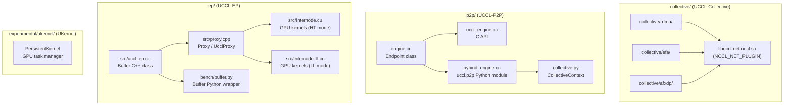
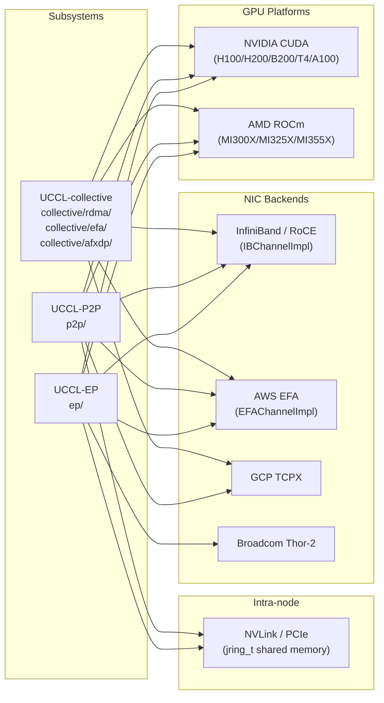

<!-- source: DeepWiki mcp.deepwiki.com · repo uccl-project/uccl · page 1 Overview · fetched 2026-11-11 -->

# Overview

<details>
<summary>Relevant source files</summary>

The following files were used as context for generating this wiki page:

- [.github/PULL_REQUEST_TEMPLATE.md](.github/PULL_REQUEST_TEMPLATE.md)
- [.github/workflows/uccl-build-test.yml](.github/workflows/uccl-build-test.yml)
- [README.md](README.md)
- [build.sh](build.sh)
- [collective/efa/README.md](collective/efa/README.md)
- [collective/rdma/README.md](collective/rdma/README.md)
- [docs/wheels.md](docs/wheels.md)
- [ep/Makefile](ep/Makefile)
- [ep/README.md](ep/README.md)
- [ep/bench/run_ep.sh](ep/bench/run_ep.sh)
- [ep/setup.py](ep/setup.py)
- [ep/src/common.cpp](ep/src/common.cpp)
- [scripts/efa_monitor.sh](scripts/efa_monitor.sh)

</details>


This page describes the purpose, structure, and high-level capabilities of the UCCL repository. It covers the three primary subsystems and their hardware backend support. For details on building and installing UCCL, see [Installation and Setup](#1.2). For architecture details, see [Architecture Overview](#1.1).

---

## What is UCCL?

UCCL is a GPU communication library focused on two properties:

- **Flexibility** — support fast-evolving ML workloads including collective operations, KV-cache/weight transfer, and expert-parallel (MoE) communication.
- **Portability** — run across heterogeneous GPU vendors (NVIDIA, AMD) and NIC vendors (InfiniBand, RoCE, AWS EFA, GCP TCPX, Broadcom).

The repository is organized into three independently usable subsystems, each targeting a distinct communication pattern:

| Subsystem | Directory | Primary Use Case | API Entry Point |
|---|---|---|---|
| UCCL-collective | `collective/` | Drop-in NCCL/RCCL replacement | `libnccl-net-uccl.so` via `NCCL_NET_PLUGIN` |
| UCCL-P2P | `p2p/` | Peer-to-peer GPU transfer (KV cache, weight sync) | `uccl.p2p` Python module / C `uccl_engine.cc` API |
| UCCL-EP | `ep/` | Expert-parallel MoE communication (DeepEP-compatible) | `uccl.ep` Python module / `Buffer` C++ class |

UCCL has been adopted as part of the AMD [TheRock](https://github.com/ROCm/TheRock) ecosystem.

Sources: [README.md:17-71]()

---

## Subsystems

### UCCL-collective

UCCL-collective replaces NCCL/RCCL without requiring application code changes. It is loaded at runtime as a network plugin (`.so`) via the `NCCL_NET_PLUGIN` environment variable.

Key design choices compared to stock NCCL:
- **Packet spraying** across up to 256 network paths to avoid single-path congestion.
- Software transport layer supporting advanced congestion control and selective-repeat loss recovery.
- Works on public cloud infrastructure with standard Ethernet NICs, not just InfiniBand.

Measured performance (from `README.md`):
- On 6x HGX servers (8×400G CX-7 RoCE, 8×H100): up to **2.5×** AllReduce throughput over NCCL.
- On 2× AWS `g4dn.8xlarge` (1×50G ENA, 1×T4): up to **3.7×** AllReduce throughput over NCCL.

For more details, see [UCCL-Collective](#2).

Sources: [README.md:26-48](), [collective/rdma/README.md:1-10](), [collective/efa/README.md:1-10]()

---

### UCCL-P2P

UCCL-P2P provides both NIXL-style initiator-target transfer APIs and NCCL-style collective APIs from a single C++ `Endpoint` class. It is designed for next-generation 800 Gbps NICs with multi-threaded transfer engines.

Key capabilities:
- Two-sided (`send`/`recv`) and one-sided (`read`/`write`) RDMA operations.
- Intra-node IPC via GPU shared memory rings (NVLink/PCIe).
- Python bindings via `pybind11` exposed as `uccl.p2p`.
- `CollectiveContext` for drop-in PyTorch distributed send/recv replacement.

For more details, see [UCCL-P2P Engine](#3).

Sources: [README.md:50-58]()

---

### UCCL-EP

UCCL-EP is a drop-in replacement for [DeepEP](https://github.com/deepseek-ai/DeepEP), targeting Mixture-of-Experts (MoE) model communication. It supports GPU-initiated RDMA via a CPU proxy layer, reaching IBGDA-level performance without locking users to a single NIC vendor.

Key capabilities:
- High-throughput mode (NVLink + RDMA forwarding) and low-latency mode (pure RDMA).
- Supports NVIDIA H100/H200/B200, AMD MI300X, and NICs including EFA, Broadcom Thor-2, CX-7.
- Python `Buffer` class (in `ep/`) with `low_latency_dispatch` / `low_latency_combine` API.

Selected benchmark results (EP32, internode):

| Platform | Dispatch Bandwidth | Combine Bandwidth |
|---|---|---|
| p5en (8×H200 + 16×200Gb/s EFA) | 54 GB/s (RDMA) | 43 GB/s (RDMA) |
| p6-b200 (8×B200 + 8×400Gb/s EFA) | 53 GB/s (RDMA) | 57 GB/s (RDMA) |
| MI300X + CX7 InfiniBand | 60 GB/s (RDMA) | 60 GB/s (RDMA) |

For more details, see [UCCL-EP Expert Parallelism](#4).

Sources: [README.md:59-69](), [ep/README.md:1-50](), [ep/README.md:138-210]()

---

## Subsystem-to-Code Entity Map

**Figure 1: UCCL Subsystems and Their Primary Code Entities**



Sources: [README.md:23-71](), [ep/Makefile:76-84](), [ep/setup.py:97-99]()

---

## Hardware Backend Support

**Figure 2: Hardware Backend Support by Subsystem**



Sources: [README.md:59-71](), [ep/README.md:1-5](), [collective/rdma/README.md:1-8](), [collective/efa/README.md:1-5]()

---

## Quick Start

Build UCCL using `build.sh`, which runs a Docker-based build and optionally installs the Python wheel:

```bash
git clone https://github.com/uccl-project/uccl.git --recursive && cd uccl
bash build.sh [cuda|rocm|therock] [all|ccl_rdma|ccl_efa|p2p|ep] [py_version] --install
```

After installation, plug UCCL into existing NCCL/RCCL workloads by setting:

```bash
# IB/RoCE (NVIDIA or AMD)
NCCL_NET_PLUGIN=`python -c "import uccl; print(uccl.nccl_plugin_path())"`

# AWS EFA
LD_PRELOAD=`python -c "import uccl; print(uccl.efa_nccl_path())"`
NCCL_NET_PLUGIN=`python -c "import uccl; print(uccl.efa_plugin_path())"`
```

For full build instructions, Docker environment details, and per-platform prerequisites, see [Installation and Setup](#1.2).

Sources: [README.md:90-118](), [build.sh:1-18](), [build.sh:35-46]()

---

## Road Map Status

| Feature | Status |
|---|---|
| KV cache transfer engine (AMD support) | ✅ Complete |
| KV cache transfer engine (RDMA, EFA, TCPX, TCP) | 🚧 In progress |
| Expert-parallel communication (all NICs, AMD GPUs) | ✅ Complete |
| EP congestion control | 🚧 In progress |
| NCCL re-architecture (scalable CPU proxy) | 🚧 In progress |
| Fast async collectives with compute-communication ordering | ☐ Planned |
| Device kernels in Triton | ☐ Planned |
| Dynamic membership (GPU server join/exit) | ☐ Planned |

Sources: [README.md:73-88]()

---

