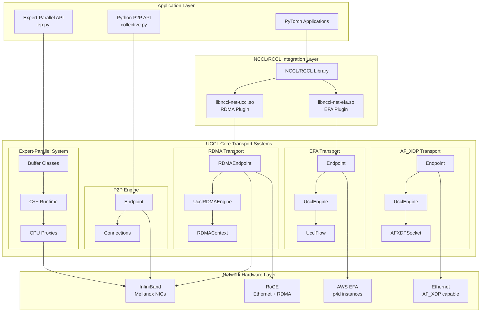
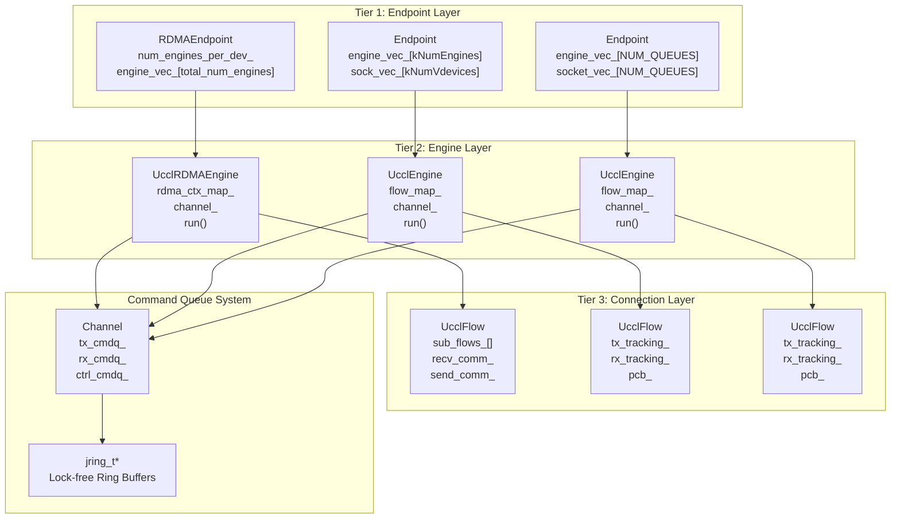
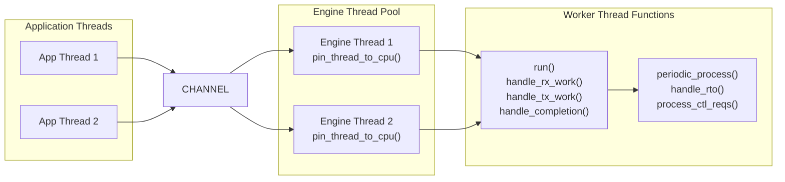
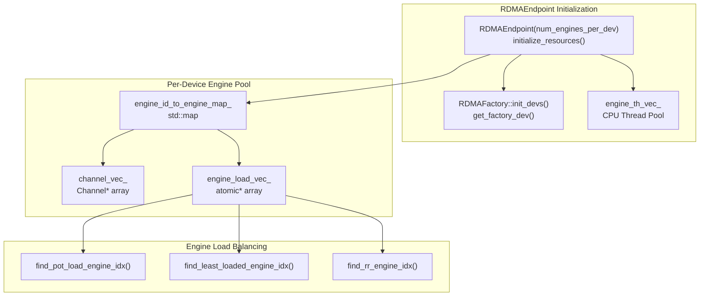
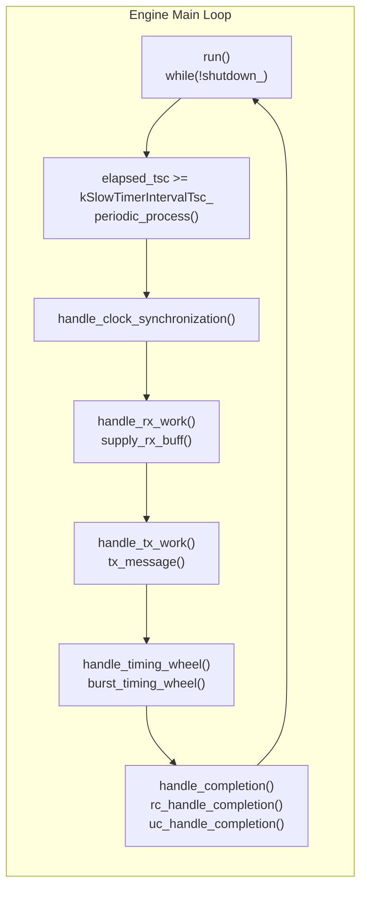
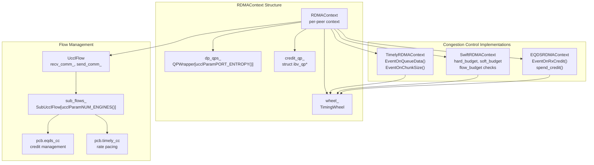
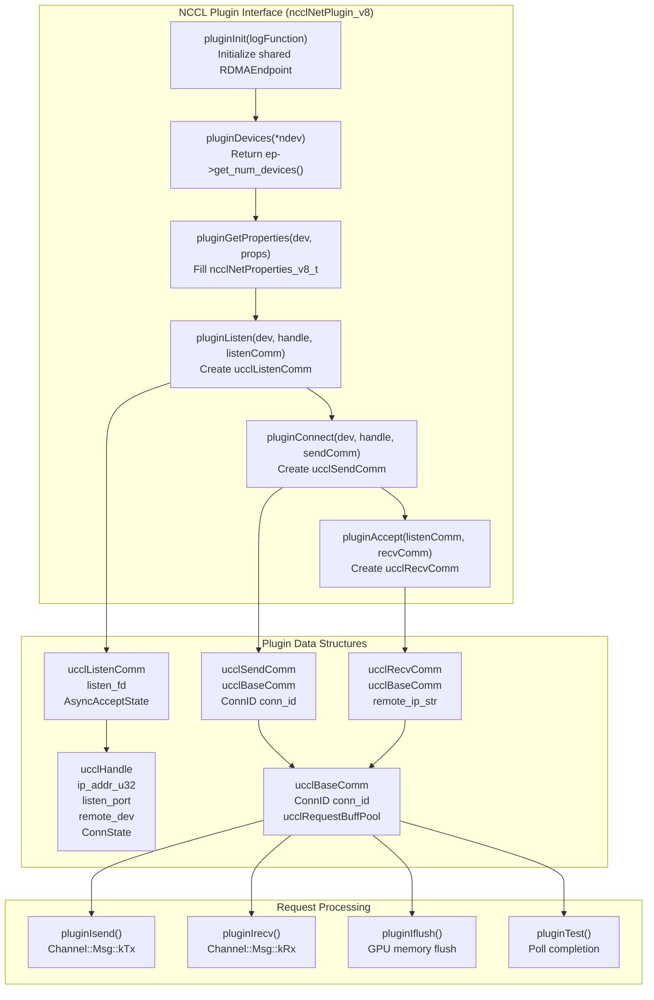
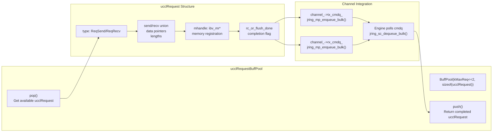
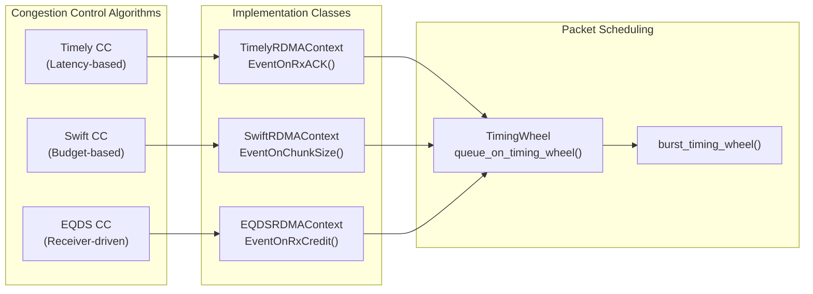
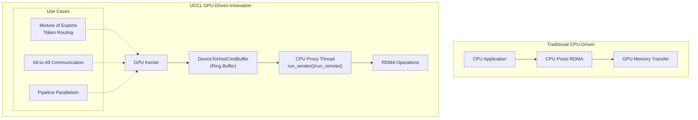

<!-- source: DeepWiki mcp.deepwiki.com · repo uccl-project/uccl · page 1.1 Architecture Overview · fetched 2026-11-11 -->

# Architecture Overview

Relevant source files

The following files were used as context for generating this wiki page:

- [.github/PULL_REQUEST_TEMPLATE.md](.github/PULL_REQUEST_TEMPLATE.md)
- [.github/workflows/uccl-build-test.yml](.github/workflows/uccl-build-test.yml)
- [README.md](README.md)
- [build.sh](build.sh)
- [collective/efa/README.md](collective/efa/README.md)
- [collective/rdma/README.md](collective/rdma/README.md)
- [docs/wheels.md](docs/wheels.md)
- [ep/Makefile](ep/Makefile)
- [ep/README.md](ep/README.md)
- [ep/bench/run_ep.sh](ep/bench/run_ep.sh)
- [ep/setup.py](ep/setup.py)
- [ep/src/common.cpp](ep/src/common.cpp)
- [include/util/gpu_rt.h](include/util/gpu_rt.h)
- [include/util/util.h](include/util/util.h)
- [p2p/Makefile](p2p/Makefile)
- [p2p/Makefile.rocm](p2p/Makefile.rocm)
- [p2p/Makefile.therock](p2p/Makefile.therock)
- [p2p/README.md](p2p/README.md)
- [p2p/benchmarks/benchmark_nccl.py](p2p/benchmarks/benchmark_nccl.py)
- [p2p/benchmarks/benchmark_nixl.py](p2p/benchmarks/benchmark_nixl.py)
- [p2p/benchmarks/benchmark_ray_p2p.py](p2p/benchmarks/benchmark_ray_p2p.py)
- [p2p/benchmarks/benchmark_uccl.py](p2p/benchmarks/benchmark_uccl.py)
- [p2p/benchmarks/benchmark_uccl_readwrite.py](p2p/benchmarks/benchmark_uccl_readwrite.py)
- [p2p/engine.cc](p2p/engine.cc)
- [p2p/engine.h](p2p/engine.h)
- [p2p/engine_api.cc](p2p/engine_api.cc)
- [p2p/tests/test_engine_onesided_ipc.py](p2p/tests/test_engine_onesided_ipc.py)
- [p2p/uccl_engine.cc](p2p/uccl_engine.cc)
- [p2p/uccl_engine.h](p2p/uccl_engine.h)
- [scripts/efa_monitor.sh](scripts/efa_monitor.sh)
- [setup.py](setup.py)
- [shared.sh](shared.sh)
- [uccl/.gitignore](uccl/.gitignore)
- [uccl/__init__.py](uccl/__init__.py)

This document provides a high-level overview of UCCL's system architecture, covering the multi-transport backend design, plugin integration model, and core communication patterns. For specific transport implementation details, see [RDMA Transport](#2.1), [EFA Transport](#2.2), and [AF_XDP Transport](#2.3). For P2P communication specifics, see [P2P Communication Engine](#3). For NCCL/RCCL integration details, see [NCCL and RCCL Integration](#5).

## System Overview

UCCL (Unified Collective Communication Library) is a high-performance GPU communication library that provides multiple transport backends while maintaining compatibility with existing NCCL/RCCL APIs. The system employs a plugin architecture where applications use standard NCCL/RCCL libraries, which dynamically load UCCL transport plugins to achieve superior performance across various network environments.

## High-Level System Architecture

**Sources:** [rdma/transport.h:97-98](), [efa/transport.h:189-190](), [afxdp/transport.h:188-189](), [rdma/nccl_plugin.cc:85-91](), [efa/nccl_plugin.cc:1-20]()

## Core Architecture Pattern

All UCCL transport backends follow a consistent three-tier hierarchical pattern with shared design principles:

### Transport Architecture Hierarchy

### Engine Threading Model

**Sources:** [rdma/transport.h:688-714](), [rdma/transport.cc:277-316](), [efa/transport.h:265-300](), [afxdp/transport.h:357-410](), [rdma/transport.cc:437-473]()

## RDMA Transport Architecture

The RDMA transport provides the highest performance backend with support for InfiniBand and RoCE networks:

### RDMAEndpoint Resource Management

### UcclRDMAEngine Core Loop

### RDMAContext and Congestion Control

**Sources:** [rdma/transport.cc:688-728](), [rdma/transport.h:739-864](), [rdma/transport.h:538-732](), [rdma/transport.cc:437-473](), [rdma/transport.cc:827-858]()

## Transport Backend Comparison

UCCL provides three specialized transport backends optimized for different network infrastructures:

| Backend | Network Target | Configuration | Key Implementation | Transport Protocol |
|---------|----------------|---------------|-------------------|-------------------|
| **RDMA** | InfiniBand, RoCE | `ucclParamNUM_ENGINES()=4` `ucclParamPORT_ENTROPY()=32` | `RDMAEndpoint` `UcclRDMAEngine` `RDMAContext` | RC/UC QPs RDMA Write/Read Credit-based flow control |
| **EFA** | AWS EFA (p4d) | `kNumVdevices=8` `kNumEnginesPerVdev=2` | `Endpoint` `UcclEngine` `UcclFlow` | UD datagrams Multi-path SACK-based reliability |
| **AF_XDP** | Ethernet | `NUM_QUEUES=12` `kMaxPath=200` | `Endpoint` `UcclEngine` `AFXDPSocket` | UDP over AF_XDP eBPF packet filtering Kernel bypass |

### Congestion Control Support

| Transport | Sender CC | Receiver CC | Implementation Classes |
|-----------|-----------|-------------|----------------------|
| **RDMA** | Timely, Swift | EQDS | `TimelyRDMAContext` `SwiftRDMAContext` `EQDSRDMAContext` |
| **EFA** | Timely, Cubic | EQDS | `swift::TimelyCtl` `swift::CubicCtl` `eqds::EQDSCC` |
| **AF_XDP** | Timely, Cubic | None | `swift::TimelyCtl` `swift::CubicCtl` |

### Hardware Requirements

| Backend | NICs | GPU Direct | Privileges | Maximum Performance |
|---------|------|------------|-----------|-------------------|
| **RDMA** | Mellanox CX-5+ Broadcom NICs | GPUDirectRDMA | User space | 400Gbps per NIC |
| **EFA** | AWS EFA NICs | Supported | User space | 100Gbps per vEFA |
| **AF_XDP** | Any Ethernet NIC | No | CAP_NET_ADMIN Privileged daemon | Link speed dependent |

**Sources:** [rdma/transport_config.h:26-29](), [efa/transport_config.h:35-37](), [afxdp/transport_config.h:29-44](), [rdma/transport.h:622-732](), [efa/transport_cc.h:1-50]()

## Plugin Integration Architecture

UCCL integrates with NCCL/RCCL through standardized plugin interfaces that provide transparent performance acceleration:

### Plugin Lifecycle and API

### Request Buffer Management

**Sources:** [rdma/nccl_plugin.cc:85-91](), [rdma/nccl_plugin.cc:21-83](), [rdma/nccl_plugin.cc:200-400](), [rdma/transport.h:44-93]()

## Advanced Features

### Congestion Control Integration

UCCL implements multiple congestion control algorithms that can be selected at compile time:

**Sources:** [rdma/transport.h:622-732](), [rdma/transport_config.h:73-90](), [rdma/transport.cc:430-435]()

### GPU-Driven Communication

UCCL introduces innovative GPU-driven communication where GPU kernels directly initiate RDMA transfers:

**Sources:** [gpu_driven/ directory references in README.md](), [p2p/README.md:1-50]()

This architecture enables ultra-low latency communication by eliminating CPU-GPU round trips and allowing GPUs to directly control network operations for workloads like Mixture of Experts models.

---

