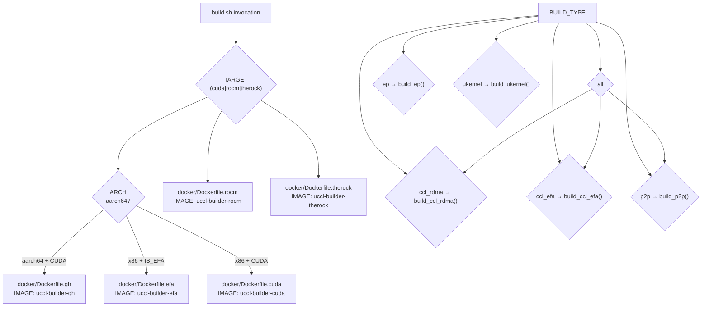
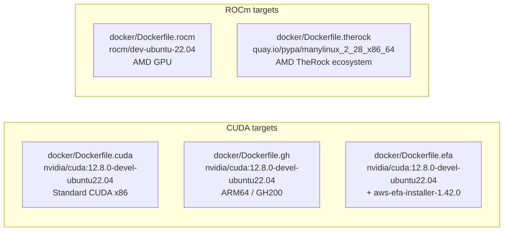
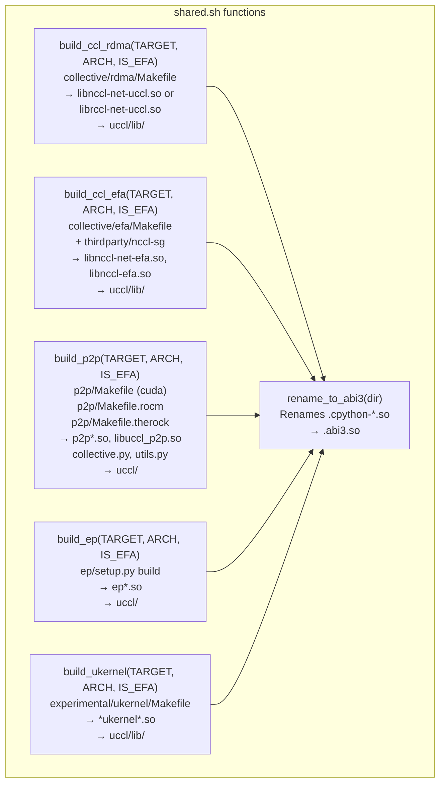

<!-- source: DeepWiki mcp.deepwiki.com · repo uccl-project/uccl · page 1.2 Installation and Setup · fetched 2026-11-11 -->

# Installation and Setup

<details>
<summary>Relevant source files</summary>

The following files were used as context for generating this wiki page:

- [.github/PULL_REQUEST_TEMPLATE.md](.github/PULL_REQUEST_TEMPLATE.md)
- [.github/workflows/uccl-build-test.yml](.github/workflows/uccl-build-test.yml)
- [README.md](README.md)
- [build.sh](build.sh)
- [collective/efa/README.md](collective/efa/README.md)
- [collective/rdma/README.md](collective/rdma/README.md)
- [docker/Dockerfile.cuda](docker/Dockerfile.cuda)
- [docker/Dockerfile.efa](docker/Dockerfile.efa)
- [docker/Dockerfile.gh](docker/Dockerfile.gh)
- [docker/Dockerfile.rocm](docker/Dockerfile.rocm)
- [docs/wheels.md](docs/wheels.md)
- [ep/Makefile](ep/Makefile)
- [ep/README.md](ep/README.md)
- [ep/bench/run_ep.sh](ep/bench/run_ep.sh)
- [ep/install_deps.sh](ep/install_deps.sh)
- [ep/setup.py](ep/setup.py)
- [ep/src/common.cpp](ep/src/common.cpp)
- [p2p/Makefile.rocm](p2p/Makefile.rocm)
- [p2p/Makefile.therock](p2p/Makefile.therock)
- [p2p/benchmarks/benchmark_ray_p2p.py](p2p/benchmarks/benchmark_ray_p2p.py)
- [p2p/engine_api.cc](p2p/engine_api.cc)
- [scripts/efa_monitor.sh](scripts/efa_monitor.sh)
- [setup.py](setup.py)
- [shared.sh](shared.sh)
- [uccl/.gitignore](uccl/.gitignore)
- [uccl/__init__.py](uccl/__init__.py)

</details>


This page covers how to obtain, build, and install UCCL for production and development use. It describes the `build.sh` top-level build script, Docker image selection, Python wheel installation, and platform-specific prerequisites for CUDA, ROCm/TheRock, and AWS EFA environments.

For details on what each subsystem does once installed, see the Architecture Overview ([1.1](#1.1)). For per-subsystem build differences (Makefiles, platform flags), see Build Scripts and Docker Environments ([6.1](#6.1)) and Platform-Specific Configuration ([6.2](#6.2)).

---

## Prerequisites

### System Dependencies (Development Builds)

When building outside Docker, install the following system packages on Ubuntu 22.04:

```
sudo apt update
sudo apt install linux-tools-$(uname -r) clang llvm cmake m4 build-essential \
                 net-tools libgoogle-glog-dev libgtest-dev libgflags-dev \
                 libelf-dev libpcap-dev libc6-dev-i386 libpci-dev \
                 libopenmpi-dev libibverbs-dev clang-format -y
```

Python dependencies for building and running:

```
pip install paramiko intervaltree pybind11 nanobind
conda install -c conda-forge "libstdcxx-ng>=12" "libgcc-ng>=12"
```

Sources: [README.md:133-150]()

### Cloning the Repository

```
git clone https://github.com/uccl-project/uccl.git --recursive
export UCCL_HOME=$(pwd)/uccl
```

The `--recursive` flag is required because UCCL uses git submodules (e.g., `thirdparty/nccl`, `thirdparty/rccl`, `thirdparty/nccl-sg`).

Sources: [README.md:124-128]()

---

## Build System Overview

All standard builds go through `build.sh`. It selects the correct Docker image, builds inside the container, then uses `auditwheel` to produce a portable Python wheel.

**Build Decision Diagram: `build.sh` target and type selection**



Sources: [build.sh:1-100](), [build.sh:134-170](), [shared.sh:26-184]()

---

## `build.sh` Usage

```
bash build.sh [cuda|rocm|therock] [all|ccl_rdma|ccl_efa|p2p|ep] \
              [py_version] [rocm_index_url] [--install]
```

### Positional Arguments

| Position | Name | Default | Description |
|---|---|---|---|
| 1 | `TARGET` | `cuda` | GPU platform: `cuda`, `cuda13`, `rocm`, `rocm6`, `therock` |
| 2 | `BUILD_TYPE` | `all` | Component(s) to build |
| 3 | `PY_VER` | auto-detected | Python version, e.g., `3.12` |
| 4 | `ROCM_IDX_URL` | `https://rocm.prereleases.amd.com/whl/gfx94X-dcgpu` | ROCm wheel index (TheRock only) |

### Optional Flag

| Flag | Effect |
|---|---|
| `--install` | After building, installs the wheel into the current Python environment |

### Environment Variables

| Variable | Default | Description |
|---|---|---|
| `CONTAINER_ENGINE` | `docker` | Use `podman` as an alternative |
| `USE_INTEL_RDMA_NIC` | `0` | Enable Intel RDMA NIC (irdma, vendor 0x8086) support |
| `TORCH_CUDA_ARCH_LIST` | auto-detected | Override GPU architecture for `ep`/`p2p` builds |
| `DISABLE_AGGRESSIVE_ATOMIC` | `0` | Disable aggressive atomics in EP (AMD) |

Sources: [build.sh:9-18](), [build.sh:26-46](), [build.sh:240-249]()

### Common Invocations

| Goal | Command |
|---|---|
| Build everything for CUDA, install | `bash build.sh cuda all --install` |
| Build only P2P for CUDA | `bash build.sh cuda p2p` |
| Build EP for ROCm 7 | `bash build.sh rocm ep --install` |
| Build CCL RDMA for CUDA 13 | `bash build.sh cuda13 ccl_rdma --install` |
| Build for TheRock (AMD) | `bash build.sh therock all 3.12 https://rocm.prereleases.amd.com/whl/gfx94X-dcgpu --install` |
| Build with Intel RDMA NIC | `USE_INTEL_RDMA_NIC=1 bash build.sh cuda ccl_efa` |

Sources: [README.md:92-100](), [build.sh:272-289]()

---

## Docker Images

`build.sh` builds one of four Dockerfiles depending on the platform and detected hardware:

**Docker Image Selection by Context**



Sources: [docker/Dockerfile.cuda:1-50](), [docker/Dockerfile.gh:1-50](), [docker/Dockerfile.efa:1-72](), [docker/Dockerfile.rocm:1-54]()

### What Each Dockerfile Installs

| Dockerfile | Base Image | Extra Packages |
|---|---|---|
| `Dockerfile.cuda` | `nvidia/cuda:12.8.0-devel-ubuntu22.04` | `libibverbs-dev`, `libnuma-dev`, `libgoogle-glog-dev`, PyTorch cu128 |
| `Dockerfile.gh` | `nvidia/cuda:12.8.0-devel-ubuntu22.04` | Same as CUDA; sets `GPU_NAME=GH200` |
| `Dockerfile.efa` | `nvidia/cuda:12.8.0-devel-ubuntu22.04` | Same as CUDA + `aws-efa-installer-1.42.0` at `/opt/amazon/efa` |
| `Dockerfile.rocm` | `rocm/dev-ubuntu-22.04` | `hipcub`, `hipsolver`, `hipblas`, PyTorch ROCm nightly |

All images install `pybind11`, `nanobind`, `auditwheel`, and `build` for Python wheel construction.

Sources: [docker/Dockerfile.cuda:13-43](), [docker/Dockerfile.efa:34-67](), [docker/Dockerfile.rocm:11-46](), [docker/Dockerfile.gh:12-41]()

---

## Build Functions in `shared.sh`

`build.sh` exports shell functions from `shared.sh` into the Docker container. Each function builds one component and copies its output into `uccl/` or `uccl/lib/`.

**Component Build Functions and Their Outputs**



Sources: [shared.sh:26-184]()

---

## Python Wheel Installation

After `build.sh` runs, the wheel is written to `wheelhouse-{TARGET}/`. Install it with:

```
pip install wheelhouse-cuda/uccl-*.whl
```

For TheRock/ROCm, provide the index URL and extra:

```
pip install --extra-index-url https://rocm.prereleases.amd.com/whl/gfx94X-dcgpu \
    wheelhouse-therock/uccl-0.0.1.post4-py3-none-manylinux_2_28_x86_64.whl[rocm]
```

The `--install` flag on `build.sh` automates this step, using `uv pip` when available in a virtual environment, falling back to `pip` otherwise.

Sources: [build.sh:397-424](), [README.md:102-103]()

### What the Wheel Contains

The `uccl` Python package is assembled by `setup.py` and includes:

| Path in wheel | Content |
|---|---|
| `uccl/lib/libnccl-net-uccl.so` | NCCL plugin for IB/RoCE |
| `uccl/lib/librccl-net-uccl.so` | RCCL plugin for IB/RoCE |
| `uccl/lib/libnccl-net-efa.so` | NCCL plugin for EFA |
| `uccl/lib/libnccl-efa.so` | Custom NCCL for EFA |
| `uccl/lib/libuccl_p2p.so` | P2P C shared library |
| `uccl/p2p*.abi3.so` | P2P Python extension (nanobind) |
| `uccl/ep*.abi3.so` | EP Python extension (pybind11) |
| `uccl/collective.py` | CollectiveContext Python API |
| `uccl/utils.py` | Shared utilities |

The `uccl/__init__.py` exposes path helpers: `nccl_plugin_path()`, `rccl_plugin_path()`, `efa_plugin_path()`, `efa_nccl_path()`. It also detects EFA at import time via `has_efa()`, which checks `/sys/class/infiniband/` for `rdmap*` entries.

Sources: [setup.py:33-64](), [uccl/__init__.py:1-53]()

---

## Platform-Specific Notes

### CUDA (NVIDIA)

- Default target is CUDA 12.8 from `nvidia/cuda:12.8.0-devel-ubuntu22.04`.
- Use `cuda13` as target for CUDA 13.0.
- The `ep` build auto-detects compute capability via `nvidia-smi --query-gpu=compute_cap`. Override with `TORCH_CUDA_ARCH_LIST=9.0`.
- GH200 (ARM64) is detected by checking both `uname -m == aarch64` and `GH200` in `nvidia-smi` GPU name output. The `docker/Dockerfile.gh` handles this case.

Sources: [build.sh:65-100](), [ep/setup.py:126-165](), [docker/Dockerfile.gh:49]()

### ROCm (AMD)

- Default is ROCm 7.1 from `rocm/dev-ubuntu-22.04`.
- Use `rocm6` as target for ROCm 6.4.3.
- AMD GPU architecture is auto-detected via `amd-smi static --asic --json`. Override with `TORCH_CUDA_ARCH_LIST=gfx942`.
- `build_rccl_nccl_header()` runs first to generate `nccl.h` from the RCCL source tree, since ROCm does not ship `nccl.h` separately.
- ROCm builds skip EFA (`ccl_efa`) and ARM64 builds.

Sources: [build.sh:73-100](), [shared.sh:16-24](), [docker/Dockerfile.rocm:39-40]()

### TheRock (AMD)

TheRock is AMD's Python-packaged ROCm distribution. Key differences from standard ROCm:

- Uses a manylinux base image rather than `rocm/dev-ubuntu-22.04`.
- Installs `rocm[libraries,devel]` from the provided PyPI index.
- At build time, emits `uccl/_rocm_init.py` that calls `rocm_sdk.initialize_process()` at import time.
- Wheel filename gets a `+rocm{version}` local version suffix.

Sources: [build.sh:255-320](), [uccl/__init__.py:4-10]()

### AWS EFA

EFA builds apply when `/sys/class/infiniband/` contains `rdmap*` devices, or when `docker/Dockerfile.efa` is used explicitly.

- The EFA installer is fetched during Docker image build: `aws-efa-installer-1.42.0` installs to `/opt/amazon/efa`.
- `ep/setup.py` detects EFA via `EFA_HOME` (default `/opt/amazon/efa`) and adds `-DEFA` flags.
- `ep/Makefile` does the same via `EFA_HOME` and `EFA_CFLAGS`/`EFA_LDFLAGS`.
- On EFA hosts at runtime, `uccl/__init__.py` skips loading `p2p` and `collective` modules (EFA uses its own plugin path).

Sources: [docker/Dockerfile.efa:46-57](), [ep/setup.py:117-179](), [ep/Makefile:5-13](), [uccl/__init__.py:12-27]()

---

## EP-Specific Installation

UCCL-EP can be built independently of the full wheel build, which is useful on bare-metal machines with CUDA or ROCm already installed.

### Step 1: Install dependencies

```
cd ep
./install_deps.sh
```

`install_deps.sh` detects the CUDA version via `nvcc --version`, constructs the correct PyTorch wheel suffix (e.g., `cu128`), installs PyTorch, and configures `CXXFLAGS`/`LDFLAGS` to point at the Torch headers and libraries.

Sources: [ep/install_deps.sh:1-84]()

### Step 2: Build and install

```
cd ep
python setup.py install
```

Or via `make`:

```
make -j install
```

The `CustomInstall` class in `ep/setup.py` copies the resulting `.so` into the `uccl` package directory in `site-packages`.

Sources: [ep/setup.py:17-43](), [ep/Makefile:114-117]()

### Step 3: Verify

```
python -c "import torch; import uccl.ep"
```

Common issues:
- `CUDA error: invalid device function` — GPU arch detection failed. Set `TORCH_CUDA_ARCH_LIST=<arch>` explicitly (e.g., `gfx942` for MI300X, `9.0` for H100).
- Compilation errors — run `python setup.py clean` then rebuild.

Sources: [ep/README.md:44-51]()

---

## Setting Environment Variables After Installation

Once installed, set the appropriate environment variable before launching PyTorch applications:

| Scenario | Variable and Value |
|---|---|
| NCCL over IB/RoCE (NVIDIA, x86 or GH200) | `NCCL_NET_PLUGIN=$(python -c "import uccl; print(uccl.nccl_plugin_path())")` |
| RCCL over IB/RoCE (AMD, x86) | `NCCL_NET_PLUGIN=$(python -c "import uccl; print(uccl.rccl_plugin_path())")` |
| NCCL over EFA (p4d, p4de) | `LD_PRELOAD=$(python -c "import uccl; print(uccl.efa_nccl_path())")` and `NCCL_NET_PLUGIN=$(python -c "import uccl; print(uccl.efa_plugin_path())")` |

Sources: [README.md:105-117](), [uccl/__init__.py:32-53]()

For EP-specific environment variables (`UCCL_IB_GID_INDEX`, `UCCL_SOCKET_IFNAME`, flow control knobs), see Configuration and Tuning ([7.3](#7.3)).

---

## Rocky Linux 9 Compatibility

The build container runs Ubuntu 22.04 (glibc 2.35). Rocky Linux 9.x ships glibc 2.34. `build.sh` detects Rocky Linux and retags the wheel to `manylinux_2_34` after `auditwheel repair` by setting `UCCL_WHEEL_PLAT`. This does not rebuild against 2.34 symbols — it only changes the platform tag.

Sources: [build.sh:103-119](), [build.sh:330-353]()

---

