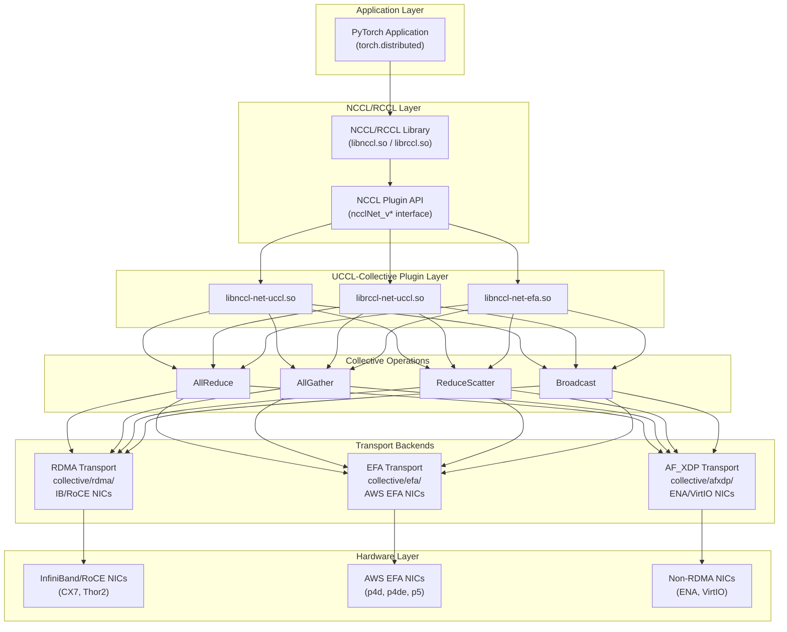
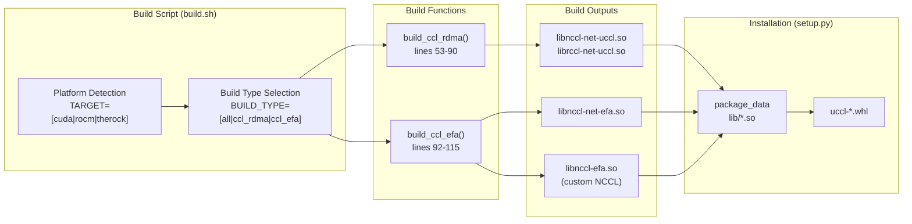
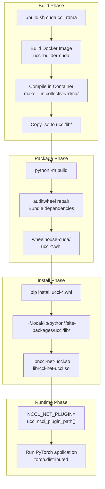

<!-- source: DeepWiki mcp.deepwiki.com · repo uccl-project/uccl · page 2 UCCL-Collective · fetched 2026-11-11 -->

# UCCL-Collective

<details>
<summary>Relevant source files</summary>

The following files were used as context for generating this wiki page:

- [.github/PULL_REQUEST_TEMPLATE.md](.github/PULL_REQUEST_TEMPLATE.md)
- [.github/workflows/uccl-build-test.yml](.github/workflows/uccl-build-test.yml)
- [README.md](README.md)
- [build.sh](build.sh)
- [collective/efa/README.md](collective/efa/README.md)
- [collective/rdma/README.md](collective/rdma/README.md)
- [docs/wheels.md](docs/wheels.md)
- [ep/Makefile](ep/Makefile)
- [ep/README.md](ep/README.md)
- [ep/bench/run_ep.sh](ep/bench/run_ep.sh)
- [ep/setup.py](ep/setup.py)
- [ep/src/common.cpp](ep/src/common.cpp)
- [p2p/Makefile.rocm](p2p/Makefile.rocm)
- [p2p/Makefile.therock](p2p/Makefile.therock)
- [p2p/benchmarks/benchmark_ray_p2p.py](p2p/benchmarks/benchmark_ray_p2p.py)
- [p2p/engine_api.cc](p2p/engine_api.cc)
- [scripts/efa_monitor.sh](scripts/efa_monitor.sh)
- [setup.py](setup.py)
- [shared.sh](shared.sh)
- [uccl/.gitignore](uccl/.gitignore)
- [uccl/__init__.py](uccl/__init__.py)

</details>


## Purpose and Scope

UCCL-Collective is a high-performance collective communication library that serves as a drop-in replacement for NCCL (NVIDIA Collective Communications Library) and RCCL (ROCm Collective Communications Library). It provides transparent integration with existing PyTorch applications through the NCCL/RCCL plugin mechanism, requiring no application code changes.

This document covers the architecture, plugin integration mechanism, and transport backend overview of UCCL-Collective. For detailed information about specific transport implementations, see:
- RDMA/InfiniBand backend: [#2.2](#2.2)
- AWS EFA backend: [#2.3](#2.3)
- AF_XDP backend for non-RDMA NICs: [#2.4](#2.4)

For point-to-point communication APIs, see [UCCL-P2P Engine](#3). For expert-parallel communication for MoE models, see [UCCL-EP Expert Parallelism](#4).

**Sources**: [README.md:17-48]()

## Architecture Overview

UCCL-Collective consists of three primary components: a plugin layer that interfaces with NCCL/RCCL, a collective operations layer, and multiple transport backends. Each transport backend is optimized for specific network hardware and deployment environments.



**Sources**: [README.md:25-48](), [build.sh:53-115](), [uccl/__init__.py:33-54]()

## Plugin Integration Mechanism

UCCL-Collective integrates with NCCL/RCCL through the plugin API, which allows custom network transport implementations to be loaded at runtime. Applications use UCCL-Collective by setting environment variables that point to the appropriate plugin shared library.

### Plugin Libraries

UCCL-Collective provides three plugin shared libraries:

| Plugin Library | Target API | GPU Platform | Network Type | Build Output |
|----------------|------------|--------------|--------------|--------------|
| `libnccl-net-uccl.so` | NCCL | NVIDIA CUDA | RDMA (IB/RoCE) | [collective/rdma/]() |
| `librccl-net-uccl.so` | RCCL | AMD ROCm | RDMA (IB/RoCE) | [collective/rdma/]() |
| `libnccl-net-efa.so` | NCCL | NVIDIA CUDA | AWS EFA | [collective/efa/]() |

### Environment Variable Configuration

The plugin mechanism is activated through environment variables:

```bash
# NCCL over IB/RoCE on x86 or GH200 ARM hosts
NCCL_NET_PLUGIN=`python -c "import uccl; print(uccl.nccl_plugin_path())"`

# RCCL over IB/RoCE on x86 hosts  
NCCL_NET_PLUGIN=`python -c "import uccl; print(uccl.rccl_plugin_path())"`

# NCCL over AWS EFA NICs (p4d and p4de)
LD_PRELOAD=`python -c "import uccl; print(uccl.efa_nccl_path())"`
NCCL_NET_PLUGIN=`python -c "import uccl; print(uccl.efa_plugin_path())"`
```

The Python helper functions return absolute paths to the installed plugin libraries:

```python
# uccl/__init__.py implementation
def nccl_plugin_path():
    lib_dir = os.path.join(os.path.dirname(os.path.abspath(__file__)), "lib")
    return os.path.join(lib_dir, "libnccl-net-uccl.so")

def rccl_plugin_path():
    lib_dir = os.path.join(os.path.dirname(os.path.abspath(__file__)), "lib")
    return os.path.join(lib_dir, "librccl-net-uccl.so")
```

**Sources**: [README.md:103-114](), [uccl/__init__.py:33-54]()

## Transport Backend Architecture

UCCL-Collective supports three transport backends, each optimized for different network hardware and deployment scenarios. The build system compiles the appropriate backend based on the target platform.

### Transport Backend Selection Matrix

| Backend | Network Hardware | Use Case | Platform Support |
|---------|------------------|----------|------------------|
| RDMA | InfiniBand, RoCE | High-performance clusters with RDMA NICs | CUDA (x86, ARM), ROCm (x86) |
| EFA | AWS EFA | AWS p4d/p4de instances | CUDA (x86 only) |
| AF_XDP | ENA, VirtIO | Cloud instances without RDMA | CUDA, ROCm |

### Build System Integration

The build system provides modular compilation of transport backends through the `build.sh` script:

```bash
# Build all backends
./build.sh [cuda|rocm|therock] all

# Build specific backend
./build.sh cuda ccl_rdma     # RDMA backend only
./build.sh cuda ccl_efa      # EFA backend only
```



**Sources**: [build.sh:1-437](), [setup.py:18-48]()

### RDMA Backend Overview

The RDMA backend implements packet spraying across multiple network paths to avoid single-path congestion. It supports both NVIDIA (NCCL) and AMD (RCCL) GPUs with InfiniBand and RoCE NICs.

**Key Features**:
- Packet spraying with up to 256 paths
- Latency-based and receiver-driven congestion control
- Selective repeat loss recovery
- Support for Broadcom Thor-2 and NVIDIA ConnectX-7 NICs

**Build Process**:
- CUDA target: `make -j$(nproc)` in [collective/rdma/]()
- ROCm target: `make -j$(nproc) -f Makefile.rocm` in [collective/rdma/]()

**Sources**: [README.md:39-47](), [build.sh:53-90]()

### EFA Backend Overview

The EFA backend is optimized for AWS EFA NICs on p4d and p4de instances. It requires a custom NCCL build with scatter-gather support.

**Key Features**:
- Optimized for AWS network topology
- Custom NCCL with scatter-gather operations
- Support for p4d.24xlarge, p4de.24xlarge instances

**Build Process**:
```bash
# Build EFA plugin
cd collective/efa && make clean && make -j$(nproc)

# Build custom NCCL with scatter-gather support
cd thirdparty/nccl-sg
make src.build -j$(nproc) NVCC_GENCODE="-gencode=arch=compute_90,code=sm_90"
```

**Build Outputs**:
- `libnccl-net-efa.so` - EFA plugin
- `libnccl-efa.so` - Custom NCCL library

**Sources**: [build.sh:92-115](), [README.md:156]()

### AF_XDP Backend Overview

The AF_XDP backend uses eBPF-based packet filtering for non-RDMA NICs such as AWS ENA and IBM VirtIO. This enables efficient collective operations on cloud instances without specialized RDMA hardware.

**Key Features**:
- eBPF packet filtering for fast packet processing
- Support for AWS ENA NICs (g4dn instances)
- Support for IBM VirtIO NICs
- Optimized for legacy Ethernet networks

**Target Use Cases**:
- AWS g4dn.8xlarge instances (1x50G ENA + 1xT4 GPU)
- Public cloud deployments without RDMA support

**Sources**: [README.md:159]()

## Performance Characteristics

UCCL-Collective demonstrates significant performance improvements over NCCL/RCCL in various deployment scenarios:

### AllReduce Performance

| Configuration | Hardware | UCCL-Collective Speedup |
|---------------|----------|------------------------|
| 6 HGX servers (2 racks) | 8x400G CX-7 RoCE, 8xH100 | Up to **2.5x** vs NCCL |
| 2 AWS g4dn.8xlarge | 1x50G ENA, 1xT4 | Up to **3.7x** vs NCCL |

The performance improvements come from:
1. **Packet spraying**: Leveraging multiple network paths (up to 256) to avoid congestion
2. **Advanced congestion control**: Latency-based and receiver-driven mechanisms
3. **Efficient loss recovery**: Selective repeat instead of full retransmission
4. **Extensible software transport**: Fast implementation without hardware limitations

**Sources**: [README.md:30-34]()

## Build and Deployment Workflow

The complete build and deployment workflow for UCCL-Collective involves platform detection, Docker-based compilation, and Python wheel packaging.



### Platform-Specific Build Commands

The build system automatically detects the platform and compiles appropriate backends:

```bash
# CUDA with RDMA backend
./build.sh cuda ccl_rdma

# ROCm with RDMA backend  
./build.sh rocm ccl_rdma

# CUDA with EFA backend (AWS only)
./build.sh cuda ccl_efa

# Build all backends
./build.sh cuda all
```

### Docker-Based Compilation

All compilation occurs inside Docker containers to ensure reproducibility:

- **uccl-builder-cuda**: CUDA 12.3+ toolchain for NVIDIA GPUs
- **uccl-builder-rocm**: ROCm 7.0+ toolchain for AMD GPUs
- **uccl-builder-gh**: CUDA on ARM for Grace Hopper systems
- **uccl-builder-efa**: CUDA with EFA support for AWS
- **uccl-builder-therock**: manylinux + TheRock ROCm packaging

**Sources**: [build.sh:194-268](), [build_and_install.sh:1-40]()

## Integration with NCCL/RCCL API

UCCL-Collective implements the NCCL plugin interface (`ncclNet_v*`), providing transparent integration with existing NCCL/RCCL-based applications. No application code changes are required.

### Supported Collective Operations

| Operation | NCCL Function | Description |
|-----------|---------------|-------------|
| AllReduce | `ncclAllReduce` | Reduce across all ranks, broadcast result |
| AllGather | `ncclAllGather` | Gather data from all ranks to all ranks |
| ReduceScatter | `ncclReduceScatter` | Reduce and scatter result chunks |
| Broadcast | `ncclBroadcast` | Send data from one rank to all ranks |

### Plugin Interface Implementation

The plugin libraries expose the NCCL network plugin API, which NCCL/RCCL loads dynamically at runtime:

```mermaid
graph LR
    subgraph "NCCL/RCCL Runtime"
        INIT["ncclCommInitRank()"]
        LOAD_PLUGIN["Load NCCL_NET_PLUGIN<br/>.so file"]
        PLUGIN_INIT["ncclNetPlugin_v*_init()"]
    end
    
    subgraph "UCCL Plugin (libnccl-net-uccl.so)"
        NET_INIT["ncclNet_v*_init()"]
        NET_DEVICES["ncclNetDevices()"]
        NET_LISTEN["ncclNetListen()"]
        NET_CONNECT["ncclNetConnect()"]
        NET_SEND["ncclNetIsend()"]
        NET_RECV["ncclNetIrecv()"]
    end
    
    subgraph "Transport Implementation"
        RDMA_SEND["RDMA post_send()"]
        RDMA_RECV["RDMA post_recv()"]
        PACKET_SPRAY["Packet Spraying<br/>256 paths"]
        CONGESTION["Congestion Control"]
    end
    
    INIT --> LOAD_PLUGIN
    LOAD_PLUGIN --> PLUGIN_INIT
    PLUGIN_INIT --> NET_INIT
    NET_INIT --> NET_DEVICES
    NET_DEVICES --> NET_LISTEN
    NET_LISTEN --> NET_CONNECT
    NET_CONNECT --> NET_SEND
    NET_CONNECT --> NET_RECV
    
    NET_SEND --> RDMA_SEND
    NET_RECV --> RDMA_RECV
    RDMA_SEND --> PACKET_SPRAY
    RDMA_RECV --> PACKET_SPRAY
    PACKET_SPRAY --> CONGESTION
```



**Sources**: [README.md:103-116]()

## Configuration and Tuning

UCCL-Collective behavior is controlled through environment variables that configure transport parameters, topology detection, and performance tuning.

### Common Environment Variables

| Variable | Purpose | Default | Example |
|----------|---------|---------|---------|
| `NCCL_NET_PLUGIN` | Path to plugin .so | - | `/path/to/libnccl-net-uccl.so` |
| `LD_PRELOAD` | Preload custom NCCL (EFA only) | - | `/path/to/libnccl-efa.so` |
| `NCCL_DEBUG` | NCCL debug level | `WARN` | `INFO`, `TRACE` |
| `NCCL_IB_DISABLE` | Disable built-in IB transport | `0` | `1` |

For detailed configuration of specific backends, see:
- RDMA backend tuning: [#2.2](#2.2)
- EFA backend configuration: [#2.3](#2.3)
- AF_XDP backend setup: [#2.4](#2.4)

For integration patterns with PyTorch applications, see [PyTorch Integration Patterns](#6.2).

**Sources**: [README.md:103-116]()

## Code Organization

The UCCL-Collective codebase is organized into transport-specific directories under `collective/`:

```
collective/
├── rdma/              # RDMA transport for IB/RoCE
│   ├── Makefile       # CUDA build
│   ├── Makefile.rocm  # ROCm build
│   └── Makefile.therock # TheRock build
├── efa/               # EFA transport for AWS
│   └── Makefile
└── afxdp/             # AF_XDP transport for non-RDMA
    └── Makefile
```

Build outputs are packaged into the `uccl` Python module:

```
uccl/
├── __init__.py        # Plugin path helpers
└── lib/
    ├── libnccl-net-uccl.so    # NCCL plugin (RDMA)
    ├── librccl-net-uccl.so    # RCCL plugin (RDMA)
    ├── libnccl-net-efa.so     # NCCL plugin (EFA)
    └── libnccl-efa.so         # Custom NCCL (EFA)
```

**Sources**: [setup.py:26-37](), [build.sh:53-115]()

---

