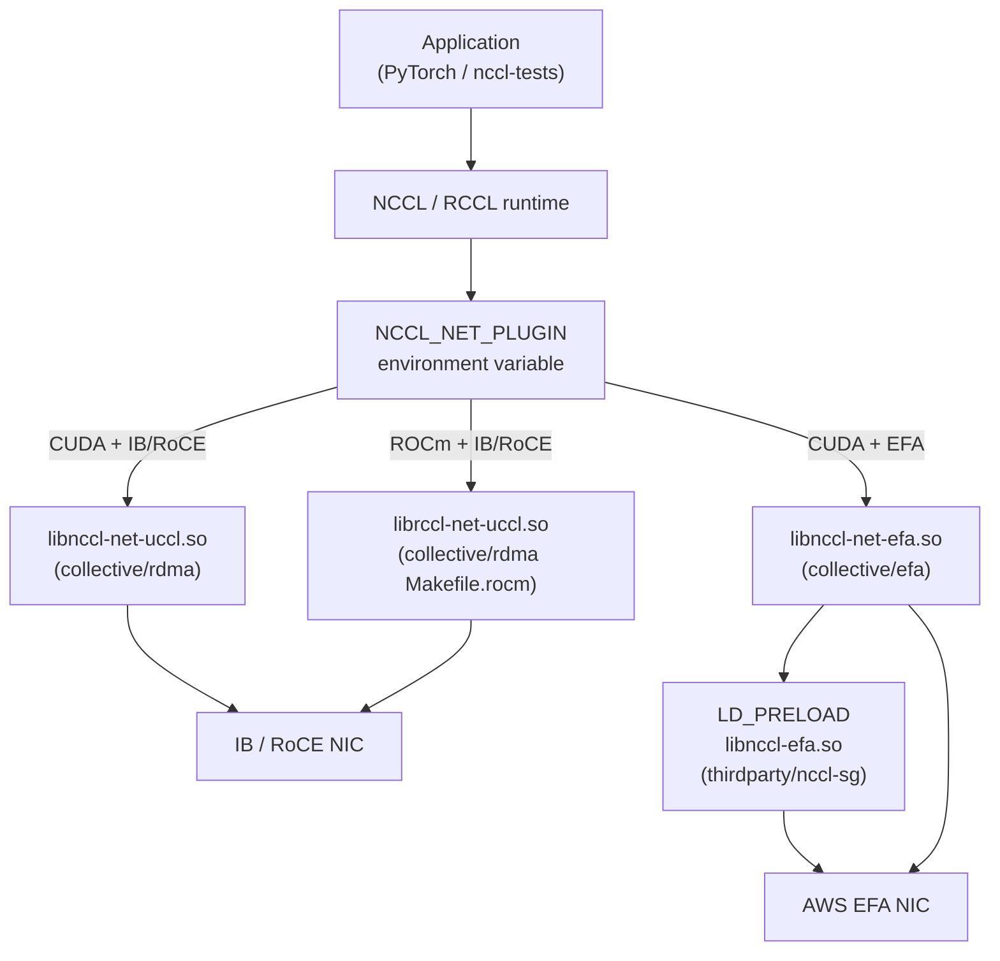
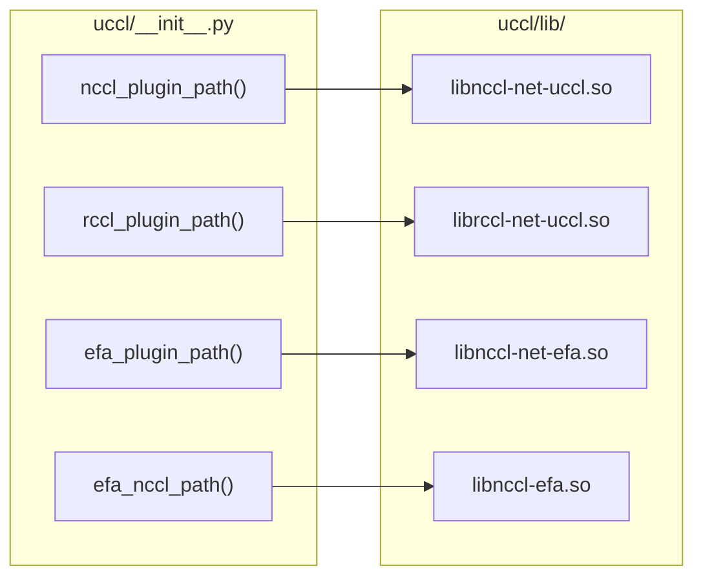
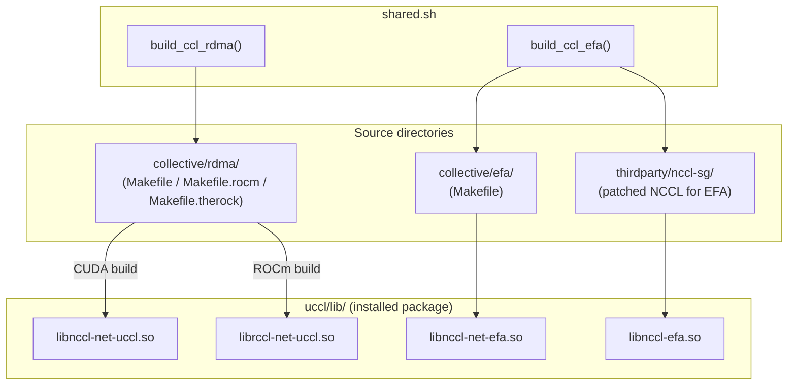

<!-- source: DeepWiki mcp.deepwiki.com · repo uccl-project/uccl · page 2.1 Collective Operations and Plugin Architecture · fetched 2026-11-11 -->

# Collective Operations and Plugin Architecture

<details>
<summary>Relevant source files</summary>

The following files were used as context for generating this wiki page:

- [.github/PULL_REQUEST_TEMPLATE.md](.github/PULL_REQUEST_TEMPLATE.md)
- [.github/workflows/uccl-build-test.yml](.github/workflows/uccl-build-test.yml)
- [README.md](README.md)
- [build.sh](build.sh)
- [collective/efa/README.md](collective/efa/README.md)
- [collective/rdma/README.md](collective/rdma/README.md)
- [docs/wheels.md](docs/wheels.md)
- [ep/Makefile](ep/Makefile)
- [ep/README.md](ep/README.md)
- [ep/bench/run_ep.sh](ep/bench/run_ep.sh)
- [ep/setup.py](ep/setup.py)
- [ep/src/common.cpp](ep/src/common.cpp)
- [p2p/Makefile.rocm](p2p/Makefile.rocm)
- [p2p/Makefile.therock](p2p/Makefile.therock)
- [p2p/benchmarks/benchmark_ray_p2p.py](p2p/benchmarks/benchmark_ray_p2p.py)
- [p2p/engine_api.cc](p2p/engine_api.cc)
- [scripts/efa_monitor.sh](scripts/efa_monitor.sh)
- [scripts/node_ips/amd.txt](scripts/node_ips/amd.txt)
- [setup.py](setup.py)
- [shared.sh](shared.sh)
- [uccl/.gitignore](uccl/.gitignore)
- [uccl/__init__.py](uccl/__init__.py)

</details>


## Purpose and Scope

This page covers how UCCL-collective integrates with the NCCL and RCCL runtime through the net plugin interface, which collective operations are exposed, and the mechanism by which plugin libraries are located and loaded at runtime. It also documents the Python path-helper API and EFA host detection logic.

For RDMA/InfiniBand backend internals, see [2.2](#2.2). For EFA-specific configuration, see [2.3](#2.3). For AF_XDP, see [2.4](#2.4). For step-by-step integration instructions in a live application, see [7.1](#7.1).

---

## NCCL/RCCL Net Plugin Interface

Both NCCL (NVIDIA) and RCCL (AMD) expose a _net plugin_ interface: a dynamically-loaded shared library that NCCL calls for all actual data transfer. When `NCCL_NET_PLUGIN` is set, NCCL bypasses its built-in transport and delegates send/receive operations to the named library. UCCL-collective uses this mechanism exclusively — no changes to application code are needed.

UCCL produces four distinct shared library files, placed in `uccl/lib/` inside the installed Python package:

| Library file | Transport backend | GPU stack |
|---|---|---|
| `libnccl-net-uccl.so` | InfiniBand / RoCE | CUDA (NVIDIA) |
| `librccl-net-uccl.so` | InfiniBand / RoCE | ROCm (AMD) |
| `libnccl-net-efa.so` | AWS EFA | CUDA |
| `libnccl-efa.so` | Modified NCCL for EFA (`thirdparty/nccl-sg`) | CUDA |

These files are copied into `uccl/lib/` by `build_ccl_rdma()` and `build_ccl_efa()` in `shared.sh`.

Sources: [shared.sh:26-97](), [uccl/__init__.py:32-53](), [collective/rdma/README.md:1-30](), [collective/efa/README.md:74-83]()

---

## Plugin Loading

**Plugin loading flow (diagram):**



Sources: [README.md:105-116](), [collective/efa/README.md:74-83]()

### Loading for IB/RoCE (CUDA)

```bash
NCCL_NET_PLUGIN=`python -c "import uccl; print(uccl.nccl_plugin_path())"`
```

### Loading for IB/RoCE (ROCm)

```bash
NCCL_NET_PLUGIN=`python -c "import uccl; print(uccl.rccl_plugin_path())"`
```

### Loading for AWS EFA

The EFA backend requires two libraries: a patched NCCL (`libnccl-efa.so`) that understands EFA QP semantics, and the actual plugin (`libnccl-net-efa.so`).

```bash
LD_PRELOAD=`python -c "import uccl; print(uccl.efa_nccl_path())"`
NCCL_NET_PLUGIN=`python -c "import uccl; print(uccl.efa_plugin_path())"`
NCCL_PROTO=Simple
```

> `NCCL_PROTO=Simple` is required for EFA. The `LL` and `LL128` protocols are not yet supported.

Sources: [README.md:105-116](), [collective/efa/README.md:74-83]()

---

## Python Path Helper API

The `uccl` package exposes four functions in `uccl/__init__.py` that return the absolute path to each plugin shared library. All four resolve paths relative to the installed package location using `os.path.dirname(os.path.abspath(__file__))`.

**Python API to library file mapping (diagram):**



| Function | Returns | Built by |
|---|---|---|
| `nccl_plugin_path()` | `uccl/lib/libnccl-net-uccl.so` | `build_ccl_rdma()` in `shared.sh` |
| `rccl_plugin_path()` | `uccl/lib/librccl-net-uccl.so` | `build_ccl_rdma()` in `shared.sh` |
| `efa_plugin_path()` | `uccl/lib/libnccl-net-efa.so` | `build_ccl_efa()` in `shared.sh` |
| `efa_nccl_path()` | `uccl/lib/libnccl-efa.so` | `build_ccl_efa()` in `shared.sh` |

Sources: [uccl/__init__.py:32-53](), [shared.sh:26-97]()

---

## EFA Host Detection

At import time, `uccl/__init__.py` calls `has_efa()`, which inspects `/sys/class/infiniband/` and returns `True` if any subdirectory name contains the string `rdmap` (the naming convention for EFA RDMA interfaces).

```python
# uccl/__init__.py
def has_efa():
    infiniband = Path("/sys/class/infiniband/")
    try:
        if infiniband.is_dir():
            return any("rdmap" in child.name for child in infiniband.iterdir())
        return False
    except (OSError, PermissionError):
        return False
is_efa = has_efa()
```

The result is stored in the module-level `is_efa` boolean. When `is_efa` is `True`, the automatic imports of `uccl.p2p` and `uccl.collective` are skipped [uccl/__init__.py:22-27](), because EFA hosts require the full EFA setup path and the P2P extension is not loaded in that configuration.

Sources: [uccl/__init__.py:12-27]()

---

## Supported Collective Operations

UCCL-collective acts as a transport-layer replacement for the NCCL/RCCL plugin interface. The collective algorithm selection (ring-allreduce, tree-allreduce, etc.) remains NCCL's responsibility. UCCL handles only the actual data movement between ranks.

Operations exercising the UCCL transport include:

| Operation | Notes |
|---|---|
| `AllReduce` | Primary target; validated via `run_nccl_test.sh` / `run_rccl_test.sh` |
| `AllToAll` | Tested via nccl-tests with the `--op alltoall` flag |
| Other NCCL collectives | Pass through transparently as NCCL controls algorithm selection |

Performance highlights from the README (no code changes required in the application):

- **2.5×** improvement over NCCL for AllReduce on 6× HGX H100 servers with 8×400G RoCE NICs
- **3.7×** improvement over NCCL on 2× AWS `g4dn.8xlarge` with 50G ENA NICs

Sources: [README.md:29-48](), [collective/rdma/README.md:23-28]()

---

## Transport Layer Design

UCCL-collective's transport design differs from the stock NCCL transport in a few key ways:

**Packet spraying.** Where NCCL uses one or a small number of network paths for a large transfer, UCCL fans traffic across many QPs simultaneously. This avoids concentrating load on a single congested path.

| Feature | Default value (NVIDIA) | Default value (AMD) |
|---|---|---|
| Paths per engine (`UCCL_PORT_ENTROPY`) | 32 | 256 |
| Engines per device (`UCCL_NUM_ENGINES`) | 4 | 1 |
| Max chunk per WQE (`UCCL_CHUNK_SIZE_KB`) | 64 KB | 128 KB |
| Connection mode (`UCCL_RCMODE`) | 0 (UC) | 1 (RC for Broadcom) |

Additional transport capabilities:
- Latency-based and receiver-driven congestion control
- Selective repeat for loss recovery
- Both Unreliable Connection (UC) and Reliable Connection (RC) modes

Sources: [collective/rdma/README.md:162-181]()

---

## Build Artifacts and Source Directories

**How plugin .so files are built and placed (diagram):**



The `build_ccl_rdma()` function in `shared.sh` selects the correct Makefile variant based on `$TARGET`:

- `cuda*` → `collective/rdma/Makefile`, produces `libnccl-net-uccl.so`
- `rocm*` → `collective/rdma/Makefile.rocm`, produces `librccl-net-uccl.so`
- `therock` → `collective/rdma/Makefile.therock`, produces `librccl-net-uccl.so`

The `build_ccl_efa()` function additionally builds `thirdparty/nccl-sg` (a patched NCCL) and copies its `libnccl.so` as `libnccl-efa.so` [shared.sh:69-97]().

Sources: [shared.sh:26-97](), [build.sh:272-288]()

---

## Key Environment Variables

These variables are read by the UCCL plugin at startup via the `UCCL_PARAM()` macro in the collective/rdma C++ source. They do not require recompilation.

| Variable | Description | Default |
|---|---|---|
| `NCCL_NET_PLUGIN` | Path to the UCCL plugin `.so`; set by the user | — |
| `UCCL_IB_HCA` | Restrict to specific IB device names | auto-detect |
| `UCCL_SOCKET_IFNAME` | Control NIC for bootstrapping | auto-detect |
| `UCCL_NUM_ENGINES` | Engines per GPU device | 4 (NVIDIA) / 1 (AMD) |
| `UCCL_PORT_ENTROPY` | QP paths per engine (packet spraying width) | 32 (NVIDIA) / 256 (AMD) |
| `UCCL_CHUNK_SIZE_KB` | Max data per work queue entry | 64 (NVIDIA) / 128 (AMD) |
| `UCCL_RCMODE` | Use RC QPs instead of UC | 1 (Broadcom), 0 (others) |
| `UCCL_PIN_TO_NUMA` | Pin proxy threads to GPU-local NUMA node | 1 |
| `NCCL_PROTO` | NCCL protocol (EFA requires `Simple`) | — |

For `UCCL_IB_GID_INDEX` used in EP and P2P contexts, see [7.3](#7.3).

Sources: [collective/rdma/README.md:162-181](), [collective/efa/README.md:74-83]()

---

