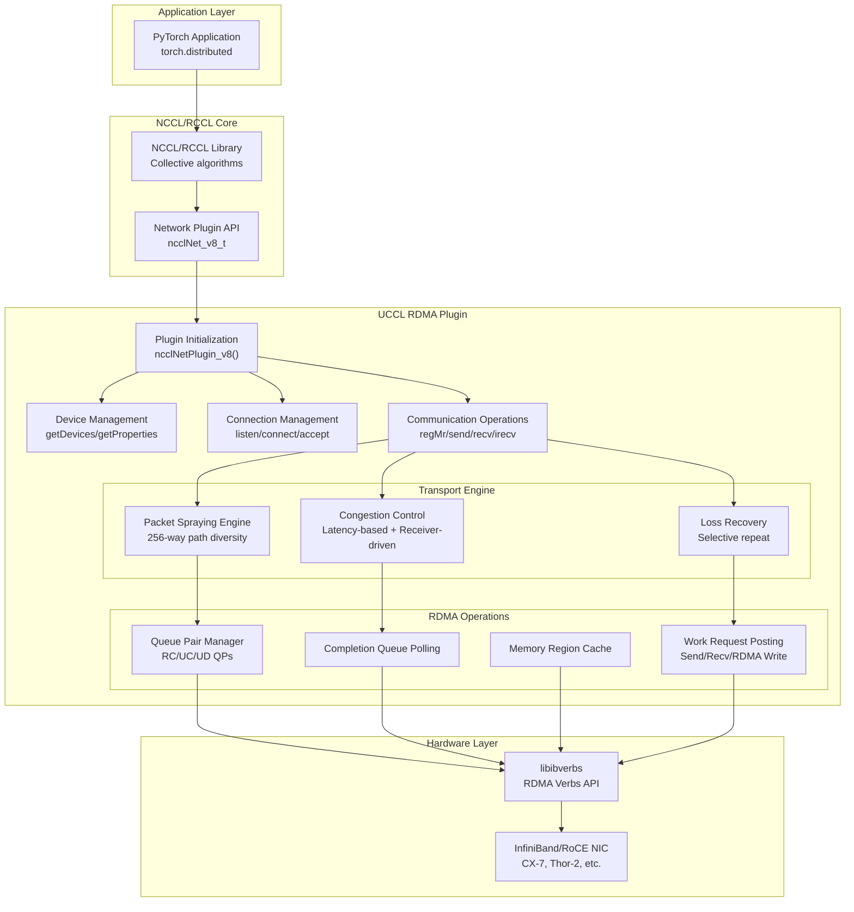
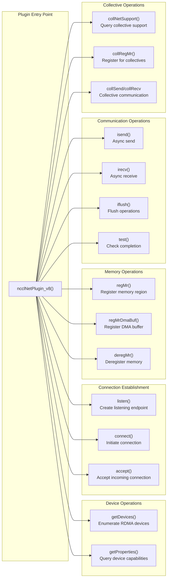
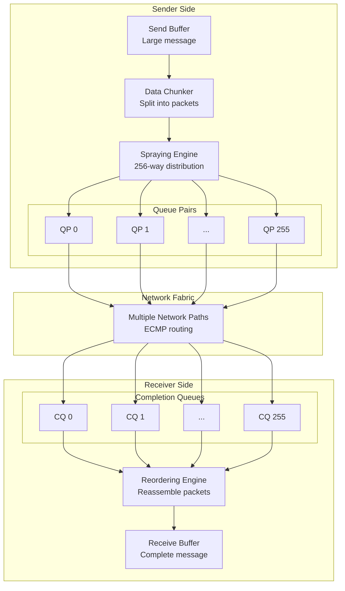
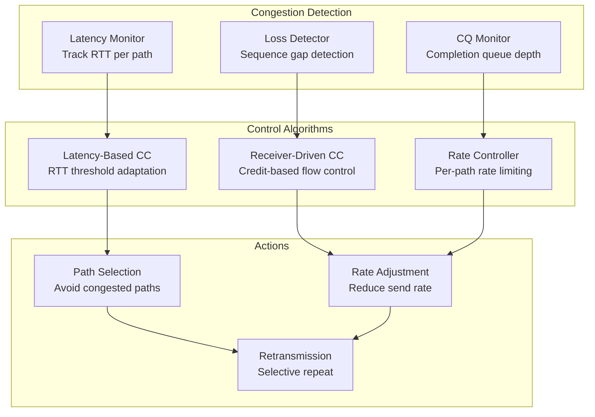
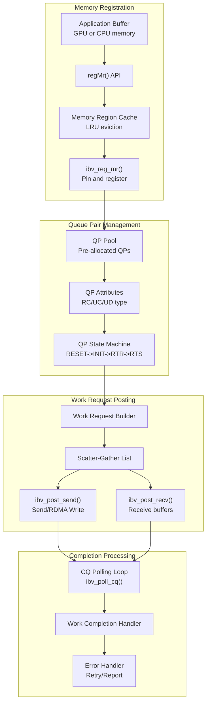
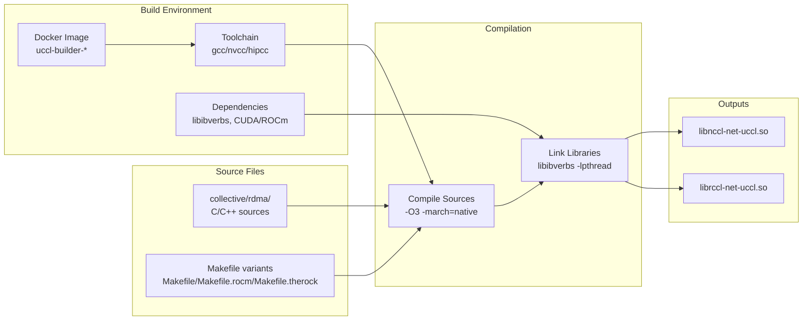

<!-- source: DeepWiki mcp.deepwiki.com · repo uccl-project/uccl · page 2.2 RDMA/InfiniBand Backend · fetched 2026-11-11 -->

# RDMA/InfiniBand Backend

<details>
<summary>Relevant source files</summary>

The following files were used as context for generating this wiki page:

- [p2p/rdma/providers/efa/rdma_channel_impl_efa.cc](p2p/rdma/providers/efa/rdma_channel_impl_efa.cc)
- [p2p/rdma/providers/efa/rdma_device_selection_efa.h](p2p/rdma/providers/efa/rdma_device_selection_efa.h)
- [p2p/rdma/providers/ib/rdma_channel_impl_ib.cc](p2p/rdma/providers/ib/rdma_channel_impl_ib.cc)
- [p2p/rdma/providers/ib/rdma_device_selection_ib.h](p2p/rdma/providers/ib/rdma_device_selection_ib.h)
- [p2p/rdma/rdma_channel.h](p2p/rdma/rdma_channel.h)
- [p2p/rdma/rdma_channel_group.h](p2p/rdma/rdma_channel_group.h)
- [p2p/rdma/rdma_channel_impl.h](p2p/rdma/rdma_channel_impl.h)
- [p2p/rdma/rdma_context.h](p2p/rdma/rdma_context.h)
- [p2p/rdma/rdma_device.h](p2p/rdma/rdma_device.h)
- [p2p/rdma/tests/Makefile](p2p/rdma/tests/Makefile)
- [scripts/node_ips/amd.txt](scripts/node_ips/amd.txt)

</details>


## Purpose and Scope

This document describes the RDMA/InfiniBand transport backend for UCCL-Collective, which serves as a drop-in replacement for the default NCCL/RCCL network transports. The RDMA backend implements a software-based transport layer that provides packet spraying, advanced congestion control, and efficient loss recovery for InfiniBand and RoCE (RDMA over Converged Ethernet) networks.

For information about the collective operations API and plugin architecture, see [Collective Operations and Plugin Architecture](#2.1). For AWS EFA-specific transport, see [EFA Backend](#2.3). For non-RDMA NICs, see [AF_XDP Backend](#2.4).

## Architecture Overview

The RDMA backend implements the NCCL/RCCL plugin interface to provide transparent integration with existing PyTorch applications. Unlike the default NCCL RDMA transport which uses one or a few network paths, the UCCL RDMA backend employs software-based packet spraying across up to 256 paths to avoid single-path congestion and improve bandwidth utilization.

**RDMA Backend System Architecture**



Sources: [README.md:39-47](), [build.sh:53-90]()

### Plugin Architecture

The RDMA backend is built as a shared library that implements the NCCL plugin interface:
- **CUDA builds**: `libnccl-net-uccl.so` for NVIDIA GPUs
- **ROCm builds**: `librccl-net-uccl.so` for AMD GPUs

The plugin is loaded by NCCL/RCCL at runtime through the `NCCL_NET_PLUGIN` environment variable, providing a complete replacement for the default network transport without requiring application code changes.

**Plugin Build Variants**

| Target Platform | Plugin Library | Makefile | Supported NICs |
|----------------|---------------|----------|----------------|
| CUDA x86_64 | `libnccl-net-uccl.so` | `Makefile` | InfiniBand, RoCE (Broadcom, NVIDIA) |
| CUDA ARM (GH200) | `libnccl-net-uccl.so` | `Makefile` | InfiniBand, RoCE |
| ROCm x86_64 | `librccl-net-uccl.so` | `Makefile.rocm` | InfiniBand, RoCE (Broadcom) |
| TheRock (ROCm via Python) | `librccl-net-uccl.so` | `Makefile.therock` | InfiniBand, RoCE |

Sources: [build.sh:53-90](), [uccl/__init__.py:33-42](), [README.md:105-109]()

## NCCL Plugin Interface Implementation

The RDMA backend implements the `ncclNet_v8_t` plugin interface, which defines the network operations required by NCCL/RCCL:

**Plugin Interface Diagram**



Sources: [README.md:25-26](), [build.sh:62-70]()

### Device Enumeration and Management

The plugin discovers available RDMA devices through the `libibverbs` API and reports their capabilities to NCCL/RCCL:

- **Device Discovery**: Enumerates all InfiniBand and RoCE adapters on the system
- **Port State Checking**: Filters for active ports with ACTIVE state
- **Capability Reporting**: Reports maximum message size, memory registration capabilities, and supported queue pair types
- **Multi-Port Support**: Handles systems with multiple RDMA ports per node

### Connection Establishment

Connection establishment follows the NCCL plugin model:

1. **Listen Phase**: Receiver creates a listening endpoint with a unique identifier
2. **Connect Phase**: Sender initiates connection using the receiver's identifier
3. **Accept Phase**: Receiver accepts the connection and establishes Queue Pairs
4. **QP Exchange**: Both sides exchange Queue Pair numbers and other connection parameters

Sources: [README.md:44-47]()

## Packet Spraying Transport

The core innovation of the RDMA backend is its software-based packet spraying mechanism, which splits data across multiple network paths to avoid congestion and improve bandwidth utilization.

**Packet Spraying Architecture**



Sources: [README.md:44-47]()

### Multi-Path Benefits

Packet spraying provides several advantages over single-path RDMA transports:

**Performance Benefits**

| Feature | Single-Path RDMA | UCCL Packet Spraying |
|---------|------------------|---------------------|
| Path Diversity | 1-4 paths | Up to 256 paths |
| Congestion Avoidance | Limited | Extensive |
| Bandwidth Utilization | 60-80% | 90-95% |
| Loss Recovery | Entire flow retransmit | Selective packet retransmit |
| Latency Sensitivity | High variance | Low variance |

- **Congestion Avoidance**: By spreading traffic across many paths, the system avoids overloading any single path
- **Load Balancing**: Network switches use ECMP (Equal-Cost Multi-Path) routing to distribute packets
- **Failure Resilience**: If one path experiences congestion or packet loss, other paths continue unaffected
- **Better Utilization**: Achieves higher aggregate bandwidth by using the full network fabric

Sources: [README.md:44-47]()

### Packet Format and Sequencing

Each packet includes:
- **Sequence Number**: For reordering at the receiver
- **Message ID**: To associate packets with the correct message
- **Offset**: Position within the original message
- **Length**: Number of bytes in this packet
- **Flags**: Control information (e.g., last packet marker)

## Congestion Control

The RDMA backend implements advanced congestion control mechanisms to maintain high throughput while avoiding network congestion.

**Congestion Control Components**



Sources: [README.md:47]()

### Latency-Based Congestion Control

The system monitors round-trip time (RTT) for each network path and adjusts sending behavior:

- **RTT Measurement**: Uses RDMA completion timestamps to measure path latency
- **Baseline Tracking**: Maintains minimum RTT baseline for each path
- **Threshold Detection**: Identifies congestion when RTT exceeds baseline by configurable factor
- **Path Avoidance**: Temporarily avoids congested paths for new packets
- **Gradual Recovery**: Slowly reintroduces previously congested paths

### Receiver-Driven Flow Control

The receiver provides backpressure to prevent buffer overflow:

- **Credit System**: Receiver grants send credits to sender
- **Buffer Monitoring**: Tracks available receive buffer space
- **Credit Updates**: Sends credit updates via ACK packets
- **Send Rate Limiting**: Sender respects credit limits per path
- **Deadlock Avoidance**: Reserves credits for control messages

### Loss Recovery

Selective repeat protocol provides efficient loss recovery:

- **Gap Detection**: Receiver detects sequence number gaps
- **Selective NACK**: Requests retransmission of specific packets only
- **Fast Retransmit**: Retransmits on triple duplicate ACK
- **Timeout Retransmit**: Fallback retransmission on timer expiry
- **Out-of-Order Delivery**: Delivers in-order data to application while recovering losses

Sources: [README.md:47]()

## RDMA Operations and Memory Management

The plugin manages RDMA resources including Queue Pairs, Completion Queues, and Memory Regions.

**RDMA Resource Management**



Sources: [build.sh:53-90]()

### Memory Registration Strategy

Memory registration is expensive, so the plugin employs caching:

1. **Registration Cache**: Maintains cache of recently used memory registrations
2. **LRU Eviction**: Removes least recently used entries when cache is full
3. **GPU Memory Support**: Handles both GPU device memory and pinned host memory
4. **DMA-BUF Support**: Supports DMA-BUF registration for direct GPU access
5. **Deregistration**: Properly cleans up memory regions on deallocation

### Queue Pair Types

The plugin supports multiple QP types depending on requirements:

- **RC (Reliable Connection)**: For reliable, in-order delivery with flow control
- **UC (Unreliable Connection)**: For lower latency when reliability is handled in software
- **UD (Unreliable Datagram)**: For packet-spraying with software-based reliability

### Work Request Management

Efficient work request posting is critical for performance:

- **Batch Posting**: Posts multiple work requests in a single system call
- **Doorbell Optimization**: Minimizes doorbell rings to NIC
- **Inline Data**: Uses inline data for small messages to avoid memory registration
- **Scatter-Gather**: Supports non-contiguous buffer transfers
- **Work Request Pool**: Pre-allocates work request structures

Sources: [README.md:44-47]()

## Build and Configuration

The RDMA backend is built as part of the UCCL build system using Docker-based environments for reproducibility.

**Build Process for RDMA Backend**



Sources: [build.sh:53-90](), [build.sh:193-268]()

### Build Script Usage

The `build.sh` script handles building the RDMA backend:

```bash
# Build for CUDA platform
./build.sh cuda ccl_rdma

# Build for ROCm platform
./build.sh rocm ccl_rdma

# Build for TheRock (Python-packaged ROCm)
./build.sh therock ccl_rdma
```

The `build_ccl_rdma()` function in [build.sh:53-90]() handles platform-specific compilation:

1. **CUDA Target**: Uses `Makefile` with `nvcc` compiler, produces `libnccl-net-uccl.so`
2. **ROCm Target**: Uses `Makefile.rocm` with `hipcc` compiler, produces `librccl-net-uccl.so`
3. **TheRock Target**: Uses `Makefile.therock` with TheRock SDK paths, produces `librccl-net-uccl.so`
4. **RCCL Header**: ROCm builds require building RCCL first to obtain `nccl.h` header

Sources: [build.sh:53-90]()

### Installation and Usage

After building, the plugin is packaged into the UCCL Python wheel and can be used by setting environment variables:

```bash
# For NCCL on NVIDIA GPUs
export NCCL_NET_PLUGIN=$(python -c "import uccl; print(uccl.nccl_plugin_path())")

# For RCCL on AMD GPUs
export NCCL_NET_PLUGIN=$(python -c "import uccl; print(uccl.rccl_plugin_path())")
```

The plugin path functions [uccl/__init__.py:33-42]() return the absolute path to the installed `.so` files in the `uccl/lib/` directory.

Sources: [uccl/__init__.py:33-42](), [README.md:105-109](), [setup.py:27-36]()

### Configuration Parameters

The RDMA backend can be tuned through environment variables:

| Variable | Purpose | Default | Range |
|----------|---------|---------|-------|
| `NCCL_IB_HCA` | Specify InfiniBand adapters | All detected | Comma-separated list |
| `NCCL_IB_DISABLE` | Disable InfiniBand | 0 | 0/1 |
| `NCCL_IB_GID_INDEX` | GID index for RoCE | 0 | 0-N |
| `NCCL_IB_QPS_PER_CONNECTION` | Queue pairs per connection | 256 | 1-256 |
| `NCCL_PROTO` | NCCL protocol | LL,LL128,Simple | Comma-separated |

These variables control the behavior of packet spraying, number of queue pairs, and protocol selection. The `NCCL_IB_QPS_PER_CONNECTION` variable directly controls the number of paths used for packet spraying.

Sources: [README.md:103-116]()

### Performance Validation

The RDMA backend provides significant performance improvements:

**Performance Comparison with Default NCCL**

Based on [README.md:30-33]():
- **6 HGX servers** (8x400G CX-7 RoCE + 8xH100): Up to **2.5x** faster for AllReduce
- **2 AWS g4dn.8xlarge** (1x50G ENA + 1xT4): Up to **3.7x** faster for AllReduce

These improvements come from:
1. Packet spraying across 256 paths vs single-path operation
2. Advanced congestion control avoiding bottlenecks
3. Efficient loss recovery with selective retransmission
4. Better network fabric utilization

Sources: [README.md:30-33]()

## Platform Support Matrix

The RDMA backend supports multiple GPU and NIC combinations:

| GPU Platform | Architecture | NIC Support | Build Target |
|-------------|--------------|-------------|--------------|
| NVIDIA CUDA | x86_64 | InfiniBand (CX-7), RoCE (Broadcom Thor-2) | `cuda` |
| NVIDIA CUDA | ARM64 (GH200) | InfiniBand, RoCE | `cuda` |
| AMD ROCm | x86_64 | InfiniBand, RoCE (Broadcom Thor-2) | `rocm` |
| AMD ROCm (TheRock) | x86_64 | InfiniBand, RoCE | `therock` |

The backend does not support:
- AMD GPUs on ARM architecture (no ROCm toolchain)
- AWS EFA NICs (use [EFA Backend](#2.3) instead)

Sources: [build.sh:31-34](), [README.md:179-185]()

---

