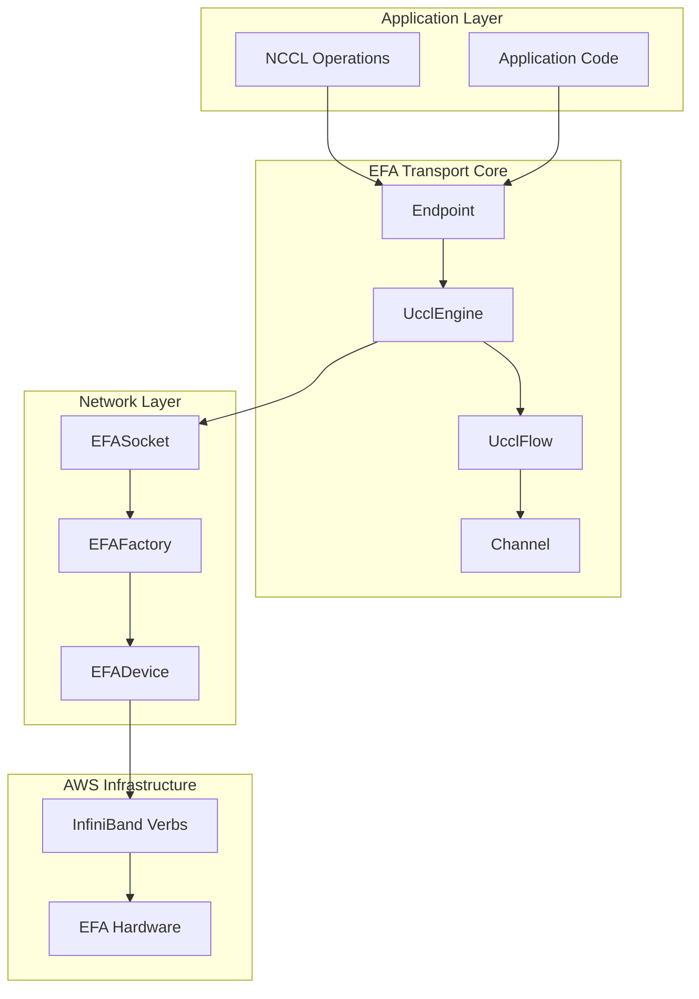
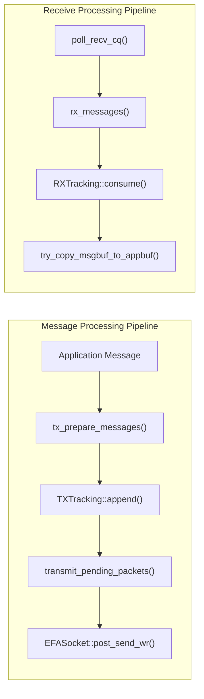
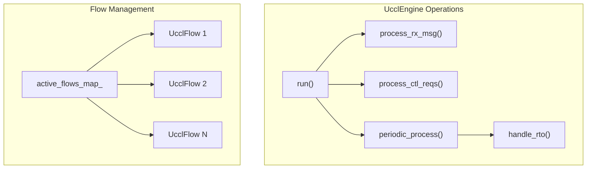
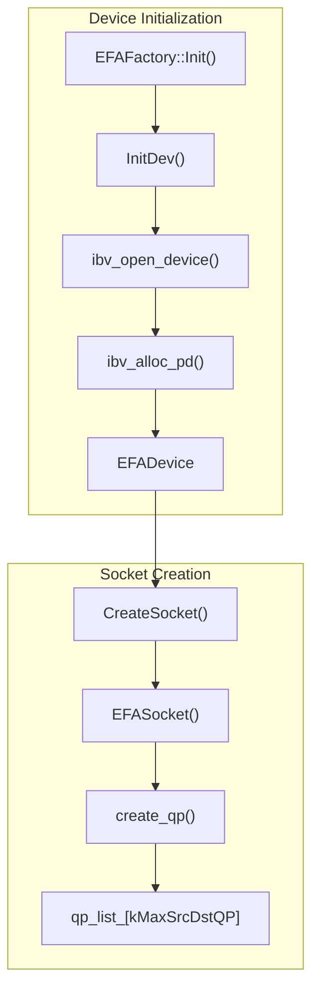
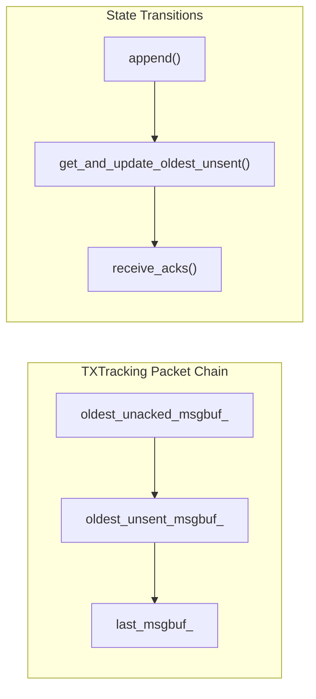
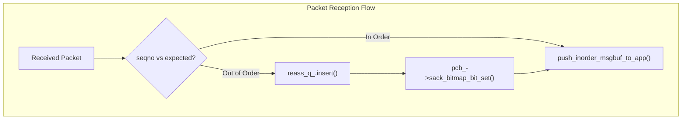
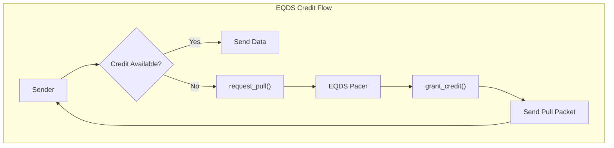
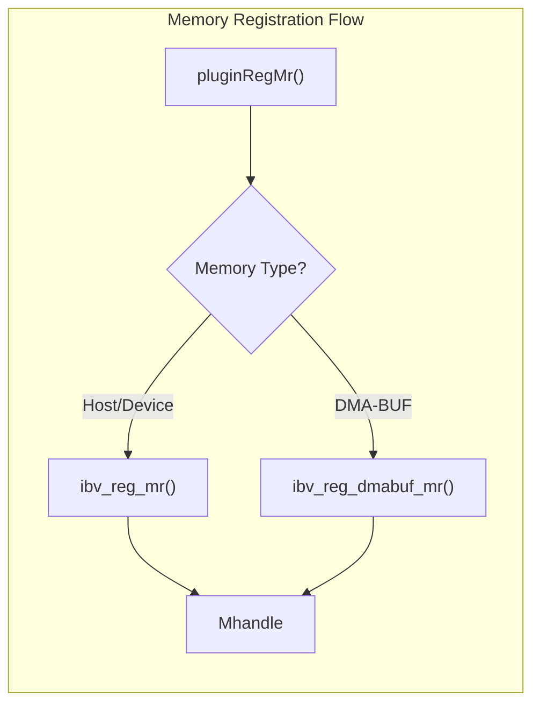
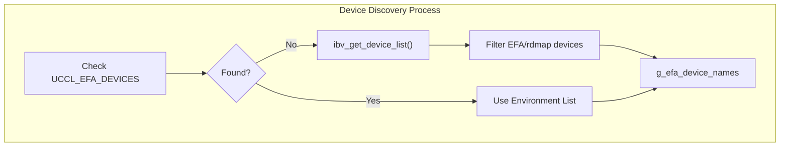

<!-- source: DeepWiki mcp.deepwiki.com · repo uccl-project/uccl · page 2.3 EFA Backend · fetched 2026-11-11 -->

# EFA Transport

Relevant source files

The following files were used as context for generating this wiki page:

- [.github/PULL_REQUEST_TEMPLATE.md](.github/PULL_REQUEST_TEMPLATE.md)
- [.github/workflows/uccl-build-test.yml](.github/workflows/uccl-build-test.yml)
- [README.md](README.md)
- [build.sh](build.sh)
- [collective/efa/README.md](collective/efa/README.md)
- [collective/rdma/README.md](collective/rdma/README.md)
- [docs/wheels.md](docs/wheels.md)
- [ep/Makefile](ep/Makefile)
- [ep/README.md](ep/README.md)
- [ep/bench/run_ep.sh](ep/bench/run_ep.sh)
- [ep/setup.py](ep/setup.py)
- [ep/src/common.cpp](ep/src/common.cpp)
- [scripts/efa_monitor.sh](scripts/efa_monitor.sh)
- [scripts/node_ips/amd.txt](scripts/node_ips/amd.txt)

## Purpose and Scope

The EFA Transport provides a high-performance network transport implementation for AWS Elastic Fabric Adapter (EFA) hardware within the UCCL communication library. This transport enables reliable UDP communication with custom congestion control algorithms and integrates with NCCL for collective operations in distributed machine learning workloads.

For RDMA transport implementation, see [RDMA Transport](#2.1). For AF_XDP transport, see [AF_XDP Transport](#2.3).

## Architecture Overview

The EFA Transport implements a multi-layered architecture built on AWS EFA hardware capabilities, providing application-level reliability over UDP with sophisticated congestion control.

### High-Level System Architecture

Sources: [efa/transport.h:834-900](), [efa/util_efa.h:276-306]()

### Component Interaction Flow

Sources: [efa/transport.cc:602-654](), [efa/transport.cc:514-600]()

## Core Components

### Endpoint Class

The `Endpoint` class serves as the primary application-facing interface, managing multiple engines and providing connection establishment capabilities.

| Component | Purpose | Key Methods |
|-----------|---------|-------------|
| `engine_vec_` | Collection of UcclEngine instances | `initialize_engine_by_gpu_idx()` |
| `channel_vec_` | Communication channels per engine | `uccl_connect()`, `uccl_accept()` |
| `ctx_pool_` | Thread-safe polling context pool | `uccl_send_async()`, `uccl_recv_async()` |

Sources: [efa/transport.h:834-900]()

### UcclEngine Class

The `UcclEngine` handles packet processing, flow management, and periodic maintenance tasks.

Sources: [efa/transport.h:721-823](), [efa/transport.cc:757-773]()

### UcclFlow Class

Individual connections are managed by `UcclFlow` instances, which handle reliable transmission, congestion control, and packet ordering.

| Component | Purpose | Implementation |
|-----------|---------|----------------|
| `TXTracking tx_tracking_` | Outbound packet management | Maintains unacked/unsent packet chains |
| `RXTracking rx_tracking_` | Inbound packet reassembly | Out-of-order packet handling with SACK |
| `swift::Pcb pcb_` | Protocol control block | Sequence numbers, RTO timers |
| Congestion Control | Rate limiting | `CubicCtl`, `TimelyCtl`, `EQDSCC` |

Sources: [efa/transport.h:392-715]()

## Socket and Device Management

### EFAFactory and EFADevice

The factory pattern manages EFA device initialization and socket creation with proper resource allocation.

Sources: [efa/util_efa.cc:108-258](), [efa/util_efa.cc:309-392]()

### Queue Pair Management

EFA transport uses multiple queue pairs for parallel data transmission and control traffic separation.

| QP Type | Configuration | Purpose |
|---------|---------------|---------|
| Data QPs | `qp_list_[kMaxSrcDstQP]` | Primary data transmission |
| Control QPs | `ctrl_qp_list_[kMaxSrcDstQPCtrl]` | ACK and control packets |
| Credit QPs | Via `CreditQPContext` | EQDS congestion control |

Sources: [efa/util_efa.h:315-353](), [efa/transport_config.h:95-115]()

## Flow Management and Reliability

### Transmission Tracking

The `TXTracking` class manages outbound packet state with three key pointers for efficient packet lifecycle management.

Sources: [efa/transport.h:202-289](), [efa/transport.cc:9-51]()

### Reception and Reassembly

The `RXTracking` class handles out-of-order packet delivery using sequence number comparisons and SACK bitmaps.

Sources: [efa/transport.cc:139-227]()

## Congestion Control Integration

### Multi-Algorithm Support

EFA transport supports multiple congestion control algorithms configured at compile time through `transport_config.h`.

| Algorithm | Type | Configuration |
|-----------|------|---------------|
| Cubic | Loss-based | `kSenderCCType = SenderCCType::kCubic` |
| Timely | Delay-based | `kSenderCCType = SenderCCType::kTimely` |
| EQDS | Receiver-driven | `kReceiverCCType = ReceiverCCType::kEQDS` |

Sources: [efa/transport_config.h:15-31]()

### EQDS Implementation

The receiver-driven EQDS congestion control uses credit-based flow control with dedicated packet types.

Sources: [efa/eqds.h:74-238](), [efa/eqds.cc:89-137]()

## NCCL Plugin Integration

### Plugin Architecture

The NCCL plugin (`nccl_plugin.cc`) exposes standard NCCL network interface functions while using EFA transport internally.

| NCCL Function | EFA Implementation | Purpose |
|---------------|-------------------|---------|
| `pluginListen()` | `ep->uccl_listen()` | Connection establishment |
| `pluginConnect()` | `ep->uccl_connect()` | Outbound connections |
| `pluginIsend()` | `ep->uccl_send_async()` | Asynchronous send |
| `pluginIrecv()` | `ep->uccl_recv_multi_async()` | Asynchronous receive |

Sources: [efa/nccl_plugin.cc:176-224](), [efa/nccl_plugin.cc:390-443]()

### Memory Registration

The plugin handles both regular and DMA-BUF memory registration for GPU memory access.

Sources: [efa/nccl_plugin.cc:346-387]()

## Configuration and Tuning

### Key Configuration Parameters

The `transport_config.h` file defines critical system parameters for performance tuning.

| Parameter | Default | Purpose |
|-----------|---------|---------|
| `kNumVdevices` | 8 | Virtual EFA devices/GPUs |
| `kNumEnginesPerVdev` | 2 | Engines per virtual device |
| `EFA_MTU` | 9000 | Maximum transmission unit |
| `kMaxDstQP` | 26 | Destination queue pairs per source |
| `kLinkBandwidth` | 100 Gbps | Expected link capacity |

Sources: [efa/transport_config.h:35-50](), [efa/transport_config.h:95-106]()

### Device Discovery

EFA devices are automatically discovered through environment variables or hardware enumeration.

Sources: [efa/util_efa.cc:31-93]()

---

